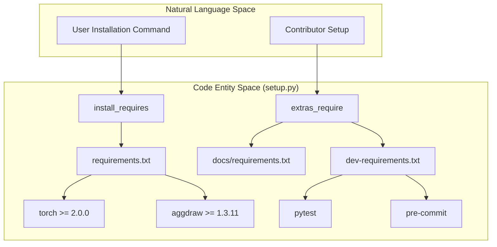
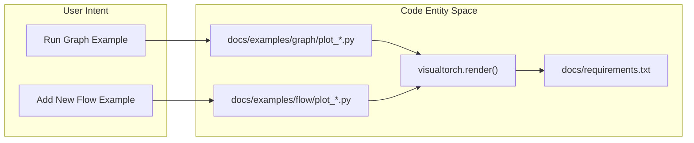

<!-- source: DeepWiki mcp.deepwiki.com · repo willyfh/visualtorch · page 1.1 Getting Started: Installation & Configuration · fetched 2026-10-21 -->

# Getting Started: Installation & Configuration

<details>
<summary>Relevant source files</summary>

The following files were used as context for generating this wiki page:

- [CITATION.cff](CITATION.cff)
- [CONTRIBUTING.md](CONTRIBUTING.md)
- [dev-requirements.txt](dev-requirements.txt)
- [docs/source/_static/images/logos/fire-icon.png](docs/source/_static/images/logos/fire-icon.png)
- [docs/source/markdown/developer_guides/contributing.md](docs/source/markdown/developer_guides/contributing.md)
- [docs/source/markdown/get_started/installation.md](docs/source/markdown/get_started/installation.md)
- [docs/source/snippets/install/pypi.txt](docs/source/snippets/install/pypi.txt)
- [docs/source/snippets/install/requirements.txt](docs/source/snippets/install/requirements.txt)
- [docs/source/snippets/install/source.txt](docs/source/snippets/install/source.txt)
- [requirements.txt](requirements.txt)
- [setup.py](setup.py)

</details>


This page provides a technical guide for installing and configuring VisualTorch. It covers environment requirements, dependency management, and the setup process for both end-users and contributors.

## System Requirements & Dependencies

VisualTorch is designed to work with modern Python environments and relies on several core libraries for tensor manipulation and image rasterization.

### Python Version Support
VisualTorch requires **Python >= 3.10** [setup.py:42-42](). It is officially tested and classified for the following versions:
*   Python 3.10
*   Python 3.11
*   Python 3.12
[setup.py:34-36]()

### Runtime Dependencies
The core functionality depends on the following packages, which are automatically resolved during a standard installation:

| Dependency | Minimum Version | Role in System |
| :--- | :--- | :--- |
| `torch` | `>= 2.0.0` | Model definition and `RecorderTensor` subclassing. |
| `numpy` | `>= 1.18.1` | Data handling and shape manipulations. |
| `pillow` | `>= 10.0.0` | Image canvas management and file I/O. |
| `aggdraw` | `>= 1.3.11` | High-performance anti-aliased drawing primitives. |

**Sources:** [requirements.txt:1-4](), [docs/source/snippets/install/requirements.txt:1-4](), [setup.py:40-40]()

---

## Installation Methods

### 1. Installation via PyPI (Recommended)
For general use, the stable release should be installed via `pip`. 
*Note: Version 1.1.0 is the current major release [setup.py:24-24](). Users of legacy APIs (v0.2.5 or older) are encouraged to upgrade due to significant architectural improvements [docs/source/markdown/get_started/installation.md:33-36]().*

```bash
pip install visualtorch==1.1.0
```
**Sources:** [docs/source/snippets/install/pypi.txt:1-1]()

### 2. Installation from Source
To access the latest features or bug fixes before they are released to PyPI, install directly from the GitHub repository:

```bash
pip install git+https://github.com/willyfh/visualtorch
```
**Sources:** [docs/source/snippets/install/source.txt:1-1]()

---

## Developer Configuration

For contributors looking to modify the codebase, run tests, or build documentation, a specialized environment is required.

### Development Environment Setup
VisualTorch uses `setuptools` with `extras_require` to manage development tools [setup.py:41-41]().

1.  **Conda Environment:** It is recommended to use a clean environment [CONTRIBUTING.md:27-32]().
2.  **Editable Install:** Install the package in editable mode with the `[dev]` flag to include testing and documentation dependencies.
    ```bash
    pip install -e .[dev]
    ```
3.  **Pre-commit Hooks:** VisualTorch uses `pre-commit` to enforce code quality via `ruff` and other linters [CONTRIBUTING.md:40-44]().
    ```bash
    pre-commit install
    ```

### Dependency Graph: Installation to Code Entities
The following diagram illustrates how the installation configuration maps to specific project files and the internal requirements system.

**Installation Logic Mapping**

**Sources:** [setup.py:40-41](), [requirements.txt:1-4](), [dev-requirements.txt:1-3](), [CONTRIBUTING.md:34-38]()

---

## Verification and Testing

After installation, the setup can be verified by running the test suite or executing the built-in examples.

### Running Tests
VisualTorch uses `pytest` for its test suite [CONTRIBUTING.md:58-58]().
```bash
pytest tests/
```

### Manual Quality Checks
To ensure the environment matches the project's linting standards (enforced by `ruff`), run the pre-commit checks manually:
```bash
pre-commit run --all-files
```
**Sources:** [CONTRIBUTING.md:62-67](), [docs/source/markdown/developer_guides/contributing.md:64-67]()

### Example Execution Flow
The following diagram bridges the user's intent to add or run an example with the internal directory structure used by the `Sphinx-Gallery` system.

**Example System Mapping**

**Sources:** [CONTRIBUTING.md:71-82](), [docs/source/markdown/developer_guides/contributing.md:54-60]()

---

