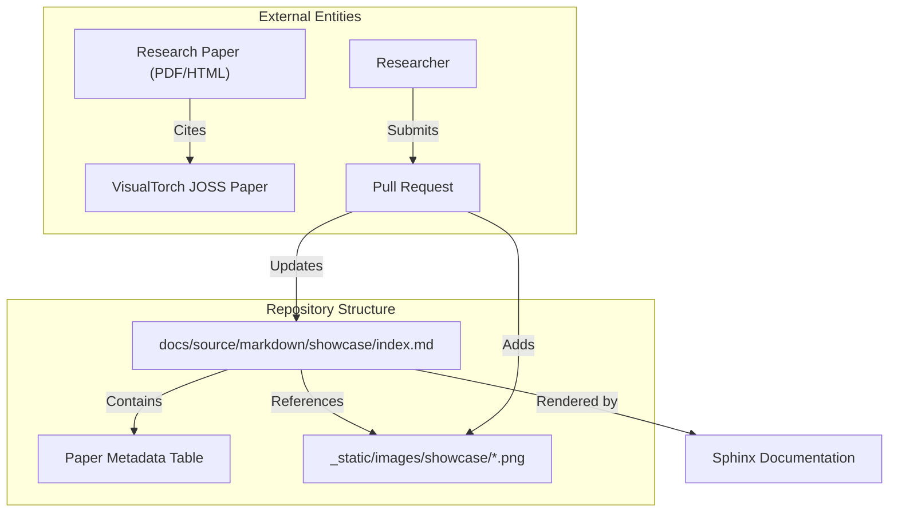

<!-- source: DeepWiki mcp.deepwiki.com · repo willyfh/visualtorch · page 1.2 Academic Context & Research Showcase · fetched 2026-10-21 -->

# Academic Context & Research Showcase

<details>
<summary>Relevant source files</summary>

The following files were used as context for generating this wiki page:

- [.pre-commit-config.yaml](.pre-commit-config.yaml)
- [docs/source/_static/images/showcase/ieee-seizure.png](docs/source/_static/images/showcase/ieee-seizure.png)
- [docs/source/_static/images/showcase/mdpi-shear-wall.png](docs/source/_static/images/showcase/mdpi-shear-wall.png)
- [docs/source/_static/images/showcase/nature-biofilm.png](docs/source/_static/images/showcase/nature-biofilm.png)
- [docs/source/markdown/showcase/index.md](docs/source/markdown/showcase/index.md)
- [docs/source/snippets/citation/bib.txt](docs/source/snippets/citation/bib.txt)
- [paper/paper.bib](paper/paper.bib)
- [paper/paper.md](paper/paper.md)

</details>


The **VisualTorch** library was developed to provide a standardized, publication-quality visualization tool for PyTorch neural network architectures, addressing a gap in the ecosystem previously filled by tools like `visualkeras` for the Keras/TensorFlow frameworks [paper/paper.md:31-37](). This page details the academic foundations of the project, including its peer-reviewed publication, and showcases a gallery of research applications where VisualTorch has been utilized to communicate complex model topologies.

## JOSS Publication & Citation

VisualTorch was formally introduced in the **Journal of Open Source Software (JOSS)**. The paper emphasizes the library's ability to automatically translate PyTorch `nn.Module` or `nn.Sequential` structures into architectural diagrams using three primary styles: Layered (Flow), Graph, and LeNet [paper/paper.md:31-31](), [paper/paper.md:45-45]().

### Citation Metadata
Researchers using VisualTorch in their work are encouraged to cite the following reference:

| Format | Citation String |
| :--- | :--- |
| **APA** | Hendria, W. F., & Gavrikov, P. (2024). VisualTorch: Streamlining Visualization for PyTorch Neural Network Architectures. *Journal of Open Source Software*, 9(102), 6678. |
| **BibTeX** | ` Hendria2024` (see below for full entry) |
| **DOI** | [10.21105/joss.06678](https://doi.org/10.21105/joss.06678) |

**Full BibTeX Entry:**
```bibtex
@article{Hendria2024,
  doi = {10.21105/joss.06678},
  url = {https://doi.org/10.21105/joss.06678},
  year = {2024},
  publisher = {The Open Journal},
  volume = {9},
  number = {102},
  pages = {6678},
  author = {Willy Fitra Hendria and Paul Gavrikov},
  title = {VisualTorch: Streamlining Visualization for PyTorch Neural Network Architectures},
  journal = {Journal of Open Source Software}
}
```
*Sources: [docs/source/snippets/citation/bib.txt:1-12](), [paper/paper.md:1-27]()*

---

## Research Showcase Gallery

The following curated entries represent published research that utilized VisualTorch for architectural diagrams. These examples demonstrate the library's versatility across domains such as bioinformatics, medical signal processing, and structural engineering.

### 1. Biofilm Modeling (BINet)
*   **Paper:** Deep learning-based high-information-content graph representation of early stage bacterial biofilms.
*   **Venue:** *npj Biofilms and Microbiomes* (2026).
*   **Application:** Visualizing **BINet**, a custom network that predicts intercellular interactions within bacterial biofilms by combining Mask R-CNN segmentation with interaction graphs.
*   **Visualization Style:** Utilized for representing complex feature extraction and interaction prediction heads.

### 2. Epileptic Seizure Prediction (SNN + LSTM)
*   **Paper:** Energy-Efficient Epileptic Seizure Prediction Using Spiking Neural Networks.
*   **Venue:** *IEEE ISCAS* (2026).
*   **Application:** A patient-specific model using the CHB-MIT scalp EEG dataset. It integrates convolutional layers with **Leaky Integrate-and-Fire (LIF)** spiking neurons and recurrent (LSTM) units.
*   **Visualization Style:** Demonstrates the hybrid flow of spiking temporal data through convolutional and recurrent blocks.

### 3. Structural Engineering (Steel Plate Shear Walls)
*   **Paper:** Failure Evaluation of Steel Plate Shear Walls in Multi-Storey Steel Buildings Under Seismic Excitation Using Convolutional Neural Networks.
*   **Venue:** *Materials*, MDPI (2026).
*   **Application:** A CNN trained on physics-based finite element simulations to predict plastic strain and failure distributions in building geometries during seismic events.
*   **Visualization Style:** Standard CNN architecture visualization for structural digital twin applications.

*Sources: [docs/source/markdown/showcase/index.md:1-55]()*

---

## Technical Integration for Showcase

The showcase is maintained via the project's documentation and static assets. The following diagram illustrates how research metadata is integrated into the visual documentation.

### Showcase Data Flow
Title: Research Entry Integration Flow

*Sources: [docs/source/markdown/showcase/index.md:1-10](), [paper/paper.md:31-37]()*

### Adding New Entries
Researchers can contribute to the showcase by following these steps:
1.  **Prepare Graphics:** Export your VisualTorch diagram as a high-resolution PNG (e.g., using `dpi=300` in your plotting script).
2.  **Asset Placement:** Add the image to `docs/source/_static/images/showcase/` [docs/source/markdown/showcase/index.md:25-25]().
3.  **Metadata Update:** Append a new section to `docs/source/markdown/showcase/index.md` including authors, venue, link, and a brief summary [docs/source/markdown/showcase/index.md:14-23]().
4.  **Verification:** Ensure the markdown follows project standards, which are enforced by `markdownlint` in the CI pipeline [.pre-commit-config.yaml:26-30]().

### Quality Standards for Submissions
VisualTorch uses a strict linting and formatting pipeline to maintain documentation quality:

| Tool | Purpose | Configuration |
| :--- | :--- | :--- |
| **Ruff** | Python code formatting in snippets | `ruff-format` [.pre-commit-config.yaml:32-40]() |
| **Markdownlint** | Validating showcase documentation | `markdownlint-cli` [.pre-commit-config.yaml:26-30]() |
| **Prettier** | General file formatting | `mirrors-prettier` [.pre-commit-config.yaml:21-25]() |

*Sources: [.pre-commit-config.yaml:1-40](), [docs/source/markdown/showcase/index.md:1-5]()_

---

