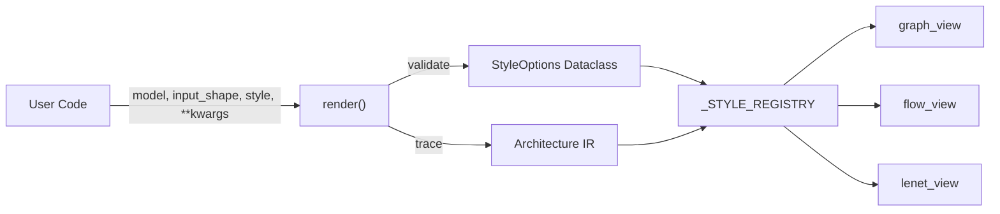

<!-- source: DeepWiki mcp.deepwiki.com · repo willyfh/visualtorch · page 2 Core Architecture · fetched 2026-10-21 -->

# Core Architecture

<details>
<summary>Relevant source files</summary>

The following files were used as context for generating this wiki page:

- [.gitignore](.gitignore)
- [pyproject.toml](pyproject.toml)
- [tests/test_regression_issues.py](tests/test_regression_issues.py)
- [tests/test_render.py](tests/test_render.py)
- [visualtorch/__init__.py](visualtorch/__init__.py)
- [visualtorch/backend.py](visualtorch/backend.py)
- [visualtorch/render.py](visualtorch/render.py)
- [visualtorch/utils/recorder.py](visualtorch/utils/recorder.py)
- [visualtorch/utils/traced_layer.py](visualtorch/utils/traced_layer.py)

</details>


The internal pipeline of VisualTorch transforms a live PyTorch model into a static visualization through a multi-stage process: **Tracing**, **Architecture Extraction**, and **Style-Specific Rendering**. This architecture ensures that the complex logic of lineage tracking and topological sorting is decoupled from the geometric rendering logic.

## Pipeline Overview

The visualization process follows a linear data flow:

1.  **Model Tracing**: A forward pass is executed within a `Recorder` context. This uses `RecorderTensor` (a `torch.Tensor` subclass) to track how data moves between leaf modules.
2.  **Architecture IR**: The raw trace (edges and module metadata) is converted into a structured `Architecture` Intermediate Representation (IR). This stage handles topological sorting and column assignment.
3.  **Rendering Dispatch**: The `render()` entry point validates user options and dispatches the `Architecture` IR to one of the three rendering frontends (`graph`, `flow`, or `lenet`).

### System Component Map

The following diagram maps the logical pipeline stages to the specific code entities responsible for them.

```mermaid
graph TD
    subgraph "Tracing Layer"
        [nn.Module] --> |"forward()"| REC["Recorder (Context Manager)"]
        REC --> RT["RecorderTensor (__torch_function__)"]
    end

    subgraph "Backend IR"
        RT --> |"Raw Edges"| EA["extract_architecture()"]
        EA --> ARCH["Architecture (Dataclass)"]
    end

    subgraph "Frontend Dispatcher"
        ARCH --> RENDER["render() Entrypoint"]
        RENDER --> REG["_STYLE_REGISTRY"]
    end

    subgraph "Style Renderers"
        REG --> GV["graph_view()"]
        REG --> FV["flow_view()"]
        REG --> LV["lenet_view()"]
    end
```
**Sources:** [visualtorch/render.py:201-205](), [visualtorch/backend.py:51-67](), [visualtorch/utils/recorder.py:176-178]()

---

## 1. Tracing Backend

The tracing backend is responsible for capturing the topology of a PyTorch model without relying on the autograd graph or hardcoded layer lists.

*   **`RecorderTensor`**: A tensor subclass that propagates `_producer_ids` through arbitrary operations via `__torch_function__` [visualtorch/utils/recorder.py:24-31]().
*   **`Recorder`**: A context manager that monkey-patches `nn.Module.__call__` to intercept inputs and outputs of leaf modules [visualtorch/utils/recorder.py:176-191]().
*   **Leaf Detection**: The tracer identifies "nodes" as modules with no children or modules where children did not fire (e.g., `nn.MultiheadAttention`) [visualtorch/utils/recorder.py:156-157]().

For details, see [Tracing Backend: RecorderTensor & trace_module_graph](#2.1).

**Sources:** [visualtorch/utils/recorder.py:1-173]()

---

## 2. Architecture Extraction

Once the forward pass completes, the raw trace data is processed into a structured `Architecture` object [visualtorch/backend.py:26-40]().

*   **Topological Sorting**: Uses an in-degree based queue to determine the longest path from source for each node [visualtorch/backend.py:98-111]().
*   **Column Assignment**: Groups nodes into columns based on their depth, allowing the renderers to lay out parallel branches correctly [visualtorch/backend.py:114-122]().
*   **Input Injection**: Prepends synthetic `Input` nodes to the architecture to represent the starting tensors [visualtorch/backend.py:138-157]().

For details, see [Architecture Extraction: extract_architecture & the Architecture Dataclass](#2.2).

**Sources:** [visualtorch/backend.py:51-135]()

---

## 3. Rendering Dispatcher

The `render()` function serves as the unified public API [visualtorch/render.py:210-215](). It provides a consistent interface while delegating the actual drawing to specialized style modules.

*   **Option Validation**: Uses dataclasses like `CommonOptions`, `GraphStyleOptions`, and `FlowStyleOptions` to validate user `kwargs` [visualtorch/render.py:29-98]().
*   **Style Registry**: Maps the `style` string argument to specific adapter functions (`_render_graph`, `_render_flow`, `_render_lenet`) [visualtorch/render.py:201-205]().

### Data Flow to Renderers

The following diagram illustrates how the `Architecture` IR and user `Options` are merged during the dispatch process.


**Sources:** [visualtorch/render.py:210-245](), [visualtorch/backend.py:133-135]()

For details, see [render() Dispatcher & Style Configuration](#2.3).

**Sources:** [visualtorch/render.py:1-208]()

---

