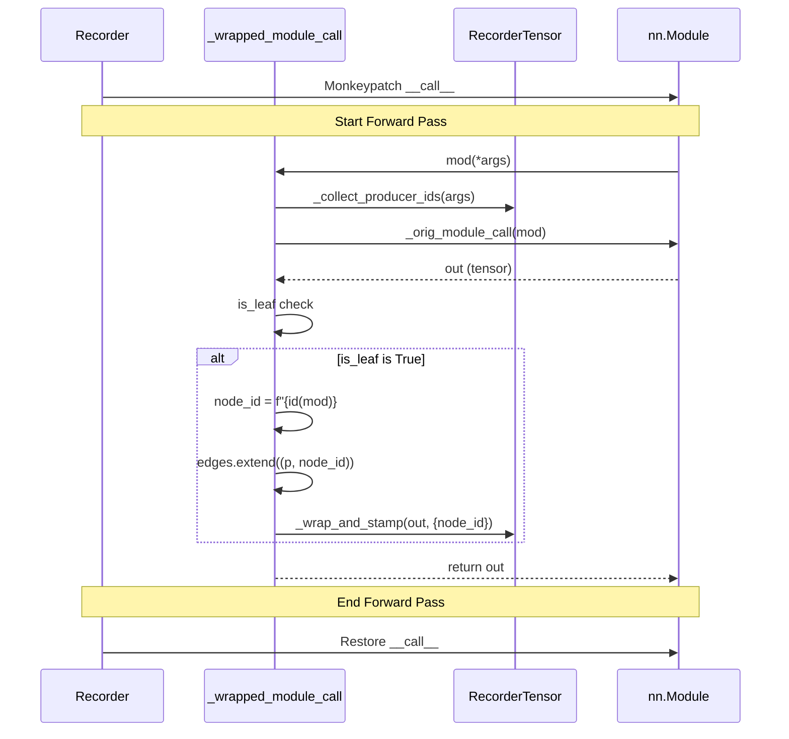

<!-- source: DeepWiki mcp.deepwiki.com · repo willyfh/visualtorch · page 2.1 Tracing Backend: RecorderTensor & trace_module_graph · fetched 2026-10-21 -->

# Tracing Backend: RecorderTensor & trace_module_graph

<details>
<summary>Relevant source files</summary>

The following files were used as context for generating this wiki page:

- [.gitignore](.gitignore)
- [pyproject.toml](pyproject.toml)
- [tests/test_regression_issues.py](tests/test_regression_issues.py)
- [visualtorch/utils/recorder.py](visualtorch/utils/recorder.py)
- [visualtorch/utils/traced_layer.py](visualtorch/utils/traced_layer.py)

</details>


The tracing backend is the core engine of VisualTorch. It performs a dynamic analysis of a PyTorch model's forward pass to recover the computational graph. Unlike static analysis tools that inspect the `nn.Module` hierarchy or `autograd` attributes, VisualTorch uses **tensor subclassing** to track the flow of data between leaf modules.

## RecorderTensor: The Lineage Tracker

The primary mechanism for tracing is `RecorderTensor`, a subclass of `torch.Tensor` [visualtorch/utils/recorder.py:24-31](). It carries a `_producer_ids` set, which contains the unique identifiers (strings derived from `id(module)`) of the leaf modules that produced the tensor's data [visualtorch/utils/recorder.py:27-30]().

### Producer Propagation via `__torch_function__`

`RecorderTensor` implements the `__torch_function__` protocol to intercept every tensor operation (e.g., `add`, `cat`, `matmul`) [visualtorch/utils/recorder.py:34-40]().

1.  **Collection**: It recursively searches input arguments and keyword arguments for existing `RecorderTensor` instances and extracts their `_producer_ids` [visualtorch/utils/recorder.py:45-45]().
2.  **Execution**: It calls the original PyTorch function [visualtorch/utils/recorder.py:47-47]().
3.  **Stamping**: It stamps the union of all collected producer IDs onto the output tensor(s) [visualtorch/utils/recorder.py:49-50]().

This allows the lineage to persist through complex operations, such as residual additions or concatenations, where multiple branches merge [visualtorch/utils/recorder.py:29-30]().

### Handling Edge Cases: Re-wrapping & Multi-outputs

*   **NumPy Escape**: If a module's internal logic converts a tensor to a NumPy array and back, the subclass is lost. To prevent lineage breakage, `_wrap_and_stamp` is used at module boundaries to re-establish the `RecorderTensor` subclass [visualtorch/utils/recorder.py:85-92]().
*   **Multi-Output Modules**: Modules like `nn.LSTM` or `nn.MultiheadAttention` return tuples or lists of tensors. The helper `_all_tensor_shapes` recursively traverses these structures to ensure every output shape is recorded [visualtorch/utils/recorder.py:109-117]().

### Data Flow: Tensor Lineage Propagation
The following diagram shows how `RecorderTensor` moves through the system during a forward pass.

```mermaid
graph TD
    subgraph "Forward Pass Execution"
        Input["__input__"] -->|RecorderTensor| ModA["Module A (Leaf)"]
        ModA -->|RecorderTensor {ID_A}| Op1["Tensor Op (e.g. torch.add)"]
        Op1 -->|RecorderTensor {ID_A}| ModB["Module B (Leaf)"]
        
        ModB -->|RecorderTensor {ID_B}| Output["Final Output"]
    end

    subgraph "RecorderTensor Logic"
        __torch_function__ --> _collect_producer_ids
        _collect_producer_ids --> _stamp_producer_ids
    end

    ModA -.->|registers| id_to_module
    ModB -.->|registers| id_to_module
```
**Sources:** [visualtorch/utils/recorder.py:24-84](), [visualtorch/utils/recorder.py:133-173]()

---

## The Recorder Context Manager

The `Recorder` class manages the lifecycle of a trace [visualtorch/utils/recorder.py:176-180](). It uses a context manager to temporarily replace `nn.Module.__call__` with a `_wrapped_module_call` [visualtorch/utils/recorder.py:192-197]().

### Module Wrapping Logic

The `_wrapped_module_call` function defines how each module interaction is handled [visualtorch/utils/recorder.py:133-142]():

1.  **Input Capture**: It collects producer IDs from the module's inputs [visualtorch/utils/recorder.py:143-143]().
2.  **Execution Tracking**: It monitors the `edges` list before and after calling the original module [visualtorch/utils/recorder.py:145-146]().
3.  **Leaf Detection**: A module is treated as a "node" if:
    *   It has no children (a true leaf, like `nn.Conv2d`) [visualtorch/utils/recorder.py:156-156]().
    *   It has children, but none of them were called (e.g., `nn.MultiheadAttention` using functional calls) [visualtorch/utils/recorder.py:156-156](), [tests/test_regression_issues.py:70-75]().
4.  **State Recording**: If identified as a leaf, it generates a `node_id` (e.g., `id#index` to support weight sharing) and records its module type, output shapes, and incoming edges [visualtorch/utils/recorder.py:157-168]().

### Tracing System Components
This diagram maps the logical tracing steps to the specific code entities involved.


**Sources:** [visualtorch/utils/recorder.py:133-173](), [visualtorch/utils/recorder.py:182-198]()

---

## Complex Case Handling

### Weight Sharing & Multiple Calls
If the same module instance is called multiple times (e.g., in a Siamese network or a recurrent loop), VisualTorch assigns a unique `node_id` for each call by appending a call index: `f"{base_id}#{call_index}"` [visualtorch/utils/recorder.py:158-161](). This ensures that the graph accurately reflects the sequence of operations even when parameters are shared.

### Multi-output Modules (LSTM/GRU)
Recurrent modules like `nn.LSTM` return a tuple: `(output, (h_n, c_n))` [visualtorch/utils/recorder.py:112-113](). 
*   The primary `output_shape` is stored in the `TracedLayer` [visualtorch/utils/traced_layer.py:21-21]().
*   Additional shapes (like hidden states) are stored in `extra_output_shapes` [visualtorch/utils/traced_layer.py:23-28]().
*   The rendering logic uses these to extend labels (e.g., `(1, 7, 20) + (1, 1, 20) + (1, 1, 20)`) [tests/test_regression_issues.py:150-153]().

### Fused Functional Layers
Modules like `nn.MultiheadAttention` are problematic because they often bypass their own children (like `out_proj`) and call functional operations directly on raw parameters [visualtorch/utils/recorder.py:149-153](). VisualTorch detects this by checking if any edges were recorded during the module's execution. If `edges` did not increase, the module is forced into the graph as a leaf to prevent it from becoming "invisible" [visualtorch/utils/recorder.py:156-156](), [tests/test_regression_issues.py:70-75]().

### Summary of Key Data Structures

| Entity | Role | Source |
| :--- | :--- | :--- |
| `INPUT_NODE_ID` | The constant string `"__input__"` used as the source for the graph. | [visualtorch/utils/recorder.py:19]() |
| `TracedLayer` | Dataclass storing a module, its unique ID, and its shapes. | [visualtorch/utils/traced_layer.py:12-28]() |
| `id_to_module` | Mapping of `node_id` to the actual `nn.Module` instance. | [visualtorch/utils/recorder.py:134]() |
| `edges` | List of `(producer_id, consumer_id)` tuples defining connectivity. | [visualtorch/utils/recorder.py:137]() |

**Sources:** [visualtorch/utils/recorder.py:1-173](), [visualtorch/utils/traced_layer.py:1-28](), [tests/test_regression_issues.py:1-160]()

---

