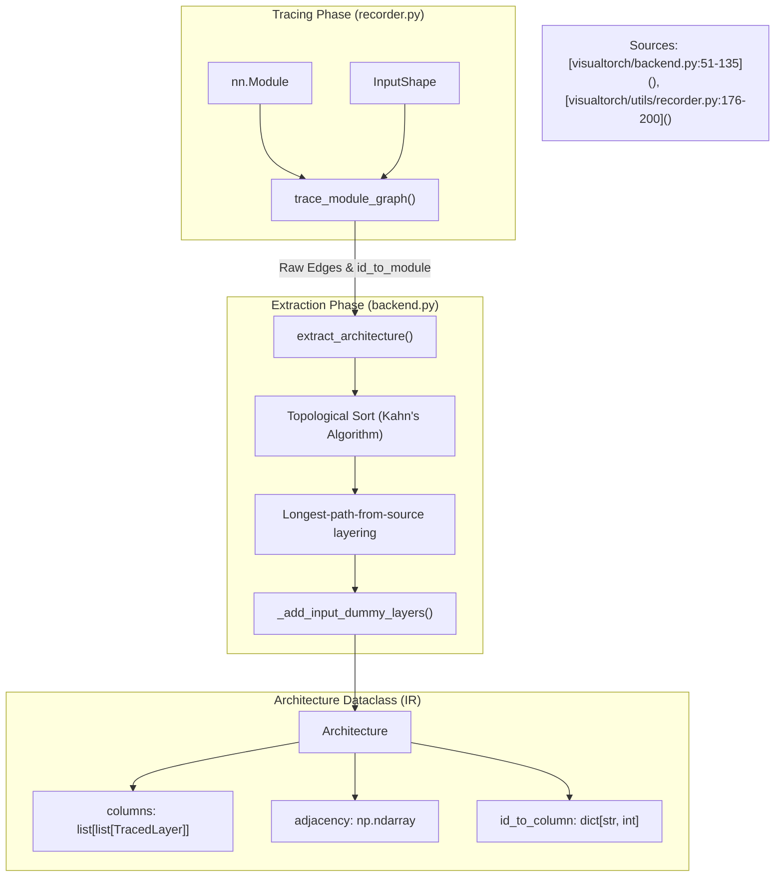

<!-- source: DeepWiki mcp.deepwiki.com · repo willyfh/visualtorch · page 2.2 Architecture Extraction: extract_architecture & the Architecture Dataclass · fetched 2026-10-21 -->

# Architecture Extraction: extract_architecture & the Architecture Dataclass

Relevant source files

The following files were used as context for generating this wiki page:

- [.gitignore](.gitignore)
- [pyproject.toml](pyproject.toml)
- [tests/test_regression_issues.py](tests/test_regression_issues.py)
- [visualtorch/backend.py](visualtorch/backend.py)
- [visualtorch/utils/__init__.py](visualtorch/utils/__init__.py)
- [visualtorch/utils/layer_utils.py](visualtorch/utils/layer_utils.py)
- [visualtorch/utils/recorder.py](visualtorch/utils/recorder.py)
- [visualtorch/utils/traced_layer.py](visualtorch/utils/traced_layer.py)

The architecture extraction layer acts as the Intermediate Representation (IR) builder for VisualTorch. It consumes the raw, unordered trace data from the backend and transforms it into a structured, layered graph format. This transformation involves assigning nodes to vertical columns based on their topological depth, constructing a global adjacency matrix, and injecting synthetic input nodes to represent the model's entry points.

## The Architecture Extraction Pipeline

The extraction process is centralized in the `extract_architecture` function [visualtorch/backend.py:51-67](). It serves as the bridge between the dynamic tracing of a `torch.nn.Module` and the static layout requirements of the rendering frontends.

### Data Flow: From Trace to IR

The following diagram illustrates the flow of data through the extraction logic, mapping code entities to their roles in the transformation.

**Architecture Extraction Data Flow**

### 1. Topological Layering
To organize layers into a readable flow, `extract_architecture` implements a "longest-path-from-source" layering strategy [visualtorch/backend.py:95-97]().
* **In-degree Calculation**: It first calculates the in-degree of every node based on the edges returned by the tracer [visualtorch/backend.py:85-93]().
* **Kahn's Algorithm**: Using a queue-based topological sort, it determines the depth of each node. A node's depth is defined as `1 + max(depth of predecessors)` [visualtorch/backend.py:98-111]().
* **Column Assignment**: This ensures that in complex architectures (like ResNet or U-Net), a merge node (e.g., an addition or concatenation) is always placed in a column after all its parallel branches have completed [visualtorch/backend.py:95-97]().

### 2. Synthetic Input Injection
The tracer only records `nn.Module` calls. To represent the starting point of the data flow, `_add_input_dummy_layers` injects synthetic nodes [visualtorch/backend.py:138-145]().
* **Input Nodes**: It creates one `TracedLayer` for each input tensor defined in the `input_shape` [visualtorch/backend.py:147-156]().
* **Labeling**: Labels are generated as "input" for single-input models or "input_N" for multi-input models via `_input_label` [visualtorch/backend.py:171-173]().
* **Wiring**: These dummy nodes are prepended to `columns[0]`, and the adjacency matrix is expanded to include edges from these inputs to their first real module consumers [visualtorch/backend.py:157-168]().

**Sources**: [visualtorch/backend.py:51-174](), [visualtorch/utils/layer_utils.py:8-18]()

---

## The Architecture Dataclass

The `Architecture` dataclass is the final product of the extraction backend. It provides a unified interface for renderers to query the model's structure.

| Attribute | Type | Description |
| :--- | :--- | :--- |
| `columns` | `list[list[TracedLayer]]` | A list of columns, where each column contains layers at that topological depth [visualtorch/backend.py:36](). |
| `adjacency` | `np.ndarray` | A square matrix where `adjacency[i, j] > 0` indicates a directed edge from node index `i` to `j` [visualtorch/backend.py:37](). |
| `id_to_index` | `dict[str, int]` | Maps a string `node_id` (e.g., "140715#0") to its row/column index in the adjacency matrix [visualtorch/backend.py:38](). |
| `id_to_column` | `dict[str, int]` | Maps a `node_id` to its column index (0 to N) for quick horizontal positioning [visualtorch/backend.py:39](). |

### TracedLayer: The Node IR
Each node in the `Architecture` is a `TracedLayer` instance [visualtorch/utils/traced_layer.py:12-29](). Unlike the raw `nn.Module`, this class specifically preserves:
* **`output_shape`**: The primary tensor shape used for volumetric rendering [visualtorch/utils/traced_layer.py:21]().
* **`extra_output_shapes`**: Captures auxiliary outputs (e.g., hidden/cell states in `nn.LSTM`) to ensure `show_dimension` labels are accurate [visualtorch/utils/traced_layer.py:23-28]().
* **`node_id`**: A stable identifier used for edge routing [visualtorch/utils/traced_layer.py:22]().

**Sources**: [visualtorch/backend.py:26-50](), [visualtorch/utils/traced_layer.py:1-29]()

---

## Multi-Output Handling and Regression Fixes

The extraction logic includes specific handling for complex PyTorch edge cases identified through regression testing [tests/test_regression_issues.py:1-4]().

### Support for Multi-Output Modules
Modules like `nn.LSTM` return a tuple of tensors `(output, (h_n, c_n))`. The architecture extraction ensures these are not lost:
1. **Tracer Collection**: `_all_tensor_shapes` recursively finds all tensors in a module's return value [visualtorch/utils/recorder.py:109-130]().
2. **Storage**: The first shape is stored in `output_shape`, and all subsequent shapes are stored in `extra_output_shapes` [visualtorch/backend.py:118-121]().
3. **Visualization**: Frontends use `format_shape_label` to concatenate these into a single string, e.g., `(1, 7, 20) + (1, 1, 20) + (1, 1, 20)` [tests/test_regression_issues.py:150-153]().

### MultiheadAttention Fallback
`nn.MultiheadAttention` is unique because it contains a child module (`out_proj`) but often computes its logic via fused functional calls, bypassing the child's `__call__` [tests/test_regression_issues.py:70-75]().
* **Leaf Detection**: The extraction logic identifies a module as a "leaf" if it has no children OR if none of its children were invoked during the forward pass [visualtorch/utils/recorder.py:156]().
* **Visibility**: This ensures `MultiheadAttention` appears as a node in the graph instead of being silently omitted [tests/test_regression_issues.py:87-90]().

**Sources**: [visualtorch/utils/recorder.py:109-173](), [tests/test_regression_issues.py:70-153]()

---

