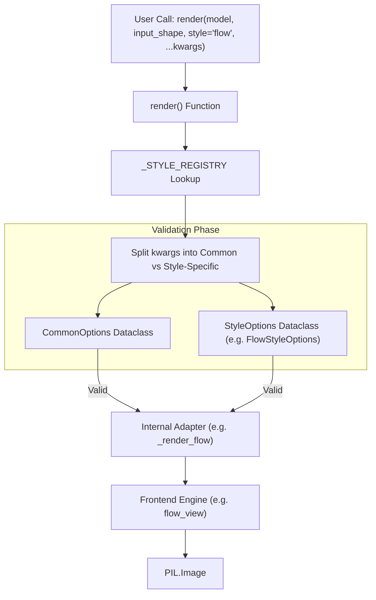
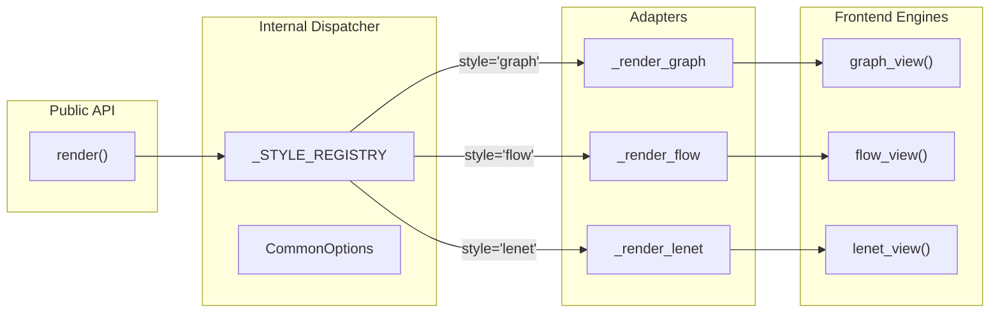

<!-- source: DeepWiki mcp.deepwiki.com · repo willyfh/visualtorch · page 2.3 render() Dispatcher & Style Configuration · fetched 2026-10-21 -->

# render() Dispatcher & Style Configuration

Relevant source files

The following files were used as context for generating this wiki page:

- [tests/test_render.py](tests/test_render.py)
- [visualtorch/__init__.py](visualtorch/__init__.py)
- [visualtorch/render.py](visualtorch/render.py)
- [visualtorch/utils/utils.py](visualtorch/utils/utils.py)

The `render()` function serves as the unified public entry point for the VisualTorch library. It abstracts the complexity of the underlying tracing and architecture extraction by providing a single interface where the visualization style and configuration are controlled via keyword arguments.

### Overview and Implementation

The dispatcher mechanism uses a registry-based approach to map style strings (e.g., `"graph"`, `"flow"`) to specific rendering logic and configuration schemas. This ensures that parameters are validated before rendering begins, preventing silent failures due to typos in configuration.

The data flow within the dispatcher follows these steps:
1.  **Validation**: Incoming `**kwargs` are split into common options and style-specific options.
2.  **Instantiation**: Dataclasses are instantiated with these arguments; any unknown or misspelled arguments trigger a `TypeError` immediately [visualtorch/render.py:7-8]().
3.  **Dispatch**: The `_STYLE_REGISTRY` identifies the appropriate internal adapter function [visualtorch/render.py:201-205]().
4.  **Execution**: The adapter calls the specific frontend (e.g., `graph_view`) with the validated options.

#### Style Dispatcher Logic
Title: render() Internal Dispatch Flow

Sources: [visualtorch/render.py:201-225](), [visualtorch/render.py:100-198]()

---

### Configuration Dataclasses

VisualTorch uses Python dataclasses to define the schema for every visualization style. This provides a clear contract for the API and enables IDE autocompletion for users.

#### CommonOptions
The `CommonOptions` dataclass contains parameters accepted by every rendering style, such as file output paths, background colors, and global padding [visualtorch/render.py:29-41]().

| Field | Type | Default | Description |
| :--- | :--- | :--- | :--- |
| `to_file` | `str \| None` | `None` | Path to save the image. |
| `color_map` | `dict` | `None` | Explicit mapping of layer types to colors. |
| `palette` | `str` | `"okabe_ito"` | The named color palette to use. |
| `background_fill` | `str \| tuple` | `"white"` | Canvas background color. |
| `padding` | `int` | `10` | Margin around the entire diagram. |
| `opacity` | `int` | `255` | Global transparency (0-255). |
| `level_gap` | `int \| None` | `None` | Manual override for vertical skip-connection spacing. |

#### Style-Specific Options
Each style has a dedicated dataclass to manage parameters unique to its layout engine.

*   **`GraphStyleOptions`**: Focuses on node/edge connectivity, neuron counts, and dimension labels [visualtorch/render.py:44-57]().
*   **`FlowStyleOptions`**: Controls volumetric scaling, funnel drawing, and 3D shading [visualtorch/render.py:59-78]().
*   **`LenetStyleOptions`**: Manages stacked-plane offsets and channel capping [visualtorch/render.py:80-98]().

Sources: [visualtorch/render.py:29-98]()

---

### Internal Adapter Functions

The dispatcher does not call the frontend engines directly. Instead, it uses internal adapter functions (`_render_graph`, `_render_flow`, `_render_lenet`) to bridge the dataclass instances back into the flat argument structure expected by the original frontend functions [visualtorch/render.py:100-198]().

Title: Entity Mapping: Dispatcher to Code Entities

Sources: [visualtorch/render.py:201-205](), [visualtorch/render.py:100-105](), [visualtorch/render.py:130-135](), [visualtorch/render.py:166-171]()

---

### Input Shape Validation

The `render()` function handles the normalization of the `input_shape` argument. VisualTorch supports both single-input models (passed as a single tuple) and multi-input models (passed as a tuple of tuples) [visualtorch/utils/utils.py:13-14]().

If a model's `forward()` method expects multiple tensors, the `input_shape` must match the arity of the positional arguments. Passing a malformed shape, such as a mix of integers and tuples at the top level, will raise a `ValueError` [tests/test_render.py:105-113]().

#### Behavior with Unused Inputs
If an input is provided in `input_shape` but not consumed by the model's `forward()` pass, the dispatcher and tracing backend will still process it. It will typically appear as a disconnected input node in the final visualization [tests/test_render.py:140-153]().

Sources: [visualtorch/utils/utils.py:13-14](), [tests/test_render.py:105-153]()

---

