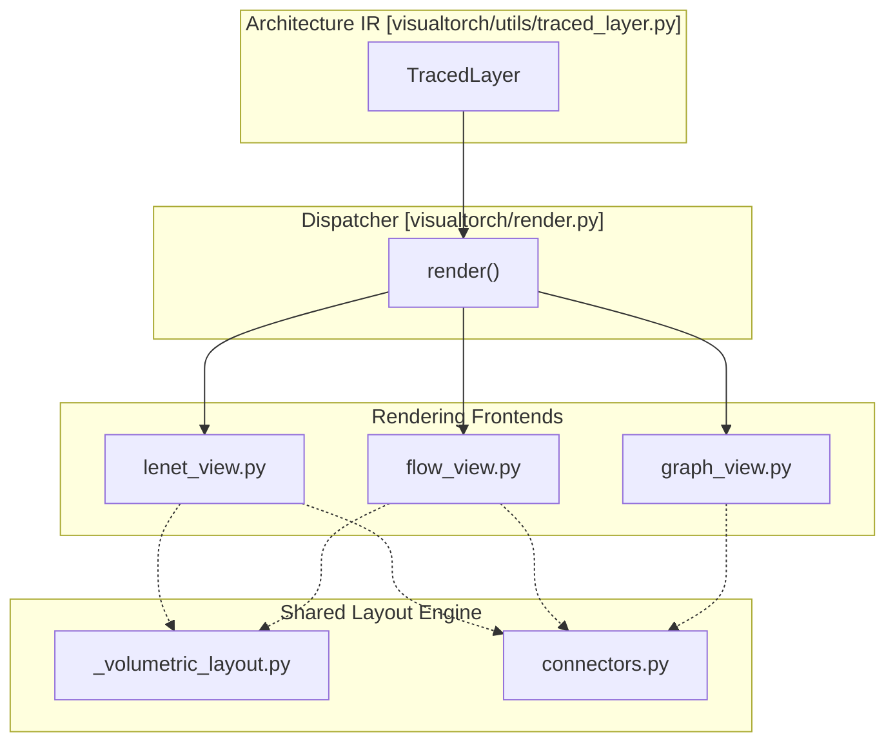
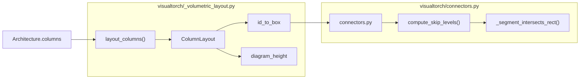

<!-- source: DeepWiki mcp.deepwiki.com · repo willyfh/visualtorch · page 3 Visualization Styles · fetched 2026-10-21 -->

# Visualization Styles

Relevant source files

The following files were used as context for generating this wiki page:

- [README.md](README.md)
- [docs/source/index.md](docs/source/index.md)
- [docs/source/markdown/api_references/index.md](docs/source/markdown/api_references/index.md)
- [tests/test_connectors.py](tests/test_connectors.py)
- [visualtorch/_volumetric_layout.py](visualtorch/_volumetric_layout.py)

VisualTorch provides three primary rendering frontends to visualize PyTorch models, each optimized for different architectural perspectives. While the visual output varies, they share a unified tracing backend and a common volumetric layout engine.

## Overview of Rendering Styles

VisualTorch supports the following styles, which can be selected via the `render(style=...)` entry point:

| Style | Description | Typical Use Case |
| :--- | :--- | :--- |
| **Graph View** | 2D nodes (boxes, circles) with explicit directed edges. | Complex branching, skip connections, and non-sequential DAGs. |
| **Flow View** | 3D volumetric blocks with funnel-style connectors. | High-level CNN architecture overviews and sequential flows. |
| **LeNet Style** | Stacked 2D planes with depth offsets. | Classic computer vision papers and "layer-by-layer" stacking. |

The following diagram illustrates the relationship between the unified architecture representation and the specific rendering implementations:

**Style Dispatch and Layout Hierarchy**

Sources: [visualtorch/render.py:1-50](), [visualtorch/_volumetric_layout.py:1-10](), [README.md:8-10]()

---

## 3.1 Graph View (`graph_view`)
The Graph View focuses on the connectivity of the model. It represents layers as 2D shapes (Boxes, Circles, or Ellipses) and uses a sophisticated routing algorithm for skip connections. It is particularly effective for models with complex branching like ResNets or U-Nets.

*   **Node Types:** Supports `Box` for standard layers, `Circle` for small operations, and `Ellipses` for repeated blocks.
*   **Routing:** Uses `compute_skip_levels` to determine vertical offsets for edges that span multiple columns to avoid visual overlap.
*   **Options:** Includes `show_neurons`, `ellipsize_after`, and `show_dimension`.

For details, see [Graph View (graph_view)](#3.1).

Sources: [visualtorch/utils/utils.py:10-50](), [tests/test_connectors.py:16-24]()

---

## 3.2 Flow View (`flow_view`)
Flow View provides a "volumetric" representation where layers are rendered as 3D cuboids. The size of the cuboid typically corresponds to the feature map dimensions (width, height, and depth/channels).

*   **Volumetric Rendering:** Uses the `de` (depth extrusion) property of `Box` shapes to create a 3D effect.
*   **Connectors:** Uses funnel-shaped polygons to show the transition between layers of different spatial resolutions.
*   **Customization:** Supports 2D/3D toggles via `draw_volume` and orientation changes.

For details, see [Flow View (flow_view)](#3.2).

Sources: [visualtorch/_volumetric_layout.py:44-58](), [README.md:12-19]()

---

## 3.3 LeNet Style View (`lenet_view`)
Inspired by the classic LeNet-5 diagrams, this style renders layers as a series of stacked 2D planes with a constant Z-offset. It is highly effective for visualizing the reduction in spatial dimensions and increase in channel depth.

*   **StackedBox:** Uses the `StackedBox` primitive to render multiple offset rectangles representing feature map channels.
*   **Capping:** Implements `max_channels` to prevent the diagram from becoming excessively wide when channel counts are high.
*   **Routing:** Supports both line-based and funnel-based skip connection routing.

For details, see [LeNet Style View (lenet_view)](#3.3).

Sources: [visualtorch/utils/utils.py:55-80](), [visualtorch/_volumetric_layout.py:7-9]()

---

## 3.4 Shared Layout Engine & Connector Routing
To ensure consistency and reduce code duplication, `flow_view` and `lenet_view` utilize a shared volumetric layout engine, while all styles utilize a central connector routing subsystem.

### Volumetric Layout Engine
The `layout_columns` function in `_volumetric_layout.py` manages the spatial positioning of nodes. It groups layers by their column (depth in the graph) and calculates the necessary vertical and horizontal gaps to prevent 3D extrusions from occluding adjacent layers.

### Connector Routing
The `connectors.py` module handles the logic for drawing lines between nodes. It includes:
*   **Collision Detection:** Implementation of Liang-Barsky algorithms to detect if a connector intersects a node's bounding box.
*   **Interval Coloring:** A greedy algorithm used in `compute_skip_levels` to assign "detour levels" to overlapping skip connections.

**Logic Flow for Shared Layout**

Sources: [visualtorch/_volumetric_layout.py:60-100](), [visualtorch/_volumetric_layout.py:25-35](), [tests/test_connectors.py:61-75](), [tests/test_connectors.py:127-140]()

For details, see [Shared Layout Engine & Connector Routing](#3.4).

---

