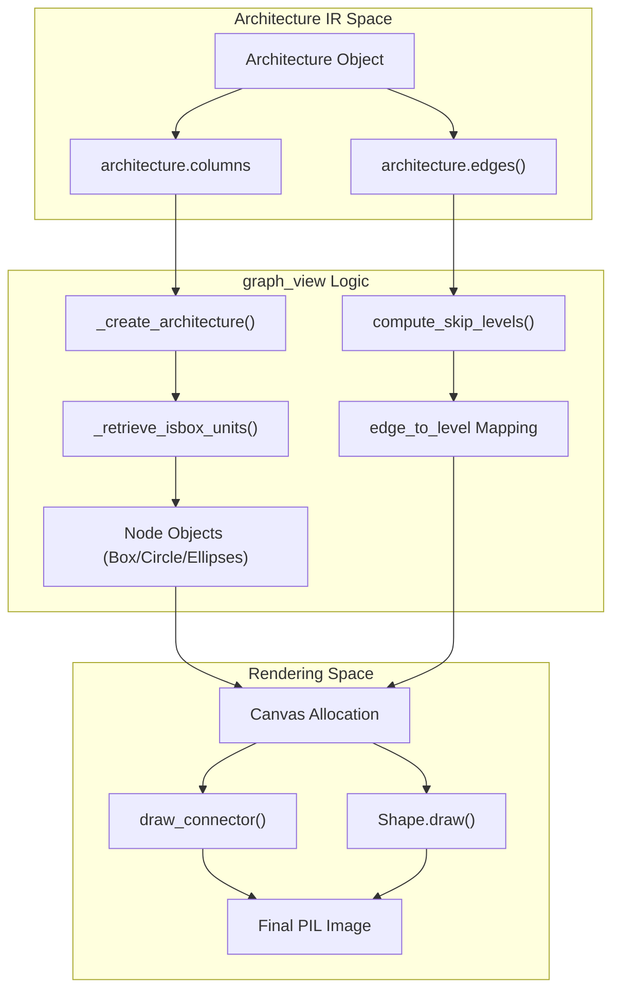
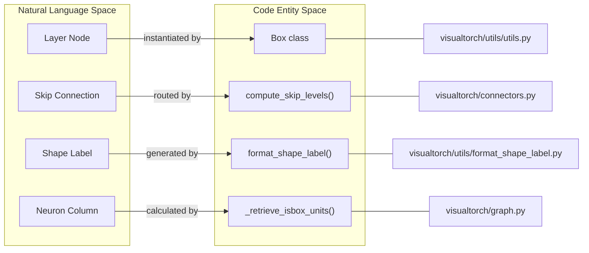

<!-- source: DeepWiki mcp.deepwiki.com · repo willyfh/visualtorch · page 3.1 Graph View (graph_view) · fetched 2026-10-21 -->

# Graph View (graph_view)

Relevant source files

The following files were used as context for generating this wiki page:

- [tests/test_flow.py](tests/test_flow.py)
- [tests/test_graph.py](tests/test_graph.py)
- [visualtorch/connectors.py](visualtorch/connectors.py)
- [visualtorch/graph.py](visualtorch/graph.py)
- [visualtorch/utils/utils.py](visualtorch/utils/utils.py)

The `graph_view` rendering frontend generates a classical node-link diagram of a PyTorch model's architecture [visualtorch/graph.py:21-42](). It represents layers as vertical columns of nodes, where nodes can either represent entire layers or individual neurons within those layers [visualtorch/graph.py:109-120](). This view is particularly suited for dense networks, small-scale CNNs, and models where skip-connection routing and branching logic need to be explicitly visualized [tests/test_graph.py:102-145]().

## Node Creation and Unit Calculation

Nodes in a `graph_view` are instances of geometric primitive classes defined in `visualtorch.utils.utils` [visualtorch/graph.py:18](). The system supports three primary node types:

| Node Type | Class | Usage |
| :--- | :--- | :--- |
| **Box** | `Box` | Used for standard layers when `show_neurons=False` [visualtorch/graph.py:1120](). |
| **Circle** | `Circle` | Used for individual neurons when `show_neurons=True` [visualtorch/graph.py:1115](). |
| **Ellipses** | `Ellipses` | Used as a placeholder when a layer exceeds the `ellipsize_after` threshold [visualtorch/graph.py:1125](). |

### Unit Retrieval Logic
The function `_retrieve_isbox_units` determines the visual height of a layer's column [visualtorch/graph.py:1104-1130]().
- If `show_neurons` is `True`, it calculates the number of units based on the layer's output shape, capped by `ellipsize_after` [visualtorch/graph.py:1107-1110]().
- If the unit count exceeds `ellipsize_after`, it injects an `Ellipses` node to represent truncated neurons [visualtorch/graph.py:1125-1127]().
- If `show_neurons` is `False`, the layer is treated as a single unit represented by a `Box` [visualtorch/graph.py:1120]().

**Sources:** [visualtorch/graph.py:109-120](), [visualtorch/graph.py:1104-1130](), [visualtorch/utils/utils.py:112-228]()

## Spatial Layout and Canvas Sizing

The layout engine follows a strictly columnar approach based on the `Architecture` IR [visualtorch/graph.py:91]().

### Column Assignment
Nodes are positioned horizontally based on their column index in `architecture.columns` [visualtorch/graph.py:97-104](). The `layer_spacing` parameter controls the horizontal distance between these columns [visualtorch/graph.py:30]().

### Vertical Alignment
Within a column, nodes are centered vertically relative to the tallest column in the graph [visualtorch/graph.py:151-152](). The vertical position is calculated using `node_spacing` and `node_size` [visualtorch/graph.py:1134-1153]().

### Skip-Connection Routing
Skip connections (edges spanning $>1$ column) are routed above the main diagram to prevent occlusion of adjacent-column edges [visualtorch/graph.py:126-128]().
1. **Collision Detection:** `compute_skip_levels` uses a Liang-Barsky algorithm to check if a straight line would intersect any intervening nodes [visualtorch/connectors.py:18-23](), [visualtorch/connectors.py:133-150]().
2. **Level Assignment:** Qualifying skips are assigned a "detour level" using greedy interval-graph coloring [visualtorch/connectors.py:35-45]().
3. **Canvas Margin:** The total image height is expanded by `top_margin_for_skips`, calculated as `num_levels * level_gap` [visualtorch/graph.py:136-137]().

**Sources:** [visualtorch/graph.py:126-137](), [visualtorch/connectors.py:18-94](), [visualtorch/connectors.py:133-150]()

## Implementation Data Flow

The following diagram illustrates the transformation from PyTorch model tracing to the final `graph_view` image.

### Architecture to Graph Transformation

**Sources:** [visualtorch/graph.py:91-158](), [visualtorch/connectors.py:18-23](), [visualtorch/utils/utils.py:120-123]()

## Key Functions and Parameters

### `graph_view` Options
- `show_neurons`: Toggles between per-layer boxes and per-neuron circles [visualtorch/graph.py:35]().
- `ellipsize_after`: Limits the number of circles drawn per layer to maintain performance and readability [visualtorch/graph.py:34]().
- `show_dimension`: If enabled, calls `format_shape_label` to print output dimensions below each layer [visualtorch/graph.py:37](), [visualtorch/graph.py:141-147]().
- `show_input`: Controls the visibility of the synthetic "Input" node, provided it doesn't break edge connectivity [visualtorch/graph.py:41](), [visualtorch/graph.py:98-102]().

### Internal Helpers
| Function | Role |
| :--- | :--- |
| `_create_architecture` | Iterates through columns to instantiate `Shape` objects and calculate their `(x, y)` coordinates [visualtorch/graph.py:1088-1163](). |
| `_retrieve_isbox_units` | Core logic for deciding node type and count per layer [visualtorch/graph.py:1104-1130](). |
| `_edge_draws_visible_content` | Predicate that prevents drawing edges to neurons that were truncated by `ellipsize_after` [visualtorch/graph.py:1186-1200](). |

**Sources:** [visualtorch/graph.py:21-86](), [visualtorch/graph.py:1088-1200]()

## Code Entity Association

This diagram maps high-level visual components to the specific code entities responsible for their generation.

### Visual to Code Mapping

**Sources:** [visualtorch/graph.py:1120](), [visualtorch/connectors.py:18](), [visualtorch/graph.py:1104](), [visualtorch/utils/utils.py:112]()

---

