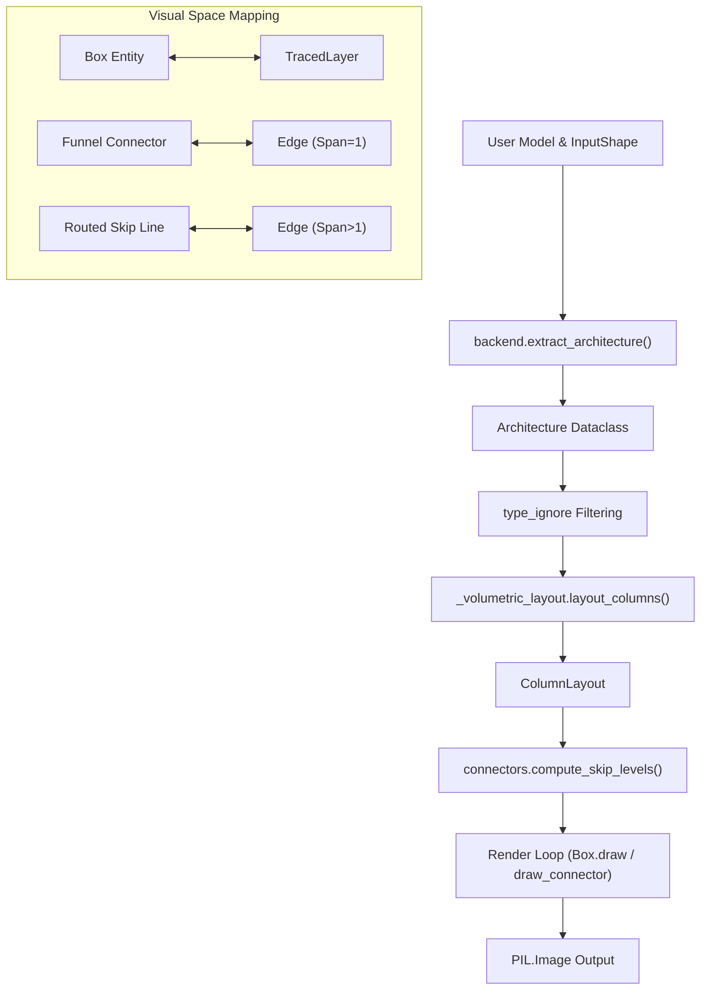
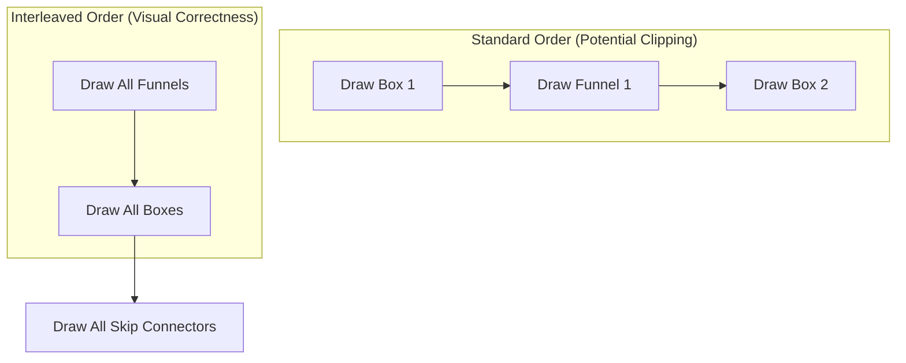

<!-- source: DeepWiki mcp.deepwiki.com · repo willyfh/visualtorch · page 3.2 Flow View (flow_view) · fetched 2026-10-21 -->

# Flow View (flow_view)

Relevant source files

The following files were used as context for generating this wiki page:

- [tests/test_connectors.py](tests/test_connectors.py)
- [tests/test_flow.py](tests/test_flow.py)
- [tests/test_graph.py](tests/test_graph.py)
- [visualtorch/_volumetric_layout.py](visualtorch/_volumetric_layout.py)
- [visualtorch/connectors.py](visualtorch/connectors.py)
- [visualtorch/flow.py](visualtorch/flow.py)

The `flow_view` style provides a volumetric visualization of a PyTorch model's architecture. It represents layers as 3D extruded boxes (or 2D rectangles) where the dimensions of the box correspond to the output shape of the layer. This view is particularly effective for CNNs and sequential models, utilizing funnel-shaped connectors to show the transition between feature map sizes.

## Core Implementation and Data Flow

The `flow_view` function [visualtorch/flow.py:34-61]() serves as the primary entry point. It orchestrates the transformation from a PyTorch `nn.Module` to a rendered image through a multi-stage pipeline.

### System Flow Diagram
This diagram illustrates how high-level user requests are processed by specific code entities within the `flow_view` subsystem.

Title: Flow View Data Processing Pipeline

Sources: [visualtorch/flow.py:116-116](), [visualtorch/flow.py:138-140](), [visualtorch/flow.py:145-155](), [visualtorch/flow.py:223-228](), [visualtorch/flow.py:246-271]()

## Volumetric Layout Engine

`flow_view` shares its layout logic with `lenet_view` through the `_volumetric_layout.py` module. This engine groups layers into columns based on their depth in the model graph [visualtorch/_volumetric_layout.py:1-10]().

### Column Stacking and Sizing
Layers within the same column (parallel branches) are stacked vertically. The layout engine calculates the necessary canvas size and positions for each box.

| Parameter | Role in Layout | Code Reference |
| :--- | :--- | :--- |
| `min_z`, `max_z` | Clamping the extrusion depth (z-axis) | [visualtorch/flow.py:38-40]() |
| `min_xy`, `max_xy` | Clamping the feature map face (x/y-axis) | [visualtorch/flow.py:39-41]() |
| `scale_z`, `scale_xy` | Linear multipliers for dimension-to-pixel mapping | [visualtorch/flow.py:42-43]() |
| `spacing` | Horizontal distance between columns | [visualtorch/_volumetric_layout.py:64-64]() |
| `padding` | Margin around the entire diagram | [visualtorch/_volumetric_layout.py:65-65]() |

Sources: [visualtorch/_volumetric_layout.py:60-104](), [visualtorch/flow.py:145-155]()

## Key Features

### 2D vs 3D Toggle (`draw_volume`)
The `draw_volume` flag determines whether layers are rendered as 3D extruded cuboids or 2D rectangles [visualtorch/flow.py:49-49]().
- When `True`: The renderer uses the `de` (depth of extrusion) attribute to draw side and top faces with shading [visualtorch/flow.py:91-91]().
- When `False`: The renderer sets `de = 0`, resulting in a flat 2D box [visualtorch/flow.py:151-153]().

### Funnel Connectors
If `draw_funnel` is enabled, the renderer draws a trapezoidal "funnel" between consecutive layers in the same branch [visualtorch/flow.py:90-90](). This visually represents the change in spatial dimensions (e.g., pooling or strided convolution). Funnels are only drawn for edges with a column span of 1 [visualtorch/flow.py:246-249]().

### Skip Connection Routing
For edges spanning more than one column (e.g., residual shortcuts), `flow_view` uses the `connectors.py` module to calculate detour levels [visualtorch/flow.py:223-228]().

- **Collision Detection**: It uses Liang-Barsky algorithm logic to determine if a straight line would intersect an intervening layer box [visualtorch/connectors.py:128-143]().
- **Level Assignment**: Overlapping skips are assigned different vertical "levels" to prevent line occlusion [visualtorch/connectors.py:82-94]().

Sources: [visualtorch/connectors.py:18-64](), [visualtorch/flow.py:246-271]()

## Interleaved Draw Order

To maintain correct visual depth for models with varying extrusion depths (`de`), `flow_view` implements an interleaved drawing strategy.

Title: Interleaved Rendering Logic

This fix ensures that large extruded boxes in later columns do not accidentally overlap and "cut through" the funnels connecting previous layers [visualtorch/flow.py:246-271]().

Sources: [visualtorch/flow.py:246-271]()

## Configuration and Filtering

### Type Filtering
The `type_ignore` list allows users to exclude specific layer types (e.g., `nn.ReLU`, `nn.Dropout`) from the visualization [visualtorch/flow.py:78-78](). This is handled during the column filtering phase [visualtorch/flow.py:138-140]().

### Orientation
The `one_dim_orientation` parameter controls how 1D layers (like `nn.Linear` outputs) are oriented in the 3D space [visualtorch/flow.py:85-85]().
- **'z'**: The single dimension is mapped to the extrusion depth.
- **'x' / 'y'**: The dimension is mapped to the width or height of the box face [visualtorch/flow.py:185-197]().

### Legend Generation
When `legend=True`, the renderer aggregates all unique layer types used in the model, resolves their colors via the `ColorWheel`, and appends a vertical legend to the bottom of the image using `vertical_image_concat` [visualtorch/flow.py:284-307]().

Sources: [visualtorch/flow.py:138-140](), [visualtorch/flow.py:185-197](), [visualtorch/flow.py:284-307]()

## Technical Specifications

| Component | Description |
| :--- | :--- |
| **Backend** | `Architecture` dataclass from `extract_architecture` |
| **Geometry** | `visualtorch.utils.utils.Box` |
| **Drawing Engine** | `aggdraw` for antialiased shapes and `PIL` for canvas management |
| **Shading** | `shade_step` modifies the base color for top/side faces of 3D boxes |

Sources: [visualtorch/flow.py:11-31](), [visualtorch/flow.py:116-116](), [visualtorch/flow.py:151-155]()

---

