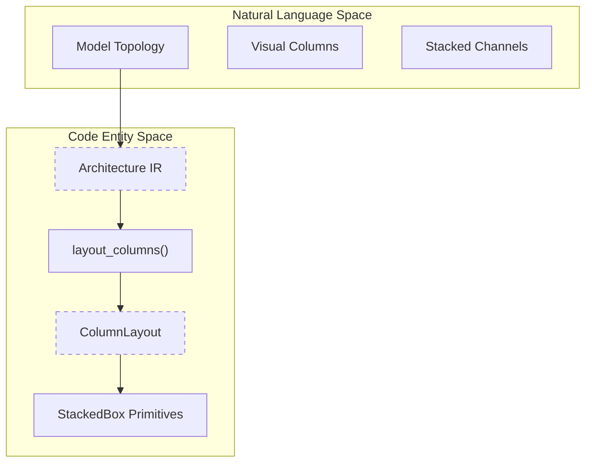

<!-- source: DeepWiki mcp.deepwiki.com · repo willyfh/visualtorch · page 3.3 LeNet Style View (lenet_view) · fetched 2026-10-21 -->

# LeNet Style View (lenet_view)

<details>
<summary>Relevant source files</summary>

The following files were used as context for generating this wiki page:

- [docs/examples/graph/plot_residual_block.py](docs/examples/graph/plot_residual_block.py)
- [docs/examples/lenet_style/plot_residual_block_lenet_style.py](docs/examples/lenet_style/plot_residual_block_lenet_style.py)
- [docs/source/conf.py](docs/source/conf.py)
- [docs/source/markdown/license/index.md](docs/source/markdown/license/index.md)
- [tests/test_connectors.py](tests/test_connectors.py)
- [tests/test_lenet_style.py](tests/test_lenet_style.py)
- [visualtorch/_volumetric_layout.py](visualtorch/_volumetric_layout.py)
- [visualtorch/lenet_style.py](visualtorch/lenet_style.py)

</details>


The `lenet_view` module provides a specialized rendering style for PyTorch models, inspired by the classic visualization of the LeNet architecture. It represents layers as "Stacked Boxes"—a series of offset flat rectangles—to visualize multi-channel feature maps and volumetric data flow [visualtorch/lenet_style.py:1-60]().

## Implementation & Data Flow

The `lenet_view` function serves as the primary entry point. It utilizes the unified `Architecture` IR to determine layer connectivity and spatial depth [visualtorch/lenet_style.py:120-120](). Unlike the standard `flow_view`, which uses solid 3D cuboids, `lenet_view` renders each layer as a `StackedBox` primitive [visualtorch/lenet_style.py:24-24]().

### Volumetric Canvas Calculation
The layout is managed by the `layout_columns` engine in `_volumetric_layout.py` [visualtorch/_volumetric_layout.py:60-70](). This engine calculates the global canvas size and individual node coordinates based on:
*   **Column Assignment:** Layers are grouped into columns by their topological depth [visualtorch/_volumetric_layout.py:112-112]().
*   **Vertical Stacking:** Parallel branches at the same depth stack top-to-bottom within a column [visualtorch/_volumetric_layout.py:73-74]().
*   **3D Footprint:** The engine accounts for the unique footprint of `StackedBox`, which spreads offset-copies symmetrically, unlike the single-direction extrusion of standard `Box` shapes [visualtorch/_volumetric_layout.py:77-79]().

### Natural Language to Code Entity Space: Layout

| Natural Language Concept | Code Entity / Symbol | File Reference |
| :--- | :--- | :--- |
| **Layer Stack** | `StackedBox` | [visualtorch/utils/utils.py:24-24]() |
| **Column Manager** | `ColumnLayout` | [visualtorch/_volumetric_layout.py:24-35]() |
| **Positioning Engine** | `layout_columns` | [visualtorch/_volumetric_layout.py:60-60]() |
| **Vertical Gap** | `gap_for` | [visualtorch/_volumetric_layout.py:85-86]() |


Sources: [visualtorch/lenet_style.py:120-136](), [visualtorch/_volumetric_layout.py:60-150]()

## Key Features & Configuration

### StackedBox Rendering & Channel Capping
The signature visual element of `lenet_view` is the representation of channels.
*   **`offset_z`**: Controls the pixel offset between overlapping channel rectangles [visualtorch/lenet_style.py:95-95]().
*   **`max_channels`**: To prevent the diagram from becoming excessively long, the number of drawn rectangles is capped. If the layer's channel dimension exceeds `max_channels`, the rendering is truncated to this limit [visualtorch/lenet_style.py:75-75]().

### Connector Routing
`lenet_view` distinguishes between direct flow and skip connections:
*   **Funnel Connectors**: When `draw_funnel=True`, consecutive layers are joined by volumetric trapezoids, implying a continuous data volume [visualtorch/lenet_style.py:90-90]().
*   **Skip Connections**: Connections that span multiple columns (span > 1) are routed as thin lines. These lines use a detour system calculated by `compute_skip_levels` to avoid colliding with intervening layer boxes [visualtorch/connectors.py:16-17](), [visualtorch/lenet_style.py:17-17]().

### Labeling & Dimensions
*   **`show_dimension`**: When enabled, the output shape of each layer (e.g., `(64, 28, 28)`) is printed in a dedicated label row below the diagram [visualtorch/lenet_style.py:98-101]().
*   **`_LABEL_ROW_HEIGHT`**: A constant (100 pixels) reserved at the bottom of the canvas to accommodate these labels [visualtorch/lenet_style.py:31-31](). Disabling labels reduces the total image height [tests/test_lenet_style.py:199-205]().

### System Component Mapping

```mermaid
graph LR
    subgraph "Input Processing"
        "Model" --> "extract_architecture"
    end

    subgraph "Visual Style"
        "extract_architecture" --> "lenet_view"
        "lenet_view" --> "make_box (_box_factory)"
    end

    subgraph "Geometric Primitives"
        "make_box (_box_factory)" --> "StackedBox"
        "lenet_view" --> "draw_connector"
    end

    subgraph "Layout Engine"
        "lenet_view" --> "layout_columns"
        "layout_columns" --> "ColumnLayout"
    end
```
Sources: [visualtorch/lenet_style.py:120-151](), [visualtorch/_volumetric_layout.py:24-35]()

## Regression Testing & Baselines

The `lenet_view` implementation is validated through regression tests that ensure consistent pixel dimensions and handling of various model types:
*   **Dimension Consistency**: Tests verify that disabling `show_dimension` results in a smaller image height, confirming the label row is correctly omitted [tests/test_lenet_style.py:199-205]().
*   **Orientation Support**: The view supports `one_dim_orientation` (x, y, or z) for 1D outputs (e.g., classification logits), ensuring layers like `nn.Linear` are rendered correctly regardless of the chosen axis [tests/test_lenet_style.py:176-181]().
*   **Model Compatibility**: Validated against `nn.Sequential`, `nn.ModuleList`, and custom `nn.Module` classes [tests/test_lenet_style.py:146-160]().

Sources: [tests/test_lenet_style.py:146-215](), [visualtorch/lenet_style.py:86-86]()

---

