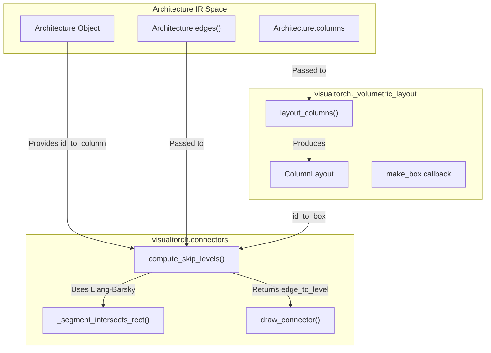
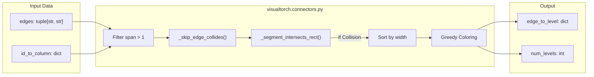

<!-- source: DeepWiki mcp.deepwiki.com · repo willyfh/visualtorch · page 3.4 Shared Layout Engine & Connector Routing · fetched 2026-10-21 -->

# Shared Layout Engine & Connector Routing

Relevant source files

The following files were used as context for generating this wiki page:

- [tests/test_connectors.py](tests/test_connectors.py)
- [tests/test_flow.py](tests/test_flow.py)
- [tests/test_graph.py](tests/test_graph.py)
- [visualtorch/_volumetric_layout.py](visualtorch/_volumetric_layout.py)
- [visualtorch/connectors.py](visualtorch/connectors.py)
- [visualtorch/utils/utils.py](visualtorch/utils/utils.py)

VisualTorch utilizes a unified layout and routing system to handle the spatial positioning of layers and the complex paths of skip connections. This shared infrastructure ensures consistent behavior across different visualization styles, specifically `flow_view` and `lenet_view`, while providing advanced collision detection and detour routing for non-sequential network architectures.

## Volumetric Column Layout

The `_volumetric_layout.py` module provides a generalized engine for positioning 3D-extruded shapes. It extends the column-based organization of the `Architecture` IR to volumetric space, where layers grouped by depth (columns) are stacked vertically if the model branches [visualtorch/_volumetric_layout.py:1-10]().

### ColumnLayout Dataclass
The result of a layout operation is encapsulated in the `ColumnLayout` class, which stores the final coordinates and dimensions required for canvas initialization and rendering [visualtorch/_volumetric_layout.py:24-35]().

| Attribute | Description |
| :--- | :--- |
| `boxes_by_column` | A nested list of `VolumetricBox` objects (`Box` or `StackedBox`) grouped by column. |
| `id_to_box` | A mapping from node IDs to their positioned box instances. |
| `column_heights` | The total vertical span of each column. |
| `diagram_height` | The maximum height across all columns. |
| `img_width` | The total calculated width of the resulting image. |
| `x_off` | The horizontal offset applied to account for 3D extrusion shifts. |

Sources: `[visualtorch/_volumetric_layout.py:24-35]()`, `[visualtorch/_volumetric_layout.py:36-41]()`

### The layout_columns Function
The `layout_columns` function is the core entry point for volumetric positioning. It iterates through columns from left to right, advancing a horizontal `current_x` cursor while stacking boxes vertically within each column [visualtorch/_volumetric_layout.py:60-74]().

Key behaviors include:
*   **Vertical Stacking**: Within a column, each box starts at a vertical position determined by the `gap_for` callback applied to the previous box [visualtorch/_volumetric_layout.py:134-134]().
*   **Geometry Callbacks**: It uses a suite of callbacks (`top_offset_for`, `x_shift_for`, etc.) to calculate the footprint of different shape types. For example, a `Box` (extruded cuboid) has different offset requirements than a `StackedBox` (symmetric spread) [visualtorch/_volumetric_layout.py:75-79]().
*   **Automatic Centering**: It calculates `x_off` to ensure that 3D extrusions (which typically shift shapes left and up) do not bleed off the left edge of the canvas [visualtorch/_volumetric_layout.py:122-124]().

Sources: `[visualtorch/_volumetric_layout.py:60-104]()`, `[visualtorch/_volumetric_layout.py:112-149]()`

## Connector Routing & Skip Levels

The `connectors.py` module solves the problem of "hidden" skip connections. In a straight-line layout, an edge spanning multiple columns would often be occluded by the intervening layers. The routing engine detects these collisions and assigns "detour levels" to route the connectors around the obstacles [visualtorch/connectors.py:1-8]().

### Collision Detection: Liang-Barsky Algorithm
VisualTorch uses a conservative implementation of the **Liang-Barsky** line-clipping algorithm to determine if a straight line between two nodes intersects any intervening boxes [visualtorch/connectors.py:105-130]().

*   **Function**: `_segment_intersects_rect` [visualtorch/connectors.py:133-188]().
*   **Behavior**: It parameterizes the connector as $P(t) = (x1, y1) + t \cdot (dx, dy)$ for $t \in [0, 1]$. Each edge of an axis-aligned bounding box (AABB) constrains the range of $t$. If the final range $[t0, t1]$ is non-empty, a collision is detected [visualtorch/connectors.py:146-152]().
*   **Conservatism**: Touching a corner or edge counts as an intersection to prevent visual ambiguity [visualtorch/connectors.py:145-146]().

### Level Assignment: Greedy Interval Coloring
When multiple skip connections exist, they must be assigned different vertical "detour levels" to avoid overlapping each other. This is implemented in `compute_skip_levels` [visualtorch/connectors.py:18-23]().

1.  **Filtering**: Only edges with a column span $> 1$ that actually collide with an intervening box are considered for routing [visualtorch/connectors.py:72-78]().
2.  **Sorting**: Intervals are sorted by width (narrowest first). This ensures that nested skips (e.g., in a U-Net) are routed logically, with outer skips taking higher detour levels than the inner ones they enclose [visualtorch/connectors.py:41-45](), [visualtorch/connectors.py:80-80]().
3.  **Greedy Coloring**: A greedy interval-graph-coloring algorithm assigns the lowest available level to each interval such that no two overlapping spans share the same level [visualtorch/connectors.py:84-92]().

Sources: `[visualtorch/connectors.py:18-64]()`, `[visualtorch/connectors.py:133-188]()`, `[tests/test_connectors.py:16-126]()`

## Implementation Logic Diagrams

### Layout and Routing Data Flow
The following diagram illustrates how the shared engine processes the Architecture IR into a rendered layout with routed connectors.

**System Entity Mapping: IR to Layout**

Sources: `[visualtorch/_volumetric_layout.py:60-70]()`, `[visualtorch/connectors.py:18-23]()`, `[visualtorch/connectors.py:133-142]()`

### Connector Routing Logic
This diagram bridges the natural language concept of "routing" to the specific code entities in `connectors.py`.

**Code Entity Space: Skip Connection Routing**

Sources: `[visualtorch/connectors.py:69-94]()`, `[visualtorch/connectors.py:97-130]()`

## Summary of Key Functions

| Module | Function | Role |
| :--- | :--- | :--- |
| `_volumetric_layout` | `layout_columns` | Positions `VolumetricBox` objects in 3D space using column-based stacking [visualtorch/_volumetric_layout.py:60](). |
| `connectors` | `compute_skip_levels` | Calculates detour levels for skip connections using interval coloring [visualtorch/connectors.py:18](). |
| `connectors` | `_segment_intersects_rect` | Implements Liang-Barsky collision detection for line segments and rectangles [visualtorch/connectors.py:133](). |
| `connectors` | `draw_connector` | Executes the actual drawing of routed lines on the `aggdraw` canvas [visualtorch/connectors.py:191](). |

Sources: `[visualtorch/_volumetric_layout.py:60-149]()`, `[visualtorch/connectors.py:18-228]()`

---

