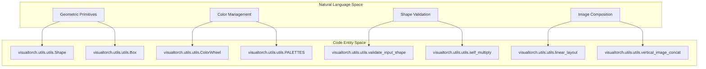
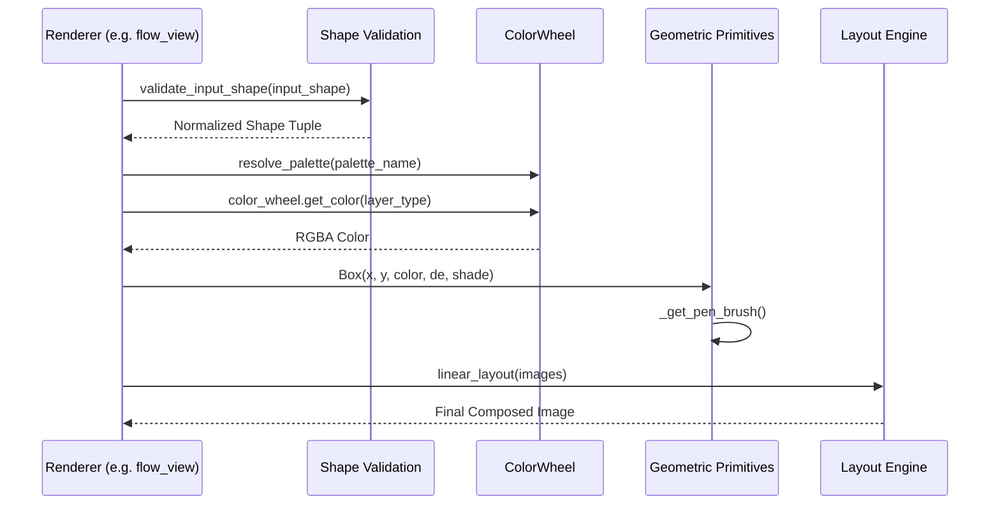

<!-- source: DeepWiki mcp.deepwiki.com · repo willyfh/visualtorch · page 4 Rendering Utilities · fetched 2026-10-21 -->

# Rendering Utilities

Relevant source files

The following files were used as context for generating this wiki page:

- [visualtorch/utils/__init__.py](visualtorch/utils/__init__.py)
- [visualtorch/utils/layer_utils.py](visualtorch/utils/layer_utils.py)
- [visualtorch/utils/utils.py](visualtorch/utils/utils.py)

The Rendering Utilities layer provides the foundational building blocks for all visualization styles in VisualTorch. It abstracts low-level drawing operations, manages color consistency across complex model architectures, and provides robust validation for the various input/output tensor shapes encountered during model tracing.

### Core Utility Architecture

The utilities are structured to provide a common language between the high-level renderers (`graph_view`, `flow_view`, `lenet_view`) and the underlying rasterization engine (`aggdraw` and `Pillow`).

The following diagram illustrates the relationship between utility entities and their roles in the rendering pipeline:

**Utility System Mapping**

**Sources:** [visualtorch/utils/utils.py:17-230](), [visualtorch/utils/__init__.py:6-30]()

---

### Geometric Primitives & Image Layout
The codebase defines a hierarchy of geometric objects that represent neural network layers. These shapes encapsulate their own drawing logic, including 3D extrusion effects for volumetric visualizations.

*   **Shape Hierarchy:** The base `Shape` class [visualtorch/utils/utils.py:17-60]() manages coordinates and color resolution. Specialized subclasses like `Box` [visualtorch/utils/utils.py:112-180](), `StackedBox` [visualtorch/utils/utils.py:61-111](), and `Circle` [visualtorch/utils/utils.py:181-189]() implement specific rasterization logic using `aggdraw` pens and brushes.
*   **Volumetric Rendering:** `Box` and `StackedBox` support depth effects through the `de` (depth) and `shade` attributes, using `_fade_color` to simulate 3D perspective [visualtorch/utils/utils.py:75-94]().
*   **Layout Utilities:** Functions like `linear_layout` handle the spatial arrangement of images, while `vertical_image_concat` facilitates the generation of legends and multi-part diagrams [visualtorch/utils/utils.py:348-350]().

For details, see [Geometric Primitives & Image Layout](#4.1).

**Sources:** [visualtorch/utils/utils.py:17-228]()

---

### Color Palettes & ColorWheel
To ensure that different layers are visually distinguishable, VisualTorch employs a sophisticated color management system.

*   **Palettes:** A collection of scientifically-informed and aesthetic color schemes (e.g., `okabe_ito`, `tab10`, `dracula`) is stored in the `PALETTES` dictionary [visualtorch/utils/utils.py:230-245]().
*   **ColorWheel:** The `ColorWheel` class [visualtorch/utils/utils.py:295-346]() provides a stateful mechanism to map layer types to specific colors. It ensures that all "Conv2d" layers, for example, share the same color within a single render, even if the user does not provide a manual `color_map`.
*   **Color Resolution:** `get_rgba_tuple` converts various color formats (hex, named colors, RGB) into the standard RGBA format required by the drawing backend [visualtorch/utils/utils.py:263-293]().

For details, see [Color Palettes & ColorWheel](#4.2).

**Sources:** [visualtorch/utils/utils.py:230-346]()

---

### Input Shape Handling & Validation
Handling the variety of tensor shapes in PyTorch (single tensors, tuples of tensors, varied dimensions) is critical for accurate visualization labels.

*   **Shape Normalization:** The `InputShape` type alias [visualtorch/utils/utils.py:13-14]() and `validate_input_shape` ensure that inputs are correctly interpreted regardless of whether the model takes a single tensor or multiple inputs.
*   **Calculation Utilities:** `self_multiply` [visualtorch/utils/utils.py:352-363]() is used to calculate total element counts (e.g., for flattening layers), while `format_shape_label` converts internal shape tuples into human-readable strings for the final image.

For details, see [Input Shape Handling & format_shape_label](#4.3).

**Sources:** [visualtorch/utils/utils.py:13-14](), [visualtorch/utils/utils.py:352-363]()

---

### Utility Interaction Flow

The following diagram shows how a rendering style (e.g., `flow_view`) utilizes these utilities to transform an architecture definition into a final image.

**Rendering Utility Pipeline**

**Sources:** [visualtorch/utils/utils.py:54-59](), [visualtorch/utils/utils.py:295-310](), [visualtorch/utils/utils.py:348-350]()

---

