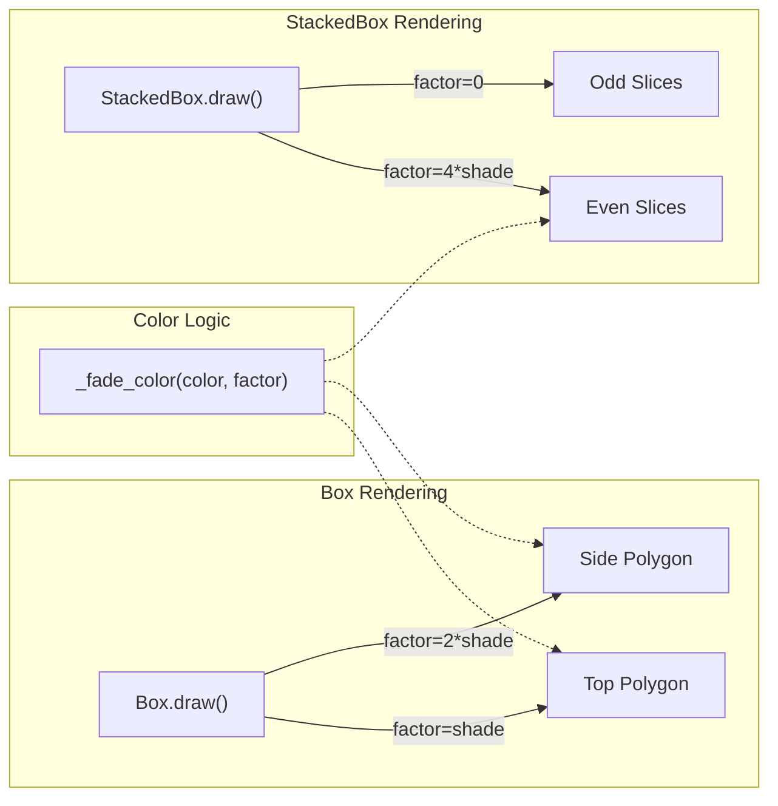
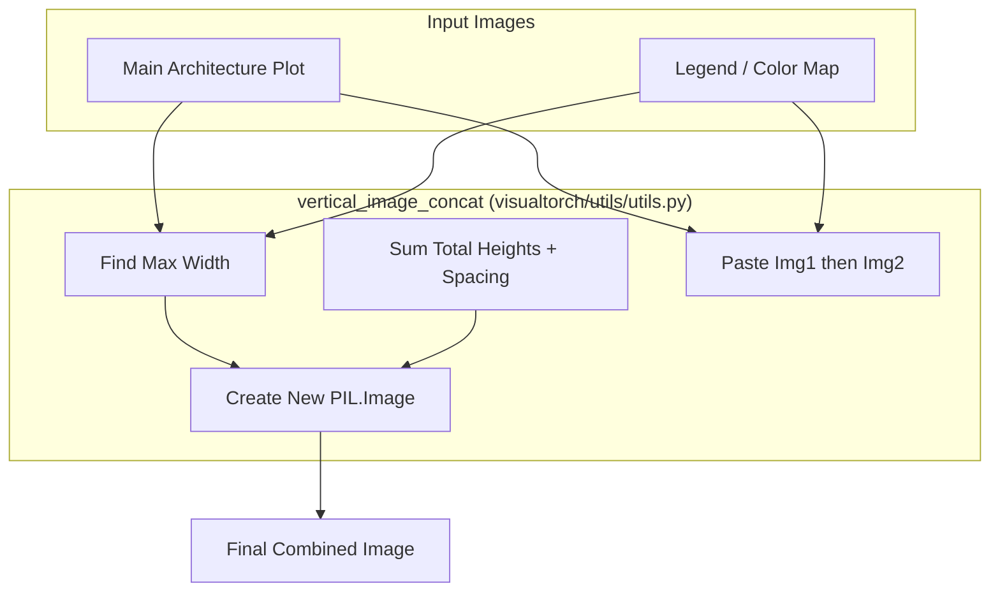

<!-- source: DeepWiki mcp.deepwiki.com · repo willyfh/visualtorch · page 4.1 Geometric Primitives & Image Layout · fetched 2026-10-21 -->

# Geometric Primitives & Image Layout

Relevant source files

The following files were used as context for generating this wiki page:

- [visualtorch/utils/__init__.py](visualtorch/utils/__init__.py)
- [visualtorch/utils/layer_utils.py](visualtorch/utils/layer_utils.py)
- [visualtorch/utils/utils.py](visualtorch/utils/utils.py)

This page documents the geometric foundation of VisualTorch. It covers the `Shape` class hierarchy used for rendering network modules, the 3D extrusion logic for volumetric effects, and the layout engines used to arrange images and legends.

## Shape Class Hierarchy

VisualTorch uses a specialized class hierarchy to manage the lifecycle of geometric primitives. Every visual element (nodes in Graph View, volumes in Flow/LeNet View) inherits from a base `Shape` class.

### The Draw Lifecycle
The rendering process for any shape follows a standard lifecycle:
1.  **Color Resolution**: Colors are converted from strings/hex to RGBA tuples via `get_rgba_tuple` [visualtorch/utils/utils.py:33-43]().
2.  **Aggdraw State**: The shape generates an `aggdraw.Pen` (for outlines) and `aggdraw.Brush` (for fills) [visualtorch/utils/utils.py:54-59]().
3.  **Rasterization**: The `draw()` method is called, passing a `PIL.ImageDraw` or `aggdraw.Draw` object to perform the actual pixel operations [visualtorch/utils/utils.py:71-73]().

### Geometric Entities

| Class | Purpose | Key Attributes |
| :--- | :--- | :--- |
| `Shape` | Base class for all primitives. | `x1, y1, x2, y2`, `_fill`, `_outline` [visualtorch/utils/utils.py:17-26]() |
| `Box` | Renders a 2D rectangle or a 3D-extruded cuboid. | `de` (depth), `shade` [visualtorch/utils/utils.py:112-118]() |
| `StackedBox` | Renders multiple overlapping slices (LeNet style). | `offset_z`, `de` (number of slices) [visualtorch/utils/utils.py:61-70]() |
| `Circle` | Renders a circle (used for small nodes). | Standard shape bounds [visualtorch/utils/utils.py:181-188]() |
| `Ellipses` | Renders three vertical dots (omitted layers). | `w` (width) used for dot spacing [visualtorch/utils/utils.py:190-228]() |

### Shape Inheritance and Implementation
The following diagram maps the relationship between the code classes and their visual representation in the final output.

**Shape Entity Mapping**

```mermaid
graph TD
    subgraph "Code Entity Space (visualtorch/utils/utils.py)"
        Base["class Shape"]
        C_Box["class Box"]
        C_SBox["class StackedBox"]
        C_Circ["class Circle"]
        C_Ellp["class Ellipses"]
    end

    subgraph "Visual Output Space"
        V_Cuboid["3D Cuboid (Flow View)"]
        V_Stack["Layer Slices (LeNet View)"]
        V_Node["Circular Node (Graph View)"]
        V_Dots["Vertical Dots (Skipped Layers)"]
    end

    Base --> C_Box
    Base --> C_SBox
    Base --> C_Circ
    Base --> C_Ellp

    C_Box -- "draw()" --> V_Cuboid
    C_SBox -- "draw()" --> V_Stack
    C_Circ -- "draw()" --> V_Node
    C_Ellp -- "draw()" --> V_Dots
```

Sources: [visualtorch/utils/utils.py:17-191](), [visualtorch/utils/__init__.py:7-12]()

---

## 3D Extrusion & Shading Logic

VisualTorch simulates 3D depth for volumetric layers using two distinct techniques depending on the view style.

### Box Extrusion (Flow View)
The `Box` class implements 3D depth by drawing a front face and two polygons representing the top and side faces [visualtorch/utils/utils.py:124-178]().
*   **Depth (`de`)**: The pixel offset for the 3D effect.
*   **Shading**: The side and top faces are darkened using `_fade_color`.
    *   Top face uses `shade` value [visualtorch/utils/utils.py:125]().
    *   Side face uses `2 * shade` value [visualtorch/utils/utils.py:126]().

### Slice Stacking (LeNet Style)
The `StackedBox` class simulates depth by iteratively drawing `de` number of rectangles, each shifted by `offset_z` [visualtorch/utils/utils.py:75-94]().
*   **Alternating Shading**: To differentiate slices, it toggles between the base fill color and a faded version (`4 * shade`) based on the iteration index [visualtorch/utils/utils.py:76-93]().
*   **Front Offset**: The `front_offset()` method calculates the exact coordinate of the foremost slice so that connectors attach to the front rather than the center [visualtorch/utils/utils.py:98-109]().

**Data Flow: Shading Calculation**

Sources: [visualtorch/utils/utils.py:75-96](), [visualtorch/utils/utils.py:124-178]()

---

## Image Layout Engines

VisualTorch provides utilities to organize multiple images (e.g., the main model plot and its legend) into a single canvas.

### Linear Layout Wrapping
The `linear_layout` function acts as a wrapping engine for image sequences [visualtorch/utils/utils.py:270-323]().
*   **Flow**: It places images side-by-side until the `max_width` is reached, then wraps to a new row.
*   **Alignment**: Supports `valign` (top, center, bottom) for images of varying heights within a single row [visualtorch/utils/utils.py:276-278]().
*   **Spacing**: Controlled via `horizontal_spacing` and `vertical_spacing` parameters [visualtorch/utils/utils.py:274-275]().

### Vertical Image Concatenation
The `vertical_image_concat` function is a specialized utility often used to append legends or labels below the main architecture plot [visualtorch/utils/utils.py:241-267]().
*   **Width Normalization**: It calculates the maximum width among all provided images and creates a canvas that fits them all [visualtorch/utils/utils.py:255-257]().
*   **Background**: Fills the resulting canvas with a `background_fill` color (defaulting to transparent/white) [visualtorch/utils/utils.py:258-259]().

**Image Concatenation Logic**

Sources: [visualtorch/utils/utils.py:241-267](), [visualtorch/utils/utils.py:270-323]()

---

