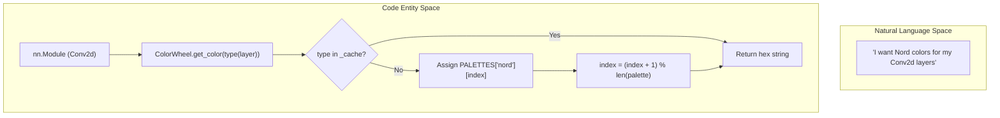
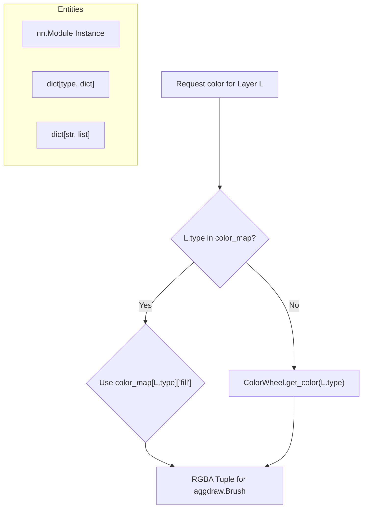

<!-- source: DeepWiki mcp.deepwiki.com · repo willyfh/visualtorch · page 4.2 Color Palettes & ColorWheel · fetched 2026-10-21 -->

# Color Palettes & ColorWheel

<details>
<summary>Relevant source files</summary>

The following files were used as context for generating this wiki page:

- [docs/examples/flow/plot_color_palettes_flow.py](docs/examples/flow/plot_color_palettes_flow.py)
- [docs/examples/graph/plot_color_palettes_graph.py](docs/examples/graph/plot_color_palettes_graph.py)
- [docs/examples/graph/plot_custom_node_color.py](docs/examples/graph/plot_custom_node_color.py)
- [docs/examples/lenet_style/plot_color_palettes_lenet_style.py](docs/examples/lenet_style/plot_color_palettes_lenet_style.py)
- [docs/source/_static/images/banners/readme-examples.png](docs/source/_static/images/banners/readme-examples.png)
- [docs/source/_static/images/banners/visualizations-preview.png](docs/source/_static/images/banners/visualizations-preview.png)
- [visualtorch/utils/utils.py](visualtorch/utils/utils.py)

</details>


This page documents the color management system in VisualTorch. It covers the built-in scientific and aesthetic palettes, the `ColorWheel` mechanism for automatic layer-to-color assignment, and the utility functions that resolve user-defined overrides against palette fallbacks.

## Overview

VisualTorch uses a hierarchical color resolution strategy. When rendering a model, the system determines a layer's color by checking:
1.  **Explicit Overrides**: User-provided `color_map` in `render()`.
2.  **Type Caching**: The `ColorWheel` class, which ensures the same `nn.Module` type consistently receives the same color from a palette.
3.  **Palette Fallback**: A selection from one of the ten built-in color palettes.

## Built-in Palettes (`PALETTES`)

VisualTorch includes a variety of palettes categorized by scientific utility (colorblind safety) and popular aesthetic themes. These are stored in the `PALETTES` dictionary [visualtorch/utils/utils.py:230-316]().

| Palette Name | Description | Source / Context |
| :--- | :--- | :--- |
| `okabe_ito` | Colorblind-safe qualitative palette. **Default.** | Okabe & Ito (2008) [visualtorch/utils/utils.py:231-233]() |
| `tol_bright` | Paul Tol's bright qualitative scheme. | Scientific visualization [visualtorch/utils/utils.py:234-236]() |
| `tol_muted` | Paul Tol's muted qualitative scheme. | Scientific visualization [visualtorch/utils/utils.py:237-239]() |
| `tab10` | Standard Tableau/Matplotlib category colors. | General purpose [visualtorch/utils/utils.py:240-242]() |
| `nord` | Arctic-toned, cool blues and greys. | Popular IDE theme [visualtorch/utils/utils.py:243-245]() |
| `dracula` | High-contrast dark theme colors. | Popular IDE theme [visualtorch/utils/utils.py:246-248]() |
| `gruvbox` | Retro "groove" colors (browns/oranges). | Popular IDE theme [visualtorch/utils/utils.py:249-251]() |
| `solarized` | Precision-tuned colors for contrast. | Precision UI design [visualtorch/utils/utils.py:252-254]() |
| `material` | Google's Material Design primary colors. | UI/UX standards [visualtorch/utils/utils.py:255-257]() |
| `catppuccin` | Soft, vibrant pastel palette. | Community theme [visualtorch/utils/utils.py:258-260]() |

**Sources:** [visualtorch/utils/utils.py:230-316]()

## The ColorWheel Class

The `ColorWheel` class is responsible for cycling through a palette and caching assignments. It ensures that every instance of `nn.Conv2d` looks the same, while `nn.Linear` receives a distinct color.

### Key Logic
- **Initialization**: Takes a list of colors (a palette) [visualtorch/utils/utils.py:321-322]().
- **Caching**: Uses an internal `_cache` dictionary to map `type` objects to specific colors [visualtorch/utils/utils.py:323]().
- **Retrieval**: The `get_color(layer_type)` method returns the cached color if it exists; otherwise, it assigns the next available color in the palette and increments the index [visualtorch/utils/utils.py:325-333]().

### Data Flow: Type to Color Mapping



**Sources:** [visualtorch/utils/utils.py:319-333]()

## Color Resolution & Utilities

### `resolve_palette`
This function handles the logic of selecting the active palette. If a user provides a string name (e.g., "dracula"), it fetches the list from `PALETTES`. If a list is provided directly, it uses that list [visualtorch/utils/utils.py:336-350]().

### `get_rgba_tuple`
Converts various color formats (hex strings, named colors, or RGB tuples) into a standard 4-element RGBA tuple `(R, G, B, A)`.
- It uses `PIL.ImageColor.getrgb` for string parsing [visualtorch/utils/utils.py:365]().
- It appends the `opacity` value (0-255) to the RGB result [visualtorch/utils/utils.py:367]().

### Shading Logic: `_fade_color`
Used primarily in `flow_view` and `lenet_view` to create 3D effects. It takes an RGBA tuple and reduces the RGB values by a `multiplier` to create a darker shade for the sides of volumetric boxes [visualtorch/utils/utils.py:372-379]().

**Sources:** [visualtorch/utils/utils.py:336-379]()

## Interaction: `color_map` vs. `palette`

When `render()` is called, it initializes a `ColorWheel` using the resolved palette. However, the `color_map` argument allows users to override this behavior per layer type.

### Resolution Logic Diagram



### Example: Combining Overrides and Palettes
In this scenario, `nn.Linear` is explicitly set to green, while all other layers (like `nn.Conv2d` or `nn.ReLU`) will pull from the `nord` palette via the `ColorWheel`.

```python
# Informed by docs/examples/graph/plot_custom_node_color.py:38-42
# and docs/examples/flow/plot_color_palettes_flow.py:30
color_map = {nn.Linear: {"fill": "#009E73"}}
img = visualtorch.render(model, input_shape, palette="nord", color_map=color_map)
```

**Sources:** [docs/examples/graph/plot_custom_node_color.py:38-42](), [docs/examples/flow/plot_color_palettes_flow.py:30]()

---

