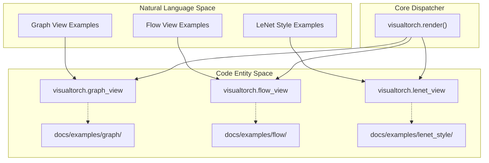
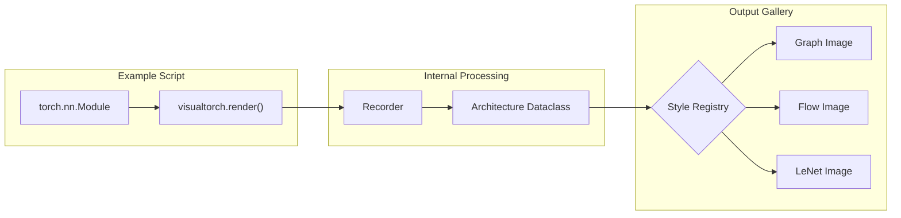

<!-- source: DeepWiki mcp.deepwiki.com · repo willyfh/visualtorch · page 5 Usage Examples & Gallery · fetched 2026-10-21 -->

# Usage Examples & Gallery

Relevant source files

The following files were used as context for generating this wiki page:

- [docs/examples/README.md](docs/examples/README.md)
- [docs/examples/flow/README.md](docs/examples/flow/README.md)
- [docs/examples/graph/README.md](docs/examples/graph/README.md)
- [docs/examples/lenet_style/README.md](docs/examples/lenet_style/README.md)
- [docs/source/markdown/api_references/lenet_style.md](docs/source/markdown/api_references/lenet_style.md)

The `visualtorch` repository includes a comprehensive suite of examples organized by visualization style. These examples serve as both a gallery of the library's capabilities and a functional test suite for various neural network architectures, from simple Multi-Layer Perceptrons (MLPs) to complex models like ResNet, U-Net, and Vision Transformers (ViT).

The example system is powered by **Sphinx-Gallery**, which automatically executes the scripts located in the `docs/examples/` directory to generate the visual outputs and documentation pages [docs/examples/README.md:1-6]().

### Visualization Ecosystem

The gallery is partitioned into three primary directories, each corresponding to a specific rendering engine within the `visualtorch` core.

#### Architecture to Example Mapping
The following diagram illustrates how high-level user scripts in the `docs/examples/` directory interact with the internal rendering modules to produce the gallery.

"Gallery to Code Mapping"

**Sources:** [docs/examples/README.md:1-6](), [docs/source/markdown/api_references/lenet_style.md:1-7]()

---

### Example Categories

#### 1. Graph View Examples
These examples utilize `graph_view` to represent models as directed acyclic graphs (DAGs). This style is optimized for showing logical connectivity, skip connections, and multi-input/multi-output branching (e.g., Siamese networks).
*   **Key Features:** Node shapes (Box, Circle, Ellipses), skip-connection routing, and layer dimension labeling.
*   **For details, see [Graph View Examples](#5.1).**

#### 2. Flow View Examples
These examples utilize `flow_view` to create volumetric representations of tensors. It is particularly effective for visualizing CNNs and spatial transformations where the "flow" of data dimensions is the primary focus.
*   **Key Features:** Funnel connectors between layers, 2D vs 3D volumetric toggles, and color palette customization.
*   **For details, see [Flow View Examples](#5.2).**

#### 3. LeNet Style Examples
These examples utilize `lenet_view` to produce the classic "stacked box" visualization popularized by early deep learning papers. It emphasizes the depth and channel-wise stacking of feature maps.
*   **Key Features:** StackedBox rendering, `offset_z` depth control, and channel capping.
*   **For details, see [LeNet Style Examples](#5.3).**

---

### Example Execution Pipeline
The following diagram describes the relationship between the example scripts and the internal `Architecture` IR (Intermediate Representation) used to render them.

"Example Rendering Pipeline"

**Sources:** [docs/examples/graph/README.md:1-6](), [docs/examples/flow/README.md:1-6](), [docs/examples/lenet_style/README.md:1-6]()

### Summary Table of Gallery Contents

| Category | Primary Focus | Notable Architectures Included |
| :--- | :--- | :--- |
| **Graph** | Topology & Connectivity | Siamese Networks, Inception, ResNet-18 |
| **Flow** | Volumetric Data Flow | U-Net, ViT, Sequential CNNs |
| **LeNet** | Feature Map Stacking | LeNet-5, Residual Blocks, Custom CNNs |

**Sources:** [docs/examples/graph/README.md:1-6](), [docs/examples/flow/README.md:1-6](), [docs/examples/lenet_style/README.md:1-6]()

---

