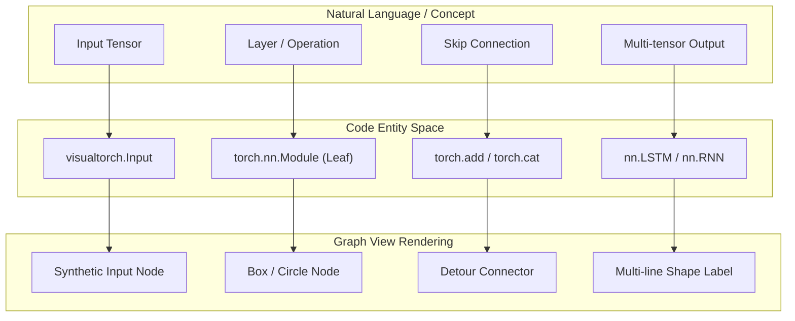
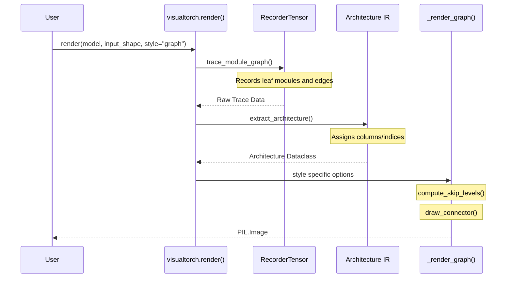

<!-- source: DeepWiki mcp.deepwiki.com · repo willyfh/visualtorch · page 5.1 Graph View Examples · fetched 2026-10-21 -->

# Graph View Examples

Relevant source files

The following files were used as context for generating this wiki page:

- [docs/examples/graph/plot_basic_dense.py](docs/examples/graph/plot_basic_dense.py)
- [docs/examples/graph/plot_custom_node_color.py](docs/examples/graph/plot_custom_node_color.py)
- [docs/examples/graph/plot_custom_node_size.py](docs/examples/graph/plot_custom_node_size.py)
- [docs/examples/graph/plot_custom_opacity_graph.py](docs/examples/graph/plot_custom_opacity_graph.py)
- [docs/examples/graph/plot_custom_spacing_layers.py](docs/examples/graph/plot_custom_spacing_layers.py)
- [docs/examples/graph/plot_dark_background_graph.py](docs/examples/graph/plot_dark_background_graph.py)
- [docs/examples/graph/plot_higher_resolution.py](docs/examples/graph/plot_higher_resolution.py)
- [docs/examples/graph/plot_inception_block.py](docs/examples/graph/plot_inception_block.py)
- [docs/examples/graph/plot_multi_output_shapes.py](docs/examples/graph/plot_multi_output_shapes.py)
- [docs/examples/graph/plot_resnet18.py](docs/examples/graph/plot_resnet18.py)
- [docs/examples/graph/plot_unet.py](docs/examples/graph/plot_unet.py)
- [docs/examples/graph/plot_vit.py](docs/examples/graph/plot_vit.py)
- [docs/examples/lenet_style/plot_basic_sequential_lenet_style.py](docs/examples/lenet_style/plot_basic_sequential_lenet_style.py)
- [docs/source/_static/images/banners/readme-examples.png](docs/source/_static/images/banners/readme-examples.png)
- [docs/source/_static/images/banners/visualizations-preview.png](docs/source/_static/images/banners/visualizations-preview.png)

The Graph View style (`graph_view`) provides a node-link representation of PyTorch models. It is designed to visualize the computational graph as a series of connected blocks or neurons, emphasizing the connectivity and topological structure of the network. This page catalogs the example scripts available in the codebase, demonstrating various architectural patterns and visual customizations.

## System Overview: From Code to Graph

The following diagram illustrates how specific PyTorch code structures are mapped to Graph View entities during the rendering process.

### Code-to-Entity Mapping

**Sources:** [docs/examples/graph/plot_custom_node_color.py:38-40](), [docs/examples/graph/plot_multi_output_shapes.py:4-8](), [docs/examples/graph/plot_unet.py:40-45]()

## Standard Architectures

These examples demonstrate how `graph_view` handles standard neural network architectures, ranging from simple MLP to complex residual and transformer-based models.

### Basic Dense & CNNs
*   **Basic Dense:** A simple multi-layer perceptron. When no `color_map` is provided, `visualtorch` automatically assigns colors from a default colorblind-safe palette [docs/examples/graph/plot_basic_dense.py:1-48]().
*   **ResNet-18:** Visualizes a standard `torchvision` ResNet-18. It demonstrates the routing of residual skip connections above the main graph flow [docs/examples/graph/plot_resnet18.py:1-35]().
*   **Vision Transformer (ViT):** Shows the literal execution sequence of a ViT, including `Conv2d` patch embedding and `MultiheadAttention` layers [docs/examples/graph/plot_vit.py:1-74]().

### Advanced Connectivity
*   **U-Net:** Features nested skip connections. The renderer uses `compute_skip_levels` to route these bypasses above the main path without intersection [docs/examples/graph/plot_unet.py:1-65]().
*   **Inception Block:** Demonstrates parallel branches (1x1, 3x3, 5x5 convolutions) that merge into a single output [docs/examples/graph/plot_inception_block.py:1-10]().

## Customization Examples

The `graph_view` style offers extensive configuration through `visualtorch.render` arguments and the `color_map` dictionary.

### Visual Styling
| Feature | Implementation | Key Parameters |
| :--- | :--- | :--- |
| **Custom Colors** | Map module types to fill colors. | `color_map[nn.Linear]["fill"]` [docs/examples/graph/plot_custom_node_color.py:38-42]() |
| **Opacity** | Global transparency for all nodes. | `opacity=100` (0-255 scale) [docs/examples/graph/plot_custom_opacity_graph.py:30-37]() |
| **Dark Mode** | Black background with white connectors. | `background_fill="black"`, `connector_fill="white"` [docs/examples/graph/plot_dark_background_graph.py:38-46]() |
| **Node Size** | Change the pixel dimensions of nodes. | `node_size=100` [docs/examples/graph/plot_higher_resolution.py:72-80]() |
| **Spacing** | Adjust horizontal/vertical gaps. | `layer_spacing=60`, `node_spacing` [docs/examples/graph/plot_custom_spacing_layers.py:1-10]() |

### Metadata and Shapes
*   **Multi-Output Shapes:** For layers like `nn.LSTM` that return multiple tensors (output, hidden state, cell state), setting `show_dimension=True` ensures all resulting shapes are printed in the node label [docs/examples/graph/plot_multi_output_shapes.py:4-10]().
*   **Synthetic Input:** The starting point of the graph is a synthetic node that can be styled using the `visualtorch.Input` key in the `color_map` [docs/examples/graph/plot_custom_node_color.py:4-5]().

## Technical Implementation: The Rendering Pipeline

The following diagram shows how the `render` function dispatches a request to the graph-specific rendering logic.

### Graph View Execution Flow

**Sources:** [docs/examples/graph/plot_higher_resolution.py:58-80](), [docs/examples/graph/plot_custom_node_color.py:42]()

## Resolution and Quality
For publication-quality images, the `node_size` and `layer_spacing` parameters act as the primary levers for resolution. Increasing these values creates a larger canvas with more detail, which can then be downscaled or saved at high DPI (e.g., 300 DPI) for crisp text and lines [docs/examples/graph/plot_higher_resolution.py:4-9]().

**Sources:**
*   `docs/examples/graph/plot_basic_dense.py:1-48`
*   `docs/examples/graph/plot_custom_node_color.py:1-49`
*   `docs/examples/graph/plot_custom_opacity_graph.py:1-44`
*   `docs/examples/graph/plot_dark_background_graph.py:1-53`
*   `docs/examples/graph/plot_higher_resolution.py:1-86`
*   `docs/examples/graph/plot_multi_output_shapes.py:1-58`
*   `docs/examples/graph/plot_resnet18.py:1-35`
*   `docs/examples/graph/plot_unet.py:1-65`
*   `docs/examples/graph/plot_vit.py:1-74`
*   `docs/examples/graph/plot_custom_spacing_layers.py:1-10`
*   `docs/examples/graph/plot_inception_block.py:1-10`

---

