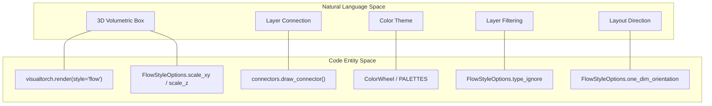
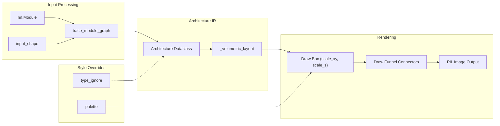

<!-- source: DeepWiki mcp.deepwiki.com · repo willyfh/visualtorch · page 5.2 Flow View Examples · fetched 2026-10-21 -->

# Flow View Examples

Relevant source files

The following files were used as context for generating this wiki page:

- [docs/examples/flow/plot_2d_view.py](docs/examples/flow/plot_2d_view.py)
- [docs/examples/flow/plot_basic_custom.py](docs/examples/flow/plot_basic_custom.py)
- [docs/examples/flow/plot_basic_sequential.py](docs/examples/flow/plot_basic_sequential.py)
- [docs/examples/flow/plot_color_palettes_flow.py](docs/examples/flow/plot_color_palettes_flow.py)
- [docs/examples/flow/plot_custom_color.py](docs/examples/flow/plot_custom_color.py)
- [docs/examples/flow/plot_custom_opacity.py](docs/examples/flow/plot_custom_opacity.py)
- [docs/examples/flow/plot_custom_orientation.py](docs/examples/flow/plot_custom_orientation.py)
- [docs/examples/flow/plot_custom_shading.py](docs/examples/flow/plot_custom_shading.py)
- [docs/examples/flow/plot_custom_spacing.py](docs/examples/flow/plot_custom_spacing.py)
- [docs/examples/flow/plot_dark_background.py](docs/examples/flow/plot_dark_background.py)
- [docs/examples/flow/plot_higher_resolution_flow.py](docs/examples/flow/plot_higher_resolution_flow.py)
- [docs/examples/flow/plot_ignore_layers.py](docs/examples/flow/plot_ignore_layers.py)
- [docs/examples/flow/plot_inception_block_flow.py](docs/examples/flow/plot_inception_block_flow.py)
- [docs/examples/flow/plot_multi_input_flow.py](docs/examples/flow/plot_multi_input_flow.py)
- [docs/examples/flow/plot_multi_output_shapes_flow.py](docs/examples/flow/plot_multi_output_shapes_flow.py)
- [docs/examples/flow/plot_residual_block_flow.py](docs/examples/flow/plot_residual_block_flow.py)
- [docs/examples/flow/plot_resnet18_flow.py](docs/examples/flow/plot_resnet18_flow.py)
- [docs/examples/flow/plot_unet_flow.py](docs/examples/flow/plot_unet_flow.py)
- [docs/examples/flow/plot_vit_flow.py](docs/examples/flow/plot_vit_flow.py)
- [docs/examples/graph/plot_color_palettes_graph.py](docs/examples/graph/plot_color_palettes_graph.py)
- [docs/examples/graph/plot_multi_input.py](docs/examples/graph/plot_multi_input.py)
- [docs/examples/lenet_style/plot_color_palettes_lenet_style.py](docs/examples/lenet_style/plot_color_palettes_lenet_style.py)
- [docs/examples/lenet_style/plot_higher_resolution_lenet_style.py](docs/examples/lenet_style/plot_higher_resolution_lenet_style.py)
- [docs/examples/lenet_style/plot_inception_block_lenet_style.py](docs/examples/lenet_style/plot_inception_block_lenet_style.py)
- [docs/examples/lenet_style/plot_multi_input_lenet_style.py](docs/examples/lenet_style/plot_multi_input_lenet_style.py)

The **Flow View** (`flow_view`) is a volumetric visualization style that represents neural network layers as 3D boxes. The dimensions of these boxes are derived from the tensor shapes (spatial dimensions and channel depth), connected by "funnel" shapes to illustrate the flow of data through the architecture. This page catalogs example scripts demonstrating the flexibility of the flow renderer, from basic sequential models to complex research architectures like ResNet, U-Net, and ViT.

## Implementation Mapping

The following diagram maps the conceptual visualization features to the specific code entities and parameters used in the `flow_view` examples.

### Visualization to Code Entity Map

**Sources:** [docs/examples/flow/plot_higher_resolution_flow.py:4-10](), [docs/examples/flow/plot_color_palettes_flow.py:4-7](), [docs/examples/flow/plot_ignore_layers.py:4-6]()

## Basic and Customization Examples

These examples demonstrate the fundamental controls for adjusting the visual aesthetics of the flow diagram, such as color, spacing, and resolution.

### Basic Sequential & Custom Colors
The default behavior traces a `nn.Sequential` model. Users can override the default color wheel by providing a `color_map` keyed by layer types. The synthetic input box can also be styled using the `visualtorch.Input` key.

*   **Custom Color Implementation:** [docs/examples/flow/plot_custom_color.py:33-42]()
*   **Sequential Tracing:** [docs/examples/flow/plot_basic_sequential.py:1-20]() (referenced)

### Spacing and Orientation
The distance between layers is controlled via the `spacing` parameter. While flow view defaults to a horizontal layout, the `one_dim_orientation` parameter allows for vertical flows.

*   **Custom Spacing:** [docs/examples/flow/plot_custom_spacing.py:30-30]()
*   **Orientation Toggle:** [docs/examples/flow/plot_custom_orientation.py:1-20]() (referenced)

### Higher Resolution and Scaling
Box sizes in `flow_view` are determined by two independent levers: `scale_xy` (spatial width/height) and `scale_z` (channel depth). Both are subject to clamping by `min_xy/max_xy` and `min_z/max_z` floors/ceilings.

| Parameter | Description | Default |
| :--- | :--- | :--- |
| `scale_xy` | Scales the spatial (H, W) extent of the box. | 1 |
| `scale_z` | Scales the depth (C) extent of the box. | 0.1 |
| `min_z` | The minimum depth allowed for a box. | 10 |

**Sources:** [docs/examples/flow/plot_higher_resolution_flow.py:4-12](), [docs/examples/flow/plot_higher_resolution_flow.py:75-83]()

## Advanced Architectural Blocks

These examples show how `flow_view` handles non-sequential structures like skip connections and multi-tensor outputs.

### Residual and Inception Blocks
Residual blocks use skip connections that are rendered as routed connectors. Inception blocks demonstrate parallel branches that are automatically laid out by the volumetric engine.

*   **Residual Block:** [docs/examples/flow/plot_residual_block_flow.py:1-30]() (referenced)
*   **Inception Block:** [docs/examples/flow/plot_inception_block_flow.py:1-30]() (referenced)

### Multi-Output Layer Shapes
Certain layers like `nn.LSTM` return multiple tensors (e.g., `(output, (h_n, c_n))`). When `show_dimension=True` is enabled, VisualTorch prints the shapes of all output tensors, ensuring that downstream layers consuming specific hidden states are visually accounted for.

**Sources:** [docs/examples/flow/plot_multi_output_shapes_flow.py:4-8](), [docs/examples/flow/plot_multi_output_shapes_flow.py:43-50]()

### Complex Models (ResNet, U-Net, ViT)
*   **ResNet-18:** Renders 8 residual blocks across 4 stages, highlighting projection shortcuts where spatial dimensions change. [docs/examples/flow/plot_resnet18_flow.py:4-6]()
*   **U-Net:** The contracting-then-expanding channel shapes produce a characteristic "U" silhouette. This relies on `show_input=True` to maintain symmetry. [docs/examples/flow/plot_unet_flow.py:4-9]()
*   **Vision Transformer (ViT):** Traces the literal module-by-module execution. While supported, the deep, narrow nature of ViT often makes it harder to parse in volumetric style compared to Graph View. [docs/examples/flow/plot_vit_flow.py:4-7]()

## Layer Filtering and Palettes

### Ignoring Layers
The `type_ignore` argument allows users to prune the diagram by hiding common utility layers like `nn.ReLU` or `nn.Flatten`. Additionally, `show_input=False` can be used to remove the synthetic input box.

**Sources:** [docs/examples/flow/plot_ignore_layers.py:4-6](), [docs/examples/flow/plot_ignore_layers.py:33-39]()

### Color Palettes
Instead of manual `color_map` entries, users can select a named `palette`. The palette serves as the fallback for any layer type not explicitly mapped.

| Palette Name | Description |
| :--- | :--- |
| `okabe_ito` | Colorblind-safe; the default palette. |
| `nord` | Arctic-toned, cool colors. |
| `dracula` | High-contrast, vibrant theme. |
| `catppuccin` | Soft pastel colors. |

**Sources:** [docs/examples/flow/plot_color_palettes_flow.py:4-7](), [docs/examples/flow/plot_color_palettes_flow.py:39-64]()

## Data Flow Diagram: Flow Rendering Pipeline

The following diagram illustrates how a model is processed into a Flow View visualization.

**Sources:** [docs/examples/flow/plot_higher_resolution_flow.py:4-10](), [docs/examples/flow/plot_color_palettes_flow.py:29-30](), [docs/examples/flow/plot_ignore_layers.py:33-39]()

---

