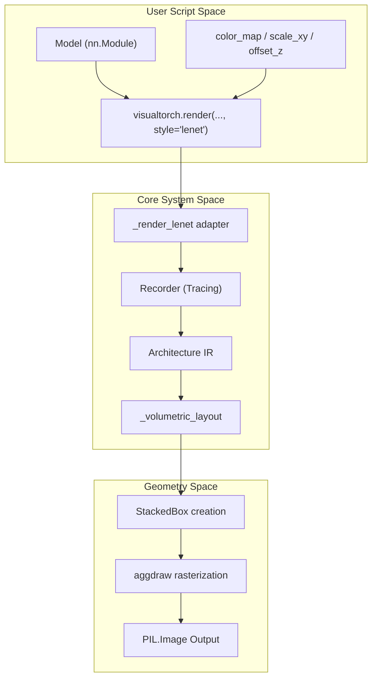

<!-- source: DeepWiki mcp.deepwiki.com · repo willyfh/visualtorch · page 5.3 LeNet Style Examples · fetched 2026-10-21 -->

# LeNet Style Examples

<details>
<summary>Relevant source files</summary>

The following files were used as context for generating this wiki page:

- [docs/examples/flow/plot_higher_resolution_flow.py](docs/examples/flow/plot_higher_resolution_flow.py)
- [docs/examples/flow/plot_inception_block_flow.py](docs/examples/flow/plot_inception_block_flow.py)
- [docs/examples/flow/plot_multi_input_flow.py](docs/examples/flow/plot_multi_input_flow.py)
- [docs/examples/graph/plot_basic_dense.py](docs/examples/graph/plot_basic_dense.py)
- [docs/examples/graph/plot_custom_node_size.py](docs/examples/graph/plot_custom_node_size.py)
- [docs/examples/graph/plot_custom_spacing_layers.py](docs/examples/graph/plot_custom_spacing_layers.py)
- [docs/examples/graph/plot_multi_input.py](docs/examples/graph/plot_multi_input.py)
- [docs/examples/lenet_style/plot_basic_custom_lenet_style.py](docs/examples/lenet_style/plot_basic_custom_lenet_style.py)
- [docs/examples/lenet_style/plot_basic_sequential_lenet_style.py](docs/examples/lenet_style/plot_basic_sequential_lenet_style.py)
- [docs/examples/lenet_style/plot_custom_color_lenet_style.py](docs/examples/lenet_style/plot_custom_color_lenet_style.py)
- [docs/examples/lenet_style/plot_custom_opacity_lenet_style.py](docs/examples/lenet_style/plot_custom_opacity_lenet_style.py)
- [docs/examples/lenet_style/plot_custom_orientation_lenet_style.py](docs/examples/lenet_style/plot_custom_orientation_lenet_style.py)
- [docs/examples/lenet_style/plot_custom_shading_lenet_style.py](docs/examples/lenet_style/plot_custom_shading_lenet_style.py)
- [docs/examples/lenet_style/plot_custom_spacing_lenet_style.py](docs/examples/lenet_style/plot_custom_spacing_lenet_style.py)
- [docs/examples/lenet_style/plot_dark_background_lenet_style.py](docs/examples/lenet_style/plot_dark_background_lenet_style.py)
- [docs/examples/lenet_style/plot_higher_resolution_lenet_style.py](docs/examples/lenet_style/plot_higher_resolution_lenet_style.py)
- [docs/examples/lenet_style/plot_ignore_layers_lenet_style.py](docs/examples/lenet_style/plot_ignore_layers_lenet_style.py)
- [docs/examples/lenet_style/plot_inception_block_lenet_style.py](docs/examples/lenet_style/plot_inception_block_lenet_style.py)
- [docs/examples/lenet_style/plot_multi_input_lenet_style.py](docs/examples/lenet_style/plot_multi_input_lenet_style.py)
- [docs/examples/lenet_style/plot_multi_output_shapes_lenet_style.py](docs/examples/lenet_style/plot_multi_output_shapes_lenet_style.py)
- [docs/examples/lenet_style/plot_resnet18_lenet_style.py](docs/examples/lenet_style/plot_resnet18_lenet_style.py)
- [docs/examples/lenet_style/plot_unet_lenet_style.py](docs/examples/lenet_style/plot_unet_lenet_style.py)
- [docs/examples/lenet_style/plot_vit_lenet_style.py](docs/examples/lenet_style/plot_vit_lenet_style.py)

</details>


The `lenet_view` style provides a volumetric, stacked-plane visualization of neural network architectures, inspired by the classic LeNet-5 diagrams. This page catalogs example scripts demonstrating how to configure and customize this style for various model architectures and aesthetic requirements.

## Overview of LeNet Style Visualization

The LeNet style utilizes `StackedBox` primitives to represent layers [visualtorch/utils/shapes.py:101-105](). Unlike the `flow_view` which uses monolithic blocks, `lenet_view` renders individual channels as stacked slices with a specific `offset_z` [visualtorch/utils/shapes.py:110-112]().

### Key Configuration Parameters
The following parameters frequently appear in the examples below:
*   `scale_xy`: Scales the spatial (width/height) dimensions of the planes [docs/examples/lenet_style/plot_higher_resolution_lenet_style.py:4-6]().
*   `offset_z`: The pixel offset between individual slices in a stack. Defaults to `10`, but often reduced for large models [docs/examples/lenet_style/plot_resnet18_lenet_style.py:8-10]().
*   `max_channels`: Caps the number of slices rendered for a single layer (default `100`) [docs/examples/lenet_style/plot_higher_resolution_lenet_style.py:7-9]().
*   `one_dim_orientation`: Controls whether 1D layers (like `Linear`) are stacked along the "z" axis (default) or spread along the "x" axis [docs/examples/lenet_style/plot_multi_output_shapes_lenet_style.py:10-12]().

---

## Basic and Sequential Examples

These examples demonstrate the standard entry point for `visualtorch.render` using `style="lenet"`.

### Basic Sequential
Uses `nn.Sequential` to define a standard CNN. The renderer automatically extracts the architecture and assigns colors based on the default color wheel.
**Sources:** [docs/examples/lenet_style/plot_basic_sequential_lenet_style.py]()

### Basic Custom Model
Demonstrates tracing a custom `nn.Module` class (`SimpleCNN`) that uses functional calls like `func.relu` and `func.max_pool2d` in its `forward` method [docs/examples/lenet_style/plot_basic_custom_lenet_style.py:15-40]().
**Sources:** [docs/examples/lenet_style/plot_basic_custom_lenet_style.py:15-48]()

---

## Architectural Patterns

### Residual Block and ResNet-18
Visualizes skip connections. For large models like ResNet-18, the `offset_z` is typically reduced to `1` to prevent the image from becoming excessively large due to high channel counts [docs/examples/lenet_style/plot_resnet18_lenet_style.py:31]().
**Sources:** [docs/examples/lenet_style/plot_resnet18_lenet_style.py:8-31](), [docs/examples/lenet_style/plot_higher_resolution_lenet_style.py:22-39]()

### Inception Block
Visualizes parallel branches within a single block. The `lenet_view` uses the shared `_volumetric_layout.py` logic to position these branches in columns [visualtorch/core/_volumetric_layout.py:11-15]().
**Sources:** [docs/examples/lenet_style/plot_inception_block_lenet_style.py]()

### U-Net and Vision Transformer (ViT)
Demonstrates the style's ability to handle complex connectivity, including the long-range skip connections in U-Net and the sequence-based processing in ViT.
**Sources:** [docs/examples/lenet_style/plot_unet_lenet_style.py](), [docs/examples/lenet_style/plot_vit_lenet_style.py]()

---

## Multi-Input and Multi-Output Handling

### Multi-Input (Siamese Networks)
Shows how to pass a tuple of shapes (e.g., `[(1, 3, 224, 224), (1, 3, 224, 224)]`) to the `input_shape` argument for models with multiple input heads.
**Sources:** [docs/examples/lenet_style/plot_multi_input_lenet_style.py]()

### Multi-Output Layer Shapes
Certain layers like `nn.LSTM` return multiple tensors. `lenet_view` renders labels for all output shapes when `show_dimension=True` [docs/examples/lenet_style/plot_multi_output_shapes_lenet_style.py:4-9]().
**Sources:** [docs/examples/lenet_style/plot_multi_output_shapes_lenet_style.py:4-15]()

---

## Aesthetic Customization

### Color, Opacity, and Shading
Custom colors are applied via a `color_map` dictionary, which can target specific layer types or the synthetic `visualtorch.Input` node [docs/examples/lenet_style/plot_custom_color_lenet_style.py:33-39]().
*   `opacity`: Integer (0-255) controlling layer transparency [docs/examples/lenet_style/plot_custom_opacity_lenet_style.py:30]().
*   `shade_step`: Controls the intensity of the 3D shading effect on the box faces [docs/examples/lenet_style/plot_custom_shading_lenet_style.py:29]().

**Sources:** [docs/examples/lenet_style/plot_custom_color_lenet_style.py:4-8](), [docs/examples/lenet_style/plot_custom_opacity_lenet_style.py:30](), [docs/examples/lenet_style/plot_custom_shading_lenet_style.py:29]()

### Spacing and Orientation
*   `spacing`: Adjusts the horizontal distance between layers [docs/examples/lenet_style/plot_custom_spacing_lenet_style.py:30]().
*   `one_dim_orientation`: Setting this to `"x"` prevents 1D layers with many units from creating extremely tall vertical stacks [docs/examples/lenet_style/plot_multi_output_shapes_lenet_style.py:54]().

**Sources:** [docs/examples/lenet_style/plot_custom_spacing_lenet_style.py:30](), [docs/examples/lenet_style/plot_custom_orientation_lenet_style.py:34-35]()

### Filtering and Backgrounds
*   `type_ignore`: A list of module types to exclude from the visualization [docs/examples/lenet_style/plot_ignore_layers_lenet_style.py:30-37]().
*   `background_fill`: Can be set to `"black"` or transparent `(0, 0, 0, 0)`. When using dark backgrounds, the `outline` in `color_map` should be adjusted for visibility [docs/examples/lenet_style/plot_dark_background_lenet_style.py:4-10]().

**Sources:** [docs/examples/lenet_style/plot_ignore_layers_lenet_style.py:30-39](), [docs/examples/lenet_style/plot_dark_background_lenet_style.py:8-11]()

---

## Resolution and Scaling

To generate high-resolution images for publications, `scale_xy` is the primary lever. Increasing `scale_xy` grows the spatial extent of every plane in the stack [docs/examples/lenet_style/plot_higher_resolution_lenet_style.py:69]().

**Sources:** [docs/examples/lenet_style/plot_higher_resolution_lenet_style.py:4-9](), [docs/examples/lenet_style/plot_higher_resolution_lenet_style.py:71]()

---

## Implementation Data Flow

The following diagram illustrates how the `lenet_view` examples interact with the core rendering engine.

**Figure 1: LeNet Style Rendering Pipeline**

**Sources:** [visualtorch/core/render_dispatcher.py:15-25](), [visualtorch/core/_volumetric_layout.py:11-20](), [visualtorch/utils/shapes.py:101-105]()

**Figure 2: Style Configuration Mapping**
```mermaid
graph LR
    subgraph "Natural Language Options"
        "Layer Spacing" --> Spacing["spacing"]
        "Plane Size" --> ScaleXY["scale_xy"]
        "Slice Gap" --> OffsetZ["offset_z"]
        "Ignore ReLUs" --> TypeIgnore["type_ignore"]
    end

    subgraph "Code Entity Space (LenetStyleOptions)"
        Spacing --> LSO["LenetStyleOptions.spacing"]
        ScaleXY --> LSO["LenetStyleOptions.scale_xy"]
        OffsetZ --> LSO["LenetStyleOptions.offset_z"]
        TypeIgnore --> LSO["LenetStyleOptions.type_ignore"]
    end
```
**Sources:** [visualtorch/core/render_dispatcher.py:76-92](), [docs/examples/lenet_style/plot_higher_resolution_lenet_style.py:4-9]()

---

