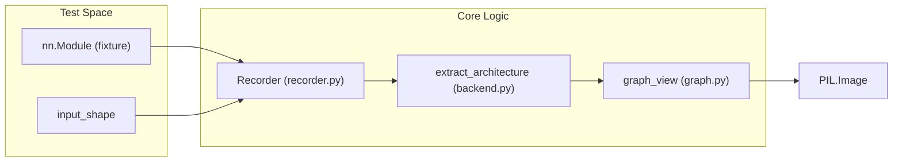
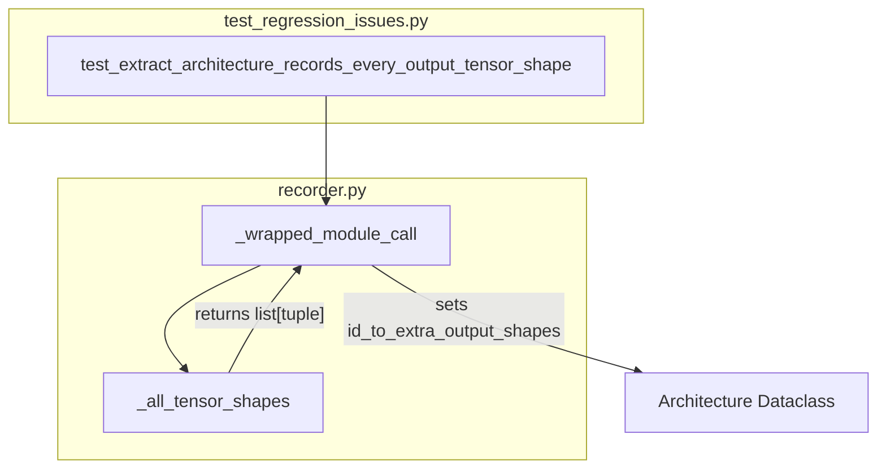

<!-- source: DeepWiki mcp.deepwiki.com · repo willyfh/visualtorch · page 6.1 Test Suite · fetched 2026-10-21 -->

# Test Suite

Relevant source files

The following files were used as context for generating this wiki page:

- [.gitignore](.gitignore)
- [docs/examples/graph/plot_residual_block.py](docs/examples/graph/plot_residual_block.py)
- [docs/examples/lenet_style/plot_residual_block_lenet_style.py](docs/examples/lenet_style/plot_residual_block_lenet_style.py)
- [docs/source/conf.py](docs/source/conf.py)
- [docs/source/markdown/license/index.md](docs/source/markdown/license/index.md)
- [pyproject.toml](pyproject.toml)
- [tests/test_connectors.py](tests/test_connectors.py)
- [tests/test_flow.py](tests/test_flow.py)
- [tests/test_graph.py](tests/test_graph.py)
- [tests/test_lenet_style.py](tests/test_lenet_style.py)
- [tests/test_regression_issues.py](tests/test_regression_issues.py)
- [tests/test_render.py](tests/test_render.py)
- [visualtorch/__init__.py](visualtorch/__init__.py)
- [visualtorch/_volumetric_layout.py](visualtorch/_volumetric_layout.py)
- [visualtorch/connectors.py](visualtorch/connectors.py)
- [visualtorch/render.py](visualtorch/render.py)
- [visualtorch/utils/recorder.py](visualtorch/utils/recorder.py)
- [visualtorch/utils/traced_layer.py](visualtorch/utils/traced_layer.py)

The **VisualTorch** test suite provides comprehensive coverage for the entire visualization pipeline, from model tracing and architecture extraction to the final rendering of three distinct styles. It ensures the correctness of layout algorithms, connectivity routing, and handles regression testing for complex PyTorch edge cases.

## Test Infrastructure Overview

The test suite is built on `pytest` and utilizes a fixture-based approach to provide standard models (Dense, Conv, Residual, Recurrent) across different test modules. It validates not only that the code runs without crashing but also verifies the mathematical and geometric properties of the generated visualizations.

### Core Test Modules

| Module | Focus Area | Key Validations |
|:---|:---|:---|
| `test_graph.py` | `graph_view` | Skip connections, weight sharing, neuron ellipsoids, and node-per-layer vs node-per-neuron logic. |
| `test_flow.py` | `flow_view` | Volumetric rendering, funnel draw order, and `type_ignore` filtering. |
| `test_lenet_style.py` | `lenet_view` | Stacked plane geometry, `offset_z` offsets, and canvas size baselines. |
| `test_render.py` | `render()` | Dispatcher logic, kwarg validation via dataclasses, and palette resolution. |
| `test_regression_issues.py` | GitHub Issues | Complex edge cases like `MultiheadAttention`, `FeaturePyramidNet`, and multi-output modules. |

Sources: [tests/test_graph.py:1-14](), [tests/test_lenet_style.py:1-14](), [tests/test_regression_issues.py:1-17](), [visualtorch/render.py:1-9]()

---

## 1. Graph View Tests (`test_graph.py`)

This module focuses on the `graph_view` frontend and the underlying `extract_architecture` logic.

### Implementation Details
The tests verify that the `Recorder` context manager correctly captures edges in various network topologies.
*   **Branching & Skips:** `test_extract_architecture_captures_branching` verifies that a merge point in a residual connection has an in-degree of 2 in the `Architecture` adjacency matrix [tests/test_graph.py:160-168]().
*   **Weight Sharing:** `test_graph_view_supports_weight_sharing` ensures that a single `nn.Module` instance called multiple times in a `forward()` pass results in distinct nodes in the graph [tests/test_graph.py:178-192]().
*   **Layer Filtering:** Validates that `show_neurons=False` correctly collapses a layer into a single node rather than a full mesh of neuron circles [tests/test_graph.py:119-123]().

### Data Flow: Tracing to Graph
The diagram below illustrates how `test_graph.py` exercises the system by passing a model through the tracing backend into the graph renderer.

**Graph Testing Data Flow**

Sources: [tests/test_graph.py:102-111](), [visualtorch/utils/recorder.py:176-180](), [visualtorch/backend.py:12-13]()

---

## 2. Flow and LeNet Style Tests

These modules test the volumetric layout engine and the "Stacked Box" geometry.

### Key Functional Tests
*   **Type Ignoring:** Both `test_flow.py` and `test_lenet_style.py` verify that layers passed to `type_ignore` (e.g., `nn.ReLU`) are completely omitted from the rendered columns [tests/test_lenet_style.py:189-197]().
*   **Canvas Sizing:** `test_lenet_view_show_dimension_can_be_disabled` checks that the canvas height decreases when dimension labels are disabled, proving the layout engine reserves space dynamically [tests/test_lenet_style.py:199-205]().
*   **Orientation:** Tests for `one_dim_orientation` ensure that 1D outputs (like classification logits) can be oriented along X, Y, or Z axes without crashing [tests/test_lenet_style.py:176-181]().

Sources: [tests/test_lenet_style.py:176-205](), [visualtorch/_volumetric_layout.py:60-103]()

---

## 3. Regression & Issue Tracking (`test_regression_issues.py`)

This module is dedicated to preventing regressions for issues reported by the community. It targets specific architectural quirks in PyTorch.

### MultiheadAttention Fallback
`nn.MultiheadAttention` is unique because it contains children (like `out_proj`) but often executes via a fused functional call that bypasses standard module hooks. The test `test_extract_architecture_records_multihead_attention_as_a_node` ensures that the tracer's fallback logic captures these modules as leaf nodes [tests/test_regression_issues.py:70-91]().

### Multi-Output Handling (e.g., LSTM)
Modules like `nn.LSTM` return a tuple of tensors `(output, (h_n, c_n))`. 
*   **Extraction:** `test_extract_architecture_records_every_output_tensor_shape` verifies that all shapes are stored in `extra_output_shapes` [tests/test_regression_issues.py:141-148]().
*   **Formatting:** `test_format_shape_label_appends_extra_shapes` ensures the labels are rendered as `(1, 7, 20) + (1, 1, 20) + (1, 1, 20)` [tests/test_regression_issues.py:150-154]().

**Regression Logic: Multi-Output Tracing**

Sources: [visualtorch/utils/recorder.py:109-130](), [visualtorch/utils/recorder.py:142-171](), [tests/test_regression_issues.py:141-148]()

---

## 4. Render Dispatcher Tests (`test_render.py`)

This module validates the primary public API: `visualtorch.render()`.

### Implementation
The `render` function uses a `_STYLE_REGISTRY` to map string names (`"graph"`, `"flow"`, `"lenet"`) to their respective option dataclasses and internal render functions [visualtorch/render.py:201-205]().

*   **Validation:** The tests verify that passing invalid keyword arguments results in a `TypeError` during dataclass instantiation, preventing silent failures [visualtorch/render.py:210-215]().
*   **Common Options:** Ensures that `CommonOptions` (like `palette` and `background_fill`) are correctly propagated to all sub-renderers [visualtorch/render.py:29-42]().

Sources: [visualtorch/render.py:29-42](), [visualtorch/render.py:201-215](), [tests/test_render.py]()

---

## 5. Connector and Routing Tests

While primarily tested through the style modules, specific logic for skip connections is validated for collision detection.

### Liang-Barsky Collision
`test_connectors.py` (and `test_graph.py`) validates the `_segment_intersects_rect` function, which uses the Liang-Barsky algorithm to determine if a skip connection needs a detour level to avoid overlapping intermediate layers [visualtorch/connectors.py:133-150]().

### Greedy Coloring
The `compute_skip_levels` function is tested to ensure that overlapping skip connections are assigned different vertical "levels" to prevent line occlusion [visualtorch/connectors.py:18-64]().

Sources: [visualtorch/connectors.py:18-64](), [visualtorch/connectors.py:133-150]()

---

