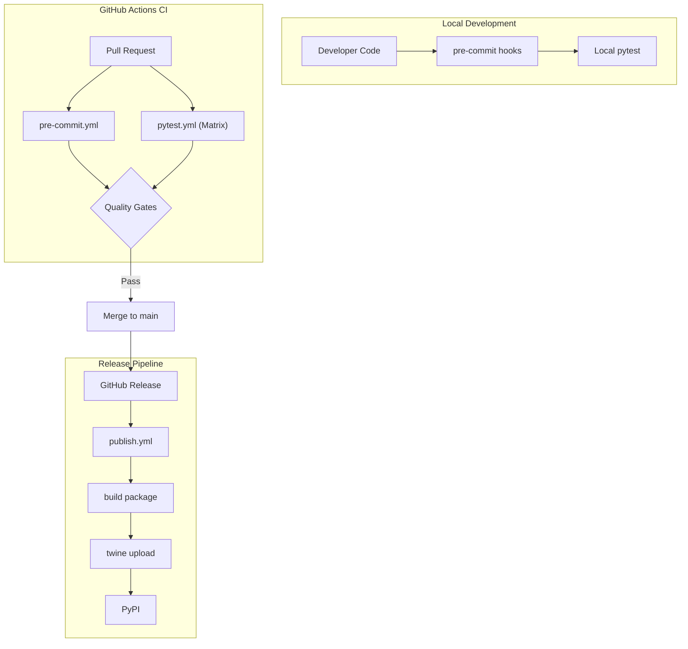
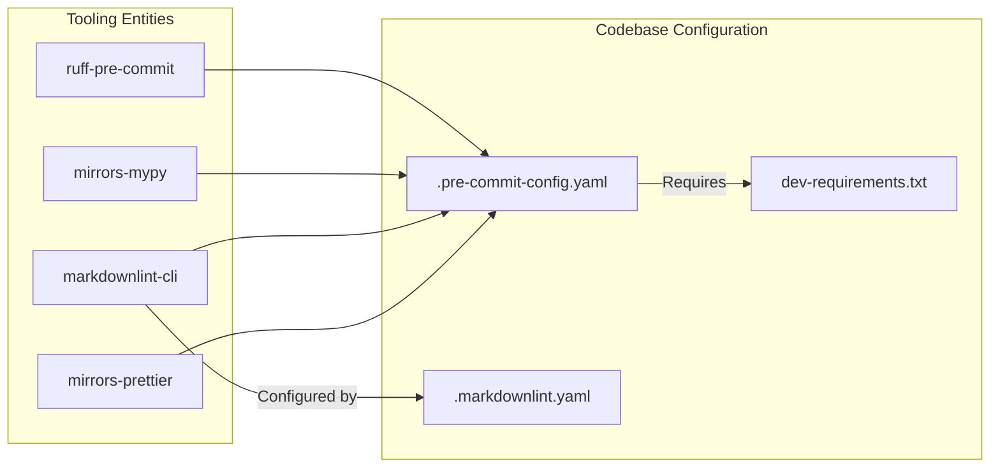

<!-- source: DeepWiki mcp.deepwiki.com · repo willyfh/visualtorch · page 6.2 CI/CD Pipelines & Developer Tooling · fetched 2026-10-21 -->

# CI/CD Pipelines & Developer Tooling

<details>
<summary>Relevant source files</summary>

The following files were used as context for generating this wiki page:

- [.github/workflows/pre-commit.yml](.github/workflows/pre-commit.yml)
- [.github/workflows/publish.yml](.github/workflows/publish.yml)
- [.github/workflows/pytest.yml](.github/workflows/pytest.yml)
- [.markdownlint.yaml](.markdownlint.yaml)
- [.pre-commit-config.yaml](.pre-commit-config.yaml)
- [.readthedocs.yaml](.readthedocs.yaml)
- [CONTRIBUTING.md](CONTRIBUTING.md)
- [dev-requirements.txt](dev-requirements.txt)
- [docs/Makefile](docs/Makefile)
- [docs/README.md](docs/README.md)
- [docs/make.bat](docs/make.bat)
- [docs/requirements.txt](docs/requirements.txt)
- [paper/paper.bib](paper/paper.bib)
- [requirements.txt](requirements.txt)

</details>


This page documents the automated workflows, quality assurance tools, and documentation build systems that support the VisualTorch lifecycle. The project employs a multi-layered CI/CD strategy using GitHub Actions to ensure cross-version compatibility, code consistency via linting, and automated package distribution.

## GitHub Actions Workflows

VisualTorch utilizes three primary GitHub Actions workflows to automate testing, linting, and deployment.

### 1. Matrix Testing (`pytest.yml`)
The `pytest.yml` workflow ensures that the codebase remains functional across supported Python environments. It executes on every push to the `main` branch and for all pull requests `[.github/workflows/pytest.yml:3-7]()`.

*   **Runtime Environment**: `ubuntu-latest` `[.github/workflows/pytest.yml:10]()`.
*   **Python Matrix**: The suite runs against Python 3.10, 3.11, and 3.12 `[.github/workflows/pytest.yml:15]()`.
*   **Execution**: It installs the local package and `pytest`, then executes the test suite `[.github/workflows/pytest.yml:25-31]()`.

### 2. Code Quality & Linting (`pre-commit.yml`)
The `pre-commit.yml` workflow enforces coding standards on pull requests to `main` `[.github/workflows/pre-commit.yml:3-6]()`. It mirrors the local development environment by running the full `pre-commit` suite against all files `[.github/workflows/pre-commit.yml:22]()`.

### 3. Automated Release (`publish.yml`)
This workflow automates the distribution of VisualTorch to the Python Package Index (PyPI).
*   **Trigger**: Triggered when a new release is "published" in GitHub `[.github/workflows/publish.yml:3-5]()`.
*   **Process**: It builds source distributions and wheels using `setuptools` and `wheel`, then uploads them via `twine` using a PyPI API token `[.github/workflows/publish.yml:21-31]()`.

### Workflow Data Flow
The following diagram illustrates how code changes propagate through the CI/CD pipeline.

**CI/CD Pipeline Architecture**

Sources: `[.github/workflows/pytest.yml:1-32]()`, `[.github/workflows/publish.yml:1-32]()`, `[.github/workflows/pre-commit.yml:1-23]()`.

---

## Developer Tooling & Environment

VisualTorch provides a structured environment for contributors to maintain high code quality.

### Pre-commit Configuration
The `.pre-commit-config.yaml` file defines the project's linting and formatting rules:
*   **Ruff**: Used for both linting and formatting with the `--fix` argument enabled `[.pre-commit-config.yaml:32-40]()`.
*   **Mypy**: Performs static type checking, excluding the `tests` directory `[.pre-commit-config.yaml:14-19]()`.
*   **Markdownlint**: Validates documentation files, with custom rules defined in `.markdownlint.yaml` `[.pre-commit-config.yaml:26-30]()`.
*   **Prettier**: Ensures consistent formatting for non-Python files `[.pre-commit-config.yaml:21-25]()`.

### Markdown Linting Rules
Custom overrides in `.markdownlint.yaml` relax certain constraints for the documentation:
*   **MD013**: Line length is extended to 1000 characters `[.markdownlint.yaml:10-13]()`.
*   **MD033**: Inline HTML is allowed (useful for complex documentation layouts) `[.markdownlint.yaml:22]()`.
*   **MD042**: Empty links are permitted, specifically to support badge syntax `[.markdownlint.yaml:33-34]()`.

### Dependency Management
The project separates dependencies into three tiers:
1.  **Runtime (`requirements.txt`)**: Core dependencies including `pillow`, `numpy`, `aggdraw`, and `torch` `[requirements.txt:1-5]()`.
2.  **Development (`dev-requirements.txt`)**: Tools required for local testing and quality checks (`pre-commit`, `pytest`) `[dev-requirements.txt:1-3]()`.
3.  **Documentation (`docs/requirements.txt`)**: Specialized packages for the Sphinx build, including `sphinx-gallery`, `matplotlib`, and `torchvision` `[docs/requirements.txt:1-12]()`.

**Entity Mapping: Dev Tools to Codebase**

Sources: `[.pre-commit-config.yaml:1-40]()`, `[.markdownlint.yaml:1-35]()`, `[dev-requirements.txt:1-3]()`.

---

## Sphinx Documentation Build

The VisualTorch documentation is built using Sphinx and hosted on ReadTheDocs.

### Build Infrastructure
The build process is orchestrated by ReadTheDocs via `.readthedocs.yaml`, which specifies:
*   **Environment**: Ubuntu 22.04 with Python 3.11 `[.readthedocs.yaml:6-8]()`.
*   **Requirements**: It installs dependencies from `docs/requirements.txt` and then installs the `visualtorch` package itself `[.readthedocs.yaml:23-27]()`.
*   **Formats**: Generates HTML, PDF, and ePub versions `[.readthedocs.yaml:15-17]()`.

### Sphinx-Gallery Integration
VisualTorch uses `sphinx-gallery` to automatically generate the visual showcase from Python scripts located in `docs/examples/` `[CONTRIBUTING.md:73-75]()`.
*   **Discovery**: Any script prefixed with `plot_*.py` is executed during the build process `[CONTRIBUTING.md:73-75]()`.
*   **Execution**: ReadTheDocs executes these scripts to generate the actual images shown in the gallery. This requires `matplotlib` and `torchvision` to be present in the build environment `[docs/requirements.txt:10-11]()`.
*   **Figure Export**: Documentation figures are typically exported at high resolution (300 DPI) for publication quality, as referenced in the academic context of the project `[paper/paper.bib:49-62]()`.

### Local Build Commands
Developers can build the documentation locally using the provided Makefile or direct sphinx commands:
```bash
# Using pip to install doc dependencies
pip install -r docs/requirements.txt

# Building the HTML output
sphinx-build -b html docs/source docs/build
```
Sources: `[.readthedocs.yaml:1-27]()`, `[docs/README.md:1-16]()`, `[CONTRIBUTING.md:71-85]()`.

---

