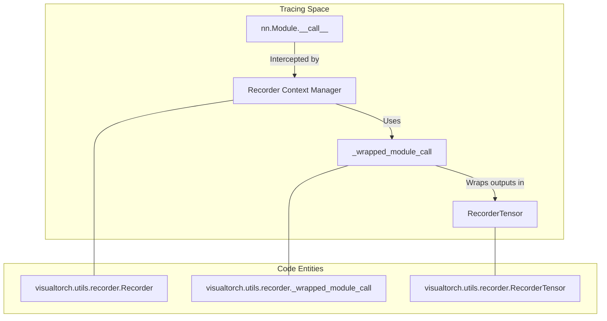
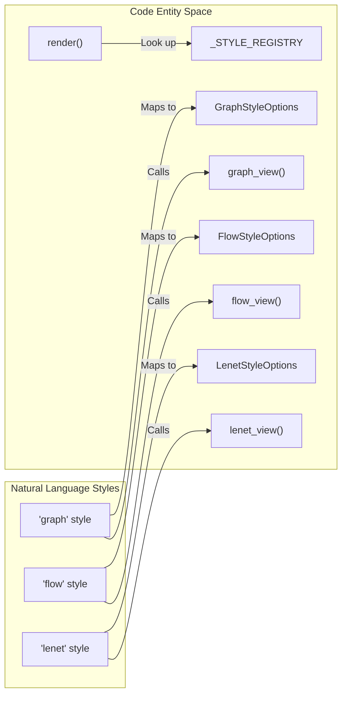

<!-- source: DeepWiki mcp.deepwiki.com · repo willyfh/visualtorch · page 7 Glossary · fetched 2026-10-21 -->

# Glossary

Relevant source files

The following files were used as context for generating this wiki page:

- [.gitignore](.gitignore)
- [README.md](README.md)
- [docs/source/index.md](docs/source/index.md)
- [docs/source/markdown/api_references/index.md](docs/source/markdown/api_references/index.md)
- [pyproject.toml](pyproject.toml)
- [tests/test_connectors.py](tests/test_connectors.py)
- [tests/test_flow.py](tests/test_flow.py)
- [tests/test_graph.py](tests/test_graph.py)
- [tests/test_regression_issues.py](tests/test_regression_issues.py)
- [tests/test_render.py](tests/test_render.py)
- [visualtorch/__init__.py](visualtorch/__init__.py)
- [visualtorch/_volumetric_layout.py](visualtorch/_volumetric_layout.py)
- [visualtorch/backend.py](visualtorch/backend.py)
- [visualtorch/connectors.py](visualtorch/connectors.py)
- [visualtorch/flow.py](visualtorch/flow.py)
- [visualtorch/graph.py](visualtorch/graph.py)
- [visualtorch/lenet_style.py](visualtorch/lenet_style.py)
- [visualtorch/render.py](visualtorch/render.py)
- [visualtorch/utils/recorder.py](visualtorch/utils/recorder.py)
- [visualtorch/utils/traced_layer.py](visualtorch/utils/traced_layer.py)
- [visualtorch/utils/utils.py](visualtorch/utils/utils.py)

This page provides definitions for the domain-specific terminology, architectural concepts, and internal code entities used throughout the VisualTorch codebase.

## 1. Core Concepts & Data Structures

| Term | Definition | Code Pointer |
| :--- | :--- | :--- |
| **Architecture** | A dataclass representing the processed model graph, including an adjacency matrix and column-based layout information. | `[visualtorch/backend.py:38-66]()` |
| **TracedLayer** | A wrapper around a PyTorch `nn.Module` that stores metadata captured during tracing, such as its unique `node_id` and output shapes. | `[visualtorch/utils/traced_layer.py:10-23]()` |
| **RecorderTensor** | A `torch.Tensor` subclass used during tracing to propagate producer IDs across operations via `__torch_function__`. | `[visualtorch/utils/recorder.py:24-52]()` |
| **InputShape** | A type alias representing either a single tensor shape `(1, 3, 224, 224)` or a tuple of shapes for multi-input models. | `[visualtorch/utils/utils.py:13-14]()` |
| **Leaf Module** | A module with no children (e.g., `nn.Conv2d`) or a module where no children were invoked during the forward pass (e.g., `nn.MultiheadAttention`). | `[visualtorch/utils/recorder.py:156-156]()` |

**Sources:**
- `[visualtorch/backend.py:38-66]()`
- `[visualtorch/utils/traced_layer.py:10-23]()`
- `[visualtorch/utils/recorder.py:24-156]()`
- `[visualtorch/utils/utils.py:13-14]()`

---

## 2. Tracing & Extraction Entities

VisualTorch uses a dynamic tracing mechanism to build a representation of the neural network. The following diagram bridges the natural language concepts of "Tracing" to the specific classes and functions in the code.

### Tracing Logic Flow
The system intercepts the standard PyTorch forward pass to record module execution order and data dependencies.

**Sources:**
- `[visualtorch/utils/recorder.py:133-173]()`
- `[visualtorch/utils/recorder.py:176-180]()`
- `[visualtorch/utils/recorder.py:24-31]()`

---

## 3. Layout & Rendering Terms

### Volumetric Rendering
Terms related to the 3D-like box rendering used in `flow_view` and `lenet_view`.

*   **de (Depth/Extrusion):** The pixel depth used to create a 3D effect for boxes. Calculated based on channel counts or sequence lengths. `[visualtorch/utils/utils.py:115-124]()`
*   **shade_step:** The amount by which colors are darkened to create shading on the top and side faces of a volumetric box. `[visualtorch/flow.py:53-53]()`
*   **offset_z:** Specifically in `lenet_view`, the pixel offset between stacked slices representing channels. `[visualtorch/lenet_style.py:95-95]()`
*   **ColumnLayout:** A structure that manages the vertical positioning of multiple nodes within the same horizontal column (e.g., in branching models). `[visualtorch/_volumetric_layout.py:11-30]()`

### Routing & Connectors
*   **Skip Levels:** The vertical "lanes" reserved above a diagram to prevent skip-connection lines from overlapping with main-line edges. `[visualtorch/connectors.py:73-90]()`
*   **Funnel:** A trapezoidal shape drawn between layers in `flow` and `lenet` styles to represent the transition of spatial dimensions. `[visualtorch/flow.py:52-52]()`
*   **Liang-Barsky:** The algorithm used to detect if a connector line would collide with a rendered box. `[visualtorch/connectors.py:168-180]()`

**Sources:**
- `[visualtorch/utils/utils.py:115-124]()`
- `[visualtorch/flow.py:52-53]()`
- `[visualtorch/lenet_style.py:95-95]()`
- `[visualtorch/_volumetric_layout.py:11-30]()`
- `[visualtorch/connectors.py:73-180]()`

---

## 4. System Dispatcher Mapping

The `render()` function acts as a dispatcher, mapping user-friendly style names to specific rendering implementations and their associated configuration dataclasses.

**Sources:**
- `[visualtorch/render.py:201-205]()`
- `[visualtorch/render.py:210-224]()`
- `[visualtorch/render.py:45-98]()`

---

## 5. Utilities & Abbreviations

*   **ColorWheel:** A utility class that cycles through a palette to assign colors to different layer types. `[visualtorch/utils/utils.py:263-275]()`
*   **self_multiply:** A helper function that calculates the total number of elements in a tensor shape (product of all dimensions). `[visualtorch/utils/utils.py:365-373]()`
*   **type_ignore:** A list of `nn.Module` types that should be omitted from the visualization (e.g., `nn.Dropout`). `[visualtorch/flow.py:78-79]()`
*   **ellipsize_after:** A threshold in `graph_view` after which neurons in a layer are represented by an `Ellipses` node rather than individual circles. `[visualtorch/graph.py:66-67]()`

**Sources:**
- `[visualtorch/utils/utils.py:263-275]()`
- `[visualtorch/utils/utils.py:365-373]()`
- `[visualtorch/flow.py:78-79]()`
- `[visualtorch/graph.py:66-67]()`