# Page: VisualTorch Overview

# VisualTorch Overview

<details>
<summary>Relevant source files</summary>

The following files were used as context for generating this wiki page:

- [CITATION.cff](CITATION.cff)
- [README.md](README.md)
- [docs/source/_static/images/logos/fire-icon.png](docs/source/_static/images/logos/fire-icon.png)
- [docs/source/index.md](docs/source/index.md)
- [docs/source/markdown/api_references/index.md](docs/source/markdown/api_references/index.md)
- [docs/source/snippets/install/pypi.txt](docs/source/snippets/install/pypi.txt)
- [docs/source/snippets/install/source.txt](docs/source/snippets/install/source.txt)
- [paper/paper.md](paper/paper.md)
- [setup.py](setup.py)

</details>


VisualTorch is a Python library designed to automate the visualization of neural network architectures built with PyTorch [README.md:2-8](). By tracing a model's forward pass, it translates complex `torch.nn.Module` or `torch.nn.Sequential` structures into polished, publication-ready diagrams [paper/paper.md:31-31]().

The project addresses the difficulty of manually constructing architecture diagrams for scientific communication, providing a programmatic way to generate visual representations that accurately reflect the underlying code [paper/paper.md:33-43]().

## Core Visualization Styles

VisualTorch supports three distinct rendering styles to cater to different architectural granularities and aesthetic requirements:

| Style | Description | Typical Use Case |
| :--- | :--- | :--- |
| **Graph View** | Displays the model as a computational graph of nodes and edges. | Complex branching, skip connections, and non-sequential models. |
| **Flow View** | Uses volumetric boxes to represent layer dimensions and data flow. | CNNs where spatial resolution and channel depth are key. |
| **LeNet Style** | A classic stacked-box visualization inspired by early CNN diagrams. | Sequential convolutional pipelines and educational illustrations. |

Sources: [README.md:8-8](), [paper/paper.md:31-31](), [docs/source/index.md:3-3]()

## System Architecture & Workflow

VisualTorch operates through a multi-stage pipeline that bridges the gap between PyTorch code and a rasterized image. The system first records the execution of the model, extracts a high-level representation, and then dispatches it to a specific renderer.

### From Code to Diagram

The following diagram illustrates how high-level user requests are translated into internal code entities:

**VisualTorch Execution Pipeline**
```mermaid
graph TD
    User["User Model (nn.Module)"] -->|render()| Dispatcher["render.py: _render_dispatcher"]
    Dispatcher -->|trace_module_graph| Tracing["recorder.py: Recorder"]
    Tracing -->|Record Tensors| Subclass["recorder.py: RecorderTensor"]
    Subclass -->|Build Graph| Arch["architecture.py: Architecture"]
    Arch -->|Dispatch| Style{Style Selection}
    
    Style -->|graph| GView["graph.py: graph_view"]
    Style -->|flow| FView["flow.py: flow_view"]
    Style -->|lenet| LView["lenet_style.py: lenet_view"]
    
    GView & FView & LView -->|draw| Canvas["Pillow / aggdraw Canvas"]
```
Sources: [README.md:12-19](), [paper/paper.md:76-102](), [docs/source/index.md:97-105]()

### Major Subsystems

The codebase is organized into functional layers that handle tracing, logic, and rendering:

*   **Tracing Backend**: Uses a custom `RecorderTensor` to track how data moves through modules during a dummy forward pass [README.md:12-15]().
*   **Architecture IR**: An intermediate representation (the `Architecture` dataclass) that standardizes shapes, connections, and module metadata.
*   **Rendering Frontends**: Style-specific modules (`graph.py`, `flow.py`, `lenet_style.py`) that interpret the Architecture IR into geometric primitives.
*   **Utility Layer**: Shared logic for color palettes, geometric shapes (Box, Circle), and image layouting.

**System Component Mapping**
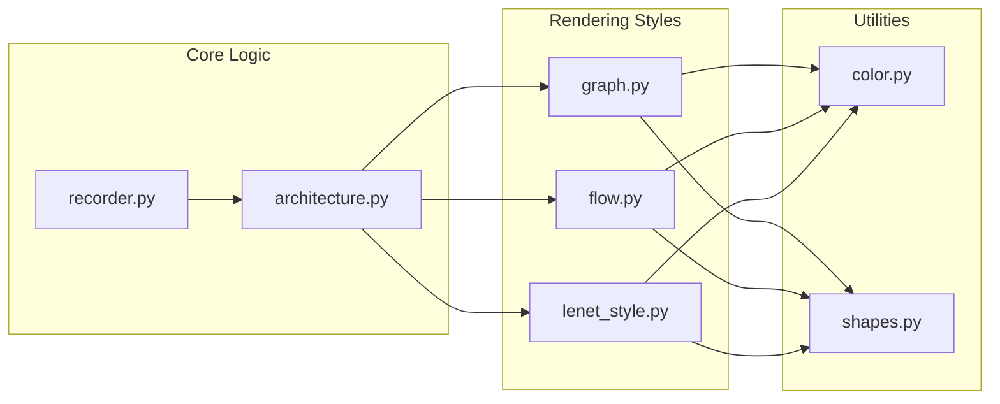
Sources: [README.md:54-55](), [setup.py:32-32]()

## Limitations & Considerations

Because VisualTorch relies on tracing a real forward pass, it has specific behavioral characteristics:
*   **Control Flow**: It only visualizes the execution path taken by the provided dummy input. Data-dependent branches not taken during the trace will not appear in the diagram [README.md:12-15]().
*   **Multi-Output Modules**: For modules returning multiple tensors (like `nn.LSTM`), node sizing is typically based on the first tensor, though all shapes are listed if dimension labels are enabled [README.md:16-19]().

## Child Pages

For detailed technical information, please refer to the following child pages:

*   **[Getting Started: Installation & Configuration](#1.1)**
    Covers installation via `pip` from PyPI or source, and environment setup for Python 3.10+ and PyTorch 2.0+ [setup.py:22-45]().
*   **[Academic Context & Research Showcase](#1.2)**
    Details the project's publication in the Journal of Open Source Software (JOSS) and highlights its use in Nature, IEEE, and MDPI research [README.md:37-41](), [paper/paper.md:67-79]().

Sources: [README.md:33-41](), [setup.py:42-42](), [docs/source/index.md:7-18]()

---

# Page: Getting Started: Installation & Configuration

# Getting Started: Installation & Configuration

<details>
<summary>Relevant source files</summary>

The following files were used as context for generating this wiki page:

- [CITATION.cff](CITATION.cff)
- [CONTRIBUTING.md](CONTRIBUTING.md)
- [dev-requirements.txt](dev-requirements.txt)
- [docs/source/_static/images/logos/fire-icon.png](docs/source/_static/images/logos/fire-icon.png)
- [docs/source/markdown/developer_guides/contributing.md](docs/source/markdown/developer_guides/contributing.md)
- [docs/source/markdown/get_started/installation.md](docs/source/markdown/get_started/installation.md)
- [docs/source/snippets/install/pypi.txt](docs/source/snippets/install/pypi.txt)
- [docs/source/snippets/install/requirements.txt](docs/source/snippets/install/requirements.txt)
- [docs/source/snippets/install/source.txt](docs/source/snippets/install/source.txt)
- [requirements.txt](requirements.txt)
- [setup.py](setup.py)

</details>


This page provides a technical guide for installing and configuring VisualTorch. It covers environment requirements, dependency management, and the setup process for both end-users and contributors.

## System Requirements & Dependencies

VisualTorch is designed to work with modern Python environments and relies on several core libraries for tensor manipulation and image rasterization.

### Python Version Support
VisualTorch requires **Python >= 3.10** [setup.py:42-42](). It is officially tested and classified for the following versions:
*   Python 3.10
*   Python 3.11
*   Python 3.12
[setup.py:34-36]()

### Runtime Dependencies
The core functionality depends on the following packages, which are automatically resolved during a standard installation:

| Dependency | Minimum Version | Role in System |
| :--- | :--- | :--- |
| `torch` | `>= 2.0.0` | Model definition and `RecorderTensor` subclassing. |
| `numpy` | `>= 1.18.1` | Data handling and shape manipulations. |
| `pillow` | `>= 10.0.0` | Image canvas management and file I/O. |
| `aggdraw` | `>= 1.3.11` | High-performance anti-aliased drawing primitives. |

**Sources:** [requirements.txt:1-4](), [docs/source/snippets/install/requirements.txt:1-4](), [setup.py:40-40]()

---

## Installation Methods

### 1. Installation via PyPI (Recommended)
For general use, the stable release should be installed via `pip`. 
*Note: Version 1.1.0 is the current major release [setup.py:24-24](). Users of legacy APIs (v0.2.5 or older) are encouraged to upgrade due to significant architectural improvements [docs/source/markdown/get_started/installation.md:33-36]().*

```bash
pip install visualtorch==1.1.0
```
**Sources:** [docs/source/snippets/install/pypi.txt:1-1]()

### 2. Installation from Source
To access the latest features or bug fixes before they are released to PyPI, install directly from the GitHub repository:

```bash
pip install git+https://github.com/willyfh/visualtorch
```
**Sources:** [docs/source/snippets/install/source.txt:1-1]()

---

## Developer Configuration

For contributors looking to modify the codebase, run tests, or build documentation, a specialized environment is required.

### Development Environment Setup
VisualTorch uses `setuptools` with `extras_require` to manage development tools [setup.py:41-41]().

1.  **Conda Environment:** It is recommended to use a clean environment [CONTRIBUTING.md:27-32]().
2.  **Editable Install:** Install the package in editable mode with the `[dev]` flag to include testing and documentation dependencies.
    ```bash
    pip install -e .[dev]
    ```
3.  **Pre-commit Hooks:** VisualTorch uses `pre-commit` to enforce code quality via `ruff` and other linters [CONTRIBUTING.md:40-44]().
    ```bash
    pre-commit install
    ```

### Dependency Graph: Installation to Code Entities
The following diagram illustrates how the installation configuration maps to specific project files and the internal requirements system.

**Installation Logic Mapping**
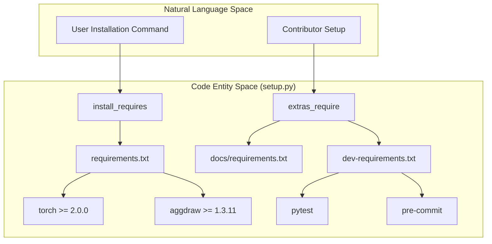
**Sources:** [setup.py:40-41](), [requirements.txt:1-4](), [dev-requirements.txt:1-3](), [CONTRIBUTING.md:34-38]()

---

## Verification and Testing

After installation, the setup can be verified by running the test suite or executing the built-in examples.

### Running Tests
VisualTorch uses `pytest` for its test suite [CONTRIBUTING.md:58-58]().
```bash
pytest tests/
```

### Manual Quality Checks
To ensure the environment matches the project's linting standards (enforced by `ruff`), run the pre-commit checks manually:
```bash
pre-commit run --all-files
```
**Sources:** [CONTRIBUTING.md:62-67](), [docs/source/markdown/developer_guides/contributing.md:64-67]()

### Example Execution Flow
The following diagram bridges the user's intent to add or run an example with the internal directory structure used by the `Sphinx-Gallery` system.

**Example System Mapping**
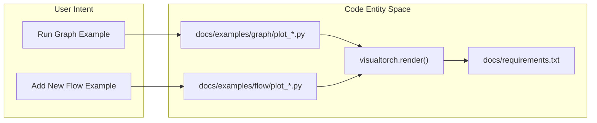
**Sources:** [CONTRIBUTING.md:71-82](), [docs/source/markdown/developer_guides/contributing.md:54-60]()

---

# Page: Academic Context & Research Showcase

# Academic Context & Research Showcase

<details>
<summary>Relevant source files</summary>

The following files were used as context for generating this wiki page:

- [.pre-commit-config.yaml](.pre-commit-config.yaml)
- [docs/source/_static/images/showcase/ieee-seizure.png](docs/source/_static/images/showcase/ieee-seizure.png)
- [docs/source/_static/images/showcase/mdpi-shear-wall.png](docs/source/_static/images/showcase/mdpi-shear-wall.png)
- [docs/source/_static/images/showcase/nature-biofilm.png](docs/source/_static/images/showcase/nature-biofilm.png)
- [docs/source/markdown/showcase/index.md](docs/source/markdown/showcase/index.md)
- [docs/source/snippets/citation/bib.txt](docs/source/snippets/citation/bib.txt)
- [paper/paper.bib](paper/paper.bib)
- [paper/paper.md](paper/paper.md)

</details>


The **VisualTorch** library was developed to provide a standardized, publication-quality visualization tool for PyTorch neural network architectures, addressing a gap in the ecosystem previously filled by tools like `visualkeras` for the Keras/TensorFlow frameworks [paper/paper.md:31-37](). This page details the academic foundations of the project, including its peer-reviewed publication, and showcases a gallery of research applications where VisualTorch has been utilized to communicate complex model topologies.

## JOSS Publication & Citation

VisualTorch was formally introduced in the **Journal of Open Source Software (JOSS)**. The paper emphasizes the library's ability to automatically translate PyTorch `nn.Module` or `nn.Sequential` structures into architectural diagrams using three primary styles: Layered (Flow), Graph, and LeNet [paper/paper.md:31-31](), [paper/paper.md:45-45]().

### Citation Metadata
Researchers using VisualTorch in their work are encouraged to cite the following reference:

| Format | Citation String |
| :--- | :--- |
| **APA** | Hendria, W. F., & Gavrikov, P. (2024). VisualTorch: Streamlining Visualization for PyTorch Neural Network Architectures. *Journal of Open Source Software*, 9(102), 6678. |
| **BibTeX** | ` Hendria2024` (see below for full entry) |
| **DOI** | [10.21105/joss.06678](https://doi.org/10.21105/joss.06678) |

**Full BibTeX Entry:**
```bibtex
@article{Hendria2024,
  doi = {10.21105/joss.06678},
  url = {https://doi.org/10.21105/joss.06678},
  year = {2024},
  publisher = {The Open Journal},
  volume = {9},
  number = {102},
  pages = {6678},
  author = {Willy Fitra Hendria and Paul Gavrikov},
  title = {VisualTorch: Streamlining Visualization for PyTorch Neural Network Architectures},
  journal = {Journal of Open Source Software}
}
```
*Sources: [docs/source/snippets/citation/bib.txt:1-12](), [paper/paper.md:1-27]()*

---

## Research Showcase Gallery

The following curated entries represent published research that utilized VisualTorch for architectural diagrams. These examples demonstrate the library's versatility across domains such as bioinformatics, medical signal processing, and structural engineering.

### 1. Biofilm Modeling (BINet)
*   **Paper:** Deep learning-based high-information-content graph representation of early stage bacterial biofilms.
*   **Venue:** *npj Biofilms and Microbiomes* (2026).
*   **Application:** Visualizing **BINet**, a custom network that predicts intercellular interactions within bacterial biofilms by combining Mask R-CNN segmentation with interaction graphs.
*   **Visualization Style:** Utilized for representing complex feature extraction and interaction prediction heads.

### 2. Epileptic Seizure Prediction (SNN + LSTM)
*   **Paper:** Energy-Efficient Epileptic Seizure Prediction Using Spiking Neural Networks.
*   **Venue:** *IEEE ISCAS* (2026).
*   **Application:** A patient-specific model using the CHB-MIT scalp EEG dataset. It integrates convolutional layers with **Leaky Integrate-and-Fire (LIF)** spiking neurons and recurrent (LSTM) units.
*   **Visualization Style:** Demonstrates the hybrid flow of spiking temporal data through convolutional and recurrent blocks.

### 3. Structural Engineering (Steel Plate Shear Walls)
*   **Paper:** Failure Evaluation of Steel Plate Shear Walls in Multi-Storey Steel Buildings Under Seismic Excitation Using Convolutional Neural Networks.
*   **Venue:** *Materials*, MDPI (2026).
*   **Application:** A CNN trained on physics-based finite element simulations to predict plastic strain and failure distributions in building geometries during seismic events.
*   **Visualization Style:** Standard CNN architecture visualization for structural digital twin applications.

*Sources: [docs/source/markdown/showcase/index.md:1-55]()*

---

## Technical Integration for Showcase

The showcase is maintained via the project's documentation and static assets. The following diagram illustrates how research metadata is integrated into the visual documentation.

### Showcase Data Flow
Title: Research Entry Integration Flow
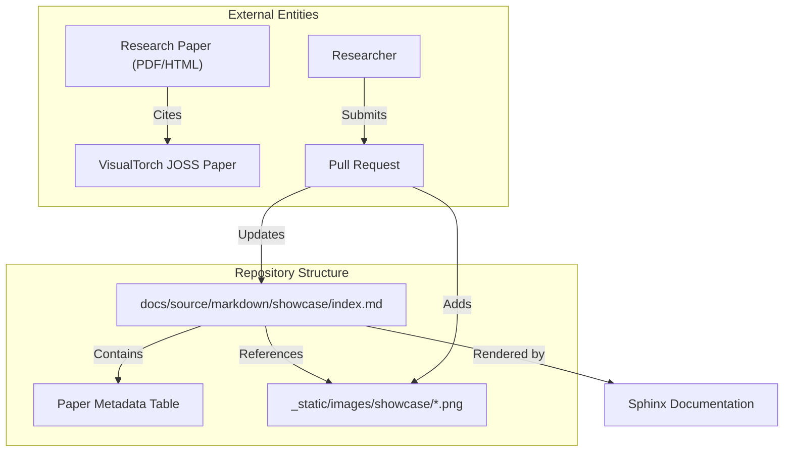
*Sources: [docs/source/markdown/showcase/index.md:1-10](), [paper/paper.md:31-37]()*

### Adding New Entries
Researchers can contribute to the showcase by following these steps:
1.  **Prepare Graphics:** Export your VisualTorch diagram as a high-resolution PNG (e.g., using `dpi=300` in your plotting script).
2.  **Asset Placement:** Add the image to `docs/source/_static/images/showcase/` [docs/source/markdown/showcase/index.md:25-25]().
3.  **Metadata Update:** Append a new section to `docs/source/markdown/showcase/index.md` including authors, venue, link, and a brief summary [docs/source/markdown/showcase/index.md:14-23]().
4.  **Verification:** Ensure the markdown follows project standards, which are enforced by `markdownlint` in the CI pipeline [.pre-commit-config.yaml:26-30]().

### Quality Standards for Submissions
VisualTorch uses a strict linting and formatting pipeline to maintain documentation quality:

| Tool | Purpose | Configuration |
| :--- | :--- | :--- |
| **Ruff** | Python code formatting in snippets | `ruff-format` [.pre-commit-config.yaml:32-40]() |
| **Markdownlint** | Validating showcase documentation | `markdownlint-cli` [.pre-commit-config.yaml:26-30]() |
| **Prettier** | General file formatting | `mirrors-prettier` [.pre-commit-config.yaml:21-25]() |

*Sources: [.pre-commit-config.yaml:1-40](), [docs/source/markdown/showcase/index.md:1-5]()_

---

# Page: Core Architecture

# Core Architecture

<details>
<summary>Relevant source files</summary>

The following files were used as context for generating this wiki page:

- [.gitignore](.gitignore)
- [pyproject.toml](pyproject.toml)
- [tests/test_regression_issues.py](tests/test_regression_issues.py)
- [tests/test_render.py](tests/test_render.py)
- [visualtorch/__init__.py](visualtorch/__init__.py)
- [visualtorch/backend.py](visualtorch/backend.py)
- [visualtorch/render.py](visualtorch/render.py)
- [visualtorch/utils/recorder.py](visualtorch/utils/recorder.py)
- [visualtorch/utils/traced_layer.py](visualtorch/utils/traced_layer.py)

</details>


The internal pipeline of VisualTorch transforms a live PyTorch model into a static visualization through a multi-stage process: **Tracing**, **Architecture Extraction**, and **Style-Specific Rendering**. This architecture ensures that the complex logic of lineage tracking and topological sorting is decoupled from the geometric rendering logic.

## Pipeline Overview

The visualization process follows a linear data flow:

1.  **Model Tracing**: A forward pass is executed within a `Recorder` context. This uses `RecorderTensor` (a `torch.Tensor` subclass) to track how data moves between leaf modules.
2.  **Architecture IR**: The raw trace (edges and module metadata) is converted into a structured `Architecture` Intermediate Representation (IR). This stage handles topological sorting and column assignment.
3.  **Rendering Dispatch**: The `render()` entry point validates user options and dispatches the `Architecture` IR to one of the three rendering frontends (`graph`, `flow`, or `lenet`).

### System Component Map

The following diagram maps the logical pipeline stages to the specific code entities responsible for them.

```mermaid
graph TD
    subgraph "Tracing Layer"
        [nn.Module] --> |"forward()"| REC["Recorder (Context Manager)"]
        REC --> RT["RecorderTensor (__torch_function__)"]
    end

    subgraph "Backend IR"
        RT --> |"Raw Edges"| EA["extract_architecture()"]
        EA --> ARCH["Architecture (Dataclass)"]
    end

    subgraph "Frontend Dispatcher"
        ARCH --> RENDER["render() Entrypoint"]
        RENDER --> REG["_STYLE_REGISTRY"]
    end

    subgraph "Style Renderers"
        REG --> GV["graph_view()"]
        REG --> FV["flow_view()"]
        REG --> LV["lenet_view()"]
    end
```
**Sources:** [visualtorch/render.py:201-205](), [visualtorch/backend.py:51-67](), [visualtorch/utils/recorder.py:176-178]()

---

## 1. Tracing Backend

The tracing backend is responsible for capturing the topology of a PyTorch model without relying on the autograd graph or hardcoded layer lists.

*   **`RecorderTensor`**: A tensor subclass that propagates `_producer_ids` through arbitrary operations via `__torch_function__` [visualtorch/utils/recorder.py:24-31]().
*   **`Recorder`**: A context manager that monkey-patches `nn.Module.__call__` to intercept inputs and outputs of leaf modules [visualtorch/utils/recorder.py:176-191]().
*   **Leaf Detection**: The tracer identifies "nodes" as modules with no children or modules where children did not fire (e.g., `nn.MultiheadAttention`) [visualtorch/utils/recorder.py:156-157]().

For details, see [Tracing Backend: RecorderTensor & trace_module_graph](#2.1).

**Sources:** [visualtorch/utils/recorder.py:1-173]()

---

## 2. Architecture Extraction

Once the forward pass completes, the raw trace data is processed into a structured `Architecture` object [visualtorch/backend.py:26-40]().

*   **Topological Sorting**: Uses an in-degree based queue to determine the longest path from source for each node [visualtorch/backend.py:98-111]().
*   **Column Assignment**: Groups nodes into columns based on their depth, allowing the renderers to lay out parallel branches correctly [visualtorch/backend.py:114-122]().
*   **Input Injection**: Prepends synthetic `Input` nodes to the architecture to represent the starting tensors [visualtorch/backend.py:138-157]().

For details, see [Architecture Extraction: extract_architecture & the Architecture Dataclass](#2.2).

**Sources:** [visualtorch/backend.py:51-135]()

---

## 3. Rendering Dispatcher

The `render()` function serves as the unified public API [visualtorch/render.py:210-215](). It provides a consistent interface while delegating the actual drawing to specialized style modules.

*   **Option Validation**: Uses dataclasses like `CommonOptions`, `GraphStyleOptions`, and `FlowStyleOptions` to validate user `kwargs` [visualtorch/render.py:29-98]().
*   **Style Registry**: Maps the `style` string argument to specific adapter functions (`_render_graph`, `_render_flow`, `_render_lenet`) [visualtorch/render.py:201-205]().

### Data Flow to Renderers

The following diagram illustrates how the `Architecture` IR and user `Options` are merged during the dispatch process.

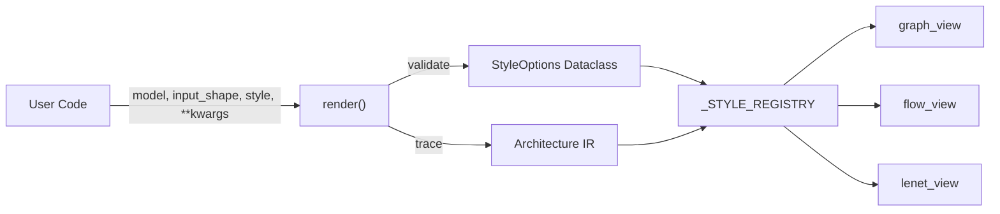
**Sources:** [visualtorch/render.py:210-245](), [visualtorch/backend.py:133-135]()

For details, see [render() Dispatcher & Style Configuration](#2.3).

**Sources:** [visualtorch/render.py:1-208]()

---

# Page: Tracing Backend: RecorderTensor & trace_module_graph

# Tracing Backend: RecorderTensor & trace_module_graph

<details>
<summary>Relevant source files</summary>

The following files were used as context for generating this wiki page:

- [.gitignore](.gitignore)
- [pyproject.toml](pyproject.toml)
- [tests/test_regression_issues.py](tests/test_regression_issues.py)
- [visualtorch/utils/recorder.py](visualtorch/utils/recorder.py)
- [visualtorch/utils/traced_layer.py](visualtorch/utils/traced_layer.py)

</details>


The tracing backend is the core engine of VisualTorch. It performs a dynamic analysis of a PyTorch model's forward pass to recover the computational graph. Unlike static analysis tools that inspect the `nn.Module` hierarchy or `autograd` attributes, VisualTorch uses **tensor subclassing** to track the flow of data between leaf modules.

## RecorderTensor: The Lineage Tracker

The primary mechanism for tracing is `RecorderTensor`, a subclass of `torch.Tensor` [visualtorch/utils/recorder.py:24-31](). It carries a `_producer_ids` set, which contains the unique identifiers (strings derived from `id(module)`) of the leaf modules that produced the tensor's data [visualtorch/utils/recorder.py:27-30]().

### Producer Propagation via `__torch_function__`

`RecorderTensor` implements the `__torch_function__` protocol to intercept every tensor operation (e.g., `add`, `cat`, `matmul`) [visualtorch/utils/recorder.py:34-40]().

1.  **Collection**: It recursively searches input arguments and keyword arguments for existing `RecorderTensor` instances and extracts their `_producer_ids` [visualtorch/utils/recorder.py:45-45]().
2.  **Execution**: It calls the original PyTorch function [visualtorch/utils/recorder.py:47-47]().
3.  **Stamping**: It stamps the union of all collected producer IDs onto the output tensor(s) [visualtorch/utils/recorder.py:49-50]().

This allows the lineage to persist through complex operations, such as residual additions or concatenations, where multiple branches merge [visualtorch/utils/recorder.py:29-30]().

### Handling Edge Cases: Re-wrapping & Multi-outputs

*   **NumPy Escape**: If a module's internal logic converts a tensor to a NumPy array and back, the subclass is lost. To prevent lineage breakage, `_wrap_and_stamp` is used at module boundaries to re-establish the `RecorderTensor` subclass [visualtorch/utils/recorder.py:85-92]().
*   **Multi-Output Modules**: Modules like `nn.LSTM` or `nn.MultiheadAttention` return tuples or lists of tensors. The helper `_all_tensor_shapes` recursively traverses these structures to ensure every output shape is recorded [visualtorch/utils/recorder.py:109-117]().

### Data Flow: Tensor Lineage Propagation
The following diagram shows how `RecorderTensor` moves through the system during a forward pass.

```mermaid
graph TD
    subgraph "Forward Pass Execution"
        Input["__input__"] -->|RecorderTensor| ModA["Module A (Leaf)"]
        ModA -->|RecorderTensor {ID_A}| Op1["Tensor Op (e.g. torch.add)"]
        Op1 -->|RecorderTensor {ID_A}| ModB["Module B (Leaf)"]
        
        ModB -->|RecorderTensor {ID_B}| Output["Final Output"]
    end

    subgraph "RecorderTensor Logic"
        __torch_function__ --> _collect_producer_ids
        _collect_producer_ids --> _stamp_producer_ids
    end

    ModA -.->|registers| id_to_module
    ModB -.->|registers| id_to_module
```
**Sources:** [visualtorch/utils/recorder.py:24-84](), [visualtorch/utils/recorder.py:133-173]()

---

## The Recorder Context Manager

The `Recorder` class manages the lifecycle of a trace [visualtorch/utils/recorder.py:176-180](). It uses a context manager to temporarily replace `nn.Module.__call__` with a `_wrapped_module_call` [visualtorch/utils/recorder.py:192-197]().

### Module Wrapping Logic

The `_wrapped_module_call` function defines how each module interaction is handled [visualtorch/utils/recorder.py:133-142]():

1.  **Input Capture**: It collects producer IDs from the module's inputs [visualtorch/utils/recorder.py:143-143]().
2.  **Execution Tracking**: It monitors the `edges` list before and after calling the original module [visualtorch/utils/recorder.py:145-146]().
3.  **Leaf Detection**: A module is treated as a "node" if:
    *   It has no children (a true leaf, like `nn.Conv2d`) [visualtorch/utils/recorder.py:156-156]().
    *   It has children, but none of them were called (e.g., `nn.MultiheadAttention` using functional calls) [visualtorch/utils/recorder.py:156-156](), [tests/test_regression_issues.py:70-75]().
4.  **State Recording**: If identified as a leaf, it generates a `node_id` (e.g., `id#index` to support weight sharing) and records its module type, output shapes, and incoming edges [visualtorch/utils/recorder.py:157-168]().

### Tracing System Components
This diagram maps the logical tracing steps to the specific code entities involved.

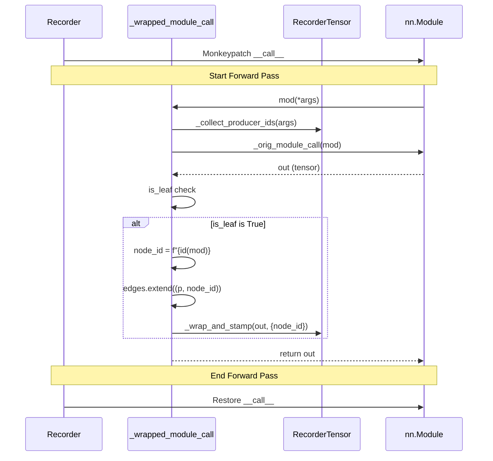
**Sources:** [visualtorch/utils/recorder.py:133-173](), [visualtorch/utils/recorder.py:182-198]()

---

## Complex Case Handling

### Weight Sharing & Multiple Calls
If the same module instance is called multiple times (e.g., in a Siamese network or a recurrent loop), VisualTorch assigns a unique `node_id` for each call by appending a call index: `f"{base_id}#{call_index}"` [visualtorch/utils/recorder.py:158-161](). This ensures that the graph accurately reflects the sequence of operations even when parameters are shared.

### Multi-output Modules (LSTM/GRU)
Recurrent modules like `nn.LSTM` return a tuple: `(output, (h_n, c_n))` [visualtorch/utils/recorder.py:112-113](). 
*   The primary `output_shape` is stored in the `TracedLayer` [visualtorch/utils/traced_layer.py:21-21]().
*   Additional shapes (like hidden states) are stored in `extra_output_shapes` [visualtorch/utils/traced_layer.py:23-28]().
*   The rendering logic uses these to extend labels (e.g., `(1, 7, 20) + (1, 1, 20) + (1, 1, 20)`) [tests/test_regression_issues.py:150-153]().

### Fused Functional Layers
Modules like `nn.MultiheadAttention` are problematic because they often bypass their own children (like `out_proj`) and call functional operations directly on raw parameters [visualtorch/utils/recorder.py:149-153](). VisualTorch detects this by checking if any edges were recorded during the module's execution. If `edges` did not increase, the module is forced into the graph as a leaf to prevent it from becoming "invisible" [visualtorch/utils/recorder.py:156-156](), [tests/test_regression_issues.py:70-75]().

### Summary of Key Data Structures

| Entity | Role | Source |
| :--- | :--- | :--- |
| `INPUT_NODE_ID` | The constant string `"__input__"` used as the source for the graph. | [visualtorch/utils/recorder.py:19]() |
| `TracedLayer` | Dataclass storing a module, its unique ID, and its shapes. | [visualtorch/utils/traced_layer.py:12-28]() |
| `id_to_module` | Mapping of `node_id` to the actual `nn.Module` instance. | [visualtorch/utils/recorder.py:134]() |
| `edges` | List of `(producer_id, consumer_id)` tuples defining connectivity. | [visualtorch/utils/recorder.py:137]() |

**Sources:** [visualtorch/utils/recorder.py:1-173](), [visualtorch/utils/traced_layer.py:1-28](), [tests/test_regression_issues.py:1-160]()

---

# Page: Architecture Extraction: extract_architecture & the Architecture Dataclass

# Architecture Extraction: extract_architecture & the Architecture Dataclass

<details>
<summary>Relevant source files</summary>

The following files were used as context for generating this wiki page:

- [.gitignore](.gitignore)
- [pyproject.toml](pyproject.toml)
- [tests/test_regression_issues.py](tests/test_regression_issues.py)
- [visualtorch/backend.py](visualtorch/backend.py)
- [visualtorch/utils/__init__.py](visualtorch/utils/__init__.py)
- [visualtorch/utils/layer_utils.py](visualtorch/utils/layer_utils.py)
- [visualtorch/utils/recorder.py](visualtorch/utils/recorder.py)
- [visualtorch/utils/traced_layer.py](visualtorch/utils/traced_layer.py)

</details>


The architecture extraction layer acts as the Intermediate Representation (IR) builder for VisualTorch. It consumes the raw, unordered trace data from the backend and transforms it into a structured, layered graph format. This transformation involves assigning nodes to vertical columns based on their topological depth, constructing a global adjacency matrix, and injecting synthetic input nodes to represent the model's entry points.

## The Architecture Extraction Pipeline

The extraction process is centralized in the `extract_architecture` function [visualtorch/backend.py:51-67](). It serves as the bridge between the dynamic tracing of a `torch.nn.Module` and the static layout requirements of the rendering frontends.

### Data Flow: From Trace to IR

The following diagram illustrates the flow of data through the extraction logic, mapping code entities to their roles in the transformation.

**Architecture Extraction Data Flow**
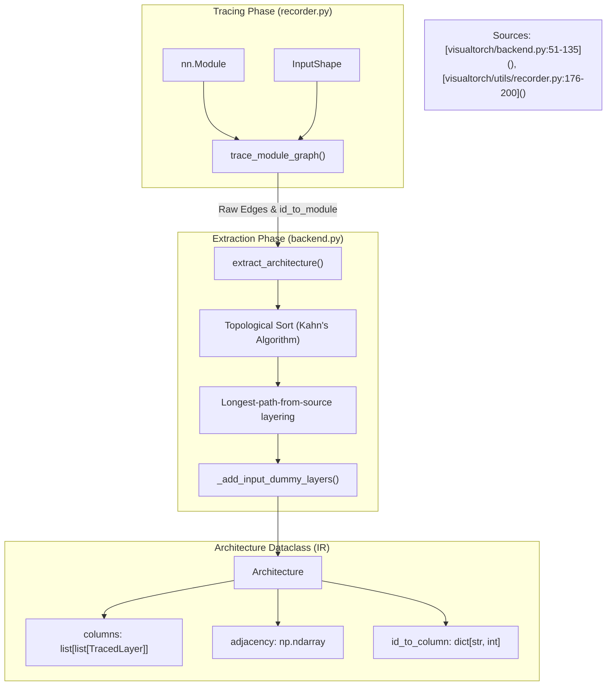

### 1. Topological Layering
To organize layers into a readable flow, `extract_architecture` implements a "longest-path-from-source" layering strategy [visualtorch/backend.py:95-97]().
* **In-degree Calculation**: It first calculates the in-degree of every node based on the edges returned by the tracer [visualtorch/backend.py:85-93]().
* **Kahn's Algorithm**: Using a queue-based topological sort, it determines the depth of each node. A node's depth is defined as `1 + max(depth of predecessors)` [visualtorch/backend.py:98-111]().
* **Column Assignment**: This ensures that in complex architectures (like ResNet or U-Net), a merge node (e.g., an addition or concatenation) is always placed in a column after all its parallel branches have completed [visualtorch/backend.py:95-97]().

### 2. Synthetic Input Injection
The tracer only records `nn.Module` calls. To represent the starting point of the data flow, `_add_input_dummy_layers` injects synthetic nodes [visualtorch/backend.py:138-145]().
* **Input Nodes**: It creates one `TracedLayer` for each input tensor defined in the `input_shape` [visualtorch/backend.py:147-156]().
* **Labeling**: Labels are generated as "input" for single-input models or "input_N" for multi-input models via `_input_label` [visualtorch/backend.py:171-173]().
* **Wiring**: These dummy nodes are prepended to `columns[0]`, and the adjacency matrix is expanded to include edges from these inputs to their first real module consumers [visualtorch/backend.py:157-168]().

**Sources**: [visualtorch/backend.py:51-174](), [visualtorch/utils/layer_utils.py:8-18]()

---

## The Architecture Dataclass

The `Architecture` dataclass is the final product of the extraction backend. It provides a unified interface for renderers to query the model's structure.

| Attribute | Type | Description |
| :--- | :--- | :--- |
| `columns` | `list[list[TracedLayer]]` | A list of columns, where each column contains layers at that topological depth [visualtorch/backend.py:36](). |
| `adjacency` | `np.ndarray` | A square matrix where `adjacency[i, j] > 0` indicates a directed edge from node index `i` to `j` [visualtorch/backend.py:37](). |
| `id_to_index` | `dict[str, int]` | Maps a string `node_id` (e.g., "140715#0") to its row/column index in the adjacency matrix [visualtorch/backend.py:38](). |
| `id_to_column` | `dict[str, int]` | Maps a `node_id` to its column index (0 to N) for quick horizontal positioning [visualtorch/backend.py:39](). |

### TracedLayer: The Node IR
Each node in the `Architecture` is a `TracedLayer` instance [visualtorch/utils/traced_layer.py:12-29](). Unlike the raw `nn.Module`, this class specifically preserves:
* **`output_shape`**: The primary tensor shape used for volumetric rendering [visualtorch/utils/traced_layer.py:21]().
* **`extra_output_shapes`**: Captures auxiliary outputs (e.g., hidden/cell states in `nn.LSTM`) to ensure `show_dimension` labels are accurate [visualtorch/utils/traced_layer.py:23-28]().
* **`node_id`**: A stable identifier used for edge routing [visualtorch/utils/traced_layer.py:22]().

**Sources**: [visualtorch/backend.py:26-50](), [visualtorch/utils/traced_layer.py:1-29]()

---

## Multi-Output Handling and Regression Fixes

The extraction logic includes specific handling for complex PyTorch edge cases identified through regression testing [tests/test_regression_issues.py:1-4]().

### Support for Multi-Output Modules
Modules like `nn.LSTM` return a tuple of tensors `(output, (h_n, c_n))`. The architecture extraction ensures these are not lost:
1. **Tracer Collection**: `_all_tensor_shapes` recursively finds all tensors in a module's return value [visualtorch/utils/recorder.py:109-130]().
2. **Storage**: The first shape is stored in `output_shape`, and all subsequent shapes are stored in `extra_output_shapes` [visualtorch/backend.py:118-121]().
3. **Visualization**: Frontends use `format_shape_label` to concatenate these into a single string, e.g., `(1, 7, 20) + (1, 1, 20) + (1, 1, 20)` [tests/test_regression_issues.py:150-153]().

### MultiheadAttention Fallback
`nn.MultiheadAttention` is unique because it contains a child module (`out_proj`) but often computes its logic via fused functional calls, bypassing the child's `__call__` [tests/test_regression_issues.py:70-75]().
* **Leaf Detection**: The extraction logic identifies a module as a "leaf" if it has no children OR if none of its children were invoked during the forward pass [visualtorch/utils/recorder.py:156]().
* **Visibility**: This ensures `MultiheadAttention` appears as a node in the graph instead of being silently omitted [tests/test_regression_issues.py:87-90]().

**Sources**: [visualtorch/utils/recorder.py:109-173](), [tests/test_regression_issues.py:70-153]()

---

# Page: render() Dispatcher & Style Configuration

# render() Dispatcher & Style Configuration

<details>
<summary>Relevant source files</summary>

The following files were used as context for generating this wiki page:

- [tests/test_render.py](tests/test_render.py)
- [visualtorch/__init__.py](visualtorch/__init__.py)
- [visualtorch/render.py](visualtorch/render.py)
- [visualtorch/utils/utils.py](visualtorch/utils/utils.py)

</details>


The `render()` function serves as the unified public entry point for the VisualTorch library. It abstracts the complexity of the underlying tracing and architecture extraction by providing a single interface where the visualization style and configuration are controlled via keyword arguments.

### Overview and Implementation

The dispatcher mechanism uses a registry-based approach to map style strings (e.g., `"graph"`, `"flow"`) to specific rendering logic and configuration schemas. This ensures that parameters are validated before rendering begins, preventing silent failures due to typos in configuration.

The data flow within the dispatcher follows these steps:
1.  **Validation**: Incoming `**kwargs` are split into common options and style-specific options.
2.  **Instantiation**: Dataclasses are instantiated with these arguments; any unknown or misspelled arguments trigger a `TypeError` immediately [visualtorch/render.py:7-8]().
3.  **Dispatch**: The `_STYLE_REGISTRY` identifies the appropriate internal adapter function [visualtorch/render.py:201-205]().
4.  **Execution**: The adapter calls the specific frontend (e.g., `graph_view`) with the validated options.

#### Style Dispatcher Logic
Title: render() Internal Dispatch Flow
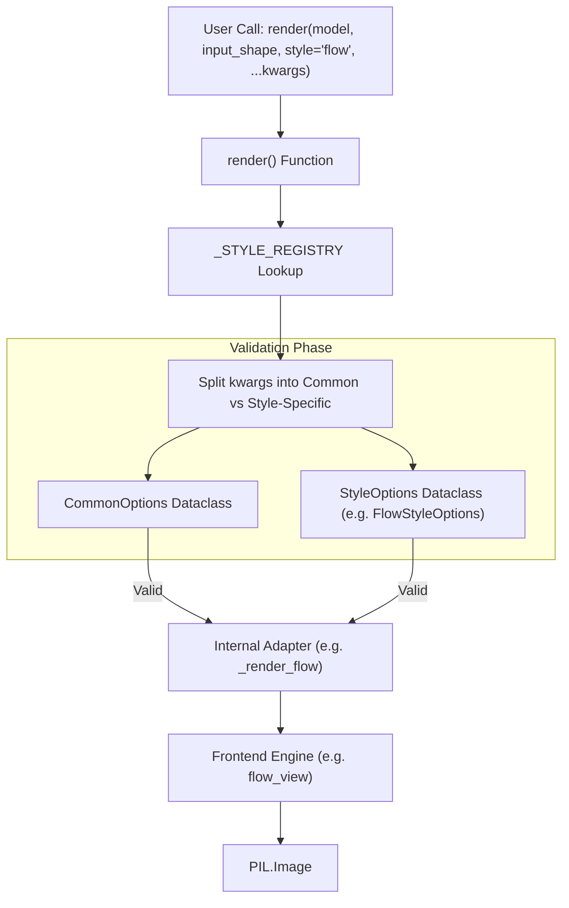
Sources: [visualtorch/render.py:201-225](), [visualtorch/render.py:100-198]()

---

### Configuration Dataclasses

VisualTorch uses Python dataclasses to define the schema for every visualization style. This provides a clear contract for the API and enables IDE autocompletion for users.

#### CommonOptions
The `CommonOptions` dataclass contains parameters accepted by every rendering style, such as file output paths, background colors, and global padding [visualtorch/render.py:29-41]().

| Field | Type | Default | Description |
| :--- | :--- | :--- | :--- |
| `to_file` | `str \| None` | `None` | Path to save the image. |
| `color_map` | `dict` | `None` | Explicit mapping of layer types to colors. |
| `palette` | `str` | `"okabe_ito"` | The named color palette to use. |
| `background_fill` | `str \| tuple` | `"white"` | Canvas background color. |
| `padding` | `int` | `10` | Margin around the entire diagram. |
| `opacity` | `int` | `255` | Global transparency (0-255). |
| `level_gap` | `int \| None` | `None` | Manual override for vertical skip-connection spacing. |

#### Style-Specific Options
Each style has a dedicated dataclass to manage parameters unique to its layout engine.

*   **`GraphStyleOptions`**: Focuses on node/edge connectivity, neuron counts, and dimension labels [visualtorch/render.py:44-57]().
*   **`FlowStyleOptions`**: Controls volumetric scaling, funnel drawing, and 3D shading [visualtorch/render.py:59-78]().
*   **`LenetStyleOptions`**: Manages stacked-plane offsets and channel capping [visualtorch/render.py:80-98]().

Sources: [visualtorch/render.py:29-98]()

---

### Internal Adapter Functions

The dispatcher does not call the frontend engines directly. Instead, it uses internal adapter functions (`_render_graph`, `_render_flow`, `_render_lenet`) to bridge the dataclass instances back into the flat argument structure expected by the original frontend functions [visualtorch/render.py:100-198]().

Title: Entity Mapping: Dispatcher to Code Entities
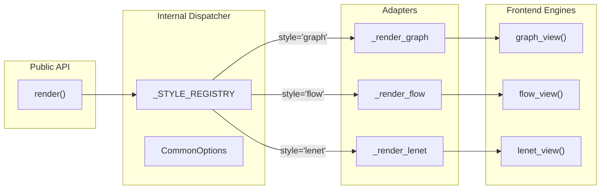
Sources: [visualtorch/render.py:201-205](), [visualtorch/render.py:100-105](), [visualtorch/render.py:130-135](), [visualtorch/render.py:166-171]()

---

### Input Shape Validation

The `render()` function handles the normalization of the `input_shape` argument. VisualTorch supports both single-input models (passed as a single tuple) and multi-input models (passed as a tuple of tuples) [visualtorch/utils/utils.py:13-14]().

If a model's `forward()` method expects multiple tensors, the `input_shape` must match the arity of the positional arguments. Passing a malformed shape, such as a mix of integers and tuples at the top level, will raise a `ValueError` [tests/test_render.py:105-113]().

#### Behavior with Unused Inputs
If an input is provided in `input_shape` but not consumed by the model's `forward()` pass, the dispatcher and tracing backend will still process it. It will typically appear as a disconnected input node in the final visualization [tests/test_render.py:140-153]().

Sources: [visualtorch/utils/utils.py:13-14](), [tests/test_render.py:105-153]()

---

# Page: Visualization Styles

# Visualization Styles

<details>
<summary>Relevant source files</summary>

The following files were used as context for generating this wiki page:

- [README.md](README.md)
- [docs/source/index.md](docs/source/index.md)
- [docs/source/markdown/api_references/index.md](docs/source/markdown/api_references/index.md)
- [tests/test_connectors.py](tests/test_connectors.py)
- [visualtorch/_volumetric_layout.py](visualtorch/_volumetric_layout.py)

</details>


VisualTorch provides three primary rendering frontends to visualize PyTorch models, each optimized for different architectural perspectives. While the visual output varies, they share a unified tracing backend and a common volumetric layout engine.

## Overview of Rendering Styles

VisualTorch supports the following styles, which can be selected via the `render(style=...)` entry point:

| Style | Description | Typical Use Case |
| :--- | :--- | :--- |
| **Graph View** | 2D nodes (boxes, circles) with explicit directed edges. | Complex branching, skip connections, and non-sequential DAGs. |
| **Flow View** | 3D volumetric blocks with funnel-style connectors. | High-level CNN architecture overviews and sequential flows. |
| **LeNet Style** | Stacked 2D planes with depth offsets. | Classic computer vision papers and "layer-by-layer" stacking. |

The following diagram illustrates the relationship between the unified architecture representation and the specific rendering implementations:

**Style Dispatch and Layout Hierarchy**
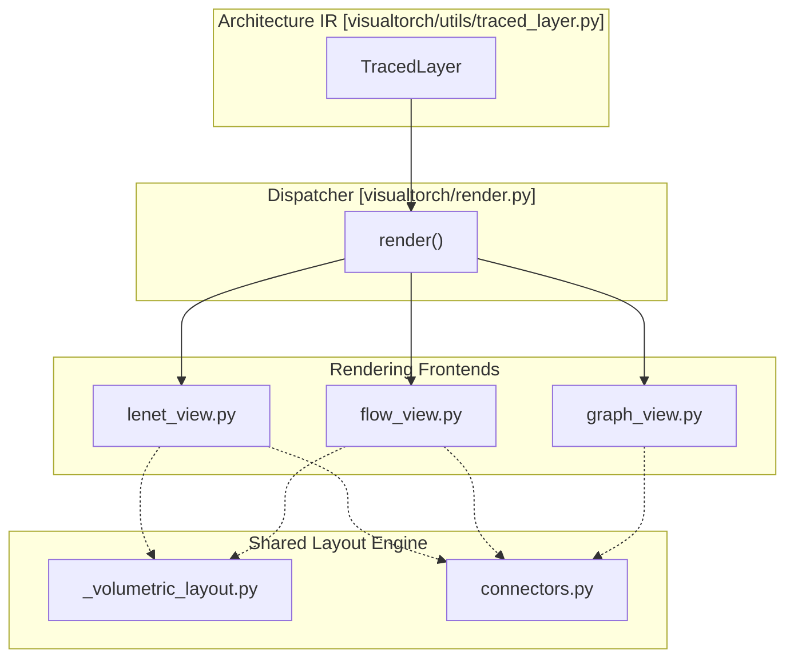
Sources: [visualtorch/render.py:1-50](), [visualtorch/_volumetric_layout.py:1-10](), [README.md:8-10]()

---

## 3.1 Graph View (`graph_view`)
The Graph View focuses on the connectivity of the model. It represents layers as 2D shapes (Boxes, Circles, or Ellipses) and uses a sophisticated routing algorithm for skip connections. It is particularly effective for models with complex branching like ResNets or U-Nets.

*   **Node Types:** Supports `Box` for standard layers, `Circle` for small operations, and `Ellipses` for repeated blocks.
*   **Routing:** Uses `compute_skip_levels` to determine vertical offsets for edges that span multiple columns to avoid visual overlap.
*   **Options:** Includes `show_neurons`, `ellipsize_after`, and `show_dimension`.

For details, see [Graph View (graph_view)](#3.1).

Sources: [visualtorch/utils/utils.py:10-50](), [tests/test_connectors.py:16-24]()

---

## 3.2 Flow View (`flow_view`)
Flow View provides a "volumetric" representation where layers are rendered as 3D cuboids. The size of the cuboid typically corresponds to the feature map dimensions (width, height, and depth/channels).

*   **Volumetric Rendering:** Uses the `de` (depth extrusion) property of `Box` shapes to create a 3D effect.
*   **Connectors:** Uses funnel-shaped polygons to show the transition between layers of different spatial resolutions.
*   **Customization:** Supports 2D/3D toggles via `draw_volume` and orientation changes.

For details, see [Flow View (flow_view)](#3.2).

Sources: [visualtorch/_volumetric_layout.py:44-58](), [README.md:12-19]()

---

## 3.3 LeNet Style View (`lenet_view`)
Inspired by the classic LeNet-5 diagrams, this style renders layers as a series of stacked 2D planes with a constant Z-offset. It is highly effective for visualizing the reduction in spatial dimensions and increase in channel depth.

*   **StackedBox:** Uses the `StackedBox` primitive to render multiple offset rectangles representing feature map channels.
*   **Capping:** Implements `max_channels` to prevent the diagram from becoming excessively wide when channel counts are high.
*   **Routing:** Supports both line-based and funnel-based skip connection routing.

For details, see [LeNet Style View (lenet_view)](#3.3).

Sources: [visualtorch/utils/utils.py:55-80](), [visualtorch/_volumetric_layout.py:7-9]()

---

## 3.4 Shared Layout Engine & Connector Routing
To ensure consistency and reduce code duplication, `flow_view` and `lenet_view` utilize a shared volumetric layout engine, while all styles utilize a central connector routing subsystem.

### Volumetric Layout Engine
The `layout_columns` function in `_volumetric_layout.py` manages the spatial positioning of nodes. It groups layers by their column (depth in the graph) and calculates the necessary vertical and horizontal gaps to prevent 3D extrusions from occluding adjacent layers.

### Connector Routing
The `connectors.py` module handles the logic for drawing lines between nodes. It includes:
*   **Collision Detection:** Implementation of Liang-Barsky algorithms to detect if a connector intersects a node's bounding box.
*   **Interval Coloring:** A greedy algorithm used in `compute_skip_levels` to assign "detour levels" to overlapping skip connections.

**Logic Flow for Shared Layout**
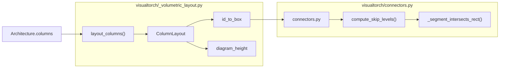
Sources: [visualtorch/_volumetric_layout.py:60-100](), [visualtorch/_volumetric_layout.py:25-35](), [tests/test_connectors.py:61-75](), [tests/test_connectors.py:127-140]()

For details, see [Shared Layout Engine & Connector Routing](#3.4).

---

# Page: Graph View (graph_view)

# Graph View (graph_view)

<details>
<summary>Relevant source files</summary>

The following files were used as context for generating this wiki page:

- [tests/test_flow.py](tests/test_flow.py)
- [tests/test_graph.py](tests/test_graph.py)
- [visualtorch/connectors.py](visualtorch/connectors.py)
- [visualtorch/graph.py](visualtorch/graph.py)
- [visualtorch/utils/utils.py](visualtorch/utils/utils.py)

</details>


The `graph_view` rendering frontend generates a classical node-link diagram of a PyTorch model's architecture [visualtorch/graph.py:21-42](). It represents layers as vertical columns of nodes, where nodes can either represent entire layers or individual neurons within those layers [visualtorch/graph.py:109-120](). This view is particularly suited for dense networks, small-scale CNNs, and models where skip-connection routing and branching logic need to be explicitly visualized [tests/test_graph.py:102-145]().

## Node Creation and Unit Calculation

Nodes in a `graph_view` are instances of geometric primitive classes defined in `visualtorch.utils.utils` [visualtorch/graph.py:18](). The system supports three primary node types:

| Node Type | Class | Usage |
| :--- | :--- | :--- |
| **Box** | `Box` | Used for standard layers when `show_neurons=False` [visualtorch/graph.py:1120](). |
| **Circle** | `Circle` | Used for individual neurons when `show_neurons=True` [visualtorch/graph.py:1115](). |
| **Ellipses** | `Ellipses` | Used as a placeholder when a layer exceeds the `ellipsize_after` threshold [visualtorch/graph.py:1125](). |

### Unit Retrieval Logic
The function `_retrieve_isbox_units` determines the visual height of a layer's column [visualtorch/graph.py:1104-1130]().
- If `show_neurons` is `True`, it calculates the number of units based on the layer's output shape, capped by `ellipsize_after` [visualtorch/graph.py:1107-1110]().
- If the unit count exceeds `ellipsize_after`, it injects an `Ellipses` node to represent truncated neurons [visualtorch/graph.py:1125-1127]().
- If `show_neurons` is `False`, the layer is treated as a single unit represented by a `Box` [visualtorch/graph.py:1120]().

**Sources:** [visualtorch/graph.py:109-120](), [visualtorch/graph.py:1104-1130](), [visualtorch/utils/utils.py:112-228]()

## Spatial Layout and Canvas Sizing

The layout engine follows a strictly columnar approach based on the `Architecture` IR [visualtorch/graph.py:91]().

### Column Assignment
Nodes are positioned horizontally based on their column index in `architecture.columns` [visualtorch/graph.py:97-104](). The `layer_spacing` parameter controls the horizontal distance between these columns [visualtorch/graph.py:30]().

### Vertical Alignment
Within a column, nodes are centered vertically relative to the tallest column in the graph [visualtorch/graph.py:151-152](). The vertical position is calculated using `node_spacing` and `node_size` [visualtorch/graph.py:1134-1153]().

### Skip-Connection Routing
Skip connections (edges spanning $>1$ column) are routed above the main diagram to prevent occlusion of adjacent-column edges [visualtorch/graph.py:126-128]().
1. **Collision Detection:** `compute_skip_levels` uses a Liang-Barsky algorithm to check if a straight line would intersect any intervening nodes [visualtorch/connectors.py:18-23](), [visualtorch/connectors.py:133-150]().
2. **Level Assignment:** Qualifying skips are assigned a "detour level" using greedy interval-graph coloring [visualtorch/connectors.py:35-45]().
3. **Canvas Margin:** The total image height is expanded by `top_margin_for_skips`, calculated as `num_levels * level_gap` [visualtorch/graph.py:136-137]().

**Sources:** [visualtorch/graph.py:126-137](), [visualtorch/connectors.py:18-94](), [visualtorch/connectors.py:133-150]()

## Implementation Data Flow

The following diagram illustrates the transformation from PyTorch model tracing to the final `graph_view` image.

### Architecture to Graph Transformation
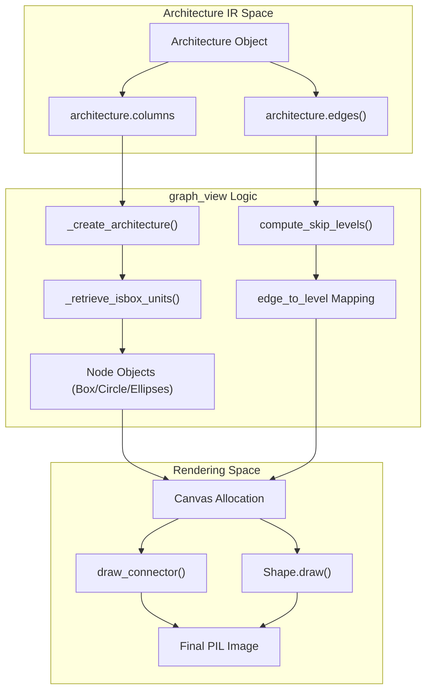
**Sources:** [visualtorch/graph.py:91-158](), [visualtorch/connectors.py:18-23](), [visualtorch/utils/utils.py:120-123]()

## Key Functions and Parameters

### `graph_view` Options
- `show_neurons`: Toggles between per-layer boxes and per-neuron circles [visualtorch/graph.py:35]().
- `ellipsize_after`: Limits the number of circles drawn per layer to maintain performance and readability [visualtorch/graph.py:34]().
- `show_dimension`: If enabled, calls `format_shape_label` to print output dimensions below each layer [visualtorch/graph.py:37](), [visualtorch/graph.py:141-147]().
- `show_input`: Controls the visibility of the synthetic "Input" node, provided it doesn't break edge connectivity [visualtorch/graph.py:41](), [visualtorch/graph.py:98-102]().

### Internal Helpers
| Function | Role |
| :--- | :--- |
| `_create_architecture` | Iterates through columns to instantiate `Shape` objects and calculate their `(x, y)` coordinates [visualtorch/graph.py:1088-1163](). |
| `_retrieve_isbox_units` | Core logic for deciding node type and count per layer [visualtorch/graph.py:1104-1130](). |
| `_edge_draws_visible_content` | Predicate that prevents drawing edges to neurons that were truncated by `ellipsize_after` [visualtorch/graph.py:1186-1200](). |

**Sources:** [visualtorch/graph.py:21-86](), [visualtorch/graph.py:1088-1200]()

## Code Entity Association

This diagram maps high-level visual components to the specific code entities responsible for their generation.

### Visual to Code Mapping
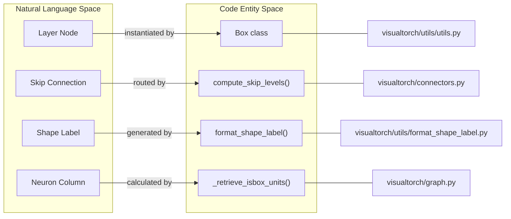
**Sources:** [visualtorch/graph.py:1120](), [visualtorch/connectors.py:18](), [visualtorch/graph.py:1104](), [visualtorch/utils/utils.py:112]()

---

# Page: Flow View (flow_view)

# Flow View (flow_view)

<details>
<summary>Relevant source files</summary>

The following files were used as context for generating this wiki page:

- [tests/test_connectors.py](tests/test_connectors.py)
- [tests/test_flow.py](tests/test_flow.py)
- [tests/test_graph.py](tests/test_graph.py)
- [visualtorch/_volumetric_layout.py](visualtorch/_volumetric_layout.py)
- [visualtorch/connectors.py](visualtorch/connectors.py)
- [visualtorch/flow.py](visualtorch/flow.py)

</details>


The `flow_view` style provides a volumetric visualization of a PyTorch model's architecture. It represents layers as 3D extruded boxes (or 2D rectangles) where the dimensions of the box correspond to the output shape of the layer. This view is particularly effective for CNNs and sequential models, utilizing funnel-shaped connectors to show the transition between feature map sizes.

## Core Implementation and Data Flow

The `flow_view` function [visualtorch/flow.py:34-61]() serves as the primary entry point. It orchestrates the transformation from a PyTorch `nn.Module` to a rendered image through a multi-stage pipeline.

### System Flow Diagram
This diagram illustrates how high-level user requests are processed by specific code entities within the `flow_view` subsystem.

Title: Flow View Data Processing Pipeline
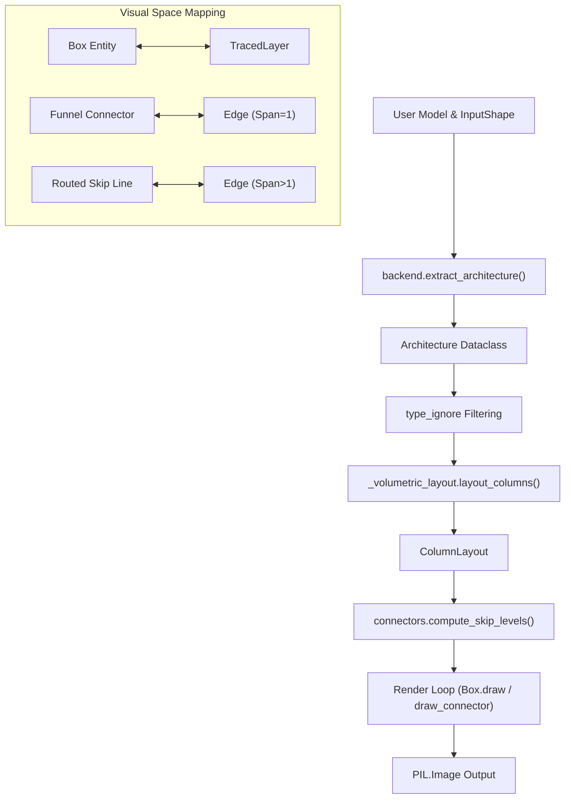
Sources: [visualtorch/flow.py:116-116](), [visualtorch/flow.py:138-140](), [visualtorch/flow.py:145-155](), [visualtorch/flow.py:223-228](), [visualtorch/flow.py:246-271]()

## Volumetric Layout Engine

`flow_view` shares its layout logic with `lenet_view` through the `_volumetric_layout.py` module. This engine groups layers into columns based on their depth in the model graph [visualtorch/_volumetric_layout.py:1-10]().

### Column Stacking and Sizing
Layers within the same column (parallel branches) are stacked vertically. The layout engine calculates the necessary canvas size and positions for each box.

| Parameter | Role in Layout | Code Reference |
| :--- | :--- | :--- |
| `min_z`, `max_z` | Clamping the extrusion depth (z-axis) | [visualtorch/flow.py:38-40]() |
| `min_xy`, `max_xy` | Clamping the feature map face (x/y-axis) | [visualtorch/flow.py:39-41]() |
| `scale_z`, `scale_xy` | Linear multipliers for dimension-to-pixel mapping | [visualtorch/flow.py:42-43]() |
| `spacing` | Horizontal distance between columns | [visualtorch/_volumetric_layout.py:64-64]() |
| `padding` | Margin around the entire diagram | [visualtorch/_volumetric_layout.py:65-65]() |

Sources: [visualtorch/_volumetric_layout.py:60-104](), [visualtorch/flow.py:145-155]()

## Key Features

### 2D vs 3D Toggle (`draw_volume`)
The `draw_volume` flag determines whether layers are rendered as 3D extruded cuboids or 2D rectangles [visualtorch/flow.py:49-49]().
- When `True`: The renderer uses the `de` (depth of extrusion) attribute to draw side and top faces with shading [visualtorch/flow.py:91-91]().
- When `False`: The renderer sets `de = 0`, resulting in a flat 2D box [visualtorch/flow.py:151-153]().

### Funnel Connectors
If `draw_funnel` is enabled, the renderer draws a trapezoidal "funnel" between consecutive layers in the same branch [visualtorch/flow.py:90-90](). This visually represents the change in spatial dimensions (e.g., pooling or strided convolution). Funnels are only drawn for edges with a column span of 1 [visualtorch/flow.py:246-249]().

### Skip Connection Routing
For edges spanning more than one column (e.g., residual shortcuts), `flow_view` uses the `connectors.py` module to calculate detour levels [visualtorch/flow.py:223-228]().

- **Collision Detection**: It uses Liang-Barsky algorithm logic to determine if a straight line would intersect an intervening layer box [visualtorch/connectors.py:128-143]().
- **Level Assignment**: Overlapping skips are assigned different vertical "levels" to prevent line occlusion [visualtorch/connectors.py:82-94]().

Sources: [visualtorch/connectors.py:18-64](), [visualtorch/flow.py:246-271]()

## Interleaved Draw Order

To maintain correct visual depth for models with varying extrusion depths (`de`), `flow_view` implements an interleaved drawing strategy.

Title: Interleaved Rendering Logic
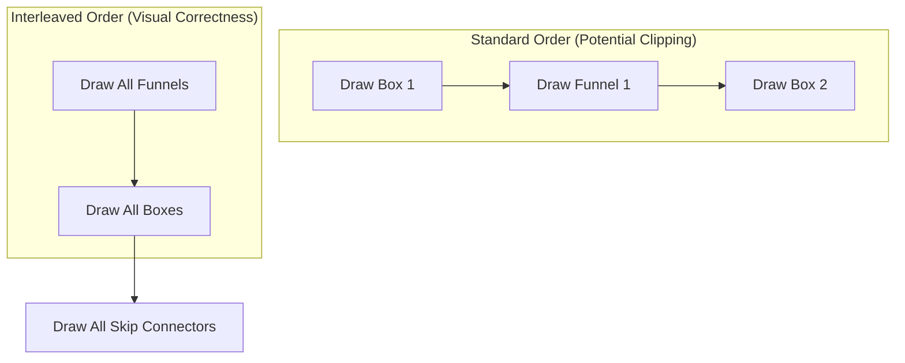
This fix ensures that large extruded boxes in later columns do not accidentally overlap and "cut through" the funnels connecting previous layers [visualtorch/flow.py:246-271]().

Sources: [visualtorch/flow.py:246-271]()

## Configuration and Filtering

### Type Filtering
The `type_ignore` list allows users to exclude specific layer types (e.g., `nn.ReLU`, `nn.Dropout`) from the visualization [visualtorch/flow.py:78-78](). This is handled during the column filtering phase [visualtorch/flow.py:138-140]().

### Orientation
The `one_dim_orientation` parameter controls how 1D layers (like `nn.Linear` outputs) are oriented in the 3D space [visualtorch/flow.py:85-85]().
- **'z'**: The single dimension is mapped to the extrusion depth.
- **'x' / 'y'**: The dimension is mapped to the width or height of the box face [visualtorch/flow.py:185-197]().

### Legend Generation
When `legend=True`, the renderer aggregates all unique layer types used in the model, resolves their colors via the `ColorWheel`, and appends a vertical legend to the bottom of the image using `vertical_image_concat` [visualtorch/flow.py:284-307]().

Sources: [visualtorch/flow.py:138-140](), [visualtorch/flow.py:185-197](), [visualtorch/flow.py:284-307]()

## Technical Specifications

| Component | Description |
| :--- | :--- |
| **Backend** | `Architecture` dataclass from `extract_architecture` |
| **Geometry** | `visualtorch.utils.utils.Box` |
| **Drawing Engine** | `aggdraw` for antialiased shapes and `PIL` for canvas management |
| **Shading** | `shade_step` modifies the base color for top/side faces of 3D boxes |

Sources: [visualtorch/flow.py:11-31](), [visualtorch/flow.py:116-116](), [visualtorch/flow.py:151-155]()

---

# Page: LeNet Style View (lenet_view)

# LeNet Style View (lenet_view)

<details>
<summary>Relevant source files</summary>

The following files were used as context for generating this wiki page:

- [docs/examples/graph/plot_residual_block.py](docs/examples/graph/plot_residual_block.py)
- [docs/examples/lenet_style/plot_residual_block_lenet_style.py](docs/examples/lenet_style/plot_residual_block_lenet_style.py)
- [docs/source/conf.py](docs/source/conf.py)
- [docs/source/markdown/license/index.md](docs/source/markdown/license/index.md)
- [tests/test_connectors.py](tests/test_connectors.py)
- [tests/test_lenet_style.py](tests/test_lenet_style.py)
- [visualtorch/_volumetric_layout.py](visualtorch/_volumetric_layout.py)
- [visualtorch/lenet_style.py](visualtorch/lenet_style.py)

</details>


The `lenet_view` module provides a specialized rendering style for PyTorch models, inspired by the classic visualization of the LeNet architecture. It represents layers as "Stacked Boxes"—a series of offset flat rectangles—to visualize multi-channel feature maps and volumetric data flow [visualtorch/lenet_style.py:1-60]().

## Implementation & Data Flow

The `lenet_view` function serves as the primary entry point. It utilizes the unified `Architecture` IR to determine layer connectivity and spatial depth [visualtorch/lenet_style.py:120-120](). Unlike the standard `flow_view`, which uses solid 3D cuboids, `lenet_view` renders each layer as a `StackedBox` primitive [visualtorch/lenet_style.py:24-24]().

### Volumetric Canvas Calculation
The layout is managed by the `layout_columns` engine in `_volumetric_layout.py` [visualtorch/_volumetric_layout.py:60-70](). This engine calculates the global canvas size and individual node coordinates based on:
*   **Column Assignment:** Layers are grouped into columns by their topological depth [visualtorch/_volumetric_layout.py:112-112]().
*   **Vertical Stacking:** Parallel branches at the same depth stack top-to-bottom within a column [visualtorch/_volumetric_layout.py:73-74]().
*   **3D Footprint:** The engine accounts for the unique footprint of `StackedBox`, which spreads offset-copies symmetrically, unlike the single-direction extrusion of standard `Box` shapes [visualtorch/_volumetric_layout.py:77-79]().

### Natural Language to Code Entity Space: Layout

| Natural Language Concept | Code Entity / Symbol | File Reference |
| :--- | :--- | :--- |
| **Layer Stack** | `StackedBox` | [visualtorch/utils/utils.py:24-24]() |
| **Column Manager** | `ColumnLayout` | [visualtorch/_volumetric_layout.py:24-35]() |
| **Positioning Engine** | `layout_columns` | [visualtorch/_volumetric_layout.py:60-60]() |
| **Vertical Gap** | `gap_for` | [visualtorch/_volumetric_layout.py:85-86]() |

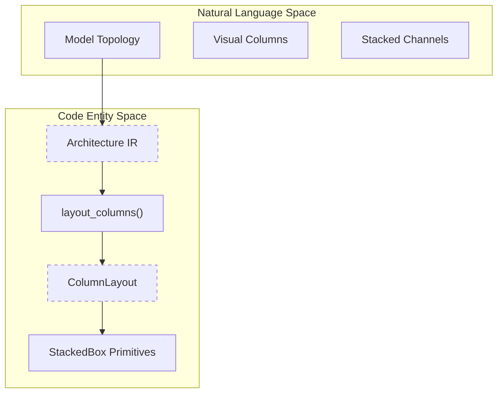
Sources: [visualtorch/lenet_style.py:120-136](), [visualtorch/_volumetric_layout.py:60-150]()

## Key Features & Configuration

### StackedBox Rendering & Channel Capping
The signature visual element of `lenet_view` is the representation of channels.
*   **`offset_z`**: Controls the pixel offset between overlapping channel rectangles [visualtorch/lenet_style.py:95-95]().
*   **`max_channels`**: To prevent the diagram from becoming excessively long, the number of drawn rectangles is capped. If the layer's channel dimension exceeds `max_channels`, the rendering is truncated to this limit [visualtorch/lenet_style.py:75-75]().

### Connector Routing
`lenet_view` distinguishes between direct flow and skip connections:
*   **Funnel Connectors**: When `draw_funnel=True`, consecutive layers are joined by volumetric trapezoids, implying a continuous data volume [visualtorch/lenet_style.py:90-90]().
*   **Skip Connections**: Connections that span multiple columns (span > 1) are routed as thin lines. These lines use a detour system calculated by `compute_skip_levels` to avoid colliding with intervening layer boxes [visualtorch/connectors.py:16-17](), [visualtorch/lenet_style.py:17-17]().

### Labeling & Dimensions
*   **`show_dimension`**: When enabled, the output shape of each layer (e.g., `(64, 28, 28)`) is printed in a dedicated label row below the diagram [visualtorch/lenet_style.py:98-101]().
*   **`_LABEL_ROW_HEIGHT`**: A constant (100 pixels) reserved at the bottom of the canvas to accommodate these labels [visualtorch/lenet_style.py:31-31](). Disabling labels reduces the total image height [tests/test_lenet_style.py:199-205]().

### System Component Mapping

```mermaid
graph LR
    subgraph "Input Processing"
        "Model" --> "extract_architecture"
    end

    subgraph "Visual Style"
        "extract_architecture" --> "lenet_view"
        "lenet_view" --> "make_box (_box_factory)"
    end

    subgraph "Geometric Primitives"
        "make_box (_box_factory)" --> "StackedBox"
        "lenet_view" --> "draw_connector"
    end

    subgraph "Layout Engine"
        "lenet_view" --> "layout_columns"
        "layout_columns" --> "ColumnLayout"
    end
```
Sources: [visualtorch/lenet_style.py:120-151](), [visualtorch/_volumetric_layout.py:24-35]()

## Regression Testing & Baselines

The `lenet_view` implementation is validated through regression tests that ensure consistent pixel dimensions and handling of various model types:
*   **Dimension Consistency**: Tests verify that disabling `show_dimension` results in a smaller image height, confirming the label row is correctly omitted [tests/test_lenet_style.py:199-205]().
*   **Orientation Support**: The view supports `one_dim_orientation` (x, y, or z) for 1D outputs (e.g., classification logits), ensuring layers like `nn.Linear` are rendered correctly regardless of the chosen axis [tests/test_lenet_style.py:176-181]().
*   **Model Compatibility**: Validated against `nn.Sequential`, `nn.ModuleList`, and custom `nn.Module` classes [tests/test_lenet_style.py:146-160]().

Sources: [tests/test_lenet_style.py:146-215](), [visualtorch/lenet_style.py:86-86]()

---

# Page: Shared Layout Engine & Connector Routing

# Shared Layout Engine & Connector Routing

<details>
<summary>Relevant source files</summary>

The following files were used as context for generating this wiki page:

- [tests/test_connectors.py](tests/test_connectors.py)
- [tests/test_flow.py](tests/test_flow.py)
- [tests/test_graph.py](tests/test_graph.py)
- [visualtorch/_volumetric_layout.py](visualtorch/_volumetric_layout.py)
- [visualtorch/connectors.py](visualtorch/connectors.py)
- [visualtorch/utils/utils.py](visualtorch/utils/utils.py)

</details>


VisualTorch utilizes a unified layout and routing system to handle the spatial positioning of layers and the complex paths of skip connections. This shared infrastructure ensures consistent behavior across different visualization styles, specifically `flow_view` and `lenet_view`, while providing advanced collision detection and detour routing for non-sequential network architectures.

## Volumetric Column Layout

The `_volumetric_layout.py` module provides a generalized engine for positioning 3D-extruded shapes. It extends the column-based organization of the `Architecture` IR to volumetric space, where layers grouped by depth (columns) are stacked vertically if the model branches [visualtorch/_volumetric_layout.py:1-10]().

### ColumnLayout Dataclass
The result of a layout operation is encapsulated in the `ColumnLayout` class, which stores the final coordinates and dimensions required for canvas initialization and rendering [visualtorch/_volumetric_layout.py:24-35]().

| Attribute | Description |
| :--- | :--- |
| `boxes_by_column` | A nested list of `VolumetricBox` objects (`Box` or `StackedBox`) grouped by column. |
| `id_to_box` | A mapping from node IDs to their positioned box instances. |
| `column_heights` | The total vertical span of each column. |
| `diagram_height` | The maximum height across all columns. |
| `img_width` | The total calculated width of the resulting image. |
| `x_off` | The horizontal offset applied to account for 3D extrusion shifts. |

Sources: `[visualtorch/_volumetric_layout.py:24-35]()`, `[visualtorch/_volumetric_layout.py:36-41]()`

### The layout_columns Function
The `layout_columns` function is the core entry point for volumetric positioning. It iterates through columns from left to right, advancing a horizontal `current_x` cursor while stacking boxes vertically within each column [visualtorch/_volumetric_layout.py:60-74]().

Key behaviors include:
*   **Vertical Stacking**: Within a column, each box starts at a vertical position determined by the `gap_for` callback applied to the previous box [visualtorch/_volumetric_layout.py:134-134]().
*   **Geometry Callbacks**: It uses a suite of callbacks (`top_offset_for`, `x_shift_for`, etc.) to calculate the footprint of different shape types. For example, a `Box` (extruded cuboid) has different offset requirements than a `StackedBox` (symmetric spread) [visualtorch/_volumetric_layout.py:75-79]().
*   **Automatic Centering**: It calculates `x_off` to ensure that 3D extrusions (which typically shift shapes left and up) do not bleed off the left edge of the canvas [visualtorch/_volumetric_layout.py:122-124]().

Sources: `[visualtorch/_volumetric_layout.py:60-104]()`, `[visualtorch/_volumetric_layout.py:112-149]()`

## Connector Routing & Skip Levels

The `connectors.py` module solves the problem of "hidden" skip connections. In a straight-line layout, an edge spanning multiple columns would often be occluded by the intervening layers. The routing engine detects these collisions and assigns "detour levels" to route the connectors around the obstacles [visualtorch/connectors.py:1-8]().

### Collision Detection: Liang-Barsky Algorithm
VisualTorch uses a conservative implementation of the **Liang-Barsky** line-clipping algorithm to determine if a straight line between two nodes intersects any intervening boxes [visualtorch/connectors.py:105-130]().

*   **Function**: `_segment_intersects_rect` [visualtorch/connectors.py:133-188]().
*   **Behavior**: It parameterizes the connector as $P(t) = (x1, y1) + t \cdot (dx, dy)$ for $t \in [0, 1]$. Each edge of an axis-aligned bounding box (AABB) constrains the range of $t$. If the final range $[t0, t1]$ is non-empty, a collision is detected [visualtorch/connectors.py:146-152]().
*   **Conservatism**: Touching a corner or edge counts as an intersection to prevent visual ambiguity [visualtorch/connectors.py:145-146]().

### Level Assignment: Greedy Interval Coloring
When multiple skip connections exist, they must be assigned different vertical "detour levels" to avoid overlapping each other. This is implemented in `compute_skip_levels` [visualtorch/connectors.py:18-23]().

1.  **Filtering**: Only edges with a column span $> 1$ that actually collide with an intervening box are considered for routing [visualtorch/connectors.py:72-78]().
2.  **Sorting**: Intervals are sorted by width (narrowest first). This ensures that nested skips (e.g., in a U-Net) are routed logically, with outer skips taking higher detour levels than the inner ones they enclose [visualtorch/connectors.py:41-45](), [visualtorch/connectors.py:80-80]().
3.  **Greedy Coloring**: A greedy interval-graph-coloring algorithm assigns the lowest available level to each interval such that no two overlapping spans share the same level [visualtorch/connectors.py:84-92]().

Sources: `[visualtorch/connectors.py:18-64]()`, `[visualtorch/connectors.py:133-188]()`, `[tests/test_connectors.py:16-126]()`

## Implementation Logic Diagrams

### Layout and Routing Data Flow
The following diagram illustrates how the shared engine processes the Architecture IR into a rendered layout with routed connectors.

**System Entity Mapping: IR to Layout**
```mermaid
graph TD
    subgraph Architecture_IR ["Architecture IR Space"]
        ARCH["Architecture Object"]
        COLS["Architecture.columns"]
        EDGES["Architecture.edges()"]
    end

    subgraph Layout_Engine ["visualtorch._volumetric_layout"]
        LC["layout_columns()"]
        CL["ColumnLayout"]
        MB["make_box callback"]
    end

    subgraph Routing_Engine ["visualtorch.connectors"]
        CSL["compute_skip_levels()"]
        LBC["_segment_intersects_rect()"]
        DC["draw_connector()"]
    end

    COLS -->|Passed to| LC
    ARCH -->|Provides id_to_column| CSL
    EDGES -->|Passed to| CSL
    
    LC -->|Produces| CL
    CL -->|id_to_box| CSL
    CSL -->|Uses Liang-Barsky| LBC
    CSL -->|Returns edge_to_level| DC
```
Sources: `[visualtorch/_volumetric_layout.py:60-70]()`, `[visualtorch/connectors.py:18-23]()`, `[visualtorch/connectors.py:133-142]()`

### Connector Routing Logic
This diagram bridges the natural language concept of "routing" to the specific code entities in `connectors.py`.

**Code Entity Space: Skip Connection Routing**
```mermaid
graph LR
    subgraph Input_Data ["Input Data"]
        E["edges: tuple[str, str]"]
        M["id_to_column: dict"]
    end

    subgraph Logic ["visualtorch.connectors.py"]
        Filter["Filter span > 1"]
        Collide["_skip_edge_collides()"]
        LB["_segment_intersects_rect()"]
        Sort["Sort by width"]
        Color["Greedy Coloring"]
    end

    subgraph Output ["Output"]
        ETL["edge_to_level: dict"]
        NL["num_levels: int"]
    end

    E --> Filter
    M --> Filter
    Filter --> Collide
    Collide --> LB
    LB -->|If Collision| Sort
    Sort --> Color
    Color --> ETL
    Color --> NL
```
Sources: `[visualtorch/connectors.py:69-94]()`, `[visualtorch/connectors.py:97-130]()`

## Summary of Key Functions

| Module | Function | Role |
| :--- | :--- | :--- |
| `_volumetric_layout` | `layout_columns` | Positions `VolumetricBox` objects in 3D space using column-based stacking [visualtorch/_volumetric_layout.py:60](). |
| `connectors` | `compute_skip_levels` | Calculates detour levels for skip connections using interval coloring [visualtorch/connectors.py:18](). |
| `connectors` | `_segment_intersects_rect` | Implements Liang-Barsky collision detection for line segments and rectangles [visualtorch/connectors.py:133](). |
| `connectors` | `draw_connector` | Executes the actual drawing of routed lines on the `aggdraw` canvas [visualtorch/connectors.py:191](). |

Sources: `[visualtorch/_volumetric_layout.py:60-149]()`, `[visualtorch/connectors.py:18-228]()`

---

# Page: Rendering Utilities

# Rendering Utilities

<details>
<summary>Relevant source files</summary>

The following files were used as context for generating this wiki page:

- [visualtorch/utils/__init__.py](visualtorch/utils/__init__.py)
- [visualtorch/utils/layer_utils.py](visualtorch/utils/layer_utils.py)
- [visualtorch/utils/utils.py](visualtorch/utils/utils.py)

</details>


The Rendering Utilities layer provides the foundational building blocks for all visualization styles in VisualTorch. It abstracts low-level drawing operations, manages color consistency across complex model architectures, and provides robust validation for the various input/output tensor shapes encountered during model tracing.

### Core Utility Architecture

The utilities are structured to provide a common language between the high-level renderers (`graph_view`, `flow_view`, `lenet_view`) and the underlying rasterization engine (`aggdraw` and `Pillow`).

The following diagram illustrates the relationship between utility entities and their roles in the rendering pipeline:

**Utility System Mapping**
```mermaid
graph TD
    subgraph "Natural Language Space"
        A["Geometric Primitives"]
        B["Color Management"]
        C["Shape Validation"]
        D["Image Composition"]
    end

    subgraph "Code Entity Space"
        A --> E["visualtorch.utils.utils.Shape"]
        A --> F["visualtorch.utils.utils.Box"]
        B --> G["visualtorch.utils.utils.ColorWheel"]
        B --> H["visualtorch.utils.utils.PALETTES"]
        C --> I["visualtorch.utils.utils.validate_input_shape"]
        C --> J["visualtorch.utils.utils.self_multiply"]
        D --> K["visualtorch.utils.utils.linear_layout"]
        D --> L["visualtorch.utils.utils.vertical_image_concat"]
    end
```
**Sources:** [visualtorch/utils/utils.py:17-230](), [visualtorch/utils/__init__.py:6-30]()

---

### Geometric Primitives & Image Layout
The codebase defines a hierarchy of geometric objects that represent neural network layers. These shapes encapsulate their own drawing logic, including 3D extrusion effects for volumetric visualizations.

*   **Shape Hierarchy:** The base `Shape` class [visualtorch/utils/utils.py:17-60]() manages coordinates and color resolution. Specialized subclasses like `Box` [visualtorch/utils/utils.py:112-180](), `StackedBox` [visualtorch/utils/utils.py:61-111](), and `Circle` [visualtorch/utils/utils.py:181-189]() implement specific rasterization logic using `aggdraw` pens and brushes.
*   **Volumetric Rendering:** `Box` and `StackedBox` support depth effects through the `de` (depth) and `shade` attributes, using `_fade_color` to simulate 3D perspective [visualtorch/utils/utils.py:75-94]().
*   **Layout Utilities:** Functions like `linear_layout` handle the spatial arrangement of images, while `vertical_image_concat` facilitates the generation of legends and multi-part diagrams [visualtorch/utils/utils.py:348-350]().

For details, see [Geometric Primitives & Image Layout](#4.1).

**Sources:** [visualtorch/utils/utils.py:17-228]()

---

### Color Palettes & ColorWheel
To ensure that different layers are visually distinguishable, VisualTorch employs a sophisticated color management system.

*   **Palettes:** A collection of scientifically-informed and aesthetic color schemes (e.g., `okabe_ito`, `tab10`, `dracula`) is stored in the `PALETTES` dictionary [visualtorch/utils/utils.py:230-245]().
*   **ColorWheel:** The `ColorWheel` class [visualtorch/utils/utils.py:295-346]() provides a stateful mechanism to map layer types to specific colors. It ensures that all "Conv2d" layers, for example, share the same color within a single render, even if the user does not provide a manual `color_map`.
*   **Color Resolution:** `get_rgba_tuple` converts various color formats (hex, named colors, RGB) into the standard RGBA format required by the drawing backend [visualtorch/utils/utils.py:263-293]().

For details, see [Color Palettes & ColorWheel](#4.2).

**Sources:** [visualtorch/utils/utils.py:230-346]()

---

### Input Shape Handling & Validation
Handling the variety of tensor shapes in PyTorch (single tensors, tuples of tensors, varied dimensions) is critical for accurate visualization labels.

*   **Shape Normalization:** The `InputShape` type alias [visualtorch/utils/utils.py:13-14]() and `validate_input_shape` ensure that inputs are correctly interpreted regardless of whether the model takes a single tensor or multiple inputs.
*   **Calculation Utilities:** `self_multiply` [visualtorch/utils/utils.py:352-363]() is used to calculate total element counts (e.g., for flattening layers), while `format_shape_label` converts internal shape tuples into human-readable strings for the final image.

For details, see [Input Shape Handling & format_shape_label](#4.3).

**Sources:** [visualtorch/utils/utils.py:13-14](), [visualtorch/utils/utils.py:352-363]()

---

### Utility Interaction Flow

The following diagram shows how a rendering style (e.g., `flow_view`) utilizes these utilities to transform an architecture definition into a final image.

**Rendering Utility Pipeline**
```mermaid
sequenceDiagram
    participant R as Renderer (e.g. flow_view)
    participant V as Shape Validation
    participant C as ColorWheel
    participant G as Geometric Primitives
    participant L as Layout Engine

    R->>V: validate_input_shape(input_shape)
    V-->>R: Normalized Shape Tuple
    R->>C: resolve_palette(palette_name)
    R->>C: color_wheel.get_color(layer_type)
    C-->>R: RGBA Color
    R->>G: Box(x, y, color, de, shade)
    G->>G: _get_pen_brush()
    R->>L: linear_layout(images)
    L-->>R: Final Composed Image
```
**Sources:** [visualtorch/utils/utils.py:54-59](), [visualtorch/utils/utils.py:295-310](), [visualtorch/utils/utils.py:348-350]()

---

# Page: Geometric Primitives & Image Layout

# Geometric Primitives & Image Layout

<details>
<summary>Relevant source files</summary>

The following files were used as context for generating this wiki page:

- [visualtorch/utils/__init__.py](visualtorch/utils/__init__.py)
- [visualtorch/utils/layer_utils.py](visualtorch/utils/layer_utils.py)
- [visualtorch/utils/utils.py](visualtorch/utils/utils.py)

</details>


This page documents the geometric foundation of VisualTorch. It covers the `Shape` class hierarchy used for rendering network modules, the 3D extrusion logic for volumetric effects, and the layout engines used to arrange images and legends.

## Shape Class Hierarchy

VisualTorch uses a specialized class hierarchy to manage the lifecycle of geometric primitives. Every visual element (nodes in Graph View, volumes in Flow/LeNet View) inherits from a base `Shape` class.

### The Draw Lifecycle
The rendering process for any shape follows a standard lifecycle:
1.  **Color Resolution**: Colors are converted from strings/hex to RGBA tuples via `get_rgba_tuple` [visualtorch/utils/utils.py:33-43]().
2.  **Aggdraw State**: The shape generates an `aggdraw.Pen` (for outlines) and `aggdraw.Brush` (for fills) [visualtorch/utils/utils.py:54-59]().
3.  **Rasterization**: The `draw()` method is called, passing a `PIL.ImageDraw` or `aggdraw.Draw` object to perform the actual pixel operations [visualtorch/utils/utils.py:71-73]().

### Geometric Entities

| Class | Purpose | Key Attributes |
| :--- | :--- | :--- |
| `Shape` | Base class for all primitives. | `x1, y1, x2, y2`, `_fill`, `_outline` [visualtorch/utils/utils.py:17-26]() |
| `Box` | Renders a 2D rectangle or a 3D-extruded cuboid. | `de` (depth), `shade` [visualtorch/utils/utils.py:112-118]() |
| `StackedBox` | Renders multiple overlapping slices (LeNet style). | `offset_z`, `de` (number of slices) [visualtorch/utils/utils.py:61-70]() |
| `Circle` | Renders a circle (used for small nodes). | Standard shape bounds [visualtorch/utils/utils.py:181-188]() |
| `Ellipses` | Renders three vertical dots (omitted layers). | `w` (width) used for dot spacing [visualtorch/utils/utils.py:190-228]() |

### Shape Inheritance and Implementation
The following diagram maps the relationship between the code classes and their visual representation in the final output.

**Shape Entity Mapping**
```mermaid
graph TD
    subgraph "Code Entity Space (visualtorch/utils/utils.py)"
        Base["class Shape"]
        C_Box["class Box"]
        C_SBox["class StackedBox"]
        C_Circ["class Circle"]
        C_Ellp["class Ellipses"]
    end

    subgraph "Visual Output Space"
        V_Cuboid["3D Cuboid (Flow View)"]
        V_Stack["Layer Slices (LeNet View)"]
        V_Node["Circular Node (Graph View)"]
        V_Dots["Vertical Dots (Skipped Layers)"]
    end

    Base --> C_Box
    Base --> C_SBox
    Base --> C_Circ
    Base --> C_Ellp

    C_Box -- "draw()" --> V_Cuboid
    C_SBox -- "draw()" --> V_Stack
    C_Circ -- "draw()" --> V_Node
    C_Ellp -- "draw()" --> V_Dots
```
Sources: [visualtorch/utils/utils.py:17-191](), [visualtorch/utils/__init__.py:7-12]()

---

## 3D Extrusion & Shading Logic

VisualTorch simulates 3D depth for volumetric layers using two distinct techniques depending on the view style.

### Box Extrusion (Flow View)
The `Box` class implements 3D depth by drawing a front face and two polygons representing the top and side faces [visualtorch/utils/utils.py:124-178]().
*   **Depth (`de`)**: The pixel offset for the 3D effect.
*   **Shading**: The side and top faces are darkened using `_fade_color`.
    *   Top face uses `shade` value [visualtorch/utils/utils.py:125]().
    *   Side face uses `2 * shade` value [visualtorch/utils/utils.py:126]().

### Slice Stacking (LeNet Style)
The `StackedBox` class simulates depth by iteratively drawing `de` number of rectangles, each shifted by `offset_z` [visualtorch/utils/utils.py:75-94]().
*   **Alternating Shading**: To differentiate slices, it toggles between the base fill color and a faded version (`4 * shade`) based on the iteration index [visualtorch/utils/utils.py:76-93]().
*   **Front Offset**: The `front_offset()` method calculates the exact coordinate of the foremost slice so that connectors attach to the front rather than the center [visualtorch/utils/utils.py:98-109]().

**Data Flow: Shading Calculation**
```mermaid
graph LR
    subgraph "Color Logic"
        FC["_fade_color(color, factor)"]
    end

    subgraph "Box Rendering"
        B_Draw["Box.draw()"]
        B_Draw -->|factor=shade| S1["Top Polygon"]
        B_Draw -->|factor=2*shade| S2["Side Polygon"]
    end

    subgraph "StackedBox Rendering"
        SB_Draw["StackedBox.draw()"]
        SB_Draw -->|factor=4*shade| S3["Even Slices"]
        SB_Draw -->|factor=0| S4["Odd Slices"]
    end

    FC -.-> S1
    FC -.-> S2
    FC -.-> S3
```
Sources: [visualtorch/utils/utils.py:75-96](), [visualtorch/utils/utils.py:124-178]()

---

## Image Layout Engines

VisualTorch provides utilities to organize multiple images (e.g., the main model plot and its legend) into a single canvas.

### Linear Layout Wrapping
The `linear_layout` function acts as a wrapping engine for image sequences [visualtorch/utils/utils.py:270-323]().
*   **Flow**: It places images side-by-side until the `max_width` is reached, then wraps to a new row.
*   **Alignment**: Supports `valign` (top, center, bottom) for images of varying heights within a single row [visualtorch/utils/utils.py:276-278]().
*   **Spacing**: Controlled via `horizontal_spacing` and `vertical_spacing` parameters [visualtorch/utils/utils.py:274-275]().

### Vertical Image Concatenation
The `vertical_image_concat` function is a specialized utility often used to append legends or labels below the main architecture plot [visualtorch/utils/utils.py:241-267]().
*   **Width Normalization**: It calculates the maximum width among all provided images and creates a canvas that fits them all [visualtorch/utils/utils.py:255-257]().
*   **Background**: Fills the resulting canvas with a `background_fill` color (defaulting to transparent/white) [visualtorch/utils/utils.py:258-259]().

**Image Concatenation Logic**
```mermaid
graph TD
    subgraph "Input Images"
        Img1["Main Architecture Plot"]
        Img2["Legend / Color Map"]
    end

    subgraph "vertical_image_concat (visualtorch/utils/utils.py)"
        W["Find Max Width"]
        H["Sum Total Heights + Spacing"]
        Canvas["Create New PIL.Image"]
        Paste["Paste Img1 then Img2"]
    end

    Img1 --> W
    Img2 --> W
    W --> Canvas
    H --> Canvas
    Img1 --> Paste
    Img2 --> Paste
    Canvas --> Final["Final Combined Image"]
```
Sources: [visualtorch/utils/utils.py:241-267](), [visualtorch/utils/utils.py:270-323]()

---

# Page: Color Palettes & ColorWheel

# Color Palettes & ColorWheel

<details>
<summary>Relevant source files</summary>

The following files were used as context for generating this wiki page:

- [docs/examples/flow/plot_color_palettes_flow.py](docs/examples/flow/plot_color_palettes_flow.py)
- [docs/examples/graph/plot_color_palettes_graph.py](docs/examples/graph/plot_color_palettes_graph.py)
- [docs/examples/graph/plot_custom_node_color.py](docs/examples/graph/plot_custom_node_color.py)
- [docs/examples/lenet_style/plot_color_palettes_lenet_style.py](docs/examples/lenet_style/plot_color_palettes_lenet_style.py)
- [docs/source/_static/images/banners/readme-examples.png](docs/source/_static/images/banners/readme-examples.png)
- [docs/source/_static/images/banners/visualizations-preview.png](docs/source/_static/images/banners/visualizations-preview.png)
- [visualtorch/utils/utils.py](visualtorch/utils/utils.py)

</details>


This page documents the color management system in VisualTorch. It covers the built-in scientific and aesthetic palettes, the `ColorWheel` mechanism for automatic layer-to-color assignment, and the utility functions that resolve user-defined overrides against palette fallbacks.

## Overview

VisualTorch uses a hierarchical color resolution strategy. When rendering a model, the system determines a layer's color by checking:
1.  **Explicit Overrides**: User-provided `color_map` in `render()`.
2.  **Type Caching**: The `ColorWheel` class, which ensures the same `nn.Module` type consistently receives the same color from a palette.
3.  **Palette Fallback**: A selection from one of the ten built-in color palettes.

## Built-in Palettes (`PALETTES`)

VisualTorch includes a variety of palettes categorized by scientific utility (colorblind safety) and popular aesthetic themes. These are stored in the `PALETTES` dictionary [visualtorch/utils/utils.py:230-316]().

| Palette Name | Description | Source / Context |
| :--- | :--- | :--- |
| `okabe_ito` | Colorblind-safe qualitative palette. **Default.** | Okabe & Ito (2008) [visualtorch/utils/utils.py:231-233]() |
| `tol_bright` | Paul Tol's bright qualitative scheme. | Scientific visualization [visualtorch/utils/utils.py:234-236]() |
| `tol_muted` | Paul Tol's muted qualitative scheme. | Scientific visualization [visualtorch/utils/utils.py:237-239]() |
| `tab10` | Standard Tableau/Matplotlib category colors. | General purpose [visualtorch/utils/utils.py:240-242]() |
| `nord` | Arctic-toned, cool blues and greys. | Popular IDE theme [visualtorch/utils/utils.py:243-245]() |
| `dracula` | High-contrast dark theme colors. | Popular IDE theme [visualtorch/utils/utils.py:246-248]() |
| `gruvbox` | Retro "groove" colors (browns/oranges). | Popular IDE theme [visualtorch/utils/utils.py:249-251]() |
| `solarized` | Precision-tuned colors for contrast. | Precision UI design [visualtorch/utils/utils.py:252-254]() |
| `material` | Google's Material Design primary colors. | UI/UX standards [visualtorch/utils/utils.py:255-257]() |
| `catppuccin` | Soft, vibrant pastel palette. | Community theme [visualtorch/utils/utils.py:258-260]() |

**Sources:** [visualtorch/utils/utils.py:230-316]()

## The ColorWheel Class

The `ColorWheel` class is responsible for cycling through a palette and caching assignments. It ensures that every instance of `nn.Conv2d` looks the same, while `nn.Linear` receives a distinct color.

### Key Logic
- **Initialization**: Takes a list of colors (a palette) [visualtorch/utils/utils.py:321-322]().
- **Caching**: Uses an internal `_cache` dictionary to map `type` objects to specific colors [visualtorch/utils/utils.py:323]().
- **Retrieval**: The `get_color(layer_type)` method returns the cached color if it exists; otherwise, it assigns the next available color in the palette and increments the index [visualtorch/utils/utils.py:325-333]().

### Data Flow: Type to Color Mapping

```mermaid
graph TD
    subgraph "Natural Language Space"
        UserChoice["'I want Nord colors for my Conv2d layers'"]
    end

    subgraph "Code Entity Space"
        Model["nn.Module (Conv2d)"] --> CW["ColorWheel.get_color(type(layer))"]
        CW --> CacheCheck{"type in _cache?"}
        CacheCheck -- "Yes" --> ReturnCached["Return hex string"]
        CacheCheck -- "No" --> AssignNext["Assign PALETTES['nord'][index]"]
        AssignNext --> UpdateIndex["index = (index + 1) % len(palette)"]
        UpdateIndex --> ReturnCached
    end
```

**Sources:** [visualtorch/utils/utils.py:319-333]()

## Color Resolution & Utilities

### `resolve_palette`
This function handles the logic of selecting the active palette. If a user provides a string name (e.g., "dracula"), it fetches the list from `PALETTES`. If a list is provided directly, it uses that list [visualtorch/utils/utils.py:336-350]().

### `get_rgba_tuple`
Converts various color formats (hex strings, named colors, or RGB tuples) into a standard 4-element RGBA tuple `(R, G, B, A)`.
- It uses `PIL.ImageColor.getrgb` for string parsing [visualtorch/utils/utils.py:365]().
- It appends the `opacity` value (0-255) to the RGB result [visualtorch/utils/utils.py:367]().

### Shading Logic: `_fade_color`
Used primarily in `flow_view` and `lenet_view` to create 3D effects. It takes an RGBA tuple and reduces the RGB values by a `multiplier` to create a darker shade for the sides of volumetric boxes [visualtorch/utils/utils.py:372-379]().

**Sources:** [visualtorch/utils/utils.py:336-379]()

## Interaction: `color_map` vs. `palette`

When `render()` is called, it initializes a `ColorWheel` using the resolved palette. However, the `color_map` argument allows users to override this behavior per layer type.

### Resolution Logic Diagram

```mermaid
graph TD
    Start["Request color for Layer L"] --> Override{"L.type in color_map?"}
    Override -- "Yes" --> MapFill{"Use color_map[L.type]['fill']"}
    Override -- "No" --> Wheel["ColorWheel.get_color(L.type)"]
    
    MapFill --> Final["RGBA Tuple for aggdraw.Brush"]
    Wheel --> Final
    
    subgraph "Entities"
        direction LR
        L["nn.Module Instance"]
        color_map["dict[type, dict]"]
        PALETTES["dict[str, list]"]
    end
```

### Example: Combining Overrides and Palettes
In this scenario, `nn.Linear` is explicitly set to green, while all other layers (like `nn.Conv2d` or `nn.ReLU`) will pull from the `nord` palette via the `ColorWheel`.

```python
# Informed by docs/examples/graph/plot_custom_node_color.py:38-42
# and docs/examples/flow/plot_color_palettes_flow.py:30
color_map = {nn.Linear: {"fill": "#009E73"}}
img = visualtorch.render(model, input_shape, palette="nord", color_map=color_map)
```

**Sources:** [docs/examples/graph/plot_custom_node_color.py:38-42](), [docs/examples/flow/plot_color_palettes_flow.py:30]()

---

# Page: Input Shape Handling & format_shape_label

# Input Shape Handling & format_shape_label

<details>
<summary>Relevant source files</summary>

The following files were used as context for generating this wiki page:

- [.gitignore](.gitignore)
- [pyproject.toml](pyproject.toml)
- [tests/test_regression_issues.py](tests/test_regression_issues.py)
- [visualtorch/utils/recorder.py](visualtorch/utils/recorder.py)
- [visualtorch/utils/traced_layer.py](visualtorch/utils/traced_layer.py)
- [visualtorch/utils/utils.py](visualtorch/utils/utils.py)

</details>


This section covers the utilities and type definitions used by VisualTorch to handle tensor dimensions. It details how the library normalizes user-provided input shapes, calculates total element counts for volumetric rendering, and formats multi-tensor output shapes (common in recurrent layers like LSTM) into human-readable labels.

## Shape Type Definitions & Normalization

VisualTorch defines a flexible `InputShape` type alias to support both single-input and multi-input models.

| Entity | Type | Description |
| :--- | :--- | :--- |
| `InputShape` | `tuple[int, ...] \| tuple[tuple[int, ...], ...]` | A single flat shape (one input tensor) or a tuple of per-tensor shapes (multiple inputs). |

Sources: `[visualtorch/utils/utils.py:13-14]()`

### validate_input_shape
The `validate_input_shape` function (defined in `visualtorch/utils/utils.py`) ensures that input shapes are normalized into a consistent format before tracing. This normalization allows the tracing backend to handle models regardless of whether they expect a single tensor or a list of tensors.

Sources: `[visualtorch/utils/utils.py:13-14]()`

## Element-Count Calculation: self_multiply

To determine the visual scale of nodes (especially in `flow_view` and `lenet_view`), VisualTorch calculates the total number of elements in a tensor shape.

The `self_multiply` function reduces a shape tuple to a scalar integer. It is designed to be robust against nested shapes, such as those produced by certain PyTorch operations or custom modules.

*   **Implementation**: It recursively multiplies dimensions within the shape.
*   **Regression Handling**: A specific fix ensures that if an element within a shape tuple is itself a `torch.Size` object, the function still reduces to a single scalar `int`.

### Shape Multiplication Logic
```mermaid
graph TD
    subgraph "Natural Language Space"
    "Total Element Count"["Total Element Count"]
    "Nested Dimensions"["Nested Dimensions"]
    end

    subgraph "Code Entity Space"
    "self_multiply"["self_multiply()"]
    "nested_shape"["nested_shape"]
    "torch_Size"["torch.Size"]
    end

    "Total Element Count" -- "Calculated by" --> "self_multiply"
    "Nested Dimensions" -- "Handled as" --> "nested_shape"
    "self_multiply" -- "Processes" --> "torch_Size"
    "nested_shape" -- "Contains" --> "torch_Size"
```
Sources: `[visualtorch/utils/utils.py:11699-11699]()`, `[tests/test_regression_issues.py:63-68]()`

## Multi-Tensor Output Handling

Many PyTorch modules return more than one tensor. For example, `nn.LSTM` returns a tuple containing the output sequence and a tuple of (hidden state, cell state). VisualTorch's tracing backend and utility layer are designed to capture and display all of these dimensions.

### Tracing Multi-Outputs
The `_all_tensor_shapes` function recursively collects the shape of every tensor found in a module's return value. These are stored in two fields within the `TracedLayer` and subsequent rendering shapes:
1.  **output_shape**: The primary output tensor (the first one encountered). This drives the physical size of the box in the visualization.
2.  **extra_output_shapes**: A tuple containing the shapes of all subsequent tensors.

Sources: `[visualtorch/utils/recorder.py:109-130]()`, `[visualtorch/utils/traced_layer.py:21-28]()`

### format_shape_label
The `format_shape_label` function converts these stored shapes into a human-readable string for display when `show_dimension=True` is set.

*   **Single Output**: Returns the shape string, e.g., `"(1, 64, 224, 224)"`.
*   **Multi-Output**: Appends extra shapes using a `+` delimiter, e.g., `"(1, 7, 20) + (1, 1, 20) + (1, 1, 20)"` for an LSTM.
*   **Empty Shapes**: If no tensors are found (e.g., a module returning `None`), it returns an empty string or handles it gracefully without a trailing `+`.

### Data Flow for Multi-Output Labels
```mermaid
graph LR
    subgraph "Natural Language Space"
    "Module Return"["Module Return Value"]
    "Label String"["Human Readable Label"]
    end

    subgraph "Code Entity Space"
    "all_tensor_shapes"["_all_tensor_shapes()"]
    "TracedLayer"["TracedLayer"]
    "format_shape_label"["format_shape_label()"]
    "Box"["Box / StackedBox"]
    end

    "Module Return" -- "Analyzed by" --> "all_tensor_shapes"
    "all_tensor_shapes" -- "Populates" --> "TracedLayer"
    "TracedLayer" -- "Stores in" --> "Box"
    "Box" -- "Passed to" --> "format_shape_label"
    "format_shape_label" -- "Produces" --> "Label String"
```
Sources: `[visualtorch/utils/recorder.py:163-167]()`, `[visualtorch/utils/traced_layer.py:23-28]()`, `[visualtorch/utils/utils.py:68-69]()`, `[tests/test_regression_issues.py:150-153]()`

## Regression: RNN Sequence Length

A critical fix in shape handling involved how Recurrent Neural Networks (RNN, LSTM, GRU) interact with `flow_view`.
*   **Issue**: RNN outputs of shape `(seq_len, hidden_size)` lack a channel axis. Previously, `seq_len` was misidentified as a channel count, causing the diagram height to inflate with the sequence length.
*   **Fix**: The layout logic was adjusted to ensure diagram height remains independent of `seq_len`, while width correctly reflects the temporal dimension.

Sources: `[tests/test_regression_issues.py:94-116]()`

---

# Page: Usage Examples & Gallery

# Usage Examples & Gallery

<details>
<summary>Relevant source files</summary>

The following files were used as context for generating this wiki page:

- [docs/examples/README.md](docs/examples/README.md)
- [docs/examples/flow/README.md](docs/examples/flow/README.md)
- [docs/examples/graph/README.md](docs/examples/graph/README.md)
- [docs/examples/lenet_style/README.md](docs/examples/lenet_style/README.md)
- [docs/source/markdown/api_references/lenet_style.md](docs/source/markdown/api_references/lenet_style.md)

</details>


The `visualtorch` repository includes a comprehensive suite of examples organized by visualization style. These examples serve as both a gallery of the library's capabilities and a functional test suite for various neural network architectures, from simple Multi-Layer Perceptrons (MLPs) to complex models like ResNet, U-Net, and Vision Transformers (ViT).

The example system is powered by **Sphinx-Gallery**, which automatically executes the scripts located in the `docs/examples/` directory to generate the visual outputs and documentation pages [docs/examples/README.md:1-6]().

### Visualization Ecosystem

The gallery is partitioned into three primary directories, each corresponding to a specific rendering engine within the `visualtorch` core.

#### Architecture to Example Mapping
The following diagram illustrates how high-level user scripts in the `docs/examples/` directory interact with the internal rendering modules to produce the gallery.

"Gallery to Code Mapping"
```mermaid
graph TD
    subgraph "Natural Language Space"
        A["Graph View Examples"]
        B["Flow View Examples"]
        C["LeNet Style Examples"]
    end

    subgraph "Code Entity Space"
        A --> D["visualtorch.graph_view"]
        B --> E["visualtorch.flow_view"]
        C --> F["visualtorch.lenet_view"]
        
        D -.-> G["docs/examples/graph/"]
        E -.-> H["docs/examples/flow/"]
        F -.-> I["docs/examples/lenet_style/"]
    end
    
    subgraph "Core Dispatcher"
        J["visualtorch.render()"] --> D
        J --> E
        J --> F
    end
```
**Sources:** [docs/examples/README.md:1-6](), [docs/source/markdown/api_references/lenet_style.md:1-7]()

---

### Example Categories

#### 1. Graph View Examples
These examples utilize `graph_view` to represent models as directed acyclic graphs (DAGs). This style is optimized for showing logical connectivity, skip connections, and multi-input/multi-output branching (e.g., Siamese networks).
*   **Key Features:** Node shapes (Box, Circle, Ellipses), skip-connection routing, and layer dimension labeling.
*   **For details, see [Graph View Examples](#5.1).**

#### 2. Flow View Examples
These examples utilize `flow_view` to create volumetric representations of tensors. It is particularly effective for visualizing CNNs and spatial transformations where the "flow" of data dimensions is the primary focus.
*   **Key Features:** Funnel connectors between layers, 2D vs 3D volumetric toggles, and color palette customization.
*   **For details, see [Flow View Examples](#5.2).**

#### 3. LeNet Style Examples
These examples utilize `lenet_view` to produce the classic "stacked box" visualization popularized by early deep learning papers. It emphasizes the depth and channel-wise stacking of feature maps.
*   **Key Features:** StackedBox rendering, `offset_z` depth control, and channel capping.
*   **For details, see [LeNet Style Examples](#5.3).**

---

### Example Execution Pipeline
The following diagram describes the relationship between the example scripts and the internal `Architecture` IR (Intermediate Representation) used to render them.

"Example Rendering Pipeline"
```mermaid
graph LR
    subgraph "Example Script"
        M["torch.nn.Module"] --> T["visualtorch.render()"]
    end

    subgraph "Internal Processing"
        T --> R["Recorder"]
        R --> IR["Architecture Dataclass"]
    end

    subgraph "Output Gallery"
        IR --> STYLE{"Style Registry"}
        STYLE --> GV["Graph Image"]
        STYLE --> FV["Flow Image"]
        STYLE --> LV["LeNet Image"]
    end
```
**Sources:** [docs/examples/graph/README.md:1-6](), [docs/examples/flow/README.md:1-6](), [docs/examples/lenet_style/README.md:1-6]()

### Summary Table of Gallery Contents

| Category | Primary Focus | Notable Architectures Included |
| :--- | :--- | :--- |
| **Graph** | Topology & Connectivity | Siamese Networks, Inception, ResNet-18 |
| **Flow** | Volumetric Data Flow | U-Net, ViT, Sequential CNNs |
| **LeNet** | Feature Map Stacking | LeNet-5, Residual Blocks, Custom CNNs |

**Sources:** [docs/examples/graph/README.md:1-6](), [docs/examples/flow/README.md:1-6](), [docs/examples/lenet_style/README.md:1-6]()

---

# Page: Graph View Examples

# Graph View Examples

<details>
<summary>Relevant source files</summary>

The following files were used as context for generating this wiki page:

- [docs/examples/graph/plot_basic_dense.py](docs/examples/graph/plot_basic_dense.py)
- [docs/examples/graph/plot_custom_node_color.py](docs/examples/graph/plot_custom_node_color.py)
- [docs/examples/graph/plot_custom_node_size.py](docs/examples/graph/plot_custom_node_size.py)
- [docs/examples/graph/plot_custom_opacity_graph.py](docs/examples/graph/plot_custom_opacity_graph.py)
- [docs/examples/graph/plot_custom_spacing_layers.py](docs/examples/graph/plot_custom_spacing_layers.py)
- [docs/examples/graph/plot_dark_background_graph.py](docs/examples/graph/plot_dark_background_graph.py)
- [docs/examples/graph/plot_higher_resolution.py](docs/examples/graph/plot_higher_resolution.py)
- [docs/examples/graph/plot_inception_block.py](docs/examples/graph/plot_inception_block.py)
- [docs/examples/graph/plot_multi_output_shapes.py](docs/examples/graph/plot_multi_output_shapes.py)
- [docs/examples/graph/plot_resnet18.py](docs/examples/graph/plot_resnet18.py)
- [docs/examples/graph/plot_unet.py](docs/examples/graph/plot_unet.py)
- [docs/examples/graph/plot_vit.py](docs/examples/graph/plot_vit.py)
- [docs/examples/lenet_style/plot_basic_sequential_lenet_style.py](docs/examples/lenet_style/plot_basic_sequential_lenet_style.py)
- [docs/source/_static/images/banners/readme-examples.png](docs/source/_static/images/banners/readme-examples.png)
- [docs/source/_static/images/banners/visualizations-preview.png](docs/source/_static/images/banners/visualizations-preview.png)

</details>


The Graph View style (`graph_view`) provides a node-link representation of PyTorch models. It is designed to visualize the computational graph as a series of connected blocks or neurons, emphasizing the connectivity and topological structure of the network. This page catalogs the example scripts available in the codebase, demonstrating various architectural patterns and visual customizations.

## System Overview: From Code to Graph

The following diagram illustrates how specific PyTorch code structures are mapped to Graph View entities during the rendering process.

### Code-to-Entity Mapping
```mermaid
graph TD
    subgraph "Natural Language / Concept"
        A["Input Tensor"]
        B["Layer / Operation"]
        C["Skip Connection"]
        D["Multi-tensor Output"]
    end

    subgraph "Code Entity Space"
        E["visualtorch.Input"]
        F["torch.nn.Module (Leaf)"]
        G["torch.add / torch.cat"]
        H["nn.LSTM / nn.RNN"]
    end

    subgraph "Graph View Rendering"
        I["Synthetic Input Node"]
        J["Box / Circle Node"]
        K["Detour Connector"]
        L["Multi-line Shape Label"]
    end

    A --> E
    B --> F
    C --> G
    D --> H

    E --> I
    F --> J
    G --> K
    H --> L
```
**Sources:** [docs/examples/graph/plot_custom_node_color.py:38-40](), [docs/examples/graph/plot_multi_output_shapes.py:4-8](), [docs/examples/graph/plot_unet.py:40-45]()

## Standard Architectures

These examples demonstrate how `graph_view` handles standard neural network architectures, ranging from simple MLP to complex residual and transformer-based models.

### Basic Dense & CNNs
*   **Basic Dense:** A simple multi-layer perceptron. When no `color_map` is provided, `visualtorch` automatically assigns colors from a default colorblind-safe palette [docs/examples/graph/plot_basic_dense.py:1-48]().
*   **ResNet-18:** Visualizes a standard `torchvision` ResNet-18. It demonstrates the routing of residual skip connections above the main graph flow [docs/examples/graph/plot_resnet18.py:1-35]().
*   **Vision Transformer (ViT):** Shows the literal execution sequence of a ViT, including `Conv2d` patch embedding and `MultiheadAttention` layers [docs/examples/graph/plot_vit.py:1-74]().

### Advanced Connectivity
*   **U-Net:** Features nested skip connections. The renderer uses `compute_skip_levels` to route these bypasses above the main path without intersection [docs/examples/graph/plot_unet.py:1-65]().
*   **Inception Block:** Demonstrates parallel branches (1x1, 3x3, 5x5 convolutions) that merge into a single output [docs/examples/graph/plot_inception_block.py:1-10]().

## Customization Examples

The `graph_view` style offers extensive configuration through `visualtorch.render` arguments and the `color_map` dictionary.

### Visual Styling
| Feature | Implementation | Key Parameters |
| :--- | :--- | :--- |
| **Custom Colors** | Map module types to fill colors. | `color_map[nn.Linear]["fill"]` [docs/examples/graph/plot_custom_node_color.py:38-42]() |
| **Opacity** | Global transparency for all nodes. | `opacity=100` (0-255 scale) [docs/examples/graph/plot_custom_opacity_graph.py:30-37]() |
| **Dark Mode** | Black background with white connectors. | `background_fill="black"`, `connector_fill="white"` [docs/examples/graph/plot_dark_background_graph.py:38-46]() |
| **Node Size** | Change the pixel dimensions of nodes. | `node_size=100` [docs/examples/graph/plot_higher_resolution.py:72-80]() |
| **Spacing** | Adjust horizontal/vertical gaps. | `layer_spacing=60`, `node_spacing` [docs/examples/graph/plot_custom_spacing_layers.py:1-10]() |

### Metadata and Shapes
*   **Multi-Output Shapes:** For layers like `nn.LSTM` that return multiple tensors (output, hidden state, cell state), setting `show_dimension=True` ensures all resulting shapes are printed in the node label [docs/examples/graph/plot_multi_output_shapes.py:4-10]().
*   **Synthetic Input:** The starting point of the graph is a synthetic node that can be styled using the `visualtorch.Input` key in the `color_map` [docs/examples/graph/plot_custom_node_color.py:4-5]().

## Technical Implementation: The Rendering Pipeline

The following diagram shows how the `render` function dispatches a request to the graph-specific rendering logic.

### Graph View Execution Flow
```mermaid
sequenceDiagram
    participant User
    participant Dispatcher as visualtorch.render()
    participant Recorder as RecorderTensor
    participant Arch as Architecture IR
    participant GView as _render_graph()

    User->>Dispatcher: render(model, input_shape, style="graph")
    Dispatcher->>Recorder: trace_module_graph()
    Note over Recorder: Records leaf modules and edges
    Recorder-->>Dispatcher: Raw Trace Data
    Dispatcher->>Arch: extract_architecture()
    Note over Arch: Assigns columns/indices
    Arch-->>Dispatcher: Architecture Dataclass
    Dispatcher->>GView: style specific options
    Note over GView: compute_skip_levels()
    Note over GView: draw_connector()
    GView-->>User: PIL.Image
```
**Sources:** [docs/examples/graph/plot_higher_resolution.py:58-80](), [docs/examples/graph/plot_custom_node_color.py:42]()

## Resolution and Quality
For publication-quality images, the `node_size` and `layer_spacing` parameters act as the primary levers for resolution. Increasing these values creates a larger canvas with more detail, which can then be downscaled or saved at high DPI (e.g., 300 DPI) for crisp text and lines [docs/examples/graph/plot_higher_resolution.py:4-9]().

**Sources:**
*   `docs/examples/graph/plot_basic_dense.py:1-48`
*   `docs/examples/graph/plot_custom_node_color.py:1-49`
*   `docs/examples/graph/plot_custom_opacity_graph.py:1-44`
*   `docs/examples/graph/plot_dark_background_graph.py:1-53`
*   `docs/examples/graph/plot_higher_resolution.py:1-86`
*   `docs/examples/graph/plot_multi_output_shapes.py:1-58`
*   `docs/examples/graph/plot_resnet18.py:1-35`
*   `docs/examples/graph/plot_unet.py:1-65`
*   `docs/examples/graph/plot_vit.py:1-74`
*   `docs/examples/graph/plot_custom_spacing_layers.py:1-10`
*   `docs/examples/graph/plot_inception_block.py:1-10`

---

# Page: Flow View Examples

# Flow View Examples

<details>
<summary>Relevant source files</summary>

The following files were used as context for generating this wiki page:

- [docs/examples/flow/plot_2d_view.py](docs/examples/flow/plot_2d_view.py)
- [docs/examples/flow/plot_basic_custom.py](docs/examples/flow/plot_basic_custom.py)
- [docs/examples/flow/plot_basic_sequential.py](docs/examples/flow/plot_basic_sequential.py)
- [docs/examples/flow/plot_color_palettes_flow.py](docs/examples/flow/plot_color_palettes_flow.py)
- [docs/examples/flow/plot_custom_color.py](docs/examples/flow/plot_custom_color.py)
- [docs/examples/flow/plot_custom_opacity.py](docs/examples/flow/plot_custom_opacity.py)
- [docs/examples/flow/plot_custom_orientation.py](docs/examples/flow/plot_custom_orientation.py)
- [docs/examples/flow/plot_custom_shading.py](docs/examples/flow/plot_custom_shading.py)
- [docs/examples/flow/plot_custom_spacing.py](docs/examples/flow/plot_custom_spacing.py)
- [docs/examples/flow/plot_dark_background.py](docs/examples/flow/plot_dark_background.py)
- [docs/examples/flow/plot_higher_resolution_flow.py](docs/examples/flow/plot_higher_resolution_flow.py)
- [docs/examples/flow/plot_ignore_layers.py](docs/examples/flow/plot_ignore_layers.py)
- [docs/examples/flow/plot_inception_block_flow.py](docs/examples/flow/plot_inception_block_flow.py)
- [docs/examples/flow/plot_multi_input_flow.py](docs/examples/flow/plot_multi_input_flow.py)
- [docs/examples/flow/plot_multi_output_shapes_flow.py](docs/examples/flow/plot_multi_output_shapes_flow.py)
- [docs/examples/flow/plot_residual_block_flow.py](docs/examples/flow/plot_residual_block_flow.py)
- [docs/examples/flow/plot_resnet18_flow.py](docs/examples/flow/plot_resnet18_flow.py)
- [docs/examples/flow/plot_unet_flow.py](docs/examples/flow/plot_unet_flow.py)
- [docs/examples/flow/plot_vit_flow.py](docs/examples/flow/plot_vit_flow.py)
- [docs/examples/graph/plot_color_palettes_graph.py](docs/examples/graph/plot_color_palettes_graph.py)
- [docs/examples/graph/plot_multi_input.py](docs/examples/graph/plot_multi_input.py)
- [docs/examples/lenet_style/plot_color_palettes_lenet_style.py](docs/examples/lenet_style/plot_color_palettes_lenet_style.py)
- [docs/examples/lenet_style/plot_higher_resolution_lenet_style.py](docs/examples/lenet_style/plot_higher_resolution_lenet_style.py)
- [docs/examples/lenet_style/plot_inception_block_lenet_style.py](docs/examples/lenet_style/plot_inception_block_lenet_style.py)
- [docs/examples/lenet_style/plot_multi_input_lenet_style.py](docs/examples/lenet_style/plot_multi_input_lenet_style.py)

</details>


The **Flow View** (`flow_view`) is a volumetric visualization style that represents neural network layers as 3D boxes. The dimensions of these boxes are derived from the tensor shapes (spatial dimensions and channel depth), connected by "funnel" shapes to illustrate the flow of data through the architecture. This page catalogs example scripts demonstrating the flexibility of the flow renderer, from basic sequential models to complex research architectures like ResNet, U-Net, and ViT.

## Implementation Mapping

The following diagram maps the conceptual visualization features to the specific code entities and parameters used in the `flow_view` examples.

### Visualization to Code Entity Map
```mermaid
graph TD
    subgraph "Natural Language Space"
        A["3D Volumetric Box"]
        B["Layer Connection"]
        C["Color Theme"]
        D["Layer Filtering"]
        E["Layout Direction"]
    end

    subgraph "Code Entity Space"
        A1["visualtorch.render(style='flow')"]
        A2["FlowStyleOptions.scale_xy / scale_z"]
        B1["connectors.draw_connector()"]
        C1["ColorWheel / PALETTES"]
        D1["FlowStyleOptions.type_ignore"]
        E1["FlowStyleOptions.one_dim_orientation"]
    end

    A --- A1
    A --- A2
    B --- B1
    C --- C1
    D --- D1
    E --- E1
```
**Sources:** [docs/examples/flow/plot_higher_resolution_flow.py:4-10](), [docs/examples/flow/plot_color_palettes_flow.py:4-7](), [docs/examples/flow/plot_ignore_layers.py:4-6]()

## Basic and Customization Examples

These examples demonstrate the fundamental controls for adjusting the visual aesthetics of the flow diagram, such as color, spacing, and resolution.

### Basic Sequential & Custom Colors
The default behavior traces a `nn.Sequential` model. Users can override the default color wheel by providing a `color_map` keyed by layer types. The synthetic input box can also be styled using the `visualtorch.Input` key.

*   **Custom Color Implementation:** [docs/examples/flow/plot_custom_color.py:33-42]()
*   **Sequential Tracing:** [docs/examples/flow/plot_basic_sequential.py:1-20]() (referenced)

### Spacing and Orientation
The distance between layers is controlled via the `spacing` parameter. While flow view defaults to a horizontal layout, the `one_dim_orientation` parameter allows for vertical flows.

*   **Custom Spacing:** [docs/examples/flow/plot_custom_spacing.py:30-30]()
*   **Orientation Toggle:** [docs/examples/flow/plot_custom_orientation.py:1-20]() (referenced)

### Higher Resolution and Scaling
Box sizes in `flow_view` are determined by two independent levers: `scale_xy` (spatial width/height) and `scale_z` (channel depth). Both are subject to clamping by `min_xy/max_xy` and `min_z/max_z` floors/ceilings.

| Parameter | Description | Default |
| :--- | :--- | :--- |
| `scale_xy` | Scales the spatial (H, W) extent of the box. | 1 |
| `scale_z` | Scales the depth (C) extent of the box. | 0.1 |
| `min_z` | The minimum depth allowed for a box. | 10 |

**Sources:** [docs/examples/flow/plot_higher_resolution_flow.py:4-12](), [docs/examples/flow/plot_higher_resolution_flow.py:75-83]()

## Advanced Architectural Blocks

These examples show how `flow_view` handles non-sequential structures like skip connections and multi-tensor outputs.

### Residual and Inception Blocks
Residual blocks use skip connections that are rendered as routed connectors. Inception blocks demonstrate parallel branches that are automatically laid out by the volumetric engine.

*   **Residual Block:** [docs/examples/flow/plot_residual_block_flow.py:1-30]() (referenced)
*   **Inception Block:** [docs/examples/flow/plot_inception_block_flow.py:1-30]() (referenced)

### Multi-Output Layer Shapes
Certain layers like `nn.LSTM` return multiple tensors (e.g., `(output, (h_n, c_n))`). When `show_dimension=True` is enabled, VisualTorch prints the shapes of all output tensors, ensuring that downstream layers consuming specific hidden states are visually accounted for.

**Sources:** [docs/examples/flow/plot_multi_output_shapes_flow.py:4-8](), [docs/examples/flow/plot_multi_output_shapes_flow.py:43-50]()

### Complex Models (ResNet, U-Net, ViT)
*   **ResNet-18:** Renders 8 residual blocks across 4 stages, highlighting projection shortcuts where spatial dimensions change. [docs/examples/flow/plot_resnet18_flow.py:4-6]()
*   **U-Net:** The contracting-then-expanding channel shapes produce a characteristic "U" silhouette. This relies on `show_input=True` to maintain symmetry. [docs/examples/flow/plot_unet_flow.py:4-9]()
*   **Vision Transformer (ViT):** Traces the literal module-by-module execution. While supported, the deep, narrow nature of ViT often makes it harder to parse in volumetric style compared to Graph View. [docs/examples/flow/plot_vit_flow.py:4-7]()

## Layer Filtering and Palettes

### Ignoring Layers
The `type_ignore` argument allows users to prune the diagram by hiding common utility layers like `nn.ReLU` or `nn.Flatten`. Additionally, `show_input=False` can be used to remove the synthetic input box.

**Sources:** [docs/examples/flow/plot_ignore_layers.py:4-6](), [docs/examples/flow/plot_ignore_layers.py:33-39]()

### Color Palettes
Instead of manual `color_map` entries, users can select a named `palette`. The palette serves as the fallback for any layer type not explicitly mapped.

| Palette Name | Description |
| :--- | :--- |
| `okabe_ito` | Colorblind-safe; the default palette. |
| `nord` | Arctic-toned, cool colors. |
| `dracula` | High-contrast, vibrant theme. |
| `catppuccin` | Soft pastel colors. |

**Sources:** [docs/examples/flow/plot_color_palettes_flow.py:4-7](), [docs/examples/flow/plot_color_palettes_flow.py:39-64]()

## Data Flow Diagram: Flow Rendering Pipeline

The following diagram illustrates how a model is processed into a Flow View visualization.

```mermaid
graph LR
    subgraph "Input Processing"
        MOD["nn.Module"] --> TRC["trace_module_graph"]
        SHP["input_shape"] --> TRC
    end

    subgraph "Architecture IR"
        TRC --> ARC["Architecture Dataclass"]
        ARC --> LAY["_volumetric_layout"]
    end

    subgraph "Rendering"
        LAY --> BOX["Draw Box (scale_xy, scale_z)"]
        BOX --> CON["Draw Funnel Connectors"]
        CON --> IMG["PIL Image Output"]
    end

    subgraph "Style Overrides"
        PAL["palette"] -.-> BOX
        IGN["type_ignore"] -.-> ARC
    end
```
**Sources:** [docs/examples/flow/plot_higher_resolution_flow.py:4-10](), [docs/examples/flow/plot_color_palettes_flow.py:29-30](), [docs/examples/flow/plot_ignore_layers.py:33-39]()

---

# Page: LeNet Style Examples

# LeNet Style Examples

<details>
<summary>Relevant source files</summary>

The following files were used as context for generating this wiki page:

- [docs/examples/flow/plot_higher_resolution_flow.py](docs/examples/flow/plot_higher_resolution_flow.py)
- [docs/examples/flow/plot_inception_block_flow.py](docs/examples/flow/plot_inception_block_flow.py)
- [docs/examples/flow/plot_multi_input_flow.py](docs/examples/flow/plot_multi_input_flow.py)
- [docs/examples/graph/plot_basic_dense.py](docs/examples/graph/plot_basic_dense.py)
- [docs/examples/graph/plot_custom_node_size.py](docs/examples/graph/plot_custom_node_size.py)
- [docs/examples/graph/plot_custom_spacing_layers.py](docs/examples/graph/plot_custom_spacing_layers.py)
- [docs/examples/graph/plot_multi_input.py](docs/examples/graph/plot_multi_input.py)
- [docs/examples/lenet_style/plot_basic_custom_lenet_style.py](docs/examples/lenet_style/plot_basic_custom_lenet_style.py)
- [docs/examples/lenet_style/plot_basic_sequential_lenet_style.py](docs/examples/lenet_style/plot_basic_sequential_lenet_style.py)
- [docs/examples/lenet_style/plot_custom_color_lenet_style.py](docs/examples/lenet_style/plot_custom_color_lenet_style.py)
- [docs/examples/lenet_style/plot_custom_opacity_lenet_style.py](docs/examples/lenet_style/plot_custom_opacity_lenet_style.py)
- [docs/examples/lenet_style/plot_custom_orientation_lenet_style.py](docs/examples/lenet_style/plot_custom_orientation_lenet_style.py)
- [docs/examples/lenet_style/plot_custom_shading_lenet_style.py](docs/examples/lenet_style/plot_custom_shading_lenet_style.py)
- [docs/examples/lenet_style/plot_custom_spacing_lenet_style.py](docs/examples/lenet_style/plot_custom_spacing_lenet_style.py)
- [docs/examples/lenet_style/plot_dark_background_lenet_style.py](docs/examples/lenet_style/plot_dark_background_lenet_style.py)
- [docs/examples/lenet_style/plot_higher_resolution_lenet_style.py](docs/examples/lenet_style/plot_higher_resolution_lenet_style.py)
- [docs/examples/lenet_style/plot_ignore_layers_lenet_style.py](docs/examples/lenet_style/plot_ignore_layers_lenet_style.py)
- [docs/examples/lenet_style/plot_inception_block_lenet_style.py](docs/examples/lenet_style/plot_inception_block_lenet_style.py)
- [docs/examples/lenet_style/plot_multi_input_lenet_style.py](docs/examples/lenet_style/plot_multi_input_lenet_style.py)
- [docs/examples/lenet_style/plot_multi_output_shapes_lenet_style.py](docs/examples/lenet_style/plot_multi_output_shapes_lenet_style.py)
- [docs/examples/lenet_style/plot_resnet18_lenet_style.py](docs/examples/lenet_style/plot_resnet18_lenet_style.py)
- [docs/examples/lenet_style/plot_unet_lenet_style.py](docs/examples/lenet_style/plot_unet_lenet_style.py)
- [docs/examples/lenet_style/plot_vit_lenet_style.py](docs/examples/lenet_style/plot_vit_lenet_style.py)

</details>


The `lenet_view` style provides a volumetric, stacked-plane visualization of neural network architectures, inspired by the classic LeNet-5 diagrams. This page catalogs example scripts demonstrating how to configure and customize this style for various model architectures and aesthetic requirements.

## Overview of LeNet Style Visualization

The LeNet style utilizes `StackedBox` primitives to represent layers [visualtorch/utils/shapes.py:101-105](). Unlike the `flow_view` which uses monolithic blocks, `lenet_view` renders individual channels as stacked slices with a specific `offset_z` [visualtorch/utils/shapes.py:110-112]().

### Key Configuration Parameters
The following parameters frequently appear in the examples below:
*   `scale_xy`: Scales the spatial (width/height) dimensions of the planes [docs/examples/lenet_style/plot_higher_resolution_lenet_style.py:4-6]().
*   `offset_z`: The pixel offset between individual slices in a stack. Defaults to `10`, but often reduced for large models [docs/examples/lenet_style/plot_resnet18_lenet_style.py:8-10]().
*   `max_channels`: Caps the number of slices rendered for a single layer (default `100`) [docs/examples/lenet_style/plot_higher_resolution_lenet_style.py:7-9]().
*   `one_dim_orientation`: Controls whether 1D layers (like `Linear`) are stacked along the "z" axis (default) or spread along the "x" axis [docs/examples/lenet_style/plot_multi_output_shapes_lenet_style.py:10-12]().

---

## Basic and Sequential Examples

These examples demonstrate the standard entry point for `visualtorch.render` using `style="lenet"`.

### Basic Sequential
Uses `nn.Sequential` to define a standard CNN. The renderer automatically extracts the architecture and assigns colors based on the default color wheel.
**Sources:** [docs/examples/lenet_style/plot_basic_sequential_lenet_style.py]()

### Basic Custom Model
Demonstrates tracing a custom `nn.Module` class (`SimpleCNN`) that uses functional calls like `func.relu` and `func.max_pool2d` in its `forward` method [docs/examples/lenet_style/plot_basic_custom_lenet_style.py:15-40]().
**Sources:** [docs/examples/lenet_style/plot_basic_custom_lenet_style.py:15-48]()

---

## Architectural Patterns

### Residual Block and ResNet-18
Visualizes skip connections. For large models like ResNet-18, the `offset_z` is typically reduced to `1` to prevent the image from becoming excessively large due to high channel counts [docs/examples/lenet_style/plot_resnet18_lenet_style.py:31]().
**Sources:** [docs/examples/lenet_style/plot_resnet18_lenet_style.py:8-31](), [docs/examples/lenet_style/plot_higher_resolution_lenet_style.py:22-39]()

### Inception Block
Visualizes parallel branches within a single block. The `lenet_view` uses the shared `_volumetric_layout.py` logic to position these branches in columns [visualtorch/core/_volumetric_layout.py:11-15]().
**Sources:** [docs/examples/lenet_style/plot_inception_block_lenet_style.py]()

### U-Net and Vision Transformer (ViT)
Demonstrates the style's ability to handle complex connectivity, including the long-range skip connections in U-Net and the sequence-based processing in ViT.
**Sources:** [docs/examples/lenet_style/plot_unet_lenet_style.py](), [docs/examples/lenet_style/plot_vit_lenet_style.py]()

---

## Multi-Input and Multi-Output Handling

### Multi-Input (Siamese Networks)
Shows how to pass a tuple of shapes (e.g., `[(1, 3, 224, 224), (1, 3, 224, 224)]`) to the `input_shape` argument for models with multiple input heads.
**Sources:** [docs/examples/lenet_style/plot_multi_input_lenet_style.py]()

### Multi-Output Layer Shapes
Certain layers like `nn.LSTM` return multiple tensors. `lenet_view` renders labels for all output shapes when `show_dimension=True` [docs/examples/lenet_style/plot_multi_output_shapes_lenet_style.py:4-9]().
**Sources:** [docs/examples/lenet_style/plot_multi_output_shapes_lenet_style.py:4-15]()

---

## Aesthetic Customization

### Color, Opacity, and Shading
Custom colors are applied via a `color_map` dictionary, which can target specific layer types or the synthetic `visualtorch.Input` node [docs/examples/lenet_style/plot_custom_color_lenet_style.py:33-39]().
*   `opacity`: Integer (0-255) controlling layer transparency [docs/examples/lenet_style/plot_custom_opacity_lenet_style.py:30]().
*   `shade_step`: Controls the intensity of the 3D shading effect on the box faces [docs/examples/lenet_style/plot_custom_shading_lenet_style.py:29]().

**Sources:** [docs/examples/lenet_style/plot_custom_color_lenet_style.py:4-8](), [docs/examples/lenet_style/plot_custom_opacity_lenet_style.py:30](), [docs/examples/lenet_style/plot_custom_shading_lenet_style.py:29]()

### Spacing and Orientation
*   `spacing`: Adjusts the horizontal distance between layers [docs/examples/lenet_style/plot_custom_spacing_lenet_style.py:30]().
*   `one_dim_orientation`: Setting this to `"x"` prevents 1D layers with many units from creating extremely tall vertical stacks [docs/examples/lenet_style/plot_multi_output_shapes_lenet_style.py:54]().

**Sources:** [docs/examples/lenet_style/plot_custom_spacing_lenet_style.py:30](), [docs/examples/lenet_style/plot_custom_orientation_lenet_style.py:34-35]()

### Filtering and Backgrounds
*   `type_ignore`: A list of module types to exclude from the visualization [docs/examples/lenet_style/plot_ignore_layers_lenet_style.py:30-37]().
*   `background_fill`: Can be set to `"black"` or transparent `(0, 0, 0, 0)`. When using dark backgrounds, the `outline` in `color_map` should be adjusted for visibility [docs/examples/lenet_style/plot_dark_background_lenet_style.py:4-10]().

**Sources:** [docs/examples/lenet_style/plot_ignore_layers_lenet_style.py:30-39](), [docs/examples/lenet_style/plot_dark_background_lenet_style.py:8-11]()

---

## Resolution and Scaling

To generate high-resolution images for publications, `scale_xy` is the primary lever. Increasing `scale_xy` grows the spatial extent of every plane in the stack [docs/examples/lenet_style/plot_higher_resolution_lenet_style.py:69]().

**Sources:** [docs/examples/lenet_style/plot_higher_resolution_lenet_style.py:4-9](), [docs/examples/lenet_style/plot_higher_resolution_lenet_style.py:71]()

---

## Implementation Data Flow

The following diagram illustrates how the `lenet_view` examples interact with the core rendering engine.

**Figure 1: LeNet Style Rendering Pipeline**
```mermaid
graph TD
    subgraph "User Script Space"
        A["Model (nn.Module)"] --> B["visualtorch.render(..., style='lenet')"]
        C["color_map / scale_xy / offset_z"] --> B
    end

    subgraph "Core System Space"
        B --> D["_render_lenet adapter"]
        D --> E["Recorder (Tracing)"]
        E --> F["Architecture IR"]
        F --> G["_volumetric_layout"]
    end

    subgraph "Geometry Space"
        G --> H["StackedBox creation"]
        H --> I["aggdraw rasterization"]
        I --> J["PIL.Image Output"]
    end
```
**Sources:** [visualtorch/core/render_dispatcher.py:15-25](), [visualtorch/core/_volumetric_layout.py:11-20](), [visualtorch/utils/shapes.py:101-105]()

**Figure 2: Style Configuration Mapping**
```mermaid
graph LR
    subgraph "Natural Language Options"
        "Layer Spacing" --> Spacing["spacing"]
        "Plane Size" --> ScaleXY["scale_xy"]
        "Slice Gap" --> OffsetZ["offset_z"]
        "Ignore ReLUs" --> TypeIgnore["type_ignore"]
    end

    subgraph "Code Entity Space (LenetStyleOptions)"
        Spacing --> LSO["LenetStyleOptions.spacing"]
        ScaleXY --> LSO["LenetStyleOptions.scale_xy"]
        OffsetZ --> LSO["LenetStyleOptions.offset_z"]
        TypeIgnore --> LSO["LenetStyleOptions.type_ignore"]
    end
```
**Sources:** [visualtorch/core/render_dispatcher.py:76-92](), [docs/examples/lenet_style/plot_higher_resolution_lenet_style.py:4-9]()

---

# Page: Testing & Quality Assurance

# Testing & Quality Assurance

<details>
<summary>Relevant source files</summary>

The following files were used as context for generating this wiki page:

- [.github/workflows/pytest.yml](.github/workflows/pytest.yml)
- [.pre-commit-config.yaml](.pre-commit-config.yaml)
- [CONTRIBUTING.md](CONTRIBUTING.md)
- [dev-requirements.txt](dev-requirements.txt)
- [paper/paper.bib](paper/paper.bib)
- [requirements.txt](requirements.txt)

</details>


VisualTorch maintains code integrity through a multi-layered quality assurance strategy encompassing a comprehensive `pytest` suite, automated CI/CD pipelines via GitHub Actions, and strict linting/formatting standards enforced by `pre-commit` hooks. This ensures that changes to the core tracing logic or rendering frontends do not introduce regressions in visualization accuracy or model compatibility.

## Quality Assurance Workflow

The development workflow is designed to catch issues early by requiring local validation before code is pushed to the repository.

### Developer Environment Setup
Contributors are expected to install development-specific dependencies to run the full suite of quality tools. This is managed via the `[dev]` extra or the `dev-requirements.txt` file.

*   **Linting & Formatting**: Enforced via `ruff` for Python and `markdownlint` for documentation.
*   **Static Analysis**: Managed by `mypy` for type checking (excluding the `tests` directory).
*   **Git Hooks**: Automated checks on every commit via the `.pre-commit-config.yaml` configuration.

For details on setting up these tools, see [CI/CD Pipelines & Developer Tooling](#6.2).

Sources: `[CONTRIBUTING.md:21-52]()`, `[.pre-commit-config.yaml:1-40]()`, `[dev-requirements.txt:1-3]()`

## Test Suite Structure

The test suite is organized into functional modules that target specific visualization styles and core engine components. The primary goal is to verify that the `Architecture` IR (Intermediate Representation) is correctly extracted from PyTorch models and that the resulting `PIL.Image` outputs meet spatial and stylistic expectations.

### Testing Architecture and Code Entities

```mermaid
graph TD
    subgraph "Test Modules (tests/)"
        T_GRAPH["test_graph.py"]
        T_FLOW["test_flow.py"]
        T_LENET["test_lenet_style.py"]
        T_RENDER["test_render.py"]
        T_REG["test_regression_issues.py"]
    end

    subgraph "Code Entities (visualtorch/)"
        R_DISP["render() Dispatcher"]
        TR_BACK["Tracing Backend"]
        ARCH_EXT["extract_architecture"]
        G_VIEW["graph_view"]
        F_VIEW["flow_view"]
        L_VIEW["lenet_view"]
    end

    T_RENDER --> R_DISP
    T_GRAPH --> G_VIEW
    T_FLOW --> F_VIEW
    T_LENET --> L_VIEW
    T_REG --> TR_BACK
    T_REG --> ARCH_EXT
```
Sources: `[CONTRIBUTING.md:58-67]()`, `[.github/workflows/pytest.yml:30-31]()`

### Test Categories
*   **Style Correctness**: Verifies that `graph_view`, `flow_view`, and `lenet_view` handle complex topologies like skip connections, Siamese branches, and weight sharing.
*   **Regression Testing**: Specifically targets fixed GitHub issues, such as `MultiheadAttention` tracing, `NumPy` escape errors, and `FeaturePyramidNet` support.
*   **Integration Testing**: Validates the unified `render()` dispatcher and its ability to resolve color palettes and handle multi-input/multi-output models.

For details on specific test cases and coverage, see [Test Suite](#6.1).

## CI/CD Pipelines

VisualTorch utilizes GitHub Actions to automate testing and deployment. Every Pull Request triggers a matrix build to ensure compatibility across supported Python versions.

### Automated Workflow Execution

```mermaid
graph LR
    subgraph "GitHub Actions"
        direction TB
        PYTEST["pytest.yml (Matrix: 3.10, 3.11, 3.12)"]
        PRECOMMIT["pre-commit.yml (Linting)"]
        PUBLISH["publish.yml (PyPI)"]
    end

    TRIGGER{"Code Push / PR"} --> PRECOMMIT
    PRECOMMIT --> PYTEST
    PYTEST -->|Success| MERGE["Ready for Merge"]
    MERGE -->|Tag Created| PUBLISH
```

| Workflow | Purpose | Trigger |
| :--- | :--- | :--- |
| `pytest.yml` | Runs `pytest` across Python 3.10, 3.11, and 3.12 on Ubuntu. | Push to `main`, PR |
| `pre-commit` | Runs `ruff`, `mypy`, and `markdownlint`. | Push to any branch |
| `publish.yml` | Releases the package to PyPI. | Tag creation |

For details on workflow configurations and deployment steps, see [CI/CD Pipelines & Developer Tooling](#6.2).

Sources: `[.github/workflows/pytest.yml:1-32]()`, `[CONTRIBUTING.md:86-94]()`

---

# Page: Test Suite

# Test Suite

<details>
<summary>Relevant source files</summary>

The following files were used as context for generating this wiki page:

- [.gitignore](.gitignore)
- [docs/examples/graph/plot_residual_block.py](docs/examples/graph/plot_residual_block.py)
- [docs/examples/lenet_style/plot_residual_block_lenet_style.py](docs/examples/lenet_style/plot_residual_block_lenet_style.py)
- [docs/source/conf.py](docs/source/conf.py)
- [docs/source/markdown/license/index.md](docs/source/markdown/license/index.md)
- [pyproject.toml](pyproject.toml)
- [tests/test_connectors.py](tests/test_connectors.py)
- [tests/test_flow.py](tests/test_flow.py)
- [tests/test_graph.py](tests/test_graph.py)
- [tests/test_lenet_style.py](tests/test_lenet_style.py)
- [tests/test_regression_issues.py](tests/test_regression_issues.py)
- [tests/test_render.py](tests/test_render.py)
- [visualtorch/__init__.py](visualtorch/__init__.py)
- [visualtorch/_volumetric_layout.py](visualtorch/_volumetric_layout.py)
- [visualtorch/connectors.py](visualtorch/connectors.py)
- [visualtorch/render.py](visualtorch/render.py)
- [visualtorch/utils/recorder.py](visualtorch/utils/recorder.py)
- [visualtorch/utils/traced_layer.py](visualtorch/utils/traced_layer.py)

</details>


The **VisualTorch** test suite provides comprehensive coverage for the entire visualization pipeline, from model tracing and architecture extraction to the final rendering of three distinct styles. It ensures the correctness of layout algorithms, connectivity routing, and handles regression testing for complex PyTorch edge cases.

## Test Infrastructure Overview

The test suite is built on `pytest` and utilizes a fixture-based approach to provide standard models (Dense, Conv, Residual, Recurrent) across different test modules. It validates not only that the code runs without crashing but also verifies the mathematical and geometric properties of the generated visualizations.

### Core Test Modules

| Module | Focus Area | Key Validations |
|:---|:---|:---|
| `test_graph.py` | `graph_view` | Skip connections, weight sharing, neuron ellipsoids, and node-per-layer vs node-per-neuron logic. |
| `test_flow.py` | `flow_view` | Volumetric rendering, funnel draw order, and `type_ignore` filtering. |
| `test_lenet_style.py` | `lenet_view` | Stacked plane geometry, `offset_z` offsets, and canvas size baselines. |
| `test_render.py` | `render()` | Dispatcher logic, kwarg validation via dataclasses, and palette resolution. |
| `test_regression_issues.py` | GitHub Issues | Complex edge cases like `MultiheadAttention`, `FeaturePyramidNet`, and multi-output modules. |

Sources: [tests/test_graph.py:1-14](), [tests/test_lenet_style.py:1-14](), [tests/test_regression_issues.py:1-17](), [visualtorch/render.py:1-9]()

---

## 1. Graph View Tests (`test_graph.py`)

This module focuses on the `graph_view` frontend and the underlying `extract_architecture` logic.

### Implementation Details
The tests verify that the `Recorder` context manager correctly captures edges in various network topologies.
*   **Branching & Skips:** `test_extract_architecture_captures_branching` verifies that a merge point in a residual connection has an in-degree of 2 in the `Architecture` adjacency matrix [tests/test_graph.py:160-168]().
*   **Weight Sharing:** `test_graph_view_supports_weight_sharing` ensures that a single `nn.Module` instance called multiple times in a `forward()` pass results in distinct nodes in the graph [tests/test_graph.py:178-192]().
*   **Layer Filtering:** Validates that `show_neurons=False` correctly collapses a layer into a single node rather than a full mesh of neuron circles [tests/test_graph.py:119-123]().

### Data Flow: Tracing to Graph
The diagram below illustrates how `test_graph.py` exercises the system by passing a model through the tracing backend into the graph renderer.

**Graph Testing Data Flow**
```mermaid
graph LR
    subgraph "Test Space"
        M["nn.Module (fixture)"]
        IS["input_shape"]
    end

    subgraph "Core Logic"
        R["Recorder (recorder.py)"]
        EA["extract_architecture (backend.py)"]
        GV["graph_view (graph.py)"]
    end

    M --> R
    IS --> R
    R --> EA
    EA --> GV
    GV --> IMG["PIL.Image"]
```
Sources: [tests/test_graph.py:102-111](), [visualtorch/utils/recorder.py:176-180](), [visualtorch/backend.py:12-13]()

---

## 2. Flow and LeNet Style Tests

These modules test the volumetric layout engine and the "Stacked Box" geometry.

### Key Functional Tests
*   **Type Ignoring:** Both `test_flow.py` and `test_lenet_style.py` verify that layers passed to `type_ignore` (e.g., `nn.ReLU`) are completely omitted from the rendered columns [tests/test_lenet_style.py:189-197]().
*   **Canvas Sizing:** `test_lenet_view_show_dimension_can_be_disabled` checks that the canvas height decreases when dimension labels are disabled, proving the layout engine reserves space dynamically [tests/test_lenet_style.py:199-205]().
*   **Orientation:** Tests for `one_dim_orientation` ensure that 1D outputs (like classification logits) can be oriented along X, Y, or Z axes without crashing [tests/test_lenet_style.py:176-181]().

Sources: [tests/test_lenet_style.py:176-205](), [visualtorch/_volumetric_layout.py:60-103]()

---

## 3. Regression & Issue Tracking (`test_regression_issues.py`)

This module is dedicated to preventing regressions for issues reported by the community. It targets specific architectural quirks in PyTorch.

### MultiheadAttention Fallback
`nn.MultiheadAttention` is unique because it contains children (like `out_proj`) but often executes via a fused functional call that bypasses standard module hooks. The test `test_extract_architecture_records_multihead_attention_as_a_node` ensures that the tracer's fallback logic captures these modules as leaf nodes [tests/test_regression_issues.py:70-91]().

### Multi-Output Handling (e.g., LSTM)
Modules like `nn.LSTM` return a tuple of tensors `(output, (h_n, c_n))`. 
*   **Extraction:** `test_extract_architecture_records_every_output_tensor_shape` verifies that all shapes are stored in `extra_output_shapes` [tests/test_regression_issues.py:141-148]().
*   **Formatting:** `test_format_shape_label_appends_extra_shapes` ensures the labels are rendered as `(1, 7, 20) + (1, 1, 20) + (1, 1, 20)` [tests/test_regression_issues.py:150-154]().

**Regression Logic: Multi-Output Tracing**
```mermaid
graph TD
    subgraph "recorder.py"
        WMC["_wrapped_module_call"]
        ATS["_all_tensor_shapes"]
    end

    subgraph "test_regression_issues.py"
        TRC["test_extract_architecture_records_every_output_tensor_shape"]
    end

    TRC --> WMC
    WMC --> ATS
    ATS -- "returns list[tuple]" --> WMC
    WMC -- "sets id_to_extra_output_shapes" --> Arch["Architecture Dataclass"]
```
Sources: [visualtorch/utils/recorder.py:109-130](), [visualtorch/utils/recorder.py:142-171](), [tests/test_regression_issues.py:141-148]()

---

## 4. Render Dispatcher Tests (`test_render.py`)

This module validates the primary public API: `visualtorch.render()`.

### Implementation
The `render` function uses a `_STYLE_REGISTRY` to map string names (`"graph"`, `"flow"`, `"lenet"`) to their respective option dataclasses and internal render functions [visualtorch/render.py:201-205]().

*   **Validation:** The tests verify that passing invalid keyword arguments results in a `TypeError` during dataclass instantiation, preventing silent failures [visualtorch/render.py:210-215]().
*   **Common Options:** Ensures that `CommonOptions` (like `palette` and `background_fill`) are correctly propagated to all sub-renderers [visualtorch/render.py:29-42]().

Sources: [visualtorch/render.py:29-42](), [visualtorch/render.py:201-215](), [tests/test_render.py]()

---

## 5. Connector and Routing Tests

While primarily tested through the style modules, specific logic for skip connections is validated for collision detection.

### Liang-Barsky Collision
`test_connectors.py` (and `test_graph.py`) validates the `_segment_intersects_rect` function, which uses the Liang-Barsky algorithm to determine if a skip connection needs a detour level to avoid overlapping intermediate layers [visualtorch/connectors.py:133-150]().

### Greedy Coloring
The `compute_skip_levels` function is tested to ensure that overlapping skip connections are assigned different vertical "levels" to prevent line occlusion [visualtorch/connectors.py:18-64]().

Sources: [visualtorch/connectors.py:18-64](), [visualtorch/connectors.py:133-150]()

---

# Page: CI/CD Pipelines & Developer Tooling

# CI/CD Pipelines & Developer Tooling

<details>
<summary>Relevant source files</summary>

The following files were used as context for generating this wiki page:

- [.github/workflows/pre-commit.yml](.github/workflows/pre-commit.yml)
- [.github/workflows/publish.yml](.github/workflows/publish.yml)
- [.github/workflows/pytest.yml](.github/workflows/pytest.yml)
- [.markdownlint.yaml](.markdownlint.yaml)
- [.pre-commit-config.yaml](.pre-commit-config.yaml)
- [.readthedocs.yaml](.readthedocs.yaml)
- [CONTRIBUTING.md](CONTRIBUTING.md)
- [dev-requirements.txt](dev-requirements.txt)
- [docs/Makefile](docs/Makefile)
- [docs/README.md](docs/README.md)
- [docs/make.bat](docs/make.bat)
- [docs/requirements.txt](docs/requirements.txt)
- [paper/paper.bib](paper/paper.bib)
- [requirements.txt](requirements.txt)

</details>


This page documents the automated workflows, quality assurance tools, and documentation build systems that support the VisualTorch lifecycle. The project employs a multi-layered CI/CD strategy using GitHub Actions to ensure cross-version compatibility, code consistency via linting, and automated package distribution.

## GitHub Actions Workflows

VisualTorch utilizes three primary GitHub Actions workflows to automate testing, linting, and deployment.

### 1. Matrix Testing (`pytest.yml`)
The `pytest.yml` workflow ensures that the codebase remains functional across supported Python environments. It executes on every push to the `main` branch and for all pull requests `[.github/workflows/pytest.yml:3-7]()`.

*   **Runtime Environment**: `ubuntu-latest` `[.github/workflows/pytest.yml:10]()`.
*   **Python Matrix**: The suite runs against Python 3.10, 3.11, and 3.12 `[.github/workflows/pytest.yml:15]()`.
*   **Execution**: It installs the local package and `pytest`, then executes the test suite `[.github/workflows/pytest.yml:25-31]()`.

### 2. Code Quality & Linting (`pre-commit.yml`)
The `pre-commit.yml` workflow enforces coding standards on pull requests to `main` `[.github/workflows/pre-commit.yml:3-6]()`. It mirrors the local development environment by running the full `pre-commit` suite against all files `[.github/workflows/pre-commit.yml:22]()`.

### 3. Automated Release (`publish.yml`)
This workflow automates the distribution of VisualTorch to the Python Package Index (PyPI).
*   **Trigger**: Triggered when a new release is "published" in GitHub `[.github/workflows/publish.yml:3-5]()`.
*   **Process**: It builds source distributions and wheels using `setuptools` and `wheel`, then uploads them via `twine` using a PyPI API token `[.github/workflows/publish.yml:21-31]()`.

### Workflow Data Flow
The following diagram illustrates how code changes propagate through the CI/CD pipeline.

**CI/CD Pipeline Architecture**
```mermaid
graph TD
    subgraph "Local Development"
        A["Developer Code"] --> B["pre-commit hooks"]
        B --> C["Local pytest"]
    end

    subgraph "GitHub Actions CI"
        D["Pull Request"] --> E["pre-commit.yml"]
        D --> F["pytest.yml (Matrix)"]
        E --> G{"Quality Gates"}
        F --> G
    end

    subgraph "Release Pipeline"
        H["GitHub Release"] --> I["publish.yml"]
        I --> J["build package"]
        J --> K["twine upload"]
        K --> L["PyPI"]
    end

    G -- "Pass" --> M["Merge to main"]
    M --> H
```
Sources: `[.github/workflows/pytest.yml:1-32]()`, `[.github/workflows/publish.yml:1-32]()`, `[.github/workflows/pre-commit.yml:1-23]()`.

---

## Developer Tooling & Environment

VisualTorch provides a structured environment for contributors to maintain high code quality.

### Pre-commit Configuration
The `.pre-commit-config.yaml` file defines the project's linting and formatting rules:
*   **Ruff**: Used for both linting and formatting with the `--fix` argument enabled `[.pre-commit-config.yaml:32-40]()`.
*   **Mypy**: Performs static type checking, excluding the `tests` directory `[.pre-commit-config.yaml:14-19]()`.
*   **Markdownlint**: Validates documentation files, with custom rules defined in `.markdownlint.yaml` `[.pre-commit-config.yaml:26-30]()`.
*   **Prettier**: Ensures consistent formatting for non-Python files `[.pre-commit-config.yaml:21-25]()`.

### Markdown Linting Rules
Custom overrides in `.markdownlint.yaml` relax certain constraints for the documentation:
*   **MD013**: Line length is extended to 1000 characters `[.markdownlint.yaml:10-13]()`.
*   **MD033**: Inline HTML is allowed (useful for complex documentation layouts) `[.markdownlint.yaml:22]()`.
*   **MD042**: Empty links are permitted, specifically to support badge syntax `[.markdownlint.yaml:33-34]()`.

### Dependency Management
The project separates dependencies into three tiers:
1.  **Runtime (`requirements.txt`)**: Core dependencies including `pillow`, `numpy`, `aggdraw`, and `torch` `[requirements.txt:1-5]()`.
2.  **Development (`dev-requirements.txt`)**: Tools required for local testing and quality checks (`pre-commit`, `pytest`) `[dev-requirements.txt:1-3]()`.
3.  **Documentation (`docs/requirements.txt`)**: Specialized packages for the Sphinx build, including `sphinx-gallery`, `matplotlib`, and `torchvision` `[docs/requirements.txt:1-12]()`.

**Entity Mapping: Dev Tools to Codebase**
```mermaid
graph LR
    subgraph "Tooling Entities"
        RUFF["ruff-pre-commit"]
        MYPY["mirrors-mypy"]
        MDL["markdownlint-cli"]
        PRE["mirrors-prettier"]
    end

    subgraph "Codebase Configuration"
        PCC[".pre-commit-config.yaml"]
        MDLY[".markdownlint.yaml"]
        DR["dev-requirements.txt"]
    end

    RUFF --> PCC
    MYPY --> PCC
    MDL --> PCC
    PRE --> PCC
    MDL -- "Configured by" --> MDLY
    PCC -- "Requires" --> DR
```
Sources: `[.pre-commit-config.yaml:1-40]()`, `[.markdownlint.yaml:1-35]()`, `[dev-requirements.txt:1-3]()`.

---

## Sphinx Documentation Build

The VisualTorch documentation is built using Sphinx and hosted on ReadTheDocs.

### Build Infrastructure
The build process is orchestrated by ReadTheDocs via `.readthedocs.yaml`, which specifies:
*   **Environment**: Ubuntu 22.04 with Python 3.11 `[.readthedocs.yaml:6-8]()`.
*   **Requirements**: It installs dependencies from `docs/requirements.txt` and then installs the `visualtorch` package itself `[.readthedocs.yaml:23-27]()`.
*   **Formats**: Generates HTML, PDF, and ePub versions `[.readthedocs.yaml:15-17]()`.

### Sphinx-Gallery Integration
VisualTorch uses `sphinx-gallery` to automatically generate the visual showcase from Python scripts located in `docs/examples/` `[CONTRIBUTING.md:73-75]()`.
*   **Discovery**: Any script prefixed with `plot_*.py` is executed during the build process `[CONTRIBUTING.md:73-75]()`.
*   **Execution**: ReadTheDocs executes these scripts to generate the actual images shown in the gallery. This requires `matplotlib` and `torchvision` to be present in the build environment `[docs/requirements.txt:10-11]()`.
*   **Figure Export**: Documentation figures are typically exported at high resolution (300 DPI) for publication quality, as referenced in the academic context of the project `[paper/paper.bib:49-62]()`.

### Local Build Commands
Developers can build the documentation locally using the provided Makefile or direct sphinx commands:
```bash
# Using pip to install doc dependencies
pip install -r docs/requirements.txt

# Building the HTML output
sphinx-build -b html docs/source docs/build
```
Sources: `[.readthedocs.yaml:1-27]()`, `[docs/README.md:1-16]()`, `[CONTRIBUTING.md:71-85]()`.

---

# Page: Glossary

# Glossary

<details>
<summary>Relevant source files</summary>

The following files were used as context for generating this wiki page:

- [.gitignore](.gitignore)
- [README.md](README.md)
- [docs/source/index.md](docs/source/index.md)
- [docs/source/markdown/api_references/index.md](docs/source/markdown/api_references/index.md)
- [pyproject.toml](pyproject.toml)
- [tests/test_connectors.py](tests/test_connectors.py)
- [tests/test_flow.py](tests/test_flow.py)
- [tests/test_graph.py](tests/test_graph.py)
- [tests/test_regression_issues.py](tests/test_regression_issues.py)
- [tests/test_render.py](tests/test_render.py)
- [visualtorch/__init__.py](visualtorch/__init__.py)
- [visualtorch/_volumetric_layout.py](visualtorch/_volumetric_layout.py)
- [visualtorch/backend.py](visualtorch/backend.py)
- [visualtorch/connectors.py](visualtorch/connectors.py)
- [visualtorch/flow.py](visualtorch/flow.py)
- [visualtorch/graph.py](visualtorch/graph.py)
- [visualtorch/lenet_style.py](visualtorch/lenet_style.py)
- [visualtorch/render.py](visualtorch/render.py)
- [visualtorch/utils/recorder.py](visualtorch/utils/recorder.py)
- [visualtorch/utils/traced_layer.py](visualtorch/utils/traced_layer.py)
- [visualtorch/utils/utils.py](visualtorch/utils/utils.py)

</details>


This page provides definitions for the domain-specific terminology, architectural concepts, and internal code entities used throughout the VisualTorch codebase.

## 1. Core Concepts & Data Structures

| Term | Definition | Code Pointer |
| :--- | :--- | :--- |
| **Architecture** | A dataclass representing the processed model graph, including an adjacency matrix and column-based layout information. | `[visualtorch/backend.py:38-66]()` |
| **TracedLayer** | A wrapper around a PyTorch `nn.Module` that stores metadata captured during tracing, such as its unique `node_id` and output shapes. | `[visualtorch/utils/traced_layer.py:10-23]()` |
| **RecorderTensor** | A `torch.Tensor` subclass used during tracing to propagate producer IDs across operations via `__torch_function__`. | `[visualtorch/utils/recorder.py:24-52]()` |
| **InputShape** | A type alias representing either a single tensor shape `(1, 3, 224, 224)` or a tuple of shapes for multi-input models. | `[visualtorch/utils/utils.py:13-14]()` |
| **Leaf Module** | A module with no children (e.g., `nn.Conv2d`) or a module where no children were invoked during the forward pass (e.g., `nn.MultiheadAttention`). | `[visualtorch/utils/recorder.py:156-156]()` |

**Sources:**
- `[visualtorch/backend.py:38-66]()`
- `[visualtorch/utils/traced_layer.py:10-23]()`
- `[visualtorch/utils/recorder.py:24-156]()`
- `[visualtorch/utils/utils.py:13-14]()`

---

## 2. Tracing & Extraction Entities

VisualTorch uses a dynamic tracing mechanism to build a representation of the neural network. The following diagram bridges the natural language concepts of "Tracing" to the specific classes and functions in the code.

### Tracing Logic Flow
The system intercepts the standard PyTorch forward pass to record module execution order and data dependencies.

```mermaid
graph TD
    subgraph "Tracing Space"
        A["nn.Module.__call__"] -- "Intercepted by" --> B["Recorder Context Manager"]
        B -- "Uses" --> C["_wrapped_module_call"]
        C -- "Wraps outputs in" --> D["RecorderTensor"]
    end

    subgraph "Code Entities"
        B_code["visualtorch.utils.recorder.Recorder"]
        C_code["visualtorch.utils.recorder._wrapped_module_call"]
        D_code["visualtorch.utils.recorder.RecorderTensor"]
    end

    B --- B_code
    C --- C_code
    D --- D_code
```

**Sources:**
- `[visualtorch/utils/recorder.py:133-173]()`
- `[visualtorch/utils/recorder.py:176-180]()`
- `[visualtorch/utils/recorder.py:24-31]()`

---

## 3. Layout & Rendering Terms

### Volumetric Rendering
Terms related to the 3D-like box rendering used in `flow_view` and `lenet_view`.

*   **de (Depth/Extrusion):** The pixel depth used to create a 3D effect for boxes. Calculated based on channel counts or sequence lengths. `[visualtorch/utils/utils.py:115-124]()`
*   **shade_step:** The amount by which colors are darkened to create shading on the top and side faces of a volumetric box. `[visualtorch/flow.py:53-53]()`
*   **offset_z:** Specifically in `lenet_view`, the pixel offset between stacked slices representing channels. `[visualtorch/lenet_style.py:95-95]()`
*   **ColumnLayout:** A structure that manages the vertical positioning of multiple nodes within the same horizontal column (e.g., in branching models). `[visualtorch/_volumetric_layout.py:11-30]()`

### Routing & Connectors
*   **Skip Levels:** The vertical "lanes" reserved above a diagram to prevent skip-connection lines from overlapping with main-line edges. `[visualtorch/connectors.py:73-90]()`
*   **Funnel:** A trapezoidal shape drawn between layers in `flow` and `lenet` styles to represent the transition of spatial dimensions. `[visualtorch/flow.py:52-52]()`
*   **Liang-Barsky:** The algorithm used to detect if a connector line would collide with a rendered box. `[visualtorch/connectors.py:168-180]()`

**Sources:**
- `[visualtorch/utils/utils.py:115-124]()`
- `[visualtorch/flow.py:52-53]()`
- `[visualtorch/lenet_style.py:95-95]()`
- `[visualtorch/_volumetric_layout.py:11-30]()`
- `[visualtorch/connectors.py:73-180]()`

---

## 4. System Dispatcher Mapping

The `render()` function acts as a dispatcher, mapping user-friendly style names to specific rendering implementations and their associated configuration dataclasses.

```mermaid
graph LR
    subgraph "Natural Language Styles"
        GS["'graph' style"]
        FS["'flow' style"]
        LS["'lenet' style"]
    end

    subgraph "Code Entity Space"
        R["render()"]
        REG["_STYLE_REGISTRY"]
        
        G_OPT["GraphStyleOptions"]
        F_OPT["FlowStyleOptions"]
        L_OPT["LenetStyleOptions"]
        
        G_FUNC["graph_view()"]
        F_FUNC["flow_view()"]
        L_FUNC["lenet_view()"]
    end

    R -- "Look up" --> REG
    GS -- "Maps to" --> G_OPT
    GS -- "Calls" --> G_FUNC
    FS -- "Maps to" --> F_OPT
    FS -- "Calls" --> F_FUNC
    LS -- "Maps to" --> L_OPT
    LS -- "Calls" --> L_FUNC
```

**Sources:**
- `[visualtorch/render.py:201-205]()`
- `[visualtorch/render.py:210-224]()`
- `[visualtorch/render.py:45-98]()`

---

## 5. Utilities & Abbreviations

*   **ColorWheel:** A utility class that cycles through a palette to assign colors to different layer types. `[visualtorch/utils/utils.py:263-275]()`
*   **self_multiply:** A helper function that calculates the total number of elements in a tensor shape (product of all dimensions). `[visualtorch/utils/utils.py:365-373]()`
*   **type_ignore:** A list of `nn.Module` types that should be omitted from the visualization (e.g., `nn.Dropout`). `[visualtorch/flow.py:78-79]()`
*   **ellipsize_after:** A threshold in `graph_view` after which neurons in a layer are represented by an `Ellipses` node rather than individual circles. `[visualtorch/graph.py:66-67]()`

**Sources:**
- `[visualtorch/utils/utils.py:263-275]()`
- `[visualtorch/utils/utils.py:365-373]()`
- `[visualtorch/flow.py:78-79]()`
- `[visualtorch/graph.py:66-67]()`