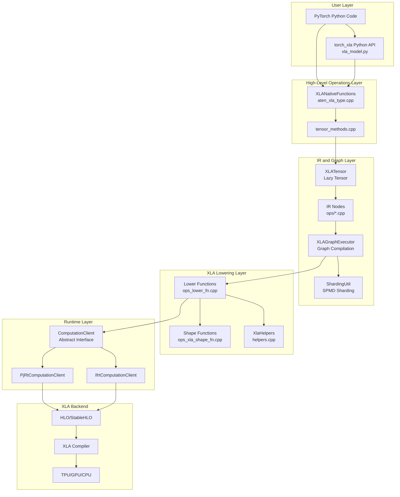
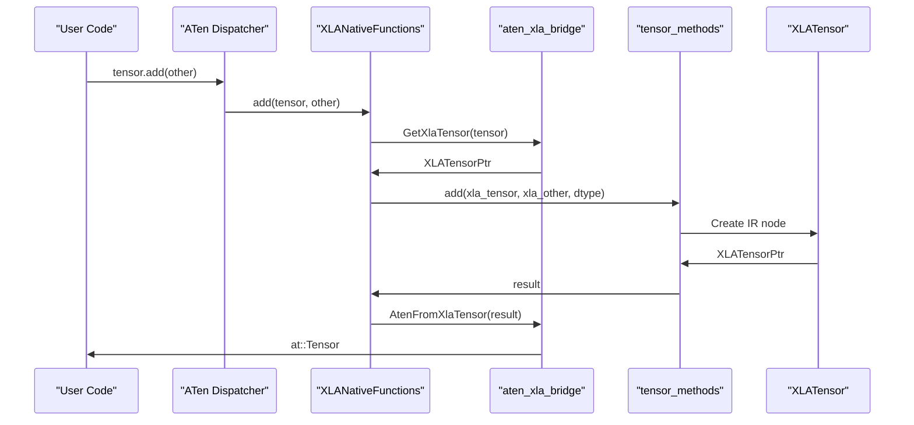
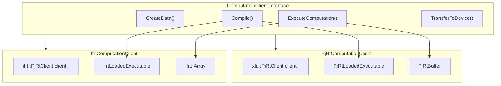
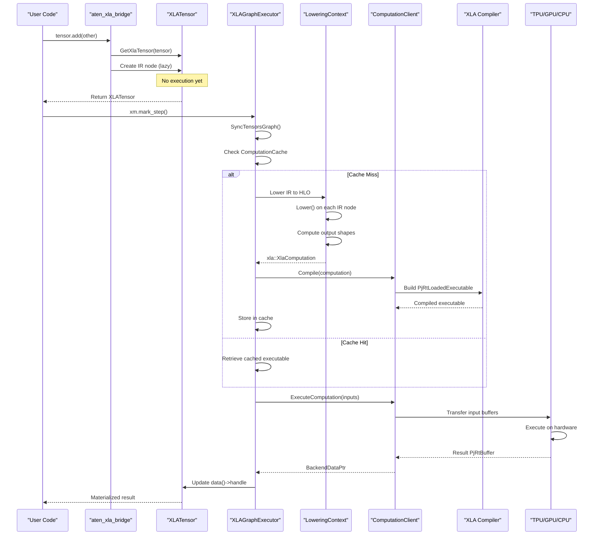

<!-- source: DeepWiki mcp.deepwiki.com · repo pytorch/xla · page 1 Overview · fetched 2026-10-21 -->

# Overview

<details>
<summary>Relevant source files</summary>

The following files were used as context for generating this wiki page:

- [.github/ci.md](.github/ci.md)
- [.github/workflows/_build_torch_xla.yml](.github/workflows/_build_torch_xla.yml)
- [.github/workflows/_check_code_changes.yml](.github/workflows/_check_code_changes.yml)
- [.github/workflows/_test.yml](.github/workflows/_test.yml)
- [.github/workflows/_tpu_ci.yml](.github/workflows/_tpu_ci.yml)
- [.github/workflows/build_and_test.yml](.github/workflows/build_and_test.yml)
- [.github/workflows/build_upstream_image.yml](.github/workflows/build_upstream_image.yml)
- [.github/workflows/setup/action.yml](.github/workflows/setup/action.yml)
- [CONTRIBUTING.md](CONTRIBUTING.md)
- [README.md](README.md)
- [WORKSPACE](WORKSPACE)
- [experimental/reference_models/README.md](experimental/reference_models/README.md)
- [scripts/build_developer.sh](scripts/build_developer.sh)
- [scripts/update_deps.py](scripts/update_deps.py)
- [setup.py](setup.py)
- [test/tpu/xla_test_job.yaml](test/tpu/xla_test_job.yaml)
- [torch_xla/csrc/runtime/BUILD](torch_xla/csrc/runtime/BUILD)
- [torch_xla/csrc/runtime/computation_client.h](torch_xla/csrc/runtime/computation_client.h)
- [torch_xla/csrc/runtime/ifrt_computation_client.cpp](torch_xla/csrc/runtime/ifrt_computation_client.cpp)
- [torch_xla/csrc/runtime/ifrt_computation_client.h](torch_xla/csrc/runtime/ifrt_computation_client.h)
- [torch_xla/csrc/runtime/ifrt_computation_client_test.cpp](torch_xla/csrc/runtime/ifrt_computation_client_test.cpp)
- [torch_xla/csrc/runtime/pjrt_computation_client.cpp](torch_xla/csrc/runtime/pjrt_computation_client.cpp)
- [torch_xla/csrc/runtime/pjrt_computation_client.h](torch_xla/csrc/runtime/pjrt_computation_client.h)
- [torch_xla/csrc/runtime/pjrt_computation_client_test.cpp](torch_xla/csrc/runtime/pjrt_computation_client_test.cpp)
- [torch_xla/csrc/runtime/pjrt_registry.cpp](torch_xla/csrc/runtime/pjrt_registry.cpp)
- [torch_xla/csrc/runtime/runtime.cpp](torch_xla/csrc/runtime/runtime.cpp)
- [torch_xla/csrc/runtime/runtime.h](torch_xla/csrc/runtime/runtime.h)

</details>


PyTorch/XLA is a Python package that uses the XLA (Accelerated Linear Algebra) deep learning compiler to connect PyTorch with Cloud TPUs and other XLA-compatible hardware accelerators. The system provides a bridge between PyTorch's ATen operations and XLA's HLO (High-Level Optimizer) representation, enabling PyTorch models to run efficiently on specialized hardware with minimal code changes.

The core design uses lazy execution: operations on XLA tensors build an intermediate representation (IR) graph rather than executing immediately. When synchronization occurs (via `xm.mark_step()` or implicit materialization), the `XLAGraphExecutor` compiles the graph to HLO, the XLA compiler optimizes and compiles it to device-specific code, and the `ComputationClient` (PJRT or IFRT) executes it on the hardware.

For installation instructions, see page **1.2**.

## System Architecture

PyTorch/XLA implements a multi-layer architecture spanning from Python APIs down to hardware execution. The following diagram shows the six primary layers:

**High-Level System Architecture**



Sources:
- [torch_xla/csrc/aten_xla_type.cpp:1-100]()
- [torch_xla/csrc/tensor.cpp:1-100]()
- [torch_xla/csrc/tensor_methods.cpp:1-100]()
- [torch_xla/csrc/xla_graph_executor.h:1-50]()
- [torch_xla/csrc/runtime/computation_client.h:1-100]()
- [torch_xla/csrc/runtime/pjrt_computation_client.h:1-100]()
- [torch_xla/csrc/runtime/ifrt_computation_client.h:1-100]()

## Core Components

The following table summarizes the key components in each layer:

| Layer | Component | File Location | Purpose |
|-------|-----------|---------------|---------|
| **User Layer** | `torch_xla` Python API | `torch_xla/core/xla_model.py` | High-level API for device management, synchronization |
| **Operations** | `XLANativeFunctions` | `torch_xla/csrc/aten_xla_type.cpp` | ATen operation dispatcher to XLA implementations |
| **Operations** | `tensor_methods` | `torch_xla/csrc/tensor_methods.cpp` | XLA-specific tensor operation implementations |
| **IR/Graph** | `XLATensor` | `torch_xla/csrc/tensor.h`, `tensor.cpp` | Lazy tensor with IR value, view system, sharding spec |
| **IR/Graph** | `XLAGraphExecutor` | `torch_xla/csrc/xla_graph_executor.h` | Graph compilation, caching, synchronization |
| **Lowering** | Lower functions | `torch_xla/csrc/ops/` | IR node lowering to HLO operations |
| **Lowering** | `XlaHelpers` | `torch_xla/csrc/helpers.cpp` | Type promotion, broadcasting, shape utilities |
| **Runtime** | `ComputationClient` | `torch_xla/csrc/runtime/computation_client.h` | Abstract interface for device execution |
| **Runtime** | `PjRtComputationClient` | `torch_xla/csrc/runtime/pjrt_computation_client.h` | PJRT-based runtime implementation |
| **Runtime** | `IfrtComputationClient` | `torch_xla/csrc/runtime/ifrt_computation_client.h` | IFRT-based runtime implementation |

### ATen/XLA Bridge

The `XLANativeFunctions` class in [torch_xla/csrc/aten_xla_type.cpp:446-860]() implements PyTorch's ATen dispatcher interface. When PyTorch operations are invoked on XLA tensors, the dispatcher redirects to XLA-specific implementations. The bridge extracts `XLATensor` objects using `bridge::GetXlaTensor()` [torch_xla/csrc/aten_xla_bridge.h:1-50](), invokes `tensor_methods` functions to create IR nodes, and wraps results back into ATen tensors.

**Operation Dispatch Flow**



Sources:
- [torch_xla/csrc/aten_xla_type.cpp:446-860]()
- [torch_xla/csrc/aten_xla_bridge.h:1-50]()
- [torch_xla/csrc/tensor_methods.cpp:1-200]()

### XLATensor and Lazy IR

`XLATensor` [torch_xla/csrc/tensor.h:93-358]() is the core data structure representing tensors on XLA devices. Each `XLATensor` contains:

- `data_->ir_value`: A `torch::lazy::Value` pointing to an IR node
- `data_->handle`: A `BackendDataPtr` to device data (when materialized)
- `data_->view`: A `View` object for view operations
- `data_->sharding`: A `ShardingSpec` for SPMD parallelism

The lazy execution model means operations create IR nodes [torch_xla/csrc/ops/]() rather than executing immediately. The IR graph is built incrementally until synchronization.

Sources:
- [torch_xla/csrc/tensor.h:93-358]()
- [torch_xla/csrc/tensor.cpp:1-300]()

### XLAGraphExecutor

`XLAGraphExecutor` [torch_xla/csrc/xla_graph_executor.h:1-100]() manages the lazy execution lifecycle:

1. **Graph Collection**: `SyncTensorsGraph()` collects all pending IR nodes from tensors
2. **Compilation**: IR nodes are lowered to HLO via `LoweringContext` [torch_xla/csrc/lowering_context.h:1-100]()
3. **Caching**: Compiled computations are cached using a hash of the IR graph
4. **Execution**: `ComputationClient::ExecuteComputation()` runs the compiled program
5. **Synchronization**: Results update tensor data handles

The executor also implements eager mode when `TORCH_XLA_DISABLE_EAGER_LAZY_MODE=0`, which compiles and executes operations immediately.

Sources:
- [torch_xla/csrc/xla_graph_executor.h:1-100]()
- [torch_xla/csrc/lowering_context.h:1-100]()

### ComputationClient Runtime

The `ComputationClient` interface [torch_xla/csrc/runtime/computation_client.h:38-450]() abstracts device interaction with two implementations:

**PjRtComputationClient** [torch_xla/csrc/runtime/pjrt_computation_client.h:27-320]() uses PJRT (Pluggable JAX Runtime):
- `client_`: `xla::PjRtClient` for device management
- `Compile()`: Compiles XLA computations to `PjRtLoadedExecutable`
- `ExecuteComputation()`: Executes on `PjRtDevice` with async semantics
- Supports local and distributed TPU/GPU execution

**IfrtComputationClient** [torch_xla/csrc/runtime/ifrt_computation_client.h:1-200]() uses IFRT (Intermediate Format Runtime) for advanced features like SPMD.

**Runtime Client Architecture**



Sources:
- [torch_xla/csrc/runtime/computation_client.h:38-450]()
- [torch_xla/csrc/runtime/pjrt_computation_client.h:27-320]()
- [torch_xla/csrc/runtime/pjrt_computation_client.cpp:1-200]()
- [torch_xla/csrc/runtime/ifrt_computation_client.h:1-200]()
- [torch_xla/csrc/runtime/ifrt_computation_client.cpp:1-200]()

## Execution Model

### Lazy Evaluation and IR Graph

PyTorch/XLA uses lazy evaluation: operations on `XLATensor` objects create IR nodes without immediate execution. For example:

```python
import torch
import torch_xla.core.xla_model as xm

device = xm.xla_device()
x = torch.randn(10, 10, device=device)
y = torch.randn(10, 10, device=device)
z = x + y  # Creates an IR node, does not execute
```

The addition creates an `Add` IR node [torch_xla/csrc/ops/arithmetic_ir_ops.h:1-50]() and stores it in `z.data()->ir_value`. The operation is not executed until synchronization occurs via:
- `xm.mark_step()`: Explicit synchronization point
- `.cpu()` or `.item()`: Materialization to host
- Printing tensor values

When synchronization occurs, `XLAGraphExecutor::SyncTensorsGraph()` collects all pending IR nodes, builds a computation graph, and compiles/executes it.

Sources:
- [torch_xla/csrc/tensor.cpp:383-412]()
- [torch_xla/csrc/ops/arithmetic_ir_ops.h:1-50]()

### Compilation and Execution Pipeline

**Complete Tensor Operation Pipeline**



The pipeline stages:

1. **IR Graph Building** [torch_xla/csrc/tensor.cpp:383-412](): Operations create IR nodes stored in `XLATensor::data()->ir_value`

2. **Graph Collection** [torch_xla/csrc/xla_graph_executor.cpp:1-200](): `SyncTensorsGraph()` collects all pending tensors

3. **Compilation Cache Check**: Hash of IR graph is checked against `ComputationCache`

4. **Lowering** [torch_xla/csrc/lowering_context.cpp:1-200](): Each IR node's `Lower()` method generates HLO operations

5. **XLA Compilation**: `ComputationClient::Compile()` invokes XLA compiler to produce `PjRtLoadedExecutable`

6. **Execution**: `ExecuteComputation()` transfers inputs, executes on device, returns results

7. **Result Update**: Tensor `data()->handle` updated with `BackendDataPtr` pointing to device buffer

Sources:
- [torch_xla/csrc/tensor.cpp:383-412]()
- [torch_xla/csrc/xla_graph_executor.cpp:1-200]()
- [torch_xla/csrc/lowering_context.cpp:1-200]()
- [torch_xla/csrc/runtime/pjrt_computation_client.cpp:1-200]()

### Compilation Caching

The `ComputationCache` [torch_xla/csrc/xla_graph_executor.cpp:1-200]() stores compiled executables keyed by IR graph hash. Cache hits avoid recompilation, dramatically improving performance for repeated patterns. Cache statistics are available via `torch_xla._XLAC._xla_metrics_report()`.

Sources:
- [torch_xla/csrc/xla_graph_executor.cpp:1-200]()

## Deployment Options

PyTorch/XLA supports several deployment options, depending on the hardware and scale requirements:

### Single-Device Execution

For simple use cases, PyTorch/XLA can be used with a single XLA device:

```python
import torch_xla
import torch_xla.core.xla_model as xm

device = xm.xla_device()
model = Model().to(device)
optimizer = optim.SGD(model.parameters(), lr=0.01)

for data, target in train_loader:
    with torch_xla.step():
        data, target = data.to(device), target.to(device)
        output = model(data)
        loss = loss_fn(output, target)
        loss.backward()
        optimizer.step()
```

Sources:
- [README.md:125-156](https://github.com/pytorch/xla)
- [API_GUIDE.md:75-97](https://github.com/pytorch/xla)

### Multi-Device Execution

For larger models or datasets, PyTorch/XLA supports distributed training across multiple devices:

```python
import torch_xla
import torch_xla.core.xla_model as xm
import torch_xla.distributed.parallel_loader as pl

def _mp_fn(index):
    device = xm.xla_device()
    model = Model().to(device)
    
    # Wrap the dataloader to optimize data transfer
    mp_device_loader = pl.MpDeviceLoader(train_loader, device)
    
    for data, target in mp_device_loader:
        with torch_xla.step():
            output = model(data)
            loss = loss_fn(output, target)
            loss.backward()
            # Combines gradients across replicas
            xm.optimizer_step(optimizer)

if __name__ == '__main__':
    torch_xla.launch(_mp_fn, args=())
```

Sources:
- [README.md:158-189](https://github.com/pytorch/xla)
- [API_GUIDE.md:109-164](https://github.com/pytorch/xla)

### Cloud TPU Support

PyTorch/XLA provides full support for Cloud TPUs, including TPU VMs and TPU Pods. The system handles the complexities of TPU communication and data placement.

For TPU Pods, PyTorch/XLA provides utilities for distributing training across multiple TPU hosts:

```
gcloud alpha compute tpus tpu-vm ssh $USER-pjrt --zone=$ZONE --project=$PROJECT --worker=all --command="PJRT_DEVICE=TPU python train_script.py"
```

Sources:
- [README.md:164-189](https://github.com/pytorch/xla)
- [API_GUIDE.md:164-189](https://github.com/pytorch/xla)

### GPU Support

PyTorch/XLA also supports NVIDIA GPUs through a CUDA plugin:

```bash
pip install torch~=2.5.0 torch_xla~=2.5.0 https://storage.googleapis.com/pytorch-xla-releases/wheels/cuda/12.1/torch_xla_cuda_plugin-2.5.0-py3-none-any.whl
```

Sources:
- [README.md:84-97](https://github.com/pytorch/xla)
- [README.md:356-373](https://github.com/pytorch/xla)

## Installation

PyTorch/XLA can be installed using pip:

### TPU Installation

```bash
pip install torch~=2.6.0 'torch_xla[tpu]~=2.6.0' \
  -f https://storage.googleapis.com/libtpu-releases/index.html \
  -f https://storage.googleapis.com/libtpu-wheels/index.html
```

### GPU Installation

```bash
pip install torch~=2.5.0 torch_xla~=2.5.0 https://storage.googleapis.com/pytorch-xla-releases/wheels/cuda/12.1/torch_xla_cuda_plugin-2.5.0-py3-none-any.whl
```

PyTorch/XLA also provides Docker images for various configurations:

```bash
docker run --privileged --net host --shm-size=16G -it us-central1-docker.pkg.dev/tpu-pytorch-releases/docker/xla:nightly_3.10_tpuvm /bin/bash
```

Sources:
- [README.md:20-41](https://github.com/pytorch/xla)
- [README.md:84-97](https://github.com/pytorch/xla)
- [README.md:336-351](https://github.com/pytorch/xla)

## Building from Source

For development or customization purposes, PyTorch/XLA can be built from source:

1. Clone the PyTorch repository:
   ```bash
   git clone --recursive https://github.com/pytorch/pytorch.git
   ```

2. Clone the PyTorch/XLA repository:
   ```bash
   git clone https://github.com/pytorch/xla.git pytorch/xla
   ```

3. Build PyTorch:
   ```bash
   cd pytorch
   python setup.py bdist_wheel
   python setup.py develop
   ```

4. Build PyTorch/XLA:
   ```bash
   cd xla/
   python setup.py develop
   ```

The build system uses Bazel for compilation and includes various configuration options through environment variables.

Sources:
- [CONTRIBUTING.md:14-179](https://github.com/pytorch/xla)
- [setup.py:1-50](https://github.com/pytorch/xla)
- [WORKSPACE:1-50](https://github.com/pytorch/xla)

## Key Files and Directories

The PyTorch/XLA repository is organized into the following key directories:

| Directory | Description |
|-----------|-------------|
| `torch_xla/csrc/` | C++ source code for core PyTorch/XLA functionality |
| `torch_xla/csrc/runtime/` | Runtime implementation including computation clients |
| `torch_xla/core/` | Python bindings and high-level APIs |
| `torch_xla/distributed/` | Distributed training functionality |
| `test/` | Test suite |
| `examples/` | Example models and training scripts |
| `contrib/` | Community contributions and Kaggle notebooks |

Sources:
- [README.md:100-113](https://github.com/pytorch/xla)
- [torch_xla/csrc/BUILD](https://github.com/pytorch/xla)
- [torch_xla/csrc/runtime/BUILD](https://github.com/pytorch/xla)

---

