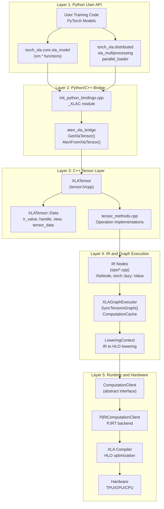
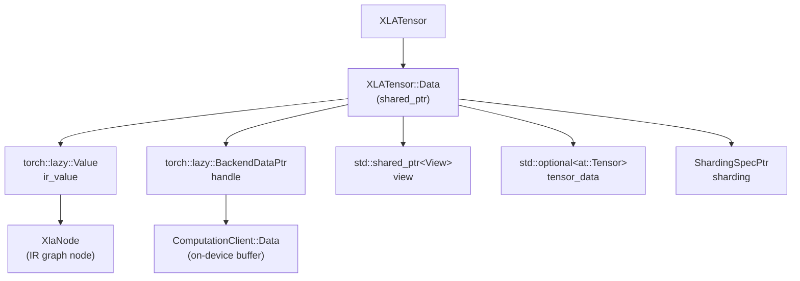
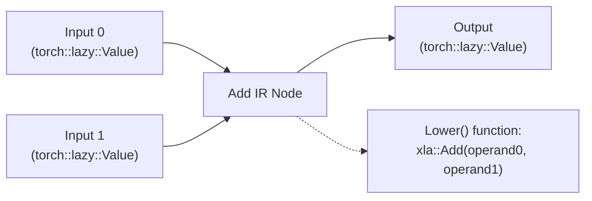
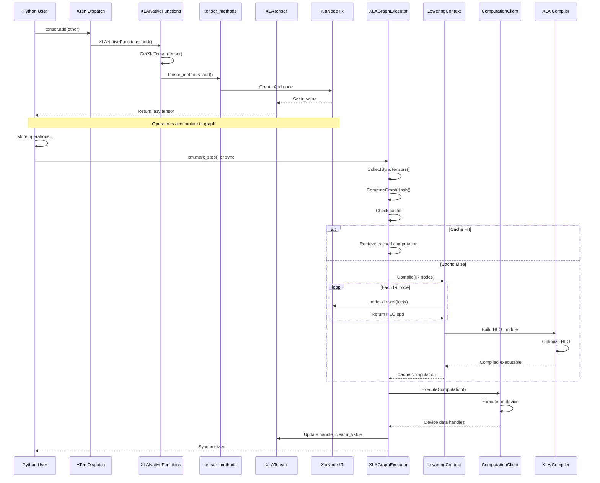
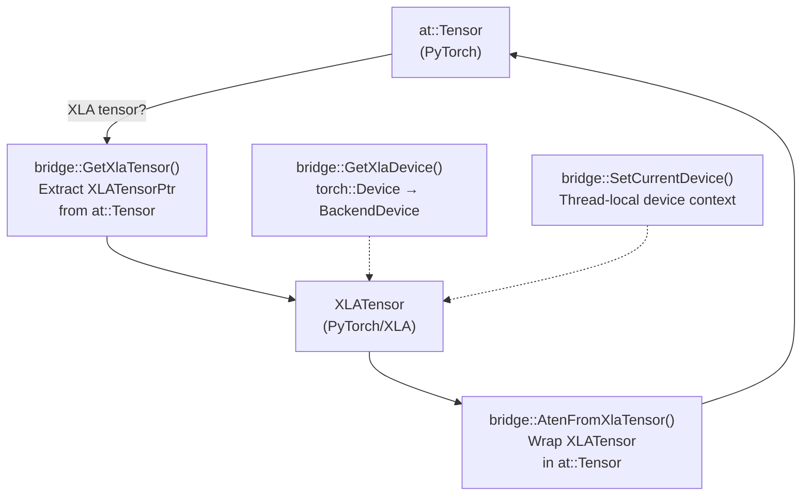
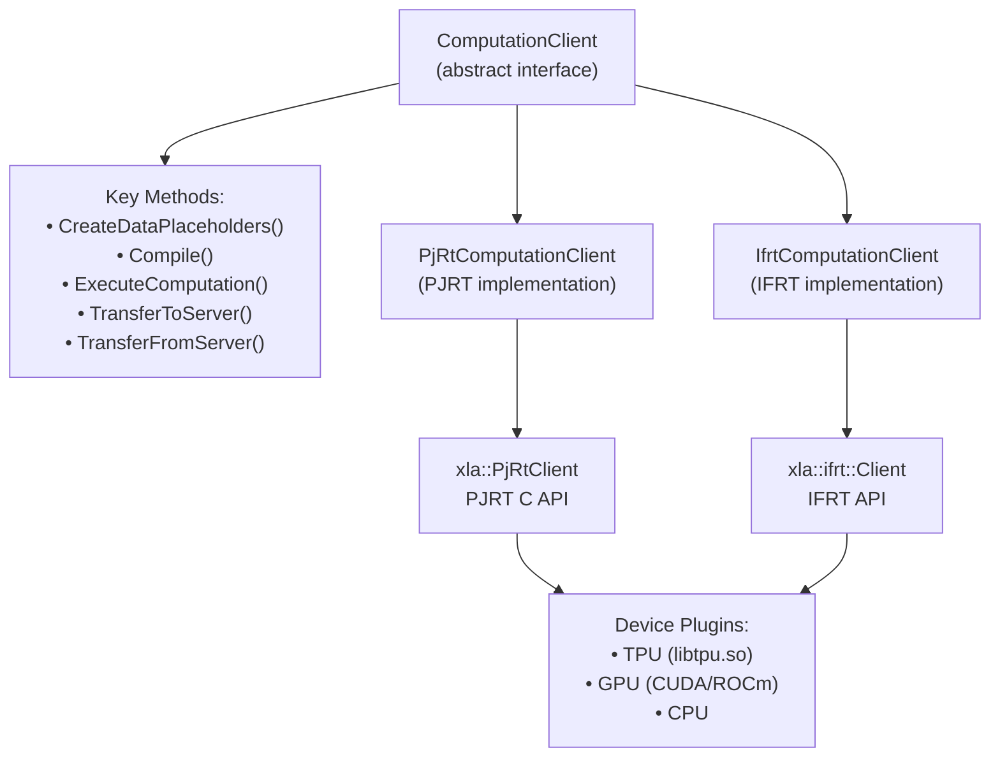
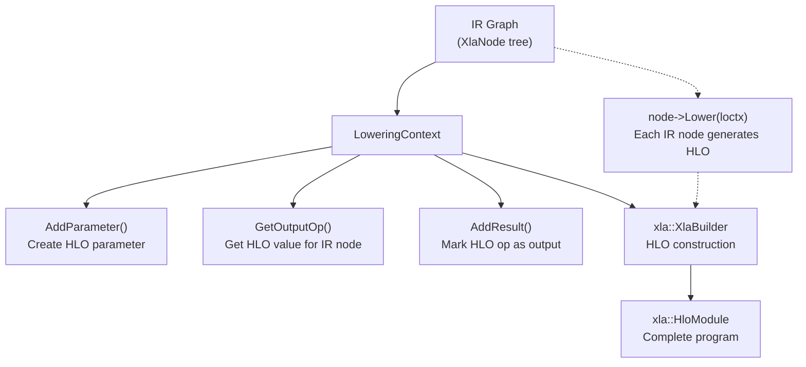
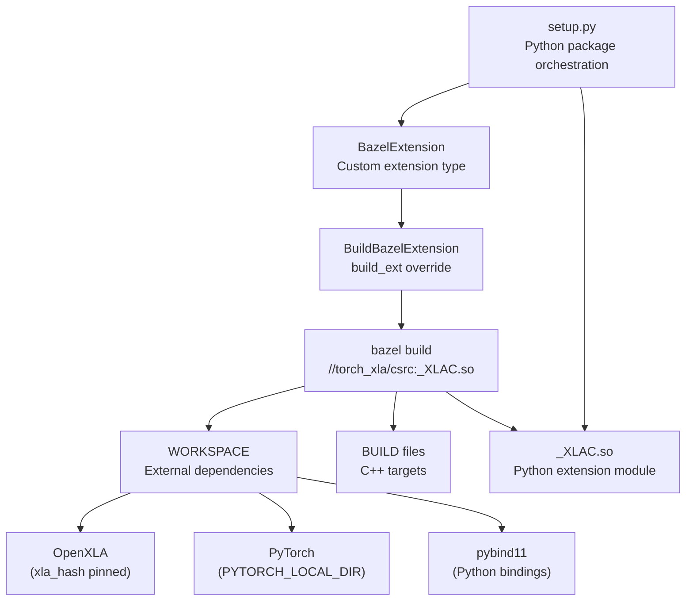

<!-- source: DeepWiki mcp.deepwiki.com · repo pytorch/xla · page 1.1 System Architecture · fetched 2026-10-21 -->

# System Architecture

<details>
<summary>Relevant source files</summary>

The following files were used as context for generating this wiki page:

- [WORKSPACE](WORKSPACE)
- [docs/source/index.rst](docs/source/index.rst)
- [setup.py](setup.py)
- [test/cpp/test_xla_sharding.cpp](test/cpp/test_xla_sharding.cpp)
- [test/spmd/test_mp_input_sharding.py](test/spmd/test_mp_input_sharding.py)
- [test/spmd/test_xla_sharding.py](test/spmd/test_xla_sharding.py)
- [test/spmd/test_xla_sharding_base.py](test/spmd/test_xla_sharding_base.py)
- [test/test_operations.py](test/test_operations.py)
- [test/test_ops_error_message.py](test/test_ops_error_message.py)
- [torch_xla/_internal/jax_workarounds.py](torch_xla/_internal/jax_workarounds.py)
- [torch_xla/core/xla_model.py](torch_xla/core/xla_model.py)
- [torch_xla/csrc/aten_autograd_ops.cpp](torch_xla/csrc/aten_autograd_ops.cpp)
- [torch_xla/csrc/aten_xla_type.cpp](torch_xla/csrc/aten_xla_type.cpp)
- [torch_xla/csrc/init_python_bindings.cpp](torch_xla/csrc/init_python_bindings.cpp)
- [torch_xla/csrc/ir_builder.h](torch_xla/csrc/ir_builder.h)
- [torch_xla/csrc/ops/ops.cpp](torch_xla/csrc/ops/ops.cpp)
- [torch_xla/csrc/ops/ops.h](torch_xla/csrc/ops/ops.h)
- [torch_xla/csrc/runtime/BUILD](torch_xla/csrc/runtime/BUILD)
- [torch_xla/csrc/runtime/computation_client.h](torch_xla/csrc/runtime/computation_client.h)
- [torch_xla/csrc/runtime/ifrt_computation_client.cpp](torch_xla/csrc/runtime/ifrt_computation_client.cpp)
- [torch_xla/csrc/runtime/ifrt_computation_client.h](torch_xla/csrc/runtime/ifrt_computation_client.h)
- [torch_xla/csrc/runtime/ifrt_computation_client_test.cpp](torch_xla/csrc/runtime/ifrt_computation_client_test.cpp)
- [torch_xla/csrc/runtime/pjrt_computation_client.cpp](torch_xla/csrc/runtime/pjrt_computation_client.cpp)
- [torch_xla/csrc/runtime/pjrt_computation_client.h](torch_xla/csrc/runtime/pjrt_computation_client.h)
- [torch_xla/csrc/runtime/pjrt_computation_client_test.cpp](torch_xla/csrc/runtime/pjrt_computation_client_test.cpp)
- [torch_xla/csrc/runtime/pjrt_registry.cpp](torch_xla/csrc/runtime/pjrt_registry.cpp)
- [torch_xla/csrc/runtime/runtime.cpp](torch_xla/csrc/runtime/runtime.cpp)
- [torch_xla/csrc/runtime/runtime.h](torch_xla/csrc/runtime/runtime.h)
- [torch_xla/csrc/tensor.cpp](torch_xla/csrc/tensor.cpp)
- [torch_xla/csrc/tensor.h](torch_xla/csrc/tensor.h)
- [torch_xla/csrc/tensor_methods.cpp](torch_xla/csrc/tensor_methods.cpp)
- [torch_xla/csrc/tensor_methods.h](torch_xla/csrc/tensor_methods.h)
- [torch_xla/csrc/tensor_util.cpp](torch_xla/csrc/tensor_util.cpp)
- [torch_xla/csrc/tensor_util.h](torch_xla/csrc/tensor_util.h)
- [torch_xla/csrc/xla_backend_impl.cpp](torch_xla/csrc/xla_backend_impl.cpp)
- [torch_xla/csrc/xla_graph_executor.cpp](torch_xla/csrc/xla_graph_executor.cpp)
- [torch_xla/csrc/xla_graph_executor.h](torch_xla/csrc/xla_graph_executor.h)
- [torch_xla/csrc/xla_lower_util.cpp](torch_xla/csrc/xla_lower_util.cpp)
- [torch_xla/csrc/xla_lower_util.h](torch_xla/csrc/xla_lower_util.h)
- [torch_xla/csrc/xla_sharding_util.cpp](torch_xla/csrc/xla_sharding_util.cpp)
- [torch_xla/csrc/xla_sharding_util.h](torch_xla/csrc/xla_sharding_util.h)
- [torch_xla/distributed/data_parallel.py](torch_xla/distributed/data_parallel.py)
- [torch_xla/distributed/parallel_loader.py](torch_xla/distributed/parallel_loader.py)
- [torch_xla/distributed/spmd/__init__.py](torch_xla/distributed/spmd/__init__.py)
- [torch_xla/distributed/spmd/xla_sharding.py](torch_xla/distributed/spmd/xla_sharding.py)
- [torch_xla/distributed/xla_multiprocessing.py](torch_xla/distributed/xla_multiprocessing.py)
- [torch_xla/utils/utils.py](torch_xla/utils/utils.py)

</details>


## Purpose and Scope

This document describes the overall architecture of PyTorch/XLA, explaining how the system bridges PyTorch's eager execution model with XLA's graph-based compilation approach. It covers the major architectural layers, core data structures, and the flow of operations from Python user code through to hardware execution.

For information about specific subsystems, see:
- Tensor representation and lazy execution: [XLATensor and Lazy Execution](#2.2)
- Graph compilation and caching: [XLA Graph Executor](#2.3)
- Distributed training capabilities: [Distributed Training and SPMD](#3)
- Build system and dependencies: [Build System and Dependencies](#5.1)

## Architectural Layers

PyTorch/XLA is organized into five distinct layers that transform PyTorch operations into hardware-executable code:



**Layer 1: Python User API** - User-facing PyTorch code interfaces with `torch_xla.core.xla_model` for device management and synchronization, and `torch_xla.distributed` for multi-device training.

**Layer 2: Python/C++ Bridge** - [torch_xla/csrc/init_python_bindings.cpp:1-4000]() implements the `_XLAC` Python module that exposes C++ functionality. [torch_xla/csrc/aten_xla_bridge.h:1-100]() provides `GetXlaTensor()` and `AtenFromXlaTensor()` to convert between PyTorch and XLA tensor representations.

**Layer 3: C++ Tensor Layer** - `XLATensor` ([torch_xla/csrc/tensor.h:94-359]()) is the core tensor type. Each `XLATensor` contains a `Data` struct ([torch_xla/csrc/tensor.h:102-152]()) holding either an IR value, a device data handle, a view, or CPU tensor data. [torch_xla/csrc/tensor_methods.cpp:1-500]() implements high-level operations.

**Layer 4: IR and Graph Execution** - Operations create `XlaNode` IR nodes ([torch_xla/csrc/ir.h:1-200]()) wrapped in `torch::lazy::Value`. `XLAGraphExecutor` ([torch_xla/csrc/xla_graph_executor.h:1-200]()) manages graph compilation, caching, and execution. `LoweringContext` converts IR to XLA HLO.

**Layer 5: Runtime and Hardware** - `ComputationClient` ([torch_xla/csrc/runtime/computation_client.h:1-100]()) provides an abstract interface. `PjRtComputationClient` ([torch_xla/csrc/runtime/pjrt_computation_client.h:1-100]()) implements the PJRT backend, interfacing with the XLA compiler and hardware devices.

Sources: [torch_xla/csrc/tensor.h:1-363](), [torch_xla/csrc/xla_graph_executor.h:1-200](), [torch_xla/csrc/runtime/computation_client.h:1-300](), [torch_xla/csrc/init_python_bindings.cpp:1-500]()

## Core Data Structures

### XLATensor and Lazy Representation

The `XLATensor` class ([torch_xla/csrc/tensor.h:94-359]()) is PyTorch/XLA's central data structure. Each tensor maintains a shared pointer to a `Data` struct that can hold tensor information in one of four states:

| State | Field | Description |
|-------|-------|-------------|
| **IR Node** | `ir_value` | Pending computation represented as IR graph |
| **Device Data** | `handle` | Materialized data on XLA device |
| **View** | `view` | Alias/view of another tensor |
| **CPU Data** | `tensor_data` | Cached CPU tensor |



The `XLATensor::Data` structure ([torch_xla/csrc/tensor.h:102-152]()) contains:
- `ir_value`: The current IR node representing pending computation
- `handle`: A `BackendDataPtr` to materialized device data
- `view`: A view into another tensor's data
- `tensor_data`: Optional cached CPU tensor
- `sharding`: SPMD sharding specification for distributed execution
- `logical_element_type`: The PyTorch-visible dtype (may differ from HLO dtype)
- `alias_id`: Identifier for input/output aliasing
- `generation`: Mutation tracking counter

The tensor transitions between states as operations are performed. Initially, a tensor may hold only CPU data. When an operation is called, it creates an IR node. When the value is needed (e.g., printed or moved to CPU), `XLAGraphExecutor` compiles and executes the graph, storing the result in `handle`.

Sources: [torch_xla/csrc/tensor.h:94-359](), [torch_xla/csrc/tensor.cpp:53-255]()

### IR System and torch::lazy::Value

PyTorch/XLA uses `torch::lazy::Value` to represent IR nodes. A `Value` is a pair of a `NodePtr` and an output index ([torch/csrc/lazy/core/ir.h]()). Each `XlaNode` ([torch_xla/csrc/ir.h]()) inherits from `torch::lazy::Node` and implements:

- `Lower()`: Converts the IR node to XLA HLO operations
- `operands()`: Returns input values
- `shapes()`: Returns output shapes
- `sharding()`: Returns sharding annotation for SPMD

Operation nodes are created by functions in [torch_xla/csrc/ops/ops.cpp:1-1000](). For example:



Generic operations use the `Generic` node class ([torch_xla/csrc/ops/generic.h]()) which stores a lambda for lowering. Specialized operations like `Constant`, `DeviceData`, `Cast`, etc. have dedicated node classes in [torch_xla/csrc/ops/]().

Sources: [torch_xla/csrc/ir.h:1-200](), [torch_xla/csrc/ops/ops.cpp:44-165](), [torch_xla/csrc/ops/generic.h:1-100]()

## Operation Execution Flow

PyTorch/XLA implements lazy execution: operations build an IR graph instead of executing immediately. The graph is compiled and executed only when results are needed.

### Lazy Execution Sequence



### Key Execution Steps

**1. Operation Dispatch** - PyTorch's dispatcher routes operations to `XLANativeFunctions` ([torch_xla/csrc/aten_xla_type.cpp:444-1000]()). Each function:
   - Extracts `XLATensor` from `at::Tensor` using `bridge::GetXlaTensor()` ([torch_xla/csrc/aten_xla_bridge.cpp:1-200]())
   - Calls the corresponding `tensor_methods::` function
   - Wraps the result back to `at::Tensor` using `bridge::AtenFromXlaTensor()`

**2. IR Node Creation** - `tensor_methods` functions ([torch_xla/csrc/tensor_methods.cpp:1-10000]()) create IR nodes. For example, `add()` creates an `Add` node and returns a new `XLATensor` with `ir_value` set to that node.

**3. Graph Collection** - When `xm.mark_step()` or a synchronization point is reached, `XLAGraphExecutor::SyncTensorsGraph()` ([torch_xla/csrc/xla_graph_executor.cpp:800-1200]()) collects all tensors with pending IR:
   - `CollectSyncTensors()` gathers tensors that need compilation
   - Performs topological sort via `PostOrderData()`
   - Computes a hash of the graph structure

**4. Compilation** - If the graph hash is not in the cache, `Compile()` ([torch_xla/csrc/xla_graph_executor.cpp:400-800]()):
   - Creates a `LoweringContext`
   - Iterates through IR nodes in topological order
   - Each node's `Lower()` method produces XLA HLO operations
   - Builds a complete HLO module with parameters and outputs
   - Invokes `ComputationClient::Compile()` which calls the XLA compiler

**5. Execution** - `ComputationClient::ExecuteComputation()` ([torch_xla/csrc/runtime/pjrt_computation_client.cpp:1000-1500]()):
   - Transfers input data to device if needed
   - Runs the compiled executable
   - Returns handles to device buffers
   - Updates `XLATensor::Data::handle` with results
   - Clears `ir_value` to indicate materialization

**6. Caching** - The `ComputationCache` ([torch_xla/csrc/xla_graph_executor.h:50-100]()) stores compiled executables keyed by graph hash. For persistent caching, serialized HLO can be written to disk (controlled by `XLA_PERSISTENT_CACHE_PATH`). Cache lookup avoids recompilation for identical graph patterns.

Sources: [torch_xla/csrc/xla_graph_executor.cpp:400-1200](), [torch_xla/csrc/aten_xla_type.cpp:860-900](), [torch_xla/csrc/tensor_methods.cpp:1-500](), [torch_xla/csrc/tensor.cpp:212-255]()

## Component Interactions

### ATen to XLA Bridge

The bridge layer ([torch_xla/csrc/aten_xla_bridge.h:1-150]()) provides bidirectional conversion:



Key functions:
- `GetXlaTensor(at::Tensor)` returns `absl::StatusOr<XLATensorPtr>` ([torch_xla/csrc/aten_xla_bridge.cpp:50-100]())
- `AtenFromXlaTensor(XLATensorPtr)` creates an `at::Tensor` with `XLATensorImpl` ([torch_xla/csrc/aten_xla_bridge.cpp:150-200]())
- `GetOrCreateXlaTensor(at::Tensor, device)` ensures a tensor is on the XLA device
- Device context is thread-local, accessed via `GetCurrentDevice()` and set via `SetCurrentDevice()`

Sources: [torch_xla/csrc/aten_xla_bridge.h:1-150](), [torch_xla/csrc/aten_xla_bridge.cpp:1-300]()

### XLAGraphExecutor Orchestration

`XLAGraphExecutor` ([torch_xla/csrc/xla_graph_executor.h:28-200](), [torch_xla/csrc/xla_graph_executor.cpp:1-3000]()) is the central orchestrator, managing:

| Responsibility | Implementation |
|----------------|----------------|
| **Tensor Registration** | `RegisterTensor()` tracks all live `XLATensor::Data` instances |
| **Graph Compilation** | `SyncTensorsGraph()` compiles pending IR graphs |
| **Computation Cache** | `ComputationCache` stores compiled executables by hash |
| **Device Synchronization** | `SyncLiveTensorsGraph()` ensures all device operations complete |
| **Eager Mode** | `ApplyEagerSync()` compiles single operations immediately |
| **Scalar Cache** | `GetDeviceData()` caches scalar literals |

The executor maintains per-device state in `DeviceContextArena` ([torch_xla/csrc/xla_graph_executor.cpp:127-200]()), tracking live tensors and compilation triggers. Graph compilation is triggered by:
- Explicit `xm.mark_step()` or `xm.wait_device_ops()`
- Tensor materialization (`.cpu()`, printing, etc.)
- Eager mode execution (when `torch_xla.experimental.eager_mode()` is enabled)

Sources: [torch_xla/csrc/xla_graph_executor.h:28-200](), [torch_xla/csrc/xla_graph_executor.cpp:127-600]()

### ComputationClient Runtime

The runtime layer abstracts hardware access through `ComputationClient` ([torch_xla/csrc/runtime/computation_client.h:1-300]()):



**Data Abstraction** - `ComputationClient::Data` represents on-device buffers. `PjRtData` wraps `xla::PjRtBuffer` handles. Operations transfer data between host and device via `TransferToServer()` and `TransferFromServer()`.

**Compilation** - `Compile()` takes an HLO module and returns a `ComputationClient::Computation` executable. The PJRT backend calls `PjRtClient::Compile()` from the OpenXLA project.

**Execution** - `ExecuteComputation()` runs a compiled executable with given inputs, returning output data handles. PJRT execution is asynchronous; synchronization occurs explicitly via device barriers.

**Plugin System** - Device selection is controlled by the `PJRT_DEVICE` environment variable. `pjrt_registry.cpp` discovers and loads PJRT plugins from shared libraries.

Sources: [torch_xla/csrc/runtime/computation_client.h:1-300](), [torch_xla/csrc/runtime/pjrt_computation_client.h:1-200](), [torch_xla/csrc/runtime/pjrt_computation_client.cpp:1-500]()

## Lowering and Code Generation

### IR to HLO Translation

`LoweringContext` ([torch_xla/csrc/lowering_context.h:1-150]()) manages the translation from IR to XLA HLO:



**Lowering Process**:
1. Create `LoweringContext` with an `xla::XlaBuilder`
2. Add parameters for all input tensors via `AddParameter()`
3. Iterate IR nodes in topological order
4. For each node, call `node->Lower(loctx)` which uses `xla::` ops to build HLO
5. Mark output tensors with `AddResult()`
6. Call `Build()` to finalize the HLO module

**Example**: The `Add` node's `Lower()` method ([torch_xla/csrc/ops/arithmetic_ir_ops.cpp:1-100]()):
```cpp
XlaOpVector Add::Lower(LoweringContext* loctx) const {
  xla::XlaOp lhs = loctx->GetOutputOp(operand(0));
  xla::XlaOp rhs = loctx->GetOutputOp(operand(1));
  xla::XlaOp result = xla::Add(lhs, rhs);
  return ReturnOp(result, loctx);
}
```

**Shape Inference** - Many operations use `InferOutputShape()` ([torch_xla/csrc/ops/infer_output_shape.h:1-50]()) to compute output shapes without full lowering, enabling graph optimization and memory planning.

**Dynamic Shapes** - For operations with dynamic dimensions, special IR nodes like `DynamicExpand` and `SizeAdd` handle shape computation. The `GetXlaShape()` utility converts between PyTorch and XLA shape representations.

Sources: [torch_xla/csrc/lowering_context.h:1-150](), [torch_xla/csrc/lowering_context.cpp:1-500](), [torch_xla/csrc/ops/ops.cpp:44-165]()

### Code Generation Configuration

PyTorch/XLA's code generation is controlled by:

| Configuration | Purpose |
|---------------|---------|
| `XLA_IR_DEBUG=1` | Dump IR graphs before compilation |
| `XLA_HLO_DEBUG=1` | Dump HLO before and after optimization |
| `XLA_SAVE_TENSORS_FILE` | Save IR/HLO to file |
| `XLA_SAVE_TENSORS_FMT` | Output format (text, dot, hlo) |
| `XLA_METRICS_FILE` | Write performance metrics |
| `XLA_COMPILATION_CACHE_SIZE` | Max cached compilations (default: 2048) |
| `XLA_PERSISTENT_CACHE_PATH` | Directory for persistent cache |

The `XLA_DUMP_FATAL_STACK` flag enables stack traces on errors, controlled via [torch_xla/csrc/runtime/env_vars.h:1-100]().

Sources: [torch_xla/csrc/xla_graph_executor.cpp:84-123](), [torch_xla/csrc/runtime/env_vars.h:1-100](), [torch_xla/csrc/runtime/sys_util.h:1-100]()

## Build System Architecture

PyTorch/XLA uses a hybrid build system combining Python `setuptools` and Bazel for C++ compilation:



**Build Process**:
1. `python setup.py install` or `pip install .` invokes [setup.py:1-400]()
2. `BuildBazelExtension.build_extension()` ([setup.py:280-333]()) runs `bazel build //torch_xla/csrc:_XLAC.so`
3. Bazel reads [WORKSPACE:1-150]() for external dependencies (OpenXLA at pinned commit, PyTorch local path)
4. Compiles C++ with flags from environment (`CXX_ABI`, `XLA_CUDA`, etc.)
5. Copies built `.so` to Python package directory
6. Bundles `libtpu.so` if `BUNDLE_LIBTPU=1` ([setup.py:194-221]())

**Dependency Pinning**:
- OpenXLA commit: `xla_hash = '9a9aa0e11e4fcda8d6a9c3267dca6776ddbdb0ca'` ([WORKSPACE:49]())
- PyTorch: Resolved via `PYTORCH_LOCAL_DIR` from `python -c "import torch; print(torch.__path__[0])"`
- JAX/libtpu versions: `_jax_version`, `_libtpu_version` in [setup.py:119-141]()

**Plugin Architecture**: PJRT plugins are dynamically loaded shared libraries. Device selection occurs via `PJRT_DEVICE` environment variable, which loads the corresponding plugin from `pjrt_registry.cpp` ([torch_xla/csrc/runtime/pjrt_registry.cpp:1-200]()).

Sources: [setup.py:1-400](), [WORKSPACE:1-150](), [torch_xla/csrc/BUILD:1-200](), [torch_xla/csrc/runtime/BUILD:1-300]()

---

