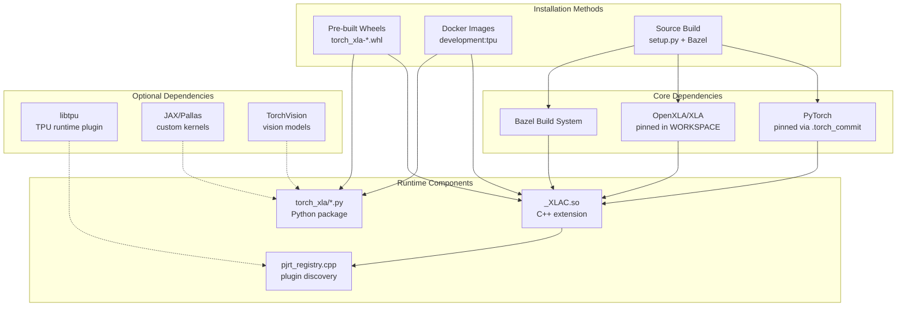
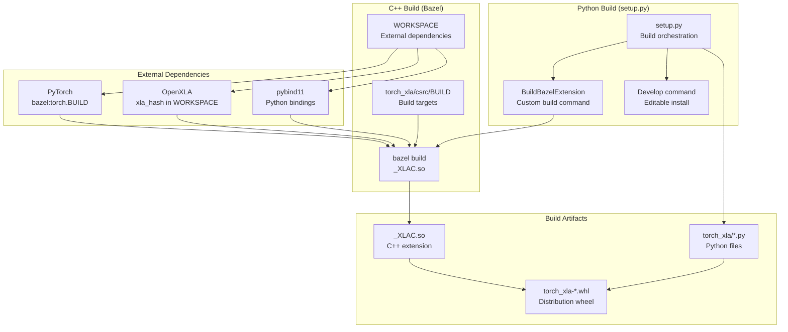
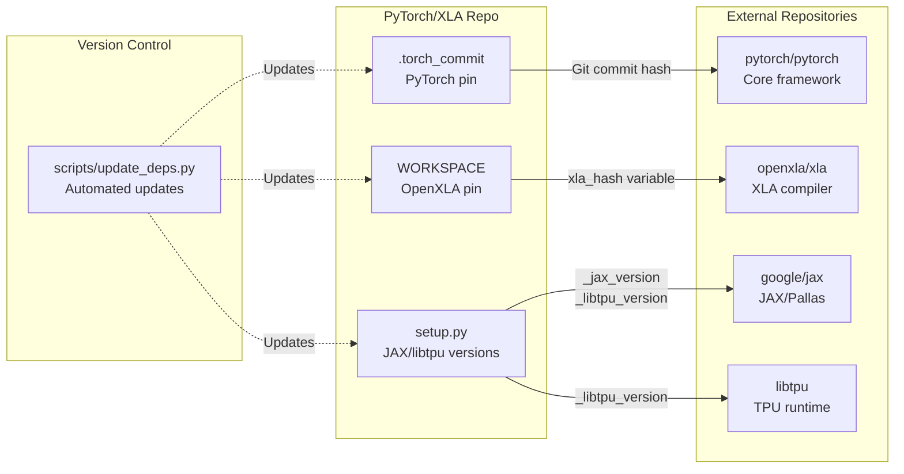
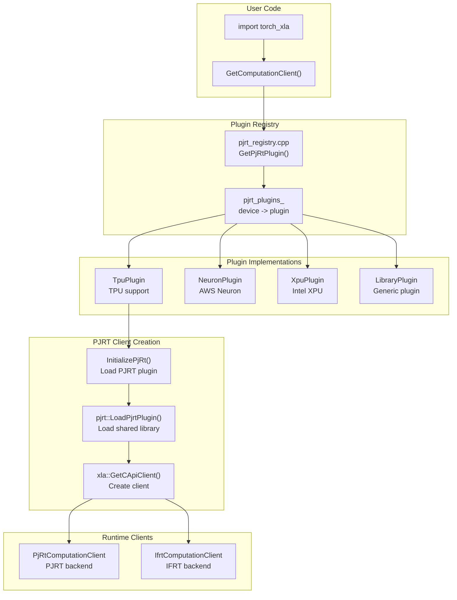
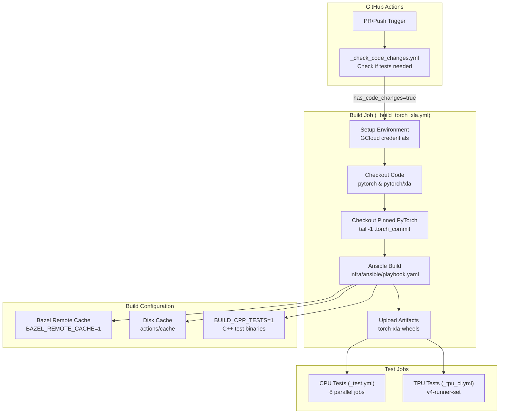
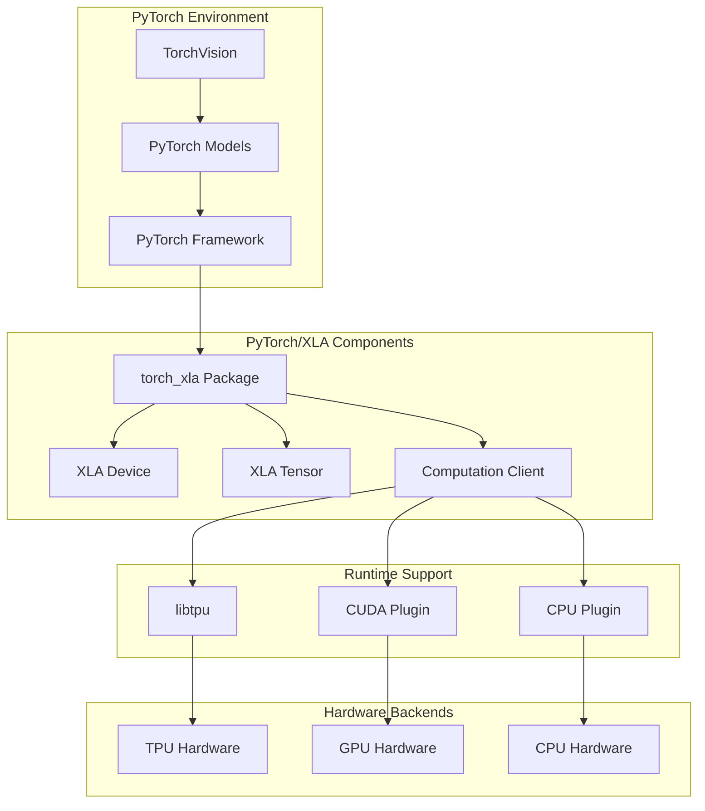

<!-- source: DeepWiki mcp.deepwiki.com · repo pytorch/xla · page 1.2 Installation and Dependencies · fetched 2026-10-21 -->

# Installation and Dependencies

<details>
<summary>Relevant source files</summary>

The following files were used as context for generating this wiki page:

- [.github/ci.md](.github/ci.md)
- [.github/workflows/_build_torch_xla.yml](.github/workflows/_build_torch_xla.yml)
- [.github/workflows/_check_code_changes.yml](.github/workflows/_check_code_changes.yml)
- [.github/workflows/_test.yml](.github/workflows/_test.yml)
- [.github/workflows/_tpu_ci.yml](.github/workflows/_tpu_ci.yml)
- [.github/workflows/build_and_test.yml](.github/workflows/build_and_test.yml)
- [.github/workflows/build_upstream_image.yml](.github/workflows/build_upstream_image.yml)
- [.github/workflows/setup/action.yml](.github/workflows/setup/action.yml)
- [CONTRIBUTING.md](CONTRIBUTING.md)
- [README.md](README.md)
- [WORKSPACE](WORKSPACE)
- [experimental/reference_models/README.md](experimental/reference_models/README.md)
- [scripts/build_developer.sh](scripts/build_developer.sh)
- [scripts/update_deps.py](scripts/update_deps.py)
- [setup.py](setup.py)
- [test/tpu/xla_test_job.yaml](test/tpu/xla_test_job.yaml)
- [torch_xla/csrc/runtime/BUILD](torch_xla/csrc/runtime/BUILD)
- [torch_xla/csrc/runtime/computation_client.h](torch_xla/csrc/runtime/computation_client.h)
- [torch_xla/csrc/runtime/ifrt_computation_client.cpp](torch_xla/csrc/runtime/ifrt_computation_client.cpp)
- [torch_xla/csrc/runtime/ifrt_computation_client.h](torch_xla/csrc/runtime/ifrt_computation_client.h)
- [torch_xla/csrc/runtime/ifrt_computation_client_test.cpp](torch_xla/csrc/runtime/ifrt_computation_client_test.cpp)
- [torch_xla/csrc/runtime/pjrt_computation_client.cpp](torch_xla/csrc/runtime/pjrt_computation_client.cpp)
- [torch_xla/csrc/runtime/pjrt_computation_client.h](torch_xla/csrc/runtime/pjrt_computation_client.h)
- [torch_xla/csrc/runtime/pjrt_computation_client_test.cpp](torch_xla/csrc/runtime/pjrt_computation_client_test.cpp)
- [torch_xla/csrc/runtime/pjrt_registry.cpp](torch_xla/csrc/runtime/pjrt_registry.cpp)
- [torch_xla/csrc/runtime/runtime.cpp](torch_xla/csrc/runtime/runtime.cpp)
- [torch_xla/csrc/runtime/runtime.h](torch_xla/csrc/runtime/runtime.h)

</details>


This page documents the installation methods, build system, and external dependencies for PyTorch/XLA. PyTorch/XLA connects PyTorch to XLA devices (TPUs, GPUs, CPUs) through a plugin architecture. For information about the runtime architecture, see [System Architecture](#1.1).

## Overview

PyTorch/XLA can be installed via:

1. **Pre-built wheels** - For end users
2. **Docker images** - For reproducible environments  
3. **Source builds** - For development and contributions

The build system uses `setup.py` for Python packaging orchestration and Bazel for C++ compilation. At runtime, device support is provided through PJRT plugins that are dynamically loaded.

**Installation and Dependency Flow**



Sources: [setup.py:1-50](), [WORKSPACE:1-157](), [torch_xla/csrc/runtime/pjrt_registry.cpp:1-175]()

## Pre-built Wheel Installation

### TPU Installation

**Stable Release (PyTorch 2.8.0)**

Python 3.8 to 3.11 are supported:

```bash
pip install torch==2.8.0 'torch_xla[tpu]==2.8.0'
```

The `[tpu]` extra installs the `libtpu` plugin required for TPU communication. This is defined in [setup.py:471-477]() as:

```python
'tpu': [
    f'libtpu=={_libtpu_version}',
    'tpu-info',
]
```

**Optional: Pallas Support**

For custom TPU kernels using JAX/Pallas:

```bash
pip install --pre torch_xla[pallas] \
  --index-url https://us-python.pkg.dev/ml-oss-artifacts-published/jax/simple/ \
  --find-links https://storage.googleapis.com/jax-releases/libtpu_releases.html
```

This installs JAX and jaxlib dependencies specified in [setup.py:409-414]():

```python
def _get_jax_install_requirements():
  return [
      f'torchax=={_torchax_version}',
      f'jaxlib=={_jaxlib_version}',
      f'jax=={_jax_version}',
  ]
```

**Nightly Builds**

Starting from PyTorch/XLA 2.8, nightly wheels support Python 3.11 to 3.13:

```bash
pip install --pre torch torchvision --index-url https://download.pytorch.org/whl/nightly/cpu
pip install 'torch_xla[tpu] @ https://storage.googleapis.com/pytorch-xla-releases/wheels/tpuvm/torch_xla-2.9.0.dev-cp312-cp312-linux_x86_64.whl' \
  -f https://storage.googleapis.com/libtpu-wheels/index.html
```

For a specific date:

```bash
pip install torch==2.9.0.dev20250423+cpu --index-url https://download.pytorch.org/whl/nightly/cpu
pip install https://storage.googleapis.com/pytorch-xla-releases/wheels/tpuvm/torch_xla-2.9.0.dev20250423-cp310-cp310-linux_x86_64.whl
```

Sources: [README.md:26-53](), [setup.py:409-480]()

### C++11 ABI Builds

Starting from PyTorch/XLA 2.7, C++11 ABI is the default. The C++11 ABI provides better lazy tensor tracing performance. The ABI is determined during compilation in [setup.py:307-317]():

```python
cxx_abi = os.getenv('CXX_ABI')
if cxx_abi is None:
    try:
        import torch
        cxx_abi = getattr(torch._C, '_GLIBCXX_USE_CXX11_ABI', None)
    except:
        pass
if cxx_abi is None:
    # Default to building with C++11 ABI
    cxx_abi = "1"
bazel_argv.append(f'--cxxopt=-D_GLIBCXX_USE_CXX11_ABI={int(cxx_abi)}')
```

For PyTorch/XLA 2.6, C++11 ABI wheels are available separately:

```bash
pip install torch==2.6.0+cpu.cxx11.abi \
  https://storage.googleapis.com/pytorch-xla-releases/wheels/tpuvm/torch_xla-2.6.0%2Bcxx11-cp310-cp310-manylinux_2_28_x86_64.whl \
  'torch_xla[tpu]' \
  -f https://storage.googleapis.com/libtpu-releases/index.html \
  -f https://storage.googleapis.com/libtpu-wheels/index.html
```

Docker images with C++11 ABI:
- `us-central1-docker.pkg.dev/tpu-pytorch-releases/docker/xla:r2.6.0_3.10_tpuvm_cxx11`
- `us-central1-docker.pkg.dev/tpu-pytorch-releases/docker/xla:nightly_3.10_tpuvm_cxx11`

Sources: [README.md:55-95](), [setup.py:307-318]()

### GPU/XPU Installation

GPU support uses a plugin architecture. The plugin is registered in [setup.py:465-469]():

```python
'torch_xla.plugins': [
    'tpu = torch_xla._internal.tpu:TpuPlugin',
    'neuron = torch_xla._internal.neuron:NeuronPlugin',
    'xpu = torch_xla._internal.xpu:XpuPlugin'
]
```

At runtime, plugins are discovered via `pjrt_registry.cpp` when `PJRT_DEVICE` environment variable is set.

Sources: [setup.py:461-470](), [torch_xla/csrc/runtime/pjrt_registry.cpp:26-175]()

## Docker Images

Docker images include pre-built PyTorch, PyTorch/XLA, and dependencies.

### Available Images

| Version | Image | Notes |
|---------|-------|-------|
| 2.7 | `us-central1-docker.pkg.dev/tpu-pytorch-releases/docker/xla:r2.7.0_3.10_tpuvm` | C++11 ABI |
| 2.6 | `us-central1-docker.pkg.dev/tpu-pytorch-releases/docker/xla:r2.6.0_3.10_tpuvm` | Pre-C++11 ABI |
| 2.6 C++11 | `us-central1-docker.pkg.dev/tpu-pytorch-releases/docker/xla:r2.6.0_3.10_tpuvm_cxx11` | C++11 ABI |
| Nightly | `us-central1-docker.pkg.dev/tpu-pytorch-releases/docker/xla:nightly_3.10_tpuvm` | Latest build |

**Usage:**

```bash
docker run --privileged --net host --shm-size=16G -it \
  us-central1-docker.pkg.dev/tpu-pytorch-releases/docker/xla:nightly_3.10_tpuvm /bin/bash
```

Flags:
- `--privileged`: Required for TPU access
- `--net host`: Share host network for distributed training
- `--shm-size=16G`: Increase shared memory for data loading

Sources: [README.md:298-315]()

## Building from Source

Building from source is required for development. The build uses `setup.py` for orchestration and Bazel for C++ compilation.

**Build System Architecture**



Sources: [setup.py:1-486](), [WORKSPACE:1-157](), [torch_xla/csrc/runtime/BUILD:1-505]()

### Development Setup

**Prerequisites:**

1. Clone repositories:

```bash
export WORKSPACE_DIR=/path/to/workspace
cd $WORKSPACE_DIR
git clone --recursive https://github.com/pytorch/pytorch.git
git clone --recursive https://github.com/pytorch/xla.git pytorch/xla
git clone https://github.com/pytorch/vision.git
```

2. Check out the pinned PyTorch version:

```bash
cd pytorch
COMMIT=$(tail -1 xla/.torch_commit)
git checkout $COMMIT
```

The `.torch_commit` file pins the PyTorch version that is tested with PyTorch/XLA. See [CONTRIBUTING.md:61-81]() for details.

**VS Code Dev Container:**

```bash
cd $WORKSPACE_DIR
ln -s pytorch/xla/.devcontainer/ .devcontainer
ln -s pytorch/xla/contrib/vscode/ .vscode
```

Open VS Code and select "Reopen in Container". The container images are defined in `.devcontainer/` and include all build dependencies.

**Build Commands:**

```bash
# Build PyTorch
cd pytorch
python setup.py bdist_wheel
python setup.py install

# Build PyTorch/XLA
cd xla
python setup.py develop

# Install TPU plugin
pip install torch_xla[tpu] \
  -f https://storage.googleapis.com/libtpu-wheels/index.html
```

The `develop` command creates an editable install using [setup.py:345-407]().

Sources: [CONTRIBUTING.md:14-189](), [scripts/build_developer.sh:1-104]()

### Build System Details

**setup.py Environment Variables**

Key environment variables control the build process in [setup.py:1-50]():

| Variable | Default | Description |
|----------|---------|-------------|
| `DEBUG` | - | Build with debug symbols |
| `TORCH_XLA_VERSION` | `2.9.0` | Override version string |
| `BUILD_CPP_TESTS` | `0` | Build C++ test binaries |
| `BUNDLE_LIBTPU` | `0` | Include libtpu.so in wheel |
| `CXX_ABI` | Auto-detected | Set C++ ABI version |
| `BAZEL_REMOTE_CACHE` | - | Enable remote cache |
| `BAZEL_JOBS` | - | Parallel jobs for Bazel |

**Bazel Build Process:**

The `BuildBazelExtension` class in [setup.py:280-333]() orchestrates the Bazel build:

1. Invoke Bazel to build `_XLAC.so` target
2. Detect C++ ABI from PyTorch or default to C++11
3. Copy compiled extension to package directory

Example Bazel invocation:
```bash
bazel build //:_XLAC.so \
  --cxxopt=-D_GLIBCXX_USE_CXX11_ABI=1 \
  --symlink_prefix=/tmp/bazel-
```

**Optional Libtpu Bundling:**

The [setup.py:194-221]() function `maybe_bundle_libtpu()` can download and bundle `libtpu.so`:

```python
if build_util.check_env_flag('BUNDLE_LIBTPU', '0'):
    # Download libtpu wheel and extract libtpu.so
    resp = requests.get(_libtpu_storage_path)
    # ... extract and copy to torch_xla/lib/
```

Sources: [setup.py:1-333]()

## External Dependencies

PyTorch/XLA depends on several external projects that are managed through version pinning.

**Dependency Management**



**PyTorch Version Pinning**

PyTorch is pinned via `.torch_commit` file containing a commit hash:

```
# 2025-03-18
abc123def456...
```

This ensures all PyTorch/XLA tests pass with the pinned PyTorch version. During CI builds, PyTorch is checked out at this commit in [.github/workflows/setup/action.yml:39-48]().

**OpenXLA Version Pinning**

OpenXLA is pinned in [WORKSPACE:49-66]():

```python
xla_hash = '9a9aa0e11e4fcda8d6a9c3267dca6776ddbdb0ca'  # Committed on 2025-10-01.

http_archive(
    name = "xla",
    strip_prefix = "xla-" + xla_hash,
    urls = [
        "https://github.com/openxla/xla/archive/" + xla_hash + ".tar.gz",
    ],
)
```

**JAX and libtpu Versions**

JAX and libtpu versions are defined in [setup.py:117-141]():

```python
USE_NIGHTLY = True  # Whether to use nightly or stable

_libtpu_version = '0.0.24'
_libtpu_date = '20250929'

_jax_version = '0.8.0'
_jaxlib_version = '0.8.0'
_jax_date = '20251001'

if USE_NIGHTLY:
    _libtpu_version += f".dev{_libtpu_date}+nightly"
    _jax_version += f'.dev{_jax_date}'
    _jaxlib_version += f'.dev{_jax_date}'
```

**Updating Dependencies**

Use [scripts/update_deps.py]() to update all dependencies:

```bash
# Update all dependencies to latest
scripts/update_deps.py

# Update specific dependency
scripts/update_deps.py --pytorch
scripts/update_deps.py --openxla
scripts/update_deps.py --jax
```

The script fetches latest versions and updates the version pins. See [scripts/update_deps.py:1-400]() for implementation.

Sources: [.torch_commit:1-2](), [WORKSPACE:45-66](), [setup.py:80-141](), [scripts/update_deps.py:1-400](), [.github/workflows/setup/action.yml:38-49]()

## Plugin Architecture

PyTorch/XLA uses a plugin system to support different hardware backends. Plugins are loaded dynamically at runtime based on the `PJRT_DEVICE` environment variable.

**Plugin Discovery and Loading**



**Plugin Registration**

Plugins are registered in [setup.py:465-469]():

```python
entry_points={
    'torch_xla.plugins': [
        'tpu = torch_xla._internal.tpu:TpuPlugin',
        'neuron = torch_xla._internal.neuron:NeuronPlugin',
        'xpu = torch_xla._internal.xpu:XpuPlugin'
    ],
}
```

**Plugin Interface**

Each plugin implements the `PjRtPlugin` interface defined in [torch_xla/csrc/runtime/pjrt_registry.h]():

```cpp
class PjRtPlugin {
  virtual std::string library_path() const = 0;
  virtual const std::unordered_map<std::string, xla::PjRtValueType>
      client_create_options() const = 0;
  virtual bool requires_xla_coordinator() const = 0;
};
```

**TPU Plugin Loading**

For TPU, the plugin loading in [torch_xla/csrc/runtime/pjrt_registry.cpp:137-149]():

```cpp
else if (device_type == "TPU") {
  TF_VLOG(1) << "Initializing TFRT TPU client...";
  absl::InitializeLog();
  auto tpu_library_path = sys_util::GetEnvString(
      env::kEnvTpuLibraryPath,
      sys_util::GetEnvString(env::kEnvInferredTpuLibraryPath, "libtpu.so"));
  XLA_ASSIGN_OR_RETURN(const PJRT_Api* c_api,
                       pjrt::LoadPjrtPlugin("tpu", tpu_library_path));
  XLA_RETURN_IF_ERROR(pjrt::InitializePjrtPlugin("tpu"));
  XLA_ASSIGN_OR_RETURN(client, xla::GetCApiClient("TPU"));
  profiler::RegisterProfilerForPlugin(c_api);
}
```

The TPU library path can be specified via `TPU_LIBRARY_PATH` environment variable or defaults to `libtpu.so`.

Sources: [setup.py:461-470](), [torch_xla/csrc/runtime/pjrt_registry.cpp:26-175](), [torch_xla/csrc/runtime/runtime.cpp:14-75]()

## CI Build System

PyTorch/XLA's CI system builds and tests across CPU and TPU platforms.

**CI Build Flow**



**Build Configuration**

The CI uses [.github/workflows/_build_torch_xla.yml:1-111]() with environment variables:

```yaml
env:
  BAZEL_REMOTE_CACHE: 1
  BAZEL_DISK_CACHE_PATH: "${{ github.workspace }}/disk-cache"
  BAZEL_JOBS: ""  # Let bazel decide parallelism
  BUILD_CPP_TESTS: 1
```

Ansible playbook [infra/ansible/playbook.yaml]() handles the actual build:

```bash
ansible-playbook playbook.yaml \
  -e "stage=build arch=amd64 accelerator=tpu \
      src_root=${GITHUB_WORKSPACE} bundle_libtpu=0 \
      build_cpp_tests=1 git_versioned_xla_build=1"
```

**Test Matrix**

CPU tests run in parallel in [.github/workflows/_test.yml:42-59]():

- `benchmark_tests`
- `python_tests` + `xla_op1` through `xla_op5`
- `torch_mp_op_tests`
- `cpp_tests`

TPU tests run on GKE with [test/tpu/xla_test_job.yaml:1-55]() pod configuration.

Sources: [.github/workflows/build_and_test.yml:1-98](), [.github/workflows/_build_torch_xla.yml:1-111](), [.github/workflows/_test.yml:1-164](), [.github/workflows/_tpu_ci.yml:1-91]()

## Environment Components and Integration

The following diagram illustrates how PyTorch/XLA integrates with the system components and the overall PyTorch ecosystem:



Sources: [README.md:5-12](), [API_GUIDE.md:1-12](), [CONTRIBUTING.md:177-196]()

---

