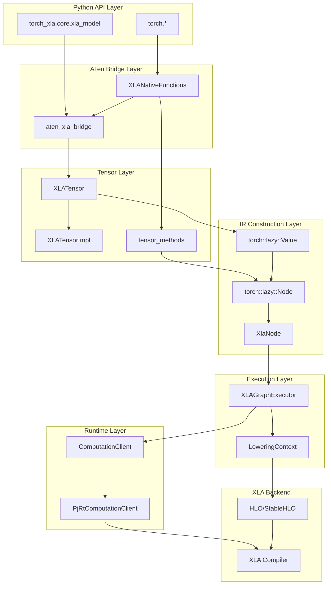
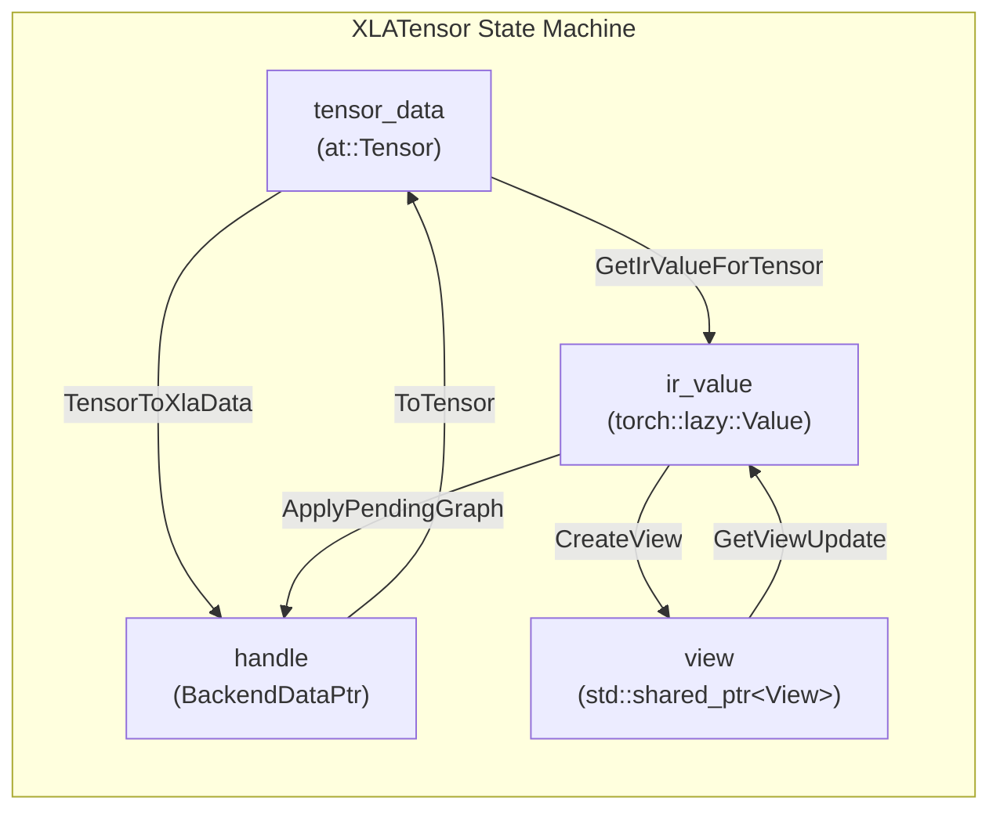
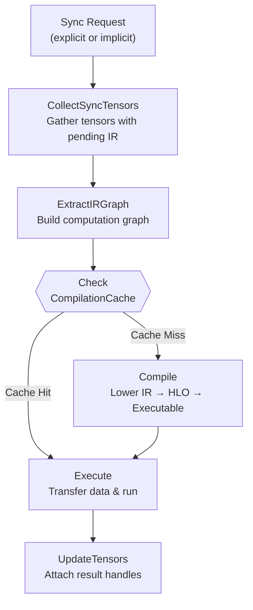
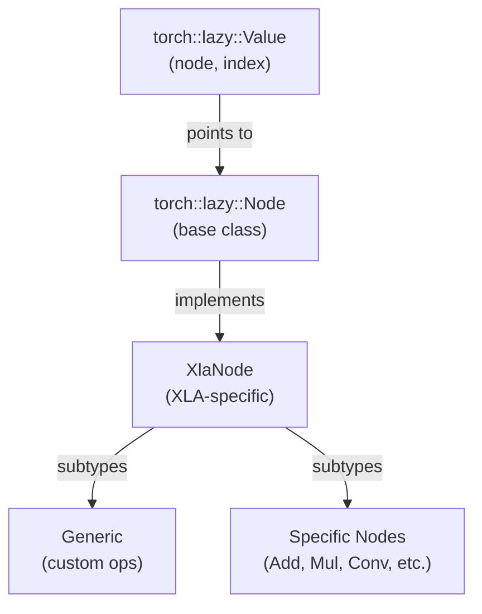
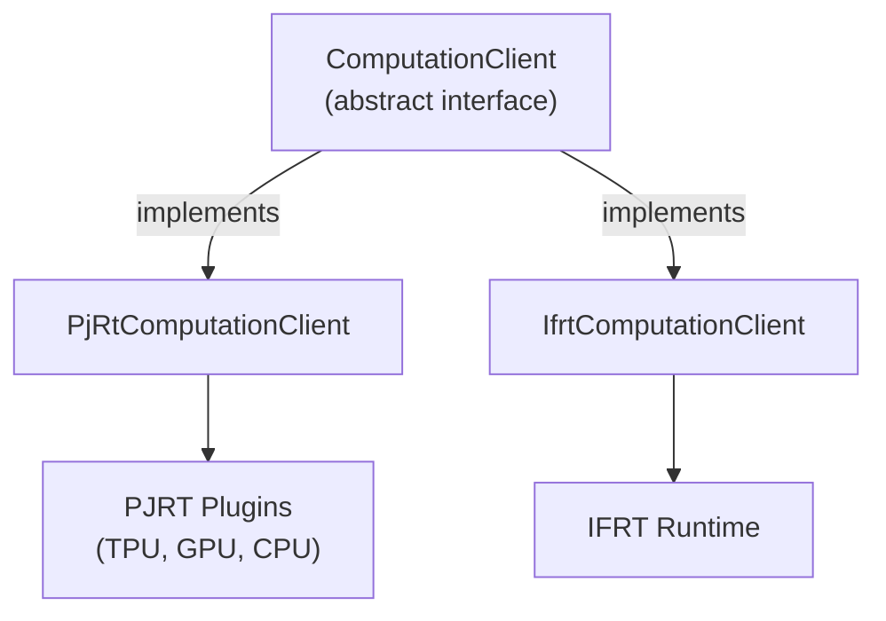
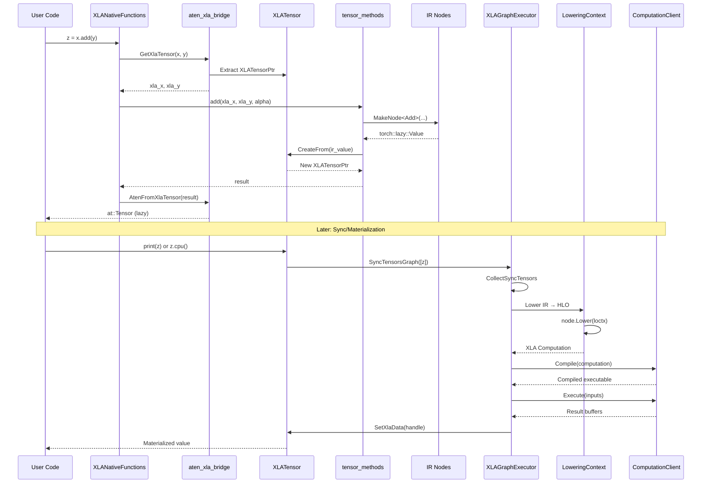

<!-- source: DeepWiki mcp.deepwiki.com · repo pytorch/xla · page 2 Core Components · fetched 2026-10-21 -->

# Core Components

<details>
<summary>Relevant source files</summary>

The following files were used as context for generating this wiki page:

- [WORKSPACE](WORKSPACE)
- [setup.py](setup.py)
- [test/test_operations.py](test/test_operations.py)
- [test/test_ops_error_message.py](test/test_ops_error_message.py)
- [torch_xla/csrc/aten_autograd_ops.cpp](torch_xla/csrc/aten_autograd_ops.cpp)
- [torch_xla/csrc/aten_xla_type.cpp](torch_xla/csrc/aten_xla_type.cpp)
- [torch_xla/csrc/init_python_bindings.cpp](torch_xla/csrc/init_python_bindings.cpp)
- [torch_xla/csrc/ops/ops.cpp](torch_xla/csrc/ops/ops.cpp)
- [torch_xla/csrc/ops/ops.h](torch_xla/csrc/ops/ops.h)
- [torch_xla/csrc/runtime/BUILD](torch_xla/csrc/runtime/BUILD)
- [torch_xla/csrc/runtime/computation_client.h](torch_xla/csrc/runtime/computation_client.h)
- [torch_xla/csrc/runtime/ifrt_computation_client.cpp](torch_xla/csrc/runtime/ifrt_computation_client.cpp)
- [torch_xla/csrc/runtime/ifrt_computation_client.h](torch_xla/csrc/runtime/ifrt_computation_client.h)
- [torch_xla/csrc/runtime/ifrt_computation_client_test.cpp](torch_xla/csrc/runtime/ifrt_computation_client_test.cpp)
- [torch_xla/csrc/runtime/pjrt_computation_client.cpp](torch_xla/csrc/runtime/pjrt_computation_client.cpp)
- [torch_xla/csrc/runtime/pjrt_computation_client.h](torch_xla/csrc/runtime/pjrt_computation_client.h)
- [torch_xla/csrc/runtime/pjrt_computation_client_test.cpp](torch_xla/csrc/runtime/pjrt_computation_client_test.cpp)
- [torch_xla/csrc/runtime/pjrt_registry.cpp](torch_xla/csrc/runtime/pjrt_registry.cpp)
- [torch_xla/csrc/runtime/runtime.cpp](torch_xla/csrc/runtime/runtime.cpp)
- [torch_xla/csrc/runtime/runtime.h](torch_xla/csrc/runtime/runtime.h)
- [torch_xla/csrc/tensor.cpp](torch_xla/csrc/tensor.cpp)
- [torch_xla/csrc/tensor.h](torch_xla/csrc/tensor.h)
- [torch_xla/csrc/tensor_methods.cpp](torch_xla/csrc/tensor_methods.cpp)
- [torch_xla/csrc/tensor_methods.h](torch_xla/csrc/tensor_methods.h)
- [torch_xla/csrc/xla_lower_util.cpp](torch_xla/csrc/xla_lower_util.cpp)
- [torch_xla/csrc/xla_lower_util.h](torch_xla/csrc/xla_lower_util.h)

</details>


This document provides an overview of the fundamental C++ and Python components that implement the PyTorch/XLA bridge. These components enable PyTorch operations to be executed on XLA devices (TPUs, GPUs) through a lazy evaluation model with automatic graph compilation and optimization.

For detailed information about specific subsystems, see:
- ATen operation dispatching: [ATen/XLA Bridge and Native Functions](#2.1)
- Tensor lifecycle and lazy evaluation: [XLATensor and Lazy Execution](#2.2)
- Graph compilation and caching: [XLA Graph Executor](#2.3)
- Device runtime interface: [Computation Client and Runtime](#2.4)
- IR graph construction: [IR System and Operation Nodes](#2.5)
- HLO code generation: [Operation Lowering and Shape Inference](#2.6)

## System Architecture Overview

PyTorch/XLA is structured as a layered system that intercepts PyTorch operations and translates them into optimized XLA computations.



**Diagram: Core Component Interaction**

Sources: [torch_xla/csrc/aten_xla_type.cpp:1-100](), [torch_xla/csrc/tensor.cpp:1-100](), [torch_xla/csrc/aten_xla_bridge.cpp:1-100]()

## Core Component Descriptions

### XLANativeFunctions

The `XLANativeFunctions` class implements the PyTorch ATen operator interface for XLA devices. Each PyTorch operation (e.g., `add`, `mul`, `conv2d`) has a corresponding implementation that constructs IR nodes instead of executing immediately.

**Key Implementation:**
- Defined in [torch_xla/csrc/XLANativeFunctions.h]()
- Implemented in [torch_xla/csrc/aten_xla_type.cpp]()
- Registered via [torch_xla/csrc/aten_autograd_ops.cpp]() for autograd support
- Operations follow pattern: extract XLATensor → call tensor_methods → return wrapped result

**Example Operation Flow:**
```
at::Tensor add(const at::Tensor& self, const at::Tensor& other, const at::Scalar& alpha)
  → GetXlaTensor(self, other)
  → tensor_methods::add(xla_self, xla_other, alpha, dtype)
  → Return bridge::AtenFromXlaTensor(result)
```

Sources: [torch_xla/csrc/aten_xla_type.cpp:446-521](), [torch_xla/csrc/XLANativeFunctions.h:1-50]()

### XLATensor

`XLATensor` is the core lazy tensor abstraction that represents a PyTorch tensor on an XLA device. It maintains tensor state as either:
- Raw CPU tensor data (`tensor_data`)
- XLA device data handle (`handle`)
- IR computation graph (`ir_value`)
- View of another tensor (`view`)



**Diagram: XLATensor State Transitions**

**Key Data Structure:**
```cpp
struct XLATensor::Data {
  std::optional<at::Tensor> tensor_data;           // CPU tensor
  torch::lazy::BackendDataPtr handle;              // Device buffer
  torch::lazy::Value ir_value;                     // IR node
  std::shared_ptr<View> view;                      // View metadata
  std::optional<at::ScalarType> logical_element_type;
  ShardingSpecPtr sharding;                        // SPMD sharding
  int64_t alias_id;                                // For input/output aliasing
}
```

Sources: [torch_xla/csrc/tensor.h:93-151](), [torch_xla/csrc/tensor.cpp:64-115]()

### XLAGraphExecutor

`XLAGraphExecutor` manages the lifecycle of IR graphs from construction through compilation to execution. It implements:
- **Lazy evaluation**: Operations build IR without executing
- **Compilation caching**: Compiled programs are cached by graph hash
- **Device synchronization**: Barrier and mark-step mechanisms
- **Eager mode**: Optional immediate execution for debugging



**Diagram: XLAGraphExecutor Execution Pipeline**

**Key Methods:**
- `SyncTensorsGraph()` - Main synchronization entry point [torch_xla/csrc/xla_graph_executor.cpp]()
- `ApplyEagerSync()` - Immediate execution for eager mode
- `CompilationCache` - Hash-based caching of compiled programs
- `DeviceBarrier()` - Explicit synchronization point

Sources: [torch_xla/csrc/xla_graph_executor.h:1-100](), [torch_xla/csrc/tensor.cpp:676-684]()

### ATen/XLA Bridge

The bridge layer provides utilities for converting between PyTorch and XLA representations:

| Function | Purpose | Location |
|----------|---------|----------|
| `GetXlaTensor(at::Tensor)` | Extract XLATensor from at::Tensor | [torch_xla/csrc/aten_xla_bridge.cpp:101-112]() |
| `AtenFromXlaTensor(XLATensorPtr)` | Wrap XLATensor as at::Tensor | [torch_xla/csrc/aten_xla_bridge.cpp]() |
| `AtenDeviceToXlaDevice(c10::Device)` | Convert device specifications | [torch_xla/csrc/aten_xla_bridge.cpp]() |
| `GetCurrentDevice()` | Get thread-local default device | [torch_xla/csrc/aten_xla_bridge.cpp:256-261]() |

Sources: [torch_xla/csrc/aten_xla_bridge.h:1-100](), [torch_xla/csrc/aten_xla_bridge.cpp:1-200]()

### Tensor Methods

The `tensor_methods` namespace contains implementations for all tensor operations. These functions:
1. Accept `XLATensorPtr` arguments
2. Construct IR nodes via `MakeNode<OpType>(...)` or generic ops
3. Return new `XLATensorPtr` with IR values

**Operation Categories:**

| Category | Example Operations | Implementation |
|----------|-------------------|----------------|
| Elementwise | add, mul, relu, tanh | [torch_xla/csrc/tensor_methods.cpp:2000-3000]() |
| Reduction | sum, mean, max | [torch_xla/csrc/tensor_methods.cpp:3000-4000]() |
| Matrix | matmul, bmm, addmm | [torch_xla/csrc/tensor_methods.cpp:1000-2000]() |
| Convolution | conv2d, conv_transpose | [torch_xla/csrc/tensor_methods.cpp:4000-5000]() |
| Pooling | max_pool2d, avg_pool2d | [torch_xla/csrc/tensor_methods.cpp:5000-6000]() |
| Collective | all_reduce, all_gather | [torch_xla/csrc/tensor_methods.cpp:6000-7000]() |

Sources: [torch_xla/csrc/tensor_methods.h:1-150](), [torch_xla/csrc/tensor_methods.cpp:1-300]()

### IR System

The IR (Intermediate Representation) system uses PyTorch's lazy tensor framework:



**Diagram: IR Node Hierarchy**

**Key Concepts:**
- `torch::lazy::Value`: Reference to a node output (node pointer + output index)
- `torch::lazy::Node`: Base class for IR nodes, tracks operands and metadata
- `XlaNode`: XLA-specific node with shape information and lowering function
- `Generic`: Flexible node type with custom lowering functions
- Specific nodes: Type-safe implementations (e.g., `Add`, `Mul`, `Permute`)

Sources: [torch_xla/csrc/ir.h:1-100](), [torch_xla/csrc/ops/ops.h:1-100](), [torch_xla/csrc/ops/ops.cpp:1-100]()

### Operation Lowering

Lowering transforms IR nodes into XLA HLO operations. Each operation implements:

```cpp
XlaOpVector Lower(const XlaNode& node, LoweringContext* loctx) {
  xla::XlaOp input = loctx->GetOutputOp(node.operand(0));
  xla::XlaOp result = xla::SomeHloOp(input);
  return node.ReturnOp(result, loctx);
}
```

**Lowering Mechanisms:**

| Mechanism | Description | Usage |
|-----------|-------------|-------|
| Built-in | Direct HLO mapping | Simple ops like Add, Mul |
| Generic | Custom lowering function | Complex ops via `GenericOp()` |
| Composite | Combination of HLO ops | BuildMatMul, BuildSoftmax |
| Code generation | Auto-generated from YAML | Generated ops |

**LoweringContext Responsibilities:**
- Track IR node to HLO operation mapping
- Manage builder state
- Handle tuple decomposition
- Apply sharding annotations

Sources: [torch_xla/csrc/lowering_context.h:1-100](), [torch_xla/csrc/ops/ops.cpp:42-105](), [torch_xla/csrc/xla_lower_util.cpp:1-100]()

### ComputationClient

`ComputationClient` is the abstract interface to XLA runtime backends:



**Diagram: ComputationClient Architecture**

**Key Operations:**
- `Compile()`: Compile HLO to executable
- `ExecuteComputation()`: Run compiled program
- `TransferToServer()`: Upload data to device
- `TransferFromServer()`: Download results
- `GetDataShards()`: Retrieve sharded data

**Data Types:**
- `ComputationClient::Data`: Opaque handle to device buffer
- `ComputationClient::Computation`: Compiled executable
- `CompileInstance`: Specification for compilation

Sources: [torch_xla/csrc/runtime/computation_client.h:1-200](), [torch_xla/csrc/runtime/pjrt_computation_client.h:1-100]()

## Tensor Operation Lifecycle

The following diagram shows how a tensor operation flows through the core components:



**Diagram: Complete Tensor Operation Lifecycle**

Sources: [torch_xla/csrc/aten_xla_type.cpp:862-895](), [torch_xla/csrc/tensor_methods.cpp:1-200](), [torch_xla/csrc/tensor.cpp:211-254]()

## Python Bindings

Python bindings expose core C++ functionality to Python:

**Key Binding Categories:**

| Module | Functionality | Implementation |
|--------|---------------|----------------|
| `_XLAC` | Core tensor operations | [torch_xla/csrc/init_python_bindings.cpp:1-100]() |
| Device management | get_xla_supported_devices, set_device | [torch_xla/csrc/init_python_bindings.cpp:300-400]() |
| Sync operations | sync, mark_step, wait_device_ops | [torch_xla/csrc/init_python_bindings.cpp:263-278]() |
| Metrics | MetricsArena, counter access | [torch_xla/csrc/init_python_bindings.cpp:500-600]() |
| IR utilities | get_tensor_view_alias_id, dump IR | [torch_xla/csrc/init_python_bindings.cpp:280-338]() |

**Binding Pattern:**
```cpp
PythonScope(m)
  .def("function_name", [](args...) -> ReturnType {
    // Implementation returns StatusOr<T> or Status
    // Automatically converted to exceptions
  })
```

Sources: [torch_xla/csrc/init_python_bindings.cpp:86-218](), [torch_xla/csrc/init_python_bindings.cpp:220-246]()

## Thread Safety and Device Management

PyTorch/XLA maintains thread-local device state:

**Device Selection:**
- Thread-local current device stored in `g_current_device`
- `SetCurrentDevice()` and `GetCurrentDevice()` manage state
- Operations default to current device if not specified
- Device mapper tracks ordinal ↔ device string mapping

**Synchronization:**
- Tensor sync is per-device: only tensors on same device sync together
- `mark_step()` is a synchronization barrier
- `wait_device_ops()` waits for all pending operations
- Multi-device execution uses `ParallelLoader` and device replication

Sources: [torch_xla/csrc/aten_xla_bridge.cpp:24-77](), [torch_xla/csrc/device.h:1-50]()

## View System

Views enable memory-efficient tensor operations without data copying:

**View Types:**

| ViewInfo::Type | Description | Example Operation |
|----------------|-------------|-------------------|
| `kNoOp` | Identity view | Aliasing |
| `kReshape` | Reshape without copy | view(), reshape() |
| `kPermute` | Dimension permutation | transpose(), permute() |
| `kSelect` | Single dimension slice | select() |
| `kNarrow` | Range slice | narrow() |
| `kAsStrided` | Arbitrary stride pattern | as_strided() |
| `kDiagonal` | Diagonal extraction | diagonal() |

**View Implementation:**
- `View` class tracks transformation from base tensor
- `Alias` represents the underlying tensor
- Views updated lazily: `GetViewUpdate()` materializes when needed
- View updates create `UpdateSlice` or similar IR nodes

Sources: [torch_xla/csrc/view.h:1-100](), [torch_xla/csrc/tensor.cpp:447-512]()

## Error Handling

PyTorch/XLA uses `absl::Status` and `absl::StatusOr<T>` for error propagation:

**Error Macros:**
```cpp
XLA_CHECK(condition) << "message";           // Fatal assertion
XLA_ERROR() << "message";                    // Create error status
XLA_ASSIGN_OR_RETURN(var, expr);            // Unwrap StatusOr or return error
XLA_ASSIGN_OR_THROW(var, expr);             // Unwrap or throw exception
XLA_THROW_IF_ERROR(status);                  // Throw if error
```

**Error Categories:**
- `InvalidArgumentError`: Invalid input parameters
- `InternalError`: Internal invariant violation
- `UnimplementedError`: Unimplemented functionality
- `ResourceExhaustedError`: Out of memory or resources

Sources: [torch_xla/csrc/status.h:1-50](), [torch_xla/csrc/aten_xla_type.cpp:600-700]()

---

