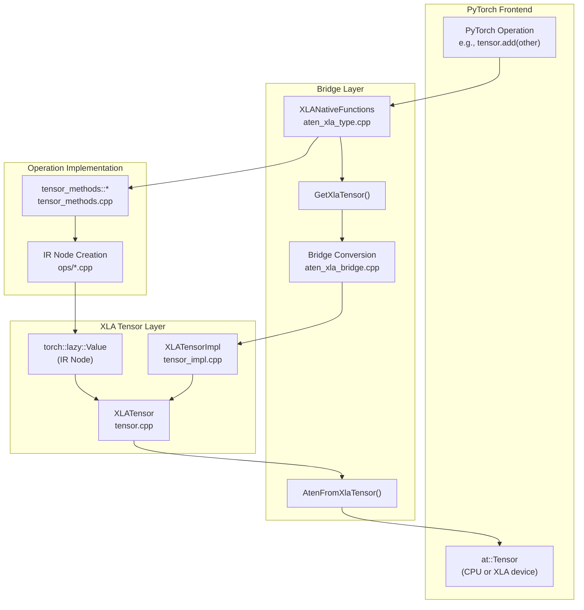
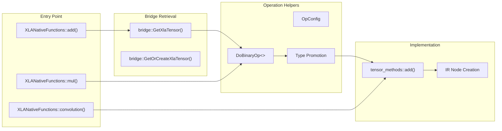
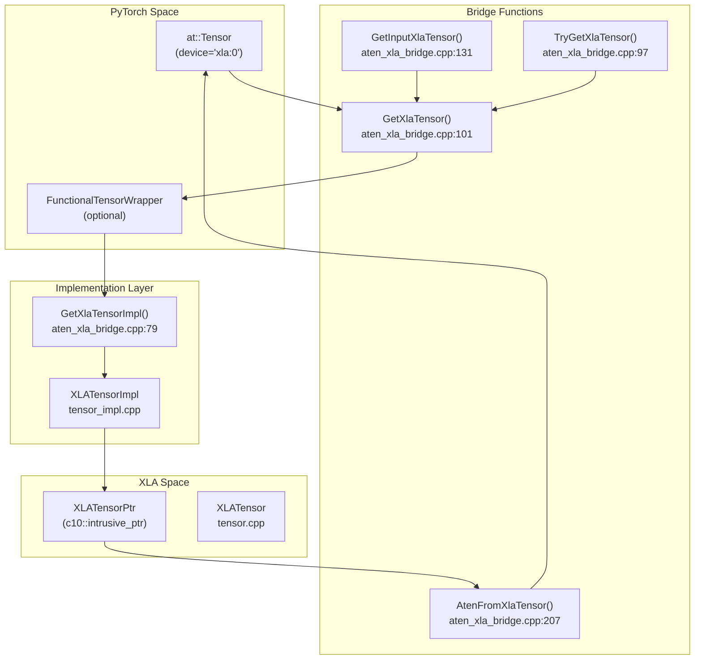
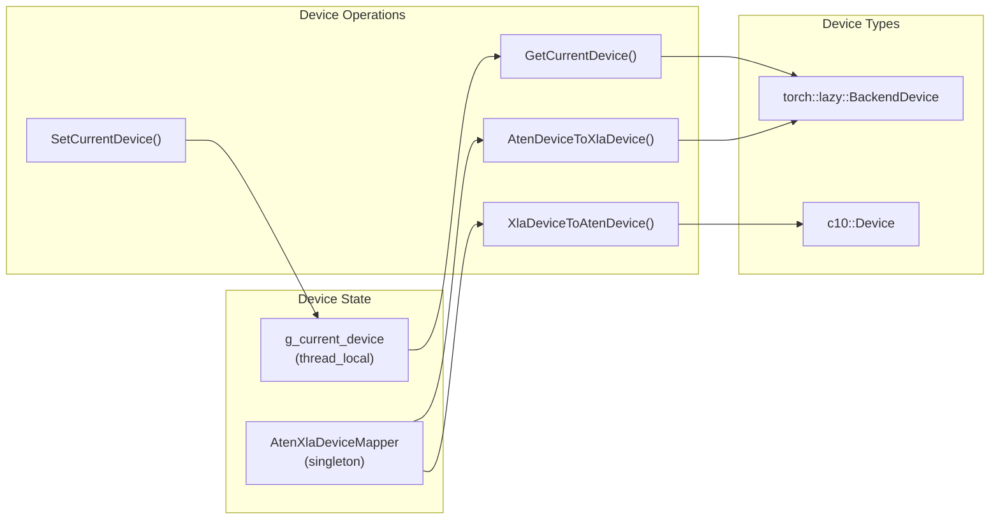
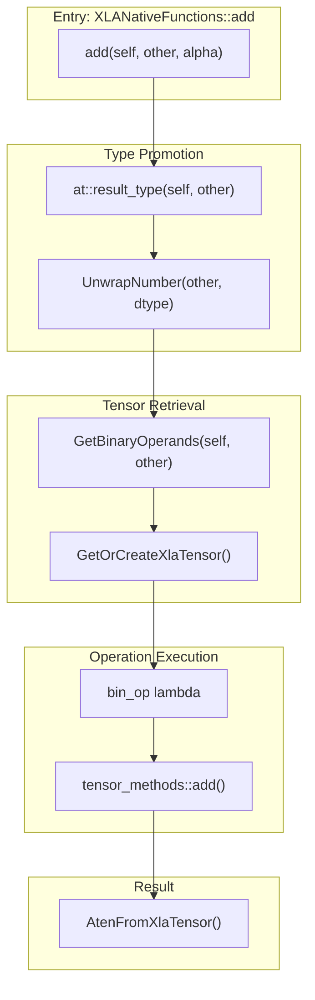
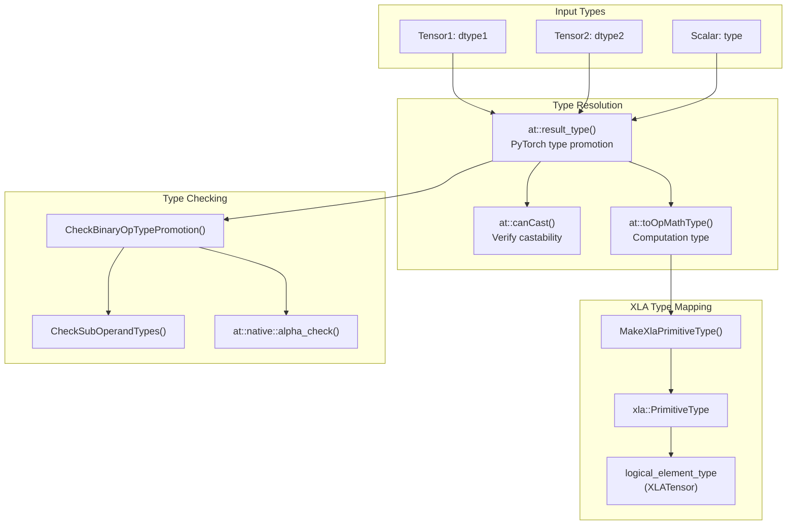
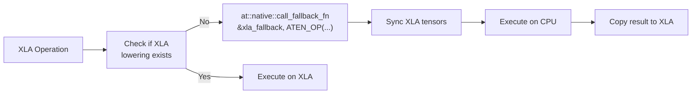
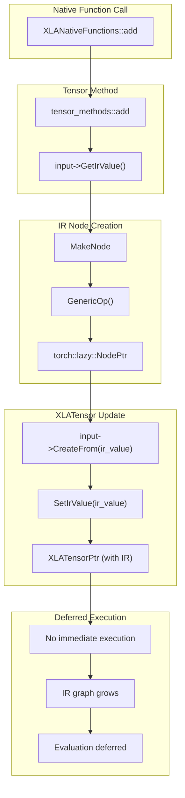
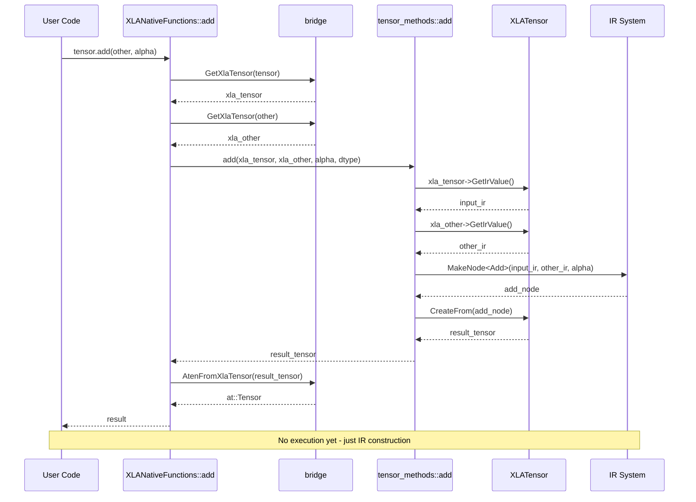

<!-- source: DeepWiki mcp.deepwiki.com · repo pytorch/xla · page 2.1 ATen/XLA Bridge and Native Functions · fetched 2026-10-21 -->

# ATen/XLA Bridge and Native Functions

Relevant source files

The following files were used as context for generating this wiki page:

- [test/cpp/cpp_test_util.cpp](test/cpp/cpp_test_util.cpp)
- [test/cpp/cpp_test_util.h](test/cpp/cpp_test_util.h)
- [test/cpp/test_replication.cpp](test/cpp/test_replication.cpp)
- [test/cpp/test_tensor.cpp](test/cpp/test_tensor.cpp)
- [test/test_operations.py](test/test_operations.py)
- [test/test_ops_error_message.py](test/test_ops_error_message.py)
- [torch_xla/csrc/aten_autograd_ops.cpp](torch_xla/csrc/aten_autograd_ops.cpp)
- [torch_xla/csrc/aten_xla_bridge.cpp](torch_xla/csrc/aten_xla_bridge.cpp)
- [torch_xla/csrc/aten_xla_bridge.h](torch_xla/csrc/aten_xla_bridge.h)
- [torch_xla/csrc/aten_xla_type.cpp](torch_xla/csrc/aten_xla_type.cpp)
- [torch_xla/csrc/init_python_bindings.cpp](torch_xla/csrc/init_python_bindings.cpp)
- [torch_xla/csrc/ops/ops.cpp](torch_xla/csrc/ops/ops.cpp)
- [torch_xla/csrc/ops/ops.h](torch_xla/csrc/ops/ops.h)
- [torch_xla/csrc/tensor.cpp](torch_xla/csrc/tensor.cpp)
- [torch_xla/csrc/tensor.h](torch_xla/csrc/tensor.h)
- [torch_xla/csrc/tensor_methods.cpp](torch_xla/csrc/tensor_methods.cpp)
- [torch_xla/csrc/tensor_methods.h](torch_xla/csrc/tensor_methods.h)
- [torch_xla/csrc/xla_lower_util.cpp](torch_xla/csrc/xla_lower_util.cpp)
- [torch_xla/csrc/xla_lower_util.h](torch_xla/csrc/xla_lower_util.h)

## Purpose and Scope

The ATen/XLA Bridge is the critical interface layer that enables PyTorch operations to execute on XLA devices (TPUs, GPUs via XLA). This system intercepts standard PyTorch ATen operations and translates them into XLA-compatible lazy IR nodes. The bridge ensures seamless integration between PyTorch's eager execution model and XLA's graph-based compilation approach.

This page covers:
- The `XLANativeFunctions` class which implements PyTorch operations for XLA
- Bridge conversion functions between PyTorch tensors and `XLATensor` objects
- Operation dispatching mechanisms and helper utilities
- Type promotion and data type handling strategies

For information about lazy tensor execution and IR graph management, see [XLATensor and Lazy Execution](#2.2). For details on how IR nodes are lowered to XLA HLO, see [Operation Lowering and Shape Inference](#2.6).

## Architecture Overview

The ATen/XLA bridge sits between PyTorch's frontend and XLA's compilation backend, intercepting operations and creating lazy IR representations.

**Diagram: ATen/XLA Bridge Architecture**

Sources: [torch_xla/csrc/aten_xla_type.cpp:1-100](), [torch_xla/csrc/aten_xla_bridge.cpp:1-50](), [torch_xla/csrc/tensor.cpp:1-100]()

## XLANativeFunctions Class

The `XLANativeFunctions` class in `aten_xla_type.cpp` provides XLA implementations for PyTorch ATen operations. This class is code-generated and contains hundreds of operation implementations.

**Diagram: XLANativeFunctions Operation Flow**

Sources: [torch_xla/csrc/aten_xla_type.cpp:446-521](), [torch_xla/csrc/aten_xla_type.cpp:862-895]()

### Key Implementation Patterns

Each native function follows a standard pattern:

| Component | Purpose | Example |
|-----------|---------|---------|
| **Function Counter** | Metrics tracking | `TORCH_LAZY_FN_COUNTER_TIMED_TRACING("xla::")` |
| **Tensor Retrieval** | Extract XLATensor from at::Tensor | `bridge::GetXlaTensor(self)` |
| **Operation Dispatch** | Call tensor_methods or create IR | `tensor_methods::add(...)` |
| **Result Wrapping** | Convert XLATensor back to at::Tensor | `bridge::AtenFromXlaTensor(result)` |

Sources: [torch_xla/csrc/aten_xla_type.cpp:862-895](), [torch_xla/csrc/aten_xla_type.cpp:387-423]()

### Implementation Guidelines

The codebase includes explicit implementation guidelines at [torch_xla/csrc/aten_xla_type.cpp:58-69]():

- To call an ATen function without an XLA kernel, use the boxed CPU fallback
- Use `at::native::call_fallback_fn<&xla_fallback, ATEN_OP(...)>::call(args...)`
- Avoid calling `tensor.op()` or `at::op(tensor)` directly

Sources: [torch_xla/csrc/aten_xla_type.cpp:58-69]()

## Bridge Conversion Functions

The bridge provides bidirectional conversion between PyTorch `at::Tensor` and XLA `XLATensor` objects.

**Diagram: Tensor Conversion Flow**

Sources: [torch_xla/csrc/aten_xla_bridge.cpp:79-143](), [torch_xla/csrc/aten_xla_bridge.h:36-80]()

### Core Bridge Functions

| Function | Return Type | Purpose |
|----------|-------------|---------|
| `GetXlaTensor(tensor)` | `absl::StatusOr<XLATensorPtr>` | Retrieves XLATensor from at::Tensor, syncing functional wrapper |
| `GetXlaTensors(tensors)` | `absl::StatusOr<vector<XLATensorPtr>>` | Batch conversion for tensor lists |
| `GetInputXlaTensor(tensor, param)` | `absl::StatusOr<XLATensorPtr>` | Retrieves with specialized error message for inputs |
| `TryGetXlaTensor(tensor)` | `XLATensorPtr` | Legacy function returning null on failure (deprecated) |
| `IsXlaTensor(tensor)` | `bool` | Checks if tensor is an XLA tensor |
| `AtenFromXlaTensor(xla_tensor)` | `at::Tensor` | Wraps XLATensor in at::Tensor |
| `ReplaceXlaTensor(tensor, new_xla)` | `absl::Status` | Replaces underlying XLATensor in existing at::Tensor |

Sources: [torch_xla/csrc/aten_xla_bridge.cpp:97-159](), [torch_xla/csrc/aten_xla_bridge.h:36-80]()

### Device Management

The bridge maintains thread-local device state and device mapping:

Sources: [torch_xla/csrc/aten_xla_bridge.cpp:24-77](), [torch_xla/csrc/aten_xla_bridge.cpp:238-298]()

## Operation Dispatching

Operation dispatching uses helper templates and functions to handle type promotion, broadcasting, and IR node creation.

### DoBinaryOp Helper Template

The `DoBinaryOp` template handles binary operations with automatic type promotion:

**Diagram: Binary Operation Dispatch**

Sources: [torch_xla/csrc/aten_xla_type.cpp:387-443](), [torch_xla/csrc/aten_xla_type.cpp:345-359]()

### OpConfig Utility

`OpConfig` manages input preprocessing and output postprocessing for operations requiring special handling:

| Method | Purpose |
|--------|---------|
| `add_input(tensor)` | Adds tensor to input list |
| `cast_inputs_to_common_dtype()` | Enables automatic input type casting |
| `use_opmathtype_for_compute()` | Uses OpMathType for computation (e.g., float32 for bfloat16) |
| `run()` | Executes operation with preprocessing/postprocessing |

**OpConfig Flow:**

Sources: [torch_xla/csrc/aten_xla_type.cpp:106-238]()

### GetBinaryOperands Function

The `GetBinaryOperands` helper ensures both operands are XLA tensors on the same device:

1. Attempts to get `XLATensor` from `self`
2. If `self` is not XLA, gets device from `other` and creates XLA tensor for `self`
3. If `self` is XLA, uses its device to convert `other` if needed
4. Returns pair of `XLATensorPtr` both on the same device

Sources: [torch_xla/csrc/aten_xla_type.cpp:345-359]()

## Type Promotion and Data Type Handling

The bridge handles complex type promotion scenarios to match PyTorch's semantics while respecting XLA's type system.

**Diagram: Type Promotion Flow**

Sources: [torch_xla/csrc/aten_xla_type.cpp:263-296](), [torch_xla/csrc/aten_xla_type.cpp:375-385](), [torch_xla/csrc/aten_xla_type.cpp:281-289]()

### Special Type Handling

| Scenario | Handling |
|----------|----------|
| **Bool subtraction** | Explicitly disallowed with error message at [torch_xla/csrc/aten_xla_type.cpp:281-289]() |
| **Integer promotion** | Automatically promotes to `int64` when needed |
| **OpMathType computation** | Uses higher precision for computation (e.g., float32 for bfloat16), then casts back |
| **Scalar unwrapping** | `UnwrapNumber()` converts scalars to tensors with appropriate dtype |

Sources: [torch_xla/csrc/aten_xla_type.cpp:281-296]()

## Helper Utilities and Common Patterns

### Utility Functions

| Function | Location | Purpose |
|----------|----------|---------|
| `to_meta(tensor)` | [aten_xla_type.cpp:240-255]() | Converts tensor to meta device for shape inference |
| `GetXlaDeviceOrCurrent(device)` | [aten_xla_type.cpp:257-261]() | Gets XLA device or current if not specified |
| `GetBinaryOperands(self, other)` | [aten_xla_type.cpp:345-359]() | Ensures both operands are XLA tensors on same device |
| `CheckBinaryOpTypePromotion(out, self, other)` | [aten_xla_type.cpp:375-385]() | Validates type promotion for binary ops |
| `IsOperationOnType(opt_dtype, tensor_type, type)` | [aten_xla_type.cpp:263-269]() | Checks if operation involves specific type |

Sources: [torch_xla/csrc/aten_xla_type.cpp:240-385]()

### Fallback Mechanism

For operations without XLA lowering, the bridge uses CPU fallback:

Sources: [torch_xla/csrc/aten_xla_type.cpp:58-69](), [torch_xla/csrc/aten_xla_type.cpp:523-531]()

### Template Macros for Operation Definition

The codebase uses template macros in `ops.cpp` for common operations:

| Macro | Purpose | Example |
|-------|---------|---------|
| `PTXLA_UNARY_OP` | Defines unary operations | `PTXLA_UNARY_OP(Neg, at::aten::neg, xla::Neg)` |
| `PTXLA_BINARY_OP` | Defines binary operations | `PTXLA_BINARY_OP(Min, at::aten::min, xla::Min)` |

These macros generate `GenericOp` IR nodes with automatic shape inference and lowering functions.

Sources: [torch_xla/csrc/ops/ops.cpp:43-90]()

## Lazy IR Construction

Operations create IR nodes rather than executing immediately, enabling graph optimization and batched compilation.

**Diagram: Lazy IR Construction Pipeline**

Sources: [torch_xla/csrc/tensor.cpp:88-101](), [torch_xla/csrc/tensor.cpp:338-363]()

### IR Value Lifecycle

1. **Creation**: Operations create `torch::lazy::Value` wrapping IR nodes
2. **Storage**: XLATensor stores IR value in `data()->ir_value`
3. **Composition**: New operations use existing IR values as inputs
4. **Materialization**: IR graph executed when `sync()` or `.cpu()` called
5. **Caching**: Compiled graphs cached for reuse

The `XLATensor::GetIrValue()` method retrieves or creates the IR representation:

| Source | Action |
|--------|--------|
| **Current IR value** | Returns `data()->ir_value` directly |
| **View** | Calls `GetViewUpdate()` to get updated IR |
| **Data handle** | Creates `DeviceData` IR node from handle |
| **Tensor data** | Calls `GetIrValueForTensor()` to upload and create IR |

Sources: [torch_xla/csrc/tensor.cpp:383-412]()

### Example: add Operation

Sources: [torch_xla/csrc/aten_xla_type.cpp:862-895](), [torch_xla/csrc/tensor_methods.cpp:1-165]()

## Key Data Structures

### XLATensor::Data

The core data structure holding tensor state:

| Field | Type | Purpose |
|-------|------|---------|
| `handle` | `BackendDataPtr` | Materialized data on device |
| `ir_value` | `torch::lazy::Value` | Lazy IR node representation |
| `tensor_data` | `optional<at::Tensor>` | CPU tensor data |
| `view` | `shared_ptr<View>` | View information if tensor is a view |
| `logical_element_type` | `optional<ScalarType>` | Type visible to PyTorch |
| `sharding` | `ShardingSpecPtr` | SPMD sharding specification |
| `device` | `BackendDevice` | Target XLA device |

At any time, an XLATensor has exactly one authoritative data source: either `handle`, `ir_value`, or `tensor_data`.

Sources: [torch_xla/csrc/tensor.h:101-151]()

### XLATensorImpl

Wrapper that makes `XLATensor` usable as PyTorch `TensorImpl`:

- Stores `XLATensorPtr` 
- Implements `TensorImpl` interface for PyTorch integration
- Manages storage and device information
- Handles autograd integration

Sources: [torch_xla/csrc/tensor_impl.cpp:1-50](), [torch_xla/csrc/aten_xla_bridge.cpp:79-93]()

---

Sources: [torch_xla/csrc/aten_xla_type.cpp](), [torch_xla/csrc/aten_xla_bridge.cpp](), [torch_xla/csrc/aten_xla_bridge.h](), [torch_xla/csrc/tensor.cpp](), [torch_xla/csrc/tensor.h](), [torch_xla/csrc/tensor_methods.cpp](), [torch_xla/csrc/ops/ops.cpp]()

---

