<!-- source: DeepWiki mcp.deepwiki.com · repo pytorch/xla · page 2.2 XLATensor and Lazy Execution · fetched 2026-10-21 -->

# XLATensor and Lazy Execution

<details>
<summary>Relevant source files</summary>

The following files were used as context for generating this wiki page:

- [test/cpp/cpp_test_util.cpp](test/cpp/cpp_test_util.cpp)
- [test/cpp/cpp_test_util.h](test/cpp/cpp_test_util.h)
- [test/cpp/test_replication.cpp](test/cpp/test_replication.cpp)
- [test/cpp/test_tensor.cpp](test/cpp/test_tensor.cpp)
- [test/test_operations.py](test/test_operations.py)
- [test/test_ops_error_message.py](test/test_ops_error_message.py)
- [torch_xla/csrc/aten_autograd_ops.cpp](torch_xla/csrc/aten_autograd_ops.cpp)
- [torch_xla/csrc/aten_xla_bridge.cpp](torch_xla/csrc/aten_xla_bridge.cpp)
- [torch_xla/csrc/aten_xla_bridge.h](torch_xla/csrc/aten_xla_bridge.h)
- [torch_xla/csrc/aten_xla_type.cpp](torch_xla/csrc/aten_xla_type.cpp)
- [torch_xla/csrc/init_python_bindings.cpp](torch_xla/csrc/init_python_bindings.cpp)
- [torch_xla/csrc/ops/ops.cpp](torch_xla/csrc/ops/ops.cpp)
- [torch_xla/csrc/ops/ops.h](torch_xla/csrc/ops/ops.h)
- [torch_xla/csrc/tensor.cpp](torch_xla/csrc/tensor.cpp)
- [torch_xla/csrc/tensor.h](torch_xla/csrc/tensor.h)
- [torch_xla/csrc/tensor_methods.cpp](torch_xla/csrc/tensor_methods.cpp)
- [torch_xla/csrc/tensor_methods.h](torch_xla/csrc/tensor_methods.h)
- [torch_xla/csrc/xla_lower_util.cpp](torch_xla/csrc/xla_lower_util.cpp)
- [torch_xla/csrc/xla_lower_util.h](torch_xla/csrc/xla_lower_util.h)

</details>


## Purpose and Scope

This document explains the `XLATensor` class and PyTorch/XLA's lazy execution model. It covers the internal data representation (`XLATensor::Data`), tensor lifecycle, state transitions, and how operations lazily build computation graphs instead of executing immediately. For information about graph compilation and execution orchestration, see [XLA Graph Executor](#2.3). For the bridge between PyTorch's ATen tensors and XLA tensors, see [ATen/XLA Bridge and Native Functions](#2.1).

---

## XLATensor Class Architecture

The `XLATensor` class is the core abstraction for lazy tensors in PyTorch/XLA. It extends `torch::lazy::LazyTensor` and manages the lazy execution model by maintaining tensor state across multiple representations.

### Class Definition

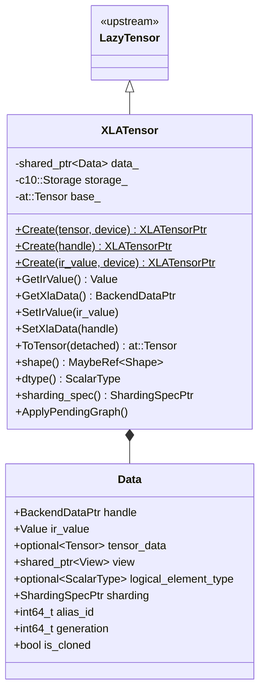

**Sources:** [torch_xla/csrc/tensor.h:94-359](), [torch_xla/csrc/tensor.cpp:53-164]()

---

## Internal Data Representation

The `XLATensor::Data` struct is the core state container for an XLA tensor. It can hold tensor data in multiple forms, and the presence of each field determines the tensor's current state.

### Data Structure Fields

| Field | Type | Purpose |
|-------|------|---------|
| `handle` | `torch::lazy::BackendDataPtr` | Pointer to materialized device data (e.g., data on TPU/GPU) |
| `ir_value` | `torch::lazy::Value` | Pointer to IR node in the computation graph |
| `tensor_data` | `std::optional<at::Tensor>` | CPU tensor data (host memory) |
| `view` | `std::shared_ptr<View>` | View metadata if tensor is a view of another tensor |
| `logical_element_type` | `std::optional<at::ScalarType>` | PyTorch-visible dtype (may differ from XLA dtype) |
| `sharding` | `ShardingSpecPtr` | SPMD sharding specification for distributed execution |
| `alias_id` | `int64_t` | Unique ID for input/output aliasing optimization |
| `generation` | `int64_t` | Version counter for tracking modifications |
| `is_cloned` | `bool` | Flag indicating if tensor is a clone |

**Sources:** [torch_xla/csrc/tensor.h:102-152](), [torch_xla/csrc/tensor.cpp:63-164]()

### Data State Diagram

```mermaid
stateDiagram-v2
    [*] --> CPUData: Create from at::Tensor
    [*] --> DeviceData: Create from handle
    [*] --> IRNode: Create from ir_value
    [*] --> ViewState: Create from view
    
    CPUData: tensor_data set<br/>handle, ir_value null
    DeviceData: handle set<br/>ir_value, tensor_data null
    IRNode: ir_value set<br/>handle, tensor_data null
    ViewState: view set<br/>may have ir_value
    
    CPUData --> IRNode: GetIrValue()<br/>creates DeviceData node
    IRNode --> DeviceData: ApplyPendingGraph()<br/>executes computation
    DeviceData --> CPUData: ToTensor()<br/>transfers to CPU
    
    IRNode --> IRNode: Operations<br/>build graph
    DeviceData --> IRNode: Operations<br/>create new node
    
    ViewState --> IRNode: GetViewUpdate()<br/>if view modified
```

**Sources:** [torch_xla/csrc/tensor.cpp:212-255](), [torch_xla/csrc/tensor.cpp:384-446]()

---

## Lazy Execution Model

PyTorch/XLA implements lazy execution by deferring operation execution until synchronization points. Operations build an intermediate representation (IR) graph instead of executing immediately.

### Execution Flow

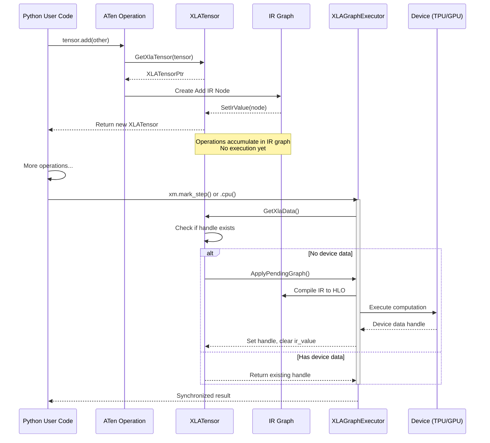

**Sources:** [torch_xla/csrc/tensor.cpp:212-255](), [torch_xla/csrc/tensor.cpp:677-686](), [torch_xla/csrc/aten_xla_type.cpp:860-893]()

### Operation Dispatch Example

When a PyTorch operation is called on an XLA tensor, it creates an IR node rather than executing:

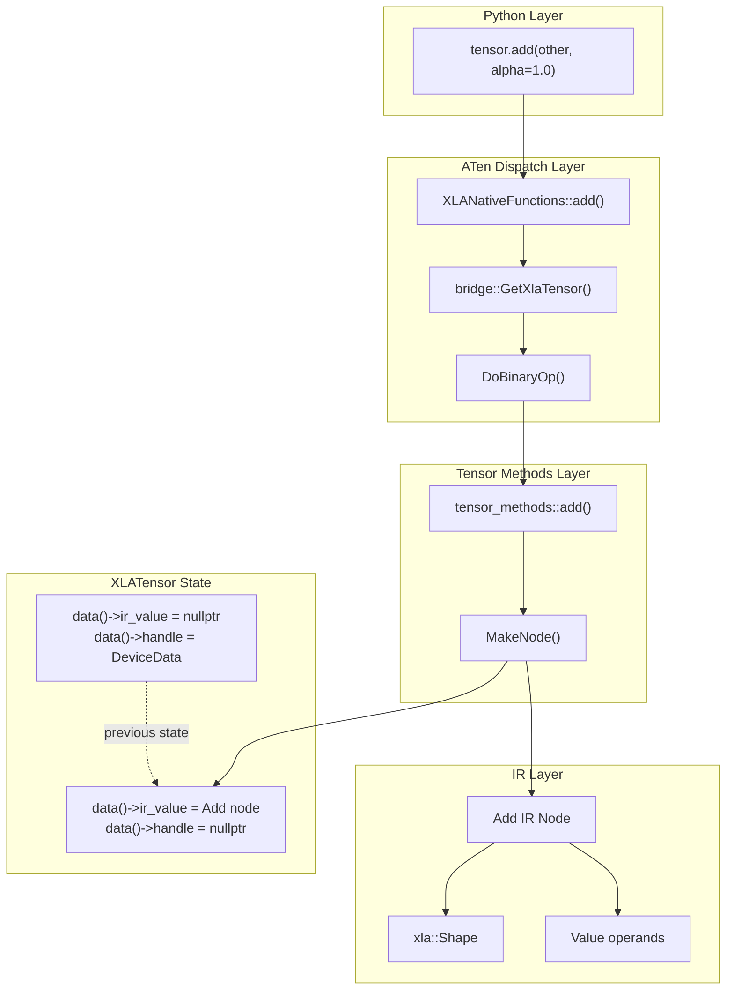

**Sources:** [torch_xla/csrc/aten_xla_type.cpp:860-893](), [torch_xla/csrc/tensor_methods.cpp:1-165](), [torch_xla/csrc/tensor.cpp:339-374]()

---

## Tensor Lifecycle and State Transitions

An `XLATensor` transitions through different states during its lifetime. Understanding these transitions is key to understanding lazy execution.

### Key Methods and State Changes

#### Tensor Creation

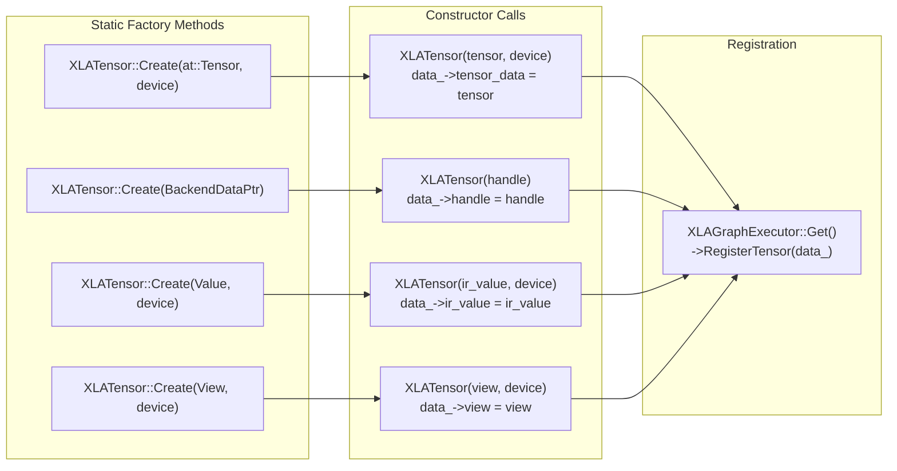

**Sources:** [torch_xla/csrc/tensor.cpp:65-115](), [torch_xla/csrc/tensor.cpp:117-164]()

#### IR Value Management

The `GetIrValue()` method creates IR nodes on-demand:

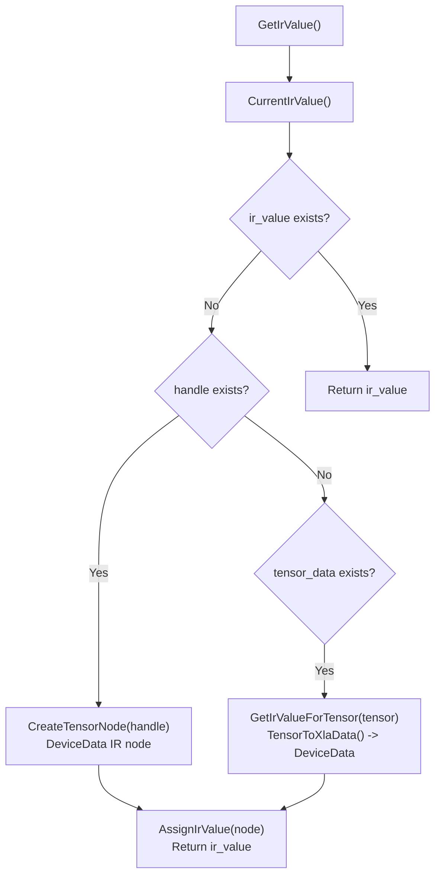

**Sources:** [torch_xla/csrc/tensor.cpp:384-413](), [torch_xla/csrc/tensor.cpp:429-446]()

#### Data Materialization

The `GetXlaData()` method materializes device data:

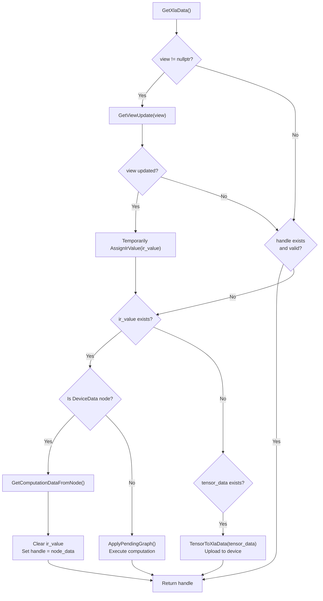

**Sources:** [torch_xla/csrc/tensor.cpp:212-255]()

---

## View Mechanism

PyTorch/XLA supports views (zero-copy tensor transformations) through a separate view tracking system. When a view operation is performed, the original tensor and view share an `Alias` object.

### View Architecture

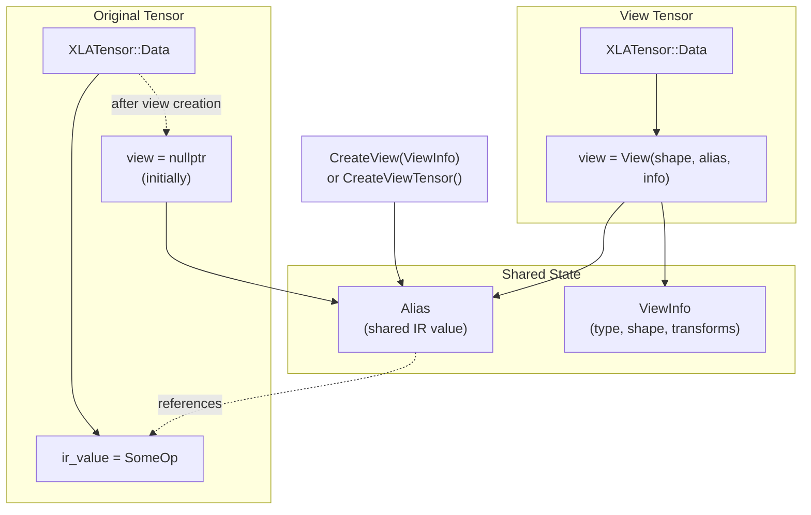

**Sources:** [torch_xla/csrc/tensor.cpp:491-513](), [torch_xla/csrc/view.h]()

### View Operations Flow

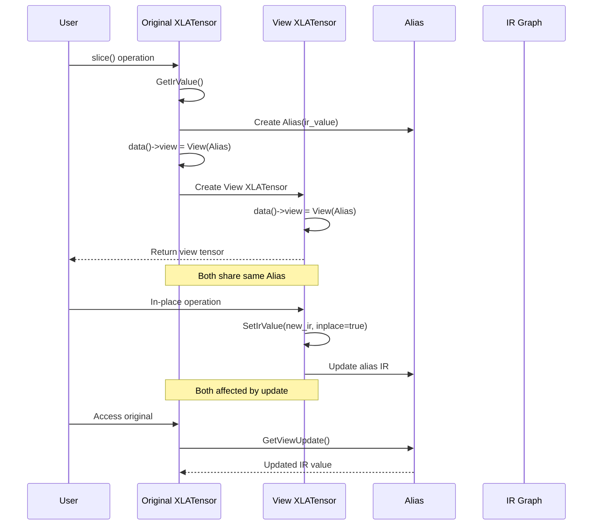

**Sources:** [torch_xla/csrc/tensor.cpp:448-470](), [torch_xla/csrc/tensor.cpp:339-374]()

---

## Integration with Eager Mode

PyTorch/XLA supports an eager execution mode where IR nodes are immediately executed after creation.

### Eager Execution Path

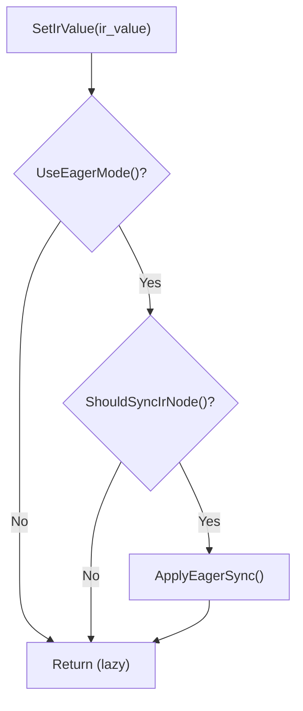

The `ShouldSyncIrNode()` check prevents immediate execution of `DeviceData` nodes:

**Sources:** [torch_xla/csrc/tensor.cpp:339-374](), [torch_xla/csrc/tensor.cpp:688-693]()

---

## Tensor Conversion and Bridge Functions

The bridge between PyTorch's `at::Tensor` and `XLATensor` is managed by functions in `aten_xla_bridge.h`.

### Bridge Function Overview

| Function | Purpose | Returns |
|----------|---------|---------|
| `GetXlaTensor(at::Tensor)` | Extract XLATensorPtr from ATen tensor | `StatusOr<XLATensorPtr>` |
| `GetXlaTensors(ITensorListRef)` | Extract multiple XLATensorPtr | `StatusOr<vector<XLATensorPtr>>` |
| `IsXlaTensor(at::Tensor)` | Check if tensor is XLA tensor | `bool` |
| `ReplaceXlaTensor(at::Tensor, XLATensorPtr)` | Replace XLA tensor in ATen wrapper | `Status` |
| `GetOrCreateXlaTensor(at::Tensor, device)` | Get existing or create new XLA tensor | `XLATensorPtr` |
| `AtenFromXlaTensor(XLATensorPtr)` | Wrap XLATensor in ATen tensor | `at::Tensor` |
| `XlaCreateTensorList(TensorList)` | Convert XLA tensors to CPU | `vector<at::Tensor>` |

**Sources:** [torch_xla/csrc/aten_xla_bridge.h:20-149](), [torch_xla/csrc/aten_xla_bridge.cpp:98-189]()

### Conversion Flow

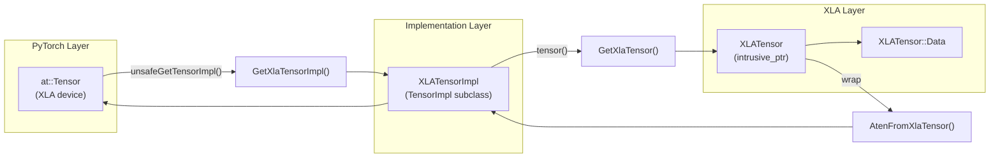

**Sources:** [torch_xla/csrc/aten_xla_bridge.cpp:80-144](), [torch_xla/csrc/tensor_impl.h]()

---

## SPMD Sharding Integration

`XLATensor::Data` includes sharding information for distributed execution via SPMD (Single Program Multiple Data).

### Sharding Specification

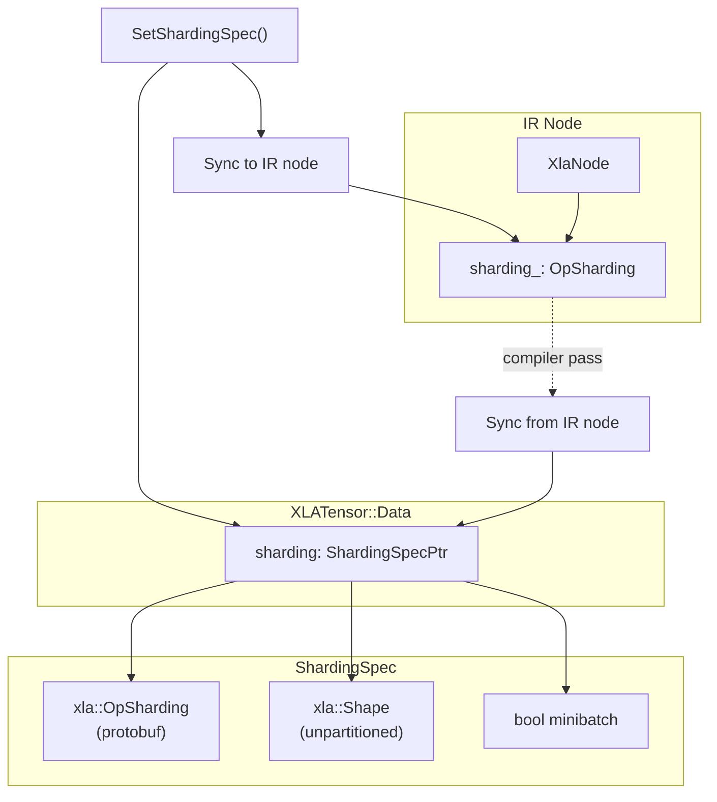

**Sources:** [torch_xla/csrc/tensor.h:266-286](), [torch_xla/csrc/tensor.cpp:257-320]()

---

## Performance Considerations

### Lazy Execution Benefits

1. **Graph Optimization**: Multiple operations are fused before execution
2. **Reduced Host-Device Transfers**: Data stays on device until explicitly needed
3. **Compilation Caching**: Identical graphs are compiled once and reused

### Synchronization Points

Operations that trigger execution (materialization):
- `xm.mark_step()` - Explicit synchronization
- `tensor.cpu()` - Transfer to CPU
- `tensor.item()` - Extract scalar value  
- `print(tensor)` - Display tensor value
- Conditionals depending on tensor values

**Sources:** [torch_xla/csrc/xla_graph_executor.cpp](), [torch_xla/csrc/tensor.cpp:515-544]()

---

## Summary

The `XLATensor` class implements lazy execution through a multi-state data representation:

1. **CPU State** (`tensor_data`): Host memory representation
2. **Device State** (`handle`): Materialized device data  
3. **IR State** (`ir_value`): Computation graph node
4. **View State** (`view`): Zero-copy view metadata

Operations transition tensors between states, with materialization deferred until synchronization. This lazy model enables graph optimization and efficient compilation caching, forming the foundation of PyTorch/XLA's performance characteristics.

---

