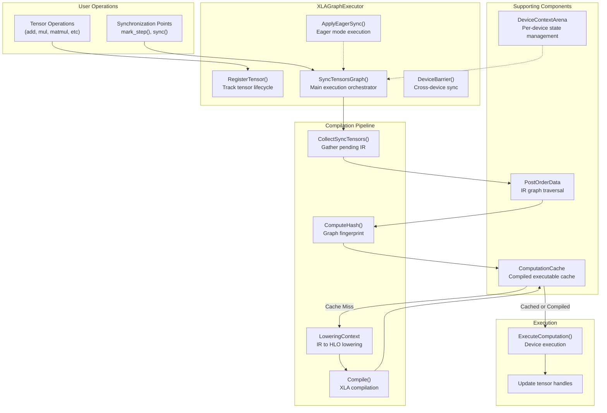
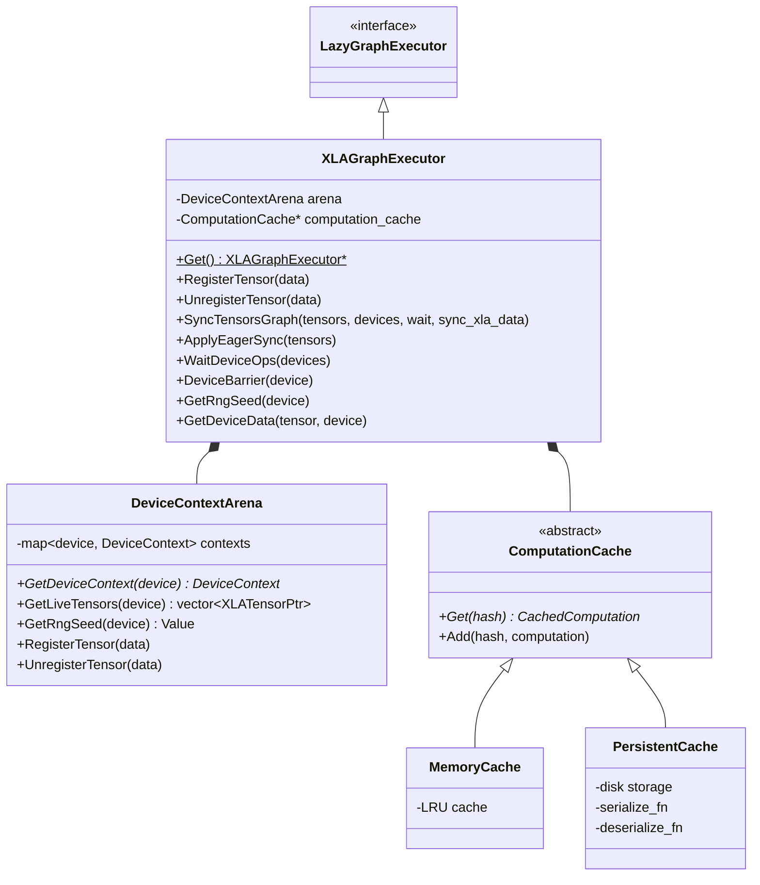
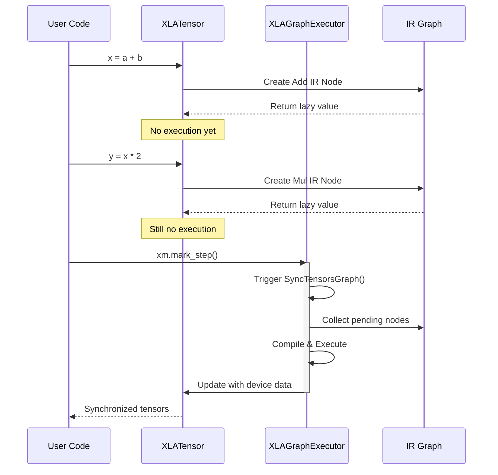
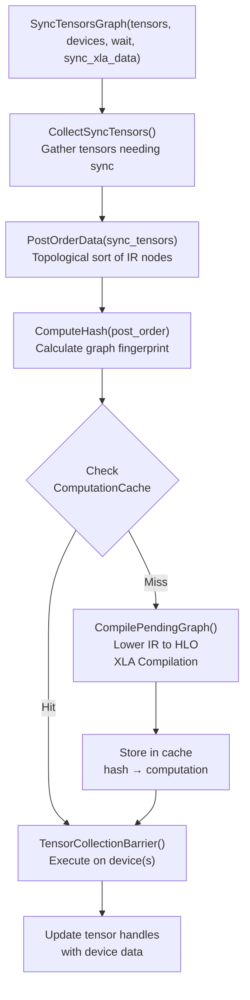
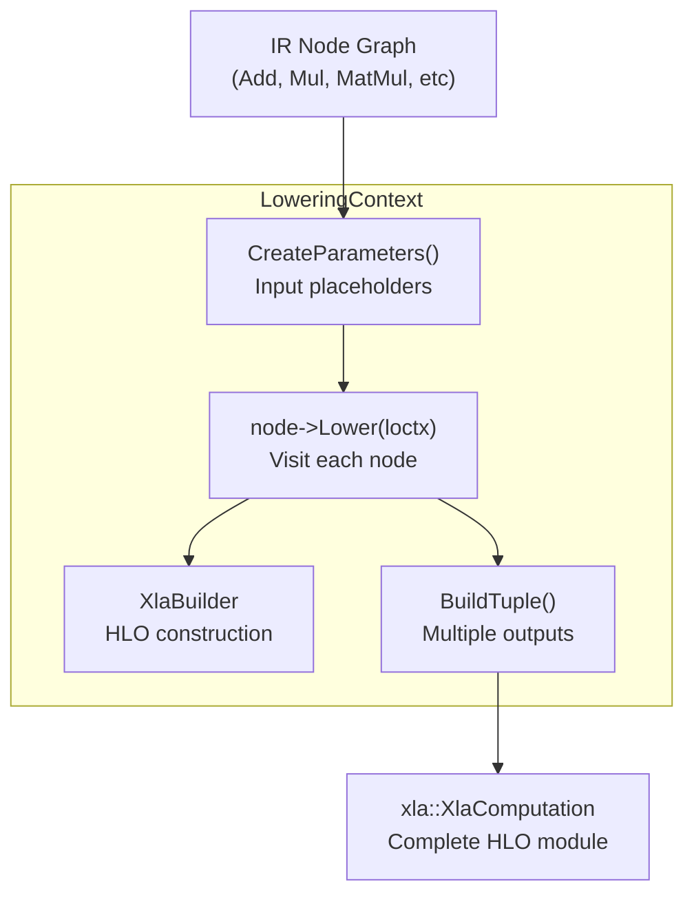
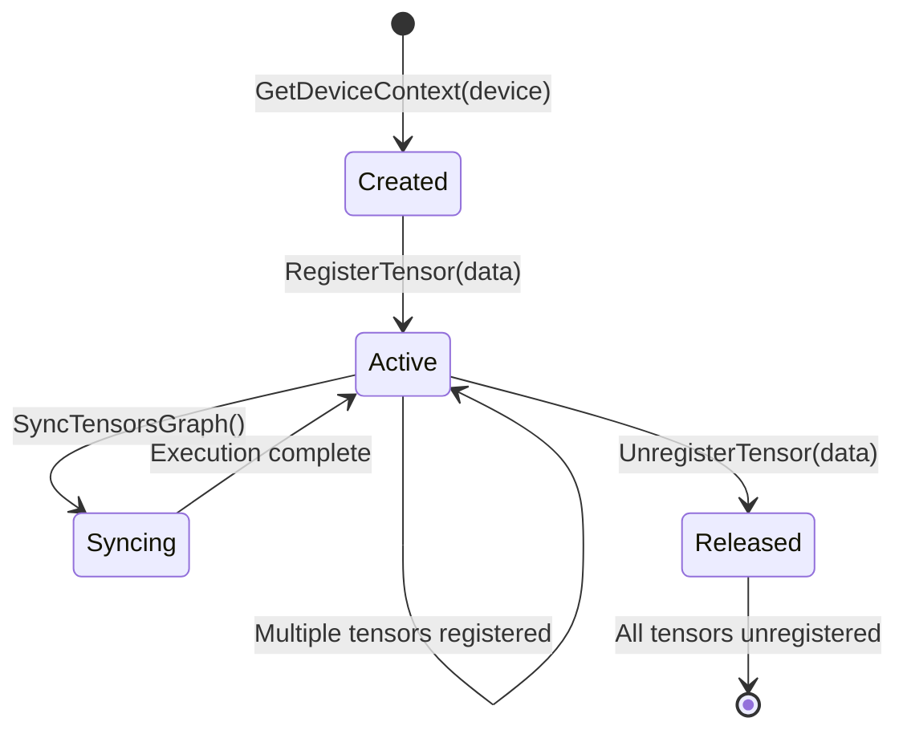
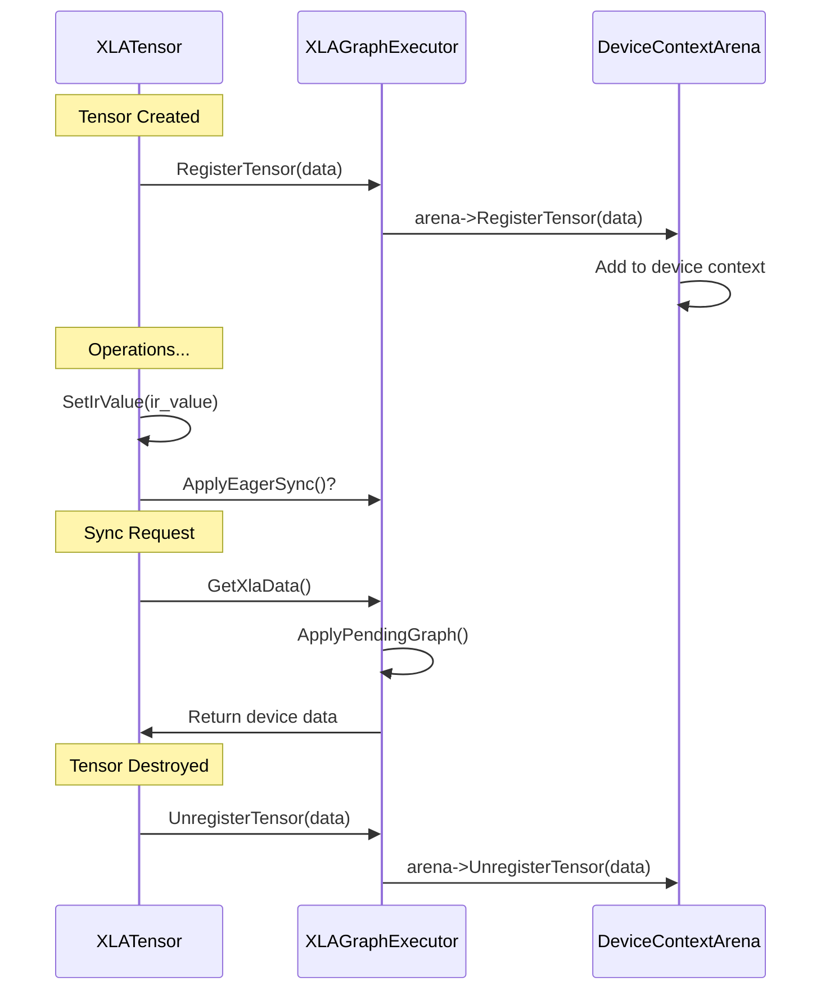

<!-- source: DeepWiki mcp.deepwiki.com · repo pytorch/xla · page 2.3 XLA Graph Executor · fetched 2026-10-21 -->

# XLA Graph Executor

<details>
<summary>Relevant source files</summary>

The following files were used as context for generating this wiki page:

- [test/cpp/test_xla_sharding.cpp](test/cpp/test_xla_sharding.cpp)
- [test/spmd/test_xla_sharding.py](test/spmd/test_xla_sharding.py)
- [test/spmd/test_xla_sharding_base.py](test/spmd/test_xla_sharding_base.py)
- [test/test_operations.py](test/test_operations.py)
- [test/test_ops_error_message.py](test/test_ops_error_message.py)
- [torch_xla/_internal/jax_workarounds.py](torch_xla/_internal/jax_workarounds.py)
- [torch_xla/csrc/aten_autograd_ops.cpp](torch_xla/csrc/aten_autograd_ops.cpp)
- [torch_xla/csrc/aten_xla_type.cpp](torch_xla/csrc/aten_xla_type.cpp)
- [torch_xla/csrc/init_python_bindings.cpp](torch_xla/csrc/init_python_bindings.cpp)
- [torch_xla/csrc/ir_builder.h](torch_xla/csrc/ir_builder.h)
- [torch_xla/csrc/ops/ops.cpp](torch_xla/csrc/ops/ops.cpp)
- [torch_xla/csrc/ops/ops.h](torch_xla/csrc/ops/ops.h)
- [torch_xla/csrc/tensor.cpp](torch_xla/csrc/tensor.cpp)
- [torch_xla/csrc/tensor.h](torch_xla/csrc/tensor.h)
- [torch_xla/csrc/tensor_methods.cpp](torch_xla/csrc/tensor_methods.cpp)
- [torch_xla/csrc/tensor_methods.h](torch_xla/csrc/tensor_methods.h)
- [torch_xla/csrc/tensor_util.cpp](torch_xla/csrc/tensor_util.cpp)
- [torch_xla/csrc/tensor_util.h](torch_xla/csrc/tensor_util.h)
- [torch_xla/csrc/xla_backend_impl.cpp](torch_xla/csrc/xla_backend_impl.cpp)
- [torch_xla/csrc/xla_graph_executor.cpp](torch_xla/csrc/xla_graph_executor.cpp)
- [torch_xla/csrc/xla_graph_executor.h](torch_xla/csrc/xla_graph_executor.h)
- [torch_xla/csrc/xla_lower_util.cpp](torch_xla/csrc/xla_lower_util.cpp)
- [torch_xla/csrc/xla_lower_util.h](torch_xla/csrc/xla_lower_util.h)
- [torch_xla/csrc/xla_sharding_util.cpp](torch_xla/csrc/xla_sharding_util.cpp)
- [torch_xla/csrc/xla_sharding_util.h](torch_xla/csrc/xla_sharding_util.h)
- [torch_xla/distributed/spmd/__init__.py](torch_xla/distributed/spmd/__init__.py)
- [torch_xla/distributed/spmd/xla_sharding.py](torch_xla/distributed/spmd/xla_sharding.py)

</details>


## Purpose and Scope

The XLA Graph Executor is the central orchestrator for lazy compilation and execution in PyTorch/XLA. It manages the lifecycle of tensor operations by collecting pending IR nodes, compiling them into executable XLA computations, caching compilations, and executing them on target devices (TPU/GPU/CPU). This component bridges the gap between PyTorch's eager execution model and XLA's graph-based compilation.

For information about the IR representation used by the executor, see [IR System and Operation Nodes](#2.5). For details on how operations are lowered to XLA HLO, see [Operation Lowering and Shape Inference](#2.6).

## Architecture Overview



**Sources:** [torch_xla/csrc/xla_graph_executor.h:1-196](), [torch_xla/csrc/xla_graph_executor.cpp:1-2760]()

## Key Components

### XLAGraphExecutor Singleton

The `XLAGraphExecutor` is a singleton class that extends `torch::lazy::LazyGraphExecutor` and serves as the central execution coordinator.



**Sources:** [torch_xla/csrc/xla_graph_executor.h:32-196](), [torch_xla/csrc/xla_graph_executor.cpp:84-123]()

### DeviceContextArena

The `DeviceContextArena` maintains per-device state including registered tensors, RNG seeds, and synchronization primitives.

| Component | Purpose | Key Data |
|-----------|---------|----------|
| `DeviceContext` | Per-device state container | `tensors_data`: weak_ptr to tensor data<br/>`seed`: RNG seed value<br/>`seed_ir_value`: IR node for seed<br/>`lock`: mutex for thread safety |
| Arena Map | Device to context mapping | `map<device, DeviceContext*>` |
| Live Tensor Tracking | Identify active tensors | Iterates weak_ptrs, filters expired ones |

**Sources:** [torch_xla/csrc/xla_graph_executor.h:36-93](), [torch_xla/csrc/xla_graph_executor.cpp:127-196]()

### ComputationCache

The cache stores compiled XLA computations to avoid recompilation of identical graphs.

**Cache Types:**

1. **MemoryCache** (`XLAGraphExecutor::MemoryCache`)
   - In-memory LRU cache
   - Configurable size via `XLA_COMPILATION_CACHE_SIZE` (default: 2048)
   - Fast but non-persistent

2. **PersistentCache** (`XLAGraphExecutor::PersistentCache`) 
   - Disk-backed cache at `XLA_PERSISTENT_CACHE_PATH`
   - Serializes/deserializes compiled computations
   - Survives process restarts
   - Can be read-only via `XLA_PERSISTENT_CACHE_READ_ONLY`

**Cache Key:** Hash of the computation graph structure, including:
- IR node operations and operands
- Input/output shapes
- Sharding annotations (if SPMD is used)

**Sources:** [torch_xla/csrc/xla_graph_executor.cpp:84-123](), [torch_xla/csrc/xla_graph_executor.h:100-137]()

## Execution Flow

### Lazy Execution Model

Operations on XLA tensors build an IR graph without immediate execution. The graph is materialized only when explicitly synchronized.



**Sources:** [torch_xla/csrc/tensor.cpp:340-374](), [torch_xla/csrc/xla_graph_executor.cpp:679-892]()

### Synchronization Points

Synchronization triggers compilation and execution of pending operations.

**Primary Synchronization Methods:**

| Method | Trigger Condition | Behavior |
|--------|------------------|----------|
| `mark_step()` | Explicit user call | Synchronizes all pending operations on all devices |
| `xm.wait_device_ops()` | Explicit barrier | Waits for all device operations to complete |
| Tensor materialization | `.cpu()`, `.numpy()`, `.item()` | Syncs only the required tensors |
| Eager mode | `XLA_EAGER_MODE=1` | Syncs after each operation automatically |

**Sources:** [torch_xla/csrc/xla_graph_executor.cpp:679-892](), [torch_xla/csrc/init_python_bindings.cpp:266-281]()

### Eager Mode Execution

When `UseEagerMode()` returns true, operations are executed immediately via `ApplyEagerSync()`.

```mermaid
graph LR
    SetIrValue["SetIrValue()<br/>New IR operation"]
    CheckEager{UseEagerMode()?}
    ApplyEagerSync["ApplyEagerSync()<br/>Immediate sync"]
    LazyExec["Add to pending graph<br/>No execution"]
    
    SetIrValue --> CheckEager
    CheckEager -->|Yes| ApplyEagerSync
    CheckEager -->|No| LazyExec
```

**Configuration:** Set via `torch_xla.experimental.eager_mode(True)` or environment variable

**Sources:** [torch_xla/csrc/tensor.cpp:357-363](), [torch_xla/csrc/xla_graph_executor.cpp:1092-1134]()

## Graph Compilation Process

### SyncTensorsGraph: Main Orchestrator

The `SyncTensorsGraph()` method orchestrates the entire compilation and execution pipeline.



**Sources:** [torch_xla/csrc/xla_graph_executor.cpp:679-892]()

### IR Collection and Post-Order Traversal

The executor collects all IR nodes that need execution and orders them topologically.

**PostOrderData Structure:**
- `post_order`: vector of IR nodes in execution order
- `emission_map`: maps each node to its index in post_order
- Ensures dependencies are satisfied before execution

**CollectSyncTensors() Logic:**
1. Iterate through input tensors
2. Check if tensor has pending IR (`CurrentIrValue()`)
3. Filter out DeviceData nodes (already materialized)
4. Add to sync collection

**Sources:** [torch_xla/csrc/xla_graph_executor.cpp:245-316](), [torch_xla/csrc/xla_graph_executor.cpp:514-576]()

### Lowering to HLO

The `LoweringContext` converts IR nodes to XLA HLO operations.



**Key Steps:**
1. **CreateParameters()**: Create HLO parameters for each unique DeviceData node
2. **Visit IR nodes**: Call `node->Lower(loctx)` for each node in post-order
3. **Build output tuple**: Combine all outputs into a single tuple
4. **Extract XlaComputation**: Finalize the HLO module

**Sources:** [torch_xla/csrc/lowering_context.h:1-150](), [torch_xla/csrc/xla_graph_executor.cpp:461-512]()

### Cache Lookup and Storage

Hash-based cache lookup avoids recompilation of identical graphs.

**Hash Computation:**
- Includes all IR node types and operands
- Includes tensor shapes and data types  
- Includes sharding specifications (for SPMD)
- Uses `torch::lazy::Hash()` primitives

**Cache Key Format:**
```
hash_t = Hash(
  node_operations,
  operand_hashes,
  shape_dimensions,
  sharding_specs
)
```

**Sources:** [torch_xla/csrc/xla_graph_executor.cpp:318-385](), [torch_xla/csrc/ir.h:1-300]()

### Execution on Device

The compiled computation is executed through the `ComputationClient`.

**Execution Flow:**
1. **Prepare inputs**: Convert IR values to `ComputationClient::Data` handles
2. **Execute**: Call `client->ExecuteComputation(computation, arguments, device)`
3. **Handle sharding**: For SPMD, use `ExecuteReplicated()` or `ExecuteSharded()`
4. **Return handles**: Get device data handles for outputs
5. **Update tensors**: Replace IR values with DeviceData nodes

**Sources:** [torch_xla/csrc/xla_graph_executor.cpp:893-1090](), [torch_xla/csrc/runtime/computation_client.h:1-500]()

## Device Management

### DeviceContext Lifecycle

Each device maintains isolated state through a `DeviceContext` object.



**DeviceContext Contents:**
- `std::map<int64_t, std::weak_ptr<Data>> tensors_data`: Map of tensor UID to data
- `uint64_t seed`: Current RNG seed value
- `uint64_t running_seed`: Running seed for sequential operations
- `torch::lazy::Value seed_ir_value`: IR node for seed
- `std::mutex lock`: Thread safety mutex

**Sources:** [torch_xla/csrc/xla_graph_executor.h:59-85](), [torch_xla/csrc/xla_graph_executor.cpp:127-196]()

### RNG State Management

The executor manages per-device RNG state for deterministic random operations.

**Seed Evolution:**
```
next_seed = (current_seed * 214013) + 2531011
```

**GetRngSeed() Behavior:**

| Mode | Behavior |
|------|----------|
| Lazy Mode | Returns IR value: `seed_ir_value = b + k * seed_ir_value`<br/>Keeps seed as computation node |
| Eager Mode | Returns current IR value<br/>Resets `seed_ir_value` to fresh DeviceData<br/>Updates seed scalar |

**Sources:** [torch_xla/csrc/xla_graph_executor.cpp:149-183]()

## Synchronization Primitives

### Wait and Barrier Operations

The executor provides several synchronization mechanisms:

| Operation | Scope | Blocking | Use Case |
|-----------|-------|----------|----------|
| `WaitDeviceOps()` | Specific devices or all | Yes | Wait for device ops to complete |
| `DeviceBarrier()` | Single device | Yes | Ensure all ops on device finish |
| `SyncLiveTensorsGraph()` | Live tensors on device | Yes | Sync all active tensors |
| `mark_step()` | All devices | Yes | Training step boundary |

**WaitDeviceOps Implementation:**
```
1. Call XLAGraphExecutor::Get()->WaitDeviceOps(devices)
2. Call ComputationClient->WaitDeviceOps(devices)
3. Block until all pending executions complete
```

**Sources:** [torch_xla/csrc/xla_graph_executor.cpp:1136-1151](), [torch_xla/csrc/init_python_bindings.cpp:266-271]()

## Integration with Other Components

### Interaction with XLATensor

Every XLATensor interacts with the graph executor for registration and synchronization.



**Sources:** [torch_xla/csrc/tensor.cpp:63-115](), [torch_xla/csrc/xla_graph_executor.cpp:197-244]()

### Interaction with Lowering Context

The graph executor creates and manages `LoweringContext` instances for compilation.

**LoweringContext Creation:**
- Device specified by tensors being synced
- Builder name: derived from operation type
- Post-order node traversal for dependency resolution
- Sharding annotations attached during lowering

**Sources:** [torch_xla/csrc/xla_graph_executor.cpp:461-512](), [torch_xla/csrc/lowering_context.h:1-150]()

### SPMD and Sharding Support

The executor integrates with the sharding system for distributed execution.

**Sharding Flow:**
1. Tensors annotated with `mark_sharding()` carry `ShardingSpec`
2. During lowering, sharding annotations added to HLO
3. XLA SPMD partitioner generates per-device programs
4. Executor handles sharded data via `PjRtShardedData`

**ShardingSpec Propagation:**
- Stored in `XLATensor::Data::sharding`
- Synced to IR node via `XlaNode::SetSharding()`
- Retrieved during lowering via `node->GetSharding()`

**Sources:** [torch_xla/csrc/tensor.cpp:256-320](), [torch_xla/csrc/xla_sharding_util.cpp:1-1200](), [torch_xla/csrc/xla_graph_executor.cpp:387-459]()

## Configuration and Environment Variables

| Environment Variable | Purpose | Default |
|---------------------|---------|---------|
| `XLA_COMPILATION_CACHE_SIZE` | Max cache entries | 2048 |
| `XLA_PERSISTENT_CACHE_PATH` | Disk cache directory | "" (disabled) |
| `XLA_PERSISTENT_CACHE_READ_ONLY` | Read-only cache mode | false |
| `XLA_EAGER_MODE` | Enable eager execution | false |
| `XLA_TRIM_GRAPH_SIZE` | Max IR nodes before trim | 100000 |
| `XLA_TRIM_GRAPH_CHECK_FREQUENCY` | Trim check interval | 5000 |

**Sources:** [torch_xla/csrc/xla_graph_executor.cpp:84-123](), [torch_xla/csrc/runtime/env_vars.h:1-100]()

---

