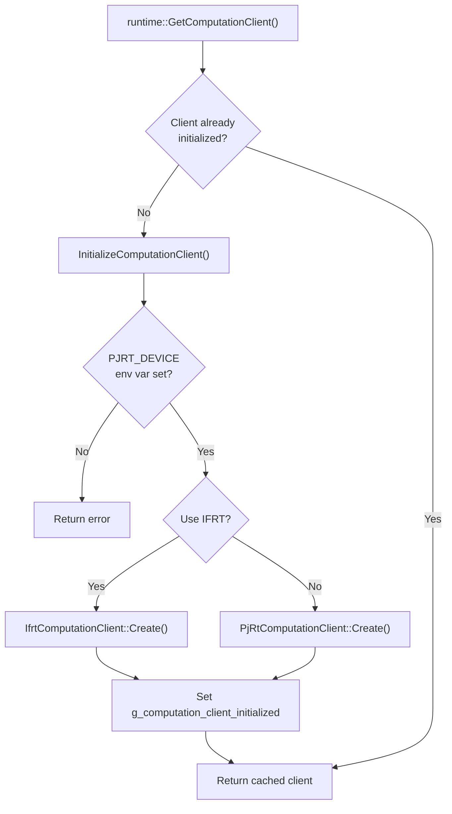
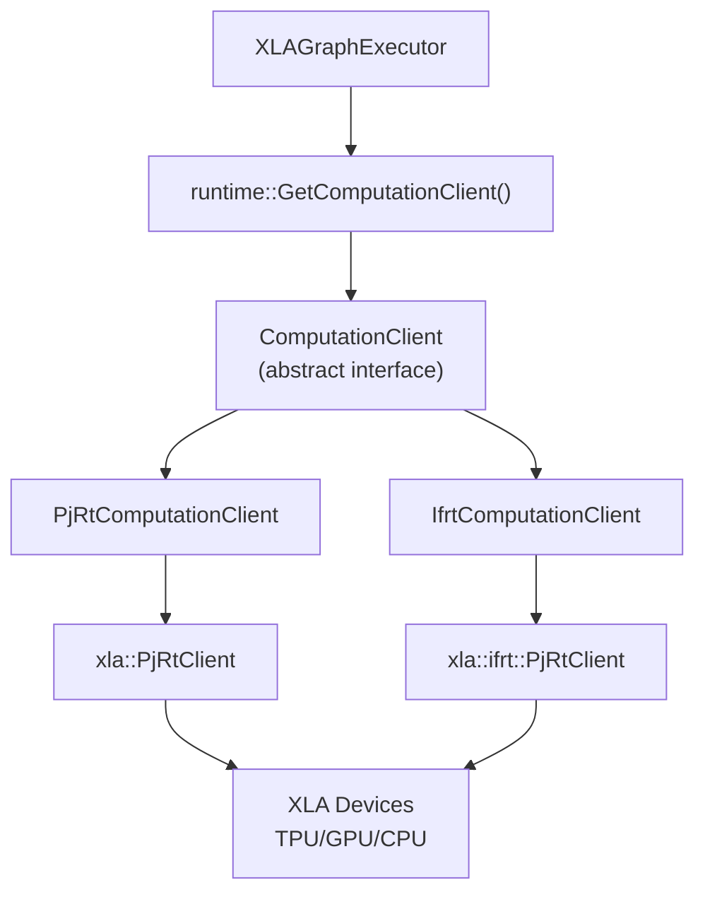
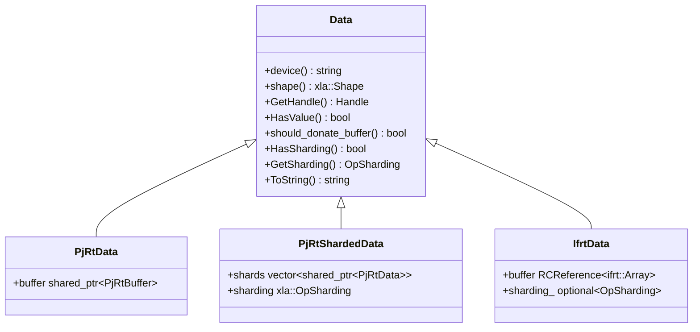
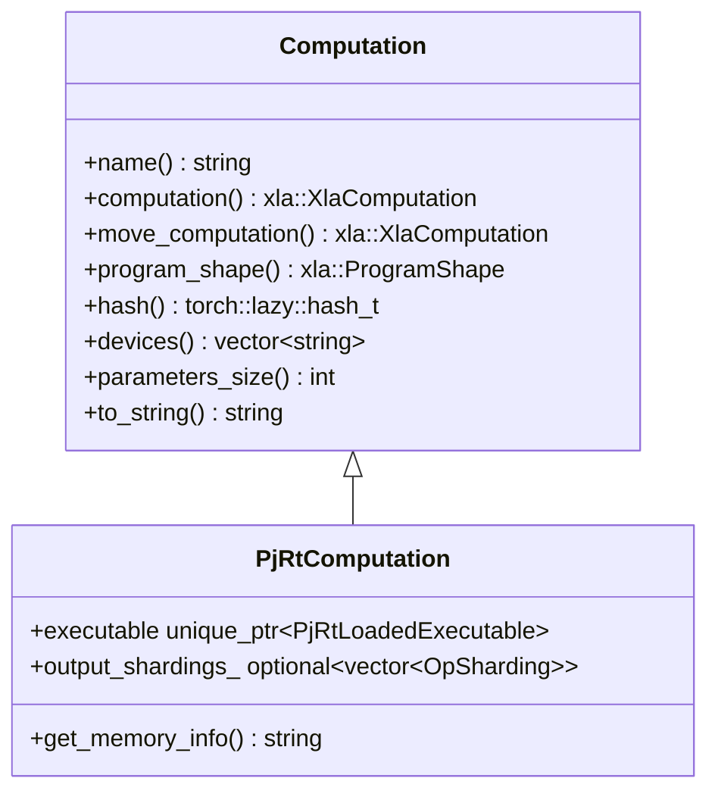
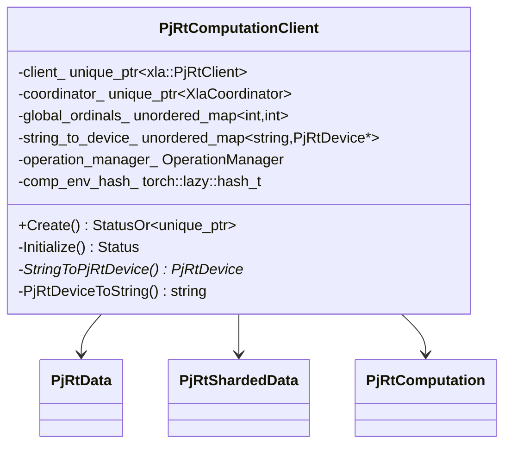
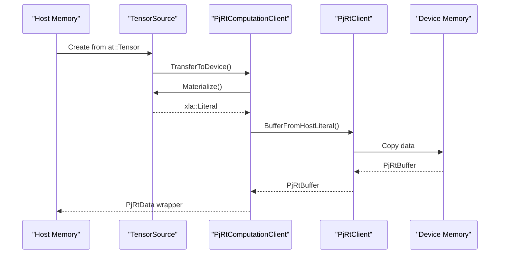
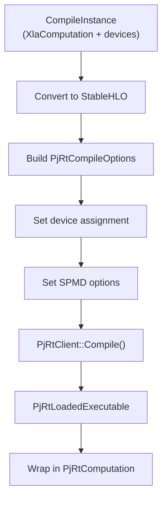
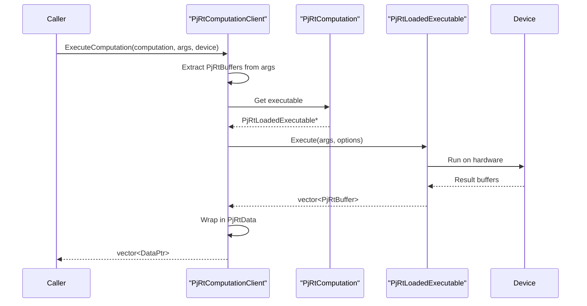

<!-- source: DeepWiki mcp.deepwiki.com · repo pytorch/xla · page 2.4 Computation Client and Runtime · fetched 2026-10-21 -->

# Computation Client and Runtime

<details>
<summary>Relevant source files</summary>

The following files were used as context for generating this wiki page:

- [WORKSPACE](WORKSPACE)
- [setup.py](setup.py)
- [torch_xla/csrc/runtime/BUILD](torch_xla/csrc/runtime/BUILD)
- [torch_xla/csrc/runtime/computation_client.h](torch_xla/csrc/runtime/computation_client.h)
- [torch_xla/csrc/runtime/ifrt_computation_client.cpp](torch_xla/csrc/runtime/ifrt_computation_client.cpp)
- [torch_xla/csrc/runtime/ifrt_computation_client.h](torch_xla/csrc/runtime/ifrt_computation_client.h)
- [torch_xla/csrc/runtime/ifrt_computation_client_test.cpp](torch_xla/csrc/runtime/ifrt_computation_client_test.cpp)
- [torch_xla/csrc/runtime/pjrt_computation_client.cpp](torch_xla/csrc/runtime/pjrt_computation_client.cpp)
- [torch_xla/csrc/runtime/pjrt_computation_client.h](torch_xla/csrc/runtime/pjrt_computation_client.h)
- [torch_xla/csrc/runtime/pjrt_computation_client_test.cpp](torch_xla/csrc/runtime/pjrt_computation_client_test.cpp)
- [torch_xla/csrc/runtime/pjrt_registry.cpp](torch_xla/csrc/runtime/pjrt_registry.cpp)
- [torch_xla/csrc/runtime/runtime.cpp](torch_xla/csrc/runtime/runtime.cpp)
- [torch_xla/csrc/runtime/runtime.h](torch_xla/csrc/runtime/runtime.h)

</details>


The Computation Client and Runtime layer provides the interface between PyTorch/XLA's execution layer and XLA devices (TPUs, GPUs, CPUs). This layer handles runtime initialization, device management, data transfers between host and devices, compilation and execution of XLA computations, and distributed coordination.

For information about how the XLA Graph Executor uses the Computation Client, see page 2.3.

## Runtime Initialization

The runtime initialization is handled by `runtime::GetComputationClient()`, which creates and initializes a singleton `ComputationClient` instance. This function is defined in [torch_xla/csrc/runtime/runtime.cpp:52-61]() and uses a static variable to ensure the client is initialized only once.

### Initialization Flow



Sources: [torch_xla/csrc/runtime/runtime.cpp:15-73]()

The initialization process:
1. Checks the `PJRT_DEVICE` environment variable to determine the target device type
2. Selects between IFRT and PJRT implementation (currently IFRT is disabled)
3. Creates and initializes the appropriate `ComputationClient` subclass
4. Sets a global flag to prevent re-initialization
5. Returns the initialized client as a singleton

Sources: [torch_xla/csrc/runtime/runtime.cpp:20-50]()

## Architecture Overview

The Computation Client layer sits between the XLA Graph Executor and XLA device runtimes:



Sources: [torch_xla/csrc/runtime/computation_client.h:54-271](), [torch_xla/csrc/runtime/pjrt_computation_client.h:27-347](), [torch_xla/csrc/runtime/ifrt_computation_client.h:29-262](), [torch_xla/csrc/runtime/runtime.cpp:15-73]()

## ComputationClient Abstract Interface

The `ComputationClient` class [torch_xla/csrc/runtime/computation_client.h:54-450]() defines the abstract interface that all runtime implementations must provide. It encapsulates all interactions with XLA devices.

### Key Methods

| Category | Method | Description |
|----------|--------|-------------|
| Data Management | `CreateDataPlaceholder()` | Creates a placeholder for async data transfer |
| | `TransferToDevice()` | Transfers tensors from host to device |
| | `TransferFromDevice()` | Transfers tensors from device to host |
| | `CopyToDevice()` | Copies data between devices |
| Compilation | `Compile()` | Compiles XLA computations for execution |
| | `SerializeComputation()` | Serializes a compiled computation |
| | `DeserializeComputation()` | Deserializes a compiled computation |
| Execution | `ExecuteComputation()` | Executes a computation on a single device |
| | `ExecuteReplicated()` | Executes a computation replicated across devices |
| Device Info | `GetDefaultDevice()` | Returns the default device string |
| | `GetLocalDevices()` | Returns local device identifiers |
| | `GetAllDevices()` | Returns all device identifiers |
| | `GetNumDevices()` | Returns total number of devices |
| Synchronization | `WaitDeviceOps()` | Waits for async operations to complete |
| Coordination | `InitializeCoordinator()` | Initializes distributed coordinator |
| | `GetCoordinator()` | Returns the XLA coordinator instance |

Sources: [torch_xla/csrc/runtime/computation_client.h:271-443]()

### Core Data Abstractions

The `ComputationClient` defines two primary nested classes:

#### ComputationClient::Data

Represents tensor data residing on an XLA device:



Sources: [torch_xla/csrc/runtime/computation_client.h:56-89](), [torch_xla/csrc/runtime/pjrt_computation_client.h:208-262](), [torch_xla/csrc/runtime/ifrt_computation_client.h:207-260]()

#### ComputationClient::Computation

Represents a compiled XLA computation that can be executed:



Sources: [torch_xla/csrc/runtime/computation_client.h:104-219](), [torch_xla/csrc/runtime/pjrt_computation_client.h:323-343]()

## Implementation: PjRtComputationClient

The `PjRtComputationClient` [torch_xla/csrc/runtime/pjrt_computation_client.h:27-347]() is the primary implementation used by PyTorch/XLA. It interfaces with XLA devices through the PJRT (Portable JAX Runtime) C++ API.

### Internal Structure



Sources: [torch_xla/csrc/runtime/pjrt_computation_client.h:176-204]()

### Initialization Process

The `PjRtComputationClient::Initialize()` method [torch_xla/csrc/runtime/pjrt_computation_client.cpp:121-145]() performs the following:

1. **PJRT Client Creation**: Calls `InitializePjRt()` from the registry to create the underlying `xla::PjRtClient`
2. **Device Ordinal Mapping**: Creates mappings between device IDs and global ordinals
3. **Compilation Hash**: Computes a hash of the compilation environment including platform, devices, and topology
4. **Operation Manager**: Initializes the operation manager for tracking async operations

Sources: [torch_xla/csrc/runtime/pjrt_computation_client.cpp:121-145]()

### Data Types

#### PjRtData

Represents a single tensor on a device:

```cpp
struct PjRtData : public Data {
  std::shared_ptr<xla::PjRtBuffer> buffer;
  
  Handle GetHandle() override;
  void Assign(const torch::lazy::BackendData& data) override;
  bool HasValue() const override;
  std::string ToString() const override;
}
```

Sources: [torch_xla/csrc/runtime/pjrt_computation_client.h:208-262]()

#### PjRtShardedData

Represents a tensor sharded across multiple devices:

```cpp
struct PjRtShardedData : public Data {
  std::vector<std::shared_ptr<PjRtData>> shards;
  xla::OpSharding sharding;
  
  bool HasSharding() const override { return true; }
  xla::OpSharding GetSharding() const override;
}
```

Sources: [torch_xla/csrc/runtime/pjrt_computation_client.h:264-321]()

### Compilation and Execution

The compilation process [torch_xla/csrc/runtime/pjrt_computation_client.cpp:402-522]():

1. Converts XLA computation to StableHLO
2. Creates PJRT compile options (device assignment, SPMD settings)
3. Invokes PJRT client compilation
4. Wraps result in `PjRtComputation`

Execution [torch_xla/csrc/runtime/pjrt_computation_client.cpp:524-661]():

1. Extracts `PjRtBuffer` objects from input `DataPtr`s
2. Invokes PJRT executable with execute options
3. Wraps output buffers in `PjRtData` objects

Sources: [torch_xla/csrc/runtime/pjrt_computation_client.cpp:402-661]()

## Implementation: IfrtComputationClient

The `IfrtComputationClient` [torch_xla/csrc/runtime/ifrt_computation_client.h:29-262]() is an alternative implementation using the IFRT (Interface for Runtime) API, which provides a higher-level abstraction over PJRT.

**Note**: Currently disabled in PyTorch/XLA runtime initialization [torch_xla/csrc/runtime/runtime.cpp:30]().

### Key Differences from PjRtComputationClient

| Aspect | PjRtComputationClient | IfrtComputationClient |
|--------|----------------------|---------------------|
| Underlying API | `xla::PjRtClient` | `xla::ifrt::PjRtClient` |
| Buffer Type | `xla::PjRtBuffer` | `xla::ifrt::Array` |
| Sharding Support | Explicit `PjRtShardedData` | Unified `IfrtData` with optional sharding |
| Status | Production | Experimental (disabled) |

Sources: [torch_xla/csrc/runtime/ifrt_computation_client.h:29-262](), [torch_xla/csrc/runtime/ifrt_computation_client.cpp:124-161]()

## Device Management

The `ComputationClient` provides comprehensive device management capabilities to enumerate, identify, and track XLA devices.

### Device Discovery and Identification


Sources: [torch_xla/csrc/runtime/pjrt_computation_client.cpp:121-145]()

### Device String Format

Devices are identified by strings in the format `"DEVICE_TYPE:ORDINAL"`, where:
- `DEVICE_TYPE`: The platform name (e.g., `TPU`, `GPU`, `CPU`)
- `ORDINAL`: The global ordinal assigned during initialization

Example: `"TPU:0"`, `"GPU:1"`, `"CPU:0"`

The conversion between PJRT devices and string identifiers is handled by:
- `PjRtDeviceToString()` [torch_xla/csrc/runtime/pjrt_computation_client.cpp:98-105]()
- `StringToPjRtDevice()` [torch_xla/csrc/runtime/pjrt_computation_client.cpp:206-214]()

Sources: [torch_xla/csrc/runtime/pjrt_computation_client.cpp:98-105](), [torch_xla/csrc/runtime/pjrt_computation_client.cpp:206-214]()

### Device Query Methods

| Method | Returns | Description |
|--------|---------|-------------|
| `GetDefaultDevice()` | `string` | Default device identifier (usually first local device) |
| `GetLocalDevices()` | `vector<string>` | All devices addressable by this process |
| `GetAllDevices()` | `vector<string>` | All devices in the computation cluster |
| `GetNumLocalDevices()` | `size_t` | Number of local devices |
| `GetNumDevices()` | `size_t` | Total number of devices |
| `GetDeviceKind()` | `string` | Device type for a given device |
| `GetDeviceAttributes()` | `flat_hash_map` | Device-specific attributes |

Sources: [torch_xla/csrc/runtime/computation_client.h:367-406]()

### Device Attributes

The `GetDeviceAttributes()` method returns device-specific attributes using a variant type:

```cpp
using DeviceAttribute = std::variant<std::string, bool, int64_t, 
                                     std::vector<int64_t>, float>;
const absl::flat_hash_map<std::string, DeviceAttribute> 
  GetDeviceAttributes(const std::string& device);
```

Sources: [torch_xla/csrc/runtime/computation_client.h:392-397]()

## Data Transfer Operations

### Host-to-Device Transfer

The `TransferToDevice()` method [torch_xla/csrc/runtime/pjrt_computation_client.cpp:257-332]() transfers tensors from host memory to device:



Sources: [torch_xla/csrc/runtime/pjrt_computation_client.cpp:257-332]()

### Device-to-Host Transfer

The `TransferFromDevice()` method [torch_xla/csrc/runtime/pjrt_computation_client.cpp:377-400]() transfers data back to host as `xla::Literal` objects:

```cpp
absl::StatusOr<std::vector<xla::Literal>> TransferFromDevice(
    absl::Span<const DataPtr> handles) override;
```

This method:
1. Extracts `PjRtBuffer` from each `DataPtr`
2. Calls `ToLiteralSync()` to transfer data
3. Returns the literals in host memory

Sources: [torch_xla/csrc/runtime/pjrt_computation_client.cpp:377-400]()

### Device-to-Device Copy

The `CopyToDevice()` method [torch_xla/csrc/runtime/pjrt_computation_client.cpp:355-375]() copies data between devices without going through host memory.

Sources: [torch_xla/csrc/runtime/pjrt_computation_client.cpp:355-375]()

## Compilation

The `Compile()` method [torch_xla/csrc/runtime/pjrt_computation_client.cpp:402-522]() compiles XLA computations for execution:

### Compilation Process



Sources: [torch_xla/csrc/runtime/pjrt_computation_client.cpp:402-522]()

### CompileInstance Structure

```cpp
struct CompileInstance {
  xla::XlaComputation computation;
  std::string compilation_device;
  std::vector<std::string> devices;
  const xla::Shape* output_shape;
  bool parameter_is_tupled_arguments;
  bool is_sharded;
  bool allow_spmd_sharding_propagation_to_output;
  bool use_auto_spmd_partitioning;
  std::vector<int64_t> auto_spmd_mesh_shape;
  std::vector<int64_t> auto_spmd_mesh_ids;
  bool eager_mode;
};
```

Sources: [torch_xla/csrc/runtime/computation_client.h:225-259]()

## Execution

### Single-Device Execution

The `ExecuteComputation()` method [torch_xla/csrc/runtime/pjrt_computation_client.cpp:524-619]() executes a compiled computation on a single device:



Sources: [torch_xla/csrc/runtime/pjrt_computation_client.cpp:524-619]()

### Replicated Execution

The `ExecuteReplicated()` method [torch_xla/csrc/runtime/pjrt_computation_client.cpp:621-767]() executes a computation across multiple devices in parallel.

Sources: [torch_xla/csrc/runtime/pjrt_computation_client.cpp:621-767]()

## XLA Coordinator

The `XlaCoordinator` [torch_xla/csrc/runtime/xla_coordinator.h]() manages coordination between distributed processes. It is initialized during computation client creation when multi-process training is configured.

### Coordinator Initialization

The coordinator is initialized in `InitializePjRt()` [torch_xla/csrc/runtime/pjrt_registry.cpp:73-184]() when:
- `PJRT_DEVICE` environment variable is set to a distributed-capable device
- Multi-process environment variables are detected (`RANK`, `WORLD_SIZE`, etc.)

```cpp
void InitializeCoordinator(int global_rank, int world_size,
                          std::string master_addr, std::string port);
XlaCoordinator& GetCoordinator();
```

The coordinator provides:
- **Process Identification**: Global rank and world size
- **Synchronization**: Barriers and coordination primitives
- **Key-Value Store**: For distributed metadata exchange

Sources: [torch_xla/csrc/runtime/computation_client.h:412-421](), [torch_xla/csrc/runtime/pjrt_registry.cpp:73-184]()

## Accessing the ComputationClient

### From C++

The computation client is accessed through the singleton getter:

```cpp
#include "torch_xla/csrc/runtime/runtime.h"

absl::StatusOr<ComputationClient*> maybe_client = 
    runtime::GetComputationClient();
if (!maybe_client.ok()) {
  // Handle initialization error
}
ComputationClient* client = maybe_client.value();
```

Sources: [torch_xla/csrc/runtime/runtime.h:10-11](), [torch_xla/csrc/runtime/runtime.cpp:52-61]()

### From Python

Python code accesses the computation client indirectly through:
- **Device placement**: `tensor.to('xla:0')` triggers device management
- **XLA model utilities**: `xm.xla_device()` queries device information
- **Graph execution**: Tensor synchronization triggers compilation and execution

The Python layer interacts with the client through the ATen/XLA bridge [torch_xla/csrc/aten_xla_bridge.cpp]().

Sources: [torch_xla/csrc/aten_xla_bridge.cpp:407-415]()

## Testing and Examples

The codebase includes several test files that demonstrate how to use collective operations:

- `test_mp_replication.py`: Tests for replication across multiple processes
- `test_mp_all_gather.py`: Tests for the all-gather operation
- `test_mp_reduce_scatter.py`: Tests for the reduce-scatter operation

Sources: [test/test_mp_replication.py:1-41](), [test/test_mp_all_gather.py:1-31](), [test/test_mp_reduce_scatter.py:1-25]()

## Summary

The Computation Client layer serves as a critical abstraction in PyTorch/XLA, providing a unified interface for interacting with XLA devices regardless of the underlying hardware. It handles data management, computation execution, and collective operations needed for distributed training.

Through implementations like PjRtComputationClient and IfrtComputationClient, PyTorch/XLA supports diverse hardware targets while presenting a consistent interface to higher layers of the system.

---

