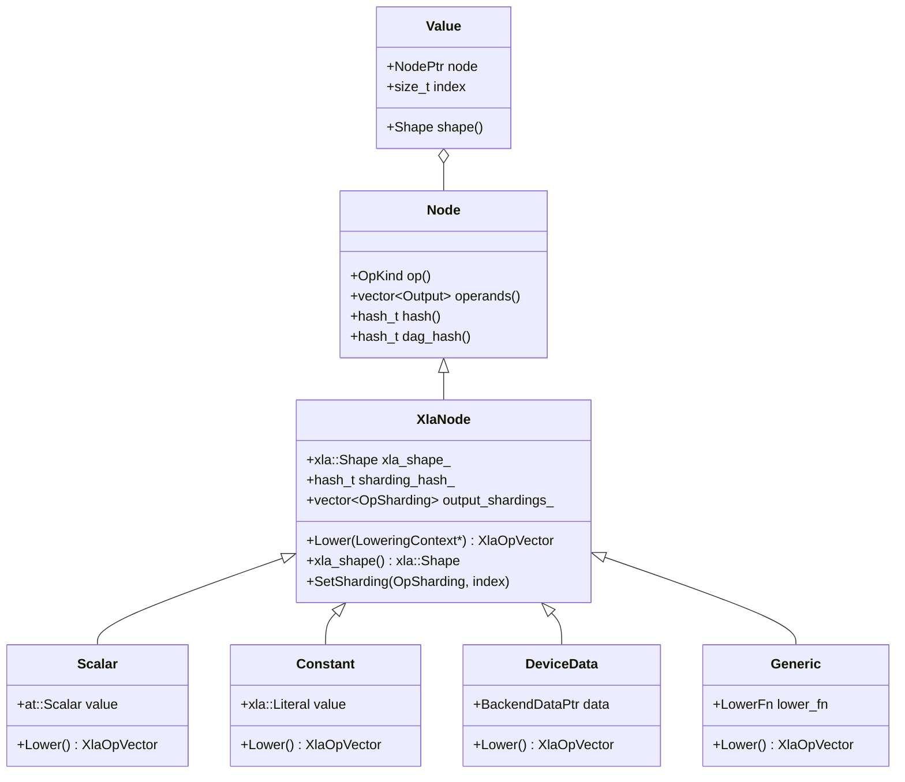
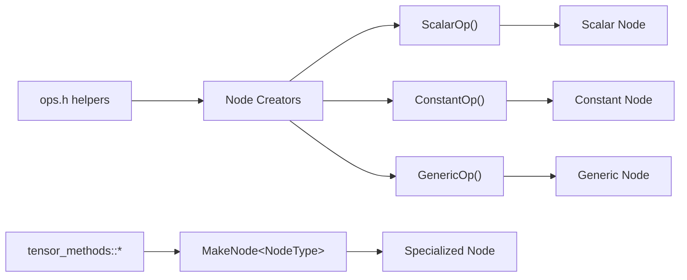
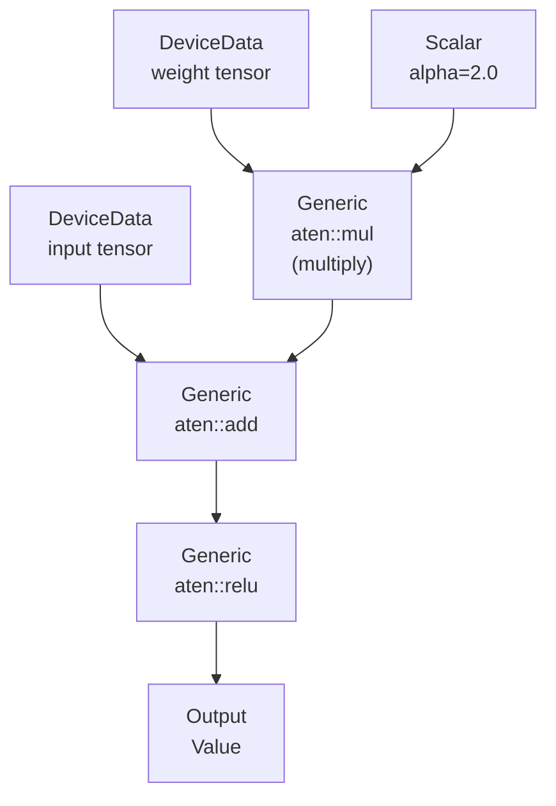
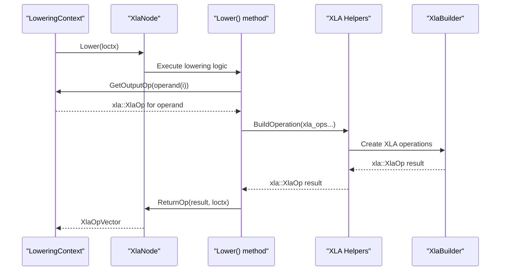

<!-- source: DeepWiki mcp.deepwiki.com · repo pytorch/xla · page 2.5 IR System and Operation Nodes · fetched 2026-10-21 -->

# IR System and Operation Nodes

<details>
<summary>Relevant source files</summary>

The following files were used as context for generating this wiki page:

- [codegen/xla_native_functions.yaml](codegen/xla_native_functions.yaml)
- [test/test_core_aten_ops.py](test/test_core_aten_ops.py)
- [test/test_operations.py](test/test_operations.py)
- [test/test_ops_error_message.py](test/test_ops_error_message.py)
- [torch_xla/csrc/aten_autograd_ops.cpp](torch_xla/csrc/aten_autograd_ops.cpp)
- [torch_xla/csrc/aten_xla_type.cpp](torch_xla/csrc/aten_xla_type.cpp)
- [torch_xla/csrc/init_python_bindings.cpp](torch_xla/csrc/init_python_bindings.cpp)
- [torch_xla/csrc/ops/ops.cpp](torch_xla/csrc/ops/ops.cpp)
- [torch_xla/csrc/ops/ops.h](torch_xla/csrc/ops/ops.h)
- [torch_xla/csrc/ops/ops_lower_fn.cpp](torch_xla/csrc/ops/ops_lower_fn.cpp)
- [torch_xla/csrc/ops/ops_xla_shape_fn.cpp](torch_xla/csrc/ops/ops_xla_shape_fn.cpp)
- [torch_xla/csrc/ops/ops_xla_shape_fn.h](torch_xla/csrc/ops/ops_xla_shape_fn.h)
- [torch_xla/csrc/tensor.cpp](torch_xla/csrc/tensor.cpp)
- [torch_xla/csrc/tensor.h](torch_xla/csrc/tensor.h)
- [torch_xla/csrc/tensor_methods.cpp](torch_xla/csrc/tensor_methods.cpp)
- [torch_xla/csrc/tensor_methods.h](torch_xla/csrc/tensor_methods.h)
- [torch_xla/csrc/xla_lower_util.cpp](torch_xla/csrc/xla_lower_util.cpp)
- [torch_xla/csrc/xla_lower_util.h](torch_xla/csrc/xla_lower_util.h)

</details>


The IR (Intermediate Representation) system in PyTorch/XLA consists of operation nodes that represent PyTorch operations in an intermediate format. These IR nodes form directed acyclic graphs (DAGs) that capture the computation to be executed on XLA devices. Each operation in PyTorch is represented by an IR node that knows how to lower itself to XLA operations.

The IR system bridges PyTorch's eager execution model with XLA's graph-based compilation model, enabling lazy evaluation and graph optimization.

## IR Value and Node Architecture

The IR system uses PyTorch's lazy tensor infrastructure with XLA-specific extensions:

**Diagram: IR Value and Node Class Hierarchy**


Key components:

- **`torch::lazy::Value`**: Represents a reference to an IR node output. Contains a `NodePtr` and output index.
- **`torch::lazy::Node`**: Base class for all IR nodes. Tracks operation kind, operands, and provides hashing.
- **`XlaNode`**: XLA-specific extension of `Node` that adds XLA shape information, sharding annotations, and the `Lower()` method.

Sources:
- [torch_xla/csrc/ir.h:54-184]()
- [torch_xla/csrc/ops/scalar.h:1-36]()
- [torch_xla/csrc/ops/constant.h:1-32]()
- [torch_xla/csrc/ops/device_data.h:1-50]()
- [torch_xla/csrc/ops/generic.h:1-71]()

## Operation Node Categories

Operation nodes in PyTorch/XLA fall into several categories based on their functionality:

**Diagram: Operation Node Categories**

```mermaid
graph TD
    OpNodes["Operation Nodes"]
    
    OpNodes --> DataNodes["Data Nodes"]
    OpNodes --> ArithmeticNodes["Arithmetic Nodes"]
    OpNodes --> ReductionNodes["Reduction Nodes"]
    OpNodes --> ViewNodes["View/Reshape Nodes"]
    OpNodes --> CollectiveNodes["Collective Nodes"]
    OpNodes --> CustomNodes["Custom Nodes"]
    
    DataNodes --> Scalar["Scalar"]
    DataNodes --> Constant["Constant"]
    DataNodes --> DeviceData["DeviceData"]
    
    ArithmeticNodes --> BinaryOps["Add, Mul, Sub, Div"]
    ArithmeticNodes --> UnaryOps["Neg, Exp, Log, Sqrt"]
    
    ReductionNodes --> Sum["Sum"]
    ReductionNodes --> Mean["Mean"]
    ReductionNodes --> MaxInDim["MaxInDim"]
    
    ViewNodes --> View["View"]
    ViewNodes --> Permute["Permute"]
    ViewNodes --> Expand["Expand"]
    
    CollectiveNodes --> AllReduce["AllReduce"]
    CollectiveNodes --> AllGather["AllGather"]
    CollectiveNodes --> ReduceScatter["ReduceScatter"]
    
    CustomNodes --> Generic["Generic"]
    CustomNodes --> CustomCall["CustomCall"]
```


### Core Node Types

| Node Type | Purpose | Key Fields | Source |
|-----------|---------|------------|--------|
| `Scalar` | Represents a scalar value that can be broadcast | `at::Scalar value`, `xla::Shape shape` | [torch_xla/csrc/ops/scalar.h]() |
| `Constant` | Represents a compile-time constant | `xla::Literal value` | [torch_xla/csrc/ops/constant.h]() |
| `DeviceData` | Represents data on a device | `BackendDataPtr data` | [torch_xla/csrc/ops/device_data.h]() |
| `Generic` | Flexible node with custom lowering | `LowerFn lower_fn`, `hash_t hash_seed` | [torch_xla/csrc/ops/generic.h:17-71]() |

### Arithmetic Operation Nodes

Arithmetic operations are typically created using helper functions in `ops.h`:

- **Unary operations**: `Neg()`, `Exp()`, `Log()`, `Log1p()`, `Sqrt()` - defined using `PTXLA_UNARY_OP` macro
- **Binary operations**: `Min()`, `Pow()`, `Fmod()` - defined using `PTXLA_BINARY_OP` macro

Sources:
- [torch_xla/csrc/ops/ops.h:71-233]()
- [torch_xla/csrc/ops/ops.cpp:43-90]()

### Specialized Operation Nodes

Many operations have dedicated node classes in `torch_xla/csrc/ops/`:

- **Pooling**: `AdaptiveAvgPool2d`, `MaxPoolNd`, `AvgPoolNd`
- **Normalization**: `NativeBatchNormForward`, `NativeBatchNormBackward`
- **Convolution**: `ConvolutionOverrideable`, `ConvolutionBackwardOverrideable`
- **Linear algebra**: `DotGeneral`, `Einsum`, `MatMul`
- **Reduction**: `Sum`, `Mean`, `Prod`, `MaxInDim`, `MinInDim`
- **Activation**: `LogSoftmax`, `Softmax`, `Gelu`, `Prelu`

Each specialized node implements:
1. Constructor that captures operation parameters
2. `Lower()` method that generates XLA operations
3. Shape inference logic (often via dedicated shape function)

Sources:
- [torch_xla/csrc/ops/]() (directory containing operation node implementations)
- [torch_xla/csrc/ops/ops_lower_fn.cpp]() (lowering implementations)

## Creating Operation Nodes

PyTorch/XLA provides several helper functions for creating operation nodes:

**Diagram: Node Creation Helpers**


### Helper Functions

**`ScalarOp()`**: Creates a `Scalar` node that represents a scalar value:
```cpp
// From ops.h
inline torch::lazy::NodePtr ScalarOp(const at::Scalar& value, xla::Shape shape)
inline torch::lazy::NodePtr ScalarOp(const at::Scalar& value, xla::PrimitiveType type)
```

**`ConstantOp()`**: Creates a `Constant` node from an XLA literal:
```cpp
inline torch::lazy::NodePtr ConstantOp(xla::Literal value)
```

**`GenericOp()`**: Creates a `Generic` node with custom lowering logic:
```cpp
inline torch::lazy::NodePtr GenericOp(
    torch::lazy::OpKind op, 
    c10::ArrayRef<torch::lazy::Value> operands,
    xla::Shape shape, 
    Generic::LowerFn lower_fn,
    size_t num_outputs = 1,
    torch::lazy::hash_t hash_seed = 0x5a2d296e9)
```

**`MakeNode<T>()`**: Template function for creating typed nodes:
```cpp
template<typename T, typename... Args>
NodePtr MakeNode(Args&&... args)
```

Sources:
- [torch_xla/csrc/ops/ops.h:16-69]()
- [torch_xla/csrc/LazyIr.h]() (MakeNode template)

### Example: Creating an Addition Node

From `tensor_methods.cpp`, creating an addition operation:

```cpp
// Creating binary operation using GenericOp
XLATensorPtr add(const XLATensorPtr& input, const XLATensorPtr& other, 
                 const at::Scalar& alpha, at::ScalarType dtype) {
  torch::lazy::Value constant = ScalarOp(alpha, input->shape());
  torch::lazy::Value scaled_other = GenericOp(
      at::aten::mul, {other->GetIrValue(), constant}, 
      other->shape(), /*lower_fn*/...);
  torch::lazy::Value result = GenericOp(
      at::aten::add, {input->GetIrValue(), scaled_other},
      input->shape(), /*lower_fn*/...);
  return input->CreateFrom(result);
}
```

Sources:
- [torch_xla/csrc/tensor_methods.cpp]() (operation implementations)
- [torch_xla/csrc/ops/arithmetic_ir_ops.h]() (arithmetic operation helpers)

## IR Graph Structure

IR nodes connect to form directed acyclic graphs (DAGs) representing computation:

**Diagram: IR Graph Structure**


### Graph Construction

When PyTorch operations are executed on XLA tensors:

1. **Operation intercept**: `XLANativeFunctions` intercepts the operation
2. **IR node creation**: A corresponding IR node is created with operands
3. **Value propagation**: The new node's output becomes a `torch::lazy::Value`
4. **Lazy evaluation**: The IR graph grows without immediate execution

Example from `aten_xla_type.cpp`:
```cpp
at::Tensor XLANativeFunctions::relu(const at::Tensor& self) {
  TORCH_LAZY_FN_COUNTER_TIMED_TRACING("xla::");
  // Get XLA tensor
  XLA_ASSIGN_OR_THROW(XLATensorPtr xla_self, bridge::GetXlaTensor(self));
  // Create IR node and wrap in new tensor
  return bridge::AtenFromXlaTensor(tensor_methods::relu(xla_self));
}
```

### Node Operands and Dependencies

Each IR node tracks its operands through the `torch::lazy::Node` interface:
- **`operands()`**: Returns vector of `Output` (references to other nodes)
- **`operand(i)`**: Gets the i-th operand
- **Dependencies**: Implicitly defined by operand relationships

Sources:
- [torch_xla/csrc/aten_xla_type.cpp]() (operation implementations)
- [torch_xla/csrc/tensor.cpp:383-412]() (GetIrValue method)
- [torch_xla/csrc/ir.h:54-184]() (XlaNode definition)

## Operation Node Implementation

Each operation node implements the `Lower()` method to convert itself to XLA operations. The implementation follows a common pattern:

**Diagram: Node Lowering Process**


### Lowering Pattern

A typical `Lower()` implementation:

1. **Get operand XLA ops**: Call `loctx->GetOutputOp(operand(i))` for each input
2. **Build XLA operations**: Use XLA builder methods or helper functions
3. **Return result**: Call `ReturnOp(result, loctx)` to package the output

Example from `ops_lower_fn.cpp` - `Abs::Lower()`:
```cpp
torch_xla::XlaOpVector Abs::Lower(LoweringContext* loctx) const {
  xla::XlaOp xla_input = loctx->GetOutputOp(operand(0));
  return ReturnOp(BuildAbs(xla_input), loctx);
}
```

Example from `ops_lower_fn.cpp` - `Addcdiv::Lower()`:
```cpp
torch_xla::XlaOpVector Addcdiv::Lower(LoweringContext* loctx) const {
  xla::XlaOp xla_input = loctx->GetOutputOp(operand(0));
  xla::XlaOp xla_t1 = loctx->GetOutputOp(operand(1));
  xla::XlaOp xla_t2 = loctx->GetOutputOp(operand(2));
  xla::XlaOp xla_val = loctx->GetOutputOp(operand(3));
  return ReturnOp(BuildAddcdiv(xla_input, xla_t1, xla_t2, xla_val), loctx);
}
```

Sources:
- [torch_xla/csrc/ops/ops_lower_fn.cpp:20-83]() (example lowering implementations)
- [torch_xla/csrc/xla_lower_util.h]() (helper function declarations)
- [torch_xla/csrc/xla_lower_util.cpp]() (helper function implementations)

### Shape Inference

Many operations define shape inference functions to compute output shapes without lowering:

**Shape Function Pattern**:
```cpp
xla::Shape OperationOutputShape(const torch::lazy::Value& input, /*params*/) {
  auto lower_for_shape_fn = 
      [/*params*/](absl::Span<const xla::XlaOp> operands) -> xla::XlaOp {
    return BuildOperation(operands[0], /*params*/);
  };
  return InferOutputShape({GetXlaShape(input)}, lower_for_shape_fn);
}
```

This allows shape computation without full graph lowering, which is important for:
- Shape-dependent operations (e.g., reshape, view)
- Dynamic shape tracking
- Memory allocation planning

Sources:
- [torch_xla/csrc/ops/ops_xla_shape_fn.h]() (shape function declarations)
- [torch_xla/csrc/ops/ops_xla_shape_fn.cpp:46-107]() (shape function implementations)
- [torch_xla/csrc/ops/infer_output_shape.h]() (InferOutputShape utility)

## Specialized Features

### Dynamic Shape Support

IR nodes support dynamic shapes for operations with runtime-determined dimensions:

**Key mechanisms**:
- **Unbounded dimensions**: `XlaNode` tracks `unbounded_dynamic_dims_` set
- **Dynamic reshape nodes**: `DynamicView`, `DynamicExpand` operations
- **Dimension size nodes**: `GetDimensionSize` retrieves runtime dimension values

Example dynamic operations:
- `DynamicView`: Runtime-determined reshape based on source tensor dimensions
- `DynamicExpand`: Broadcasting with dynamically-determined sizes
- `ExpandSymInt`: Expansion using symbolic integer dimensions

Sources:
- [torch_xla/csrc/ir.h:152-157]() (unbounded_dynamic_dims_)
- [torch_xla/csrc/ops/dynamic_view.h]()
- [torch_xla/csrc/ops/dynamic_expand.h]()
- [torch_xla/csrc/ops/expand_symint.h]()

### Sharding Annotations

IR nodes carry sharding annotations for distributed execution:

**XlaNode sharding fields**:
- `output_shardings_`: Vector of `xla::OpSharding` per output
- `sharding_hash_`: Hash incorporating sharding for deduplication
- `SetSharding()`: Method to attach sharding to specific output
- `ClearSharding()`: Remove sharding annotations

Sharding flows from:
1. User annotations via `mark_sharding()` API
2. Compiler-inserted shardings during SPMD partitioning
3. Propagation through operations

Sources:
- [torch_xla/csrc/ir.h:126-137]() (sharding methods)
- [torch_xla/csrc/tensor.cpp:256-286]() (SetShardingSpec, ClearShardingSpec)
- [torch_xla/csrc/ops/custom_sharding.h]() (CustomSharding node)

### Generic Nodes with Custom Lowering

The `Generic` node type enables flexible operation definition without creating dedicated node classes:

**Use cases**:
- Prototyping new operations
- Operations with complex lowering that don't justify dedicated classes
- Operations generated from macros (e.g., `PTXLA_UNARY_OP`, `PTXLA_BINARY_OP`)

Example from `ops.cpp`:
```cpp
// PTXLA_UNARY_OP macro generates:
torch::lazy::NodePtr Neg(const torch::lazy::Value& input) {
  auto lower_fn = [](const XlaNode& node,
                     LoweringContext* loctx) -> XlaOpVector {
    xla::XlaOp xla_input = loctx->GetOutputOp(node.operand(0));
    return node.ReturnOp(xla::Neg(xla_input), loctx);
  };
  return GenericOp(torch::lazy::OpKind(at::aten::neg), {input}, 
                   GetXlaShape(input), std::move(lower_fn));
}
```

Sources:
- [torch_xla/csrc/ops/generic.h:17-71]()
- [torch_xla/csrc/ops/ops.cpp:43-90]() (macro-generated operations)

## Complete Example: Tensor Addition

Here's how a tensor addition flows through the IR system:

**1. PyTorch Operation**:
```python
import torch_xla.core.xla_model as xm
device = xm.xla_device()
a = torch.tensor([1.0, 2.0], device=device)
b = torch.tensor([3.0, 4.0], device=device)
c = a + b  # Triggers IR construction
```

**2. ATen Bridge Intercept** (from `aten_xla_type.cpp`):
```cpp
at::Tensor XLANativeFunctions::add(const at::Tensor& self,
                                    const at::Tensor& other,
                                    const at::Scalar& alpha) {
  // Get XLA tensors
  XLA_ASSIGN_OR_THROW(XLATensorPtr xla_self, bridge::GetXlaTensor(self));
  XLA_ASSIGN_OR_THROW(XLATensorPtr xla_other, bridge::GetXlaTensor(other));
  
  // Create IR node via tensor_methods
  return bridge::AtenFromXlaTensor(
      tensor_methods::add(xla_self, xla_other, alpha, /*dtype*/));
}
```

**3. IR Node Creation** (from `tensor_methods.cpp`):
- Gets IR values from input tensors
- Creates `GenericOp` with custom lowering function
- Returns new XLATensor wrapping the IR value

**4. Lowering** (when graph executes):
```cpp
// Inside Generic::Lower()
xla::XlaOp lhs = loctx->GetOutputOp(operand(0));
xla::XlaOp rhs = loctx->GetOutputOp(operand(1));
// Apply type promotion and broadcasting
auto promoted = XlaHelpers::Promote(lhs, rhs);
xla::XlaOp result = xla::Add(promoted.first, promoted.second);
return ReturnOp(result, loctx);
```

**5. Execution**:
- Graph executor compiles IR graph to XLA computation
- Computation executes on device
- Result stored in new `DeviceData` node

Sources:
- [torch_xla/csrc/aten_xla_type.cpp:862-895]() (add implementation)
- [torch_xla/csrc/tensor_methods.cpp]() (tensor operation helpers)
- [torch_xla/csrc/ops/arithmetic_ir_ops.cpp]() (arithmetic IR operations)

## Conclusion

The IR system in PyTorch/XLA serves as an essential translation layer between PyTorch operations and XLA operations. It provides a flexible representation of computation graphs with support for a wide range of operations, dynamic shapes, and sharding. This system enables efficient execution of PyTorch models on XLA-compatible devices like TPUs and GPUs, delivering accelerated training and inference performance.

---

