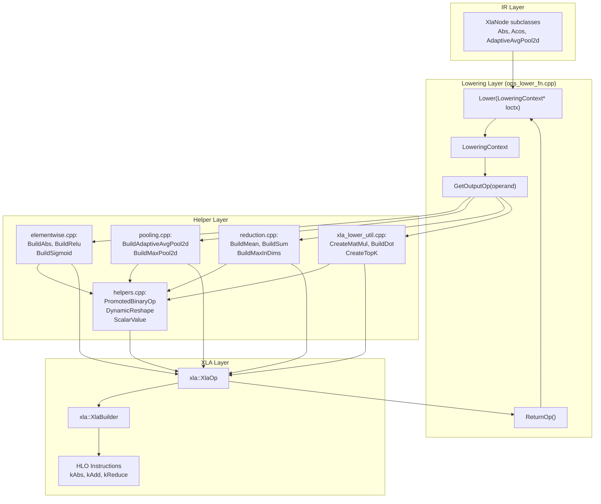
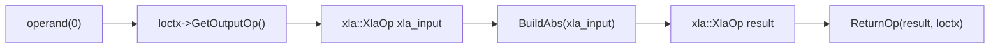
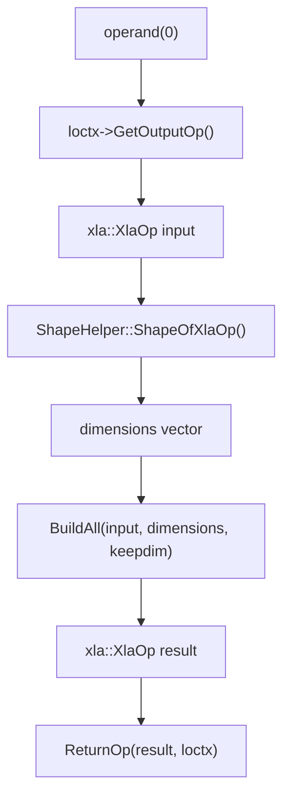
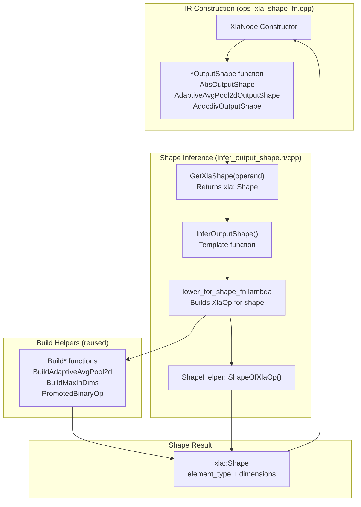
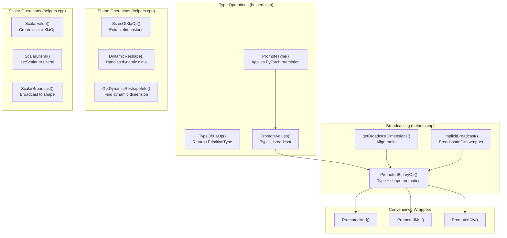
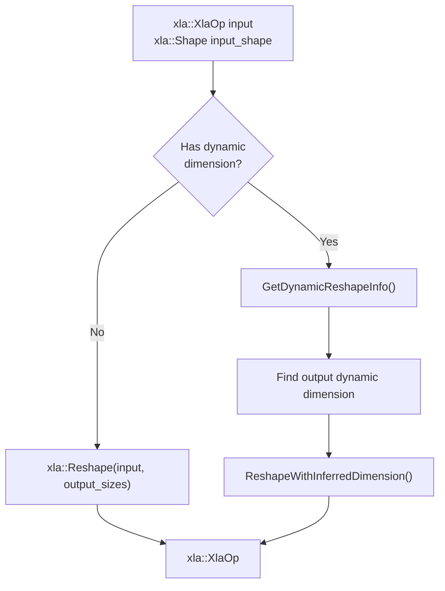
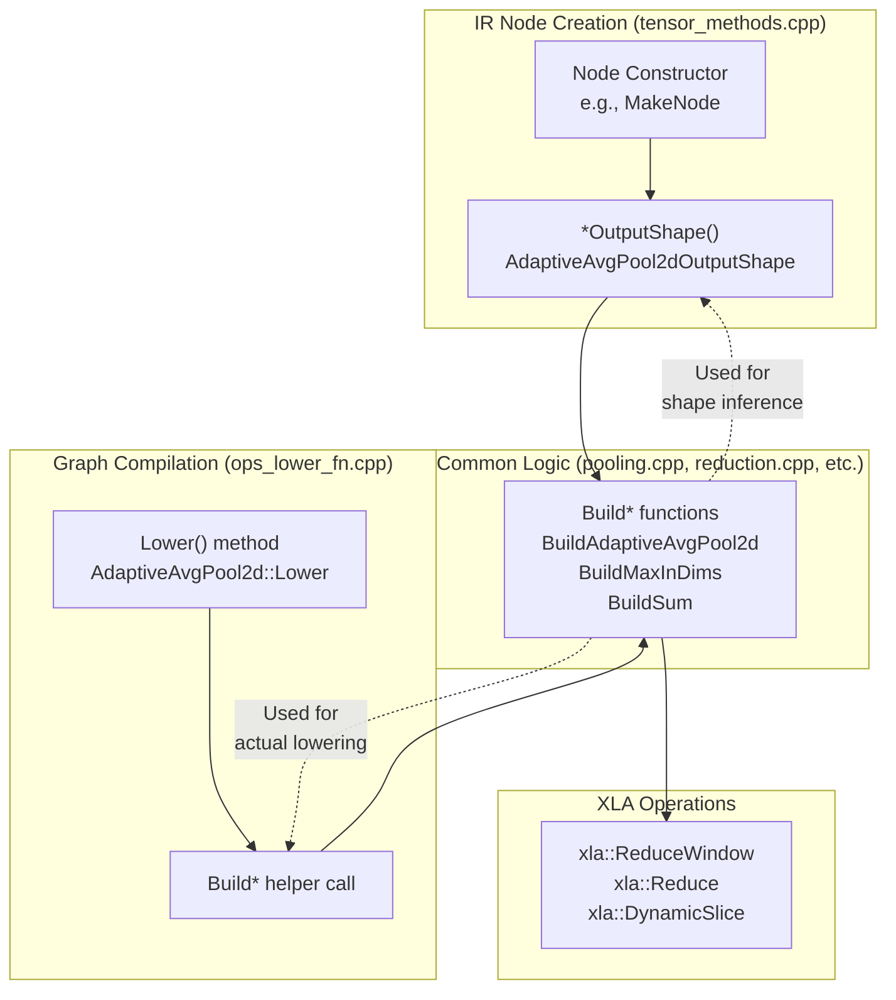

<!-- source: DeepWiki mcp.deepwiki.com · repo pytorch/xla · page 2.6 Operation Lowering and Shape Inference · fetched 2026-10-21 -->

# Operation Lowering and Shape Inference

<details>
<summary>Relevant source files</summary>

The following files were used as context for generating this wiki page:

- [codegen/xla_native_functions.yaml](codegen/xla_native_functions.yaml)
- [test/test_core_aten_ops.py](test/test_core_aten_ops.py)
- [test/test_operations.py](test/test_operations.py)
- [test/test_ops_error_message.py](test/test_ops_error_message.py)
- [torch_xla/csrc/aten_autograd_ops.cpp](torch_xla/csrc/aten_autograd_ops.cpp)
- [torch_xla/csrc/aten_xla_type.cpp](torch_xla/csrc/aten_xla_type.cpp)
- [torch_xla/csrc/init_python_bindings.cpp](torch_xla/csrc/init_python_bindings.cpp)
- [torch_xla/csrc/ops/ops.cpp](torch_xla/csrc/ops/ops.cpp)
- [torch_xla/csrc/ops/ops.h](torch_xla/csrc/ops/ops.h)
- [torch_xla/csrc/ops/ops_lower_fn.cpp](torch_xla/csrc/ops/ops_lower_fn.cpp)
- [torch_xla/csrc/ops/ops_xla_shape_fn.cpp](torch_xla/csrc/ops/ops_xla_shape_fn.cpp)
- [torch_xla/csrc/ops/ops_xla_shape_fn.h](torch_xla/csrc/ops/ops_xla_shape_fn.h)
- [torch_xla/csrc/tensor.cpp](torch_xla/csrc/tensor.cpp)
- [torch_xla/csrc/tensor.h](torch_xla/csrc/tensor.h)
- [torch_xla/csrc/tensor_methods.cpp](torch_xla/csrc/tensor_methods.cpp)
- [torch_xla/csrc/tensor_methods.h](torch_xla/csrc/tensor_methods.h)
- [torch_xla/csrc/xla_lower_util.cpp](torch_xla/csrc/xla_lower_util.cpp)
- [torch_xla/csrc/xla_lower_util.h](torch_xla/csrc/xla_lower_util.h)

</details>


This document describes the mechanism by which PyTorch/XLA converts intermediate representation (IR) nodes into XLA HLO operations (lowering) and determines the output shapes of operations without executing them (shape inference). These are core components of the compilation pipeline that transform PyTorch operations into executable XLA computations.

For information about the IR system and operation nodes, see [IR System and Operation Nodes](#2.5). For details on XLA execution and graph compilation, see [XLA Graph Executor](#2.3).

## Overview

Operation lowering and shape inference are closely coupled processes that transform PyTorch operations into XLA HLO:

- **Lowering**: Converts IR nodes to `xla::XlaOp` operations by implementing the `Lower()` method, which uses `LoweringContext` to retrieve input operations and build XLA HLO
- **Shape Inference**: Computes output shapes for operations by implementing `*OutputShape()` functions (e.g., `AbsOutputShape`, `AdaptiveAvgPool2dOutputShape`) that determine tensor dimensions without executing the operation

These processes support three code generation modes defined in [codegen/xla_native_functions.yaml:1-329]():
- `full_codegen`: Automatic generation of IR nodes and declarations; requires manual implementation of shape and lowering functions
- `ir_gen`: Generates IR node declarations only; requires manual `Lower()` and shape function implementation
- `supported`: Requires complete manual implementation of all components

Sources: [torch_xla/csrc/ops/ops_lower_fn.cpp:1-1000](), [torch_xla/csrc/ops/ops_xla_shape_fn.cpp:1-1000](), [codegen/xla_native_functions.yaml:1-329]()

## Lowering Process

### Lowering Architecture

**Diagram: Lowering Process from IR to HLO**



Sources: [torch_xla/csrc/ops/ops_lower_fn.cpp:1-1000](), [torch_xla/csrc/lowering_context.h](), [torch_xla/csrc/elementwise.h](), [torch_xla/csrc/pooling.h](), [torch_xla/csrc/reduction.h](), [torch_xla/csrc/xla_lower_util.h](), [torch_xla/csrc/helpers.h]()

### LoweringContext

`LoweringContext` provides the interface for retrieving input XLA operations during lowering:

| Method | Purpose |
|--------|---------|
| `GetOutputOp(operand)` | Retrieves the `xla::XlaOp` for a given IR operand |
| `builder()` | Returns the `xla::XlaBuilder` for creating new operations |

The context maintains the mapping from IR nodes to their corresponding XLA operations, allowing each node to access its dependencies during lowering.

Sources: [torch_xla/csrc/lowering_context.h]()

### Lower() Method Implementation

Each IR node implements `Lower()` to convert itself to XLA operations. The pattern follows:

1. Retrieve input `xla::XlaOp` operations from context
2. Call helper functions to build the XLA operation
3. Return the result using `ReturnOp()` or `ReturnOps()`

#### Simple Unary Operation Example



**Code Example**: [torch_xla/csrc/ops/ops_lower_fn.cpp:20-23]()
```cpp
torch_xla::XlaOpVector Abs::Lower(LoweringContext* loctx) const {
  xla::XlaOp xla_input = loctx->GetOutputOp(operand(0));
  return ReturnOp(BuildAbs(xla_input), loctx);
}
```

Sources: [torch_xla/csrc/ops/ops_lower_fn.cpp:20-23]()

#### Type Conversion in Lower()

Operations often need to handle type conversions when XLA and PyTorch have different type requirements:

**Code Example**: [torch_xla/csrc/ops/ops_lower_fn.cpp:25-31]()
```cpp
torch_xla::XlaOpVector Acos::Lower(LoweringContext* loctx) const {
  xla::XlaOp xla_input = loctx->GetOutputOp(operand(0));
  if (xla::primitive_util::IsIntegralType(XlaHelpers::TypeOfXlaOp(xla_input))) {
    xla_input = xla::ConvertElementType(xla_input, xla::PrimitiveType::F32);
  }
  return ReturnOp(xla::Acos(xla_input), loctx);
}
```

This pattern handles PyTorch's support for integer inputs to `torch.acos` while XLA requires floating-point types.

Sources: [torch_xla/csrc/ops/ops_lower_fn.cpp:25-31](), [torch_xla/csrc/ops/ops_lower_fn.cpp:162-170]()

#### Multi-Input Operations

Operations with multiple inputs retrieve each operand separately:

**Code Example**: [torch_xla/csrc/ops/ops_lower_fn.cpp:69-75]()
```cpp
torch_xla::XlaOpVector Addcdiv::Lower(LoweringContext* loctx) const {
  xla::XlaOp xla_input = loctx->GetOutputOp(operand(0));
  xla::XlaOp xla_t1 = loctx->GetOutputOp(operand(1));
  xla::XlaOp xla_t2 = loctx->GetOutputOp(operand(2));
  xla::XlaOp xla_val = loctx->GetOutputOp(operand(3));
  return ReturnOp(BuildAddcdiv(xla_input, xla_t1, xla_t2, xla_val), loctx);
}
```

Sources: [torch_xla/csrc/ops/ops_lower_fn.cpp:69-75]()

#### Operations with Reduction Dimensions



**Code Example**: [torch_xla/csrc/ops/ops_lower_fn.cpp:85-90]()
```cpp
torch_xla::XlaOpVector All::Lower(LoweringContext* loctx) const {
  xla::XlaOp input = loctx->GetOutputOp(operand(0));
  std::vector<int64_t> dimensions = torch::lazy::Iota<int64_t>(
      ShapeHelper::ShapeOfXlaOp(input).dimensions_size());
  return ReturnOp(BuildAll(input, dimensions, false), loctx);
}
```

Sources: [torch_xla/csrc/ops/ops_lower_fn.cpp:85-90](), [torch_xla/csrc/ops/ops_lower_fn.cpp:92-95]()

### Helper Functions for Lowering

Lower() methods delegate to helper functions that encapsulate common XLA operation patterns:

| Helper Category | File | Examples | Purpose |
|----------------|------|----------|---------|
| Elementwise | [elementwise.h/cpp]() | `BuildAbs`, `BuildSigmoid`, `BuildRelu`, `BuildPrelu` | Unary element-wise operations |
| Pooling | [pooling.h/cpp]() | `BuildAdaptiveAvgPool2d`, `BuildMaxPool2d`, `BuildAdaptiveAvgPool2dBackward` | Spatial pooling operations |
| Reduction | [reduction.h/cpp]() | `BuildAll`, `BuildMean`, `BuildSum`, `BuildMaxInDims`, `BuildArgMax` | Dimension reduction operations |
| Data Ops | [data_ops.h/cpp]() | `BuildMaskedFill`, `BuildExpand`, `BuildView`, `BuildSlice` | Data manipulation operations |
| XLA Lower Util | [xla_lower_util.h/cpp]() | `CreateMatMul`, `BuildDot`, `CreateTopK`, `CreateIndexAlongDim` | Advanced operations and indexing |
| Comparison | [ops/ops.cpp]() | `ComparisonOp` | Element-wise comparisons |

Sources: [torch_xla/csrc/elementwise.h](), [torch_xla/csrc/pooling.h](), [torch_xla/csrc/reduction.h](), [torch_xla/csrc/data_ops.h](), [torch_xla/csrc/xla_lower_util.h:1-150](), [torch_xla/csrc/ops/ops.cpp:44-150]()

## Shape Inference

### Shape Inference Architecture

**Diagram: Shape Inference Flow**



Sources: [torch_xla/csrc/ops/ops_xla_shape_fn.cpp:1-1000](), [torch_xla/csrc/ops/infer_output_shape.h](), [torch_xla/csrc/ops/infer_output_shape.cpp](), [torch_xla/csrc/shape_helper.h]()

### Shape Function Pattern

Shape functions compute output shapes by creating a lambda that performs shape inference. The `InferOutputShape` utility (defined in [torch_xla/csrc/ops/infer_output_shape.h]()) executes the lambda with placeholder operations to determine the output shape without full compilation.

**Code Example**: [torch_xla/csrc/ops/ops_xla_shape_fn.cpp:67-74]()
```cpp
xla::Shape AdaptiveAvgPool2dOutputShape(const torch::lazy::Value& input,
                                        absl::Span<const int64_t> output_size) {
  auto lower_for_shape_fn =
      [output_size](absl::Span<const xla::XlaOp> operands) -> xla::XlaOp {
    XLA_CHECK_EQ(operands.size(), 1);
    return BuildAdaptiveAvgPool2d(operands[0], output_size);
  };
  return InferOutputShape({GetXlaShape(input)}, lower_for_shape_fn);
}
```

The pattern:
1. Define a `lower_for_shape_fn` lambda that builds the operation
2. Pass input shapes using `GetXlaShape()`
3. `InferOutputShape` creates a temporary `xla::XlaBuilder`, builds placeholder operations, executes the lambda, and extracts the output shape
4. The same `Build*` helpers are used in both shape inference and actual lowering for consistency

Sources: [torch_xla/csrc/ops/ops_xla_shape_fn.cpp:67-74](), [torch_xla/csrc/ops/infer_output_shape.h]()

### Shape Inference Patterns

#### Direct Shape Return

For operations where the output shape equals the input shape:

**Code Example**: [torch_xla/csrc/ops/ops_xla_shape_fn.cpp:46-48]()
```cpp
xla::Shape AbsOutputShape(const torch::lazy::Value& input) {
  return GetXlaShape(input);
}
```

Sources: [torch_xla/csrc/ops/ops_xla_shape_fn.cpp:46-48]()

#### Type Promotion in Shape Functions

When operations change element types:

**Code Example**: [torch_xla/csrc/ops/ops_xla_shape_fn.cpp:50-56]()
```cpp
xla::Shape AcosOutputShape(const torch::lazy::Value& input) {
  xla::Shape result_shape = GetXlaShape(input);
  if (xla::primitive_util::IsIntegralType(result_shape.element_type())) {
    result_shape.set_element_type(xla::PrimitiveType::F32);
  }
  return result_shape;
}
```

Sources: [torch_xla/csrc/ops/ops_xla_shape_fn.cpp:50-56]()

#### Binary Operation Shape Inference

Binary operations must infer the broadcasted output shape:

**Code Example**: [torch_xla/csrc/ops/ops_xla_shape_fn.cpp:29-43]()
```cpp
xla::Shape InferBinaryOpShape(const torch::lazy::Value& first,
                              const torch::lazy::Value& second,
                              const torch_xla::XlaOpCombiner& bin_op) {
  auto lower_for_shape_fn =
      [&](absl::Span<const xla::XlaOp> operands) -> xla::XlaOp {
    return XlaHelpers::PromotedBinaryOp(operands[0], operands[1], bin_op);
  };

  std::vector<xla::Shape> shapes;
  for (auto& i : {first, second}) {
    shapes.push_back(GetXlaShape(i));
  }

  return InferOutputShape(shapes, lower_for_shape_fn);
}
```

Sources: [torch_xla/csrc/ops/ops_xla_shape_fn.cpp:29-43]()

### Shape Inference with Parameters

Operations with additional parameters incorporate them into shape computation:

**Code Example**: [torch_xla/csrc/ops/ops_xla_shape_fn.cpp:157-164]()
```cpp
xla::Shape AmaxOutputShape(const torch::lazy::Value& input,
                           absl::Span<const int64_t> dim, bool keepdim) {
  auto lower_for_shape_fn =
      [&](absl::Span<const xla::XlaOp> operands) -> xla::XlaOp {
    return BuildMaxInDims(operands[0], dim, keepdim);
  };
  return InferOutputShape({GetXlaShape(input)}, lower_for_shape_fn);
}
```

Sources: [torch_xla/csrc/ops/ops_xla_shape_fn.cpp:157-164]()

## Helper Utilities

### XlaHelpers Overview

The `XlaHelpers` class ([torch_xla/csrc/helpers.h:29-375]()) provides static utilities for common XLA operations:

**Diagram: XlaHelpers Utility Categories**



Sources: [torch_xla/csrc/helpers.h:29-375](), [torch_xla/csrc/helpers.cpp:1-800]()

### Type Promotion

`XlaHelpers::PromoteType` implements PyTorch's type promotion rules:

| Type Category | Priority (Highest to Lowest) |
|---------------|------------------------------|
| Complex | C128 > C64 |
| Floating Point | F64 > F32 > BF16 > F16 |
| Integral | Larger byte size wins; unsigned if same size |
| Boolean | PRED (lowest priority) |

**Code Example**: [torch_xla/csrc/helpers.cpp:477-522]()
```cpp
xla::PrimitiveType XlaHelpers::PromoteType(xla::PrimitiveType type1,
                                           xla::PrimitiveType type2) {
  if (type1 == type2) {
    return type1;
  }
  // Complex types take precedence
  if (xla::primitive_util::IsComplexType(type1)) {
    return (!xla::primitive_util::IsComplexType(type2) || size1 >= size2)
               ? type1
               : type2;
  }
  // Floating point types take precedence over integral
  if (xla::primitive_util::IsFloatingPointType(type1)) {
    return (!xla::primitive_util::IsFloatingPointType(type2) || size1 >= size2)
               ? type1
               : type2;
  }
  // ... (handles remaining cases)
}
```

Sources: [torch_xla/csrc/helpers.cpp:477-522]()

### Broadcasting Support

Broadcasting utilities handle dimension alignment for binary operations. The `XlaHelpers::PromotedBinaryOp` function combines type promotion and shape broadcasting:

**Code Example**: [torch_xla/csrc/helpers.h:336-368]()
```cpp
// Returns broadcast dimensions for operations between different ranks
static std::vector<int64_t> getBroadcastDimensions(xla::XlaOp op1,
                                                   xla::XlaOp op2);

// Performs binary operation with automatic type and shape promotion
static xla::XlaOp PromotedBinaryOp(
    xla::XlaOp op1, xla::XlaOp op2,
    const std::function<xla::XlaOp(xla::XlaOp, xla::XlaOp)>& bin_op);

// Convenience functions for common operations
static xla::XlaOp PromotedAdd(xla::XlaOp op1, xla::XlaOp op2);
static xla::XlaOp PromotedSub(xla::XlaOp op1, xla::XlaOp op2);
static xla::XlaOp PromotedMul(xla::XlaOp op1, xla::XlaOp op2);
static xla::XlaOp PromotedDiv(xla::XlaOp op1, xla::XlaOp op2);
```

The implementation:
1. Promotes both operands to a common type using `XlaHelpers::Promote`
2. Computes broadcast dimensions using `getBroadcastDimensions`
3. Applies the binary operation with the correct dimensions
4. Returns the result with the promoted type and broadcasted shape

Sources: [torch_xla/csrc/helpers.h:336-368](), [torch_xla/csrc/helpers.cpp:634-650]()

### Dynamic Reshaping

Dynamic reshape handles both static and dynamic dimensions:



**Code Example**: [torch_xla/csrc/helpers.cpp:336-353]()
```cpp
xla::XlaOp XlaHelpers::DynamicReshape(xla::XlaOp input,
                                      absl::Span<const int64_t> output_sizes) {
  const xla::Shape& input_shape = ShapeHelper::ShapeOfXlaOp(input);
  if (output_sizes == input_shape.dimensions()) {
    return input;
  }
  auto info = GetDynamicReshapeInfo(input_shape, output_sizes);
  if (info) {
    return xla::ReshapeWithInferredDimension(input, output_sizes,
                                             info->dynamic_dimension);
  }
  return xla::Reshape(input, output_sizes);
}
```

Sources: [torch_xla/csrc/helpers.cpp:336-353](), [torch_xla/csrc/helpers.cpp:290-325]()

### Reduction Helpers

Reduction operations are implemented in [torch_xla/csrc/reduction.cpp](). These helpers provide dimension reduction operations with support for keepdim behavior:

| Function | Purpose | Key Parameters |
|----------|---------|----------------|
| `BuildMean` | Average reduction across dimensions | `input`, `dimensions`, `keep_reduced_dimensions` |
| `BuildSum` | Sum reduction across dimensions | `input`, `dimensions`, `keep_reduced_dimensions` |
| `BuildMaxInDims` | Maximum value reduction | `input`, `dimensions`, `keepdim` |
| `BuildMinInDims` | Minimum value reduction | `input`, `dimensions`, `keepdim` |
| `BuildAll` | Logical AND reduction | `input`, `dimensions`, `keepdim` |
| `BuildAny` | Logical OR reduction | `input`, `dimensions`, `keepdim` |
| `BuildArgMax` | Index of maximum value | `input`, `dim`, `keepdim` |
| `BuildArgMin` | Index of minimum value | `input`, `dim`, `keepdim` |

**Example**: [torch_xla/csrc/reduction.cpp:308-313]()
```cpp
xla::XlaOp BuildMean(xla::XlaOp input, absl::Span<const int64_t> dimensions,
                     bool keep_reduced_dimensions) {
  return CreateSummation(input, dimensions, keep_reduced_dimensions,
                         /*scale=*/true)
      .result;
}
```

These functions internally use `xla::Reduce` with appropriate computation builders (e.g., `CreateScalarAddComputation` for sum/mean, `CreateScalarMaxComputation` for max).

Sources: [torch_xla/csrc/reduction.cpp:308-313](), [torch_xla/csrc/reduction.h:8-119]()

## Code Generation Patterns

### Full Codegen Operations

Operations in the `full_codegen` list get automatic generation of:
- IR node class declaration and implementation
- `Lower()` method declaration
- Shape function declaration
- Native function registration

**Configuration**: [codegen/xla_native_functions.yaml:11-106]()

Example operations: `acos`, `abs`, `all`, `addcdiv`, `ceil`, `cos`, `exp`, etc.

The developer must still implement:
- The shape function in [torch_xla/csrc/ops/ops_xla_shape_fn.cpp]()
- The lowering function in [torch_xla/csrc/ops/ops_lower_fn.cpp]()

Sources: [codegen/xla_native_functions.yaml:11-106]()

### IR Gen Operations

Operations in `ir_gen` only get IR node declarations generated. Developers must manually implement:
- Shape function
- `Lower()` method
- Any additional IR node methods

**Configuration**: [codegen/xla_native_functions.yaml:111-121]()

Example operations: `_adaptive_avg_pool2d`, `atan2`, `baddbmm`, `bitwise_and.Tensor`

Sources: [codegen/xla_native_functions.yaml:111-121]()

### Supported Operations

Operations in `supported` require complete manual implementation:
- Native function declaration and definition
- IR node class
- Shape function
- Lowering function

**Configuration**: [codegen/xla_native_functions.yaml:129-329]()

This mode is used for operations with complex lowering logic or special handling requirements.

Sources: [codegen/xla_native_functions.yaml:129-329]()

### Lowering and Shape Function Relationship

**Diagram: Shared Logic Between Shape Inference and Lowering**



Both shape inference and lowering use the same `Build*` helper functions to ensure consistency between inferred shapes and actual computation results. This design pattern:
1. Prevents shape mismatches between inference and execution
2. Reduces code duplication
3. Ensures that changes to operation logic are automatically reflected in both paths

**Example**: `BuildAdaptiveAvgPool2d` is called by both:
- `AdaptiveAvgPool2dOutputShape` (shape inference) in [torch_xla/csrc/ops/ops_xla_shape_fn.cpp:67-74]()
- `AdaptiveAvgPool2d::Lower` (actual lowering) in [torch_xla/csrc/ops/ops_lower_fn.cpp:42-44]()

Sources: [torch_xla/csrc/ops/ops_xla_shape_fn.cpp:67-74](), [torch_xla/csrc/ops/ops_lower_fn.cpp:42-44](), [torch_xla/csrc/pooling.cpp]()

## Testing Shape Inference

The test suite validates that operations produce correct shapes and values:

**Test Pattern**: [test/test_core_aten_ops.py:42-73]()
```python
def run_export_and_compare(testcase, func, args, kwargs, atol=1e-3, rtol=1e-5):
    # Run on CPU (PyTorch reference)
    res = func(*args, **kwargs)
    
    # Run on XLA device
    args2 = pytree.tree_map_only(torch.Tensor, lambda x: x.to(device=device), args)
    res_xla = func(*args2, **kwargs2)
    
    # Verify shapes match
    testcase.assertEqual(output1.shape, output2.shape)
    
    # Verify values match
    testcase.assertTrue(torch.allclose(output1, output2_cpu, atol=atol, rtol=rtol))
    
    # Test export to StableHLO
    exported = torch.export.export(NNModWrapper(func), args, kwargs)
    shlo = exported_program_to_stablehlo(exported)
    res2 = shlo(*args, **kwargs)
```

This ensures that:
1. XLA and PyTorch compute the same output shapes
2. XLA and PyTorch compute numerically equivalent results
3. Operations can be exported to StableHLO

Sources: [test/test_core_aten_ops.py:42-73](), [test/test_core_aten_ops.py:75-1157]()

---

