<!-- source: DeepWiki mcp.deepwiki.com · repo pytorch/xla · page 2.7 XLA Helpers and Utilities · fetched 2026-10-21 -->

# XLA Helpers and Utilities

<details>
<summary>Relevant source files</summary>

The following files were used as context for generating this wiki page:

- [torch_xla/csrc/data_ops.cpp](torch_xla/csrc/data_ops.cpp)
- [torch_xla/csrc/data_ops.h](torch_xla/csrc/data_ops.h)
- [torch_xla/csrc/helpers.cpp](torch_xla/csrc/helpers.cpp)
- [torch_xla/csrc/helpers.h](torch_xla/csrc/helpers.h)
- [torch_xla/csrc/ops/split.cpp](torch_xla/csrc/ops/split.cpp)
- [torch_xla/csrc/ops/split.h](torch_xla/csrc/ops/split.h)
- [torch_xla/csrc/reduction.cpp](torch_xla/csrc/reduction.cpp)
- [torch_xla/csrc/reduction.h](torch_xla/csrc/reduction.h)

</details>


## Purpose and Scope

This document covers the collection of C++ utility functions and classes that support XLA operation lowering in PyTorch/XLA. These utilities provide essential building blocks for converting PyTorch operations into XLA HLO (High-Level Operations), including type promotion, broadcasting, shape manipulation, reduction operations, data transformations, and random number generation.

For information about the operation lowering process that uses these helpers, see [Operation Lowering and Shape Inference](#2.6). For the IR node definitions that invoke these utilities, see [IR System and Operation Nodes](#2.5).

## System Architecture

The XLA helpers form a foundational layer that sits between the IR representation and the final XLA HLO generation. The following diagram illustrates the main components:

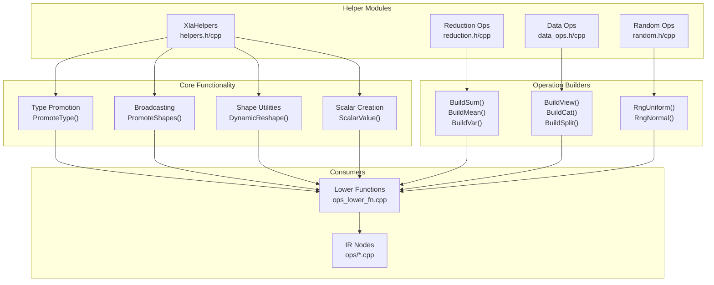

**Sources:** [torch_xla/csrc/helpers.h:1-411](), [torch_xla/csrc/reduction.h:1-121](), [torch_xla/csrc/data_ops.h:1-122](), [torch_xla/csrc/random.h:1-24]()

## XlaHelpers Class

The `XlaHelpers` class in [torch_xla/csrc/helpers.h]() provides static utility methods for common XLA operations. This class is the primary interface for type conversion, broadcasting, and shape manipulation during lowering.

### Key Data Structures

| Structure | Purpose | Location |
|-----------|---------|----------|
| `MinMax` | Stores minimum and maximum values for numeric types | [helpers.h:31-34]() |
| `DynamicSize` | Encapsulates dynamic dimension size with optional static value | [helpers.h:36-39]() |
| `DynamicReshapeInfo` | Contains output shape and dynamic dimension index for reshape operations | [helpers.h:41-44]() |

### Type Promotion System

The type promotion system follows PyTorch's rules to determine the result type of binary operations:

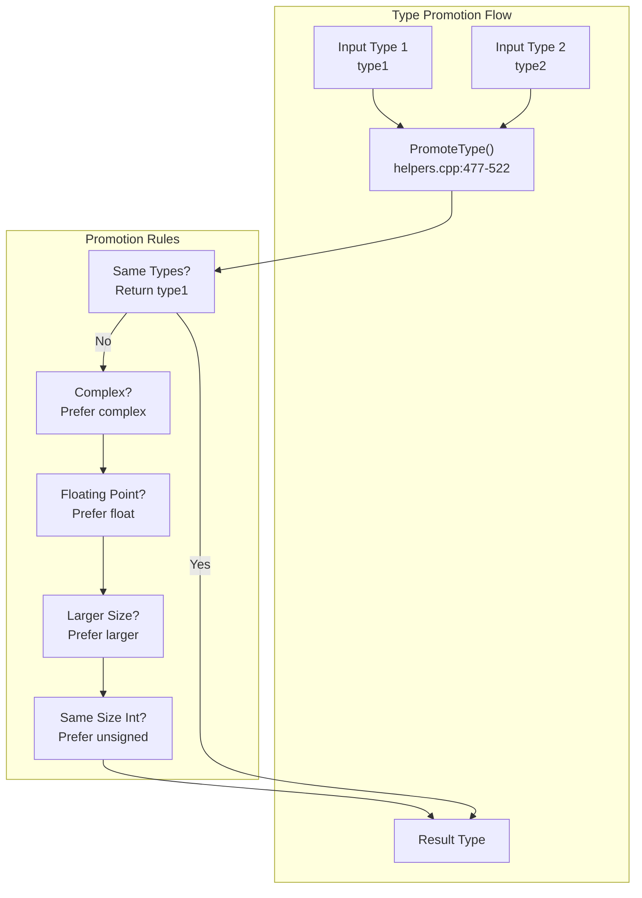

**Key Functions:**

- `PromoteType(type1, type2)` - Determines promoted type between two primitive types [helpers.cpp:477-522]()
- `PromoteValues(op1, op2)` - Converts operations to common type [helpers.cpp:530-542]()
- `PromoteShapes(op1, op2)` - Handles broadcasting for different shapes [helpers.cpp:777-791]()
- `Promote(op1, op2)` - Combines type and shape promotion [helpers.cpp:793-797]()

**Sources:** [torch_xla/csrc/helpers.cpp:477-803](), [torch_xla/csrc/helpers.h:268-303]()

### Broadcasting and Shape Manipulation

Broadcasting ensures that operations between tensors of different shapes follow NumPy/PyTorch semantics:

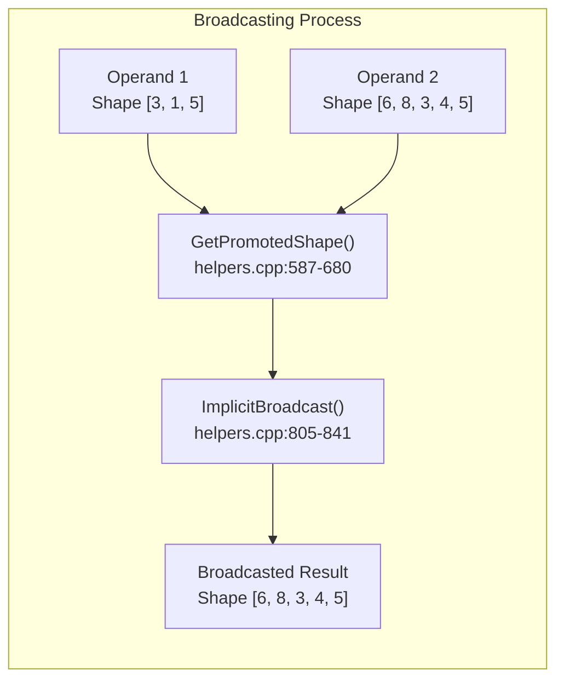

**Core Broadcasting Functions:**

| Function | Purpose | Location |
|----------|---------|----------|
| `GetPromotedShape()` | Computes broadcasted shape from two input shapes | [helpers.cpp:587-680]() |
| `GetPromotedBinaryOpShape()` | Combines type and shape promotion for binary ops | [helpers.cpp:699-714]() |
| `ImplicitBroadcast()` | Broadcasts operand to target shape | [helpers.cpp:805-841]() |
| `getBroadcastDimensions()` | Returns explicit broadcast dimension specifications | [helpers.cpp:682-697]() |

**Dynamic Shape Support:**

For tensors with dynamic dimensions, the system provides specialized handling:

- `GetPromotedDynamicShape()` - Handles bounded dynamic shapes [helpers.cpp:716-775]()
- `IsUnboundedDynamic()` - Checks for unbounded dynamic dimensions [helpers.cpp:368-376]()
- `DynamicUnboundedBroadcast()` - Broadcasts with unbounded dynamic shapes [helpers.cpp:896-958]()

**Sources:** [torch_xla/csrc/helpers.cpp:587-958](), [torch_xla/csrc/helpers.h:132-337]()

### Scalar and Constant Creation

Creating XLA constants and scalar values is fundamental to lowering operations:

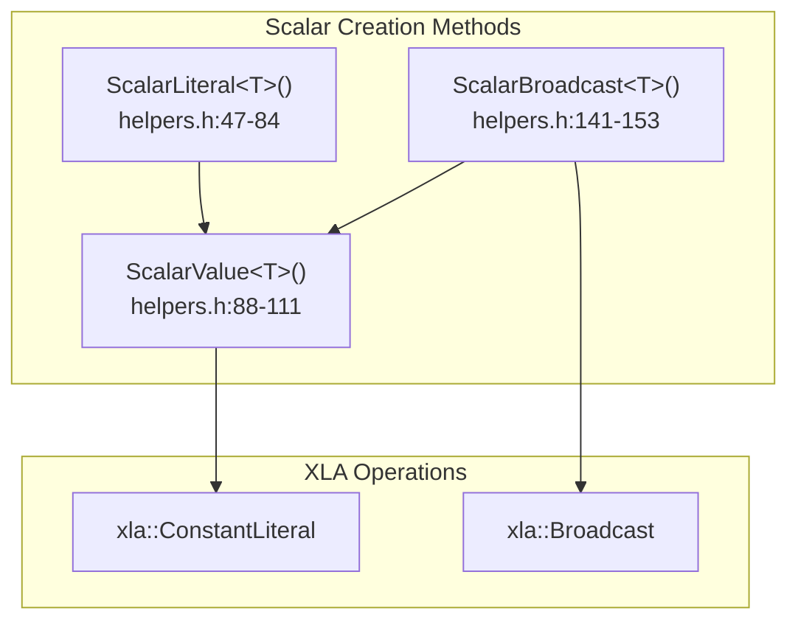

**Template Methods:**

```cpp
// Create scalar XlaOp from value
template <class T>
static xla::XlaOp ScalarValue(T scalar_value, xla::XlaBuilder* builder);

// Create scalar with specific type
template <class T>
static xla::XlaOp ScalarValue(T scalar_value, xla::PrimitiveType type,
                              xla::XlaBuilder* builder);

// Create broadcasted scalar
template <class T>
static xla::XlaOp ScalarBroadcast(T scalar_value, const xla::Shape& shape,
                                  xla::XlaBuilder* builder);
```

**Sources:** [torch_xla/csrc/helpers.h:47-153]()

### Shape Transformation Utilities

The helpers provide comprehensive shape manipulation capabilities:

| Function | Purpose | Location |
|----------|---------|----------|
| `SizesOfXlaOp()` | Extracts dimension sizes from XlaOp | [helpers.cpp:265-269]() |
| `ReshapeToRank()` | Reshapes to target rank by adding 1s | [helpers.cpp:275-288]() |
| `DynamicReshape()` | Handles reshape with dynamic dimensions | [helpers.cpp:336-353]() |
| `Flatten()` | Flattens tensor to 1D | [helpers.cpp:433-441]() |
| `FlattenDimRange()` | Flattens specific dimension range | [helpers.cpp:443-466]() |

**Dynamic Reshape Flow:**

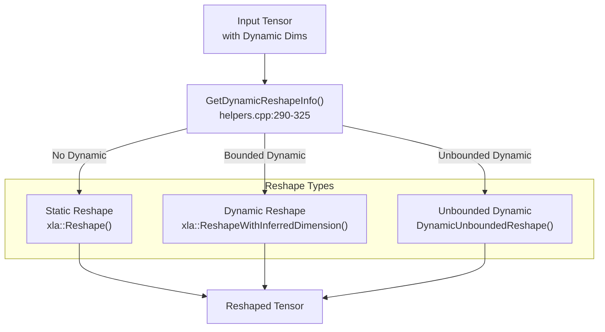

**Sources:** [torch_xla/csrc/helpers.cpp:265-466](), [torch_xla/csrc/helpers.h:118-249]()

### Computation Builders

XlaHelpers provides factory methods for creating XLA computations used in reductions:

| Computation | Purpose | Location |
|-------------|---------|----------|
| `CreateAddComputation()` | Binary addition (or OR for PRED) | [helpers.cpp:221-227]() |
| `CreateMulComputation()` | Binary multiplication | [helpers.cpp:229-233]() |
| `CreateMaxComputation()` | Binary maximum | [helpers.cpp:235-239]() |
| `CreateMinComputation()` | Binary minimum | [helpers.cpp:241-245]() |
| `CreateAndComputation()` | Binary AND | [helpers.cpp:247-251]() |
| `CreateOrComputation()` | Binary OR | [helpers.cpp:253-257]() |
| `CreateMaxAndArgMaxComputation()` | Max with index tracking | [helpers.cpp:259-263]() |

**Sources:** [torch_xla/csrc/helpers.cpp:221-263](), [torch_xla/csrc/helpers.h:220-235]()

### Promoted Binary Operations

Convenience methods for common binary operations with automatic promotion:

```cpp
// Promoted arithmetic operations
static xla::XlaOp PromotedAdd(xla::XlaOp op1, xla::XlaOp op2);
static xla::XlaOp PromotedSub(xla::XlaOp op1, xla::XlaOp op2);
static xla::XlaOp PromotedMul(xla::XlaOp op1, xla::XlaOp op2);
static xla::XlaOp PromotedDiv(xla::XlaOp op1, xla::XlaOp op2);
```

These methods automatically handle both type and shape promotion before performing the operation.

**Sources:** [torch_xla/csrc/helpers.h:346-368]()

## Reduction Operations

The reduction module ([torch_xla/csrc/reduction.cpp]()) provides building blocks for all reduction operations, including statistical computations and loss functions.

### Reduction Architecture

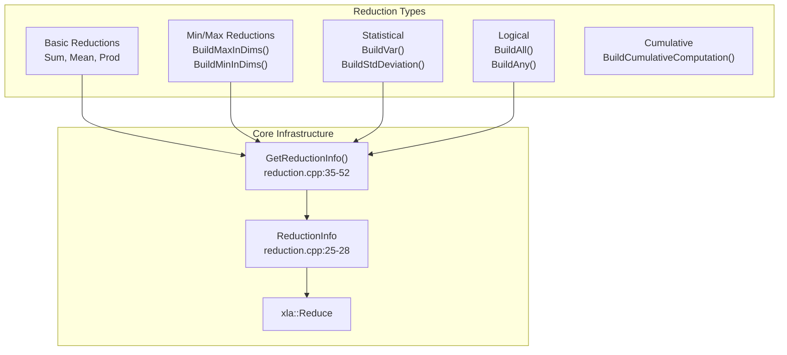

**Sources:** [torch_xla/csrc/reduction.cpp:1-622](), [torch_xla/csrc/reduction.h:1-121]()

### Basic Reductions

| Function | Description | Keep Dims Support | Location |
|----------|-------------|-------------------|----------|
| `BuildSum()` | Sum over dimensions | Yes | [reduction.cpp:366-371]() |
| `BuildMean()` | Mean over dimensions | Yes | [reduction.cpp:308-313]() |
| `BuildProd()` | Product over dimensions | Yes | [reduction.cpp:373-376]() |

**Implementation Pattern:**

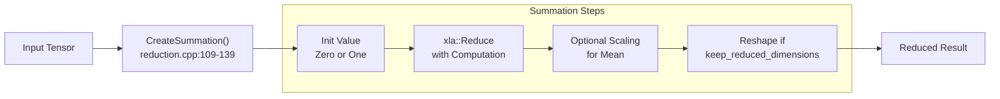

**Sources:** [torch_xla/csrc/reduction.cpp:109-376]()

### Min/Max Operations

The min/max operations support both single and multi-dimensional reductions:

```cpp
// Reduce along single dimension
xla::XlaOp BuildMaxInDim(xla::XlaOp input, int64_t dim, 
                         bool keep_reduced_dimensions);
xla::XlaOp BuildMinInDim(xla::XlaOp input, int64_t dim,
                         bool keep_reduced_dimensions);

// Reduce along multiple dimensions
xla::XlaOp BuildMaxInDims(xla::XlaOp input, 
                          absl::Span<const int64_t> dimensions,
                          bool keep_reduced_dimensions);
xla::XlaOp BuildMinInDims(xla::XlaOp input,
                          absl::Span<const int64_t> dimensions,
                          bool keep_reduced_dimensions);
```

**ArgMax/ArgMin:**

Index-tracking reductions that return the position of min/max values:

- `BuildArgMax()` - Returns indices of maximum values [reduction.cpp:442-470]()
- `BuildArgMin()` - Returns indices of minimum values [reduction.cpp:472-500]()

**Sources:** [torch_xla/csrc/reduction.cpp:378-500](), [torch_xla/csrc/reduction.h:50-77]()

### Statistical Operations

Statistical reductions for variance and standard deviation:

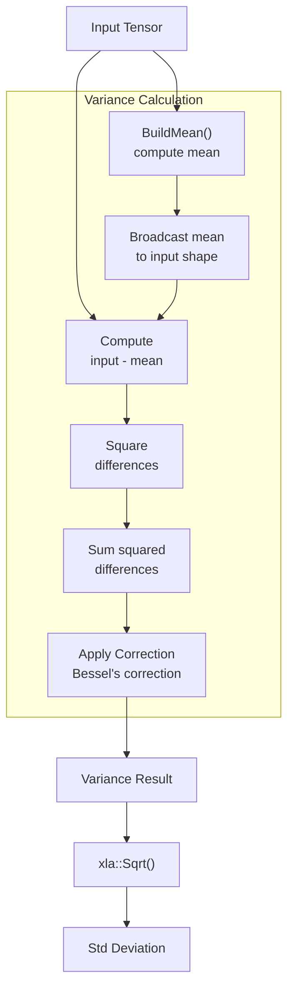

**Key Functions:**

- `BuildVar()` - Variance with Bessel's correction support [reduction.cpp:328-357]()
- `BuildStdDeviation()` - Standard deviation (sqrt of variance) [reduction.cpp:359-364]()

**Sources:** [torch_xla/csrc/reduction.cpp:328-364](), [torch_xla/csrc/reduction.h:37-39, 105-106]()

### Loss Functions

Pre-built loss function computations with forward and backward passes:

| Loss Function | Forward | Backward | Location |
|---------------|---------|----------|----------|
| Binary Cross Entropy | `BuildBinaryCrossEntropy()` | `BuildBinaryCrossEntropyBackward()` | [reduction.cpp:170-227]() |
| MSE Loss | `BuildMseLoss()` | `BuildMseLossBackward()` | [reduction.cpp:229-274]() |

**Reduction Modes:**

```cpp
enum class ReductionMode {
  kNone,   // No reduction
  kMean,   // Mean reduction
  kSum,    // Sum reduction
};
```

**Sources:** [torch_xla/csrc/reduction.cpp:158-274](), [torch_xla/csrc/reduction.h:9-29]()

### Cumulative Operations

Cumulative computations apply a reduction cumulatively along a dimension:

```cpp
// Basic cumulative operation
xla::XlaOp BuildCumulativeComputation(xla::XlaOp input, int64_t dim,
                                      const xla::XlaComputation& reducer,
                                      xla::XlaOp init);

// With index tracking
xla::XlaOp BuildCumulativeComputationWithIndices(
    xla::XlaOp value_input, xla::XlaOp index_input, int64_t dim,
    const xla::XlaComputation& reducer, xla::XlaOp value_init,
    xla::XlaOp index_init);
```

Implementation uses `xla::ReduceWindowWithGeneralPadding` with window size equal to dimension size and appropriate padding.

**Sources:** [torch_xla/csrc/reduction.cpp:276-306](), [torch_xla/csrc/reduction.h:86-97]()

### Logical Reductions

Boolean reduction operations:

- `BuildAll()` - Logical AND across dimensions [reduction.cpp:502-526]()
- `BuildAny()` - Logical OR across dimensions [reduction.cpp:528-552]()

Both support keeping reduced dimensions and handle type conversion to PRED or U8.

**Sources:** [torch_xla/csrc/reduction.cpp:502-552](), [torch_xla/csrc/reduction.h:99-103]()

### Special Reductions

**Logsumexp:**

Numerically stable log-sum-exp using the log-sum-exp trick:

```cpp
xla::XlaOp BuildLogsumexp(xla::XlaOp input,
                          absl::Span<const int64_t> dimensions,
                          bool keep_reduced_dimensions);
```

Implementation: `log(sum(exp(input - max))) + max` to avoid overflow.

**Einsum:**

Einstein summation notation support with forward and backward passes:

```cpp
xla::XlaOp BuildEinsum(absl::Span<const xla::XlaOp> operands,
                       const std::string& equation);

std::vector<xla::XlaOp> BuildEinsumBackward(const xla::XlaOp& grad_output,
                                            absl::Span<const xla::XlaOp> inputs,
                                            const std::string& equation);
```

**Sources:** [torch_xla/csrc/reduction.cpp:554-619](), [torch_xla/csrc/reduction.h:108-117]()

## Data Manipulation Utilities

The data operations module ([torch_xla/csrc/data_ops.cpp]()) provides utilities for tensor reshaping, slicing, concatenation, and other data movement operations.

### View and Reshape Operations

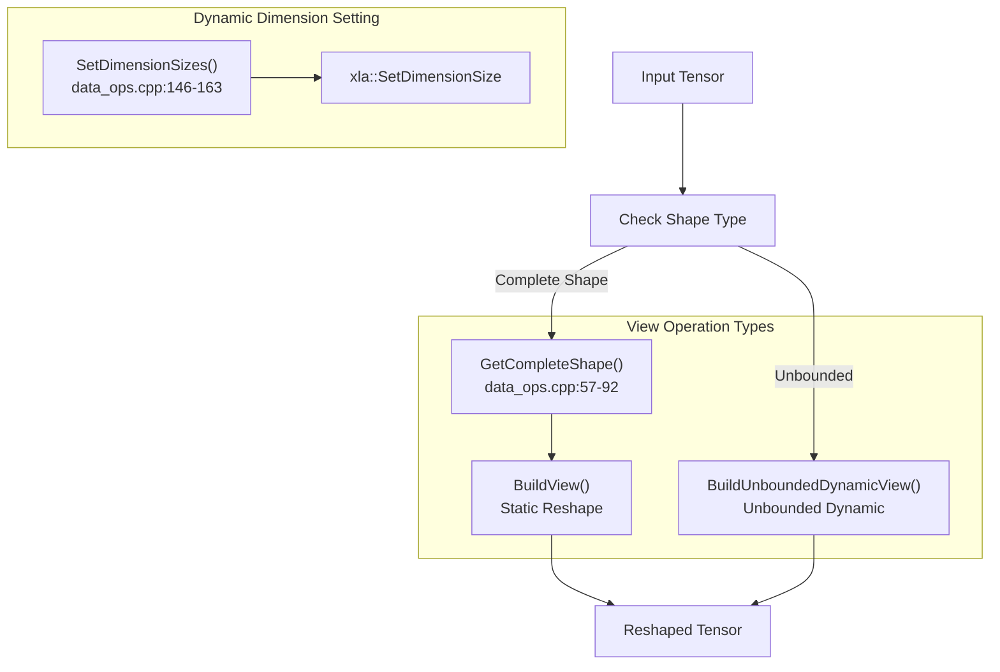

**Key Functions:**

| Function | Purpose | Location |
|----------|---------|----------|
| `BuildView()` | Standard reshape with inferred dimension support | [data_ops.cpp:94-99]() |
| `BuildUnboundedDynamicView()` | Reshape for unbounded dynamic tensors | [data_ops.cpp:101-144]() |
| `GetCompleteShape()` | Infers -1 dimension in output sizes | [data_ops.cpp:57-92]() |
| `SetDimensionSizes()` | Sets dynamic dimension sizes | [data_ops.cpp:146-163]() |

**Sources:** [torch_xla/csrc/data_ops.cpp:57-163](), [torch_xla/csrc/data_ops.h:18-37]()

### Dimension Manipulation

**Squeeze Operations:**

Remove dimensions of size 1:

```cpp
// Squeeze specific dimension
xla::XlaOp SqueezeTrivialDimension(xla::XlaOp input, int64_t dim);

// Squeeze all size-1 dimensions
xla::XlaOp SqueezeAllTrivialDimensions(xla::XlaOp input);

// Helper to compute squeezed dimensions
std::vector<int64_t> BuildSqueezedDimensions(
    absl::Span<const int64_t> dimensions, int64_t squeeze_dim);
```

**Unsqueeze Operations:**

Add dimensions of size 1:

```cpp
xla::XlaOp BuildUnsqueeze(xla::XlaOp input, int64_t dim);

std::vector<int64_t> BuildUnsqueezeDimensions(
    absl::Span<const int64_t> dimensions, int64_t dim);
```

**Sources:** [torch_xla/csrc/data_ops.cpp:165-259](), [torch_xla/csrc/data_ops.h:39-64]()

### Expand and Broadcast

Expand singleton dimensions to larger sizes:

```cpp
xla::XlaOp BuildExpand(xla::XlaOp input,
                       absl::Span<const int64_t> output_sizes);
```

Implementation adjusts input rank to match output rank, then broadcasts.

**Sources:** [torch_xla/csrc/data_ops.cpp:182-192](), [torch_xla/csrc/data_ops.h:48-49]()

### Concatenation and Stacking

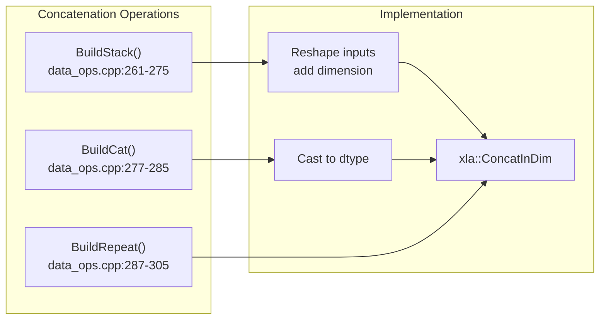

**Functions:**

| Function | Description | Location |
|----------|-------------|----------|
| `BuildStack()` | Concatenate along new dimension | [data_ops.cpp:261-275]() |
| `BuildCat()` | Concatenate along existing dimension with dtype | [data_ops.cpp:277-285]() |
| `BuildRepeat()` | Repeat tensor along dimensions | [data_ops.cpp:287-305]() |

**Sources:** [torch_xla/csrc/data_ops.cpp:261-305](), [torch_xla/csrc/data_ops.h:66-75]()

### Splitting Operations

Split tensor into multiple parts:

```cpp
// Split with specified sizes
std::vector<xla::XlaOp> BuildSplit(xla::XlaOp input,
                                   absl::Span<const int64_t> split_sizes,
                                   int64_t dim);

// Compute number of splits
size_t ComputeSplitCount(int64_t dim_size,
                         absl::Span<const int64_t> split_sizes);
```

Used by the `Split` IR node [torch_xla/csrc/ops/split.cpp:1-53]().

**Sources:** [torch_xla/csrc/data_ops.cpp:307-335](), [torch_xla/csrc/data_ops.h:77-85]()

### Slicing and Indexing

**Slice Operations:**

```cpp
xla::XlaOp BuildSlice(xla::XlaOp input, 
                      absl::Span<const int64_t> base_indices,
                      absl::Span<const int64_t> sizes);

xla::XlaOp BuildUpdateSlice(xla::XlaOp input, xla::XlaOp source,
                            absl::Span<const int64_t> base_indices);
```

**Specialized Indexing:**

- `BuildTake()` - Flatten and gather operation [data_ops.cpp:373-387]()
- `BoundIndices()` - Handle negative indices [data_ops.cpp:366-371]()
- `BuildUnselect()` - Inverse of select with padding [data_ops.cpp:409-448]()

**Sources:** [torch_xla/csrc/data_ops.cpp:337-448](), [torch_xla/csrc/data_ops.h:87-102]()

### Padding Operations

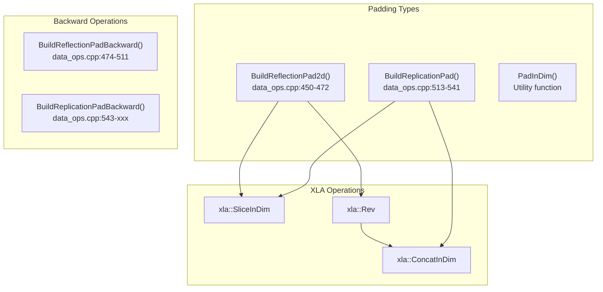

**Padding Functions:**

| Function | Description | Location |
|----------|-------------|----------|
| `BuildReflectionPad2d()` | Reflection padding | [data_ops.cpp:450-472]() |
| `BuildReflectionPadBackward()` | Gradient for reflection padding | [data_ops.cpp:474-511]() |
| `BuildReplicationPad()` | Edge replication padding | [data_ops.cpp:513-541]() |
| `BuildReplicationPadBackward()` | Gradient for replication padding | [data_ops.cpp:543-xxx]() |
| `PadInDim()` | Generic dimension padding utility | Referenced in backward ops |

**Sources:** [torch_xla/csrc/data_ops.cpp:450-xxx](), [torch_xla/csrc/data_ops.h:104-118]()

### Additional Data Operations

**Resize:**

Change total number of elements with zero-padding or truncation:

```cpp
xla::XlaOp BuildResize(xla::XlaOp input, absl::Span<const int64_t> size);
```

**Masked Fill:**

Fill tensor based on boolean mask:

```cpp
xla::XlaOp BuildMaskedFillScalar(xla::XlaOp input, xla::XlaOp mask,
                                 xla::XlaOp scalar);
```

**Sources:** [torch_xla/csrc/data_ops.cpp:389-407, 194-212](), [torch_xla/csrc/data_ops.h:51-52, 97-99]()

## Random Number Generation

The random module ([torch_xla/csrc/random.cpp]()) provides stateless random number generation using XLA's RNG infrastructure.

### RNG Architecture

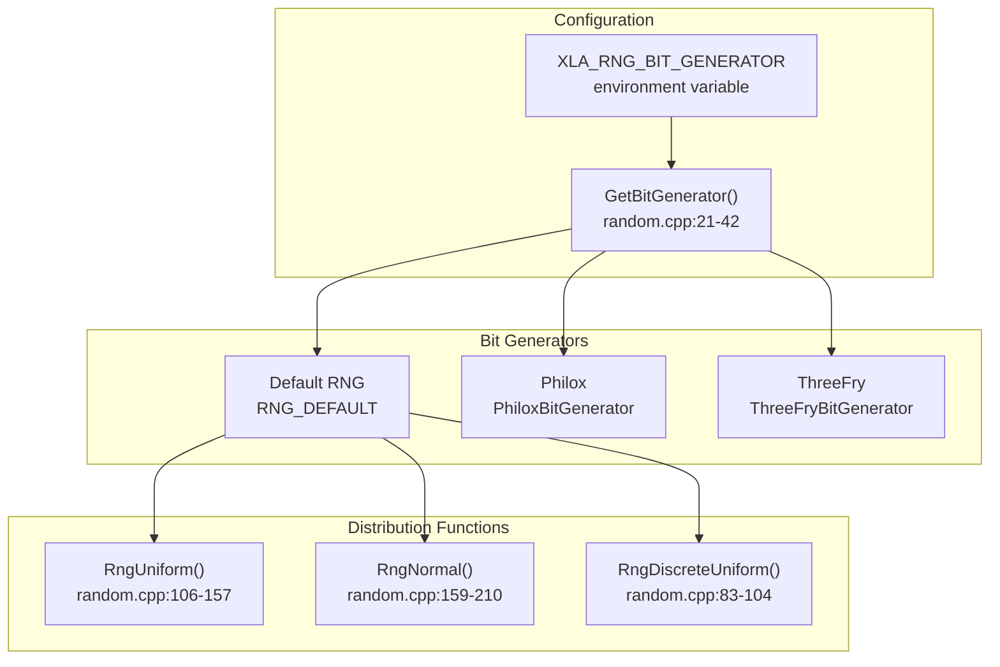

**Sources:** [torch_xla/csrc/random.cpp:1-213](), [torch_xla/csrc/random.h:1-24]()

### Bit Generator Selection

The bit generator is selected via the `XLA_RNG_BIT_GENERATOR` environment variable:

| Value | Generator | Implementation |
|-------|-----------|----------------|
| `default` | XLA Default RNG | `xla::RngBitGenerator` with `RNG_DEFAULT` |
| `philox` | Philox Algorithm | `xla::PhiloxBitGenerator` |
| `three_fry` | ThreeFry Algorithm | `xla::ThreeFryBitGenerator` |

**Sources:** [torch_xla/csrc/random.cpp:21-42]()

### Distribution Functions

**Uniform Distribution:**

```cpp
xla::XlaOp RngUniform(xla::XlaOp seed, const xla::Shape& shape,
                      xla::XlaOp minval, xla::XlaOp maxval, 
                      bool downcast = false);
```

Supports floating-point (F16, BF16, F32, F64), complex (C64, C128), and integer types (S32, U32, S64, U64). The `downcast` parameter controls precision for BF16/F16 generation.

**Normal Distribution:**

```cpp
xla::XlaOp RngNormal(xla::XlaOp seed, const xla::Shape& shape, 
                     xla::XlaOp mean, xla::XlaOp std);
```

Generates normally distributed random values. For complex types, generates independent real and imaginary components with adjusted variance.

**Discrete Uniform Distribution:**

```cpp
xla::XlaOp RngDiscreteUniform(xla::XlaOp seed, const xla::Shape& shape,
                              xla::XlaOp minval, xla::XlaOp maxval);
```

For integer types only.

**Sources:** [torch_xla/csrc/random.cpp:83-210](), [torch_xla/csrc/random.h:11-19]()

### Type Handling

Random generation includes helper functions for type compatibility:

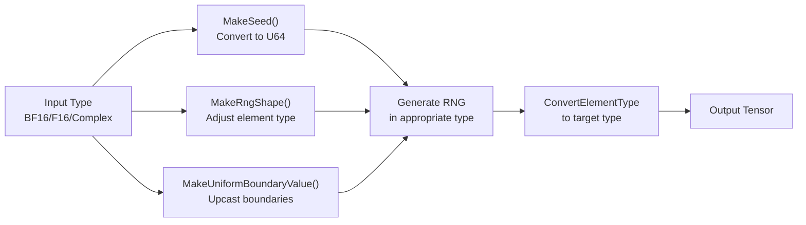

**Helper Functions:**

- `MakeSeed()` - Ensures seed is U64 [random.cpp:44-50]()
- `MakeRngShape()` - Adjusts shape for intermediate computation [random.cpp:65-79]()
- `MakeUniformBoundaryValue()` - Handles boundary value types [random.cpp:52-63]()

**Sources:** [torch_xla/csrc/random.cpp:44-79]()

## Usage Patterns

### Common Helper Usage in Lowering

The following diagram illustrates typical usage patterns when lowering operations:

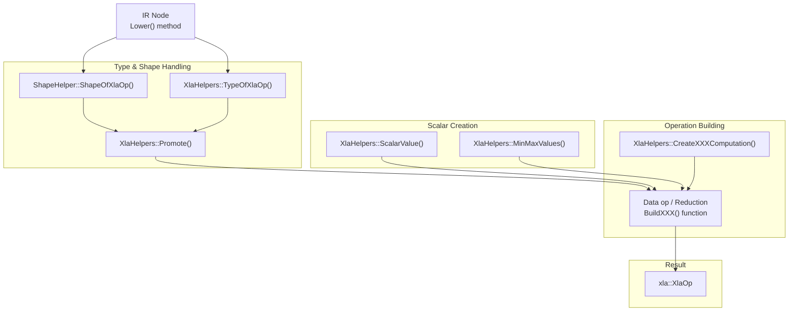

**Sources:** All helper modules

### Integration with Lowering Context

The helpers are primarily consumed by operation lowering functions and IR node `Lower()` methods. For example, the `Split` operation [torch_xla/csrc/ops/split.cpp:39-43]() uses `BuildSplit()` from data_ops:

```cpp
XlaOpVector Split::Lower(LoweringContext* loctx) const {
  xla::XlaOp input = loctx->GetOutputOp(operand(0));
  const auto outputs = BuildSplit(input, split_sizes_, dim_);
  return ReturnOps(outputs, loctx);
}
```

**Sources:** [torch_xla/csrc/ops/split.cpp:39-43]()

## Summary

The XLA Helpers and Utilities layer provides essential building blocks for operation lowering in PyTorch/XLA:

| Module | Primary Purpose | Key Classes/Functions |
|--------|----------------|----------------------|
| **helpers.cpp/h** | Type promotion, broadcasting, shape manipulation | `XlaHelpers` class with static methods |
| **reduction.cpp/h** | Reduction operations and loss functions | `BuildSum()`, `BuildMean()`, `BuildVar()`, etc. |
| **data_ops.cpp/h** | Data movement and transformation | `BuildView()`, `BuildCat()`, `BuildSplit()`, etc. |
| **random.cpp/h** | Random number generation | `RngUniform()`, `RngNormal()`, `RngDiscreteUniform()` |

These utilities handle the complexity of XLA type systems, dynamic shapes, and broadcasting semantics, allowing operation lowering code to focus on the semantic transformation from PyTorch operations to XLA HLO.

**Sources:** [torch_xla/csrc/helpers.h:1-411](), [torch_xla/csrc/reduction.h:1-121](), [torch_xla/csrc/data_ops.h:1-122](), [torch_xla/csrc/random.h:1-24]()

---

