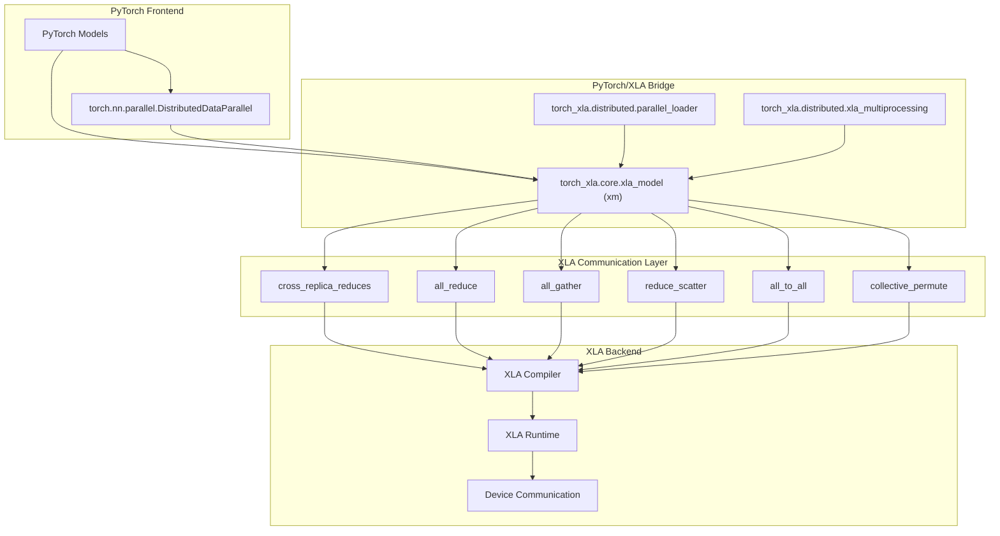
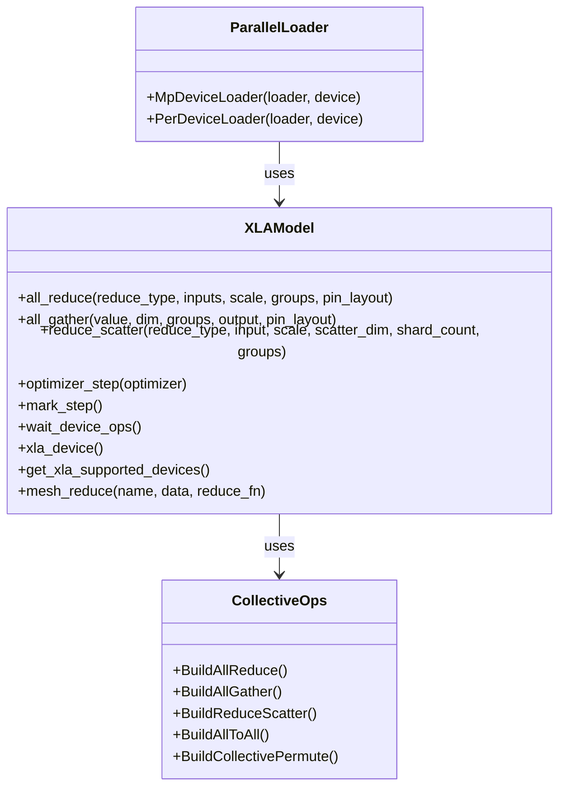
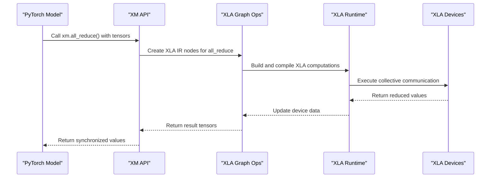
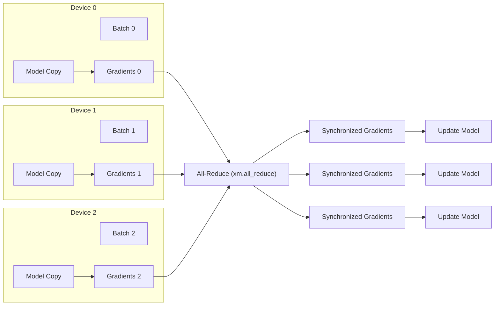

<!-- source: DeepWiki mcp.deepwiki.com · repo pytorch/xla · page 3 Distributed Training and SPMD · fetched 2026-10-21 -->

# Distributed Training

<details>
<summary>Relevant source files</summary>

The following files were used as context for generating this wiki page:

- [docs/source/index.rst](docs/source/index.rst)
- [test/cpp/test_xla_sharding.cpp](test/cpp/test_xla_sharding.cpp)
- [test/spmd/test_mp_input_sharding.py](test/spmd/test_mp_input_sharding.py)
- [test/spmd/test_xla_sharding.py](test/spmd/test_xla_sharding.py)
- [test/spmd/test_xla_sharding_base.py](test/spmd/test_xla_sharding_base.py)
- [torch_xla/_internal/jax_workarounds.py](torch_xla/_internal/jax_workarounds.py)
- [torch_xla/core/xla_model.py](torch_xla/core/xla_model.py)
- [torch_xla/csrc/ir_builder.h](torch_xla/csrc/ir_builder.h)
- [torch_xla/csrc/tensor_util.cpp](torch_xla/csrc/tensor_util.cpp)
- [torch_xla/csrc/tensor_util.h](torch_xla/csrc/tensor_util.h)
- [torch_xla/csrc/xla_backend_impl.cpp](torch_xla/csrc/xla_backend_impl.cpp)
- [torch_xla/csrc/xla_graph_executor.cpp](torch_xla/csrc/xla_graph_executor.cpp)
- [torch_xla/csrc/xla_graph_executor.h](torch_xla/csrc/xla_graph_executor.h)
- [torch_xla/csrc/xla_sharding_util.cpp](torch_xla/csrc/xla_sharding_util.cpp)
- [torch_xla/csrc/xla_sharding_util.h](torch_xla/csrc/xla_sharding_util.h)
- [torch_xla/distributed/data_parallel.py](torch_xla/distributed/data_parallel.py)
- [torch_xla/distributed/parallel_loader.py](torch_xla/distributed/parallel_loader.py)
- [torch_xla/distributed/spmd/__init__.py](torch_xla/distributed/spmd/__init__.py)
- [torch_xla/distributed/spmd/xla_sharding.py](torch_xla/distributed/spmd/xla_sharding.py)
- [torch_xla/distributed/xla_multiprocessing.py](torch_xla/distributed/xla_multiprocessing.py)
- [torch_xla/utils/utils.py](torch_xla/utils/utils.py)

</details>


This document describes the distributed training capabilities of PyTorch/XLA, focusing on how to efficiently train models across multiple accelerators (TPUs, GPUs) using XLA as the backend. PyTorch/XLA provides collective communication primitives that enable various distributed training strategies like data parallelism and model parallelism. For specific applications of these capabilities in SPMD sharding, see [SPMD Basic](#4.2) and [SPMD Advanced](#4.3).

## Architecture Overview

PyTorch/XLA implements distributed training through a layered architecture that connects PyTorch's frontend to XLA devices. The system provides collective communication operations that enable efficient data exchange between devices during training.



Sources:
- [torch_xla/core/xla_model.py:417-473](torch_xla/core/xla_model.py:417-473)
- [torch_xla/csrc/cross_replica_reduces.cpp:135-203](torch_xla/csrc/cross_replica_reduces.cpp:135-203)
- [torch_xla/csrc/init_python_bindings.cpp:298-321](torch_xla/csrc/init_python_bindings.cpp:298-321)

## Key Components

### XLA Model API (xm)

The core interface for distributed training in PyTorch/XLA is the `torch_xla.core.xla_model` module, commonly imported as `xm`. This module provides high-level functions for:

1. Accessing XLA devices
2. Performing collective operations 
3. Managing distributed training workflows
4. Synchronizing tensors and operations across devices



Sources:
- [torch_xla/core/xla_model.py:38-450](torch_xla/core/xla_model.py:38-450)
- [torch_xla/csrc/cross_replica_reduces.h:13-126](torch_xla/csrc/cross_replica_reduces.h:13-126)

### Communication Primitives

PyTorch/XLA provides several communication primitives for distributed training, all accessible through the `xm` module:

| Operation | Purpose | Main API | Implementation |
|-----------|---------|----------|---------------|
| **All-Reduce** | Aggregate values across devices | `xm.all_reduce(reduce_type, inputs, scale, groups)` | `torch_xla._XLAC._xla_all_reduce` |
| **All-Gather** | Collect data from all devices | `xm.all_gather(value, dim, groups, output)` | `torch_xla._XLAC._xla_all_gather` |
| **Reduce-Scatter** | Reduce then distribute data | `xm.reduce_scatter(reduce_type, input, scale, scatter_dim, shard_count)` | `torch_xla._XLAC._xla_reduce_scatter` |
| **All-to-All** | Exchange data between devices | `torch_xla._XLAC._xla_all_to_all` | - |
| **Collective Permute** | Point-to-point exchange | `torch_xla._XLAC._xla_collective_permute` | - |

PyTorch/XLA supports different reduction types:
- `xm.REDUCE_SUM`: Sum reduction
- `xm.REDUCE_MUL`: Multiplication reduction
- `xm.REDUCE_MIN`: Minimum reduction
- `xm.REDUCE_MAX`: Maximum reduction
- `xm.REDUCE_AND`: Logical AND reduction
- `xm.REDUCE_OR`: Logical OR reduction

Sources:
- [torch_xla/core/xla_model.py:29-35](torch_xla/core/xla_model.py:29-35)
- [torch_xla/core/xla_model.py:417-473](torch_xla/core/xla_model.py:417-473)
- [torch_xla/csrc/cross_replica_reduces.cpp:135-203](torch_xla/csrc/cross_replica_reduces.cpp:135-203)

## Communication Data Flow

The following diagram shows the data flow during a typical all-reduce operation in distributed training:



Sources:
- [torch_xla/csrc/cross_replica_reduces.cpp:298-357](torch_xla/csrc/cross_replica_reduces.cpp:298-357)
- [torch_xla/core/xla_model.py:417-473](torch_xla/core/xla_model.py:417-473)

## Core Concepts

### Replica Groups

Replica groups allow finer control over which devices participate in collective operations. By default, all devices form a single group, but you can create custom groupings for specialized communication patterns.

Example of creating replica groups:
```python
# Two groups: devices [0,1,2,3] and [4,5,6,7]
replica_groups = [[0, 1, 2, 3], [4, 5, 6, 7]]
result = xm.all_reduce(xm.REDUCE_SUM, tensor, groups=replica_groups)
```

For TPUs, PyTorch/XLA provides an optimized function for creating replica groups based on the physical topology:

```python
from torch_xla.distributed.xla_multiprocessing import create_optimized_replica_groups
replica_groups = create_optimized_replica_groups()
if replica_groups is not None:
    result = xm.all_reduce(xm.REDUCE_SUM, tensor, groups=replica_groups)
```

Sources:
- [torch_xla/distributed/xla_multiprocessing.py:186-196](torch_xla/distributed/xla_multiprocessing.py:186-196)
- [torch_xla/csrc/init_python_bindings.cpp:204-213](torch_xla/csrc/init_python_bindings.cpp:204-213)

### PIN_LAYOUT Parameter

The `pin_layout` parameter (default: `True`) helps prevent data corruption during communication:

- When `True`: Enforces consistent data layouts, preventing corruption when different processes have slightly different programs.
- When `False`: May enable certain XLA optimizations but could lead to compilation failures with error messages like "HloModule has a mix of layout constrained".

```python
# With layout pinning (safer)
result = xm.all_reduce(xm.REDUCE_SUM, tensor, pin_layout=True)

# Without layout pinning (may enable more optimizations but riskier)
result = xm.all_reduce(xm.REDUCE_SUM, tensor, pin_layout=False)
```

Sources:
- [torch_xla/core/xla_model.py:438-442](torch_xla/core/xla_model.py:438-442)
- [torch_xla/csrc/cross_replica_reduces.cpp:153-164](torch_xla/csrc/cross_replica_reduces.cpp:153-164)

## Distributed Training Patterns

PyTorch/XLA supports several distributed training approaches:

### Data Parallel Training

Data parallel training is the most common approach, where a model is replicated across multiple devices, and each replica processes a portion of the data:



The typical flow for data parallel training with PyTorch/XLA:

1. Distribute data across devices using `parallel_loader`
2. Forward pass on each device
3. Backward pass to compute gradients
4. Synchronize gradients with `xm.all_reduce` or `xm.optimizer_step`
5. Update model parameters
6. Use `xm.mark_step()` to trigger XLA computation execution

Sources:
- [test/test_train_mp_mnist.py:143-179](test/test_train_mp_mnist.py:143-179)
- [test/test_train_mp_imagenet.py:285-309](test/test_train_mp_imagenet.py:285-309)

### Using torch.nn.parallel.DistributedDataParallel (DDP)

PyTorch/XLA also supports PyTorch's native DDP for distributed training:

```python
import torch.distributed as dist
import torch_xla.distributed.xla_backend
from torch.nn.parallel import DistributedDataParallel as DDP

# Initialize process group
dist.init_process_group('xla', init_method='xla://')

# Create model and move to XLA device
device = xm.xla_device()
model = MyModel().to(device)

# Wrap with DDP
model = DDP(model, gradient_as_bucket_view=True)
```

Sources:
- [test/test_train_mp_mnist.py:78-141](test/test_train_mp_mnist.py:78-141)
- [test/test_train_mp_imagenet.py:178-179, 260-264](test/test_train_mp_imagenet.py:178-179, 260-264)

## Multi-Process Data Loading

For efficient distributed training, PyTorch/XLA provides data loading utilities that efficiently move data from CPU to XLA devices:

```python
import torch_xla.distributed.parallel_loader as pl

# Create device data loader
train_device_loader = pl.MpDeviceLoader(
    train_loader,
    device,
    loader_prefetch_size=8,
    device_prefetch_size=4
)

# Use in training loop
for data, target in train_device_loader:
    output = model(data)
    loss = loss_fn(output, target)
    loss.backward()
    xm.optimizer_step(optimizer)
```

Sources:
- [test/test_train_mp_mnist.py:181-186](test/test_train_mp_mnist.py:181-186)
- [test/test_train_mp_imagenet.py:328-339](test/test_train_mp_imagenet.py:328-339)

## XLA Multiprocessing

PyTorch/XLA provides multiprocessing utilities to launch distributed training jobs:

```python
import torch_xla

def _mp_fn(index, flags):
    # Your training function here
    device = xm.xla_device()
    # ...

if __name__ == '__main__':
    torch_xla.launch(_mp_fn, args=(FLAGS,))
```

Sources:
- [torch_xla/distributed/xla_multiprocessing.py:10-43](torch_xla/distributed/xla_multiprocessing.py:10-43)
- [test/test_train_mp_mnist.py:206-220](test/test_train_mp_mnist.py:206-220)

## Common Distributed Training Operations

### Example: Gradient Synchronization with All-Reduce

The most common use of distributed operations is gradient synchronization:

```python
# Manual gradient synchronization
for param in model.parameters():
    if param.grad is not None:
        param.grad = xm.all_reduce(xm.REDUCE_SUM, param.grad)

# Or use the built-in helper
xm.optimizer_step(optimizer)
```

### Example: Distributed Model Evaluation

For evaluation metrics, use `mesh_reduce` to aggregate metrics across devices:

```python
def test_loop_fn(test_loader):
    total_samples = 0
    correct = 0
    for data, target in test_loader:
        output = model(data)
        pred = output.max(1, keepdim=True)[1]
        correct += pred.eq(target.view_as(pred)).sum()
        total_samples += data.size()[0]
    
    # Aggregate accuracy metric across all devices
    accuracy = 100.0 * correct.item() / total_samples
    accuracy = xm.mesh_reduce('test_accuracy', accuracy, np.mean)
    return accuracy
```

Sources:
- [test/test_train_mp_mnist.py:167-179](test/test_train_mp_mnist.py:167-179)
- [test/test_train_mp_imagenet.py:311-326](test/test_train_mp_imagenet.py:311-326)

## Best Practices

1. **Mark Steps**: Use `xm.mark_step()` to indicate execution boundaries for XLA optimizations.

2. **Placement Optimization**: For TPUs, consider using optimized replica groups with `create_optimized_replica_groups()`.

3. **Tensor Movement**: Minimize data transfer between CPU and XLA devices.

4. **Synchronization**: Use `xm.optimizer_step()` instead of manual `all_reduce` operations when possible.

5. **Broadcast Parameters**: Ensure parameters are consistent across replicas with `xm.broadcast_master_param(model)`.

Sources:
- [test/test_train_mp_imagenet.py:258](test/test_train_mp_imagenet.py:258)
- [torch_xla/distributed/xla_multiprocessing.py:186-196](torch_xla/distributed/xla_multiprocessing.py:186-196)

## Implementation Details

PyTorch/XLA's distributed operations are implemented through a layered architecture:

1. Python API in `torch_xla.core.xla_model`
2. C++ bridging layer in `torch_xla.csrc.init_python_bindings`
3. XLA operations in `torch_xla.csrc.cross_replica_reduces`
4. XLA backend execution through the XLA runtime

All collective operations support different reduction types, custom replica groups, and layout pinning. Behind the scenes, these operations create XLA computation graphs that are executed on the target accelerator devices.

Sources:
- [torch_xla/csrc/ops/xla_ops.h:5-67](torch_xla/csrc/ops/xla_ops.h:5-67)
- [torch_xla/csrc/ops/xla_ops.cpp:5-43](torch_xla/csrc/ops/xla_ops.cpp:5-43)
- [torch_xla/csrc/cross_replica_reduces.cpp:22-125](torch_xla/csrc/cross_replica_reduces.cpp:22-125)

---

