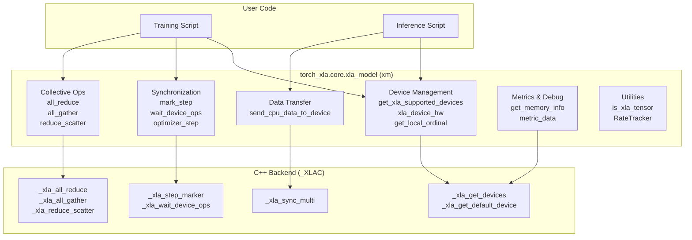
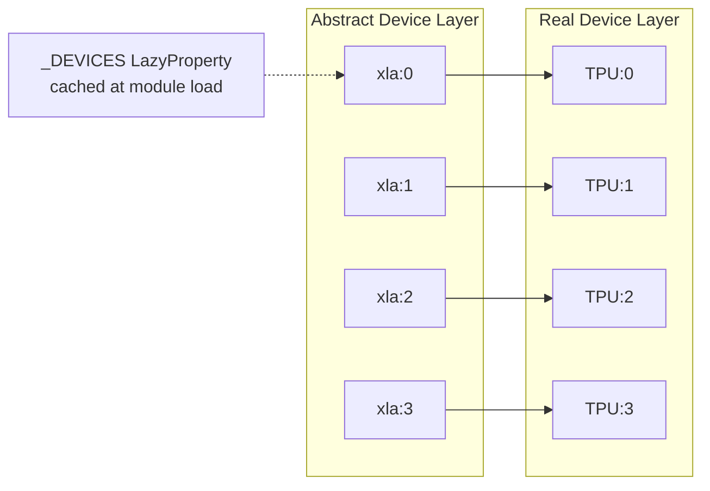
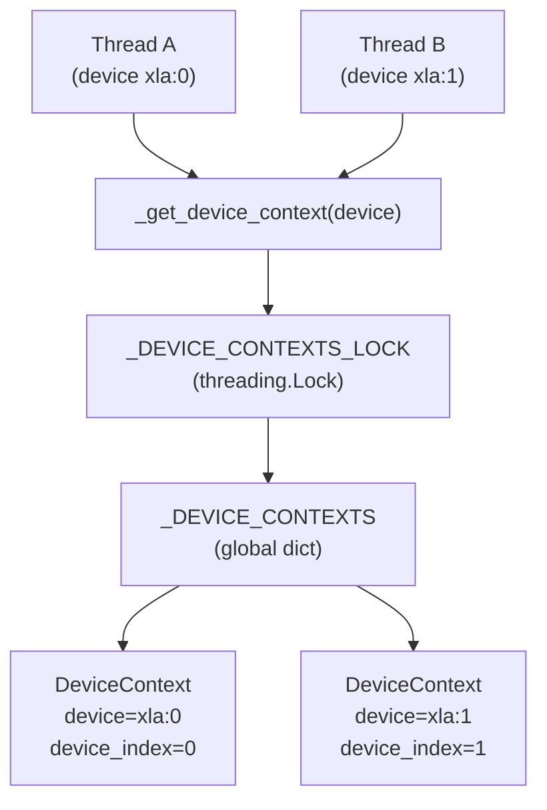
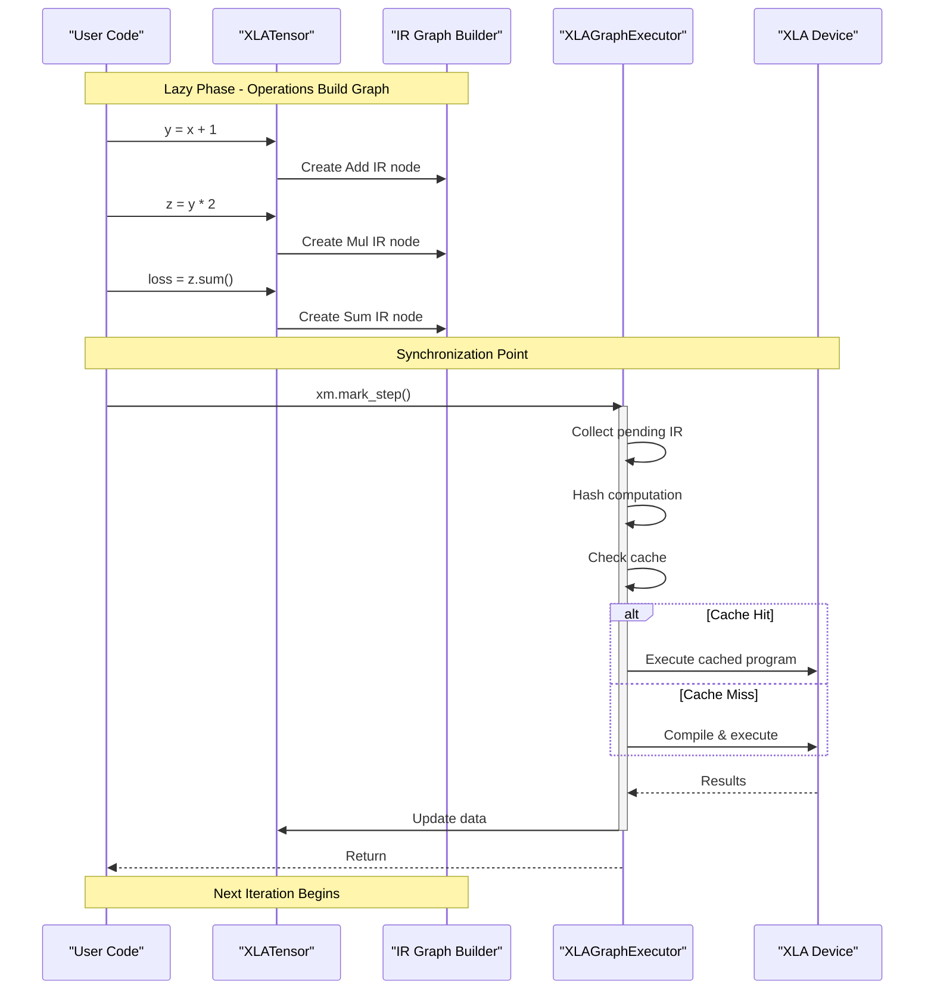
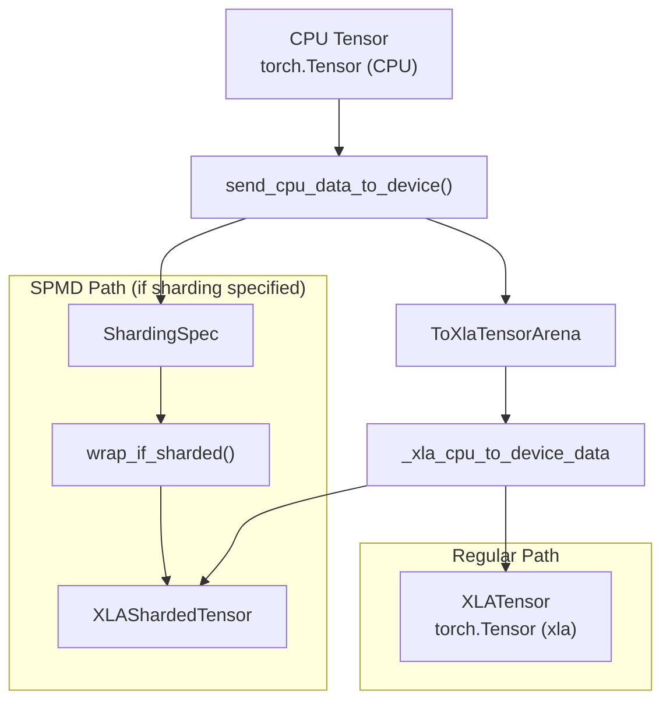
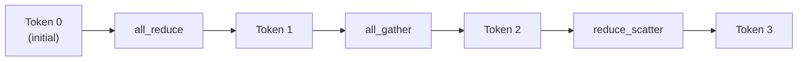
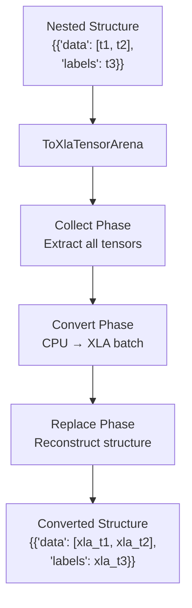
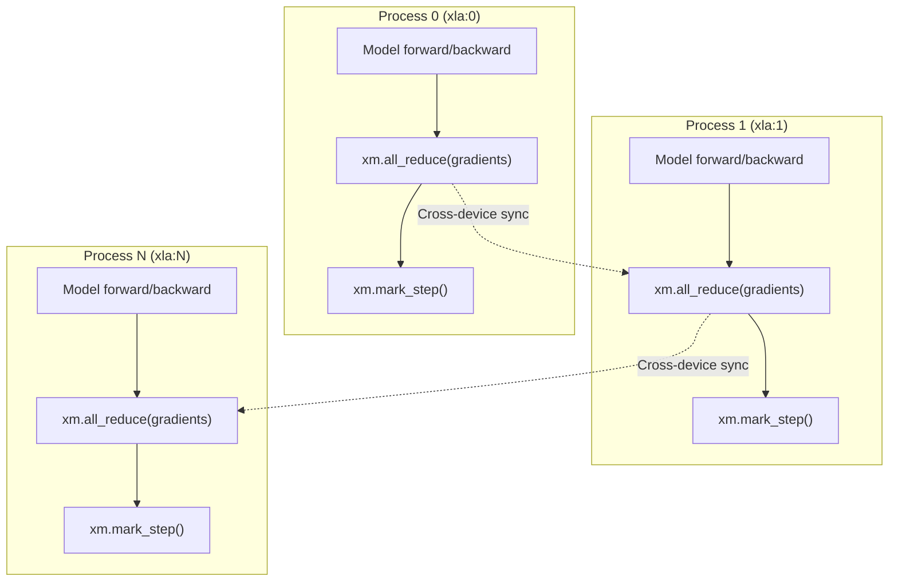

<!-- source: DeepWiki mcp.deepwiki.com · repo pytorch/xla · page 3.1 XLA Model Core API · fetched 2026-10-21 -->

# XLA Model Core API

<details>
<summary>Relevant source files</summary>

The following files were used as context for generating this wiki page:

- [docs/source/index.rst](docs/source/index.rst)
- [test/spmd/test_mp_input_sharding.py](test/spmd/test_mp_input_sharding.py)
- [torch_xla/core/xla_model.py](torch_xla/core/xla_model.py)
- [torch_xla/distributed/data_parallel.py](torch_xla/distributed/data_parallel.py)
- [torch_xla/distributed/parallel_loader.py](torch_xla/distributed/parallel_loader.py)
- [torch_xla/distributed/xla_multiprocessing.py](torch_xla/distributed/xla_multiprocessing.py)
- [torch_xla/utils/utils.py](torch_xla/utils/utils.py)

</details>


## Purpose and Scope

This page documents the `torch_xla.core.xla_model` module, the primary Python API for PyTorch/XLA. This module is conventionally imported as `xm` and provides:

- Device management and query functions
- Synchronization primitives (`mark_step`, `wait_device_ops`)
- Data transfer between CPU and XLA devices
- Collective communication operations
- Utilities for metrics, profiling, and debugging

For information about multi-process execution patterns, see [Multi-Process Execution](#3.2). For detailed documentation of collective operations, see [Collective Communication Operations](#3.3). For SPMD-specific APIs, see [SPMD Sharding System](#3.4).

---

## Module Overview

The `xla_model` module serves as the main entry point for interacting with XLA devices from Python code. It bridges PyTorch's eager execution model with XLA's graph-based lazy execution through a set of synchronization and device management primitives.

**Key Design Principles:**
- **Lazy execution management**: Functions like `mark_step()` control when lazy computations materialize
- **Device abstraction**: Abstract `xla:N` device indices map to real hardware (TPU, GPU, CPU)
- **Multi-device coordination**: Support for replication and collective operations across devices
- **Minimal API surface**: Core functions are designed to be composable and non-intrusive

### Module Structure



**Sources:** [torch_xla/core/xla_model.py:1-100]()

---

## Device Management

The device management functions provide an abstraction over XLA's device model, allowing code to query available devices, determine device properties, and manage device contexts.

### Device Query Functions

| Function | Purpose | Return Type |
|----------|---------|-------------|
| `get_xla_supported_devices(max_devices)` | Returns list of available XLA device strings | `List[str]` |
| `xla_real_devices(devices)` | Maps XLA device strings to real device names (e.g., 'TPU:0') | `List[str]` |
| `xla_device_hw(device)` | Returns hardware type ('TPU', 'GPU', 'CPU') | `str` |
| `xla_device_kind(device)` | Returns vendor-specific device kind identifier | `str` |
| `get_local_ordinal()` | Returns local device ordinal (0 to N-1) | `int` |
| `is_master_ordinal(local)` | Checks if current process is ordinal 0 | `bool` |

### Device Strings and Real Devices

PyTorch/XLA uses abstract device strings like `xla:0`, `xla:1` that map to actual hardware devices:



**Implementation Details:**

The device list is cached in a `LazyProperty` at module initialization:
- [torch_xla/core/xla_model.py:28]() - `_DEVICES = xu.LazyProperty(lambda: torch_xla._XLAC._xla_get_devices())`
- Devices are queried once from the C++ layer via `_XLAC._xla_get_devices()`
- The `_xla_real_device()` function parses device strings using regex to extract ordinals: [torch_xla/core/xla_model.py:140-145]()

### Device Context Management

Each device has an associated `DeviceContext` object stored in a thread-safe dictionary:



The `DeviceContext` class [torch_xla/core/xla_model.py:45-49]() is a simple container that stores device-specific state. The `_get_device_context()` function [torch_xla/core/xla_model.py:51-62]() lazily creates and caches these contexts.

### Ordinal and Master Functions

```python
# Get the local device ordinal (0 to N-1 where N is number of local devices)
local_ord = xm.get_local_ordinal()  # Calls runtime.local_ordinal()

# Check if this is the master process (ordinal 0)
if xm.is_master_ordinal(local=True):
    print("I am the local master")

if xm.is_master_ordinal(local=False):  
    print("I am the global master")  # Only true on host 0, device 0

# Convenience function to print only from master
xm.master_print("This only prints once", local=True)
```

**Sources:** [torch_xla/core/xla_model.py:69-223]()

---

## Synchronization and Execution

Synchronization functions control when PyTorch/XLA's lazy computation graph is executed. These are critical for performance and correctness in XLA programs.

### Synchronization Model



### Core Synchronization Functions

#### `mark_step()`

The most important synchronization primitive. Marks the end of a "step" and triggers compilation and execution of pending operations.

```python
def mark_step(wait: bool = False, reset_scope: bool = True)
```

- **`wait`**: If True, blocks until execution completes. If False, execution is asynchronous.
- **`reset_scope`**: If True, clears the step marker scope for SPMD debugging.

**Typical usage pattern:**
```python
for step, data in enumerate(train_loader):
    optimizer.zero_grad()
    output = model(data)
    loss = loss_fn(output, target)
    loss.backward()
    optimizer.step()
    xm.mark_step()  # Execute accumulated graph
```

**Implementation:** [torch_xla/core/xla_model.py:998-1049]()
- Calls `torch_xla._XLAC._xla_step_marker(device, [], wait=wait)`
- In SPMD mode, updates step scope for debugging
- Records metrics via `ms.save_completion_event()`

#### `wait_device_ops()`

Blocks until all outstanding operations on all devices complete. Unlike `mark_step()`, this doesn't insert a step boundary.

```python
def wait_device_ops(devices: List[torch.device] = [])
```

**Use cases:**
- Ensuring data is materialized before CPU access
- Synchronizing before timing measurements
- Debugging race conditions

**Implementation:** [torch_xla/core/xla_model.py:1051-1062]()
- Calls `torch_xla._XLAC._xla_wait_device_ops(devices=devices)`
- Typically used without arguments to wait on all devices

#### `optimizer_step()`

Optimized version of `optimizer.step()` that handles gradient synchronization and step marking efficiently.

```python
def optimizer_step(optimizer: torch.optim.Optimizer, 
                   barrier: bool = False,
                   optimizer_args: dict = {})
```

- **`barrier`**: If True, ensures all devices reach this point before stepping (via `xm.rendezvous`)
- **`optimizer_args`**: Dictionary of keyword arguments passed to `optimizer.step()`

**Typical usage:**
```python
loss.backward()
xm.optimizer_step(optimizer)  # Replaces optimizer.step() + xm.mark_step()
```

**Implementation:** [torch_xla/core/xla_model.py:1064-1095]()
- Reduces gradients across replicas if needed
- Calls `optimizer.step(**optimizer_args)`
- Calls `mark_step()`
- Optionally performs barrier synchronization

### Lazy Materialization with `unlazy()`

Forces immediate materialization of XLA tensors. This is primarily for benchmarking and should not be used in production code.

```python
xm.unlazy([tensor1, tensor2, tensor3])
```

**Implementation:** [torch_xla/core/xla_model.py:225-234]()
- Calls `torch_xla._XLAC._xla_sync_multi(tensors, devices=[], wait=True)`
- Blocks until all tensors are materialized on device

**Sources:** [torch_xla/core/xla_model.py:225-234](), [torch_xla/core/xla_model.py:998-1095]()

---

## Data Transfer

The `send_cpu_data_to_device()` function efficiently transfers CPU tensors to XLA devices, with optional SPMD sharding support.

### Function Signature

```python
def send_cpu_data_to_device(
    data: Any,
    device: Union[str, torch.device],
    sharding: Optional[ShardingSpec] = None
) -> Any
```

### Data Transfer Flow



### Implementation Details

The function handles nested data structures (lists, tuples, dicts) recursively using the `ToXlaTensorArena` class:

1. **Collection Phase**: [torch_xla/core/xla_model.py:1143-1168]()
   - Traverse input structure to find all CPU tensors
   - Collect tensors in a flat list

2. **Transfer Phase**: [torch_xla/core/xla_model.py:1170-1188]()
   - Call `torch_xla._XLAC._xla_cpu_to_device_data(cpu_tensors, device_str)`
   - If sharding specified, wrap result with `wrap_if_sharded()`

3. **Reconstruction Phase**: 
   - Replace CPU tensors in original structure with XLA tensors
   - Maintain original structure (list/tuple/dict/nested)

### SPMD Sharding Support

When `sharding` parameter is provided, tensors are sharded according to the specification:

```python
from torch_xla.distributed.spmd import Mesh, ShardingSpec

mesh = Mesh(device_ids, (world_size,), ('data',))
sharding = ShardingSpec(mesh, ('data', None))

xla_data = xm.send_cpu_data_to_device(
    cpu_data, 
    device='xla:0',
    sharding=sharding
)
# xla_data is now an XLAShardedTensor
```

### Usage in ParallelLoader

The `ParallelLoader` class uses `send_cpu_data_to_device()` to efficiently transfer batches from CPU DataLoader to XLA devices: [torch_xla/distributed/parallel_loader.py:186-225]()

```python
result = xm.send_cpu_data_to_device(batches, device, self._input_sharding)
```

**Sources:** [torch_xla/core/xla_model.py:1098-1196](), [torch_xla/distributed/parallel_loader.py:186-225]()

---

## Collective Communication Operations

The `xla_model` module provides collective communication primitives for distributed training. These operations enable efficient data exchange across multiple devices.

### Overview of Collective Operations

| Operation | Purpose | Input | Output |
|-----------|---------|-------|--------|
| `all_reduce` | Reduce values across all devices | Single tensor or list | Reduced value(s) |
| `all_gather` | Gather values from all devices | Single tensor or list | Concatenated values |
| `reduce_scatter` | Reduce then scatter chunks to devices | Single tensor or list | Scatter chunk |
| `all_to_all` | Transpose data across devices | Single tensor | Transposed tensor |
| `collective_permute` | Send to specific devices | Single tensor | Permuted tensor |
| `collective_broadcast` | Broadcast from root device | List of tensors | Broadcasted values |

### Reduction Types

The following reduction operations are supported [torch_xla/core/xla_model.py:30-35]():

```python
REDUCE_SUM = 'sum'
REDUCE_MUL = 'mul'
REDUCE_AND = 'and'
REDUCE_OR = 'or'
REDUCE_MIN = 'min'
REDUCE_MAX = 'max'
```

### Common Parameters

- **`groups`**: Optional replica groups for scoped operations. Example: `[[0,1,2,3], [4,5,6,7]]` defines two independent groups.
- **`pin_layout`**: Controls layout pinning to prevent data corruption in heterogeneous programs. Set to False if seeing "HloModule has a mix of layout constrained" errors.
- **`scale`**: Scaling factor applied after reduction (for `all_reduce`, `reduce_scatter`).

### All-Reduce Token Management

Collective operations are chained using an all-reduce token to maintain ordering:



The token is stored per device context and retrieved via `_get_all_reduce_token()` [torch_xla/core/xla_model.py:390-393]():

```python
def _get_all_reduce_token() -> Tuple[Any, DeviceContext]:
    devctx = _get_device_context()
    token = torch_xla._XLAC._get_all_reduce_token(devctx.device)
    return token, devctx
```

### Coalescing and Bucketization

For efficiency, multiple small tensors can be coalesced into larger operations:

- **`CoalescingBuckets`** class [torch_xla/core/xla_model.py:596-671](): Groups tensors into buckets based on size
- **`all_gather_bucketized()`** [torch_xla/core/xla_model.py:674-707](): Bucketized all-gather
- **`reduce_scatter_bucketized()`** [torch_xla/core/xla_model.py:928-967](): Bucketized reduce-scatter

**Example:**
```python
tensors = [torch.randn(100, 100, device=device) for _ in range(20)]
results = xm.all_gather_bucketized(
    tensors, 
    bucket_cap_mb=160  # Group into ~160MB buckets
)
```

For detailed information on collective operations, including usage examples and advanced patterns, see [Collective Communication Operations](#3.3).

**Sources:** [torch_xla/core/xla_model.py:396-967]()

---

## Utilities and Helpers

The module provides various utility functions and classes for common tasks in XLA programs.

### Tensor Type Checking

```python
def is_xla_tensor(tensor: torch.Tensor) -> bool:
    """Check if a tensor is on an XLA device."""
    return tensor.device.type == 'xla'
```

**Usage:**
```python
if xm.is_xla_tensor(my_tensor):
    print("Tensor is on XLA device")
```

**Sources:** [torch_xla/core/xla_model.py:65-66]()

### RateTracker Class

The `RateTracker` class provides smoothed rate calculation for metrics like samples/second:

```python
tracker = xm.RateTracker()
for step, batch in enumerate(dataloader):
    # ... training code ...
    tracker.add(batch_size)
    
    if step % 10 == 0:
        print(f"Samples/sec: {tracker.rate():.2f}")
        print(f"Global rate: {tracker.global_rate():.2f}")
```

**Implementation:** [torch_xla/core/xla_model.py:254-295]()
- Uses exponential smoothing with configurable `smooth_factor`
- Tracks both instantaneous rate (`rate()`) and global average (`global_rate()`)
- Smoothing factor can be set via environment variable `RATE_TRACKER_SMOOTHING`

### ToXlaTensorArena Class

Internal utility for batch-converting CPU tensors to XLA tensors while preserving structure:



**Sources:** [torch_xla/core/xla_model.py:298-342]()

### View Sharing Detection

The `check_view_sharing()` function detects tensors that share views, which can cause issues in distributed training:

```python
xm.check_view_sharing(model.parameters())
# Raises RuntimeError if any parameters share views
```

**Implementation:** [torch_xla/core/xla_model.py:345-376]()
- Tracks tensor IDs and view alias IDs
- Checks both XLA and regular PyTorch tensors
- Useful for debugging optimizer state corruption

### Rendezvous Function

```python
def rendezvous(tag: str, payload: bytes = b'', replicas: List[int] = []) -> bytes
```

Synchronizes all devices at a barrier and optionally exchanges data:

```python
# Simple barrier
xm.rendezvous('step_100')

# Exchange data
result = xm.rendezvous('checkpoint', payload=serialized_state)
```

**Implementation:** [torch_xla/core/xla_model.py:1295-1327]()
- All replicas must call with same tag
- Waits until all devices reach the rendezvous point
- Can exchange arbitrary byte payloads

**Sources:** [torch_xla/core/xla_model.py:65-66](), [torch_xla/core/xla_model.py:254-376](), [torch_xla/core/xla_model.py:1295-1327]()

---

## Metrics and Debugging

The module provides functions for collecting performance metrics and debugging XLA execution.

### Memory Information

```python
def get_memory_info(device: torch.device) -> Dict[str, int]:
    """Returns memory statistics for the device."""
    return {
        'bytes_used': ...,
        'bytes_limit': ...,
    }
```

**Usage:**
```python
device = torch_xla.device()
mem_info = xm.get_memory_info(device)
print(f"Memory used: {mem_info['bytes_used'] / 1e9:.2f} GB")
print(f"Memory limit: {mem_info['bytes_limit'] / 1e9:.2f} GB")
```

**Implementation:** [torch_xla/core/xla_model.py:1205-1232]()

### Execution Metrics

The `metric_data()` function retrieves execution metrics from the C++ layer:

```python
metrics = xm.metric_data()
print(metrics)  # Dictionary of metric name -> value
```

Available metrics include:
- Compilation time
- Execution time  
- Transfer time
- Cache hit/miss ratios
- Graph size statistics

**Implementation:** [torch_xla/core/xla_model.py:1336-1352]()

### IR Inspection

```python
def get_stacks(tensors: List[torch.Tensor]) -> Dict[int, List[str]]:
    """Returns Python stack traces for tensor creation sites."""
```

Useful for debugging where tensors were created in complex programs.

**Implementation:** [torch_xla/core/xla_model.py:1234-1239]()

### Metrics Reporting

```python
def metrics_report() -> str:
    """Returns a formatted string of current metrics."""
```

Provides a human-readable summary of execution metrics.

**Implementation:** [torch_xla/core/xla_model.py:1354-1359]()

### Debugging Utilities

| Function | Purpose |
|----------|---------|
| `get_stacks(tensors)` | Get creation stack traces for tensors |
| `metrics_report()` | Print formatted metrics report |
| `short_device_type(device)` | Get short device type string ('TPU', 'GPU', 'CPU') |

### Example: Performance Monitoring

```python
import torch_xla.core.xla_model as xm

device = torch_xla.device()
rate_tracker = xm.RateTracker()

for step, batch in enumerate(train_loader):
    # Training step
    output = model(batch)
    loss = loss_fn(output)
    loss.backward()
    xm.optimizer_step(optimizer)
    
    rate_tracker.add(batch_size)
    
    if step % 100 == 0:
        # Print metrics
        print(f"Step {step}")
        print(f"Throughput: {rate_tracker.rate():.2f} samples/sec")
        mem = xm.get_memory_info(device)
        print(f"Memory: {mem['bytes_used']/1e9:.2f} GB")
        
        if step % 1000 == 0:
            print(xm.metrics_report())
```

**Sources:** [torch_xla/core/xla_model.py:1205-1359]()

---

## Integration with Distributed Training

The `xla_model` functions integrate with PyTorch/XLA's distributed training infrastructure.

### Multi-Process Training Pattern



### Typical Training Loop

```python
import torch_xla.core.xla_model as xm
from torch_xla.distributed.parallel_loader import MpDeviceLoader

def train_loop():
    device = torch_xla.device()
    model = MyModel().to(device)
    optimizer = torch.optim.Adam(model.parameters())
    
    # Wrap dataloader for efficient host-to-device transfer
    train_loader = MpDeviceLoader(raw_loader, device)
    
    for epoch in range(num_epochs):
        for step, batch in enumerate(train_loader):
            # Data already on XLA device from MpDeviceLoader
            output = model(batch['data'])
            loss = loss_fn(output, batch['labels'])
            
            loss.backward()
            xm.optimizer_step(optimizer)  # Includes all_reduce + mark_step
            
            if step % 10 == 0 and xm.is_master_ordinal():
                print(f"Loss: {loss.item()}")
```

### Device Context in Multi-Process

Each process manages its own device context:
- `get_local_ordinal()` returns 0 to N-1 for N local devices
- `runtime.global_ordinal()` returns global ordinal across all hosts
- Device contexts stored per-device in `_DEVICE_CONTEXTS` dict

**Sources:** [torch_xla/core/xla_model.py:37-62](), [torch_xla/core/xla_model.py:237-251]()

---

## Advanced Topics

### Optimized Replica Groups

For certain TPU topologies, PyTorch/XLA can create optimized replica group orderings:

```python
from torch_xla.distributed.xla_multiprocessing import create_optimized_replica_groups

groups = create_optimized_replica_groups()
if groups:
    # Use optimized ordering for collectives
    xm.all_reduce(xm.REDUCE_SUM, tensor, groups=groups)
```

**Implementation:** [torch_xla/distributed/xla_multiprocessing.py:186-196]()
- Automatically detects TPU type (v5p, v6e)
- Returns optimized orderings for specific topologies
- Falls back to default ordering if no optimization available

### Custom Collectives with Functional API

PyTorch/XLA supports torch.distributed functional collectives for compatibility with torch.compile:

```python
# Only for scale=1.0, groups=[], pin_layout=True
result = torch.ops._c10d_functional.all_reduce(tensor, 'sum', '')
```

This path is automatically chosen when conditions are met [torch_xla/core/xla_model.py:441-444]().

### Send/Recv Operations

Point-to-point communication for pipeline parallelism:

```python
# Sender process
xm.send(tensor, channel_id=42)

# Receiver process  
result = xm.recv(output_tensor, channel_id=42)
```

**Implementation:** [torch_xla/core/xla_model.py:804-833]()

**Sources:** [torch_xla/core/xla_model.py:396-453](), [torch_xla/core/xla_model.py:804-833](), [torch_xla/distributed/xla_multiprocessing.py:186-196]()

---

