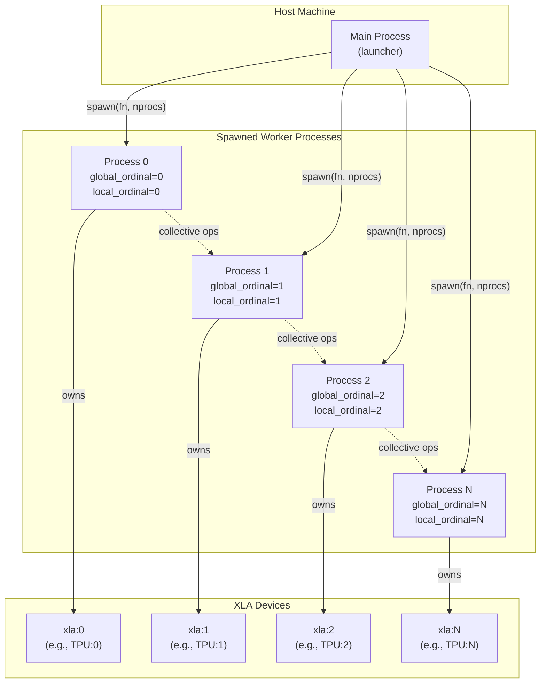
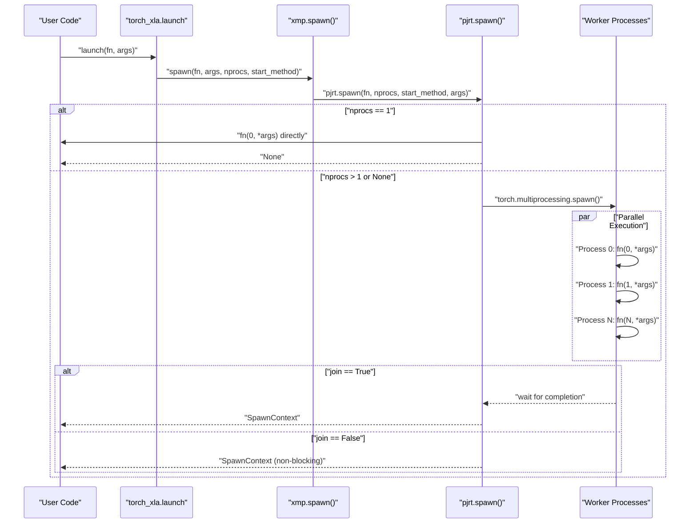
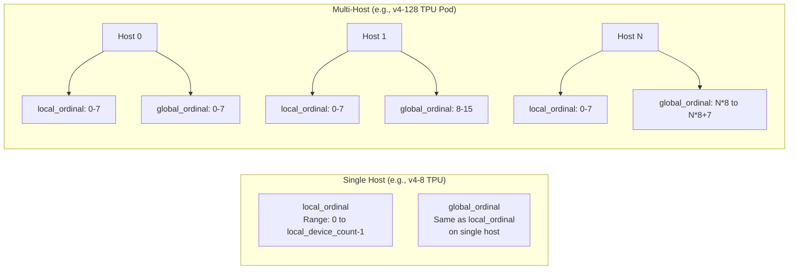
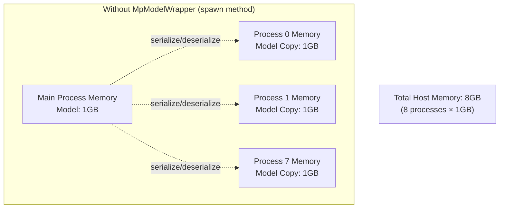
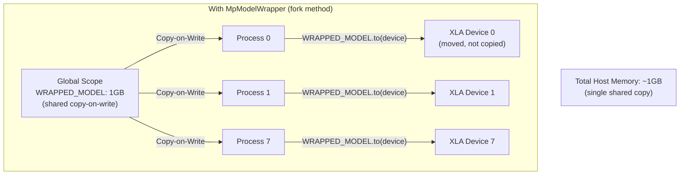
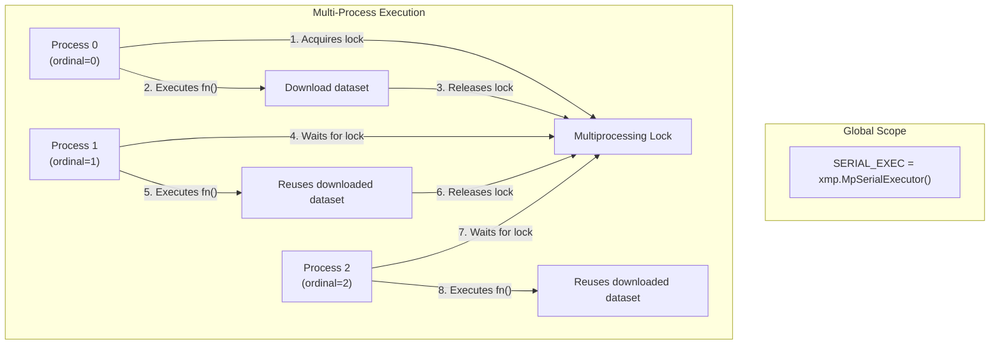
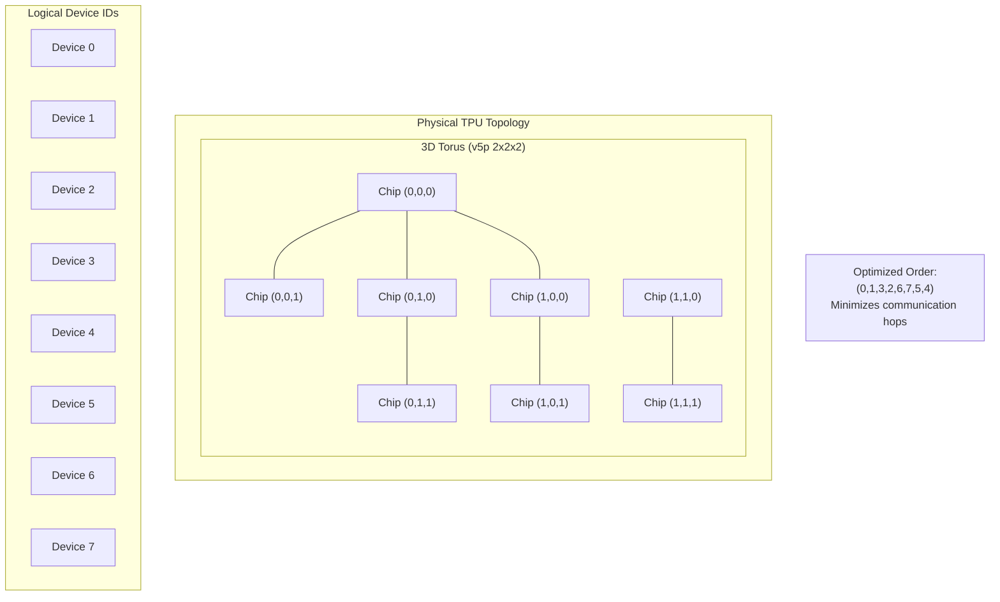
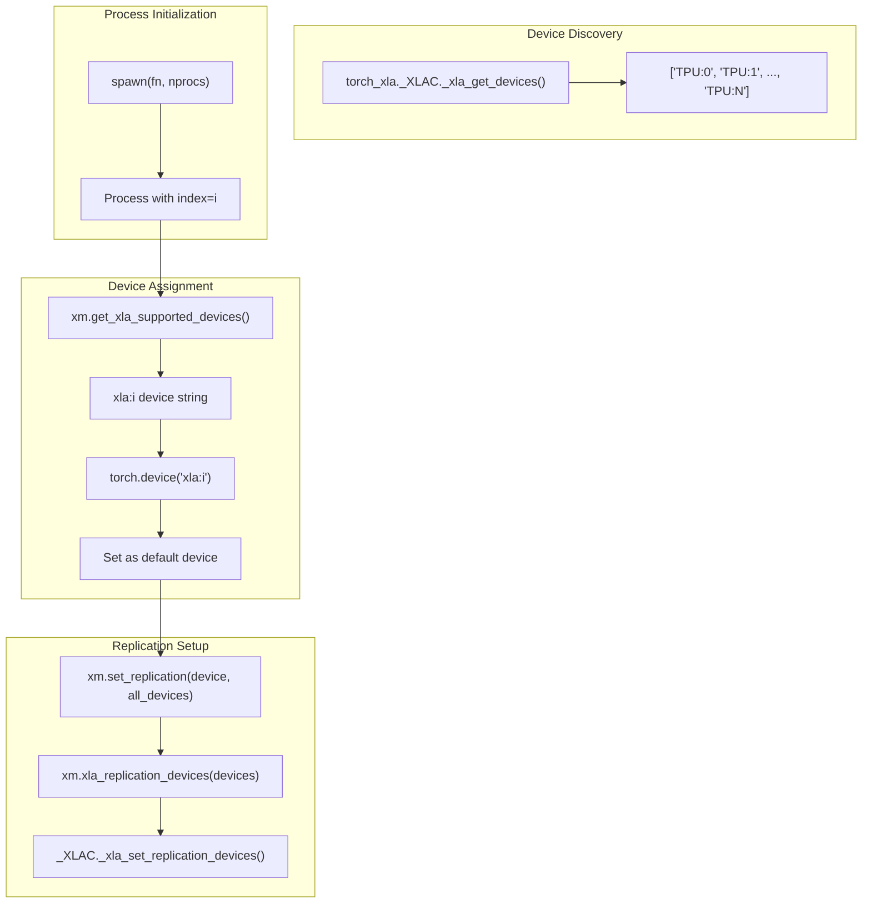
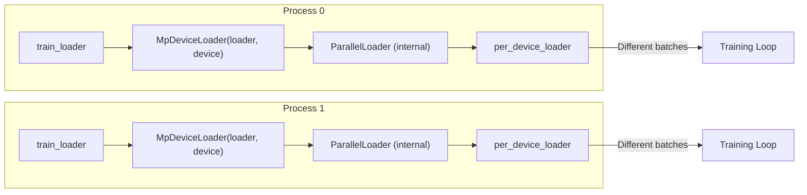
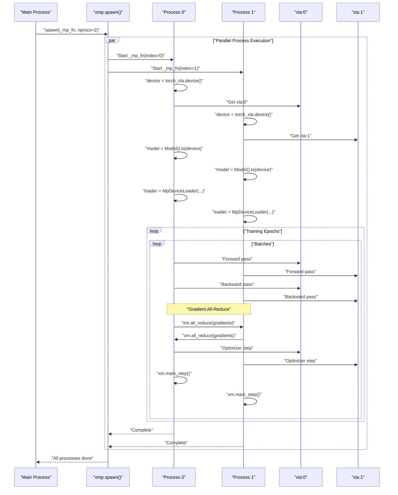

<!-- source: DeepWiki mcp.deepwiki.com · repo pytorch/xla · page 3.2 Multi-Process Execution · fetched 2026-10-21 -->

# Multi-Process Execution

<details>
<summary>Relevant source files</summary>

The following files were used as context for generating this wiki page:

- [docs/source/index.rst](docs/source/index.rst)
- [test/spmd/test_mp_input_sharding.py](test/spmd/test_mp_input_sharding.py)
- [torch_xla/core/xla_model.py](torch_xla/core/xla_model.py)
- [torch_xla/distributed/data_parallel.py](torch_xla/distributed/data_parallel.py)
- [torch_xla/distributed/parallel_loader.py](torch_xla/distributed/parallel_loader.py)
- [torch_xla/distributed/xla_multiprocessing.py](torch_xla/distributed/xla_multiprocessing.py)
- [torch_xla/utils/utils.py](torch_xla/utils/utils.py)

</details>


## Purpose and Scope

This page documents PyTorch/XLA's multi-process execution system for distributed training across multiple XLA devices. The system enables data-parallel training by spawning separate Python processes, with each process owning one or more XLA devices. This approach is the primary method for scaling training workloads across multiple TPU cores, GPU devices, or other XLA-supported accelerators.

For information about collective communication operations used within multi-process training, see [Collective Communication Operations](#3.3). For SPMD-based model parallelism that can be combined with multi-process execution, see [SPMD Sharding System](#3.4). For efficient data loading in multi-process scenarios, see [Distributed Data Loading](#3.5).

**Sources:** [torch_xla/distributed/xla_multiprocessing.py:1-197]()

---

## Multi-Process Architecture Overview

The multi-process execution model in PyTorch/XLA follows a Single Program, Multiple Data (SPMD) pattern where each process executes the same training code but operates on different data and a different XLA device.

### Process-to-Device Mapping



**Sources:** [torch_xla/distributed/xla_multiprocessing.py:10-44](), [torch_xla/core/xla_model.py:86-110]()

---

## The spawn() Function

The `spawn()` function is the primary entry point for multi-process execution. It is typically accessed via the `torch_xla.launch` API, which internally delegates to `xla_multiprocessing.spawn()`.

### Function Signature and Parameters

[torch_xla/distributed/xla_multiprocessing.py:10-44]()

| Parameter | Type | Default | Description |
|-----------|------|---------|-------------|
| `fn` | `callable` | Required | The function to execute on each device. Called as `fn(index, *args)` where `index` is the global process ordinal. |
| `args` | `tuple` | `()` | Arguments passed to `fn` after the index. |
| `nprocs` | `int` | `None` | Number of processes to spawn. If `None`, uses all available devices. If `1`, runs `fn` directly without multiprocessing. |
| `join` | `bool` | `True` | Whether to block until all processes complete. |
| `daemon` | `bool` | `False` | Whether spawned processes should be daemon threads. |
| `start_method` | `string` | `'spawn'` | Python multiprocessing start method: `'spawn'` or `'fork'`. |

### Execution Flow



### Usage Pattern

```python
# Typical multi-process training setup
def _mp_fn(index):
    device = torch_xla.device()  # Gets xla:index
    model = MyModel().to(device)
    optimizer = optim.SGD(model.parameters(), lr=0.01)
    
    # Training loop
    for epoch in range(num_epochs):
        for batch in train_loader:
            optimizer.zero_grad()
            output = model(batch)
            loss = criterion(output)
            loss.backward()
            optimizer.step()
            xm.mark_step()  # Synchronize

# Launch on all available devices
torch_xla.launch(_mp_fn)
```

**Key Behaviors:**

1. **Automatic Device Assignment**: Each process with index `i` gets device `xla:i` by default
2. **Single-Process Optimization**: When `nprocs=1`, the function runs directly without spawning, avoiding multiprocessing overhead
3. **Error Handling**: The implementation delegates to `pjrt.spawn()` which handles the actual process creation

**Sources:** [torch_xla/distributed/xla_multiprocessing.py:10-44]()

---

## Process Ordinals and Device Context

Each spawned process has two important identifiers that determine its role in distributed training:

### Ordinal Types



### Ordinal Functions

| Function | Returns | Purpose |
|----------|---------|---------|
| `xm.get_local_ordinal()` | `int` | Local process rank on current host (0 to num_local_devices - 1) |
| `runtime.global_ordinal()` | `int` | Global process rank across all hosts (0 to world_size - 1) |
| `xm.is_master_ordinal(local=True)` | `bool` | Check if process is the master (ordinal 0) |
| `xm.master_print(...)` | `None` | Print only from master process |

**Implementation Details:**

[torch_xla/core/xla_model.py:86-119]()

```python
def get_local_ordinal() -> int:
    """Local ordinal within the current host."""
    return runtime.local_ordinal()

def is_master_ordinal(local: bool = True) -> bool:
    """Check if this is the master process."""
    ordinal = get_local_ordinal() if local else runtime.global_ordinal()
    return ordinal == 0

def master_print(*args, fd=sys.stdout, local=False, flush=False):
    """Print only from master process."""
    if is_master_ordinal(local=local):
        print(*args, file=fd, flush=flush)
```

### Device Context and Replication Setup

The `set_replication()` function configures the device context for multi-process training:

[torch_xla/core/xla_model.py:237-252]()

This function:
1. Sets up the list of replication devices
2. Configures the device index for the current process
3. Initializes the all-reduce token for collective operations
4. Sets the default device for the process

**Sources:** [torch_xla/core/xla_model.py:86-119](), [torch_xla/core/xla_model.py:237-252]()

---

## MpModelWrapper: Memory-Efficient Model Replication

When using the `'fork'` start method, Python's copy-on-write mechanism can be leveraged to reduce memory usage. The `MpModelWrapper` class enables this optimization by ensuring only one copy of the model exists in host memory.

### Problem Without MpModelWrapper



### Solution With MpModelWrapper



### Implementation and Usage

[torch_xla/distributed/xla_multiprocessing.py:46-92]()

The `MpModelWrapper` class provides:

1. **Lazy Device Transfer**: Models are transferred to devices serially, one at a time
2. **Lock-Based Coordination**: A multiprocessing lock ensures thread-safe model access
3. **Memory Sharing**: The model remains in shared memory pages until explicitly modified

**Usage Pattern:**

```python
# At global scope (before spawning)
WRAPPED_MODEL = xmp.MpModelWrapper(MyLargeModel())

def _mp_fn(index):
    device = torch_xla.device()
    
    # Each process gets the model moved to its device
    # Lock ensures serial transfer, reducing memory pressure
    model = WRAPPED_MODEL.to(device)
    
    # Continue with training...
    optimizer = optim.Adam(model.parameters())
    # ...

# Use fork method to enable copy-on-write
torch_xla.launch(_mp_fn, start_method='fork')
```

**Key Methods:**

- `__init__(self, model)`: Wraps a CPU model, creates multiprocessing lock
- `to(self, device)`: Thread-safe device transfer, acquires lock during transfer

**Trade-offs:**

| Aspect | spawn | fork + MpModelWrapper |
|--------|-------|----------------------|
| Memory Usage | High (N × model_size) | Low (~1 × model_size) |
| Transfer Speed | Parallel (faster) | Serial (slower) |
| Safety | More isolated | Requires careful state management |
| Compatibility | All platforms | Unix/Linux only |

**Sources:** [torch_xla/distributed/xla_multiprocessing.py:46-92]()

---

## MpSerialExecutor: Cross-Process Coordination

The `MpSerialExecutor` class provides a mechanism to serialize execution of specific operations across all processes. This is useful for operations that should only be performed once (e.g., downloading datasets) or that would cause resource contention if performed in parallel.

### Architecture



### Implementation

[torch_xla/distributed/xla_multiprocessing.py:94-126]()

The class is minimal but effective:

```python
class MpSerialExecutor:
    def __init__(self):
        self._lock = torch.multiprocessing.Lock()
    
    def run(self, fn):
        """Execute fn serially across all processes."""
        with self._lock:
            return fn()
```

### Usage Pattern

```python
# At global scope
SERIAL_EXEC = xmp.MpSerialExecutor()

def load_dataset(path):
    """Expensive operation: download and load data."""
    if not os.path.exists(path):
        download_mnist(path)  # Only happens once!
    return load_from_disk(path)

def _mp_fn(index):
    # All processes call this, but only one downloads at a time
    dataset = SERIAL_EXEC.run(lambda: load_dataset('/tmp/mnist-data'))
    
    # Each process now has access to the dataset
    train_loader = DataLoader(dataset, batch_size=32)
    # ... training code ...

torch_xla.launch(_mp_fn)
```

**Common Use Cases:**

1. **Dataset Downloading**: Avoid multiple processes downloading the same data
2. **Checkpoint Loading**: Serialize filesystem access to reduce I/O contention
3. **Logging/Metrics**: Ensure atomic writes to shared log files
4. **Resource Initialization**: One-time setup of shared resources

**Sources:** [torch_xla/distributed/xla_multiprocessing.py:94-126]()

---

## Optimized Replica Groups for TPU Topologies

PyTorch/XLA includes topology-aware optimizations for specific TPU configurations to improve collective communication performance. These optimizations reorder device IDs to minimize communication latency.

### TPU Topology Mapping



### Implementation Details

[torch_xla/distributed/xla_multiprocessing.py:128-197]()

The system supports optimized orderings for specific TPU configurations:

| TPU Type | Topology | Optimized Ordering |
|----------|----------|-------------------|
| v5p | 2×2×2 | `(0, 1, 3, 2, 6, 7, 5, 4)` |
| v6e | 2×4 | `(0, 2, 4, 6, 7, 5, 3, 1)` |

**Key Functions:**

- `create_optimized_replica_groups()`: Returns optimized replica group ordering or `None` if no optimization available
- `_get_xyz_bounds()`: Extracts physical coordinates from device attributes
- `_v5p_create_replica_groups()`: v5p-specific optimization
- `_v6e_create_replica_groups()`: v6e-specific optimization

**Function Flow:**

```mermaid
sequenceDiagram
    participant User as "User Code"
    participant Create as "create_optimized_replica_groups()"
    participant TPU as "torch_xla.tpu.get_tpu_type()"
    participant Handler as "device_kind_handler_dict"
    participant Bounds as "_get_xyz_bounds()"
    participant Specific as "TPU-specific handler"
    
    User->>Create: "create_optimized_replica_groups()"
    Create->>TPU: "get_tpu_type()"
    TPU-->>Create: "v5p"
    Create->>Handler: "handler_dict['v5p']"
    Handler-->>Create: "_v5p_create_replica_groups"
    Create->>Specific: "call handler"
    Specific->>Bounds: "get topology bounds"
    Bounds-->>Specific: "(2, 2, 2)"
    
    alt "Known topology"
        Specific-->>Create: "[[0,1,3,2,6,7,5,4]]"
    else "Unknown topology"
        Specific-->>Create: "None"
    end
    
    Create-->>User: "replica_groups or None"
```

### Usage in Collective Operations

The optimized replica groups are used internally by collective operations defined in `xla_model.py`. When creating replica groups for operations like `all_reduce`, the system can query these optimizations:

```python
# Example integration (conceptual)
replica_groups = xmp.create_optimized_replica_groups()
if replica_groups is None:
    # Use default ordering
    replica_groups = [list(range(world_size))]

# Use in collective operation
xm.all_reduce(tensor, groups=replica_groups)
```

**Performance Impact:**

- Reduces communication latency by ordering devices based on physical proximity
- Most beneficial for large-scale TPU pods with complex topologies
- Transparent to user code—optimizations applied automatically when available

**Sources:** [torch_xla/distributed/xla_multiprocessing.py:128-197](), [torch_xla/core/xla_model.py:24]()

---

## Integration with Device Management

Multi-process execution integrates with PyTorch/XLA's device management system to ensure proper device assignment and replication setup.

### Device Discovery and Assignment



### Key Functions

[torch_xla/core/xla_model.py:69-84](), [torch_xla/core/xla_model.py:192-223](), [torch_xla/core/xla_model.py:237-252]()

| Function | Purpose | Returns |
|----------|---------|---------|
| `get_xla_supported_devices(max_devices)` | Get list of available XLA devices | `List[str]` (e.g., `['xla:0', 'xla:1']`) |
| `xla_replication_devices(local_devices)` | Get real device names for replication | `List[str]` (e.g., `['TPU:0', 'TPU:1']`) |
| `set_replication(device, devices)` | Configure replication for a process | `None` |

### Typical Initialization Sequence

```python
def _mp_fn(index):
    # 1. Get all available devices
    all_devices = xm.get_xla_supported_devices()
    # Result: ['xla:0', 'xla:1', 'xla:2', 'xla:3', ...]
    
    # 2. This process uses device at index
    device = torch_xla.device(index)
    # or equivalently:
    device = torch.device(all_devices[index])
    
    # 3. Set up replication (usually handled automatically)
    xm.set_replication(device, all_devices)
    
    # 4. Move model to device
    model = MyModel().to(device)
    
    # 5. Training loop with collective operations
    for batch in loader:
        loss = compute_loss(model, batch)
        loss.backward()
        # Gradient synchronization across all replicas
        xm.optimizer_step(optimizer)
        xm.mark_step()
```

**Sources:** [torch_xla/core/xla_model.py:69-84](), [torch_xla/core/xla_model.py:192-223](), [torch_xla/core/xla_model.py:237-252]()

---

## Integration with Data Loading

Multi-process execution requires careful coordination of data loading to ensure each process receives different batches. PyTorch/XLA provides specialized data loaders for this purpose.

### MpDeviceLoader

The `MpDeviceLoader` is a simplified wrapper for multi-process data parallelism that automatically handles per-device data distribution:

[torch_xla/distributed/parallel_loader.py:253-288]()



**Usage Pattern:**

```python
def _mp_fn(index):
    device = torch_xla.device()
    model = MyModel().to(device)
    
    # Standard PyTorch DataLoader
    train_loader = DataLoader(dataset, batch_size=32, shuffle=True)
    
    # Wrap with MpDeviceLoader for automatic device transfer
    train_device_loader = pl.MpDeviceLoader(
        train_loader, 
        device,
        input_sharding=None  # Optional: SPMD sharding spec
    )
    
    # Use in training loop
    for batch in train_device_loader:
        # batch is already on XLA device
        output = model(batch)
        # ...
```

**Key Features:**

1. **Automatic Device Transfer**: Data is transferred to XLA device in background threads
2. **SPMD Support**: Optional `input_sharding` parameter for sharded inputs (see [SPMD Sharding System](#3.4))
3. **Simplified API**: Single device, single loader—ideal for multi-process data parallelism

For more details on data loading mechanisms, including `ParallelLoader` and advanced features, see [Distributed Data Loading](#3.5).

**Sources:** [torch_xla/distributed/parallel_loader.py:253-288](), [test/spmd/test_mp_input_sharding.py:16-152]()

---

## Complete Multi-Process Training Example

The following diagram shows the complete flow of a typical multi-process training script:



**Corresponding Code Structure:**

```python
import torch
import torch_xla
import torch_xla.core.xla_model as xm
import torch_xla.distributed.parallel_loader as pl
from torch.utils.data import DataLoader

def _mp_fn(index):
    """Training function executed by each process."""
    
    # 1. Device setup
    device = torch_xla.device()  # Gets xla:index automatically
    
    # 2. Model setup
    model = MyModel().to(device)
    optimizer = torch.optim.Adam(model.parameters(), lr=0.001)
    
    # 3. Data setup
    train_loader = DataLoader(dataset, batch_size=32, shuffle=True)
    train_device_loader = pl.MpDeviceLoader(train_loader, device)
    
    # 4. Training loop
    for epoch in range(num_epochs):
        for batch in train_device_loader:
            optimizer.zero_grad()
            output = model(batch['input'])
            loss = criterion(output, batch['target'])
            loss.backward()
            
            # Optimizer step includes gradient all-reduce
            xm.optimizer_step(optimizer)
            xm.mark_step()  # Synchronization point
        
        # Metrics (print only from master)
        if xm.is_master_ordinal():
            print(f"Epoch {epoch} completed")

# Launch on all available devices
if __name__ == '__main__':
    torch_xla.launch(_mp_fn)
```

**Sources:** [torch_xla/distributed/xla_multiprocessing.py:10-44](), [torch_xla/distributed/parallel_loader.py:253-288](), [torch_xla/core/xla_model.py:86-119]()

---

## Common Patterns and Best Practices

### Pattern 1: Master Process Operations

Only perform certain operations (logging, checkpointing) from the master process:

```python
def _mp_fn(index):
    device = torch_xla.device()
    # ... training setup ...
    
    for epoch in range(num_epochs):
        train_loss = train_one_epoch(model, loader)
        
        # Only master saves checkpoints
        if xm.is_master_ordinal():
            torch.save(model.state_dict(), f'checkpoint_epoch_{epoch}.pt')
            print(f'Epoch {epoch}: loss = {train_loss}')
```

### Pattern 2: Serialized Resource Access

Use `MpSerialExecutor` for operations that should not run concurrently:

```python
SERIAL_EXEC = xmp.MpSerialExecutor()

def _mp_fn(index):
    # Only one process downloads at a time
    dataset = SERIAL_EXEC.run(lambda: download_and_prepare_data('/tmp/data'))
    
    # All processes can now use the data
    train_loader = DataLoader(dataset, batch_size=32)
```

### Pattern 3: Memory-Efficient Model Loading

Use `MpModelWrapper` with fork method for large models:

```python
# Global scope
WRAPPED_MODEL = xmp.MpModelWrapper(VeryLargeModel())

def _mp_fn(index):
    device = torch_xla.device()
    # Efficient device transfer (serialized to reduce memory pressure)
    model = WRAPPED_MODEL.to(device)
    # ... training ...

torch_xla.launch(_mp_fn, start_method='fork')
```

### Pattern 4: Error Handling in Worker Processes

Be aware that exceptions in worker processes can cause hangs due to collective operations:

```python
def _mp_fn(index):
    try:
        device = torch_xla.device()
        # ... training code ...
    except Exception as e:
        # Log the error
        xm.master_print(f"Process {index} failed: {e}")
        # Re-raise to ensure proper cleanup
        raise
```

**Key Considerations:**

1. **Collective Operations**: All processes must participate in collective ops (all-reduce, all-gather, etc.) or they will hang
2. **Synchronization Points**: Use `xm.mark_step()` to create synchronization boundaries
3. **Device Memory**: Each process has its own device memory allocation
4. **Host Memory**: Use fork method with `MpModelWrapper` for large models to reduce host memory usage
5. **Ordinal Checks**: Use `is_master_ordinal()` to avoid redundant operations

**Sources:** [torch_xla/core/xla_model.py:97-119](), [torch_xla/distributed/xla_multiprocessing.py:46-126]()

---

## Related Systems

- For core device management and synchronization APIs, see [XLA Model Core API](#3.1)
- For collective communication operations used in multi-process training, see [Collective Communication Operations](#3.3)
- For SPMD-based model parallelism that can be combined with multi-process execution, see [SPMD Sharding System](#3.4)
- For efficient data loading in distributed settings, see [Distributed Data Loading](#3.5)
- For examples of multi-process training scripts, see [Training Examples and Patterns](#6)

**Sources:** [torch_xla/distributed/xla_multiprocessing.py:1-197](), [torch_xla/core/xla_model.py:1-1000](), [torch_xla/distributed/parallel_loader.py:1-288]()

---

