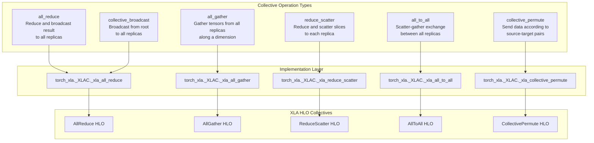
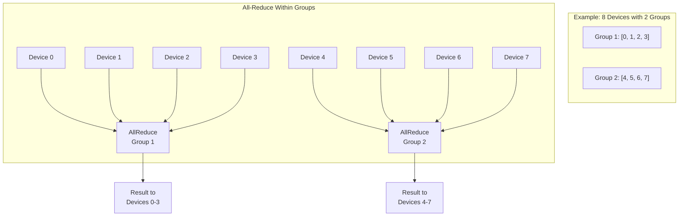
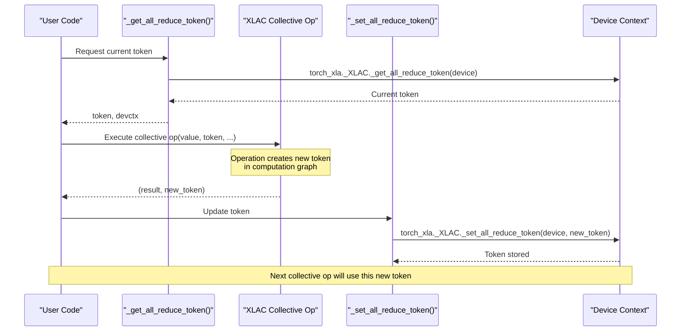
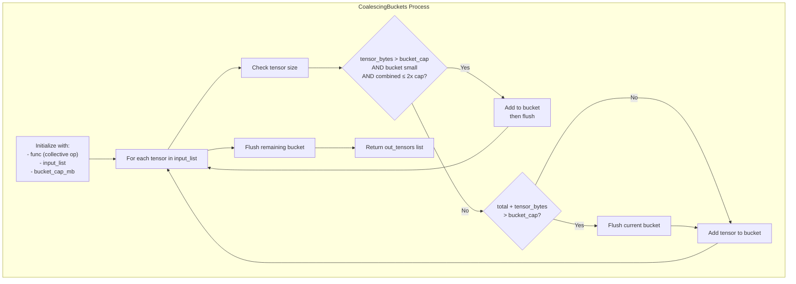
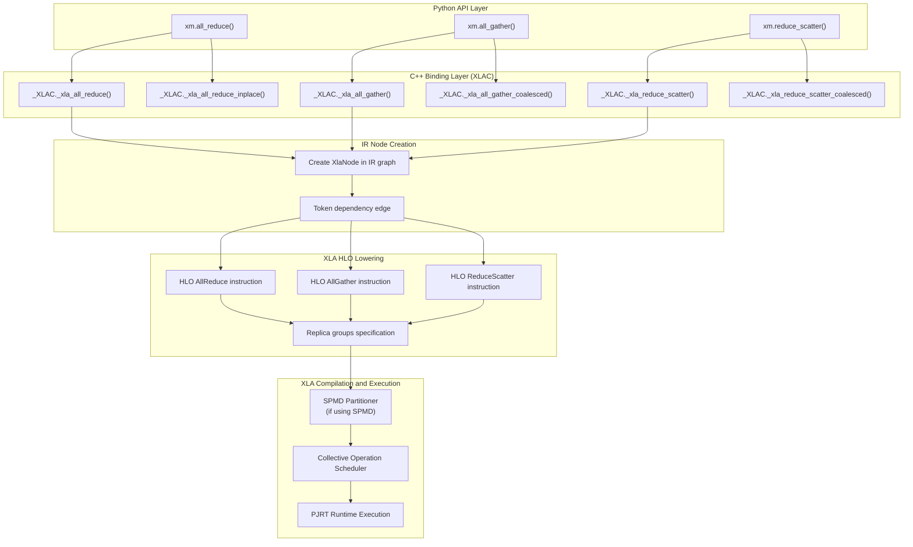

<!-- source: DeepWiki mcp.deepwiki.com · repo pytorch/xla · page 3.3 Collective Communication Operations · fetched 2026-10-21 -->

# Collective Communication Operations

<details>
<summary>Relevant source files</summary>

The following files were used as context for generating this wiki page:

- [docs/source/index.rst](docs/source/index.rst)
- [test/spmd/test_mp_input_sharding.py](test/spmd/test_mp_input_sharding.py)
- [torch_xla/core/xla_model.py](torch_xla/core/xla_model.py)
- [torch_xla/distributed/data_parallel.py](torch_xla/distributed/data_parallel.py)
- [torch_xla/distributed/parallel_loader.py](torch_xla/distributed/parallel_loader.py)
- [torch_xla/distributed/xla_multiprocessing.py](torch_xla/distributed/xla_multiprocessing.py)
- [torch_xla/utils/utils.py](torch_xla/utils/utils.py)

</details>


## Purpose and Scope

This page documents the collective communication operations provided by PyTorch/XLA for distributed training. These operations enable data exchange and synchronization across multiple devices (replicas) during distributed execution. The operations include `all_reduce`, `all_gather`, `reduce_scatter`, `all_to_all`, `collective_permute`, and point-to-point communication primitives.

For information about launching multi-process training, see [Multi-Process Execution](#3.2). For SPMD sharding and mesh-based communication patterns, see [SPMD Sharding System](#3.4). For efficient data loading in distributed settings, see [Distributed Data Loading](#3.5).

## Overview

PyTorch/XLA provides collective communication operations through the `torch_xla.core.xla_model` module (commonly imported as `xm`). These operations are essential for:

- **Gradient synchronization** in data-parallel training
- **Parameter gathering** across devices
- **Distributed inference** with model parallelism
- **Custom communication patterns** for advanced distributed algorithms

All collective operations in PyTorch/XLA map to XLA's HLO collective operations, which are optimized by the XLA compiler for the target hardware (TPU, GPU, CPU).

Sources: [torch_xla/core/xla_model.py:1-1000]()

## Core Collective Operations

PyTorch/XLA supports six primary collective communication operations, each corresponding to a standard MPI/NCCL-style collective pattern:



**Collective Operation Hierarchy**

Sources: [torch_xla/core/xla_model.py:396-801]()

### all_reduce

The `all_reduce` operation performs a reduction across all replicas and returns the result to all participants.

**Function signature**: [torch_xla/core/xla_model.py:396-453]()

```python
def all_reduce(
    reduce_type: str,
    inputs: Union[torch.Tensor, List[torch.Tensor]],
    scale: float = 1.0,
    groups: Optional[List[List[int]]] = None,
    pin_layout: bool = True
) -> Union[torch.Tensor, List[torch.Tensor]]
```

**Key parameters**:
- `reduce_type`: One of `xm.REDUCE_SUM`, `xm.REDUCE_MUL`, `xm.REDUCE_AND`, `xm.REDUCE_OR`, `xm.REDUCE_MIN`, `xm.REDUCE_MAX` [torch_xla/core/xla_model.py:30-35]()
- `inputs`: Single tensor or list of tensors to reduce
- `scale`: Scaling factor applied after reduction
- `groups`: Optional replica groups for sub-group communication
- `pin_layout`: Whether to constrain layout for correctness

**Implementation details**:
- Single-device execution is a no-op (returns clone or original list) [torch_xla/core/xla_model.py:432-437]()
- For simple cases (scale=1.0, no groups, pin_layout=True), uses c10d functional version for Dynamo traceability [torch_xla/core/xla_model.py:441-444]()
- Supports in-place reduction for list inputs [torch_xla/core/xla_model.py:450-451]()

Sources: [torch_xla/core/xla_model.py:396-453]()

### all_gather

The `all_gather` operation gathers tensors from all replicas and concatenates them along a specified dimension.

**Function signature**: [torch_xla/core/xla_model.py:501-593]()

```python
def all_gather(
    value: torch.Tensor,
    dim: int = 0,
    groups: Optional[List[List[int]]] = None,
    output: Optional[torch.Tensor] = None,
    pin_layout: bool = True,
    channel_id=None,
    use_global_device_ids=None
) -> torch.Tensor
```

**Implementation strategies**:
1. **All-reduce based**: When `pin_layout=True` and no explicit output, uses `_all_gather_using_all_reduce` which pads tensors and performs an all-reduce [torch_xla/core/xla_model.py:532-536]()
2. **Native all-gather**: Calls `_xla_all_gather` for single tensor input [torch_xla/core/xla_model.py:559-561]()
3. **Coalesced all-gather**: For list of tensors, uses `_xla_all_gather_coalesced` [torch_xla/core/xla_model.py:586-590]()

**Shard count calculation**: Automatically determined from `groups` or defaults to world size [torch_xla/core/xla_model.py:540-546]()

Sources: [torch_xla/core/xla_model.py:456-593]()

### reduce_scatter

The `reduce_scatter` operation performs a reduction across replicas and scatters the result, with each replica receiving one shard.

**Function signature**: [torch_xla/core/xla_model.py:836-925]()

```python
def reduce_scatter(
    reduce_type: str,
    input: Union[torch.Tensor, List[torch.Tensor]],
    scale: float,
    scatter_dim: int,
    shard_count: int,
    groups: Optional[List[List[int]]] = None,
    output: Optional[Union[torch.Tensor, List[torch.Tensor]]] = None,
    pin_layout: bool = True,
    channel_id=None,
    use_global_device_ids=None
) -> torch.Tensor
```

**Key behaviors**:
- Supports both single tensor and list of tensors input [torch_xla/core/xla_model.py:882-925]()
- Provides out-of-place version when `output` is specified [torch_xla/core/xla_model.py:883-889]()
- Coalesced version available for list inputs [torch_xla/core/xla_model.py:918-921]()

Sources: [torch_xla/core/xla_model.py:836-925]()

### all_to_all

The `all_to_all` operation splits the input tensor along one dimension and distributes the splits to all replicas, then concatenates received splits along another dimension.

**Function signature**: [torch_xla/core/xla_model.py:710-744]()

```python
def all_to_all(
    value: torch.Tensor,
    split_dimension: int,
    concat_dimension: int,
    split_count: int,
    groups: Optional[List[List[int]]] = None,
    pin_layout: bool = True
) -> torch.Tensor
```

**Use cases**:
- Transposing data layouts in model parallelism
- Resharding tensors across different partition schemes

Sources: [torch_xla/core/xla_model.py:710-744]()

### collective_permute

The `collective_permute` operation sends data from specified source replicas to target replicas according to a list of pairs.

**Function signature**: [torch_xla/core/xla_model.py:747-767]()

```python
def collective_permute(
    value: torch.Tensor,
    pairs: List[List[int]]
) -> torch.Tensor
```

**Parameters**:
- `pairs`: List of `[source_replica_id, target_replica_id]` pairs defining the permutation

**Example**: `[[0, 1], [1, 2], [2, 0]]` creates a cyclic permutation where replica 0 sends to 1, 1 sends to 2, and 2 sends to 0.

Sources: [torch_xla/core/xla_model.py:747-767]()

### collective_broadcast

The `collective_broadcast` operation broadcasts tensors from a root replica to all other replicas.

**Function signature**: [torch_xla/core/xla_model.py:770-801]()

```python
def collective_broadcast(
    tensors: List[torch.Tensor],
    root_ordinal: int = 0,
    groups: Optional[List[int]] = None,
    pin_layout: bool = True
) -> None
```

**Implementation**: Uses in-place multiplication by 0 or 1 followed by `all_reduce(REDUCE_SUM)` to achieve broadcast semantics [torch_xla/core/xla_model.py:790-801]()

Sources: [torch_xla/core/xla_model.py:770-801]()

## Replica Groups and Communication Patterns

Replica groups allow partitioning the set of devices into subgroups, where collective operations occur independently within each group.



**Replica Groups in Communication Patterns**

**Specifying groups**:
```python
# Two groups of 4 devices each
groups = [[0, 1, 2, 3], [4, 5, 6, 7]]

# All-reduce within groups
xm.all_reduce(xm.REDUCE_SUM, tensor, groups=groups)
```

**Default behavior**: When `groups=None` or `groups=[]`, all devices participate in a single group [torch_xla/core/xla_model.py:429]()

**Group size validation**: All groups must have the same number of replicas [torch_xla/core/xla_model.py:542-543]()

Sources: [torch_xla/core/xla_model.py:396-453](), [torch_xla/core/xla_model.py:501-593]()

## Token-Based Execution Ordering

PyTorch/XLA uses a token-based mechanism to maintain correct execution order for collective operations. This prevents race conditions and ensures deterministic execution.



**Token Chaining Mechanism**

**Token retrieval**: [torch_xla/core/xla_model.py:390-393]()
```python
def _get_all_reduce_token() -> Tuple[Any, DeviceContext]:
  devctx = _get_device_context()
  token = torch_xla._XLAC._get_all_reduce_token(devctx.device)
  return token, devctx
```

**Token usage pattern**:
1. **Retrieve current token** before executing collective operation
2. **Pass token** to XLAC collective operation
3. **Store new token** returned by the operation
4. **Next operation** uses the new token, creating a dependency chain

**Example from `all_gather`**: [torch_xla/core/xla_model.py:548-556]()
```python
token, devctx = _get_all_reduce_token()
# ... operation ...
new_token = torch_xla._XLAC._xla_all_gather_out(output, value, token, ...)
torch_xla._XLAC._set_all_reduce_token(devctx.device, new_token)
```

Sources: [torch_xla/core/xla_model.py:390-393](), [torch_xla/core/xla_model.py:548-590](), [torch_xla/core/xla_model.py:739-743](), [torch_xla/core/xla_model.py:764-766](), [torch_xla/core/xla_model.py:813-817](), [torch_xla/core/xla_model.py:831-832](), [torch_xla/core/xla_model.py:880-896]()

## Coalescing and Optimization

To reduce communication overhead, PyTorch/XLA provides coalescing mechanisms that batch multiple small tensor communications into larger, more efficient operations.

### CoalescingBuckets Class

The `CoalescingBuckets` class implements automatic batching of tensors up to a specified bucket capacity.

**Class definition**: [torch_xla/core/xla_model.py:596-671]()



**Bucket Coalescing Algorithm**

**Key attributes**:
- `_func`: The collective operation to apply to each bucket
- `_bucket_cap`: Capacity in bytes (default: 160MB)
- `_tensor_bucket`: Current bucket of tensors
- `_out_tensors`: Accumulated results

**Flush behavior**: [torch_xla/core/xla_model.py:632-642]()
- Single tensor in bucket: uses non-coalesced operation
- Multiple tensors: uses coalesced operation variant

**Bucketization logic**: [torch_xla/core/xla_model.py:650-667]()
```python
def __call__(self) -> Union[torch.Tensor, List[torch.Tensor]]:
  for idx, tensor in enumerate(self._input_list):
    tensor_bytes = tensor.numel() * tensor.element_size()
    total_new = self._total + tensor_bytes
    
    # Special case: large tensor with small bucket
    if tensor_bytes > self._bucket_cap and self._total < 0.5 * self._bucket_cap and total_new <= 2 * self._bucket_cap:
      self.add(tensor, idx)
      self.flush()
    else:
      # Regular case: flush if over capacity
      if total_new > self._bucket_cap:
        self.flush()
      self.add(tensor, idx)
  
  self.flush()  # Final flush
  return self._out_tensors
```

Sources: [torch_xla/core/xla_model.py:596-671]()

### all_gather_bucketized

**Function signature**: [torch_xla/core/xla_model.py:674-707]()

```python
def all_gather_bucketized(
    input_list: List[torch.Tensor],
    dim: int = 0,
    groups: Optional[List[List[int]]] = None,
    output: Optional[torch.Tensor] = None,
    pin_layout: bool = False,
    bucket_cap_mb=160
) -> Union[torch.Tensor, List[torch.Tensor]]
```

**Usage**: Wraps `all_gather` with `CoalescingBuckets` to batch multiple tensors [torch_xla/core/xla_model.py:697-707]()

Sources: [torch_xla/core/xla_model.py:674-707]()

### reduce_scatter_bucketized

**Function signature**: [torch_xla/core/xla_model.py:928-968]()

```python
def reduce_scatter_bucketized(
    reduce_type: str,
    input_list: Union[torch.Tensor, List[torch.Tensor]],
    scale: float,
    scatter_dim: int,
    shard_count: int,
    groups: Optional[List[List[int]]] = None,
    output: Optional[Union[torch.Tensor, List[torch.Tensor]]] = None,
    pin_layout: bool = False,
    bucket_cap_mb: int = 160
) -> CoalescingBuckets
```

**Usage**: Wraps `reduce_scatter` with `CoalescingBuckets` [torch_xla/core/xla_model.py:955-970]()

Sources: [torch_xla/core/xla_model.py:928-968]()

## Advanced Features

### Layout Pinning

The `pin_layout` parameter controls whether collective operations constrain tensor layouts for correctness.

**Purpose**: 
- **Enabled (True)**: Prevents data corruption when processes have slightly different computation graphs
- **Disabled (False)**: Allows compiler more freedom, but may fail with "HloModule has a mix of layout constrained" errors

**Default**: Most operations default to `pin_layout=True` [torch_xla/core/xla_model.py:401]()

**Trade-offs**:
- Pinned layouts ensure correctness but may limit optimization opportunities
- Unpinned layouts enable more aggressive compiler optimizations but require careful use

**Implementation note**: For `all_gather` with `pin_layout=True`, uses all-reduce-based implementation [torch_xla/core/xla_model.py:532-536]()

Sources: [torch_xla/core/xla_model.py:417-421](), [torch_xla/core/xla_model.py:472-476](), [torch_xla/core/xla_model.py:520-524](), [torch_xla/core/xla_model.py:730-734](), [torch_xla/core/xla_model.py:784-788](), [torch_xla/core/xla_model.py:867-871]()

### Channel ID and Global Device IDs

**channel_id**: Optional parameter for cross-module communication, enabling communication between separately compiled modules [torch_xla/core/xla_model.py:525](), [torch_xla/core/xla_model.py:872]()

**use_global_device_ids**: When `True`, interprets replica group IDs as global device identifiers rather than local indices [torch_xla/core/xla_model.py:526](), [torch_xla/core/xla_model.py:873]()

These parameters enable advanced communication patterns in multi-module or multi-slice scenarios.

Sources: [torch_xla/core/xla_model.py:501-593](), [torch_xla/core/xla_model.py:836-925]()

### Point-to-Point Communication

PyTorch/XLA also provides point-to-point communication primitives:

**send**: [torch_xla/core/xla_model.py:804-818]()
```python
def send(value: torch.Tensor, channel_id: int) -> torch.Tensor
```

**recv**: [torch_xla/core/xla_model.py:821-833]()
```python
def recv(output: torch.Tensor, channel_id: int) -> torch.Tensor
```

These operations use `channel_id` to match send/recv pairs and maintain token-based ordering.

Sources: [torch_xla/core/xla_model.py:804-833]()

## Integration with XLA Compiler

All collective operations eventually lower to XLA HLO collective instructions. The integration involves several layers:



**Collective Operation Compilation Pipeline**

**Key integration points**:

1. **Python to C++**: Python functions call into `_XLAC` module bindings
2. **IR node creation**: Each operation creates a node in the lazy computation graph
3. **Token threading**: Tokens create edges in the IR graph to enforce ordering
4. **HLO lowering**: IR nodes lower to HLO collective instructions during compilation
5. **Replica group encoding**: Group specifications encoded in HLO metadata
6. **SPMD processing**: When using SPMD mode, the partitioner may transform collectives
7. **Runtime execution**: PJRT runtime executes compiled collectives on hardware

**Optimization opportunities**:
- **Collective fusion**: XLA may fuse multiple small collectives
- **Pipeline parallelism**: Collective scheduler overlaps communication with computation
- **Algorithmic selection**: XLA chooses optimal collective algorithm based on message size and topology

Sources: [torch_xla/core/xla_model.py:396-925]()

## Usage Examples

### Basic All-Reduce for Gradient Synchronization

```python
import torch
import torch_xla.core.xla_model as xm

# Accumulate gradients
for param in model.parameters():
    if param.grad is not None:
        # Sum gradients across all replicas
        xm.all_reduce(xm.REDUCE_SUM, param.grad)
        # Scale by world size to get average
        param.grad.div_(xm.xrt_world_size())
```

### All-Gather with Replica Groups

```python
# Gather features from each replica in the group
num_devices = xr.global_runtime_device_count()
groups = [[0, 1, 2, 3], [4, 5, 6, 7]]  # Two groups of 4

local_features = torch.randn(32, 128, device=xm.xla_device())
gathered_features = xm.all_gather(local_features, dim=0, groups=groups)
# Result shape: [128, 128] (4x the batch size)
```

### Bucketized Reduce-Scatter for Sharded Parameters

```python
# List of parameter shards to reduce and scatter
param_list = [param.grad for param in model.parameters() if param.grad is not None]

# Use bucketized reduce-scatter for efficiency
reduced_shards = xm.reduce_scatter_bucketized(
    reduce_type=xm.REDUCE_SUM,
    input_list=param_list,
    scale=1.0 / xm.xrt_world_size(),
    scatter_dim=0,
    shard_count=xm.xrt_world_size(),
    bucket_cap_mb=160
)
```

### Optimized Replica Groups for TPU Topologies

PyTorch/XLA provides optimized replica group orderings for specific TPU configurations:

```python
from torch_xla.distributed.xla_multiprocessing import create_optimized_replica_groups

# Get optimized groups for current TPU topology
optimized_groups = create_optimized_replica_groups()

if optimized_groups is not None:
    # Use optimized groups for better ICI bandwidth utilization
    xm.all_reduce(xm.REDUCE_SUM, tensor, groups=optimized_groups)
else:
    # Fall back to default (all devices in one group)
    xm.all_reduce(xm.REDUCE_SUM, tensor)
```

**Supported optimizations**:
- **TPU v5p 2x2x2**: Uses `_V5P_2x2x2_ORDER` [torch_xla/distributed/xla_multiprocessing.py:137-159]()
- **TPU v6e 2x4**: Uses `_V6E_2x4_ORDER` [torch_xla/distributed/xla_multiprocessing.py:163-174]()

Sources: [torch_xla/core/xla_model.py:396-970](), [torch_xla/distributed/xla_multiprocessing.py:186-196]()

## Performance Considerations

### Communication-Computation Overlap

Collective operations in XLA can overlap with computation when:
1. Operations are not immediately synchronized (lazy execution)
2. XLA's collective scheduler identifies independent operations
3. Hardware supports asynchronous communication (e.g., TPU ICI)

### Bucket Size Tuning

The `bucket_cap_mb` parameter in bucketized operations affects performance:
- **Larger buckets**: Fewer collective operations, better amortization of latency
- **Smaller buckets**: More fine-grained scheduling, better overlap potential
- **Default (160MB)**: Balanced for most workloads

### Pin Layout Trade-offs

Disabling `pin_layout` can improve performance but requires:
- Identical computation graphs across all processes
- Careful validation to avoid silent data corruption
- Understanding of when layout mismatches can occur

### Replica Group Optimization

Using optimized replica groups for TPU topologies can significantly reduce communication time by aligning groups with physical interconnect topology.

Sources: [torch_xla/core/xla_model.py:596-671](), [torch_xla/core/xla_model.py:674-707](), [torch_xla/core/xla_model.py:928-968](), [torch_xla/distributed/xla_multiprocessing.py:128-196]()

---

