<!-- source: DeepWiki mcp.deepwiki.com · repo pytorch/xla · page 3.4 SPMD Sharding System · fetched 2026-10-21 -->

# SPMD Sharding System

<details>
<summary>Relevant source files</summary>

The following files were used as context for generating this wiki page:

- [test/cpp/test_xla_sharding.cpp](test/cpp/test_xla_sharding.cpp)
- [test/spmd/test_xla_sharding.py](test/spmd/test_xla_sharding.py)
- [test/spmd/test_xla_sharding_base.py](test/spmd/test_xla_sharding_base.py)
- [torch_xla/_internal/jax_workarounds.py](torch_xla/_internal/jax_workarounds.py)
- [torch_xla/csrc/ir_builder.h](torch_xla/csrc/ir_builder.h)
- [torch_xla/csrc/tensor_util.cpp](torch_xla/csrc/tensor_util.cpp)
- [torch_xla/csrc/tensor_util.h](torch_xla/csrc/tensor_util.h)
- [torch_xla/csrc/xla_backend_impl.cpp](torch_xla/csrc/xla_backend_impl.cpp)
- [torch_xla/csrc/xla_graph_executor.cpp](torch_xla/csrc/xla_graph_executor.cpp)
- [torch_xla/csrc/xla_graph_executor.h](torch_xla/csrc/xla_graph_executor.h)
- [torch_xla/csrc/xla_sharding_util.cpp](torch_xla/csrc/xla_sharding_util.cpp)
- [torch_xla/csrc/xla_sharding_util.h](torch_xla/csrc/xla_sharding_util.h)
- [torch_xla/distributed/spmd/__init__.py](torch_xla/distributed/spmd/__init__.py)
- [torch_xla/distributed/spmd/xla_sharding.py](torch_xla/distributed/spmd/xla_sharding.py)

</details>


This page documents the SPMD (Single Program Multiple Data) sharding system in PyTorch/XLA, focusing on the core components: `Mesh`, `PartitionSpec`, `mark_sharding`, `ShardingUtil`, and automatic sharding propagation. SPMD enables efficient distribution of tensor computations across multiple devices by partitioning both data and computation.

## Overview

SPMD sharding allows a single program to execute across multiple devices, where each device operates on different portions (shards) of tensors. The system consists of Python-level APIs (`xs.Mesh`, `xs.mark_sharding`) and C++-level utilities (`ShardingUtil`, `XLATensor::ShardingSpec`) that work together to annotate, propagate, and execute sharded computations.

**SPMD Sharding Flow**

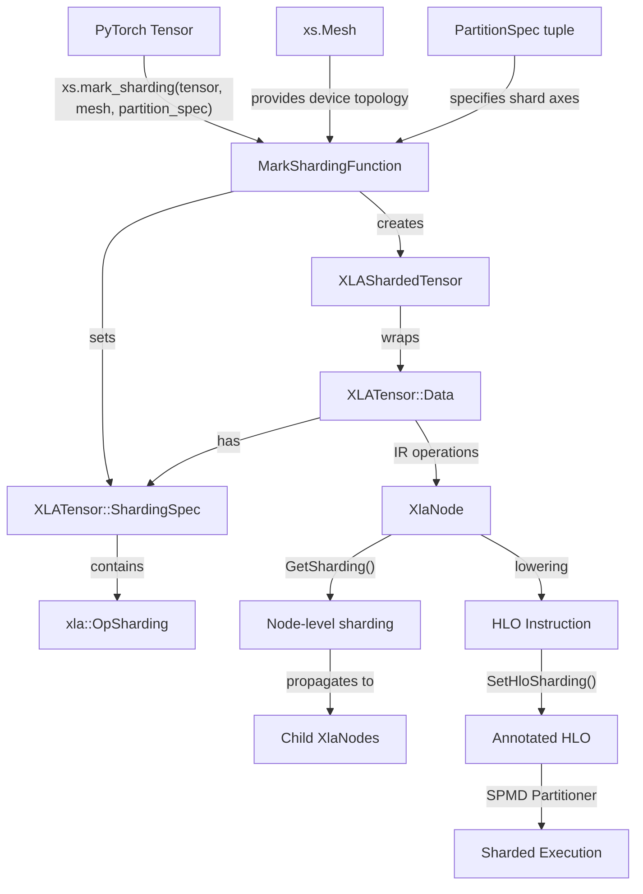

Sources:
- [torch_xla/distributed/spmd/xla_sharding.py:368-453]()
- [torch_xla/csrc/tensor.h:265-277]()
- [torch_xla/csrc/xla_sharding_util.h:18-148]()

## Core Data Structures

### Mesh: Device Topology

The `Mesh` class ([torch_xla/distributed/spmd/xla_sharding.py:38-151]()) represents the logical arrangement of devices for sharding. It maps device IDs to a multi-dimensional mesh structure.

**Mesh Structure**

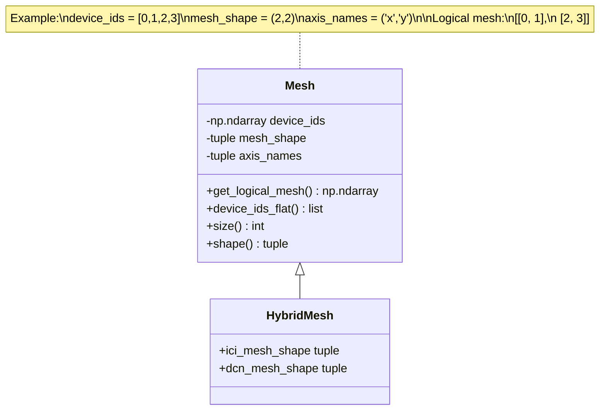

The mesh is created by reshaping a flat list of device IDs into the specified `mesh_shape`. Each axis can optionally be named via `axis_names`, enabling readable partition specifications.

**Key Methods:**
- `get_logical_mesh()`: Returns the reshaped device arrangement as a NumPy array
- `device_ids_flat()`: Returns the flattened list of device IDs  
- `size()`: Returns total number of devices
- `shape()`: Returns the mesh shape tuple

Sources:
- [torch_xla/distributed/spmd/xla_sharding.py:38-151]()
- [test/spmd/test_xla_sharding.py:206-217]()

### PartitionSpec: Sharding Specification

A `PartitionSpec` is a tuple that describes how tensor dimensions map to mesh axes. Each element in the tuple corresponds to a tensor dimension and specifies which mesh axis (or axes) to shard along.

**PartitionSpec Examples:**

| PartitionSpec | Mesh Shape | Tensor Shape | Meaning |
|---------------|------------|--------------|---------|
| `(0, 1)` | `(2, 4)` | `(16, 32)` | Shard dim 0 along mesh axis 0, dim 1 along mesh axis 1 |
| `(0, None)` | `(4, 2)` | `(16, 32)` | Shard dim 0 along mesh axis 0, replicate dim 1 |
| `(None, None)` | `(2, 2)` | `(16, 32)` | Fully replicated across all devices |
| `((0, 1), None)` | `(2, 4)` | `(16, 32)` | Shard dim 0 along both mesh axes 0 and 1 |

**Partition Spec Type Definition:**

```python
PartitionSpec = tuple[Union[tuple[Union[int, str], ...], int, str, None], ...]
```

The tuple length must match the tensor rank. Each element can be:
- `int`: Mesh axis index to shard along
- `str`: Mesh axis name to shard along
- `tuple`: Multiple mesh axes for a single tensor dimension
- `None`: Replicate this tensor dimension

Sources:
- [torch_xla/distributed/spmd/xla_sharding.py:29-35]()
- [torch_xla/csrc/xla_sharding_util.cpp:50-68]()

### ShardingSpec: C++ Representation

At the C++ level, sharding information is stored in `XLATensor::ShardingSpec` ([torch_xla/csrc/tensor.h:265-277]()), which wraps an `xla::OpSharding` proto.

**ShardingSpec Class Structure**

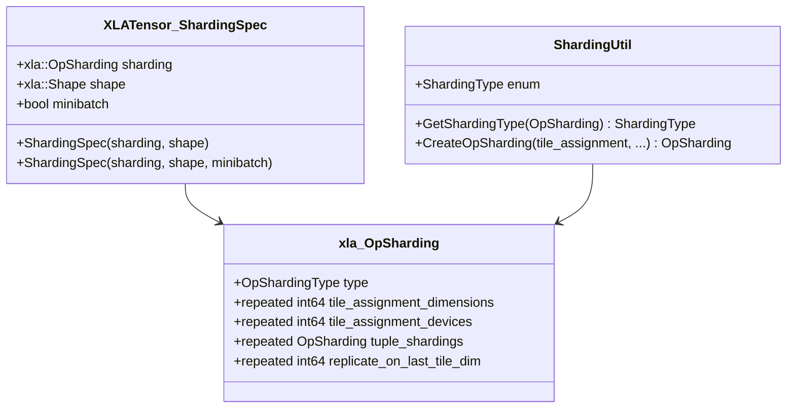

The `ShardingSpec` contains:
- `sharding`: The XLA `OpSharding` proto defining the sharding strategy
- `shape`: The unpartitioned tensor shape
- `minibatch`: Flag for batch dimension handling

Sources:
- [torch_xla/csrc/tensor.h:265-277]()
- [torch_xla/csrc/xla_sharding_util.h:21-32]()

### ShardingType Enum

`ShardingUtil::ShardingType` ([torch_xla/csrc/xla_sharding_util.h:21-29]()) categorizes the different sharding patterns:

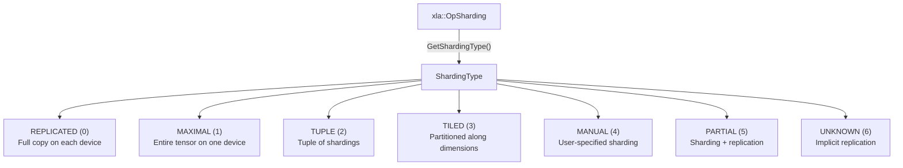

**ShardingType Determination Logic** ([torch_xla/csrc/xla_sharding_util.cpp:189-206]()):
- `REPLICATED`: `sharding.type() == OpSharding::REPLICATED`
- `MAXIMAL`: `sharding.type() == OpSharding::MAXIMAL`
- `TUPLE`: `sharding.type() == OpSharding::TUPLE`
- `MANUAL`: `sharding.type() == OpSharding::MANUAL`
- `TILED`: `sharding.type() == OpSharding::OTHER` with no replication
- `PARTIAL`: `sharding.type() == OpSharding::OTHER` with replication groups
- `UNKNOWN`: `sharding.type() == OpSharding::UNKNOWN`

Sources:
- [torch_xla/csrc/xla_sharding_util.h:21-29]()
- [torch_xla/csrc/xla_sharding_util.cpp:189-206]()

### XLAShardedTensor: Python Wrapper

`XLAShardedTensor` ([torch_xla/distributed/spmd/xla_sharding.py:486-686]()) is a Python wrapper returned by `mark_sharding` that provides a sharded view of the tensor while maintaining the global tensor interface.

**XLAShardedTensor Structure**

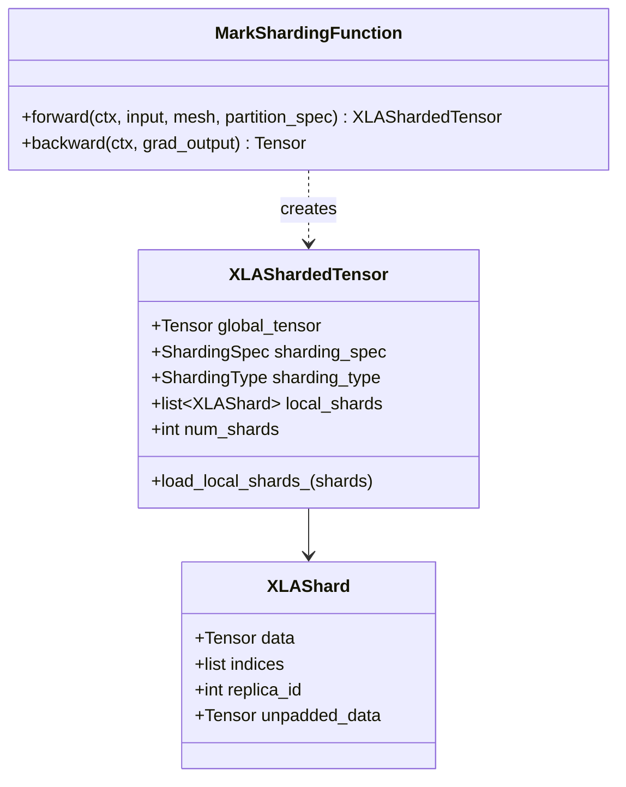

**Key Properties:**
- `global_tensor`: The underlying XLA tensor with sharding annotation
- `sharding_spec`: Python-level sharding specification
- `sharding_type`: The `ShardingType` enum value
- `local_shards`: List of `XLAShard` objects representing local device shards
- `num_shards`: Total number of shards across all devices

**Local Shard Access** ([torch_xla/distributed/spmd/xla_sharding.py:578-596]()):

The `local_shards` property materializes the tensor and returns shards for each device. Each `XLAShard` contains:
- `data`: The shard data on CPU (may be padded)
- `indices`: Slice indices in the global tensor
- `replica_id`: Replica group ID for this shard
- `unpadded_data`: The shard data without padding

Sources:
- [torch_xla/distributed/spmd/xla_sharding.py:486-686]()
- [test/spmd/test_xla_sharding.py:72-125]()

## Marking Tensors for Sharding

### mark_sharding Function

The `xs.mark_sharding` function ([torch_xla/distributed/spmd/xla_sharding.py:368-453]()) is the primary API for applying sharding to tensors.

**mark_sharding Signature:**

```python
def mark_sharding(
    t: Union[torch.Tensor, XLAShardedTensor],
    mesh: Mesh,
    partition_spec: PartitionSpec
) -> XLAShardedTensor
```

**Execution Flow:**

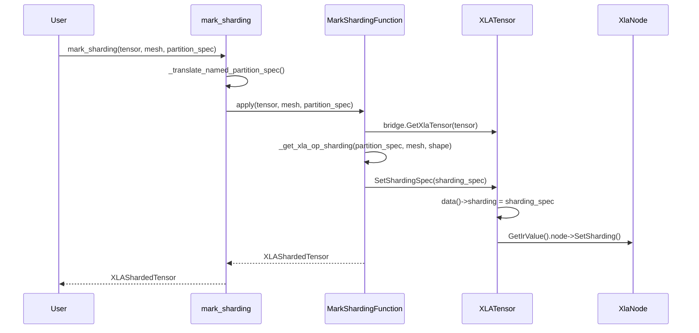

**Internal Steps** ([torch_xla/distributed/spmd/xla_sharding.py:368-453]()):

1. **Named Axis Translation**: Convert named partition specs to integer indices
2. **OpSharding Creation**: Build `xla::OpSharding` proto from partition spec
3. **Autograd Wrapping**: Wrap in `MarkShardingFunction` for gradient support
4. **XLATensor Annotation**: Set `ShardingSpec` on the XLATensor
5. **IR Node Annotation**: Propagate sharding to the underlying IR node
6. **Wrapper Creation**: Return `XLAShardedTensor` wrapper

Sources:
- [torch_xla/distributed/spmd/xla_sharding.py:368-453]()
- [torch_xla/distributed/spmd/xla_sharding.py:171-265]()

### MarkShardingFunction: Autograd Support

`MarkShardingFunction` ([torch_xla/distributed/spmd/xla_sharding.py:171-265]()) is an `autograd.Function` that enables gradient flow through sharding annotations.

**Forward Pass** ([torch_xla/distributed/spmd/xla_sharding.py:184-233]()):
- Creates `xla::OpSharding` from partition spec
- Sets sharding on XLATensor via `SetShardingSpec()`
- Wraps result in `XLAShardedTensor`
- Saves mesh and partition spec for backward

**Backward Pass** ([torch_xla/distributed/spmd/xla_sharding.py:235-265]()):
- Applies same sharding to gradient tensor
- Ensures gradient has matching sharding as forward
- Returns gradient wrapped in `XLAShardedTensor`

Sources:
- [torch_xla/distributed/spmd/xla_sharding.py:171-265]()

### ShardingUtil C++ Utilities

`ShardingUtil` ([torch_xla/csrc/xla_sharding_util.h:18-148]()) provides C++ utilities for creating and manipulating sharding specifications.

**Key ShardingUtil Methods:**

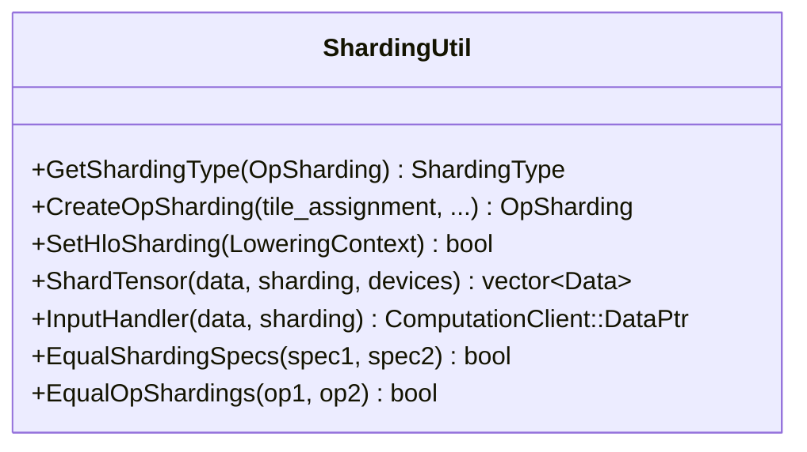

**CreateOpSharding** ([torch_xla/csrc/xla_sharding_util.cpp:84-166]()):
- Converts Python partition spec to `xla::OpSharding` proto
- Handles tiled, replicated, partial, and manual sharding types
- Builds tile assignment and replication groups

**SetHloSharding** ([torch_xla/csrc/xla_sharding_util.cpp:171-187]()):
- Annotates HLO instructions with sharding during lowering
- Returns `true` if any sharding was applied (enables SPMD compilation)
- Called by `LoweringContext` for each operation

**ShardTensor** ([torch_xla/csrc/xla_sharding_util.cpp:429-542]()):
- Physically shards a tensor's data across devices
- Computes shard shapes and extracts slices
- Returns vector of `ComputationClient::Data` for each device

**InputHandler** ([torch_xla/csrc/xla_sharding_util.cpp:544-576]()):
- Reshards input data to match expected sharding
- Used when loading sharded data for execution
- Handles device mapping and replication

Sources:
- [torch_xla/csrc/xla_sharding_util.h:18-148]()
- [torch_xla/csrc/xla_sharding_util.cpp:84-187]()
- [torch_xla/csrc/xla_sharding_util.cpp:429-576]()

## Sharding Propagation

Sharding information flows through three levels: XLATensor, IR nodes, and HLO instructions. This ensures operations on sharded tensors preserve and propagate sharding annotations.

### Tensor-Level Sharding

**XLATensor Sharding Management**

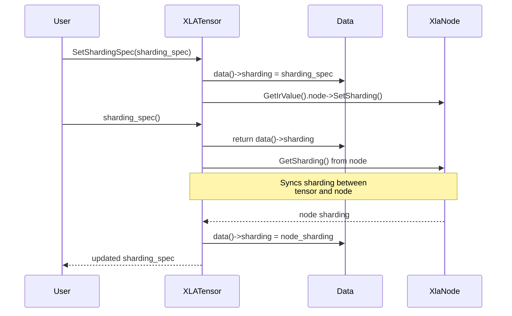

**Key Methods** ([torch_xla/csrc/tensor.cpp:256-319]()):

- `SetShardingSpec(sharding_spec, overwrite)`: Stores sharding on tensor data and syncs to IR node
- `sharding_spec()`: Returns current sharding, syncing from node if needed
- `ClearShardingSpec()`: Removes sharding annotation

The `sharding_spec()` getter syncs sharding from the IR node to the tensor, ensuring consistency when sharding is attached by compiler passes ([torch_xla/csrc/tensor.cpp:288-319]()).

Sources:
- [torch_xla/csrc/tensor.h:279-285]()
- [torch_xla/csrc/tensor.cpp:256-319]()

### IR Node-Level Sharding

**XlaNode Sharding Interface**

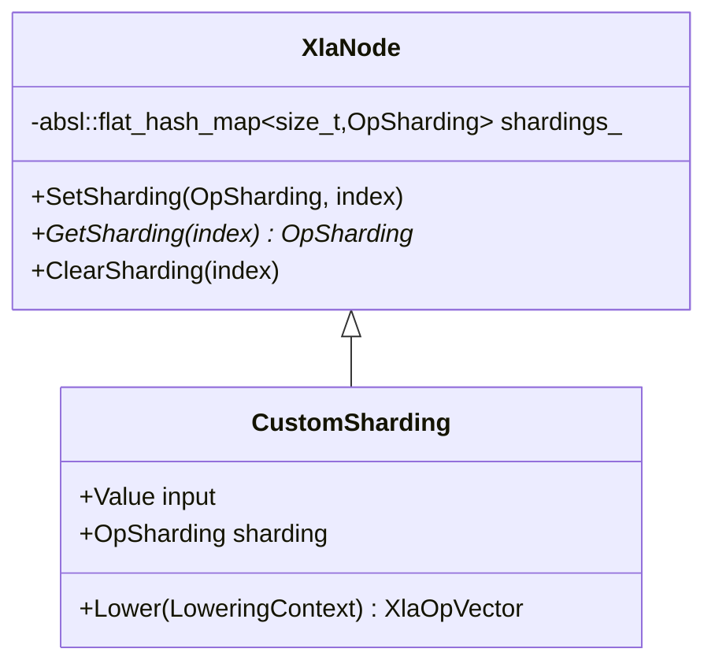

IR nodes in PyTorch/XLA can carry sharding information via the `shardings_` map. The `XlaNode` base class provides:

- `SetSharding(sharding, index)`: Attach sharding to a specific output index
- `GetSharding(index)`: Retrieve sharding for an output index
- `ClearSharding(index)`: Remove sharding annotation

**CustomSharding Node** ([torch_xla/csrc/ops/custom_sharding.h:15-37]()):

The `CustomSharding` IR node explicitly wraps a value with a sharding annotation:
- Created when `mark_sharding` is called
- Preserves sharding through graph transformations
- Lower function applies sharding during HLO generation

Sources:
- [torch_xla/csrc/ir.h]() (XlaNode definition)
- [torch_xla/csrc/ops/custom_sharding.h:15-37]()
- [torch_xla/csrc/ops/custom_sharding.cpp:1-38]()

### HLO-Level Sharding

**Lowering and Annotation**

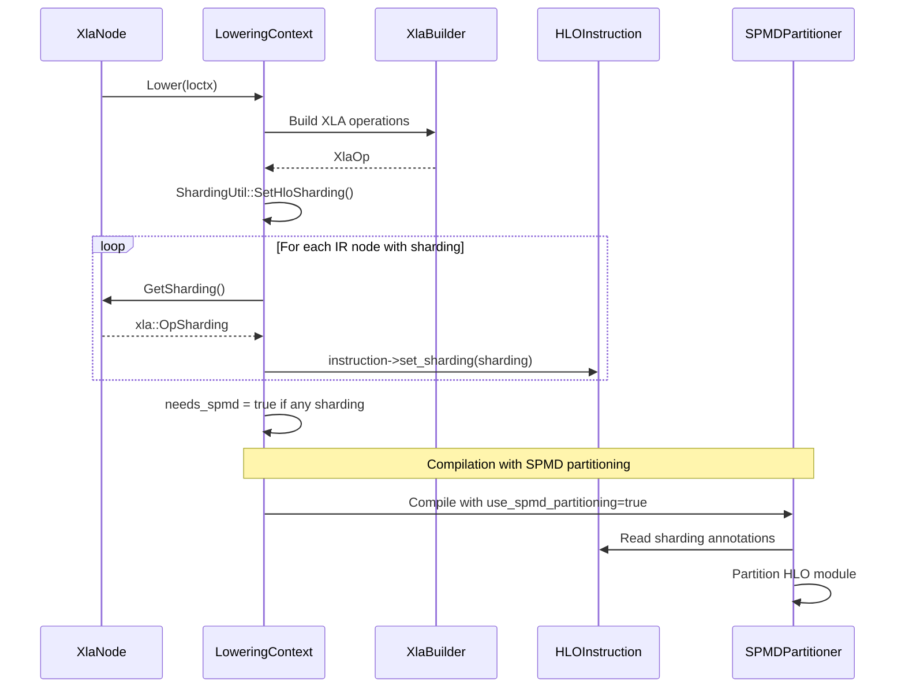

**ShardingUtil::SetHloSharding** ([torch_xla/csrc/xla_sharding_util.cpp:171-187]()):

This function walks the IR graph and annotates HLO instructions:
1. Iterate through all IR nodes in the computation
2. For nodes with sharding annotations, get the corresponding HLO instruction
3. Call `instruction->set_sharding()` to attach the `xla::HloSharding`
4. Return `true` if any sharding was applied

When sharding is present, the computation is compiled with `use_spmd_partitioning=true`, invoking XLA's SPMD partitioner to generate device-specific code.

Sources:
- [torch_xla/csrc/xla_sharding_util.cpp:171-187]()
- [torch_xla/csrc/xla_graph_executor.cpp]() (compilation with SPMD)

## Advanced Features

### Automatic Sharding Propagation

When operations are performed on sharded tensors, sharding propagates automatically through the computation graph via XLA's sharding propagation pass.

**Propagation Example:**

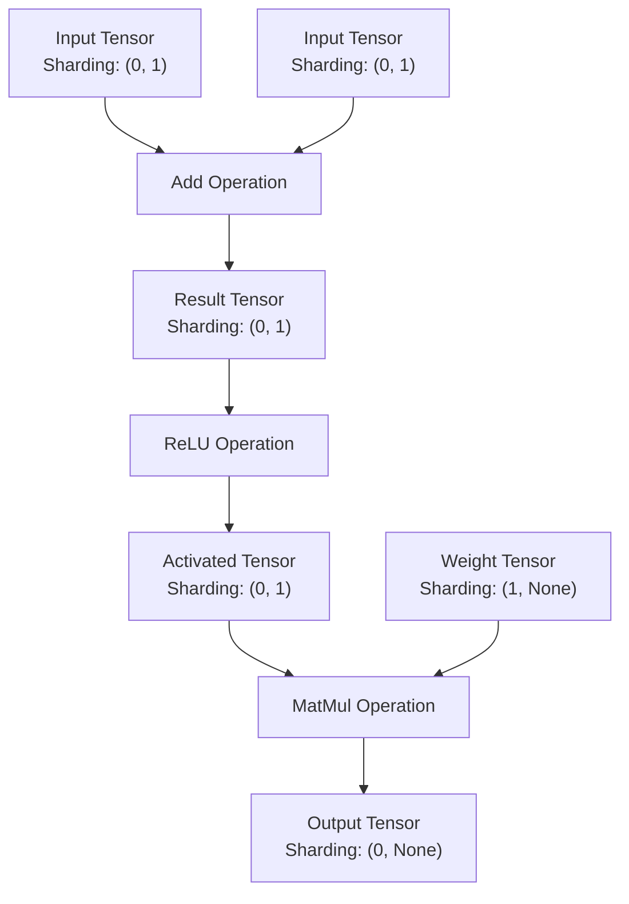

Sharding propagation happens at multiple stages:
1. **IR construction**: Operations inherit sharding from inputs when appropriate
2. **HLO annotation**: Sharding annotations are set on HLO instructions
3. **SPMD partitioner**: XLA's partitioner propagates shardings and inserts collectives

Sources:
- [torch_xla/csrc/xla_sharding_util.cpp:171-187]()

### Manual Sharding with CustomSharding

The `CustomSharding` IR node ([torch_xla/csrc/ops/custom_sharding.h:15-37]()) provides explicit control over sharding:

```python
# Internal use - typically called via mark_sharding
# Creates CustomSharding IR node wrapping the input value
```

When lowered, `CustomSharding` applies the sharding to the XLA operation and passes through the input value unchanged, but with sharding annotation attached.

Sources:
- [torch_xla/csrc/ops/custom_sharding.h:15-37]()
- [torch_xla/csrc/ops/custom_sharding.cpp:1-38]()

### Sharding and Data Movement

**ShardTensor: Physical Sharding** ([torch_xla/csrc/xla_sharding_util.cpp:429-542]()):

The `ShardTensor` function physically partitions tensor data across devices:

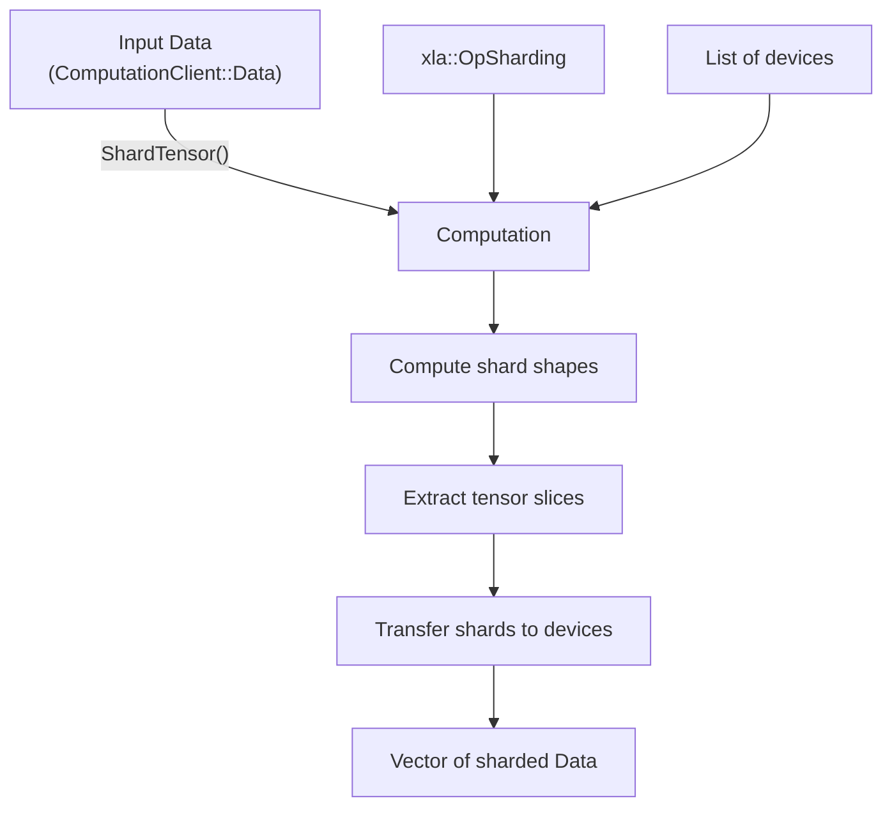

Steps:
1. Compute per-device shard shape from OpSharding
2. Extract slices from the input tensor
3. Transfer each slice to its target device
4. Return vector of `ComputationClient::Data` (one per device)

**InputHandler: Resharding** ([torch_xla/csrc/xla_sharding_util.cpp:544-576]()):

The `InputHandler` reshards data to match expected sharding at execution time:
- Used when loading checkpoints or transferring between sharding strategies
- Handles device mapping and validates shard compatibility
- Can reshape data to match different OpSharding configurations

Sources:
- [torch_xla/csrc/xla_sharding_util.cpp:429-542]()
- [torch_xla/csrc/xla_sharding_util.cpp:544-576]()

### Clearing Sharding

The `xs.clear_sharding()` function ([torch_xla/distributed/spmd/xla_sharding.py:455-484]()) removes sharding annotations:

```python
xs.clear_sharding(tensor)  # Remove sharding from tensor
```

This calls `XLATensor::ClearShardingSpec()` ([torch_xla/csrc/tensor.cpp:279-286]()), which:
1. Sets `data()->sharding = nullptr`
2. Clears sharding from the IR node via `ClearSharding()`

Sources:
- [torch_xla/distributed/spmd/xla_sharding.py:455-484]()
- [torch_xla/csrc/tensor.cpp:279-286]()

## Integration with Collective Operations

SPMD sharding integrates with collective communication operations for efficient multi-device execution.

**Collective Operations with Sharding:**

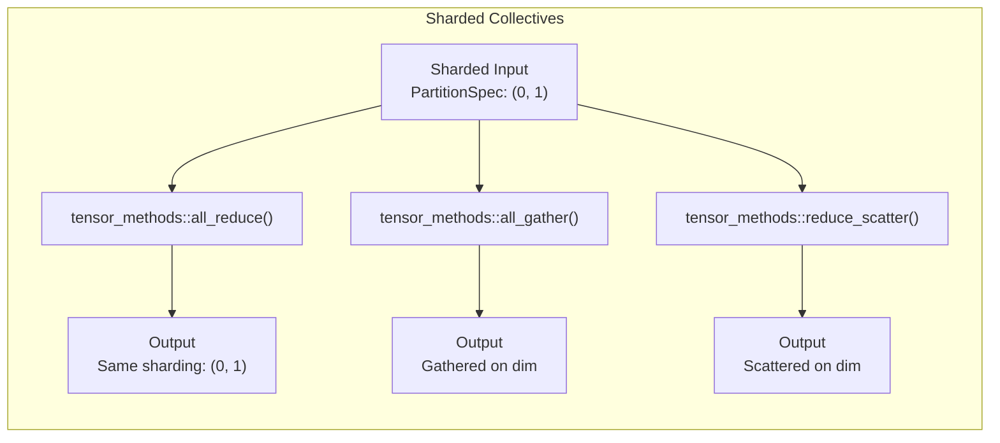

**Sharding-Aware Collectives:**

When collective operations are used with sharded tensors, the sharding information influences how the collective is executed:

- **all_reduce** ([torch_xla/csrc/tensor_methods.cpp]()): Preserves sharding, reduces across replicas
- **all_gather** ([torch_xla/csrc/tensor_methods.h:68-71]()): Gathers sharded dimension, may change sharding
- **reduce_scatter** ([torch_xla/csrc/tensor_methods.h:28-46]()): Reduces and scatters, may introduce sharding

The `pin_layout` parameter ensures sharding is preserved through the collective operation.

Sources:
- [torch_xla/csrc/tensor_methods.h:17-71]()
- [torch_xla/csrc/ops/all_reduce.h]()
- [torch_xla/csrc/ops/all_gather.h]()

## Advanced Sharding Features

### Named Partition Specifications

You can use named axes in the mesh to create more readable sharding specifications:

```python
# Create a mesh with named axes
mesh = xs.Mesh(np.arange(8), (2, 4), ('batch', 'model'))

# Shard tensor using named axes
t = torch.randn(16, 32).to(xm.xla_device())
sharded_t = xs.mark_sharding(t, mesh, ('batch', 'model'))
```

Sources:
- [test/spmd/test_xla_sharding.py:412-447]()

### SPMD and FSDP Integration

PyTorch/XLA provides integration between SPMD sharding and Fully Sharded Data Parallel (FSDP) training:

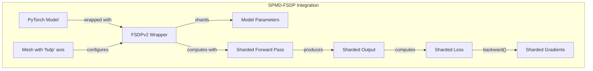

Sources:
- [torch_xla/experimental/spmd_fully_sharded_data_parallel.py:37-187]()
- [test/spmd/test_fsdp_v2.py:26-63]()

## Performance Considerations

When using SPMD sharding, consider these factors for optimal performance:

1. **Mesh configuration**: The logical device arrangement should match your computational needs
2. **Sharding strategy**: Different sharding types (tiled, partial, replicated) have different communication costs
3. **Operation fusion**: XLA can fuse operations for better performance with properly sharded tensors
4. **Communication overhead**: Balance computation and communication based on tensor sizes and operations

Sources:
- [torch_xla/csrc/xla_sharding_util.cpp]()
- [torch_xla/distributed/spmd/xla_sharding.py]()

## Troubleshooting

Common issues with SPMD sharding and their solutions:

| Issue | Possible Cause | Solution |
|-------|----------------|----------|
| `RuntimeError: ShardingType.PARTIAL requires non-empty replication groups` | Missing replication groups for partial sharding | Provide replication groups when using partial sharding |
| Sharded tensor shape mismatch | Uneven sharding across devices | Use padding or ensure tensor dimensions are divisible by mesh dimensions |
| Operation not supported with sharding | Not all operations support all sharding types | Try a different sharding strategy or use explicit collective operations |
| Performance degradation | Excessive communication between shards | Analyze communication patterns and adjust sharding strategy |

Sources:
- [torch_xla/csrc/xla_sharding_util.cpp:249-251]()
- [test/spmd/test_xla_sharding.py:190-203]()

## Conclusion

SPMD sharding in PyTorch/XLA is a powerful feature for scaling deep learning workloads across multiple accelerators. By understanding the core concepts, sharding types, and best practices outlined in this document, you can effectively leverage SPMD sharding to improve training performance and enable larger models.

---

