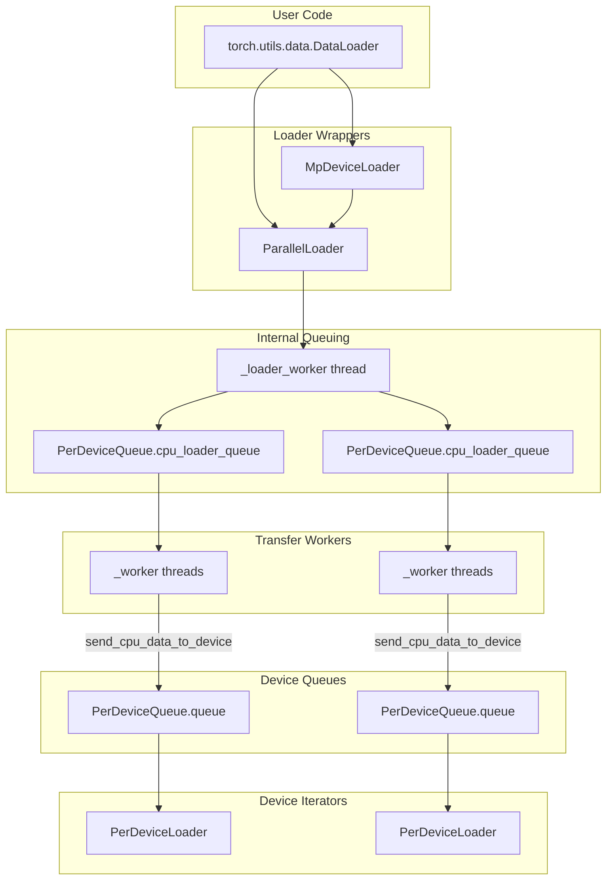
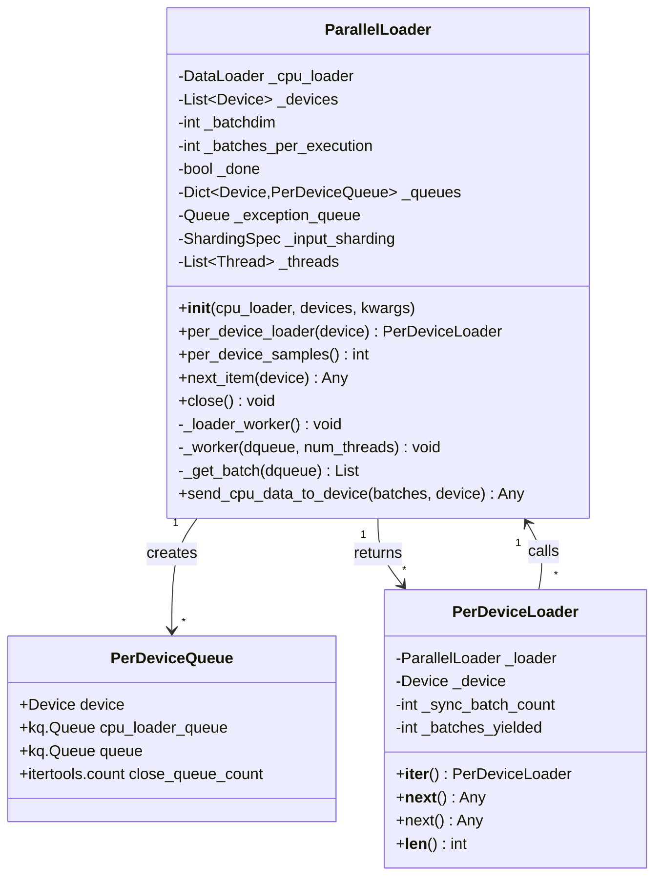
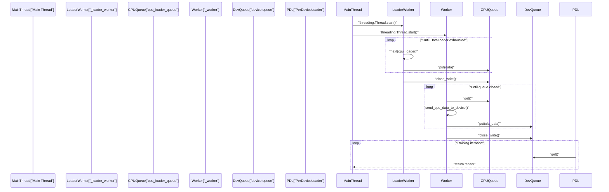
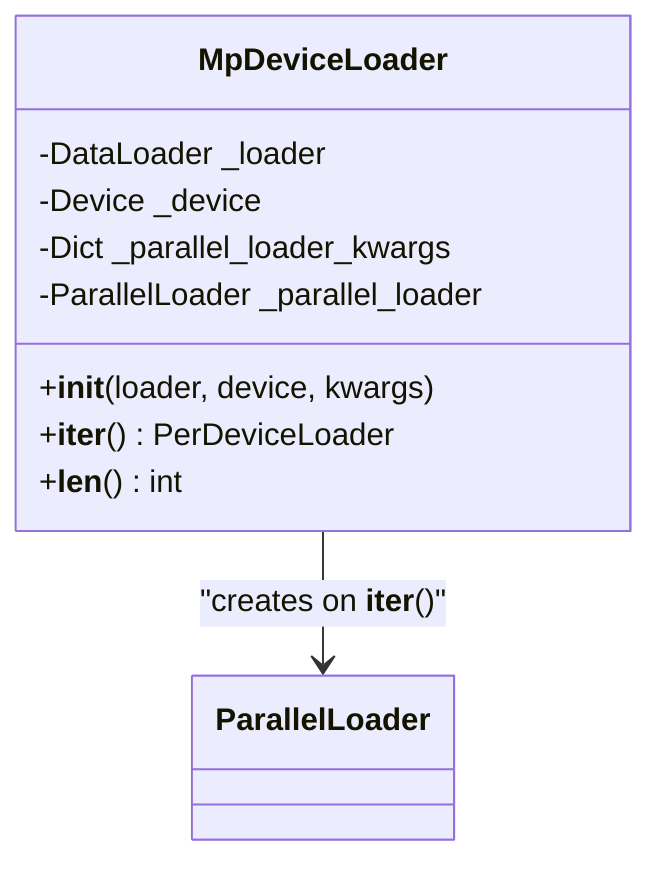
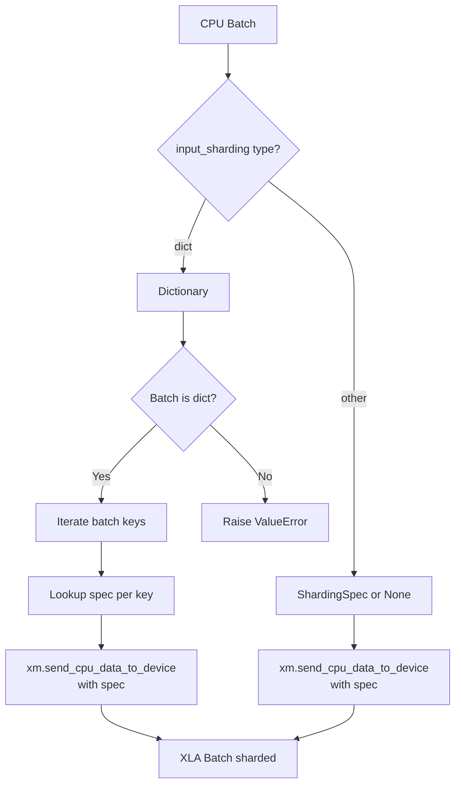
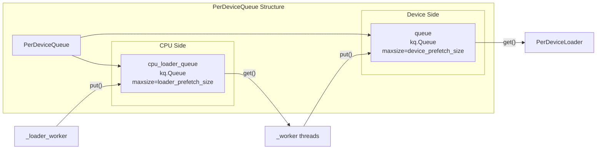
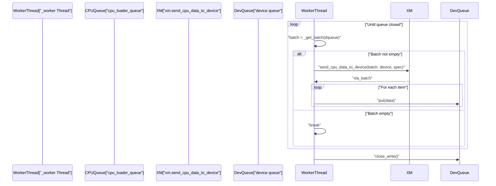
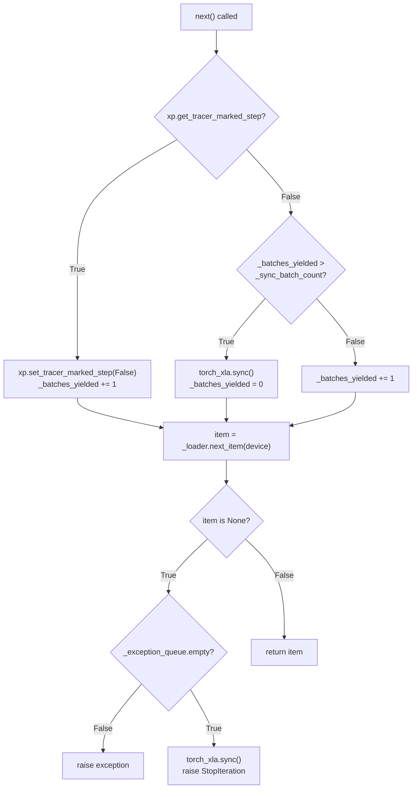
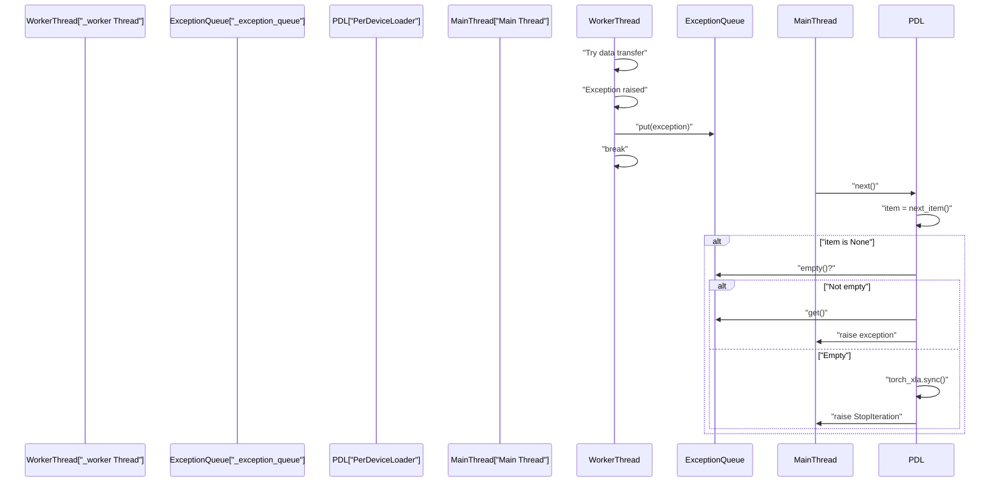

<!-- source: DeepWiki mcp.deepwiki.com · repo pytorch/xla · page 3.5 Distributed Data Loading · fetched 2026-10-21 -->

# Distributed Data Loading

<details>
<summary>Relevant source files</summary>

The following files were used as context for generating this wiki page:

- [docs/source/index.rst](docs/source/index.rst)
- [test/spmd/test_mp_input_sharding.py](test/spmd/test_mp_input_sharding.py)
- [torch_xla/core/xla_model.py](torch_xla/core/xla_model.py)
- [torch_xla/distributed/data_parallel.py](torch_xla/distributed/data_parallel.py)
- [torch_xla/distributed/parallel_loader.py](torch_xla/distributed/parallel_loader.py)
- [torch_xla/distributed/xla_multiprocessing.py](torch_xla/distributed/xla_multiprocessing.py)
- [torch_xla/utils/utils.py](torch_xla/utils/utils.py)

</details>


## Overview

PyTorch/XLA's distributed data loading system provides efficient host-to-device data transfer through `ParallelLoader` and `MpDeviceLoader` classes. The system implements multi-threaded background data upload, per-device queuing, and optional SPMD input sharding during transfer.

Related topics: Multi-process execution (page 3.2), SPMD sharding (page 3.4), collective operations (page 3.3).

---

## Core Components

PyTorch/XLA provides two data loading wrappers for PyTorch `DataLoader`:

- **`ParallelLoader`**: Multi-device data distribution with background threading
- **`MpDeviceLoader`**: Single-device wrapper for multi-process scenarios

Both support optional SPMD `ShardingSpec` annotations for automatic data partitioning during transfer.

### System Architecture



**Sources**: [torch_xla/distributed/parallel_loader.py:1-288]()

---

## ParallelLoader

The `ParallelLoader` class wraps a PyTorch `DataLoader` and manages background data upload to multiple XLA devices through a multi-threaded pipeline.

### Class Relationships



**Sources**: [torch_xla/distributed/parallel_loader.py:13-20](), [torch_xla/distributed/parallel_loader.py:22-57](), [torch_xla/distributed/parallel_loader.py:59-154]()

### Constructor Parameters

| Parameter | Type | Default | Description |
|-----------|------|---------|-------------|
| `cpu_loader` | `DataLoader` | Required | PyTorch DataLoader to wrap |
| `devices` | `List[Device]` | Required | List of XLA devices for data distribution |
| `batchdim` | `int` | `0` | Dimension holding the batch size |
| `batches_per_execution` | `int` | `1` | Number of batches before synchronization |
| `loader_prefetch_size` | `int` | `16` | Max capacity of CPU loader queue |
| `device_prefetch_size` | `int` | `8` | Max capacity of per-device queue |
| `host_to_device_transfer_threads` | `int` | `1` | Number of parallel transfer threads per device |
| `input_sharding` | `ShardingSpec` or `Dict` | `None` | Sharding specification for input tensors |

**Sources**: [torch_xla/distributed/parallel_loader.py:85-120]()

### Threading Model

`ParallelLoader` spawns daemon threads in two categories:

1. **`_loader_worker` thread**: Reads from PyTorch DataLoader and distributes batches to per-device CPU queues
2. **`_worker` threads**: Transfer data from CPU queues to device queues (configurable count per device via `host_to_device_transfer_threads`)

### Data Flow Sequence



**Sources**: [torch_xla/distributed/parallel_loader.py:106-120](), [torch_xla/distributed/parallel_loader.py:156-176](), [torch_xla/distributed/parallel_loader.py:227-250]()

### Round-Robin Distribution

The `_loader_worker` thread distributes batches round-robin across devices. Sample `i` from the DataLoader is routed to `devices[i % len(devices)]`.

```python
# Logic from _loader_worker (simplified)
batch = []
for i, data in enumerate(cpu_loader):
    batch.append(data)
    if len(batch) == len(devices):
        for queue_no, device_batch in enumerate(batch):
            queues[queue_no].cpu_loader_queue.put(device_batch)
        batch = []
```

**Sources**: [torch_xla/distributed/parallel_loader.py:156-176]()

---

## MpDeviceLoader

`MpDeviceLoader` wraps a PyTorch `DataLoader` for single-device multi-processing scenarios. It internally creates a `ParallelLoader` with one device.

### Class Structure



### Implementation Details

`MpDeviceLoader.__iter__()` recreates the internal `ParallelLoader` on each call, ensuring clean queue state per epoch. The method returns the `PerDeviceLoader` iterator for the wrapped device.

```python
def __iter__(self):
    if self._parallel_loader is not None:
        self._parallel_loader.close()
        self._parallel_loader = None
    self._parallel_loader = ParallelLoader(self._loader, [self._device],
                                           **self._parallel_loader_kwargs)
    return self._parallel_loader.per_device_loader(self._device)
```

**Sources**: [torch_xla/distributed/parallel_loader.py:253-288](), [torch_xla/distributed/parallel_loader.py:278-284]()

---

## Input Sharding with SPMD

Both `ParallelLoader` and `MpDeviceLoader` support automatic input sharding during data transfer through the `input_sharding` parameter.

### Sharding Specification Formats

| Format | Example | Use Case |
|--------|---------|----------|
| Single `ShardingSpec` | `ShardingSpec(mesh, ('x', None))` | Apply same sharding to all compatible tensors |
| Dictionary of `ShardingSpec` | `{'input_ids': ShardingSpec(mesh, ('x',)), 'labels': ShardingSpec(mesh, ('x',))}` | Different sharding per input key |
| `None` | `None` | Replicated (no sharding) |

### Single ShardingSpec Example

```python
from torch_xla.distributed.spmd import Mesh
import torch_xla.distributed.spmd as xs

# Create mesh
mesh = xs.get_1d_mesh('data')

# Single sharding spec applied to all tensors
train_loader = MpDeviceLoader(
    dataloader,
    device,
    input_sharding=xs.ShardingSpec(mesh, ('data', None))
)
```

This applies the same sharding specification to all compatible tensors in the batch.

**Sources**: [test/spmd/test_mp_input_sharding.py:63-76]()

### Dictionary ShardingSpec Example

```python
# Different sharding for different inputs
train_loader = MpDeviceLoader(
    dataloader,
    device,
    input_sharding={
        'input_ids': xs.ShardingSpec(mesh, ('data',)),
        'attention_mask': xs.ShardingSpec(mesh, ('data',)),
        'labels': xs.ShardingSpec(mesh, ('data',))
    }
)
```

When using a dictionary:
- The input batch must be a dictionary with matching keys
- Each key's tensor gets its specified sharding
- Missing keys in `input_sharding` raise a `KeyError`

**Sources**: [test/spmd/test_mp_input_sharding.py:36-59](), [torch_xla/distributed/parallel_loader.py:198-225]()

### Sharding Application Flow



**Sources**: [torch_xla/distributed/parallel_loader.py:186-225]()

The actual sharding is performed by `xm.send_cpu_data_to_device()`, which:
1. Transfers tensors to the device
2. Applies the specified `ShardingSpec` annotation
3. Returns a list of sharded XLA tensors

**Sources**: [torch_xla/distributed/parallel_loader.py:216-224]()

---

## Background Transfer Pipeline

The multi-threaded pipeline ensures efficient CPU-to-device transfer with minimal blocking of the training loop.

### Queue Structure



**Sources**: [torch_xla/distributed/parallel_loader.py:13-20]()

### Batching Strategy

The `_worker` threads accumulate multiple items before transfer via `_get_batch()`:

```python
def _get_batch(self, dqueue):
    batch = []
    while len(batch) < dqueue.queue.max_size():
        item = dqueue.cpu_loader_queue.get()
        if item is None:  # Queue closed
            break
        batch.append(item)
    return batch
```

This accumulates up to `device_prefetch_size` items, reducing individual transfer call overhead.

**Sources**: [torch_xla/distributed/parallel_loader.py:177-184]()

### Transfer Execution Flow



**Sources**: [torch_xla/distributed/parallel_loader.py:227-250]()

---

## PerDeviceLoader and Synchronization

The `PerDeviceLoader` class is the iterator returned by `ParallelLoader.per_device_loader()`. It manages synchronization between batches.

### Synchronization Logic



**Sources**: [torch_xla/distributed/parallel_loader.py:39-56]()

### Batches Per Execution

The `batches_per_execution` parameter controls synchronization frequency:

- `batches_per_execution=1`: Sync after every batch (default, safe but slower)
- `batches_per_execution=N`: Sync every N batches (faster, requires careful graph management)

The sync count is calculated as:
```python
self._sync_batch_count = loader.batches_per_execution - 1
```

When `_batches_yielded > _sync_batch_count`, a sync is triggered.

**Sources**: [torch_xla/distributed/parallel_loader.py:27-28](), [torch_xla/distributed/parallel_loader.py:44-48]()

---

## Exception Handling

The loader system uses an exception queue to propagate errors from worker threads to the main thread.

### Exception Propagation Flow



**Sources**: [torch_xla/distributed/parallel_loader.py:240-243](), [torch_xla/distributed/parallel_loader.py:51-55]()

Exceptions raised by the loader system:
- `ValueError`: Batch is not a dict when `input_sharding` is a dict (line 200-201)
- `KeyError`: Missing keys in `input_sharding` dict (line 220-221)
- Any exception from `xm.send_cpu_data_to_device()` is propagated

**Sources**: [torch_xla/distributed/parallel_loader.py:200-221]()

---

## DataParallel Integration

The `DataParallel` class uses `ParallelLoader` internally for thread-based multi-device training.

### DataParallel.__call__() Flow

The `DataParallel.__call__()` method:
1. Creates a `ParallelLoader` with all devices
2. Spawns threads per device with `_module_runner` target
3. Each thread calls `per_device_loader()` for its device

```python
# From DataParallel.__call__()
para_loader = pl.ParallelLoader(
    loader, self._device_ids, batchdim=batchdim, **self._kwargs)
for module, device, context in zip(self._models, self._device_ids, self._contexts):
    loader = para_loader.per_device_loader(device)
    thread = threading.Thread(
        target=self._module_runner,
        args=(loop_fn, device, module, loader, context, result),
        kwargs=kwargs)
    thread.start()
```

**Sources**: [torch_xla/distributed/data_parallel.py:134-153]()

---

## Performance Considerations

### Queue Sizing Parameters

| Parameter | Default | Effect |
|-----------|---------|--------|
| `loader_prefetch_size` | 16 | CPU queue capacity per device |
| `device_prefetch_size` | 8 | Device queue capacity per device |
| `host_to_device_transfer_threads` | 1 | Transfer thread count per device |

Higher queue sizes increase memory usage but improve overlap between data loading and model execution. Multiple transfer threads improve throughput when batches are small or CPU preprocessing is minimal.

**Sources**: [torch_xla/distributed/parallel_loader.py:70-80]()

### Transfer Thread Coordination

Multiple `_worker` threads per device coordinate via `close_queue_count` to ensure the device queue closes only after all threads finish:

```python
# From _worker() finalization
close_queue_count = next(dqueue.close_queue_count)
if close_queue_count == host_to_device_transfer_threads - 1:
    dqueue.queue.close_write()
```

The counter increments atomically; the last thread closes the queue.

**Sources**: [torch_xla/distributed/parallel_loader.py:248-250]()

### Profiling Trace Points

The loader uses `xp.Trace()` context managers for profiling:

| Trace Name | Location | Measures |
|------------|----------|----------|
| `"cpu_loader.next"` | `_loader_worker` | PyTorch DataLoader iteration time |
| `"get_batch_from_cpu_queue"` | `_worker` | Batch accumulation from CPU queue |
| `"cpu_data_to_xla_device"` | `_worker` | Host-to-device transfer time |

**Sources**: [torch_xla/distributed/parallel_loader.py:164](), [torch_xla/distributed/parallel_loader.py:232](), [torch_xla/distributed/parallel_loader.py:238]()

---

## Complete Usage Examples

### ParallelLoader Multi-Device Example

```python
import torch_xla.core.xla_model as xm
from torch_xla.distributed.parallel_loader import ParallelLoader
from torch.utils.data import DataLoader

# Standard PyTorch DataLoader
train_loader = DataLoader(dataset, batch_size=32, shuffle=True)

# Wrap with ParallelLoader
devices = xm.get_xla_supported_devices()
para_loader = ParallelLoader(
    train_loader,
    devices,
    batchdim=0,
    batches_per_execution=1,
    loader_prefetch_size=16,
    device_prefetch_size=8,
    host_to_device_transfer_threads=1
)

# Per-device iterator (typically used in separate threads)
device_loader = para_loader.per_device_loader(devices[0])
for batch in device_loader:
    # batch is on devices[0]
    output = model(batch)
```

**Sources**: [torch_xla/distributed/parallel_loader.py:59-154]()

### MpDeviceLoader Single-Device Example

```python
import torch_xla
from torch_xla.distributed.parallel_loader import MpDeviceLoader

# Single device per process (multi-processing setup)
device = torch_xla.device()

# Wrap DataLoader
train_device_loader = MpDeviceLoader(
    train_loader,
    device,
    loader_prefetch_size=16,
    device_prefetch_size=8
)

# Training loop
for epoch in range(num_epochs):
    for batch in train_device_loader:
        # batch is on XLA device
        output = model(batch)
        loss = criterion(output, batch['labels'])
        optimizer.zero_grad()
        loss.backward()
        optimizer.step()
```

**Sources**: [torch_xla/distributed/parallel_loader.py:253-288]()

### SPMD Input Sharding

```python
import torch_xla.distributed.spmd as xs

# Create mesh
num_devices = xr.global_runtime_device_count()
mesh = xs.Mesh(
    list(range(num_devices)),
    (num_devices,),
    ('data',)
)

# Dictionary-based sharding for transformer inputs
train_loader = MpDeviceLoader(
    dataloader,
    device,
    input_sharding={
        'input_ids': xs.ShardingSpec(mesh, ('data', None)),
        'attention_mask': xs.ShardingSpec(mesh, ('data', None)),
        'labels': xs.ShardingSpec(mesh, ('data',))
    }
)

for batch in train_loader:
    # batch['input_ids'] sharded along dimension 0
    # batch['attention_mask'] sharded along dimension 0
    # batch['labels'] sharded along dimension 0
    output = model(**batch)
```

**Sources**: [test/spmd/test_mp_input_sharding.py:36-59]()

---

