<!-- source: DeepWiki mcp.deepwiki.com · repo pytorch/xla · page 4 Advanced Features · fetched 2026-10-21 -->

# Advanced Features

<details>
<summary>Relevant source files</summary>

The following files were used as context for generating this wiki page:

- [test/benchmarks/test_ragged_paged_attention_benchmark.py](test/benchmarks/test_ragged_paged_attention_benchmark.py)
- [test/test_gmm.py](test/test_gmm.py)
- [test/test_multi_queries_paged_attention_kernel.py](test/test_multi_queries_paged_attention_kernel.py)
- [test/test_pallas.py](test/test_pallas.py)
- [test/test_pallas_spmd.py](test/test_pallas_spmd.py)
- [test/test_quantized_matmul_pallas_kernel.py](test/test_quantized_matmul_pallas_kernel.py)
- [test/test_ragged_paged_attention_kernel.py](test/test_ragged_paged_attention_kernel.py)
- [torch_xla/csrc/data_ops.cpp](torch_xla/csrc/data_ops.cpp)
- [torch_xla/csrc/data_ops.h](torch_xla/csrc/data_ops.h)
- [torch_xla/csrc/helpers.cpp](torch_xla/csrc/helpers.cpp)
- [torch_xla/csrc/helpers.h](torch_xla/csrc/helpers.h)
- [torch_xla/csrc/ops/split.cpp](torch_xla/csrc/ops/split.cpp)
- [torch_xla/csrc/ops/split.h](torch_xla/csrc/ops/split.h)
- [torch_xla/csrc/reduction.cpp](torch_xla/csrc/reduction.cpp)
- [torch_xla/csrc/reduction.h](torch_xla/csrc/reduction.h)
- [torch_xla/experimental/custom_kernel.py](torch_xla/experimental/custom_kernel.py)
- [torch_xla/experimental/pallas_kernels/__init__.py](torch_xla/experimental/pallas_kernels/__init__.py)
- [torch_xla/experimental/pallas_kernels/multi_queries_paged_attention_kernel.py](torch_xla/experimental/pallas_kernels/multi_queries_paged_attention_kernel.py)
- [torch_xla/experimental/pallas_kernels/quantized_matmul_kernel.py](torch_xla/experimental/pallas_kernels/quantized_matmul_kernel.py)
- [torch_xla/experimental/pallas_kernels/ragged_paged_attention_kernel.py](torch_xla/experimental/pallas_kernels/ragged_paged_attention_kernel.py)
- [torch_xla/experimental/pallas_kernels/ragged_paged_attention_v2.py](torch_xla/experimental/pallas_kernels/ragged_paged_attention_v2.py)

</details>


This document covers advanced capabilities in PyTorch/XLA that extend beyond standard tensor operations. It focuses on two major areas: (1) Custom kernel integration with JAX/Pallas for high-performance TPU-specific operations, and (2) Dynamic shape support including bounded and unbounded dynamism for variable-sized tensor computations.

For distributed training features like SPMD and collective operations, see [Distributed Training and SPMD](#3). For core tensor operations and the lazy execution model, see [Core Components](#2).

---

## Custom Kernels and Pallas Integration

PyTorch/XLA provides a framework for integrating custom TPU kernels written in JAX/Pallas, enabling users to leverage highly optimized kernels for operations like Flash Attention and quantized matrix multiplication. The integration bridges PyTorch's eager execution model with JAX's compilation pipeline while maintaining compatibility with PyTorch's autograd system.

### Architecture Overview

The custom kernel system operates through several layers:

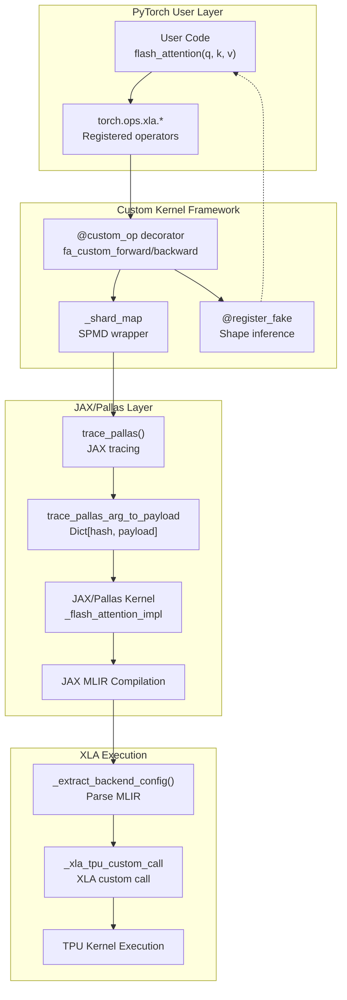

**Sources:** [torch_xla/experimental/custom_kernel.py:1-288]()

### Core Integration Mechanisms

#### Payload Extraction and Caching

The `trace_pallas()` function converts JAX/Pallas kernels to executable payloads:

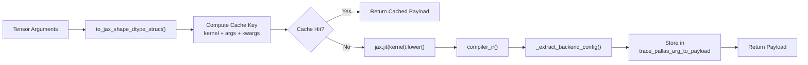

The payload cache is a global dictionary mapping input signatures to compiled MLIR backend configurations:

- **Key**: `(jax_config, kernel, static_argnums, static_argnames, tuple(jax_args), kwargs)`
- **Value**: Serialized MLIR backend config string

**Sources:** [torch_xla/experimental/custom_kernel.py:207-258]()

#### Custom Operator Registration

PyTorch custom operators are registered using `@custom_op` decorator with fake implementations for shape inference:

| Component | Purpose | Example |
|-----------|---------|---------|
| `@custom_op` | Register forward/backward ops | `fa_custom_forward`, `fa_custom_backward` |
| `@register_fake` | Provide shape inference without execution | Returns empty tensors with correct shapes |
| `mutates_args=()` | Declare no in-place mutations | Required for torch.compile compatibility |

**Sources:** [torch_xla/experimental/custom_kernel.py:403-471](), [torch_xla/experimental/custom_kernel.py:643-706]()

### Flash Attention Implementation

Flash Attention is a memory-efficient attention mechanism that reduces memory usage from O(N²) to O(N) by tiling and recomputation.

#### Forward Pass

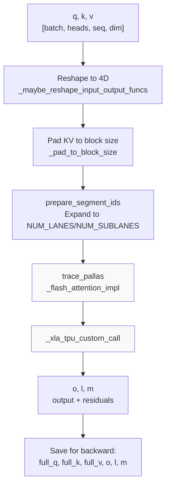

**Key Implementation Details:**

1. **Block Sizes**: Tuned per TPU version (v4/v5/v6):
   - `block_q`: Query block size (typically 512-1024)
   - `block_k_major`: Major K block size (512)
   - `block_k`: Minor K block size (256-512)
   - `block_b`: Batch block size (2)

2. **Residuals**: Forward pass saves `l` (log-sum-exp) and `m` (max values) for backward:
   - Shape: `[batch, heads, seq, MIN_BLOCK_SIZE]` where `MIN_BLOCK_SIZE = 128`
   - Required when any of q, k, v requires gradients

3. **Segment IDs**: For packed sequences, segment IDs mask attention across different sequences:
   - Expanded to `[batch, num_heads, q_seq, NUM_LANES=128]` for queries
   - Expanded to `[batch, NUM_SUBLANES=8, kv_seq]` for keys/values

**Sources:** [torch_xla/experimental/custom_kernel.py:308-400](), [torch_xla/experimental/custom_kernel.py:747-823]()

#### Backward Pass

The backward pass computes gradients with respect to q, k, v using saved residuals:

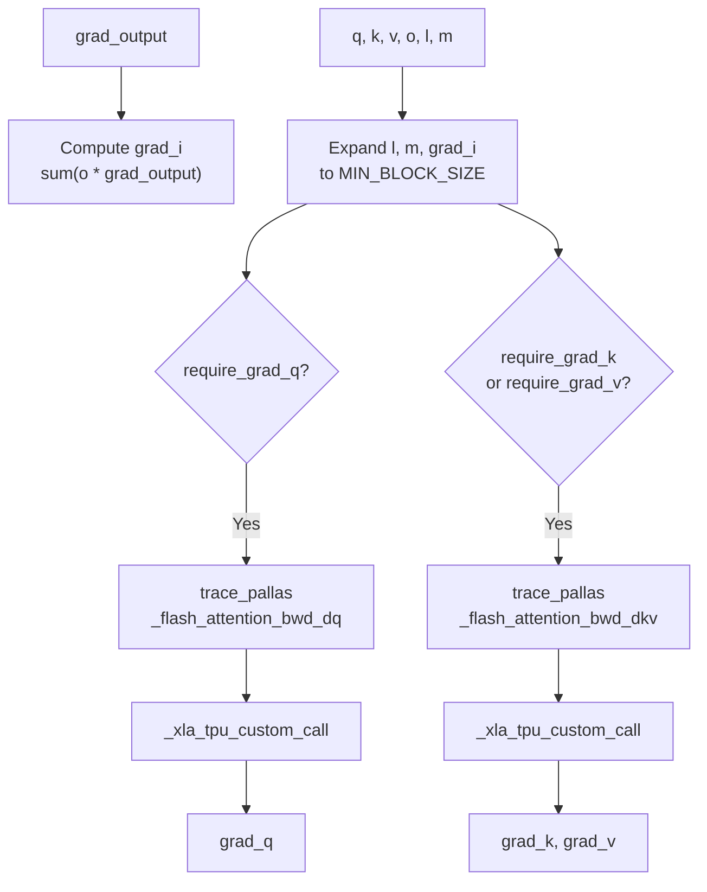

**Sources:** [torch_xla/experimental/custom_kernel.py:495-640](), [torch_xla/experimental/custom_kernel.py:825-851]()

### Ragged Paged Attention

Ragged Paged Attention is optimized for serving workloads with variable-length sequences, storing KV cache in pages to avoid memory fragmentation.

#### Data Layout

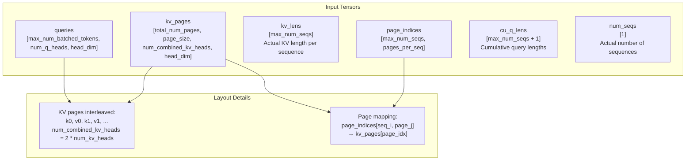

#### Kernel Configuration

The kernel is highly parameterized with tuned configurations per TPU version:

| Parameter | Description | Example Values |
|-----------|-------------|----------------|
| `num_q_heads_per_blk` | Query heads per block | 12, 28 (v6) |
| `num_kv_heads_per_blk` | KV heads per block | 2, 4 (v6) |
| `num_kv_pages_per_block` | Pages loaded per iteration | 4, 8, 16 |
| `num_queries_per_block` | Queries processed per iteration | 32, 64 |
| `page_size` | Tokens per page | 16, 32, 64, 128, 256 |

**Tuned Block Sizes**: Over 1000 tuned configurations stored in `TUNED_BLOCK_SIZES` dict keyed by:
- TPU version (v4, v5, v6)
- Data types (q_dtype, kv_dtype)
- Dimensions (num_q_heads_per_blk, num_kv_heads_per_blk, head_dim, page_size)
- Batch constraints (max_num_batched_tokens, max_model_len)

**Sources:** [torch_xla/experimental/pallas_kernels/ragged_paged_attention_v2.py:30-48](), [torch_xla/experimental/custom_kernel.py:871-1053]()

#### Runtime Validation

The kernel performs extensive runtime checks:

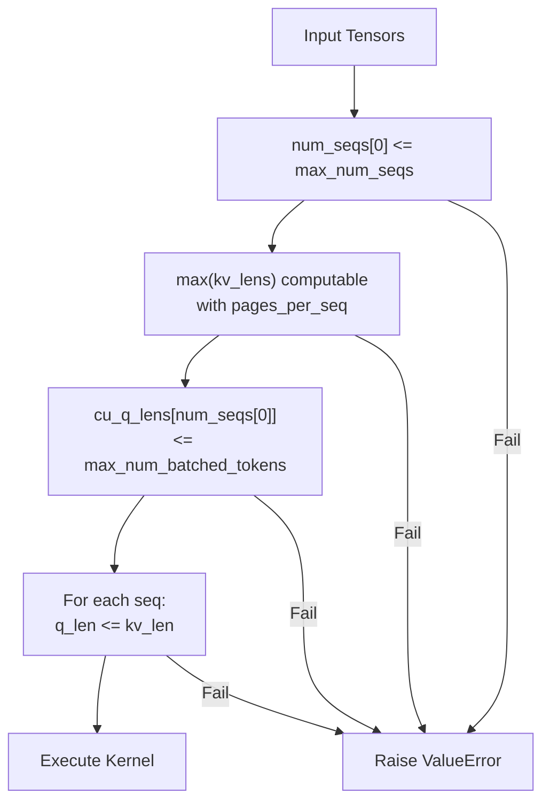

**Sources:** [torch_xla/experimental/custom_kernel.py:873-902]()

### Quantized Matrix Multiplication

The quantized matmul kernel performs INT8 quantization for memory-efficient inference:

#### Quantization Flow

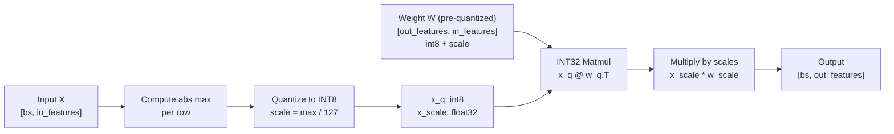

#### Kernel Parameters

The kernel supports various configurations:

| Mode | `quantize_activation` | `save_acc` | `save_x_q` | Use Case |
|------|----------------------|------------|------------|----------|
| Dynamic Quant | True | False | False | Single-layer inference |
| Cached Quant | True | False | True | Multi-layer (reuse quantized activations) |
| Accumulation | True | True | True | Very large matrices (split computation) |
| No Quant | False | - | False | Weights-only quantization |

**Block Size Tuning**: The kernel selects block sizes based on:
- Input dimensions (batch_size, in_features, out_features)
- Available VMEM (considering double buffering)
- Tensor layouts and alignment requirements

**Sources:** [torch_xla/experimental/pallas_kernels/quantized_matmul_kernel.py:1-274](), [torch_xla/experimental/custom_kernel.py:1634-1792]()

### SPMD Integration with Custom Kernels

Custom kernels can be wrapped with `_shard_map()` for SPMD parallelism:

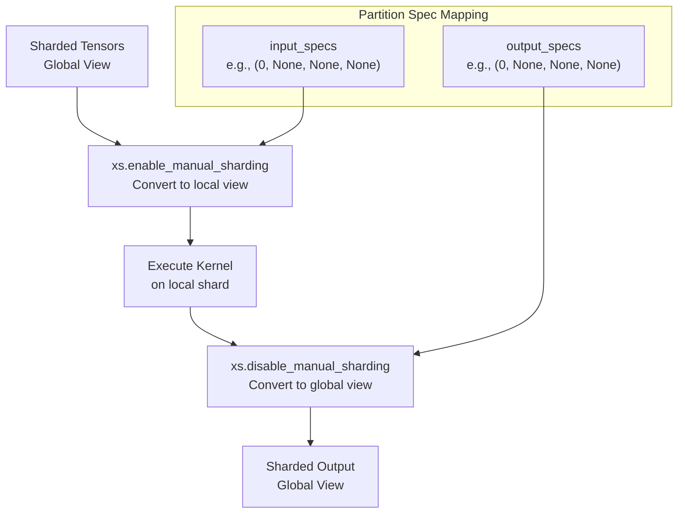

**Key Functions:**

- **`_shard_map(func, mesh, input_specs, output_specs)`**: Wraps kernel for SPMD execution
- **`xs.enable_manual_sharding(tensor, spec, mesh)`**: Provides local view of sharded tensor
- **`xs.disable_manual_sharding(tensor, spec, full_shape, mesh)`**: Reconstructs global view

**Example**: Flash Attention with data parallelism on batch dimension:
```python
partition_spec = (0, None, None, None)  # Shard batch
o = flash_attention(q, k, v, partition_spec=partition_spec)
```

**Sources:** [torch_xla/experimental/custom_kernel.py:25-109](), [torch_xla/experimental/custom_kernel.py:431-468]()

### Helper Functions and Utilities

#### Type Conversion

**`convert_torch_dtype_to_jax(dtype)`**: Maps PyTorch dtypes to JAX dtypes:

| PyTorch | JAX | Notes |
|---------|-----|-------|
| `torch.float32` | `jnp.float32` | - |
| `torch.bfloat16` | `jnp.bfloat16` | - |
| `torch.float8_e5m2` | `jnp.float8_e5m2` | FP8 types |
| `torch.float8_e4m3fn` | `jnp.float8_e4m3fn` | FP8 types |
| `torch.int8` | `jnp.int8` | Quantization |

**Sources:** [torch_xla/experimental/custom_kernel.py:161-194]()

#### Payload Extraction

**`_extract_backend_config(module)`**: Extracts serialized kernel from MLIR:

1. Traverses MLIR module operations (2 levels deep)
2. Searches for `stablehlo.custom_call` operation
3. Returns `backend_config.value` containing base64-encoded kernel

**Sources:** [torch_xla/experimental/custom_kernel.py:125-158]()

---

## Dynamic Shapes and Symbolic Integers

PyTorch/XLA supports dynamic shapes to handle variable-sized tensors efficiently. The system provides two modes: (1) bounded dynamism where dimensions have upper bounds, and (2) unbounded dynamism where dimensions can grow arbitrarily.

### Dynamic Reshape System

The core dynamic reshape functionality handles shape transformations while propagating dynamic dimension information.

#### Architecture

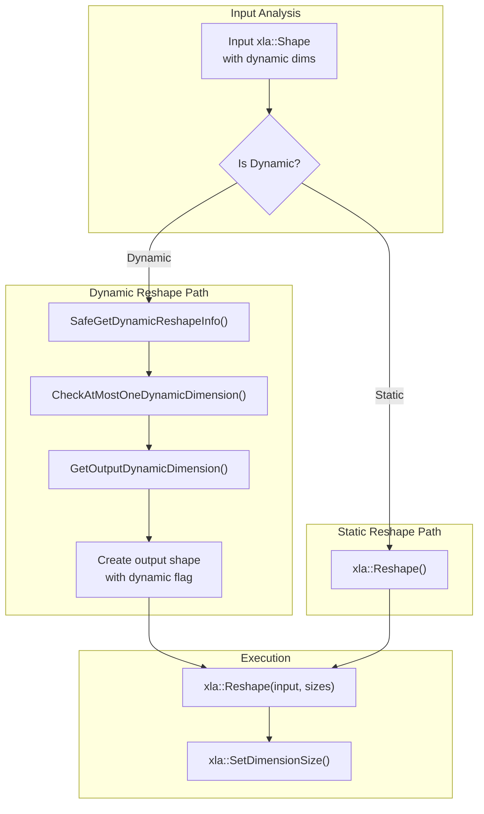

**Sources:** [torch_xla/csrc/helpers.cpp:533-579](), [torch_xla/csrc/helpers.h:161-201]()

#### Dynamic Dimension Mapping

**`GetOutputDynamicDimension()`** maps the input dynamic dimension to the output:

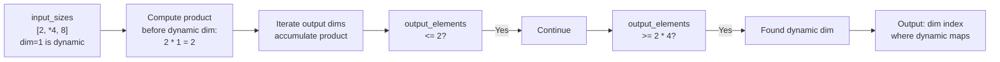

**Example Mapping:**
- Input: `[2, *4, 8]` (32 elements, dim 1 dynamic)
- Output: `[8, *4, 2]` → dim 1 is dynamic (8 elements before, 8*4=32 including)
- Output: `[64]` → dim 0 is dynamic (entire tensor)

**Sources:** [torch_xla/csrc/helpers.cpp:230-273]()

#### Error Handling

The system performs comprehensive validation:

| Error Condition | Check Function | Error Message |
|----------------|----------------|---------------|
| More than 1 dynamic dim | `CheckAtMostOneDynamicDimension()` | "expected shape [...] to have a single dynamic dimension (*)" |
| Unbounded output dims | `CheckNoOutputSizesAreUnbounded()` | "expected output sizes [...] to have no unbounded dynamic dimensions" |
| Dynamic dim split | `CheckDynamicDimensionNotSplit()` | "Expected the number of output elements..." |
| No output dim found | `CheckFoundOutputDynamicDimension()` | "The mapped dynamic dimension of the output was not found" |

**Sources:** [torch_xla/csrc/helpers.cpp:142-224]()

### Unbounded Dynamism

Unbounded dynamism allows dimensions to grow without compile-time upper bounds, using custom calls for shape manipulation.

#### Dynamic Unbounded Reshape

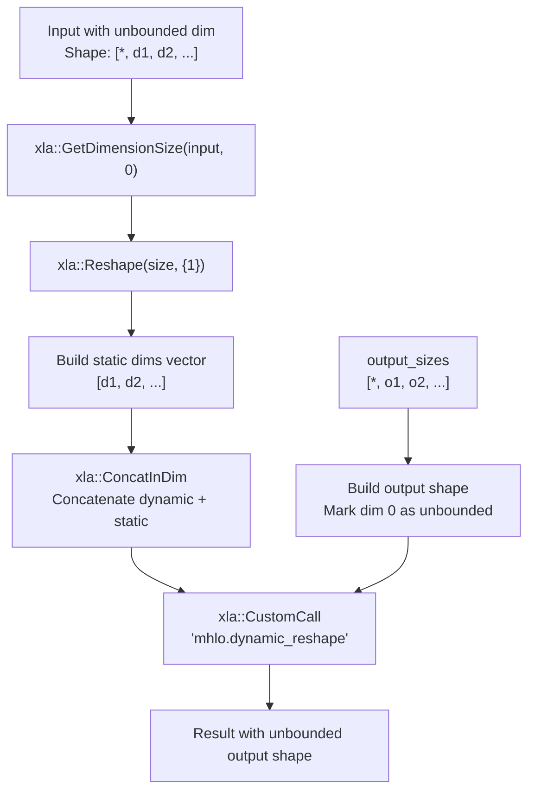

**Key Implementation:**

- **`DynamicUnboundedReshape(input, aux_input, output_sizes)`**: Uses custom call `"mhlo.dynamic_reshape"`
- Preserves unbounded dimension markers: `xla::Shape::kUnboundedSize`
- Broadcasts dimensions from `aux_input` to guide shape inference

**Sources:** [torch_xla/csrc/helpers.cpp:627-694](), [torch_xla/csrc/helpers.h:203-214]()

#### View Operation with Unbounded Dims

The view operation handles unbounded dynamism through custom reshaping:

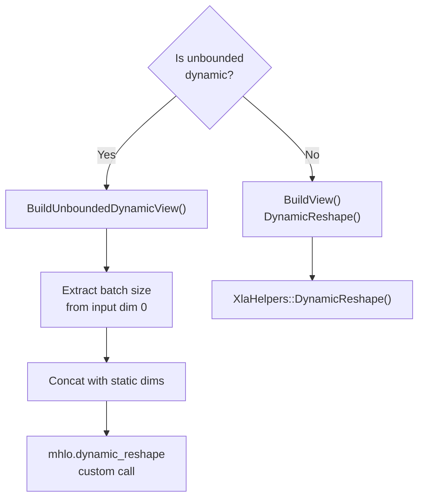

**Constraints:**
- Only batch size (dim 0) can be unbounded
- Product of non-batch dims must match between input and output
- Uses `mhlo.dynamic_reshape` custom call for runtime shape resolution

**Sources:** [torch_xla/csrc/data_ops.cpp:95-145](), [torch_xla/csrc/data_ops.h:27-32]()

### Helper Functions for Dynamic Operations

#### XlaHelpers Methods

| Method | Purpose | Dynamic Handling |
|--------|---------|------------------|
| `GetDimensionsSize()` | Compute total size of dimensions | Returns `{XlaOp, optional<int64_t>}` |
| `DynamicReshape()` | Reshape with dynamic dims | Propagates dynamic dimension |
| `SafeDynamicReshape()` | Error-checked reshape | Returns `StatusOr<XlaOp>` |
| `DynamicBroadcastInDim()` | Broadcast with dynamic shapes | Uses `xla::SetDimensionSize()` |
| `IsUnboundedDynamic()` | Check if shape has unbounded dims | Tests for `kUnboundedSize` |

**Sources:** [torch_xla/csrc/helpers.h:36-228](), [torch_xla/csrc/helpers.cpp:369-404]()

#### Dimension Size Computation

**`GetDimensionsSize()`** computes dimension sizes handling both static and dynamic cases:

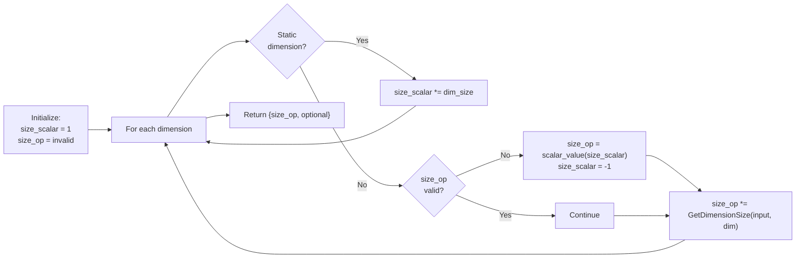

**Return Value:**
- `DynamicSize::size`: XlaOp computing the runtime size
- `DynamicSize::scalar_size`: Optional compile-time size (if all static)

**Sources:** [torch_xla/csrc/helpers.cpp:369-404](), [torch_xla/csrc/helpers.h:42-45]()

### Shape Inference and Propagation

#### Reduction Operations

Reduction operations maintain dynamic shape information:

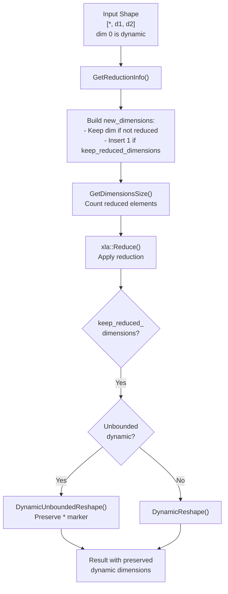

**Example:** Sum over dim 1:
- Input: `[*8, 4, 16]` (dim 0 dynamic)
- Output: `[*8, 16]` (dim 0 still dynamic)
- Output (keep_dims): `[*8, 1, 16]` (dim 0 still dynamic)

**Sources:** [torch_xla/csrc/reduction.cpp:26-140](), [torch_xla/csrc/reduction.h:1-96]()

#### Expansion and Broadcasting

**`BuildExpand()`** handles dynamic shape broadcasting:

1. Adjust input rank: Insert 1s at the beginning if needed
2. Use `DynamicReshape()` to match dimensions
3. Apply `xla::BroadcastInDim()` with correct dimension mapping

For unbounded shapes, implicit broadcasting uses `ImplicitBroadcastWithUnboundedDynamicShapes()` which:
- Identifies unbounded dimensions
- Creates dynamic broadcast using `DynamicUnboundedBroadcast()`
- Ensures proper dimension alignment

**Sources:** [torch_xla/csrc/data_ops.cpp:183-193](), [torch_xla/csrc/helpers.cpp:712-772]()

### SetDimensionSizes API

The `SetDimensionSizes()` function marks dimensions as dynamically sized:

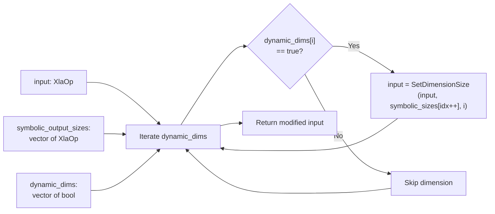

**Usage Example:**
```cpp
// Mark dims 0 and 2 as dynamic
std::vector<bool> dynamic_dims = {true, false, true, false};
std::vector<xla::XlaOp> sizes = {size_dim0, size_dim2};
xla::XlaOp result = SetDimensionSizes(input, sizes, dynamic_dims);
```

**Sources:** [torch_xla/csrc/data_ops.cpp:147-164](), [torch_xla/csrc/data_ops.h:34-37]()

### Environment Control

**`IsUnboundedDynamismEnabled()`**: Feature flag for unbounded dynamism

- Environment variable: `EXPERIMENTAL_XLA_UNBOUNDED_DYNAMISM`
- Default: `false` (bounded dynamism only)
- When enabled: Allows `xla::Shape::kUnboundedSize` dimensions

**Sources:** [torch_xla/csrc/helpers.h:205-208]()

---

**Document Sources:**
- [torch_xla/experimental/custom_kernel.py:1-1800]()
- [torch_xla/csrc/helpers.cpp:1-1500]()
- [torch_xla/csrc/helpers.h:1-500]()
- [torch_xla/csrc/data_ops.cpp:1-1000]()
- [torch_xla/csrc/data_ops.h:1-122]()
- [torch_xla/csrc/reduction.cpp:1-500]()
- [torch_xla/csrc/reduction.h:1-96]()
- [torch_xla/experimental/pallas_kernels/ragged_paged_attention_v2.py:1-1000]()
- [torch_xla/experimental/pallas_kernels/quantized_matmul_kernel.py:1-274]()
- [test/test_pallas.py:1-1500]()

---

