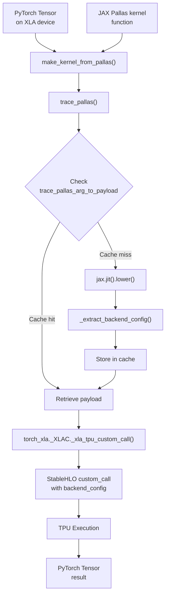
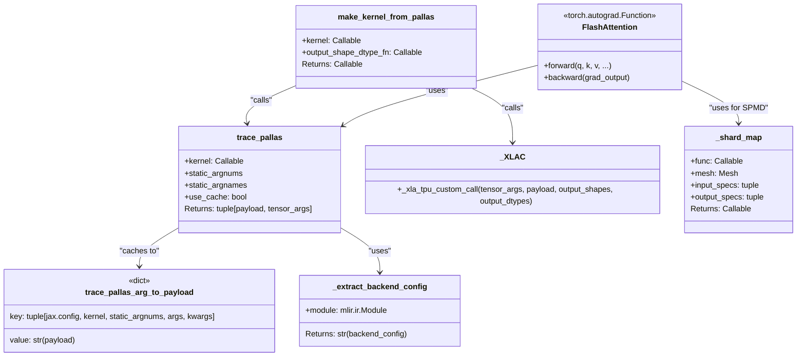
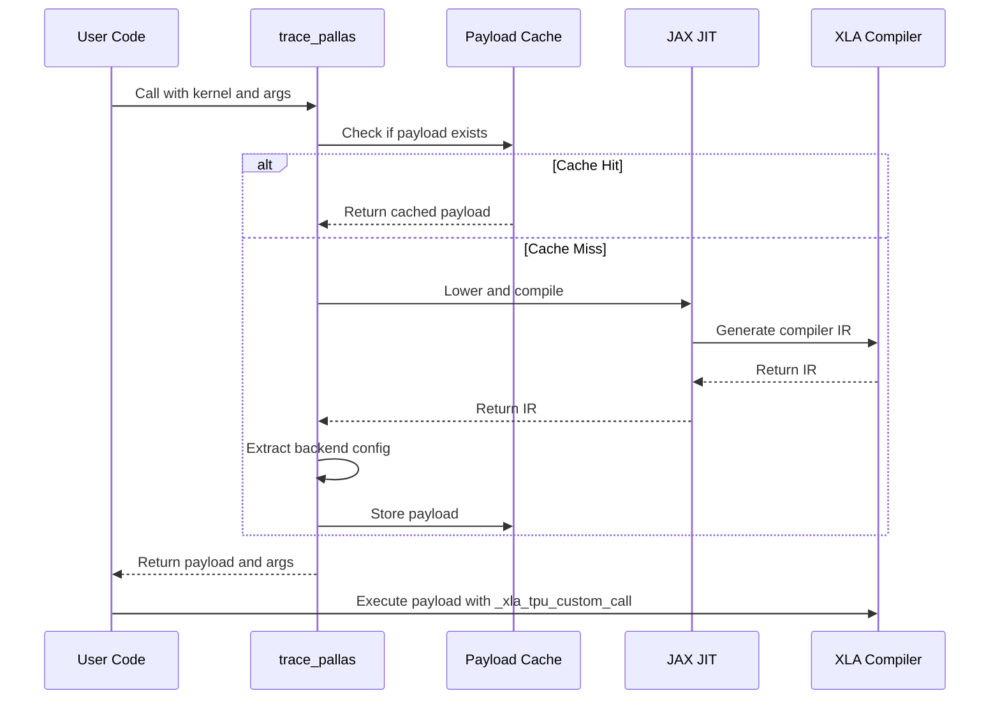
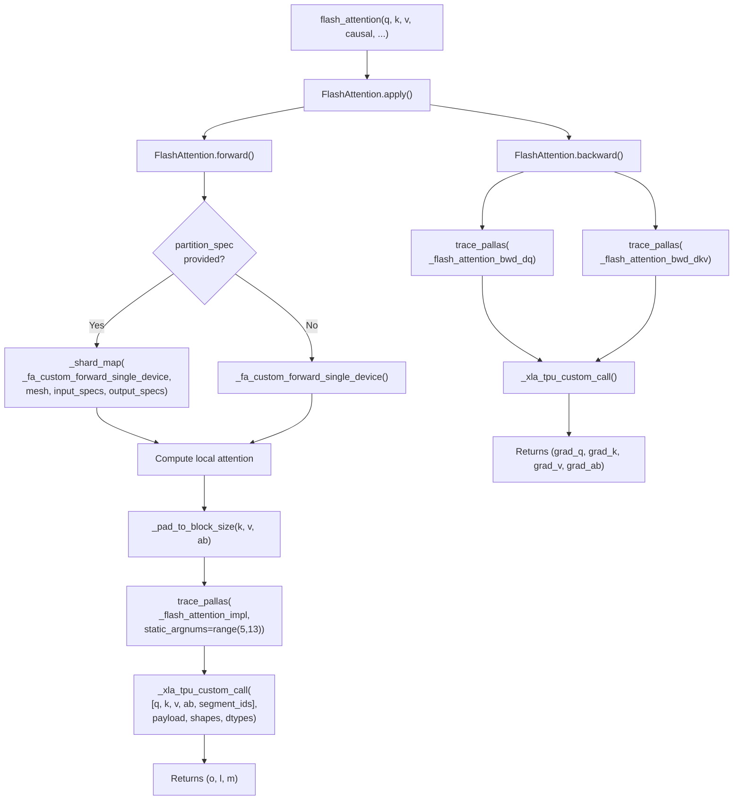
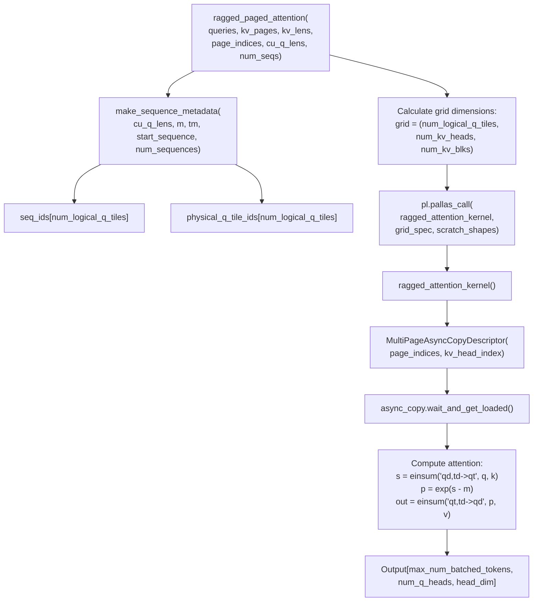
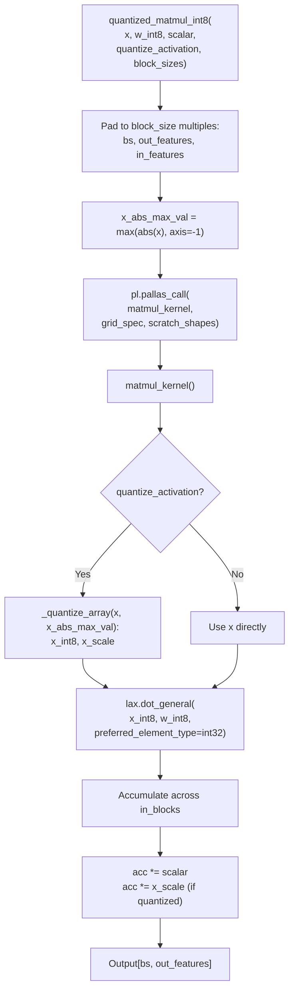
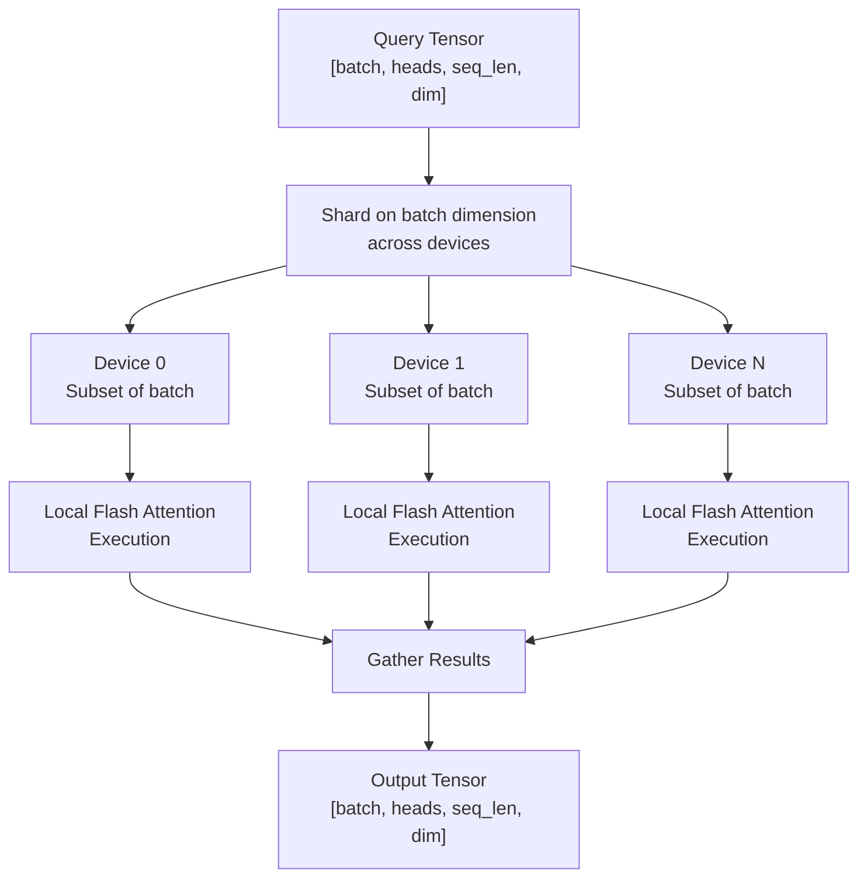
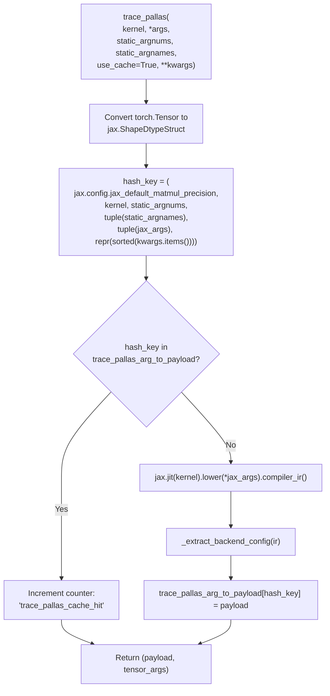

<!-- source: DeepWiki mcp.deepwiki.com · repo pytorch/xla · page 4.1 Custom Kernels and Pallas Integration · fetched 2026-10-21 -->

# Custom Kernels

<details>
<summary>Relevant source files</summary>

The following files were used as context for generating this wiki page:

- [test/benchmarks/test_ragged_paged_attention_benchmark.py](test/benchmarks/test_ragged_paged_attention_benchmark.py)
- [test/test_gmm.py](test/test_gmm.py)
- [test/test_multi_queries_paged_attention_kernel.py](test/test_multi_queries_paged_attention_kernel.py)
- [test/test_pallas.py](test/test_pallas.py)
- [test/test_pallas_spmd.py](test/test_pallas_spmd.py)
- [test/test_quantized_matmul_pallas_kernel.py](test/test_quantized_matmul_pallas_kernel.py)
- [test/test_ragged_paged_attention_kernel.py](test/test_ragged_paged_attention_kernel.py)
- [torch_xla/experimental/custom_kernel.py](torch_xla/experimental/custom_kernel.py)
- [torch_xla/experimental/pallas_kernels/__init__.py](torch_xla/experimental/pallas_kernels/__init__.py)
- [torch_xla/experimental/pallas_kernels/multi_queries_paged_attention_kernel.py](torch_xla/experimental/pallas_kernels/multi_queries_paged_attention_kernel.py)
- [torch_xla/experimental/pallas_kernels/quantized_matmul_kernel.py](torch_xla/experimental/pallas_kernels/quantized_matmul_kernel.py)
- [torch_xla/experimental/pallas_kernels/ragged_paged_attention_kernel.py](torch_xla/experimental/pallas_kernels/ragged_paged_attention_kernel.py)
- [torch_xla/experimental/pallas_kernels/ragged_paged_attention_v2.py](torch_xla/experimental/pallas_kernels/ragged_paged_attention_v2.py)

</details>


## Purpose and Scope

This document explains how to use and create custom TPU kernels in PyTorch/XLA. Custom kernels allow you to write highly optimized, hardware-specific implementations of operations that can dramatically improve performance. PyTorch/XLA provides integration with JAX's Pallas library to enable custom kernels for TPU hardware acceleration. For information about PyTorch's standard XLA integration, see [PyTorch/XLA Bridge](#2.1).

## Overview

Custom kernels in PyTorch/XLA enable execution of JAX Pallas kernels through the `torch_xla.experimental.custom_kernel` module. The integration uses `trace_pallas()` to convert Pallas kernels into StableHLO payloads, which are then executed via the `_xla_tpu_custom_call` primitive. This allows PyTorch models to leverage optimized TPU kernels from the JAX ecosystem while maintaining autograd support and SPMD compatibility.

**Custom Kernel Execution Flow**



Sources:
- [torch_xla/experimental/custom_kernel.py:210-257]()
- [torch_xla/experimental/custom_kernel.py:260-287]()
- [torch_xla/experimental/custom_kernel.py:125-158]()
- [torch_xla/experimental/custom_kernel.py:207]()

## Core Components and Architecture

The custom kernel system consists of several key components in `torch_xla/experimental/custom_kernel.py` that enable JAX/Pallas kernel execution within PyTorch.

**Core API Functions and Data Structures**



Sources:
- [torch_xla/experimental/custom_kernel.py:210-257]()
- [torch_xla/experimental/custom_kernel.py:260-287]()
- [torch_xla/experimental/custom_kernel.py:125-158]()
- [torch_xla/experimental/custom_kernel.py:25-109]()
- [torch_xla/experimental/custom_kernel.py:747-851]()

### Custom Kernel Lifecycle

1. **Pallas Kernel Definition**: Define a kernel using JAX's Pallas library
2. **Tracing**: Trace the kernel to generate an XLA payload
3. **Payload Extraction**: Extract the backend configuration
4. **Custom Call**: Execute the payload on TPU hardware using `_xla_tpu_custom_call`
5. **Results Processing**: Return and potentially reshape the results

#### Payload Generation and Caching Mechanism



Sources:
- [torch_xla/experimental/custom_kernel.py:203-251](torch_xla/experimental/custom_kernel.py)
- [torch_xla/experimental/custom_kernel.py:124-157](torch_xla/experimental/custom_kernel.py)

## Creating Custom Kernels

### Using `make_kernel_from_pallas`

The main API for creating custom kernels is `make_kernel_from_pallas`, which takes a JAX Pallas kernel function and creates a PyTorch-compatible kernel function:

```python
def make_kernel_from_pallas(kernel: Callable, output_shape_dtype_fn: Callable):
    # Converts a JAX Pallas kernel to a PyTorch-compatible function
    # kernel: The JAX Pallas kernel function
    # output_shape_dtype_fn: Function to determine output shape and dtype
    # Returns: A callable PyTorch function
```

This creates a wrapped function that:
1. Traces the JAX Pallas kernel to generate an XLA payload
2. Determines output shapes and dtypes
3. Executes the payload using `_xla_tpu_custom_call`
4. Returns the results in a PyTorch-friendly format

Sources:
- [torch_xla/experimental/custom_kernel.py:253-281](torch_xla/experimental/custom_kernel.py)
- [test/test_pallas.py:236-249](test/test_pallas.py)

### Example: Creating a Simple Addition Kernel

```python
import jax
import jax.numpy as jnp
from jax.experimental import pallas as pl
from torch_xla.experimental.custom_kernel import make_kernel_from_pallas

# Define the JAX Pallas kernel
def add_vectors_kernel(x_ref, y_ref, o_ref):
    x, y = x_ref[...], y_ref[...]
    o_ref[...] = x + y

# JIT-compile it with JAX
@jax.jit
def add_vectors(x: jax.Array, y: jax.Array) -> jax.Array:
    return pl.pallas_call(
        add_vectors_kernel, 
        out_shape=jax.ShapeDtypeStruct(x.shape, x.dtype)
    )(x, y)

# Create a PyTorch-compatible kernel
pt_kernel = make_kernel_from_pallas(add_vectors, lambda x, y: [(x.shape, x.dtype)])

# Use the kernel with PyTorch tensors
x = torch.randn((2, 2), dtype=torch.float32).to("xla")
y = torch.randn((2, 2), dtype=torch.float32).to("xla")
result = pt_kernel(x, y)
```

Sources:
- [test/test_pallas.py:226-240](test/test_pallas.py)
- [test/test_pallas.py:241-249](test/test_pallas.py)

### Type Conversion Between PyTorch and JAX

When creating custom kernels, you often need to convert between PyTorch and JAX data types. The `convert_torch_dtype_to_jax` function handles this conversion:

```python
@requires_jax
def convert_torch_dtype_to_jax(dtype: torch.dtype) -> "jnp.dtype":
    # Convert PyTorch dtype to JAX dtype
```

Similarly, `to_jax_shape_dtype_struct` converts a PyTorch tensor to a JAX ShapeDtypeStruct, which is useful for tracing:

```python
@requires_jax
def to_jax_shape_dtype_struct(tensor: torch.Tensor) -> "jax.ShapeDtypeStruct":
    # Convert PyTorch tensor to JAX ShapeDtypeStruct
```

Sources:
- [torch_xla/experimental/custom_kernel.py:160-187](torch_xla/experimental/custom_kernel.py)
- [torch_xla/experimental/custom_kernel.py:191-197](torch_xla/experimental/custom_kernel.py)

## Available Custom Kernels

PyTorch/XLA provides several pre-implemented custom kernels optimized for TPU hardware.

### Flash Attention

Flash Attention implements memory-efficient attention using JAX's `_flash_attention_impl` kernel from `jax.experimental.pallas.ops.tpu.flash_attention`. The implementation is wrapped in `FlashAttention` (a `torch.autograd.Function`) and exposed as `flash_attention()`.

**Flash Attention Implementation Architecture**



**Supported Features:**
- Block sizes: `DEFAULT_BLOCK_SIZES` dictionary defines tuned block configurations (e.g., `block_q=512`, `block_k=512`)
- Causal masking via `causal` parameter
- Segment IDs: `SegmentIds` from JAX Pallas for masked attention within segments
- Attention bias: Optional `ab` parameter for additive attention bias
- SPMD: Partition specs like `(0, None, None, None)` for data parallelism
- Backward pass: Separate kernels `_flash_attention_bwd_dq` and `_flash_attention_bwd_dkv`

Sources:
- [torch_xla/experimental/custom_kernel.py:747-851]()
- [torch_xla/experimental/custom_kernel.py:308-400]()
- [torch_xla/experimental/custom_kernel.py:495-640]()
- [torch_xla/experimental/custom_kernel.py:854-869]()
- [torch_xla/experimental/custom_kernel.py:750-769]()

### Ragged Paged Attention

Ragged Paged Attention handles variable-length sequences with paged KV cache, implemented in `torch_xla/experimental/pallas_kernels/ragged_paged_attention_v2.py`. The kernel uses `ragged_paged_attention()` from JAX Pallas and is exposed through `ragged_paged_attention()` wrapper.

**Ragged Paged Attention Data Flow**



**Key Features:**
- **Paged KV cache:** `kv_pages` shape is `[total_num_pages, page_size, num_combined_kv_heads, head_dim]` where K and V are interleaved
- **Ragged batching:** `cu_q_lens` (cumulative query lengths) specifies variable sequence lengths
- **Tuned block sizes:** `TUNED_BLOCK_SIZES` dictionary contains optimized `(num_kv_pages_per_block, num_queries_per_block)` for different configurations
- **Async page loading:** `MultiPageAsyncCopyDescriptor` loads KV pages asynchronously from HBM to VMEM
- **Sliding window:** Optional `sliding_window` parameter for local attention
- **Soft capping:** Optional `soft_cap` parameter applies `soft_cap * tanh(logits / soft_cap)`
- **Quantization:** Supports INT8 KV cache with `k_scale` and `v_scale` parameters

Sources:
- [torch_xla/experimental/pallas_kernels/ragged_paged_attention_v2.py:47-241]()
- [torch_xla/experimental/pallas_kernels/ragged_paged_attention_kernel.py:103-173]()
- [torch_xla/experimental/pallas_kernels/ragged_paged_attention_kernel.py:18-94]()
- [torch_xla/experimental/custom_kernel.py:904-965]()

### Group Matrix Multiplication (GMM)

Group Matrix Multiplication performs grouped matmul operations, used in Mixture-of-Experts (MoE) models. The implementation wraps JAX's Megablox GMM kernels and exposes `gmm()`, `tgmm()`, and `GMM` (autograd function).

**GMM and TGMM Operations**

```mermaid
flowchart TD
    subgraph "GMM: lhs @ rhs[group_i]"
        GMMInput["gmm(lhs, rhs, group_sizes, transpose_rhs)"]
        GMMInput --> GMMShape["lhs: [m, k]\nrhs: [num_groups, k, n]\ngroup_sizes: [num_groups]"]
        GMMShape --> GMMKernel["Megablox gmm kernel"]
        GMMKernel --> GMMOut["output: [m, n]"]
    end
    
    subgraph "TGMM: lhs[:, group_i] @ rhs[group_i, :]"
        TGMMInput["tgmm(lhs, rhs, group_sizes)"]
        TGMMInput --> TGMMShape["lhs: [k, m]\nrhs: [m, n]\ngroup_sizes: [num_groups]"]
        TGMMShape --> TGMMKernel["Megablox tgmm kernel"]
        TGMMKernel --> TGMMOut["output: [num_groups, k, n]"]
    end
    
    subgraph "Backward"
        GMMAutograd["GMM.apply(lhs, rhs, group_sizes)"]
        GMMAutograd --> GMMFwd["GMM.forward()"]
        GMMAutograd --> GMMBwd["GMM.backward()"]
        GMMBwd --> GMMBackwardCall["gmm_backward(grad_output, lhs, rhs, group_sizes)"]
        GMMBackwardCall --> GradLHS["grad_lhs via tgmm"]
        GMMBackwardCall --> GradRHS["grad_rhs via gmm"]
    end
```



**Implementation Details:**
- **GMM:** Computes `out[row] = lhs[row] @ rhs[group_for_row]` where groups are defined by `group_sizes`
- **TGMM:** Transposed GMM, computes `out[group] = lhs[:, group_rows].T @ rhs[group_rows, :]`
- **Backward pass:** `gmm_backward()` uses `tgmm` for `grad_lhs` and `gmm` for `grad_rhs`
- **Cache support:** `use_cache=True` in underlying `trace_pallas()` calls enables payload caching
- **Precision:** Supports `jax.config.jax_default_matmul_precision` for high-precision matmul
- **Transpose:** `transpose_rhs` parameter transposes RHS before multiplication

Sources:
- [torch_xla/experimental/custom_kernel.py:1415-1492]()
- [torch_xla/experimental/custom_kernel.py:1495-1568]()
- [torch_xla/experimental/custom_kernel.py:1571-1622]()
- [test/test_gmm.py:26-40]()
- [test/test_gmm.py:100-146]()

### Quantized Matrix Multiplication (INT8)

The `quantized_matmul_int8()` kernel in `torch_xla/experimental/pallas_kernels/quantized_matmul_kernel.py` performs INT8 quantized matrix multiplication with optional activation quantization.

**Quantized Matmul Architecture**



**Key Parameters:**
- **Activation quantization:** `quantize_activation=True` quantizes inputs to INT8 (8-bit symmetric quantization)
- **Block sizes:** `batch_block_size`, `out_block_size`, `in_block_size` must be multiples of 128
- **Tuned configurations:** `TUNED_BLOCK_SIZES` dictionary maps `(tpu_version, bs, out_features, in_features, dtype, quantize_activation)` to optimal block sizes
- **VMEM management:** `_get_vmem_limit()` calculates VMEM usage for double buffering and scratch space
- **Scratch allocations:** `acc_scratch` for multi-block accumulation, `x_q_scratch` and `x_scale_scratch` for cached quantization

Sources:
- [torch_xla/experimental/pallas_kernels/quantized_matmul_kernel.py:171-310]()
- [torch_xla/experimental/pallas_kernels/quantized_matmul_kernel.py:38-126]()
- [torch_xla/experimental/pallas_kernels/quantized_matmul_kernel.py:10-18]()
- [torch_xla/experimental/pallas_kernels/quantized_matmul_kernel.py:326-342]()

## Integration with PyTorch

### Custom Operations Registration

Custom kernels are registered as PyTorch custom operations using the `custom_op` decorator:

```python
@custom_op("xla::fa_custom_forward", mutates_args=())
def fa_custom_forward(
    q: torch.Tensor, k: torch.Tensor, v: torch.Tensor, causal: bool,
    q_segment_ids: torch.Tensor, kv_segment_ids: torch.Tensor, sm_scale: float,
    ab: Optional[torch.Tensor], partition_spec: str, mesh: str,
    ctx_grad: List[bool]
) -> Tuple[torch.Tensor, ...]:
    # Custom op implementation
```

This allows the kernel to be called using `torch.ops.xla.operation_name` and integrates with PyTorch's dispatcher system.

Sources:
- [torch_xla/experimental/custom_kernel.py:396-396](torch_xla/experimental/custom_kernel.py)
- [torch_xla/experimental/custom_kernel.py:637-637](torch_xla/experimental/custom_kernel.py)

### Backward Pass Implementation with PyTorch Autograd

Custom kernels need to support backward passes for training. This is done by implementing autograd Functions:

```python
class FlashAttention(torch.autograd.Function):
    """
    This is a simplified wrapper on top of JAX Pallas flash attention
    where we only takes q, k, v and causal as input and set block_sizes for the users.
    """
    
    @staticmethod
    @requires_jax
    def forward(ctx, q, k, v, causal, q_segment_ids, kv_segment_ids, sm_scale, ab,
              partition_spec, mesh):
        # Forward implementation
        
    @staticmethod
    @requires_jax
    def backward(ctx, grad_output):
        # Backward implementation
```

Sources:
- [torch_xla/experimental/custom_kernel.py:740-844](torch_xla/experimental/custom_kernel.py)
- [torch_xla/experimental/custom_kernel.py:488-698](torch_xla/experimental/custom_kernel.py)

### Integration with PyTorch Dynamo

Custom kernels can be used with PyTorch's Dynamo compiler for further optimization:

```python
@with_jax_high_precision
def test_flash_attention_wrapper_with_dynamo(self):
    def flash_attention_wrapper(q, k, v, causal=False):
      return torch.ops.xla.flash_attention(q, k, v, causal)

    # Compile with Dynamo
    compiled_flash_attention = torch.compile(
        flash_attention_wrapper, backend="openxla")
        
    # Use the compiled function
    o_no_causal = compiled_flash_attention(q, k, v)
    o_with_causal = compiled_flash_attention(q, k, v, causal=True)
```

Sources:
- [test/test_pallas.py:313-333](test/test_pallas.py)

## Distributed Training Support (SPMD)

Custom kernels support Single Program Multiple Data (SPMD) execution for distributed training on multiple devices.

### Mesh and Partition Specifications

SPMD support is implemented through the `_shard_map` function, which maps a local function over sharded data:

```python
def _shard_map(func, mesh, input_specs, output_specs):
  """Map a function over shards of data.
  
  Args:
    func: callable to be mapped over shards
    mesh: a Mesh representing the array of devices
    in_specs: partition spec of positional inputs
    out_specs: partition spec of outputs
  
  Returns:
    A callable that applies the input function across sharded data.
  """
```

Sources:
- [torch_xla/experimental/custom_kernel.py:24-108](torch_xla/experimental/custom_kernel.py)
- [test/test_pallas_spmd.py:64-81](test/test_pallas_spmd.py)

### Data Parallel Example with Flash Attention



Key features:
- Support for partitioning tensors across multiple devices
- Multiple partition dimensions (batch, sequence, heads)
- Automatic handling of forward and backward passes
- Compatibility with distributed training frameworks

Sources:
- [test/test_pallas_spmd.py:64-81](test/test_pallas_spmd.py)
- [test/test_pallas_spmd.py:110-127](test/test_pallas_spmd.py)
- [torch_xla/experimental/custom_kernel.py:424-456](torch_xla/experimental/custom_kernel.py)

## Performance Considerations

### Block Sizes and Optimization

Custom kernels often use block-based processing for optimized performance on TPU hardware. For example, Flash Attention uses the following default block sizes:

```python
DEFAULT_BLOCK_SIZES = {
    "block_q": 512,
    "block_k_major": 512,
    "block_k": 512,
    "block_b": 2,
    "block_q_major_dkv": 512,
    "block_k_major_dkv": 512,
    "block_q_dkv": 512,
    "block_k_dkv": 512,
    "block_q_dq": 1024,
    "block_k_dq": 256,
    "block_k_major_dq": 512,
}
```

Different operations may require different block size tuning for optimal performance.

Sources:
- [torch_xla/experimental/custom_kernel.py:750-764](torch_xla/experimental/custom_kernel.py)
- [torch_xla/experimental/custom_kernel.py:327-365](torch_xla/experimental/custom_kernel.py)

### Payload Caching

The `trace_pallas()` function caches compiled payloads to avoid redundant JAX compilation. The cache key includes the JAX matmul precision, kernel function, static arguments, input shapes/dtypes, and keyword arguments.

**Payload Cache Mechanism**



**Cache Behavior:**
- **Cache key:** Tuple of `(jax_config, kernel, static_argnums, static_argnames, jax_args, kwargs)`
- **Global dictionary:** `trace_pallas_arg_to_payload: Dict[Tuple[Any], str]` at module level
- **Metric:** `trace_pallas_cache_hit` counter incremented on cache hits
- **JAX args:** `jax.ShapeDtypeStruct` (no storage) used for cache key, actual `tensor_args` returned separately
- **Use case:** GMM, TGMM, FlashAttention backward passes all use `use_cache=True`

Sources:
- [torch_xla/experimental/custom_kernel.py:207]()
- [torch_xla/experimental/custom_kernel.py:210-257]()
- [torch_xla/experimental/custom_kernel.py:234-245]()
- [test/test_gmm.py:136-145]()

### Benchmarking and Performance Tuning

For performance-critical applications, it's important to benchmark custom kernels and tune their parameters. The codebase includes benchmarking utilities for this purpose:

```python
def benchmark(args):
    # ... benchmark implementation ...
```

Performance can be tuned by adjusting parameters like:
- Block sizes for matrix operations
- Cache configurations
- Number of queries/keys per block
- Data types (float32 vs bfloat16)

Sources:
- [test/benchmarks/test_ragged_paged_attention_benchmark.py:97-233](test/benchmarks/test_ragged_paged_attention_benchmark.py)

## Summary

PyTorch/XLA's custom kernel framework provides a powerful way to implement highly optimized operations for TPU hardware. By leveraging JAX's Pallas library, these kernels can achieve significant performance improvements while maintaining compatibility with PyTorch's programming model. The system supports automatic differentiation, distributed training, and integration with PyTorch Dynamo for further optimization.

---

