<!-- source: DeepWiki mcp.deepwiki.com · repo pytorch/xla · page 4.2 Dynamic Shapes and Symbolic Integers · fetched 2026-10-21 -->

# Dynamic Shapes and Symbolic Integers

<details>
<summary>Relevant source files</summary>

The following files were used as context for generating this wiki page:

- [codegen/xla_native_functions.yaml](codegen/xla_native_functions.yaml)
- [test/test_core_aten_ops.py](test/test_core_aten_ops.py)
- [torch_xla/csrc/data_ops.cpp](torch_xla/csrc/data_ops.cpp)
- [torch_xla/csrc/data_ops.h](torch_xla/csrc/data_ops.h)
- [torch_xla/csrc/helpers.cpp](torch_xla/csrc/helpers.cpp)
- [torch_xla/csrc/helpers.h](torch_xla/csrc/helpers.h)
- [torch_xla/csrc/ops/ops_lower_fn.cpp](torch_xla/csrc/ops/ops_lower_fn.cpp)
- [torch_xla/csrc/ops/ops_xla_shape_fn.cpp](torch_xla/csrc/ops/ops_xla_shape_fn.cpp)
- [torch_xla/csrc/ops/ops_xla_shape_fn.h](torch_xla/csrc/ops/ops_xla_shape_fn.h)
- [torch_xla/csrc/ops/split.cpp](torch_xla/csrc/ops/split.cpp)
- [torch_xla/csrc/ops/split.h](torch_xla/csrc/ops/split.h)
- [torch_xla/csrc/reduction.cpp](torch_xla/csrc/reduction.cpp)
- [torch_xla/csrc/reduction.h](torch_xla/csrc/reduction.h)

</details>


## Purpose and Scope

This document covers PyTorch/XLA's support for **dynamic shapes** and **symbolic integers**, which enable tensors to have dimensions whose sizes are not known until runtime. Dynamic shapes are critical for operations like `nonzero`, `masked_select`, and any operation where the output size depends on data values rather than just input shapes.

For information about static shape inference and XLA shape functions, see [2.6](#2.6). For SPMD sharding with dynamic shapes, see [3.4](#3.4).

## Overview

Dynamic shapes in PyTorch/XLA allow tensors to have dimensions with **unbounded** or **data-dependent** sizes. Traditional XLA compilation requires all shapes to be statically known at compile time, but many PyTorch operations produce outputs whose shapes depend on the input data:

- `torch.nonzero(x)` - output size depends on how many elements are non-zero
- `torch.masked_select(x, mask)` - output size depends on how many mask elements are True
- Operations with symbolic size parameters

PyTorch/XLA implements two mechanisms to handle this:
1. **Symbolic Integers** - Python-level symbolic dimension tracking using `c10::SymInt`
2. **XLA Dynamic Dimensions** - Runtime dimension size tracking in compiled HLO

**Key Trade-off**: Dynamic shapes provide flexibility but prevent certain XLA optimizations that require static shapes. They also require special handling during graph compilation.

Sources: [torch_xla/csrc/tensor.h:18-88](), [test/test_operations.py:338-360]()

## Symbolic Integer System: XLASymNodeImpl

The `XLASymNodeImpl` class implements PyTorch's symbolic integer interface (`c10::SymNodeImpl`) to represent dimension sizes that are computed symbolically rather than as concrete integers.

### Class Architecture

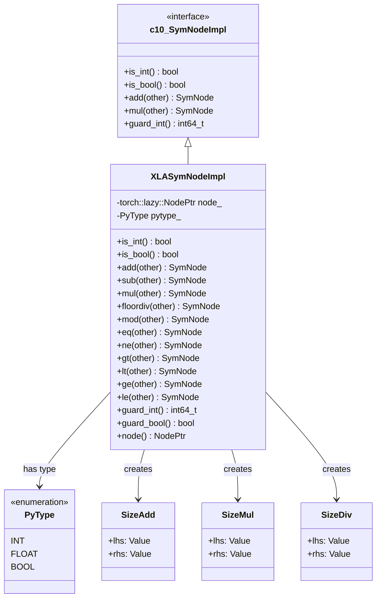

Sources: [torch_xla/csrc/tensor.h:24-88](), [torch_xla/csrc/tensor.cpp:694-820]()

### Symbolic Operations

Each arithmetic or comparison operation on symbolic integers creates a corresponding IR node:

| Python Operation | XLASymNodeImpl Method | IR Node Created | Return Type |
|-----------------|----------------------|-----------------|-------------|
| `a + b` | `add()` | `SizeAdd` | `XLASymNodeImpl(INT)` |
| `a - b` | `sub()` | `SizeSub` | `XLASymNodeImpl(INT)` |
| `a * b` | `mul()` | `SizeMul` | `XLASymNodeImpl(INT)` |
| `a // b` | `floordiv()` | `SizeDiv` | `XLASymNodeImpl(INT)` |
| `a % b` | `mod()` | `SizeMod` | `XLASymNodeImpl(INT)` |
| `a == b` | `eq()` | `SizeEq` | `XLASymNodeImpl(BOOL)` |
| `a != b` | `ne()` | `SizeNe` | `XLASymNodeImpl(BOOL)` |
| `a > b` | `gt()` | `SizeGt` | `XLASymNodeImpl(BOOL)` |
| `a < b` | `lt()` | `SizeLt` | `XLASymNodeImpl(BOOL)` |

**Example from code:**
```cpp
// torch_xla/csrc/tensor.cpp:700-706
c10::SymNode XLASymNodeImpl::add(const c10::SymNode& other) {
  auto p_other = dynamic_cast<XLASymNodeImpl*>(other.get());
  XLA_CHECK(is_int()) << __FUNCTION__ << " with non-int NYI";
  XLA_CHECK(p_other->is_int()) << __FUNCTION__ << " with non-int NYI";
  auto n_add = torch_xla::MakeNode<SizeAdd>(node(), p_other->node());
  return c10::make_intrusive<XLASymNodeImpl>(n_add, PyType::INT);
}
```

Sources: [torch_xla/csrc/tensor.cpp:700-820]()

### Guard Operations and Materialization

Symbolic integers must eventually be **materialized** to concrete values when PyTorch needs to allocate memory or perform CPU operations. This happens through **guard** methods:

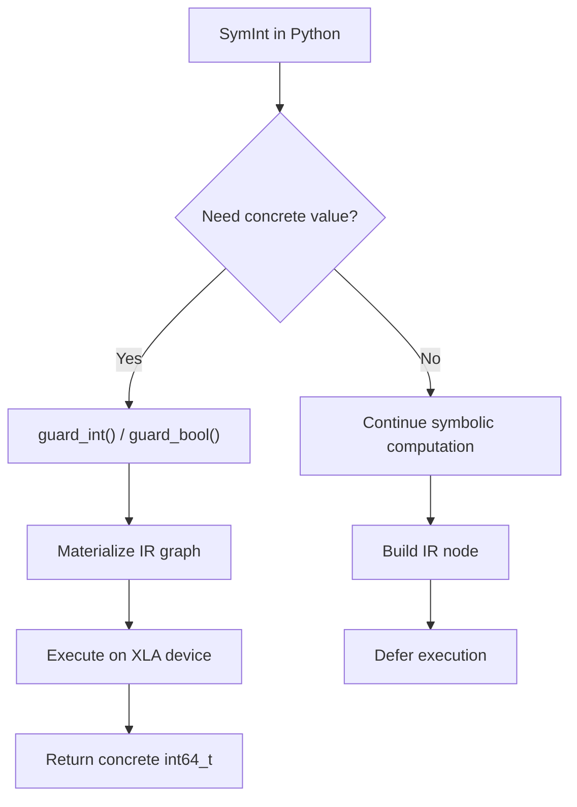

**Guard Implementation:**
- `guard_int()`: Forces graph execution to get the actual integer value
- `guard_bool()`: Forces graph execution to get the actual boolean value
- `has_hint()`: Returns `false` - symbolic values have no static hints

The guard methods trigger a **graph synchronization**, compiling and executing all pending IR to materialize the symbolic value.

Sources: [torch_xla/csrc/tensor.cpp:853-910]()

## Dynamic Dimension Tracking

XLA shapes can mark specific dimensions as **dynamic**, meaning their size is determined at runtime rather than compile time. PyTorch/XLA provides helper functions in `XlaHelpers` to query and manipulate dynamic dimensions.

### Shape Representation

```mermaid
graph TB
    subgraph StaticShape["Static Shape Example"]
        S1["xla::Shape"] --> S2["dimensions: [3, 4, 5]"]
        S2 --> S3["dynamic_dimensions: [false, false, false]"]
    end
    
    subgraph DynamicShape["Dynamic Shape Example"]
        D1["xla::Shape"] --> D2["dimensions: [3, ?, 5]"]
        D2 --> D3["dynamic_dimensions: [false, true, false]"]
        D3 --> D4["Runtime: xla::GetDimensionSize(op, 1)"]
    end
    
    subgraph UnboundedShape["Unbounded Dynamic Shape"]
        U1["xla::Shape"] --> U2["dimensions: [?, 4, 5]"]
        U2 --> U3["dimensions[0] = xla::Shape::kUnboundedSize"]
        U3 --> U4["dynamic_dimensions: [true, false, false]"]
    end
```

### Checking for Dynamic Dimensions

**CheckAtMostOneDynamicDimension (Recommended):**

[torch_xla/csrc/helpers.cpp:320-367]() provides a safe function that returns an error status if the shape has more than one dynamic dimension:

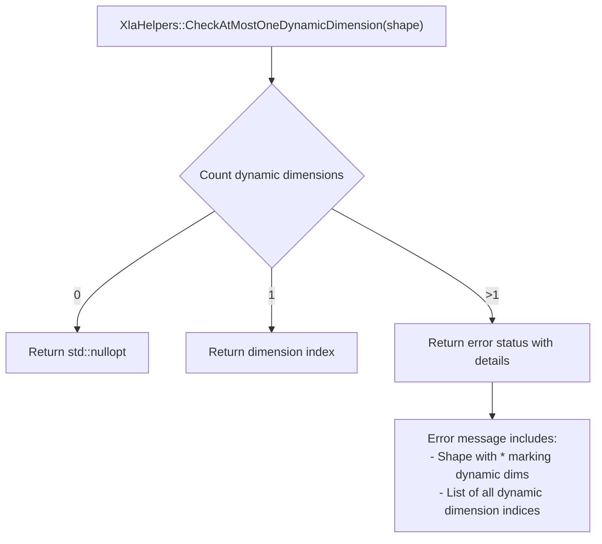

The function partitions dimension indices into dynamic and non-dynamic, then validates the count. If there are 2+ dynamic dimensions, it builds a detailed error message showing the shape with `*` markers.

**GetDynamicDimension (Deprecated):**

[torch_xla/csrc/helpers.cpp:314-318]() provides a simpler version that returns `-1` if no dynamic dimensions exist:

This function internally calls `CheckAtMostOneDynamicDimension()` and throws an exception on error, but is deprecated in favor of the explicit error-handling version.

### Computing Dimension Sizes

**GetDimensionsSize Function:**

[torch_xla/csrc/helpers.cpp:369-404]() computes the total number of elements across specified dimensions, handling both static and dynamic cases:

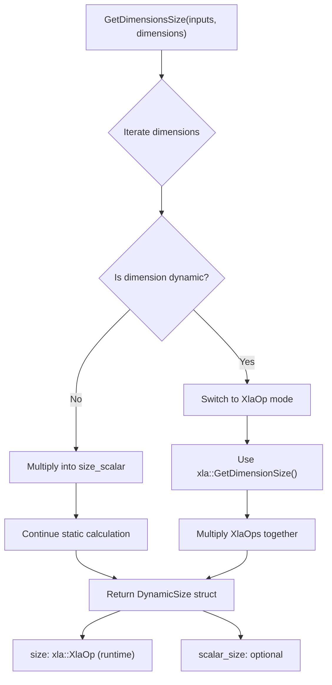

The function returns a `DynamicSize` struct containing:
- `size`: An `xla::XlaOp` computing the product (valid for both static and dynamic)
- `scalar_size`: An `optional<int64_t>` with the compile-time known value (nullopt if any dimension is dynamic)

Sources: [torch_xla/csrc/helpers.cpp:314-404](), [torch_xla/csrc/helpers.h:42-45](), [torch_xla/csrc/helpers.h:251-264]()

## Dynamic Reshape Operations

Reshaping tensors with dynamic dimensions requires special handling to propagate the dynamic dimension from input to output shape. PyTorch/XLA provides several functions for this.

### DynamicReshape and SafeDynamicReshape

**Function Signatures:**

[torch_xla/csrc/helpers.h:189-201]() declares both versions:
- `DynamicReshape()` - deprecated, throws on error
- `SafeDynamicReshape()` - returns `absl::StatusOr<xla::XlaOp>` for proper error handling

**Reshape Flow:**

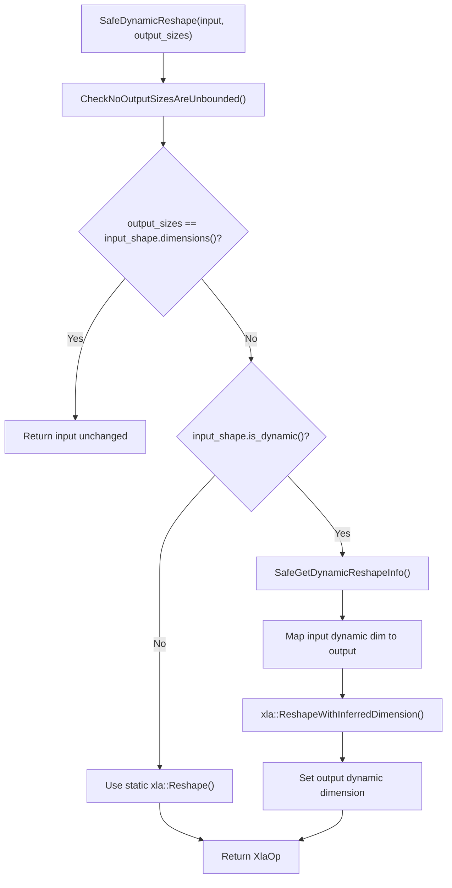

**Error Checking:**

[torch_xla/csrc/helpers.cpp:149-165]() performs validation before reshape:

The `CheckNoOutputSizesAreUnbounded()` function ensures no output dimension is `xla::Shape::kUnboundedSize`, returning a detailed error message with `*` markers indicating unbounded dimensions if validation fails.

### DynamicReshapeInfo Structure

[torch_xla/csrc/helpers.h:47-50]() defines:

```cpp
struct DynamicReshapeInfo {
  xla::Shape output_shape;
  int64_t dynamic_dimension = -1;
};
```

This structure contains:
- `output_shape`: The complete output shape with dynamic dimension marked
- `dynamic_dimension`: Index of the dynamic dimension in the output (-1 if none)

### GetDynamicReshapeInfo and SafeGetDynamicReshapeInfo

**Safe Version (Recommended):**

[torch_xla/csrc/helpers.cpp:543-566]() computes how to propagate the dynamic dimension:

1. **Validates exactly one dynamic dimension** - calls `CheckAndGetExactlyOneDynamicDimension()`
2. **Creates output shape** - uses `xla::ShapeUtil::MakeValidatedShape()`
3. **Maps dynamic dimension** - calls `GetOutputDynamicDimension()` to find where the input dynamic dimension maps to in the output
4. **Marks output dimension as dynamic** - sets `output_shape.set_dynamic_dimension()`

**Mapping Algorithm:**

[torch_xla/csrc/helpers.cpp:230-273]() implements `GetOutputDynamicDimension()`:

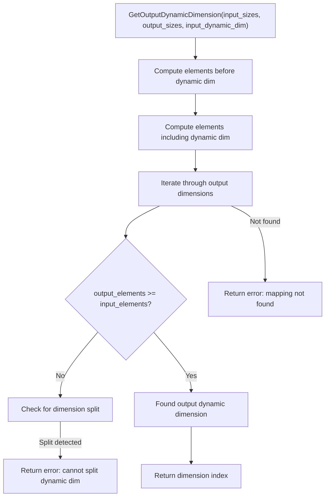

The algorithm ensures:
- The dynamic dimension is not split across multiple output dimensions
- The dynamic dimension is fully contained in one output dimension
- Detailed error messages if mapping fails

Sources: [torch_xla/csrc/helpers.cpp:149-273](), [torch_xla/csrc/helpers.cpp:543-614](), [torch_xla/csrc/helpers.h:164-201]()

## Unbounded Dynamism Mode

**Unbounded dynamism** is an experimental feature where dimensions can have sizes that exceed any compile-time bound, marked as `xla::Shape::kUnboundedSize`.

### Enabling Unbounded Dynamism

[torch_xla/csrc/helpers.h:205-208]() defines the check:

```cpp
static bool IsUnboundedDynamismEnabled() {
  return runtime::sys_util::GetEnvBool("EXPERIMENTAL_XLA_UNBOUNDED_DYNAMISM", false);
}
```

The environment variable `EXPERIMENTAL_XLA_UNBOUNDED_DYNAMISM=1` must be set to enable this mode.

### IsUnboundedDynamic Check

[torch_xla/csrc/helpers.cpp:616-624]() validates unbounded dynamic shapes:

```cpp
bool XlaHelpers::IsUnboundedDynamic(const xla::Shape& shape) {
  XLA_CHECK(XlaHelpers::IsUnboundedDynamismEnabled())
      << "set EXPERIMENTAL_XLA_UNBOUNDED_DYNAMISM=1 to run any unbounded dynamism workload.";
  const absl::Span<const int64_t> dims = shape.dimensions();
  return std::any_of(dims.begin(), dims.end(), [](int64_t size) {
    return size == xla::Shape::kUnboundedSize;
  });
}
```

### DynamicUnboundedReshape

[torch_xla/csrc/helpers.cpp:626-673]() implements special reshape for unbounded dimensions:

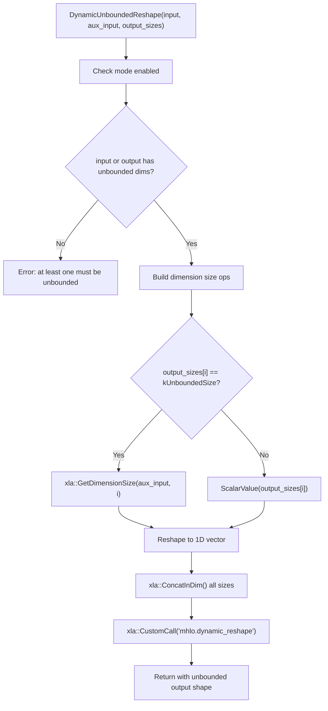

Key points:
- Uses `aux_input` to provide dynamic dimension sizes
- Constructs dimension sizes as 1D vectors
- Concatenates into single dimension vector
- Calls `mhlo.dynamic_reshape` custom call
- Output shape marks unbounded dimensions as `xla::Shape::kUnboundedSize`

### Special Handling in Operations

**Broadcast Operations:**

[torch_xla/csrc/reduction.cpp:89-98]() shows explicit broadcasting requirement:

```cpp
if (XlaHelpers::IsUnboundedDynamismEnabled()) {
  // XLA Multiply doesn't do implicit broadcasting for unbounded dynamism now.
  auto promoted = XlaHelpers::Promote(input, scale);
  return xla::Mul(
      promoted.first, promoted.second,
      XlaHelpers::getBroadcastDimensions(promoted.first, promoted.second));
}
```

**View Operations:**

[torch_xla/csrc/data_ops.cpp:102-145]() implements `BuildUnboundedDynamicView()`:

The function checks that only the batch size (dimension 0) is unbounded, validates dimension compatibility, and uses `mhlo.dynamic_reshape` to perform the view operation while preserving the unbounded dimension.

**Reshape in Reductions:**

[torch_xla/csrc/reduction.cpp:126-138]() shows conditional reshape:

```cpp
if (shape.is_unbounded_dynamic()) {
  // Mark unbounded dimensions in output
  for (size_t i = 0; i < result.rinfo.new_dimensions.size(); ++i) {
    if (shape.is_unbounded_dynamic_dimension(i)) {
      result.rinfo.new_dimensions[i] = xla::Shape::kUnboundedSize;
    }
  }
  result.result = XlaHelpers::DynamicUnboundedReshape(
      result.result, input, result.rinfo.new_dimensions);
}
```

### Current Limitations

- Only batch size (dimension 0) typically supported as unbounded
- XLA doesn't perform implicit broadcasting for unbounded dimensions
- Some operations require CPU fallback
- Requires explicit dimension tracking via `aux_input` tensors

Sources: [torch_xla/csrc/helpers.cpp:616-673](), [torch_xla/csrc/helpers.h:203-214](), [torch_xla/csrc/reduction.cpp:89-138](), [torch_xla/csrc/data_ops.cpp:102-145]()

## Dynamic Shape Operations

### Core Dynamic Operations

PyTorch/XLA provides specialized operations for working with dynamic shapes:

#### 1. Get Dimension Size

Retrieves the runtime size of a potentially dynamic dimension:

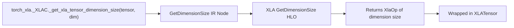

**Usage Example:**
```python
# test/test_operations.py:340-344
x = torch.tensor((0, 1, 2, 0, 3, 4), device='xla')
x_dim0_shape = torch_xla._XLAC._get_xla_tensor_dimension_size(
    torch.nonzero(x, as_tuple=False), 0)
# x_dim0_shape is a 0-d XLA tensor containing the dynamic size
assert x_dim0_shape.item() == 4  # 4 non-zero elements
```

#### 2. Dynamic Expand

Expands a tensor where the target dimension size comes from another tensor:

```cpp
// torch_xla/csrc/init_python_bindings.cpp:454-467
at::Tensor DynamicExpand(const at::Tensor& input,
                         const std::vector<int64_t>& sizes,
                         const at::Tensor& src_tensor, int src_dim,
                         int target_dim) {
  // Expands input to sizes, but dimension target_dim takes its
  // size from src_tensor.size(src_dim) at runtime
  return tensor_methods::dynamic_expand(
      xla_input, sizes, xla_src_tensor, src_dim, target_dim);
}
```

**Semantic Flow:**
1. `sizes` contains mostly static dimensions, with one placeholder
2. `src_tensor.size(src_dim)` provides the dynamic size
3. IR node `DynamicExpand` captures this dependency
4. At lowering, `GetDimensionSize(src_tensor, src_dim)` provides the runtime size

#### 3. Dynamic View/Reshape

Reshapes a tensor where one output dimension size is computed from input dimensions:

```cpp
// torch_xla/csrc/init_python_bindings.cpp:469-492
at::Tensor DynamicView(const at::Tensor& input,
                       const std::vector<int64_t>& size,
                       const at::Tensor& src_tensor, int src_dim,
                       int target_dim, float mul_scaler) {
  // Reshapes input to size, where size[target_dim] is computed as:
  // src_tensor.size(src_dim) * mul_scaler
}
```

**Use Case**: When reshaping a tensor after `nonzero`, the output size depends on data:
```python
indices = torch.nonzero(mask)  # shape: [N, 2] where N is dynamic
# Want to reshape to [N*2] - N is dynamic!
flat = torch_xla._XLAC._dynamic_view(
    indices, [-1], indices, 0, 0, mul_scaler=2.0)
```

Sources: [torch_xla/csrc/init_python_bindings.cpp:454-492](), [torch_xla/csrc/tensor_methods.cpp]()

### Operations Producing Dynamic Shapes

The following operations inherently produce dynamic output shapes:

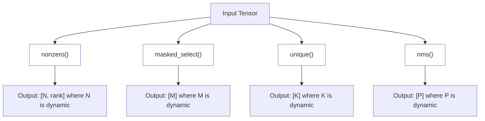

#### nonzero Implementation Pattern

```cpp
// Creates output with dynamic first dimension
xla::XlaOp Nonzero(xla::XlaOp input) {
  xla::Shape input_shape = ShapeOfXlaOp(input);
  
  // Count non-zero elements (dynamic)
  xla::XlaOp count = CountNonzero(input);
  
  // Create output shape with dynamic dimension
  xla::Shape output_shape = ShapeUtil::MakeShape(
      S64, {count_value, input_shape.rank()});
  output_shape.set_dynamic_dimension(0, true);
  
  // Lower to HLO with SetDimensionSize
  xla::XlaOp result = ...;  // actual nonzero logic
  return xla::SetDimensionSize(result, count, /*dimension=*/0);
}
```

#### masked_select Implementation Pattern

```cpp
// torch_xla/csrc/data_ops.cpp
xla::XlaOp MaskedSelect(xla::XlaOp input, xla::XlaOp mask) {
  // Flatten inputs
  xla::XlaOp flat_input = Flatten(input);
  xla::XlaOp flat_mask = Flatten(mask);
  
  // Count True values in mask (dynamic)
  xla::XlaOp true_count = CountTrue(flat_mask);
  
  // Use dynamic gather/filter
  xla::XlaOp result = DynamicFilter(flat_input, flat_mask);
  
  // Mark dimension as dynamic
  return SetDimensionSize(result, true_count, /*dimension=*/0);
}
```

Sources: [test/test_operations.py:340-360](), [torch_xla/csrc/data_ops.cpp]()

## IR Nodes for Symbolic Integer Operations

PyTorch/XLA defines special IR nodes (in the `ops/dynamic_ir.h`) for operations on symbolic integers:

### Size Operation Nodes

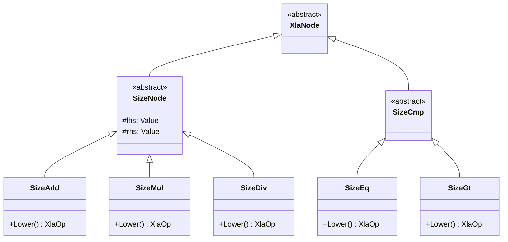

### Lowering Size Operations to HLO

Each `Size*` IR node lowers to XLA operations on scalar S64 tensors:

**SizeAdd Lowering:**
```cpp
// Conceptual lowering (actual code in ops/dynamic_ir.cpp)
XlaOpVector SizeAdd::Lower(LoweringContext* loctx) const {
  xla::XlaOp lhs = loctx->GetOutputOp(operand(0));  // S64 scalar
  xla::XlaOp rhs = loctx->GetOutputOp(operand(1));  // S64 scalar
  xla::XlaOp result = xla::Add(lhs, rhs);
  return ReturnOp(result, loctx);
}
```

**SizeDiv Lowering:**
```cpp
XlaOpVector SizeDiv::Lower(LoweringContext* loctx) const {
  xla::XlaOp lhs = loctx->GetOutputOp(operand(0));
  xla::XlaOp rhs = loctx->GetOutputOp(operand(1));
  xla::XlaOp result = xla::Div(lhs, rhs);
  return ReturnOp(result, loctx);
}
```

**SizeEq Lowering:**
```cpp
XlaOpVector SizeEq::Lower(LoweringContext* loctx) const {
  xla::XlaOp lhs = loctx->GetOutputOp(operand(0));
  xla::XlaOp rhs = loctx->GetOutputOp(operand(1));
  xla::XlaOp result = xla::Eq(lhs, rhs);  // Returns PRED scalar
  return ReturnOp(result, loctx);
}
```

### Integration with GetDimensionSize

The `GetDimensionSize` IR node retrieves the runtime size of a dimension:

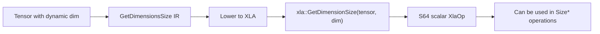

**Example IR Graph:**
```
GetDimensionSize(input_tensor, dim=1) -> size1
GetDimensionSize(input_tensor, dim=2) -> size2
SizeMul(size1, size2) -> total_size
DynamicView(input_tensor, [batch, total_size])
```

Sources: [torch_xla/csrc/ops/dynamic_ir.h](), [torch_xla/csrc/tensor.cpp:700-820]()

## Common Patterns and Testing

### Testing Dynamic Shapes

The test suite validates dynamic shape behavior:

**Test 1: nonzero produces dynamic shape**
```python
# test/test_operations.py:340-344
def test_nonzero_shape(self):
    x = torch.tensor((0, 1, 2, 0, 3, 4), device='xla')
    # nonzero produces [N, 1] where N = count of non-zeros
    x_dim0_shape = torch_xla._XLAC._get_xla_tensor_dimension_size(
        torch.nonzero(x, as_tuple=False), 0)
    self.assertEqual(x_dim0_shape.item(), 4)  # 4 non-zero elements
```

**Test 2: masked_select produces dynamic shape**
```python
# test/test_operations.py:346-351
def test_masked_select_shape(self):
    x = torch.tensor((0, 1, 2, 0, 3, 4), device='xla')
    mask = x.ge(2)  # [F, F, T, F, T, T]
    x_dim0_shape = torch_xla._XLAC._get_xla_tensor_dimension_size(
        torch.masked_select(x, mask), 0)
    self.assertEqual(x_dim0_shape.item(), 3)  # 3 elements >= 2
```

**Test 3: Type casting with dynamic dimensions**
```python
# test/test_operations.py:353-359
def test_nonzero_cast(self):
    t1 = torch.ones(5, 2, device='xla')
    # nonzero returns index type (S32 on TPU, S64 on CPU)
    # Should be castable to float without error
    t2 = torch.nonzero(t1.int()).float()
    torch_xla.sync()  # No error on sync
```

Sources: [test/test_operations.py:338-360]()

### Performance Considerations

Dynamic shapes have performance implications:

1. **Compilation Cost**: Each unique concrete shape triggers recompilation unless cached
2. **Memory Allocation**: XLA must allocate max-size buffers for unbounded dimensions
3. **Optimization Limitations**: Prevents static shape-based optimizations (padding removal, reshape elision)

**Best Practices:**
- Use static shapes when possible
- Batch operations to amortize dynamic overhead
- Use `_get_xla_tensor_dimension_size` instead of `.item()` to keep computation on device
- Avoid mixing static and dynamic computation paths in the same graph

### Key Environment Variables

```
XLA_DENSE_GATHER_FACTOR=8192    # Threshold for sparse vs dense gather
XLA_DENSE_SCATTER_FACTOR=100    # Threshold for sparse vs dense scatter
```

These control when operations with dynamic shapes use sparse (index-based) vs dense (mask-based) implementations.

Sources: [torch_xla/csrc/data_ops.cpp:30-48](), [torch_xla/csrc/xla_lower_util.cpp:74-86]()

---

