<!-- source: DeepWiki mcp.deepwiki.com · repo pytorch/xla · page 5 Building, Testing, and CI · fetched 2026-10-21 -->

# Building, Testing, and CI

<details>
<summary>Relevant source files</summary>

The following files were used as context for generating this wiki page:

- [.github/ci.md](.github/ci.md)
- [.github/workflows/_build_torch_xla.yml](.github/workflows/_build_torch_xla.yml)
- [.github/workflows/_check_code_changes.yml](.github/workflows/_check_code_changes.yml)
- [.github/workflows/_test.yml](.github/workflows/_test.yml)
- [.github/workflows/_tpu_ci.yml](.github/workflows/_tpu_ci.yml)
- [.github/workflows/build_and_test.yml](.github/workflows/build_and_test.yml)
- [.github/workflows/build_upstream_image.yml](.github/workflows/build_upstream_image.yml)
- [.github/workflows/setup/action.yml](.github/workflows/setup/action.yml)
- [CONTRIBUTING.md](CONTRIBUTING.md)
- [README.md](README.md)
- [WORKSPACE](WORKSPACE)
- [experimental/reference_models/README.md](experimental/reference_models/README.md)
- [scripts/build_developer.sh](scripts/build_developer.sh)
- [scripts/update_deps.py](scripts/update_deps.py)
- [setup.py](setup.py)
- [test/benchmarks/run_torchbench_tests.sh](test/benchmarks/run_torchbench_tests.sh)
- [test/neuron/run_tests.sh](test/neuron/run_tests.sh)
- [test/pytorch_test_base.py](test/pytorch_test_base.py)
- [test/run_tests.sh](test/run_tests.sh)
- [test/spmd/test_dtensor_convert_mesh.py](test/spmd/test_dtensor_convert_mesh.py)
- [test/spmd/test_dtensor_redistribute.py](test/spmd/test_dtensor_redistribute.py)
- [test/spmd/test_xla_dtensor_placements.py](test/spmd/test_xla_dtensor_placements.py)
- [test/spmd/test_xla_dtensor_spec_conversion.py](test/spmd/test_xla_dtensor_spec_conversion.py)
- [test/spmd/test_xla_sharded_tensor.py](test/spmd/test_xla_sharded_tensor.py)
- [test/test_mp_all_to_all.py](test/test_mp_all_to_all.py)
- [test/test_mp_collective_permute.py](test/test_mp_collective_permute.py)
- [test/test_ops.py](test/test_ops.py)
- [test/test_user_computation_debug_cache.py](test/test_user_computation_debug_cache.py)
- [test/test_xla_graph_execution.py](test/test_xla_graph_execution.py)
- [test/torch_distributed/test_torch_distributed_fsdp_meta.py](test/torch_distributed/test_torch_distributed_fsdp_meta.py)
- [test/tpu/run_tests.sh](test/tpu/run_tests.sh)
- [test/tpu/xla_test_job.yaml](test/tpu/xla_test_job.yaml)
- [test/utils/run_tests_utils.sh](test/utils/run_tests_utils.sh)
- [torch_xla/csrc/runtime/BUILD](torch_xla/csrc/runtime/BUILD)
- [torch_xla/csrc/runtime/computation_client.h](torch_xla/csrc/runtime/computation_client.h)
- [torch_xla/csrc/runtime/ifrt_computation_client.cpp](torch_xla/csrc/runtime/ifrt_computation_client.cpp)
- [torch_xla/csrc/runtime/ifrt_computation_client.h](torch_xla/csrc/runtime/ifrt_computation_client.h)
- [torch_xla/csrc/runtime/ifrt_computation_client_test.cpp](torch_xla/csrc/runtime/ifrt_computation_client_test.cpp)
- [torch_xla/csrc/runtime/pjrt_computation_client.cpp](torch_xla/csrc/runtime/pjrt_computation_client.cpp)
- [torch_xla/csrc/runtime/pjrt_computation_client.h](torch_xla/csrc/runtime/pjrt_computation_client.h)
- [torch_xla/csrc/runtime/pjrt_computation_client_test.cpp](torch_xla/csrc/runtime/pjrt_computation_client_test.cpp)
- [torch_xla/csrc/runtime/pjrt_registry.cpp](torch_xla/csrc/runtime/pjrt_registry.cpp)
- [torch_xla/csrc/runtime/runtime.cpp](torch_xla/csrc/runtime/runtime.cpp)
- [torch_xla/csrc/runtime/runtime.h](torch_xla/csrc/runtime/runtime.h)
- [torch_xla/distributed/spmd/xla_sharded_tensor.py](torch_xla/distributed/spmd/xla_sharded_tensor.py)

</details>


This document describes the build system, testing infrastructure, and continuous integration (CI) pipeline for PyTorch/XLA. It covers how C++ and Python components are compiled, how tests are organized and executed, and how CI workflows orchestrate builds and tests across different hardware backends.

For information about setting up a development environment, see the [contribution guide](CONTRIBUTING.md). For details about the plugin architecture and runtime initialization, see [Computation Client and Runtime](#2.4).

---

## Build System Architecture

PyTorch/XLA uses a two-tier build system: `setup.py` orchestrates Python packaging and dependency management, while Bazel handles C++ compilation. This design allows PyTorch/XLA to integrate with PyTorch's build system while leveraging Bazel's efficient caching and dependency management for the XLA compiler integration.

### Build Flow

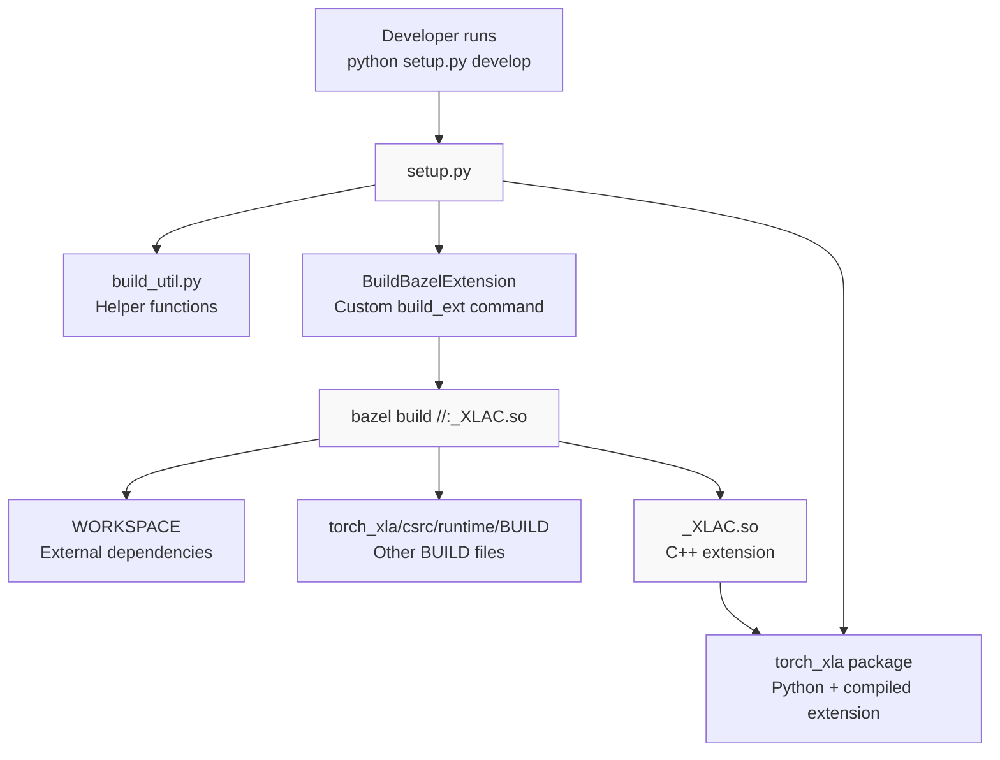

**Build System Components**

Sources: [setup.py:1-486](), [WORKSPACE:1-157]()

The build process begins when a user runs `python setup.py develop` or `python setup.py install`. The `setup()` call in [setup.py:417-485]() defines the package structure and specifies `BazelExtension('//:_XLAC.so')` as the C++ extension to build. The custom `BuildBazelExtension` class [setup.py:280-333]() overrides setuptools' default build logic to invoke Bazel instead of the standard C++ compiler.

When `BuildBazelExtension.build_extension()` is called [setup.py:283-333](), it constructs a Bazel command that includes C++ ABI flags [setup.py:307-318](), remote cache options from environment variables [setup.py:319](), and targets both the main extension and optionally C++ test binaries [setup.py:303-306](). After Bazel completes the build, the method copies the output from `bazel-bin/` to the location where setuptools expects to find it [setup.py:325-332]().

### Dependency Management

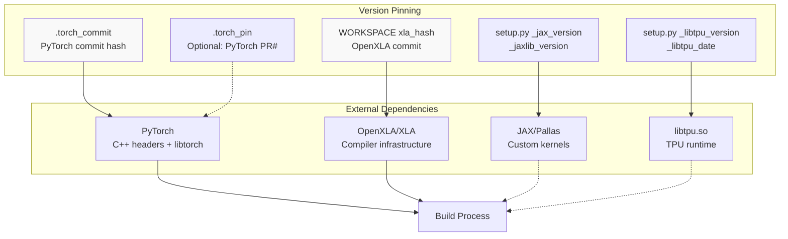

**Dependency Version Pinning**

Sources: [setup.py:80-142](), [WORKSPACE:45-66](), [.github/ci.md:1-27]()

PyTorch/XLA pins specific versions of all major dependencies to ensure reproducible builds and prevent version skew issues. The `.torch_commit` file at the repository root specifies the exact PyTorch commit to build against. During CI, if a `.torch_pin` file exists with content like `#<PR_NUMBER>`, the build system uses that PyTorch PR instead [.github/ci.md:14-21]().

The `WORKSPACE` file [WORKSPACE:47-66]() pins OpenXLA to a specific commit via `xla_hash`, which determines the XLA compiler version. Comments in [setup.py:80-116]() explain the process for updating libtpu and JAX versions together to minimize version skew. The `setup.py` variables `_libtpu_version`, `_libtpu_date`, `_jax_version`, `_jaxlib_version`, and `_jax_date` [setup.py:119-124]() control which nightly or stable versions are installed.

### C++ Build Configuration

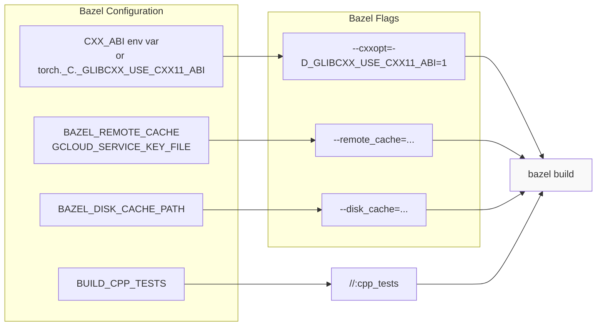

**Build Configuration Options**

Sources: [setup.py:307-319](), [build_util.py:1-73]()

The build system determines the C++ ABI to use by first checking the `CXX_ABI` environment variable [setup.py:307-308](). If not set, it attempts to read `torch._C._GLIBCXX_USE_CXX11_ABI` [setup.py:309-313](). As of PyTorch 2.7, the default is C++11 ABI (`1`) if neither is available [setup.py:314-317]().

The `build_util.bazel_options_from_env()` function [build_util.py:1-73]() processes additional environment variables to configure Bazel's caching behavior. When `GCLOUD_SERVICE_KEY_FILE` is set, it enables remote caching [build_util.py:28-40](). The `BAZEL_DISK_CACHE_PATH` environment variable enables local disk caching [build_util.py:41-45](). These caching mechanisms are critical for CI performance, reducing build times from ~50 minutes to ~10 minutes for incremental builds.

---

## Test Organization and Infrastructure

PyTorch/XLA's test suite is organized into multiple categories and can run across different hardware backends (CPU, TPU, Neuron). Tests are executed through shell scripts that set appropriate environment variables and invoke Python test files.

### Test Category Structure

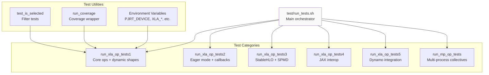

**Test Sharding and Execution**

Sources: [test/run_tests.sh:1-359](), [test/utils/run_tests_utils.sh:1-100]()

The main test script [test/run_tests.sh:1-359]() defines functions for each test category. The `run_xla_op_tests1` through `run_xla_op_tests5` functions [test/run_tests.sh:147-281]() partition the operation tests into approximately equal execution time groups to enable parallel CI execution. For example, `run_xla_op_tests1` includes dynamic shape tests, eager mode tests, and basic operations [test/run_tests.sh:148-187](), while `run_xla_op_tests3` focuses on StableHLO export and SPMD functionality [test/run_tests.sh:216-265]().

Each test is wrapped by the `run_test` function [test/run_tests.sh:48-55](), which sets `PJRT_DEVICE=CPU` and `CPU_NUM_DEVICES=1` by default. The `run_test_multi_devices` variant [test/run_tests.sh:65-72]() uses `CPU_NUM_DEVICES=4` for testing multi-device collectives. Test filtering is provided by `test_is_selected()` from [test/utils/run_tests_utils.sh:39-66](), which checks if a test matches the patterns specified via command-line arguments.

### XLATestBase Framework

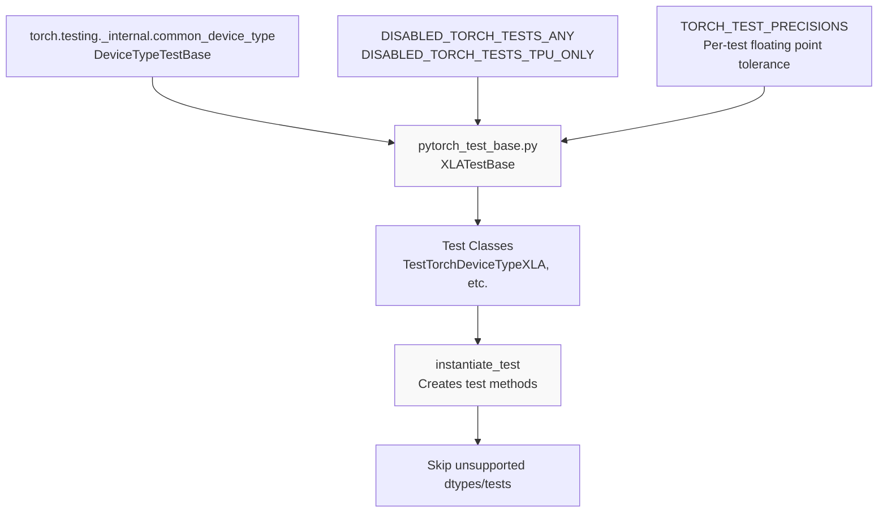

**Test Base Class and Compatibility**

Sources: [test/pytorch_test_base.py:1-600]()

The `XLATestBase` class [test/pytorch_test_base.py:526-600]() extends PyTorch's `DeviceTypeTestBase` to provide XLA-specific test infrastructure. It defines `device_type = 'xla'` [test/pytorch_test_base.py:527]() and specifies unsupported dtypes like `torch.half` and complex types [test/pytorch_test_base.py:528-530]().

The `instantiate_test` method [test/pytorch_test_base.py:543-600]() is called for each test to determine whether it should run, be skipped, or handle dtype variants. It consults the `DISABLED_TORCH_TESTS` dictionary [test/pytorch_test_base.py:520-523](), which is built from `DISABLED_TORCH_TESTS_ANY` (tests disabled on all backends) and `DISABLED_TORCH_TESTS_TPU_ONLY` (tests disabled only on TPU) [test/pytorch_test_base.py:31-476](), [test/pytorch_test_base.py:359-476]().

For tests with dtype variants, the method automatically sets appropriate floating-point precision tolerances [test/pytorch_test_base.py:567-600](). The `TORCH_TEST_PRECISIONS` dictionary [test/pytorch_test_base.py:19-29]() overrides the default precision for specific tests where XLA's numerical behavior differs slightly from CPU.

### OpInfo Testing Framework

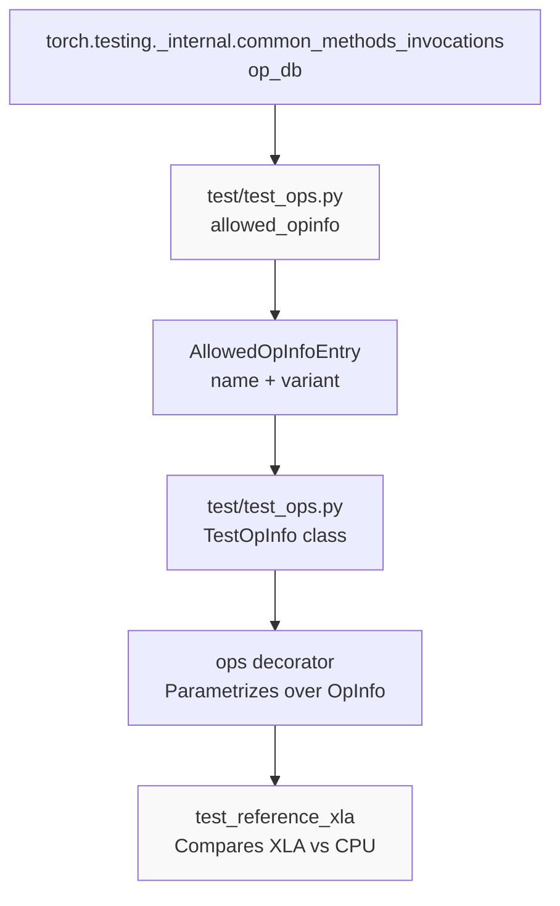

**OpInfo Reference Testing**

Sources: [test/test_ops.py:1-500]()

PyTorch/XLA uses PyTorch's OpInfo framework to automatically test operations. The `allowed_opinfo` dictionary [test/test_ops.py:51-440]() maps operation names to `AllowedOpInfoEntry` objects that specify which operations are expected to pass on XLA. For example, `AllowedOpInfoEntry('abs')` [test/test_ops.py:52]() indicates that the `abs` operation is fully supported, while `AllowedOpInfoEntry('div', 'floor_rounding')` [test/test_ops.py:93]() indicates that only the `floor_rounding` variant of `div` is supported.

The `TestOpInfo` class [test/test_ops.py:443-500]() is decorated with `@ops(allowed_opinfo.values())` to parametrize tests over all allowed operations. The `test_reference_xla` method [test/test_ops.py:462-500]() executes each operation on both XLA and CPU devices with generated sample inputs, then compares the outputs to verify correctness.

### Device-Specific Test Runners

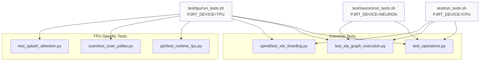

**Backend-Specific Test Configuration**

Sources: [test/tpu/run_tests.sh:1-103](), [test/neuron/run_tests.sh:1-200]()

Each hardware backend has its own test runner script that sets appropriate environment variables and selects relevant tests. The TPU runner [test/tpu/run_tests.sh:1-103]() sets `PJRT_DEVICE=TPU` [test/tpu/run_tests.sh:80]() and includes tests specific to TPU features like Pallas kernels [test/tpu/run_tests.sh:82]() and splash attention [test/tpu/run_tests.sh:89]().

The Neuron runner [test/neuron/run_tests.sh:1-200]() is maintained by AWS for testing on Trainium/Inferentia devices. It sets `PJRT_DEVICE=NEURON` [test/neuron/run_tests.sh:56]() and runs a subset of the full test suite [test/neuron/run_tests.sh:154-200](). As noted in the file header [test/neuron/run_tests.sh:1-10](), this is a temporary solution until all tests are fixed or skipped for Neuron.

---

## CI/CD Pipeline Architecture

The CI system uses GitHub Actions to orchestrate builds and tests across multiple platforms. The workflow is designed to build artifacts once and reuse them across multiple test jobs, minimizing redundant compilation.

### Workflow Dependencies

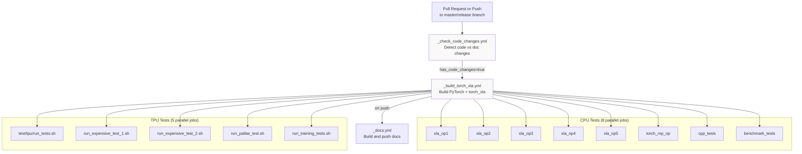

**Workflow Orchestration**

Sources: [.github/workflows/build_and_test.yml:1-98](), [.github/workflows/_check_code_changes.yml:1-50]()

The main workflow [.github/workflows/build_and_test.yml:1-98]() begins by calling `_check_code_changes.yml` [.github/workflows/build_and_test.yml:20-27]() to determine if the PR contains code changes or only documentation changes. The `has_code_changes` output [.github/workflows/build_and_test.yml:36]() is used to conditionally skip expensive build and test steps for doc-only PRs.

If code changes are detected, the `build-torch-xla` job [.github/workflows/build_and_test.yml:38-55]() is executed, which calls the reusable `_build_torch_xla.yml` workflow. This workflow runs on a `linux.24xlarge` runner [.github/workflows/build_and_test.yml:53]() and has a 50-minute timeout [.github/workflows/build_and_test.yml:44](). The build produces two artifacts: `torch-xla-wheels` containing the compiled Python packages [.github/workflows/_build_torch_xla.yml:83-88]() and `cpp-test-bin` containing C++ test executables [.github/workflows/_build_torch_xla.yml:90-95]().

### Build Job Implementation

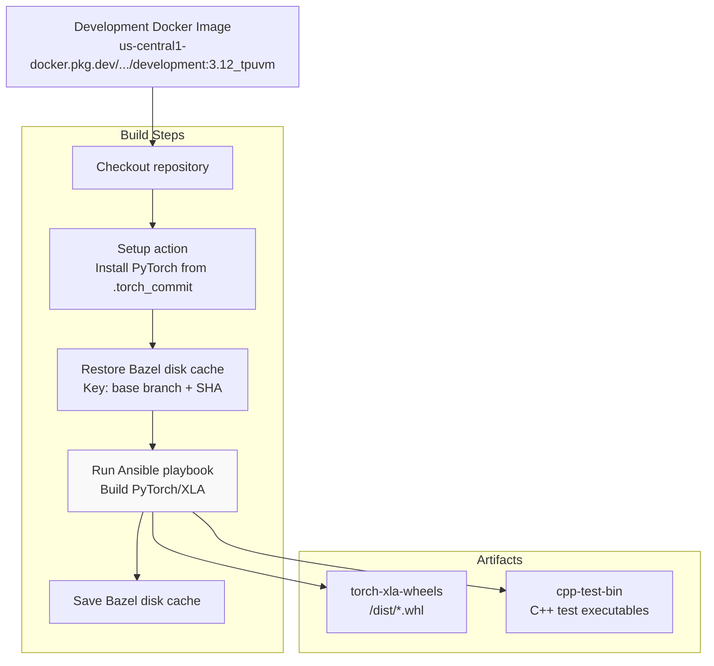

**Build Job Configuration**

Sources: [.github/workflows/_build_torch_xla.yml:1-120]()

The build workflow [.github/workflows/_build_torch_xla.yml:1-120]() runs inside a Docker container [.github/workflows/_build_torch_xla.yml:32-33]() with the specified development image. Environment variables control caching behavior: `BAZEL_REMOTE_CACHE` is set to `true` for pushes to master and PRs from the main repository [.github/workflows/_build_torch_xla.yml:36](), while `BAZEL_DISK_CACHE_PATH` specifies the local cache directory [.github/workflows/_build_torch_xla.yml:37]().

The disk cache is restored from the base branch and commit SHA [.github/workflows/_build_torch_xla.yml:57-65]() for pull request events, significantly speeding up incremental builds. The actual build step [.github/workflows/_build_torch_xla.yml:67-81]() invokes an Ansible playbook located at [pytorch/xla/infra/ansible/playbook.yaml]() with parameters that enable C++ test building [.github/workflows/_build_torch_xla.yml:81](). After the build completes, artifacts are uploaded [.github/workflows/_build_torch_xla.yml:83-95]() and a new disk cache is saved [.github/workflows/_build_torch_xla.yml:97-117]() for future use.

### Test Job Parallelization

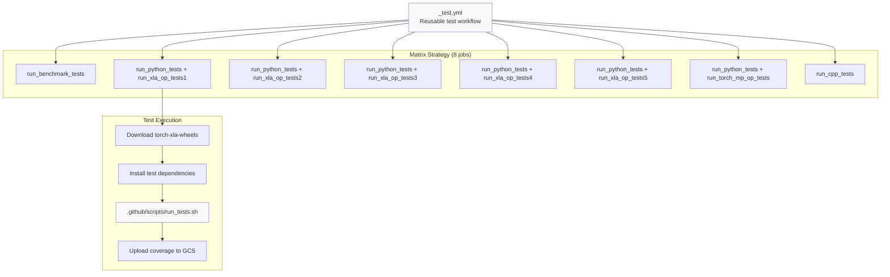

**CPU Test Parallelization**

Sources: [.github/workflows/_test.yml:1-164]()

The CPU test workflow [.github/workflows/_test.yml:1-164]() uses a matrix strategy [.github/workflows/_test.yml:42-59]() to run 8 jobs in parallel. Each job sets specific environment variables [.github/workflows/_test.yml:61-73]() that control which tests to run. For example, the second matrix entry sets `RUN_PYTHON_TESTS=python_tests` and `RUN_XLA_OP_TESTS1=xla_op1` [.github/workflows/_test.yml:47-48](), which causes `test/run_tests.sh` to execute only the `run_xla_op_tests1` function.

The test execution steps [.github/workflows/_test.yml:76-126]() download the wheel artifacts [.github/workflows/_test.yml:84-88](), install test dependencies including JAX and Pallas [.github/workflows/_test.yml:102-121](), and invoke the test script [.github/workflows/_test.yml:122-125](). For jobs with `collect-coverage=true` [.github/workflows/_test.yml:64](), coverage results are uploaded to Google Cloud Storage [.github/workflows/_test.yml:126-159]().

### TPU Test Infrastructure

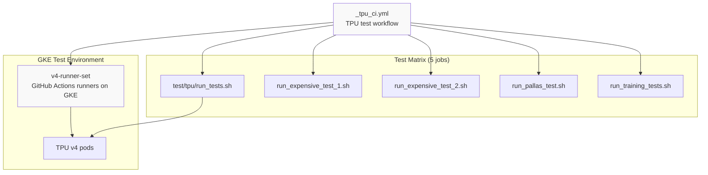

**TPU CI Configuration**

Sources: [.github/workflows/_tpu_ci.yml:1-91](), [test/tpu/xla_test_job.yaml:1-55]()

The TPU CI workflow [.github/workflows/_tpu_ci.yml:1-91]() runs on self-hosted runners deployed on Google Kubernetes Engine (GKE) with access to TPU v4 pods [.github/workflows/_tpu_ci.yml:17](). The workflow is limited to pull request and push events [.github/workflows/_tpu_ci.yml:77](), with a 75-minute timeout [.github/workflows/_tpu_ci.yml:9]().

The matrix strategy [.github/workflows/_tpu_ci.yml:19-27]() partitions TPU tests into 5 groups. The main test group [.github/workflows/_tpu_ci.yml:23]() runs the standard test suite via [test/tpu/run_tests.sh:1-103](), while other groups run expensive or specialized tests. Each test job downloads the wheels [.github/workflows/_tpu_ci.yml:29-41](), installs dependencies including Pallas and libtpu [.github/workflows/_tpu_ci.yml:43-75](), and runs the test script with `PJRT_DEVICE=TPU` [.github/workflows/_tpu_ci.yml:77-84]().

---

## Running Tests Locally

Developers can run the same tests locally that execute in CI. The test scripts support filtering to run specific test files or categories.

### Local CPU Testing

```bash
# Set device to CPU
export PJRT_DEVICE=CPU

# Run all tests (takes ~30 minutes)
cd pytorch/xla
test/run_tests.sh

# Run specific test file
test/run_tests.sh test/test_operations.py

# Run specific test category
RUN_XLA_OP_TESTS1=xla_op1 test/run_tests.sh

# Run with coverage
USE_COVERAGE=1 test/run_tests.sh

# Continue on error (see all failures)
CONTINUE_ON_ERROR=1 test/run_tests.sh

# Run multi-device tests
CPU_NUM_DEVICES=4 test/run_tests.sh test/test_mp_replication.py
```

Sources: [test/run_tests.sh:1-359](), [CONTRIBUTING.md:296-317]()

The `run_tests.sh` script accepts test file paths as arguments to filter which tests run [test/utils/run_tests_utils.sh:39-66](). Environment variables control test execution: `RUN_XLA_OP_TESTS1` through `RUN_XLA_OP_TESTS5` and `RUN_TORCH_MP_OP_TESTS` select specific test categories [test/run_tests.sh:318-349](), while `USE_COVERAGE` enables coverage collection [test/run_tests.sh:41-46]().

### Local TPU Testing

```bash
# Run on TPU (must be on a TPU VM)
export PJRT_DEVICE=TPU
cd pytorch/xla
test/tpu/run_tests.sh

# Run specific test file
test/tpu/run_tests.sh test/test_operations.py

# Run with debug output
XLA_HLO_DEBUG=1 test/tpu/run_tests.sh test/test_operations.py
```

Sources: [test/tpu/run_tests.sh:1-103]()

The TPU test script [test/tpu/run_tests.sh:1-103]() must be run on a Cloud TPU VM with `PJRT_DEVICE=TPU`. It supports the same filtering mechanism as the CPU test script [test/tpu/run_tests.sh:31-32]().

### Building C++ Tests

```bash
# Build C++ tests with Bazel
cd pytorch/xla
BUILD_CPP_TESTS=1 python setup.py develop

# Run C++ tests
test/cpp/run_tests.sh
```

Sources: [setup.py:303-306](), [torch_xla/csrc/runtime/BUILD:149-158]()

C++ tests are built when the `BUILD_CPP_TESTS` environment variable is set [setup.py:303-306](). The tests are defined in Bazel BUILD files, such as [torch_xla/csrc/runtime/BUILD:149-158]() which defines the `cache_test` target. Individual tests can be run directly from the `bazel-bin` directory, or all tests can be executed via [test/cpp/run_tests.sh]().

---

## Benchmarking Infrastructure

PyTorch/XLA includes benchmarking infrastructure for measuring performance of operations and models. Benchmarks are run as part of CI when the `RUN_BENCHMARK_TESTS` environment variable is set.

### Benchmark Organization

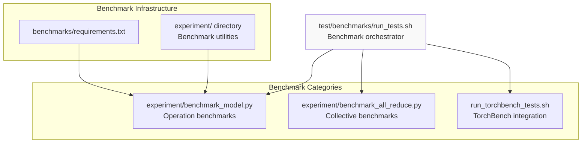

**Benchmark Execution**

Sources: [test/benchmarks/run_torchbench_tests.sh:1-100]()

The TorchBench integration script [test/benchmarks/run_torchbench_tests.sh:1-100]() clones the PyTorch benchmark repository and runs a subset of models on XLA devices. The script accepts model names as arguments [test/benchmarks/run_torchbench_tests.sh:6]() and constructs absolute paths to the various PyTorch repositories [test/benchmarks/run_torchbench_tests.sh:8-13]().

Benchmark dependencies are listed in [benchmarks/requirements.txt]() and installed during the CI setup [.github/workflows/_test.yml:119-121](). The CI job matrix includes a dedicated `run_benchmark_tests` entry [.github/workflows/_test.yml:46]() that executes benchmarks separately from correctness tests, allowing performance regressions to be detected without blocking test jobs.

---

## Build and Test Configuration Reference

### Environment Variables

| Variable | Purpose | Default | Example |
|----------|---------|---------|---------|
| `PJRT_DEVICE` | Select runtime backend | - | `CPU`, `TPU`, `NEURON` |
| `CPU_NUM_DEVICES` | Number of CPU devices | `4` | `1`, `8` |
| `BUILD_CPP_TESTS` | Build C++ test binaries | `0` | `1` |
| `USE_COVERAGE` | Enable coverage collection | `0` | `1` |
| `BAZEL_REMOTE_CACHE` | Enable remote cache | `0` | `1` |
| `BAZEL_DISK_CACHE_PATH` | Local cache directory | - | `/tmp/bazel-cache` |
| `CXX_ABI` | C++ ABI version | `1` | `0`, `1` |
| `XLA_HLO_DEBUG` | Dump HLO graphs | `0` | `1` |
| `XLA_IR_DEBUG` | Dump IR graphs | `0` | `1` |

Sources: [test/run_tests.sh:26-29](), [setup.py:307-318](), [test/utils/run_tests_utils.sh:1-100]()

### Test Sharding Strategy

The test suite is divided into shards to enable parallel execution in CI:

| Shard | Category | Approximate Duration | Example Tests |
|-------|----------|---------------------|---------------|
| `xla_op1` | Core ops + dynamic shapes | ~15 min | `test_operations.py`, `test_dynamic_shapes.py` |
| `xla_op2` | Eager + callbacks | ~12 min | `test_eager.py`, `test_callback.py` |
| `xla_op3` | StableHLO + SPMD | ~18 min | `test_exports.py`, `test_xla_sharding.py` |
| `xla_op4` | JAX interop | ~8 min | `test_jax_interop.py` |
| `xla_op5` | Dynamo | ~10 min | `test_dynamo.py` |
| `torch_mp_op` | Multi-process | ~14 min | `test_mp_replication.py`, `test_mp_all_reduce.py` |
| `cpp_tests` | C++ unit tests | ~5 min | All `*_test` binaries |
| `benchmark_tests` | Performance | ~20 min | `run_torchbench_tests.sh` |

Sources: [test/run_tests.sh:147-349](), [.github/workflows/_test.yml:44-59]()

### Docker Images

CI uses pre-built Docker images with all dependencies installed:

| Image | Purpose | Base | Python Version |
|-------|---------|------|----------------|
| `development:3.12_tpuvm` | Build and test | Ubuntu 22.04 | 3.12 |
| `xla:r2.7.0_3.10_tpuvm` | Release testing | Ubuntu 22.04 | 3.10 |
| `xla:nightly_3.10_tpuvm` | Nightly testing | Ubuntu 22.04 | 3.10 |

Sources: [.github/workflows/build_and_test.yml:43](), [README.md:299-315]()

The development images include the complete build toolchain (Bazel, C++ compilers, CUDA/TPU drivers) and are rebuilt when the Dockerfile changes [.github/workflows/build_upstream_image.yml:1-50](). Release images are built during the release process and pushed to Google Artifact Registry.

---

