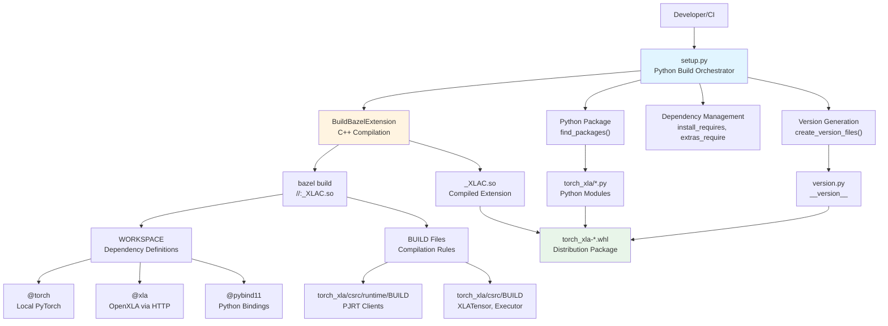
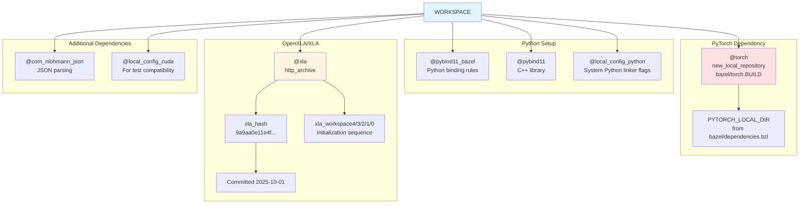
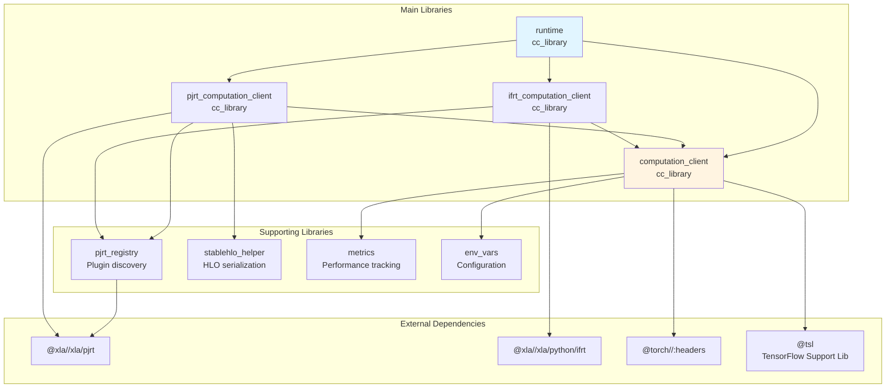
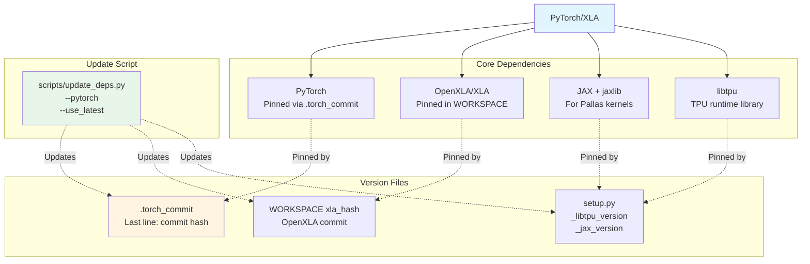
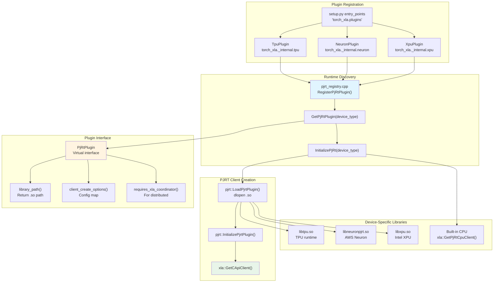
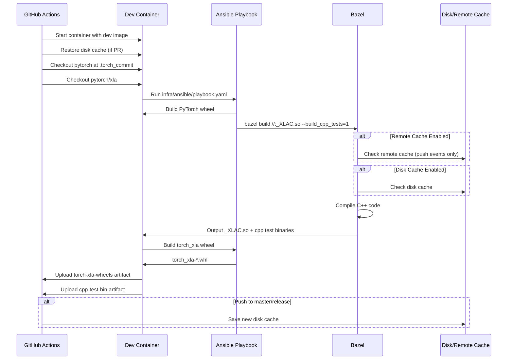

<!-- source: DeepWiki mcp.deepwiki.com · repo pytorch/xla · page 5.1 Build System and Dependencies · fetched 2026-10-21 -->

# Build System and Dependencies

<details>
<summary>Relevant source files</summary>

The following files were used as context for generating this wiki page:

- [.github/ci.md](.github/ci.md)
- [.github/workflows/_build_torch_xla.yml](.github/workflows/_build_torch_xla.yml)
- [.github/workflows/_check_code_changes.yml](.github/workflows/_check_code_changes.yml)
- [.github/workflows/_test.yml](.github/workflows/_test.yml)
- [.github/workflows/_tpu_ci.yml](.github/workflows/_tpu_ci.yml)
- [.github/workflows/build_and_test.yml](.github/workflows/build_and_test.yml)
- [.github/workflows/build_upstream_image.yml](.github/workflows/build_upstream_image.yml)
- [.github/workflows/setup/action.yml](.github/workflows/setup/action.yml)
- [CONTRIBUTING.md](CONTRIBUTING.md)
- [README.md](README.md)
- [WORKSPACE](WORKSPACE)
- [experimental/reference_models/README.md](experimental/reference_models/README.md)
- [scripts/build_developer.sh](scripts/build_developer.sh)
- [scripts/update_deps.py](scripts/update_deps.py)
- [setup.py](setup.py)
- [test/tpu/xla_test_job.yaml](test/tpu/xla_test_job.yaml)
- [torch_xla/csrc/runtime/BUILD](torch_xla/csrc/runtime/BUILD)
- [torch_xla/csrc/runtime/computation_client.h](torch_xla/csrc/runtime/computation_client.h)
- [torch_xla/csrc/runtime/ifrt_computation_client.cpp](torch_xla/csrc/runtime/ifrt_computation_client.cpp)
- [torch_xla/csrc/runtime/ifrt_computation_client.h](torch_xla/csrc/runtime/ifrt_computation_client.h)
- [torch_xla/csrc/runtime/ifrt_computation_client_test.cpp](torch_xla/csrc/runtime/ifrt_computation_client_test.cpp)
- [torch_xla/csrc/runtime/pjrt_computation_client.cpp](torch_xla/csrc/runtime/pjrt_computation_client.cpp)
- [torch_xla/csrc/runtime/pjrt_computation_client.h](torch_xla/csrc/runtime/pjrt_computation_client.h)
- [torch_xla/csrc/runtime/pjrt_computation_client_test.cpp](torch_xla/csrc/runtime/pjrt_computation_client_test.cpp)
- [torch_xla/csrc/runtime/pjrt_registry.cpp](torch_xla/csrc/runtime/pjrt_registry.cpp)
- [torch_xla/csrc/runtime/runtime.cpp](torch_xla/csrc/runtime/runtime.cpp)
- [torch_xla/csrc/runtime/runtime.h](torch_xla/csrc/runtime/runtime.h)

</details>


This document describes the build system, external dependencies, version pinning mechanisms, and plugin architecture used by PyTorch/XLA. It covers how the project is compiled from source, how dependencies are managed, and how the build system supports multiple hardware backends through a plugin system.

For information about the testing infrastructure that validates builds, see [Testing Infrastructure and Frameworks](#5.2). For details on the CI/CD pipeline that orchestrates builds, see [CI/CD Pipeline](#5.3).

---

## Overview and Two-Tier Build Architecture

PyTorch/XLA uses a **two-tier build system** combining Python's `setuptools` with Google's Bazel build system. The `setup.py` script orchestrates the overall build process, handles Python packaging, manages dependencies, and invokes Bazel to compile the C++ components. This hybrid approach allows PyTorch/XLA to leverage Bazel's strengths for complex C++ compilation while maintaining standard Python packaging conventions.



**Sources**: [setup.py:1-486](), [WORKSPACE:1-157](), [torch_xla/csrc/runtime/BUILD:1-551]()

---

## Setup.py: Python Build Orchestration

The `setup.py` script serves as the main entry point for building PyTorch/XLA. It defines custom build commands and manages the overall packaging process.

### Key Components

| Component | Class/Function | Purpose |
|-----------|---------------|---------|
| **Extension Definition** | `BazelExtension` | Defines C++ extension as Bazel target `//:_XLAC.so` |
| **Build Command** | `BuildBazelExtension` | Executes Bazel build, copies output to setuptools expected location |
| **Clean Command** | `Clean` | Runs `bazel clean --expunge` and removes generated files |
| **Develop Command** | `Develop` | Supports editable installs via `.pth` file (multi-package support) |
| **Version Management** | `create_version_files()` | Generates `version.py` and `version.cpp` with git commit info |
| **libtpu Bundling** | `maybe_bundle_libtpu()` | Optionally downloads and includes `libtpu.so` in wheel |

### Build Environment Variables

The build process is controlled by several environment variables documented at the top of `setup.py`:

| Variable | Default | Purpose |
|----------|---------|---------|
| `DEBUG` | - | Build with debug symbols |
| `TORCH_XLA_VERSION` | `2.9.0` | Override version string |
| `GIT_VERSIONED_XLA_BUILD` | `TRUE` | Include git commit hash in version |
| `BAZEL_VERBOSE` | `0` | Enable verbose Bazel output |
| `BUILD_CPP_TESTS` | `0` | Build C++ test binaries |
| `CXX_ABI` | Auto-detected | C++11 ABI flag: `0` or `1` |
| `BUNDLE_LIBTPU` | `0` | Include libtpu.so in wheel |
| `BAZEL_REMOTE_CACHE` | - | Enable remote build cache |
| `GCLOUD_SERVICE_KEY_FILE` | - | Credentials for remote cache |

**Sources**: [setup.py:1-50](), [setup.py:144-171](), [setup.py:266-333]()

### C++11 ABI Handling

PyTorch/XLA must match PyTorch's C++ ABI to ensure binary compatibility. Starting from PyTorch 2.7, PyTorch uses the C++11 ABI by default. The build system detects this automatically:

```python
# From setup.py:307-317
cxx_abi = os.getenv('CXX_ABI')
if cxx_abi is None:
    try:
        import torch
        cxx_abi = getattr(torch._C, '_GLIBCXX_USE_CXX11_ABI', None)
    except:
        pass
if cxx_abi is None:
    # Default to C++11 ABI
    cxx_abi = "1"
bazel_argv.append(f'--cxxopt=-D_GLIBCXX_USE_CXX11_ABI={int(cxx_abi)}')
```

**Sources**: [setup.py:307-317](), [README.md:55-95]()

---

## Bazel Build System

Bazel handles the C++ compilation, dependency management, and incremental builds. The build configuration is defined in `WORKSPACE` and various `BUILD` files throughout the codebase.

### WORKSPACE Configuration

The `WORKSPACE` file defines external dependencies and their versions:



**Key XLA Pinning**: The OpenXLA/XLA commit is pinned via `xla_hash` at [WORKSPACE:49](). To update, modify this hash and the date comment. The XLA dependency can also be overridden with a local checkout using Bazel's `--override_repository` flag.

**Sources**: [WORKSPACE:1-157](), [WORKSPACE:37-81]()

### Runtime BUILD Configuration

The core runtime library is built by [torch_xla/csrc/runtime/BUILD:1-551](). This file defines multiple C++ libraries and their dependencies:



**Sources**: [torch_xla/csrc/runtime/BUILD:1-551]()

---

## External Dependencies and Version Management

PyTorch/XLA depends on several major external projects, each with specific version requirements. The project uses pinning mechanisms to ensure reproducibility and stability.

### Dependency Hierarchy



**Sources**: [setup.py:80-139](), [WORKSPACE:49](), [.torch_commit (referenced)](), [scripts/update_deps.py:1-386]()

### PyTorch Pinning

PyTorch/XLA maintains compatibility with a specific PyTorch commit, stored in [.torch_commit](). This file contains:
- A date comment (line 1)
- The full commit hash (line 2)

The CI and developer builds checkout PyTorch at this exact commit to ensure consistency. When updating the pin:

```bash
# Via update script (recommended)
scripts/update_deps.py --pytorch

# Manual update
cd ../pytorch
git fetch origin
COMMIT=$(git rev-parse origin/main)
DATE=$(git show -s --format=%cd --date=short $COMMIT)
echo "# $DATE" > xla/.torch_commit
echo "$COMMIT" >> xla/.torch_commit
```

**Sources**: [CONTRIBUTING.md:61-81](), [.github/workflows/setup/action.yml:39-48](), [scripts/update_deps.py:46-47]()

### OpenXLA/XLA Version

The OpenXLA compiler is pinned in [WORKSPACE:49-66]():

```python
xla_hash = '9a9aa0e11e4fcda8d6a9c3267dca6776ddbdb0ca'  # Committed on 2025-10-01.

http_archive(
    name = "xla",
    strip_prefix = "xla-" + xla_hash,
    urls = ["https://github.com/openxla/xla/archive/" + xla_hash + ".tar.gz"],
    # ... patches ...
)
```

For development with a local XLA checkout, override via Bazel flag:
```bash
bazel --override_repository=xla=/path/to/openxla
```

**Sources**: [WORKSPACE:49-81](), [scripts/update_deps.py:114-145]()

### JAX and libtpu Versions

JAX (with jaxlib) and libtpu are optional dependencies for Pallas custom kernels and TPU execution, respectively. Versions are defined in [setup.py:117-141]():

```python
USE_NIGHTLY = True  # Whether to use nightly or stable

_libtpu_version = '0.0.24'
_libtpu_date = '20250929'

_jax_version = '0.8.0'
_jaxlib_version = '0.8.0'
_jax_date = '20251001'

if USE_NIGHTLY:
    _libtpu_version += f".dev{_libtpu_date}+nightly"
    _jax_version += f'.dev{_jax_date}'
    _jaxlib_version += f'.dev{_jax_date}'
```

These are installed as optional extras:
```bash
pip install torch_xla[tpu]     # Installs libtpu
pip install torch_xla[pallas]  # Installs jax and jaxlib
```

**Updating Dependencies**: Run `scripts/update_deps.py` (optionally with `--use_latest` for nightly builds) to update all three dependencies (OpenXLA, libtpu, JAX) in a coordinated fashion.

**Sources**: [setup.py:117-141](), [setup.py:471-479](), [scripts/update_deps.py:1-386]()

---

## Plugin Architecture for Device Backends

PyTorch/XLA supports multiple hardware backends (TPU, GPU, CPU, Neuron) through a **PJRT plugin system**. Plugins are dynamically discovered and loaded at runtime, allowing new device support without modifying core code.



**Sources**: [torch_xla/csrc/runtime/pjrt_registry.cpp:1-175](), [setup.py:461-469]()

### Plugin Discovery Flow

1. **Registration**: Plugins register themselves via setuptools `entry_points` in [setup.py:465-469]()
2. **Environment Variable**: User sets `PJRT_DEVICE` to device type (e.g., `TPU`, `CPU`, `NEURON`)
3. **Discovery**: `GetPjRtPlugin()` looks up registered plugin in `pjrt_plugins_` map
4. **Loading**: `InitializePjRt()` calls plugin methods to get library path and options
5. **Initialization**: PJRT C API library is loaded via `pjrt::LoadPjrtPlugin()`
6. **Client Creation**: `xla::GetCApiClient()` creates the PJRT client instance

### Environment Variables for Plugins

| Variable | Default | Used By | Purpose |
|----------|---------|---------|---------|
| `PJRT_DEVICE` | - | All | Device type selection (required) |
| `TPU_LIBRARY_PATH` | `libtpu.so` | TPU | Override libtpu.so location |
| `XLA_INFERRED_TPU_LIBRARY_PATH` | - | TPU | Auto-detected path |
| `NEURON_LIBRARY_PATH` | `libneuronpjrt.so` | Neuron | Neuron PJRT library |
| `XPU_LIBRARY_PATH` | `libxpu.so` | XPU | Intel XPU library |
| `PJRT_DYNAMIC_PLUGINS` | `false` | All | Enable dynamic plugin loading |
| `NUM_CPU_DEVICES` | `1` | CPU | Number of virtual CPU devices |
| `PJRT_ASYNC_CPU_CLIENT` | `true` | CPU | Enable async CPU client |

**Sources**: [torch_xla/csrc/runtime/pjrt_registry.cpp:74-171](), [torch_xla/csrc/runtime/env_vars.h (referenced)]()

### Built-in vs. Dynamic Plugins

- **Built-in plugins** (CPU, TPU): Compiled into PyTorch/XLA, initialized directly
- **Dynamic plugins** (Neuron, XPU, custom): Loaded from shared libraries at runtime

The `PJRT_DYNAMIC_PLUGINS` flag enables the dynamic loading path, which is used for non-TPU/CPU devices.

**Sources**: [torch_xla/csrc/runtime/pjrt_registry.cpp:77-130]()

---

## Build Process Workflows

### Developer Build Workflow

For local development, use [scripts/build_developer.sh:1-104]():

```bash
# Rebuild torch_xla only (default)
scripts/build_developer.sh

# Rebuild pytorch, vision, and torch_xla
scripts/build_developer.sh -b pytorch

# Rebuild and test imports
scripts/build_developer.sh -t
```

The script:
1. Checks out the pinned PyTorch commit from `.torch_commit` if `-b pytorch`
2. Builds PyTorch wheel and installs it
3. Builds torchvision in develop mode
4. Builds torch_xla wheel and installs in develop mode (editable install)
5. Installs libtpu via `torch_xla[tpu]` extras
6. Optionally tests that libraries import correctly

**Sources**: [scripts/build_developer.sh:1-104](), [CONTRIBUTING.md:219-226]()

### CI Build Workflow

The CI build is orchestrated by [.github/workflows/_build_torch_xla.yml:1-111]():



**Key Build Parameters**:
- **Container Image**: `us-central1-docker.pkg.dev/tpu-pytorch-releases/docker/development:3.12_tpuvm`
- **Build Timeout**: 50 minutes
- **Remote Cache**: Enabled only for push events to prevent unauthorized access
- **Disk Cache**: Restored from base branch, saved only on push
- **C++ Tests**: Built and packaged separately in `cpp-test-bin` artifact

**Sources**: [.github/workflows/_build_torch_xla.yml:1-111](), [.github/ci.md:80-94]()

### Caching Strategy

PyTorch/XLA uses two caching mechanisms to speed up builds:

1. **Remote Cache** (Google Cloud Storage)
   - Enabled via `BAZEL_REMOTE_CACHE=1` and `GCLOUD_SERVICE_KEY`
   - Only used for push events to master/release branches (security)
   - Shared across all builds on the same branch

2. **Disk Cache** (GitHub Actions Cache)
   - Path: `$BAZEL_DISK_CACHE_PATH` (typically `./disk-cache`)
   - Keyed by: `${{ runner.os }}-${{ branch }}-${{ commit_sha }}`
   - Pull requests restore from base branch cache
   - New caches created only on push events

**Sources**: [.github/workflows/_build_torch_xla.yml:36-38](), [.github/workflows/_build_torch_xla.yml:56-105]()

---

## Build Configuration Reference

### Common Build Commands

```bash
# Standard wheel build
python setup.py bdist_wheel

# Editable/develop install (creates .pth file)
python setup.py develop

# Clean build artifacts
python setup.py clean

# Build with debug symbols
DEBUG=1 python setup.py bdist_wheel

# Build with specific C++ ABI
CXX_ABI=1 python setup.py bdist_wheel

# Build C++ tests
BUILD_CPP_TESTS=1 python setup.py bdist_wheel

# Bundle libtpu in wheel
BUNDLE_LIBTPU=1 python setup.py bdist_wheel

# Use remote Bazel cache (requires credentials)
BAZEL_REMOTE_CACHE=1 GCLOUD_SERVICE_KEY_FILE=key.json python setup.py bdist_wheel
```

**Sources**: [setup.py:1-50](), [CONTRIBUTING.md:169-188]()

### Bazel Configuration

Bazel build options are controlled via environment variables, processed by `build_util.bazel_options_from_env()`:

| Variable | Purpose |
|----------|---------|
| `BAZEL_REMOTE_CACHE` | Enable remote cache |
| `GCLOUD_SERVICE_KEY_FILE` | Auth for remote cache |
| `BAZEL_DISK_CACHE_PATH` | Local disk cache directory |
| `SILO_NAME` | Remote cache silo name |
| `BAZEL_JOBS` | Number of parallel jobs (empty = auto) |
| `BAZEL_VERBOSE` | Verbose output |
| `TPUVM_MODE` | TPU-specific flags |
| `XLA_CPU_USE_ACL` | Use ARM Compute Library |

**Sources**: [setup.py:319](), [.github/workflows/_build_torch_xla.yml:36-39]()

---

## Troubleshooting Build Issues

### Common Problems and Solutions

| Problem | Cause | Solution |
|---------|-------|----------|
| `PJRT_DEVICE not set` | Missing environment variable | Set `export PJRT_DEVICE=CPU` or `TPU` |
| C++ ABI mismatch | PyTorch and torch_xla built with different ABIs | Ensure both use same ABI, rebuild PyTorch if needed |
| Bazel version mismatch | Old bazel version | Install correct bazel version (see `.bazelversion`) |
| Git permission errors | Running git in container as root | Run git commands outside container |
| Missing libtpu.so | TPU library not installed | `pip install torch_xla[tpu]` |
| Import errors after build | Stale installation | `pip uninstall torch_xla -y && python setup.py develop` |

**Sources**: [CONTRIBUTING.md:324-328](), [.github/ci.md:126-131]()

### Verifying Build Success

```bash
# Check that libraries load
python -c "import torch_xla; print(torch_xla.devices())"

# Check versions
python -c "import torch_xla; print(torch_xla.__version__)"

# Verify XLA and PyTorch commit hashes
python -c "import torch_xla.version; print(torch_xla.version.__xla_gitrev__); print(torch_xla.version.__torch_gitrev__)"
```

**Sources**: [CONTRIBUTING.md:190-196](), [scripts/build_developer.sh:100-103]()

---

## Summary

The PyTorch/XLA build system combines Python's setuptools for packaging with Bazel for C++ compilation, creating a flexible two-tier architecture. External dependencies are carefully pinned for reproducibility: PyTorch via `.torch_commit`, OpenXLA via WORKSPACE `xla_hash`, and JAX/libtpu via setup.py version variables. The plugin architecture enables extensibility to new hardware backends without modifying core code. Both developer and CI builds leverage caching mechanisms (remote and disk) to minimize rebuild times, with the CI employing Ansible playbooks for consistent, reproducible builds across environments.

**Sources**: [setup.py:1-486](), [WORKSPACE:1-157](), [torch_xla/csrc/runtime/pjrt_registry.cpp:1-175](), [.github/workflows/_build_torch_xla.yml:1-111]()

---

