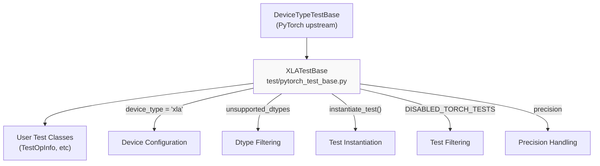
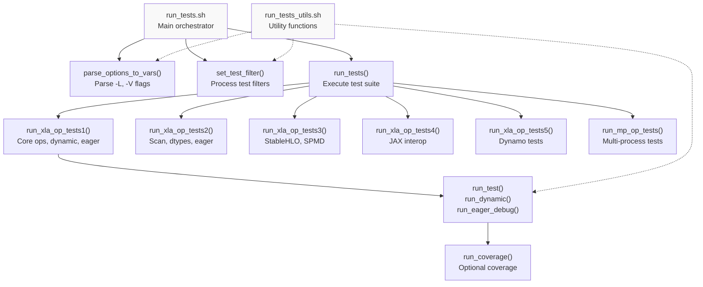
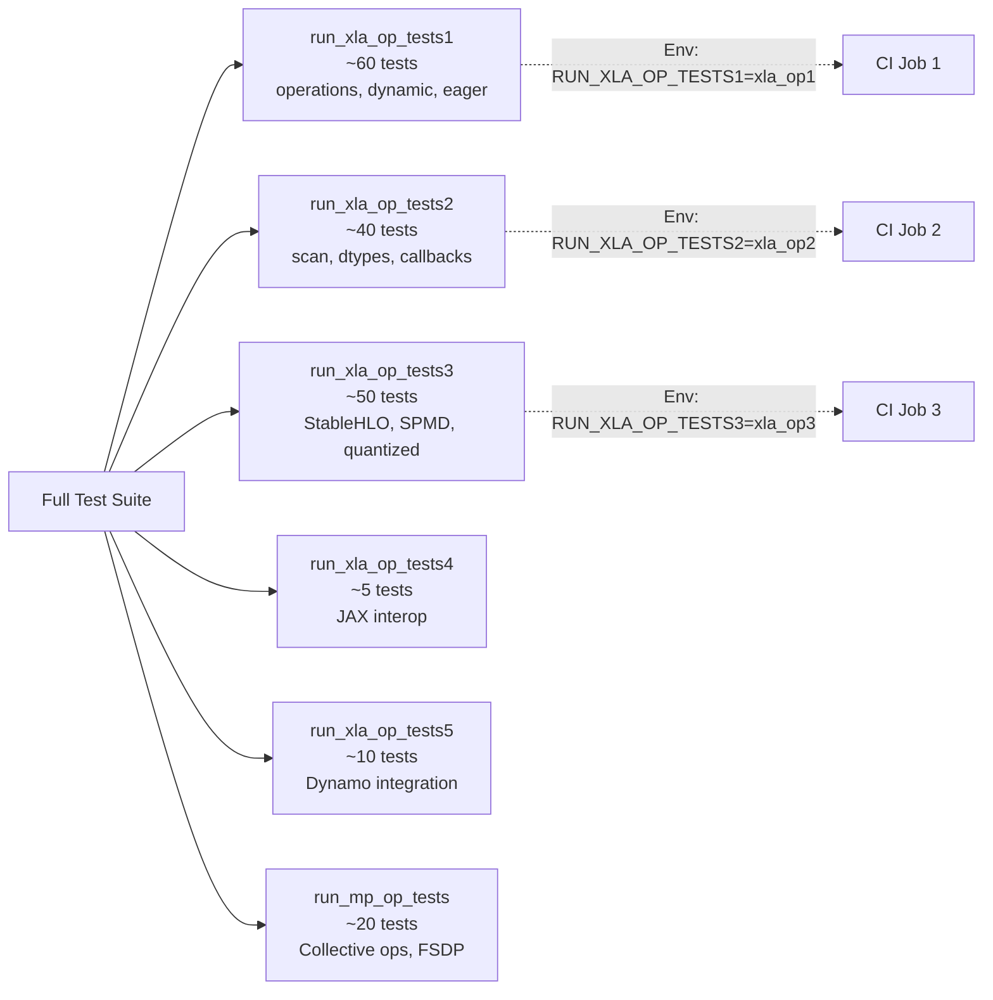
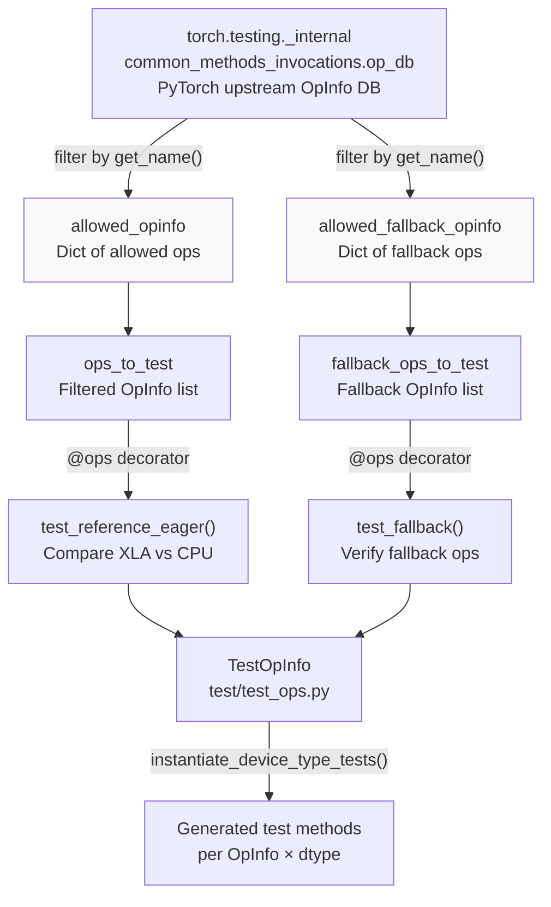
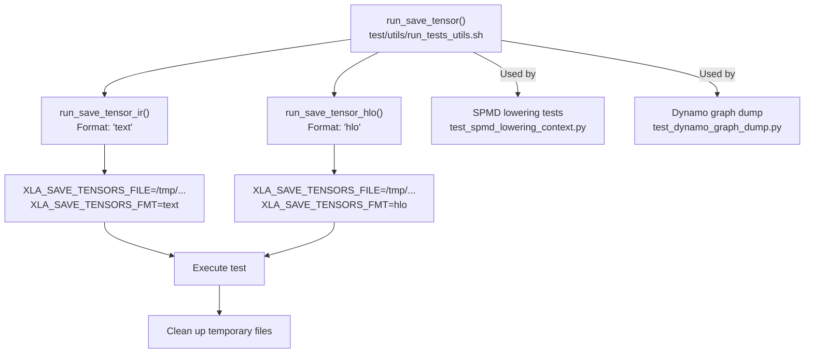

<!-- source: DeepWiki mcp.deepwiki.com · repo pytorch/xla · page 5.2 Testing Infrastructure and Frameworks · fetched 2026-10-21 -->

# Testing Infrastructure and Frameworks

<details>
<summary>Relevant source files</summary>

The following files were used as context for generating this wiki page:

- [test/benchmarks/run_torchbench_tests.sh](test/benchmarks/run_torchbench_tests.sh)
- [test/neuron/run_tests.sh](test/neuron/run_tests.sh)
- [test/pytorch_test_base.py](test/pytorch_test_base.py)
- [test/run_tests.sh](test/run_tests.sh)
- [test/spmd/test_dtensor_convert_mesh.py](test/spmd/test_dtensor_convert_mesh.py)
- [test/spmd/test_dtensor_redistribute.py](test/spmd/test_dtensor_redistribute.py)
- [test/spmd/test_xla_dtensor_placements.py](test/spmd/test_xla_dtensor_placements.py)
- [test/spmd/test_xla_dtensor_spec_conversion.py](test/spmd/test_xla_dtensor_spec_conversion.py)
- [test/spmd/test_xla_sharded_tensor.py](test/spmd/test_xla_sharded_tensor.py)
- [test/test_mp_all_to_all.py](test/test_mp_all_to_all.py)
- [test/test_mp_collective_permute.py](test/test_mp_collective_permute.py)
- [test/test_ops.py](test/test_ops.py)
- [test/test_user_computation_debug_cache.py](test/test_user_computation_debug_cache.py)
- [test/test_xla_graph_execution.py](test/test_xla_graph_execution.py)
- [test/torch_distributed/test_torch_distributed_fsdp_meta.py](test/torch_distributed/test_torch_distributed_fsdp_meta.py)
- [test/tpu/run_tests.sh](test/tpu/run_tests.sh)
- [test/utils/run_tests_utils.sh](test/utils/run_tests_utils.sh)
- [torch_xla/distributed/spmd/xla_sharded_tensor.py](torch_xla/distributed/spmd/xla_sharded_tensor.py)

</details>


This document describes the testing infrastructure and frameworks used to validate PyTorch/XLA functionality. It covers the base test classes, test orchestration scripts, utilities, and patterns for writing and executing tests across different device types (CPU, TPU, Neuron).

For information about the CI/CD pipeline that runs these tests, see [CI/CD Pipeline](#5.3). For benchmarking infrastructure, see [Benchmarking and Performance Testing](#5.4).

## Test Organization and Structure

PyTorch/XLA tests are organized in the `test/` directory with specialized subdirectories for different categories:

| Directory | Purpose | Key Files |
|-----------|---------|-----------|
| `test/` | Core XLA operation tests | `test_operations.py`, `test_ops.py`, `test_xla_graph_execution.py` |
| `test/spmd/` | SPMD and sharding tests | `test_xla_sharding.py`, `test_xla_sharded_tensor.py` |
| `test/dynamo/` | TorchDynamo integration | `test_dynamo.py`, `test_dynamo_dynamic_shape.py` |
| `test/stablehlo/` | StableHLO export tests | `test_exports.py`, `test_stablehlo_compile.py` |
| `test/torch_distributed/` | PyTorch distributed backend | `test_torch_distributed_*_xla_backend.py` |
| `test/eager/` | Eager mode tests | `test_eager.py`, `test_eager_spmd.py` |
| `test/pjrt/` | PJRT runtime tests | `test_runtime.py`, `test_dtypes.py` |
| `test/tpu/` | TPU-specific tests | `run_tests.sh` (TPU runner) |
| `test/neuron/` | AWS Neuron tests | `run_tests.sh` (Neuron runner) |

Tests are categorized into shards for parallel execution:
- **XLA Op Tests** (`run_xla_op_tests1-5`): Core operation testing across different modes
- **Multi-Process Tests** (`run_mp_op_tests`): Collective operations and distributed training
- **Torch Op Tests** (`run_torch_op_tests`): PyTorch upstream operation compatibility

**Sources:** [test/run_tests.sh:1-359](), [test/tpu/run_tests.sh:1-103](), [test/neuron/run_tests.sh:1-376]()

## XLATestBase: Core Test Class

### Test Class Hierarchy



### XLATestBase Class Features

The `XLATestBase` class in [test/pytorch_test_base.py:526-692]() provides the foundation for all XLA tests:

**Key Attributes:**
- `device_type = 'xla'`: Identifies tests as XLA-specific
- `unsupported_dtypes`: Set of dtypes not supported on XLA (half, complex32, complex64, complex128)
- `precision = DEFAULT_FLOATING_PRECISION`: Default tolerance for floating-point comparisons (1e-3)

**Test Instantiation:** The `instantiate_test()` method [test/pytorch_test_base.py:543-611]() handles:
1. Filtering disabled tests based on `DISABLED_TORCH_TESTS` dictionaries
2. Creating dtype-specific test variants
3. Setting device-specific precision tolerances
4. Skipping unsupported dtype combinations

**Disabled Test Management:** Tests can be disabled via dictionaries:
- `DISABLED_TORCH_TESTS_ANY`: Tests disabled on all devices [test/pytorch_test_base.py:31-357]()
- `DISABLED_TORCH_TESTS_TPU_ONLY`: Additional TPU-specific disables [test/pytorch_test_base.py:359-476]()
- `DISABLED_TORCH_TESTS_CPU` / `DISABLED_TORCH_TESTS_TPU`: Device-specific merged sets [test/pytorch_test_base.py:516-523]()

Each entry can be an exact test name or a regex pattern, managed by `MatchSet` [test/pytorch_test_base.py:479-506]().

**Precision Handling:** The class manages precision tolerances:
- Per-test precision overrides in `TORCH_TEST_PRECIIONS` [test/pytorch_test_base.py:19-29]()
- Per-dtype precision via `precision_overrides` [test/pytorch_test_base.py:568-600]()
- Runtime precision adjustment in `assertEqual()` [test/pytorch_test_base.py:655-689]()

**Sources:** [test/pytorch_test_base.py:526-692](), [test/pytorch_test_base.py:19-523]()

### Test Setup and Environment

```python
# Example test class setup
@classmethod
def setUpClass(cls):
    cls.primary_device = str(torch_xla.device())
    torch_xla._XLAC._xla_set_mat_mul_precision('highest')

def setUp(self):
    super().setUp()
    xm.set_rng_state(101)  # Deterministic RNG
```

The `setUpClass()` method [test/pytorch_test_base.py:618-621]() configures the device and matrix multiplication precision. The `setUp()` method [test/pytorch_test_base.py:623-625]() ensures deterministic RNG state for reproducible tests.

**Sources:** [test/pytorch_test_base.py:618-625]()

## Test Orchestration and Execution

### Main Test Runner Architecture



### Test Execution Functions

The test runner provides multiple execution modes via wrapper functions in [test/run_tests.sh:48-136]():

| Function | Environment Variables | Purpose |
|----------|----------------------|---------|
| `run_test()` | `PJRT_DEVICE=CPU`, `CPU_NUM_DEVICES=1` | Basic test execution |
| `run_test_multi_devices()` | `CPU_NUM_DEVICES=4` | Multi-device testing |
| `run_test_without_functionalization()` | `XLA_DISABLE_FUNCTIONALIZATION=1` | Legacy mode testing |
| `run_dynamic()` | `XLA_EXPERIMENTAL="nonzero:..."` | Dynamic shape mode |
| `run_eager_debug()` | `XLA_USE_EAGER_DEBUG_MODE=1` | Eager debug mode |
| `run_use_bf16()` | `XLA_USE_BF16=1` | BF16 precision testing |
| `run_downcast_bf16()` | `XLA_DOWNCAST_BF16=1` | BF16 downcasting |
| `run_pt_xla_debug()` | `PT_XLA_DEBUG=1`, `PT_XLA_DEBUG_FILE=...` | Debug tensor saving |

Each function wraps `run_coverage()` [test/run_tests.sh:37-46](), which optionally collects code coverage.

**Sources:** [test/run_tests.sh:48-136]()

### Test Sharding Strategy



Tests are distributed across shards to balance execution time. The sharding is controlled by environment variables [test/run_tests.sh:318-349]():

```bash
if [[ "$RUN_XLA_OP_TESTS1" == "xla_op1" ]]; then
    run_xla_op_tests1
elif [[ "$RUN_XLA_OP_TESTS2" == "xla_op2" ]]; then
    run_xla_op_tests2
# ... etc
```

**Sources:** [test/run_tests.sh:147-291](), [test/run_tests.sh:316-350]()

### Test Filtering and Selection

Test execution can be filtered using glob patterns:

```bash
# Run specific test file
./run_tests.sh test/test_operations.py

# Run multiple tests
./run_tests.sh test/test_operations.py test/test_metrics.py

# Run all tests (no filter)
./run_tests.sh
```

The `test_is_selected()` function [test/utils/run_tests_utils.sh:41-66]() checks if a test matches the filter:

```bash
function test_is_selected {
  if [[ -z "$_TEST_FILTER" ]]; then
    return 0  # No filter, run all
  fi
  for _FILTER in $_TEST_FILTER; do
    case $(realpath $1) in
    $(realpath $_FILTER))
      return 0  # Match found
      ;;
    esac
  done
  return 1  # No match
}
```

When `CONTINUE_ON_ERROR=1` is set, tests continue after failures instead of stopping at the first error [test/run_tests.sh:18-24]().

**Sources:** [test/utils/run_tests_utils.sh:41-80](), [test/run_tests.sh:18-24]()

## OpInfo Testing Framework

### OpInfo Integration Architecture



### Allowed Operations Configuration

The `allowed_opinfo` dictionary [test/test_ops.py:51-380]() defines which operations from PyTorch's `op_db` are expected to pass on XLA:

```python
allowed_opinfo = get_allowed_ops_map(
    AllowedOpInfoEntry('abs'),
    AllowedOpInfoEntry('add'),
    AllowedOpInfoEntry('addmm'),
    AllowedOpInfoEntry('addmm', 'decomposed'),  # Variant
    # ... ~250+ operations
)
```

Each `AllowedOpInfoEntry` [test/test_ops.py:19-23]() specifies:
- `name`: Operation name (e.g., 'abs', 'addmm')
- `variant_test_name`: Optional variant (e.g., 'decomposed', 'no_rounding_mode')

The `get_name()` function [test/test_ops.py:39-41]() creates unique identifiers by concatenating name and variant.

**Sources:** [test/test_ops.py:19-423]()

### Fallback Operations Testing

For operations that require CPU fallback, `allowed_fallback_opinfo` [test/test_ops.py:382-411]() uses `AllowedFallbackOpInfoEntry` [test/test_ops.py:26-37]():

```python
allowed_fallback_opinfo = get_allowed_ops_map(
    AllowedFallbackOpInfoEntry(
        'nn.functional.embedding_bag',
        fallback_ops={"aten::_embedding_bag"},
    ),
    AllowedFallbackOpInfoEntry(
        'unique',
        fallback_ops={"aten::_unique2"},
        allow_sample=lambda sample: sample.kwargs["dim"] is None,
    ),
    # ...
)
```

The `test_fallback()` method [test/test_ops.py:477-513]() verifies:
1. Results match CPU reference
2. Expected fallback operations were executed via `met.executed_fallback_ops()`

**Sources:** [test/test_ops.py:382-514]()

### Test Comparison Framework

```python
def compare_with_eager_reference(self, torch_fn, sample_input, **kwargs):
    # Convert XLA tensors to CPU
    t_inp, t_args, t_kwargs = sample_input.input, sample_input.args, sample_input.kwargs
    cpu_inp, cpu_args, cpu_kwargs = cpu(sample_input)
    
    # Execute on both devices
    actual = torch_fn(t_inp, *t_args, **t_kwargs)
    expected = torch_fn(cpu_inp, *cpu_args, **cpu_kwargs)
    
    # Compare with exact dtype and device-agnostic comparison
    self.assertEqual(actual, expected, exact_dtype=True, exact_device=False)
```

The `compare_with_eager_reference()` method [test/test_ops.py:427-467]() recursively converts tensors to CPU using `to_cpu()` helper, executes the operation on both XLA and CPU, and compares results.

**Sources:** [test/test_ops.py:427-475]()

## Test Utilities and Debug Modes

### Graph Saving and Debug Utilities



The `run_save_tensor()` function [test/utils/run_tests_utils.sh:85-120]() enables IR/HLO graph saving for debugging:

```bash
function run_save_tensor {
  local run_test_func="$1"
  local file_graph_format="$2"
  shift 2
  
  local base_file="/tmp/xla_test_save_ir.txt"
  
  # Set environment variables
  XLA_SAVE_TENSORS_FILE="$base_file" \
  XLA_SAVE_TENSORS_FMT="$file_graph_format" \
  $run_test_func "$@"
  
  # Clean up after test
  rm -f "${base_file}"*
}
```

**Sources:** [test/utils/run_tests_utils.sh:85-155]()

### Debug Mode Functions

Additional debug modes are provided for troubleshooting:

| Function | Environment Variable | Purpose | Example Usage |
|----------|---------------------|---------|---------------|
| `run_xla_ir_debug()` | `XLA_IR_DEBUG=1` | Print XLA IR graphs | Debugging lowering issues |
| `run_xla_hlo_debug()` | `XLA_HLO_DEBUG=1` | Print HLO graphs | Debugging compilation |
| `run_xla_ir_hlo_debug()` | Both flags | Print IR and HLO | Full graph inspection |

These are used in tests like:
```bash
run_xla_hlo_debug run_test "$_TEST_DIR/stablehlo/test_stablehlo_save_load.py"
run_xla_ir_hlo_debug run_test "$_TEST_DIR/test_user_computation_debug_cache.py"
```

**Sources:** [test/utils/run_tests_utils.sh:136-155](), [test/run_tests.sh:182-186]()

## Device-Specific Test Runners

### TPU Test Runner

The TPU test runner [test/tpu/run_tests.sh:1-103]() is a curated subset focused on TPU-specific functionality:

```bash
function run_test {
  if ! test_is_selected "$1"; then
    return
  fi
  python3 "$@"  # No PJRT_DEVICE override, uses default TPU
}
```

Key TPU tests include:
- Matrix multiplication precision tests (`test_mat_mul_precision.py`)
- SPMD and sharding tests (`test_xla_sharding.py`, `test_train_spmd_linear_model.py`)
- FSDP v2 tests (`test_fsdp_v2.py`)
- Dynamic shapes (`test_dynamic_shape_models.py`)
- Pallas kernels (`test_scan_pallas.py`)

**Sources:** [test/tpu/run_tests.sh:1-103]()

### Neuron Test Runner

The Neuron test runner [test/neuron/run_tests.sh:1-376]() supports AWS Inferentia/Trainium:

```bash
function run_test {
  echo "Running in PjRt runtime: $@"
  PJRT_DEVICE=NEURON NEURON_NUM_DEVICES=1 run_coverage "$@"
}

function run_test_multi_device {
  PJRT_DEVICE=NEURON run_coverage "$@"  # Uses all devices
}
```

Neuron-specific features:
- Custom neuron utility tests (`test_neuron_utils.py`, `test_neuron_data_types.py`) [test/neuron/run_tests.sh:286-289]()
- Many tests are commented out or skipped due to Neuron limitations
- Uses `NEURONCORE_NUM_DEVICES` for multi-device tests

**Sources:** [test/neuron/run_tests.sh:1-376]()

## Environment Variables for Test Configuration

### Core Environment Variables

Tests are configured via environment variables set in [test/run_tests.sh:26-29]():

| Variable | Default | Purpose |
|----------|---------|---------|
| `TORCH_TEST_DEVICES` | `$_TEST_DIR/pytorch_test_base.py` | Points to device test module |
| `PYTORCH_TEST_WITH_SLOW` | `1` | Enable slow tests |
| `XLA_DUMP_FATAL_STACK` | `1` | Dump stack traces on fatal errors |
| `CPU_NUM_DEVICES` | `4` | Number of virtual CPU devices |
| `USE_COVERAGE` | `0` | Enable code coverage collection |
| `CONTINUE_ON_ERROR` | `0` | Continue tests after failures |

### Test Mode Environment Variables

| Variable | Values | Effect |
|----------|--------|--------|
| `PJRT_DEVICE` | `CPU`, `TPU`, `CUDA`, `NEURON` | Select device backend |
| `XLA_DISABLE_FUNCTIONALIZATION` | `0`/`1` | Disable functionalization pass |
| `XLA_USE_BF16` | `0`/`1` | Automatically cast to BF16 |
| `XLA_DOWNCAST_BF16` | `0`/`1` | Downcast float32 to BF16 |
| `XLA_EXPERIMENTAL` | `"nonzero:masked_select:..."` | Enable experimental ops |
| `XLA_USE_EAGER_DEBUG_MODE` | `0`/`1` | Enable eager debug mode |
| `PT_XLA_DEBUG` | `0`/`1`/`2` | Debug level for tensor saving |
| `PT_XLA_DEBUG_FILE` | Path | Output file for debug info |
| `XLA_USE_SPMD` | `0`/`1` | Enable SPMD mode |
| `XLA_IR_DEBUG` | `0`/`1` | Enable IR debug printing |
| `XLA_HLO_DEBUG` | `0`/`1` | Enable HLO debug printing |
| `XLA_METRICS_FILE` | Path | Write metrics to file |

**Sources:** [test/run_tests.sh:26-29](), [test/run_tests.sh:48-136]()

## Test Execution Patterns

### Multi-Process Test Pattern

Multi-process tests use `torch_xla.launch()` to spawn processes across devices:

```python
def _mp_fn(index):
    device = torch_xla.device()
    if xm.xla_device_hw(device) in ['TPU', 'NEURON']:
        ordinal = xr.global_ordinal()
        # Test logic using collective operations
        result_tensor = xm.all_reduce(...)
        # Verify results
        assert result == expected
    else:
        print(f"Device {device} not supported", file=sys.stderr)

if __name__ == '__main__':
    torch_xla.launch(_mp_fn, args=())
```

This pattern is used in tests like:
- [test/test_mp_collective_permute.py:8-31]()
- [test/test_mp_all_to_all.py:8-34]()
- [test/torch_distributed/test_torch_distributed_fsdp_meta.py:143-161]()

**Sources:** [test/test_mp_collective_permute.py:1-32](), [test/test_mp_all_to_all.py:1-35]()

### Device-Aware Test Pattern

Tests check device capabilities before running:

```python
def test_feature(self):
    device = torch_xla.device()
    if xm.xla_device_hw(device) not in ['TPU', 'GPU']:
        self.skipTest("Feature requires TPU or GPU")
    
    # Test implementation
    ...
```

This is seen in tests like [test/spmd/test_dtensor_convert_mesh.py:17-28]() which skip tests if insufficient devices are available:

```python
@unittest.skipIf(xr.global_runtime_device_count() == 1,
                 "Multiple devices needed for 1D mesh test")
def test_convert_1d_device_mesh(self):
    device_count = xr.global_runtime_device_count()
    # Test implementation
```

**Sources:** [test/spmd/test_dtensor_convert_mesh.py:1-115](), [test/test_mp_collective_permute.py:8-31]()

### XLAShardedTensor Test Pattern

Tests for sharded tensors follow a common pattern in [test/spmd/test_xla_sharded_tensor.py:16-34]():

```python
class XlaShardedTensorTest(test_xla_sharding_base.XlaShardingTest):
    @classmethod
    def setUpClass(cls):
        super().setUpClass()
    
    def test_xlashardedtensor_is_dtensor(self):
        xt = torch.randn(128, 128).to('xla')
        xla_tensor = XLAShardedTensor(xt)
        self.assertIsInstance(xla_tensor, DTensor)
```

This demonstrates:
1. Inheriting from `XlaShardingTest` base class
2. Creating XLA tensors with `.to('xla')`
3. Wrapping in `XLAShardedTensor`
4. Verifying sharding behavior

**Sources:** [test/spmd/test_xla_sharded_tensor.py:10-38](), [test/spmd/test_dtensor_redistribute.py:13-269]()

---

