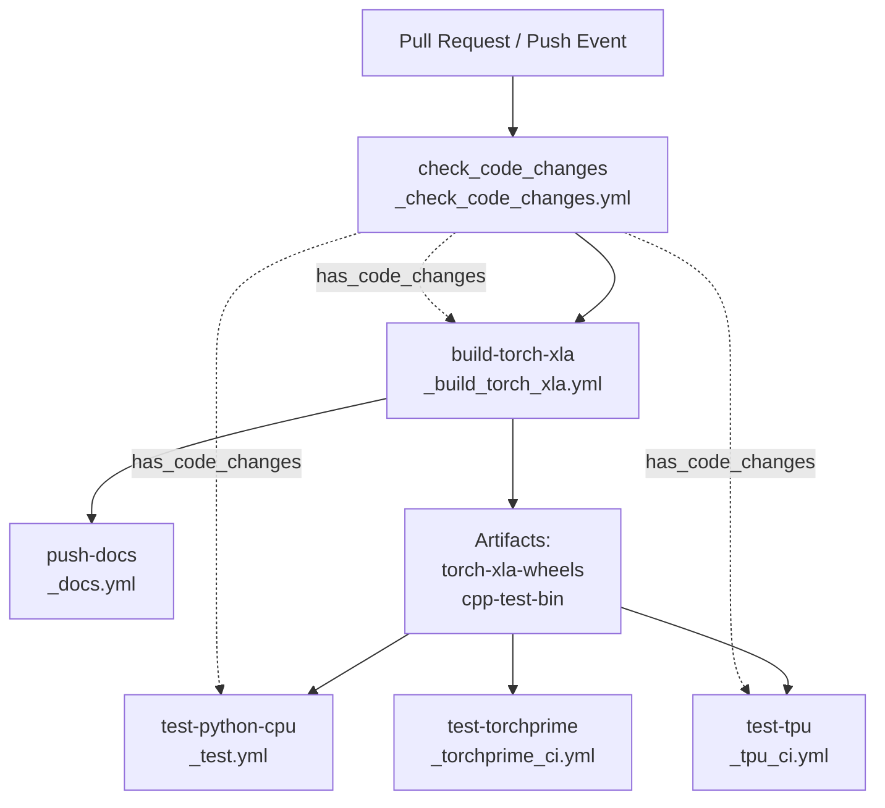
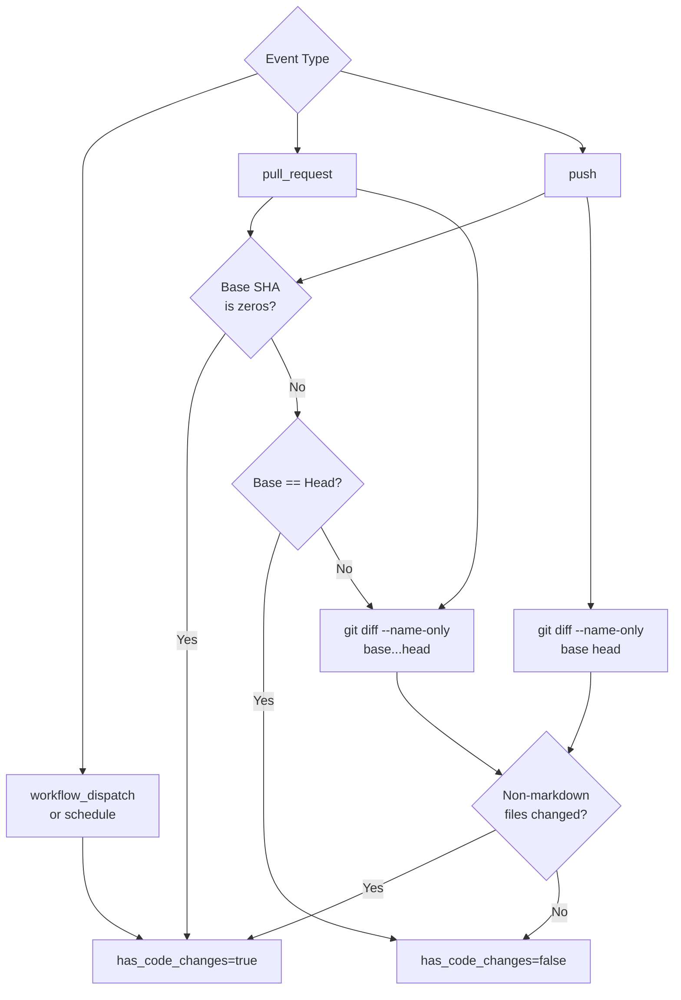
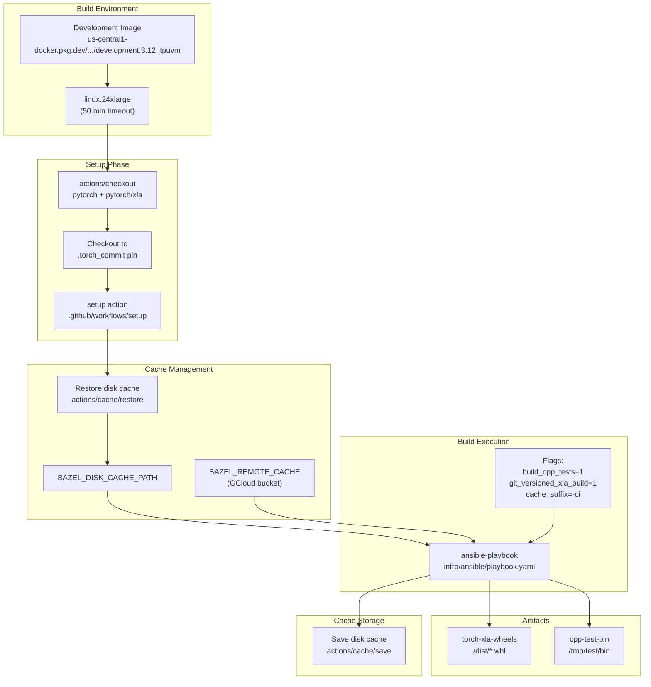
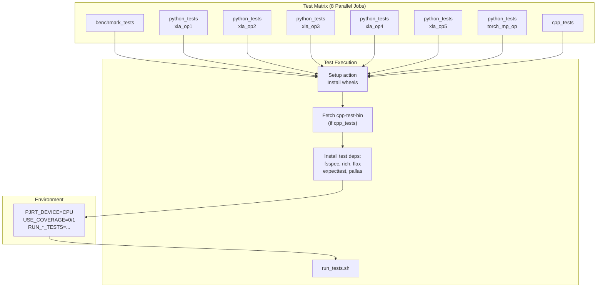
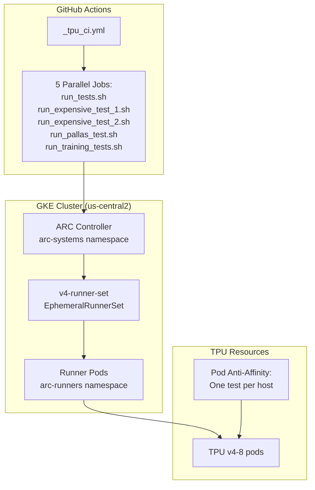
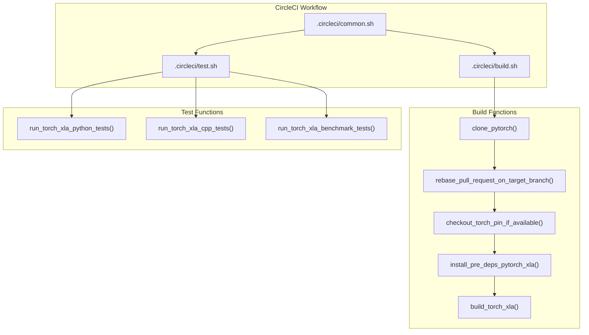
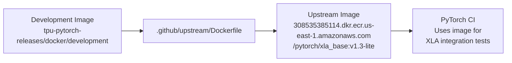
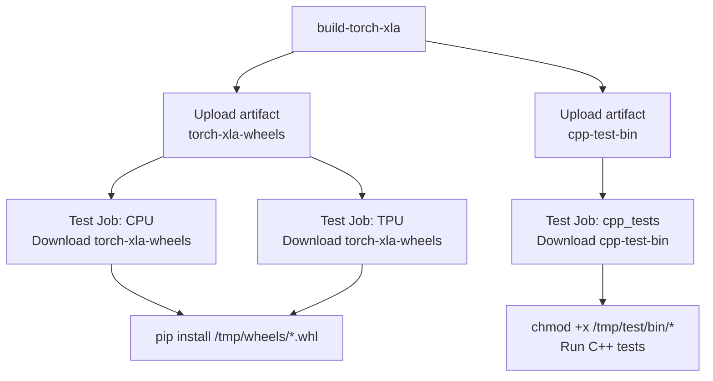
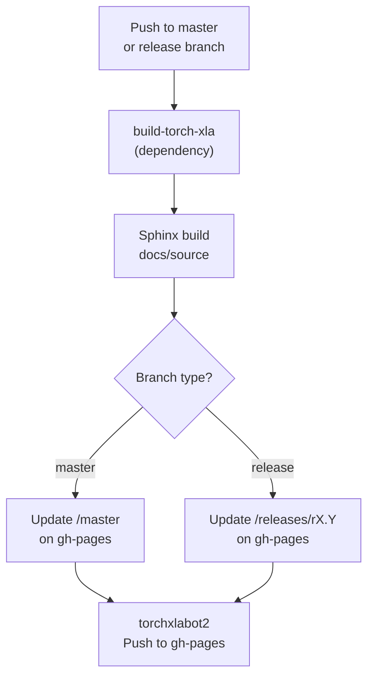

<!-- source: DeepWiki mcp.deepwiki.com · repo pytorch/xla · page 5.3 CI/CD Pipeline · fetched 2026-10-21 -->

# CI/CD Pipeline

<details>
<summary>Relevant source files</summary>

The following files were used as context for generating this wiki page:

- [.circleci/build.sh](.circleci/build.sh)
- [.circleci/common.sh](.circleci/common.sh)
- [.circleci/test.sh](.circleci/test.sh)
- [.github/ci.md](.github/ci.md)
- [.github/upstream/install_conda.sh](.github/upstream/install_conda.sh)
- [.github/upstream/install_valgrind.sh](.github/upstream/install_valgrind.sh)
- [.github/workflows/_build_torch_xla.yml](.github/workflows/_build_torch_xla.yml)
- [.github/workflows/_check_code_changes.yml](.github/workflows/_check_code_changes.yml)
- [.github/workflows/_test.yml](.github/workflows/_test.yml)
- [.github/workflows/_tpu_ci.yml](.github/workflows/_tpu_ci.yml)
- [.github/workflows/build_and_test.yml](.github/workflows/build_and_test.yml)
- [.github/workflows/build_upstream_image.yml](.github/workflows/build_upstream_image.yml)
- [.github/workflows/setup/action.yml](.github/workflows/setup/action.yml)
- [CONTRIBUTING.md](CONTRIBUTING.md)
- [README.md](README.md)
- [experimental/reference_models/README.md](experimental/reference_models/README.md)
- [scripts/build_developer.sh](scripts/build_developer.sh)
- [scripts/update_deps.py](scripts/update_deps.py)
- [test/bench.py](test/bench.py)
- [test/test_operations_hlo.py](test/test_operations_hlo.py)
- [test/tpu/xla_test_job.yaml](test/tpu/xla_test_job.yaml)

</details>


This page documents the continuous integration and continuous deployment (CI/CD) infrastructure for PyTorch/XLA. The CI system ensures code quality through automated building, testing, and documentation generation on every pull request and push to protected branches.

For information about the build system and dependency management, see [Build System and Dependencies](#5.1). For details about test infrastructure and test frameworks, see [Testing Infrastructure and Frameworks](#5.2). For benchmarking and performance testing, see [Benchmarking and Performance Testing](#5.4).

## Overview

The PyTorch/XLA CI/CD pipeline consists of three primary components:

1. **GitHub Actions workflows** - Main CI infrastructure for PyTorch/XLA repository
2. **CircleCI configuration** - Legacy support for upstream PyTorch CI integration
3. **TPU test runners** - Self-hosted GKE-based infrastructure for TPU validation

The CI runs on two types of runners:
- **CPU runners**: Organization self-hosted runners (e.g., `linux.24xlarge`, `linux.12xlarge`) for most jobs
- **TPU runners**: Custom GKE-based runners (`v4-runner-set`) for TPU-specific tests

Sources: [.github/ci.md:1-78](), [README.md:7-8]()

## Main Workflow Orchestration

The primary CI workflow is defined in `build_and_test.yml`, which orchestrates all build and test jobs.



**Figure 1: Main CI Workflow Dependencies**

The workflow triggers on:
- Pull requests to `master` and release branches (`r[0-9]+.[0-9]+`)
- Pushes to `master` and release branches
- Manual workflow dispatch

Sources: [.github/workflows/build_and_test.yml:1-98]()

### Workflow Configuration

Key workflow parameters:

| Workflow Job | Runner | Timeout | Matrix Size | Purpose |
|-------------|--------|---------|-------------|---------|
| `check_code_changes` | `ubuntu-24.04` | Default | 1 | Detect code changes |
| `build-torch-xla` | `linux.24xlarge` | 50 min | 1 | Build PyTorch/XLA |
| `test-python-cpu` | `linux.24xlarge` | 45 min | 8 jobs | CPU tests |
| `test-tpu` | `v4-runner-set` | 75 min | 5 jobs | TPU tests |

Sources: [.github/workflows/build_and_test.yml:38-98](), [.github/workflows/_test.yml:1-164]()

## Code Change Detection

The `_check_code_changes.yml` workflow determines whether full CI should run based on file changes.



**Figure 2: Code Change Detection Logic**

The workflow uses different diff strategies:
- **Pull requests**: Three-dot diff (`base...head`) shows changes since branch diverged
- **Pushes**: Two-dot diff (`base head`) shows changes between commits
- **Markdown-only changes**: Skips full CI if only `.md` files changed

Sources: [.github/workflows/_check_code_changes.yml:1-112]()

## Build Pipeline

### Build Process

The `_build_torch_xla.yml` workflow builds PyTorch and PyTorch/XLA from source.



**Figure 3: Build Pipeline Architecture**

Key environment variables:

| Variable | Purpose | Value |
|----------|---------|-------|
| `BAZEL_REMOTE_CACHE` | Enable GCloud cache | `true` for push/internal PRs |
| `BAZEL_DISK_CACHE_PATH` | Local disk cache | `${{ github.workspace }}/disk-cache` |
| `BAZEL_JOBS` | Parallelism | Empty (let Bazel decide) |
| `BUILD_CPP_TESTS` | Build C++ tests | `1` |

Sources: [.github/workflows/_build_torch_xla.yml:1-111](), [.github/workflows/setup/action.yml:1-65]()

### Caching Strategy

The build uses two levels of caching:

1. **Remote Cache** (GCloud bucket):
   - Enabled for pushes and internal PRs
   - Shared across all CI runs
   - Requires `GCLOUD_SERVICE_KEY` secret

2. **Disk Cache** (GitHub Actions cache):
   - Per-branch cache identified by `${{ runner.os }}-${{ github.ref_name }}-${{ github.sha }}`
   - Restored on PRs using base branch cache
   - Saved only on pushes to create new baseline

Sources: [.github/workflows/_build_torch_xla.yml:36-106]()

### PyTorch Commit Pinning

PyTorch/XLA pins a specific PyTorch commit to ensure compatibility:

```python
# File: .torch_commit (format)
# YYYY-MM-DD
<commit-hash>
```

The setup action checks out this pinned commit:

```bash
COMMIT=$(tail -1 "xla/$TORCH_COMMIT_FILE")
git fetch --no-recurse-submodules origin $COMMIT
git checkout --no-recurse-submodules FETCH_HEAD
```

Sources: [.github/workflows/setup/action.yml:38-48](), [CONTRIBUTING.md:62-81]()

## CPU Test Execution

### Test Matrix Configuration

The `_test.yml` workflow executes tests in parallel using a matrix strategy:



**Figure 4: CPU Test Matrix Execution**

Sources: [.github/workflows/_test.yml:41-73]()

### Test Categories

Tests are organized by environment variables:

| Environment Variable | Test Category | Purpose |
|---------------------|---------------|---------|
| `RUN_BENCHMARK_TESTS` | `benchmark_tests` | Performance benchmarks |
| `RUN_PYTHON_TESTS` | `python_tests` | Core Python tests |
| `RUN_XLA_OP_TESTS1-5` | `xla_op1-5` | XLA operation tests (split) |
| `RUN_TORCH_MP_OP_TESTS` | `torch_mp_op` | Multi-process tests |
| `RUN_CPP_TESTS` | `cpp_tests` | C++ unit tests |

Sources: [.github/workflows/_test.yml:65-73]()

### Test Execution Script

The actual test execution is handled by `.github/scripts/run_tests.sh`, which delegates to `test/run_tests.sh`:

```bash
# Environment-based test selection
if [[ ! -z "$RUN_BENCHMARK_TESTS" ]]; then
  test/benchmarks/run_tests.sh -L""
elif [[ "$RUN_PYTHON_TESTS" == "python_tests" ]]; then
  ./test/run_tests.sh
elif [[ "$RUN_CPP_TESTS" == "cpp_tests" ]]; then
  PJRT_DEVICE=CPU test/cpp/run_tests.sh -L""
fi
```

Sources: [.github/workflows/_test.yml:125](), [.circleci/common.sh:178-202]()

### Coverage Collection

When `USE_COVERAGE=1`:

```bash
pip install coverage==6.5.0 --upgrade
pip install coverage-lcov
pip install toml
./test/run_tests.sh
coverage combine
coverage-lcov --data_file_path lcov/.coverage
```

Coverage artifacts are uploaded to GCS:
- Python coverage: `gs://ng3-metrics/ng3-pytorchxla-coverage/.../cpu_python_coverage_*.out`
- C++ coverage: `gs://ng3-metrics/ng3-pytorchxla-coverage/.../cpu_cpp_coverage_*.out`

Sources: [.circleci/common.sh:127-143](), [.github/workflows/_test.yml:126-159]()

## TPU Test Execution

### TPU Test Infrastructure

TPU tests run on self-hosted GKE runners managed by Actions Runner Controller (ARC):



**Figure 5: TPU Test Infrastructure**

Sources: [.github/workflows/_tpu_ci.yml:1-91](), [.github/ci.md:115-125]()

### TPU Test Matrix

The TPU workflow runs five test suites in parallel:

| Test Script | Purpose | Timeout |
|------------|---------|---------|
| `test/tpu/run_tests.sh` | Core TPU tests | 75 min |
| `test/tpu/run_expensive_test_1.sh` | Expensive test suite 1 | 75 min |
| `test/tpu/run_expensive_test_2.sh` | Expensive test suite 2 | 75 min |
| `test/tpu/run_pallas_test.sh` | Pallas custom kernel tests | 75 min |
| `test/tpu/run_training_tests.sh` | Training integration tests | 75 min |

Sources: [.github/workflows/_tpu_ci.yml:22-27]()

### TPU Test Setup

Test dependencies are installed before execution:

```bash
# Core dependencies
pip install fsspec rich flax
pip install --upgrade protobuf

# PyTorch/XLA optional dependencies
WHL=$(ls /tmp/wheels/torch_xla*)
INDEX="https://us-python.pkg.dev/ml-oss-artifacts-published/jax/simple/"
LINKS="https://storage.googleapis.com/jax-releases/libtpu_releases.html"
pip install "$WHL[pallas]" --pre --index-url $INDEX --find-links $LINKS
pip install "$WHL[tpu]" --pre --index-url $INDEX --find-links $LINKS
```

Environment:
- `PJRT_DEVICE=TPU`
- `TPU_LOG_DIR=tpu_logs_${{ strategy.job-index }}`

Sources: [.github/workflows/_tpu_ci.yml:44-85]()

### TPU Pod Configuration

Individual TPU test pods are configured with:

```yaml
# test/tpu/xla_test_job.yaml
affinity:
  podAntiAffinity:
    requiredDuringSchedulingIgnoredDuringExecution:
      - labelSelector:
          matchExpressions:
            - key: tpu
              operator: In
              values: [v2-8]
        topologyKey: "kubernetes.io/hostname"
  nodeAffinity:
    requiredDuringSchedulingIgnoredDuringExecution:
      nodeSelectorTerms:
        - matchExpressions:
            - key: tpu.googleapis.com/type
              operator: In
              values: [v2-8]
```

This ensures one test per host to avoid resource contention.

Sources: [test/tpu/xla_test_job.yaml:8-27]()

## CircleCI Integration

### Legacy CircleCI Support

CircleCI configuration supports upstream PyTorch CI integration:



**Figure 6: CircleCI Build and Test Flow**

Sources: [.circleci/common.sh:1-203](), [.circleci/build.sh:1-56](), [.circleci/test.sh:1-31]()

### CircleCI Build Process

Key functions in `.circleci/common.sh`:

```bash
# Clone PyTorch and PyTorch/XLA
clone_pytorch() {
  PYTORCH_DIR=$1
  XLA_DIR=$2
  git clone --quiet https://github.com/pytorch/pytorch.git "$PYTORCH_DIR"
  cp -r "$PWD" "$XLA_DIR"
}

# Rebase PR on target branch
rebase_pull_request_on_target_branch() {
  git config --global user.email "circleci.ossci@gmail.com"
  git config --global user.name "CircleCI"
  if [[ ! -z "${CIRCLE_PULL_REQUEST}" ]]; then
    PR_NUM=$(basename $CIRCLE_PULL_REQUEST)
    CIRCLE_PR_BASE_BRANCH=$(curl -s https://api.github.com/repos/.../pulls/$PR_NUM | jq -r '.base.ref')
    git rebase "origin/${CIRCLE_PR_BASE_BRANCH}"
  fi
}

# Check out pinned PyTorch commit
checkout_torch_pin_if_available() {
  COMMITID_FILE="xla/.torch_pin"
  if [ -e "$COMMITID_FILE" ]; then
    git checkout $(cat "$COMMITID_FILE")
  fi
}
```

Sources: [.circleci/common.sh:20-56]()

### CircleCI Build Configuration

Build environment setup:

```bash
# Use sccache for C++ compilation caching
SCCACHE_ERROR_LOG=~/sccache_error.log sccache --start-server
sccache --zero-stats

# Set cache bucket
export SILO_NAME='cache-silo-ci-dev-3.8_cuda_12.1'
export BUILD_CPP_TESTS='1'

# Build PyTorch
export USE_CUDA=1
python setup.py install

# Build PyTorch/XLA
build_torch_xla $XLA_DIR
```

Sources: [.circleci/build.sh:14-54]()

### CircleCI Test Execution

Test execution with coverage support:

```bash
run_torch_xla_tests() {
  PYTORCH_DIR=$1
  XLA_DIR=$2
  USE_COVERAGE="${3:-0}"
  
  export PYTORCH_TESTING_DEVICE_ONLY_FOR="xla"
  export CXX_ABI=$(python -c "import torch;print(int(torch._C._GLIBCXX_USE_CXX11_ABI))")
  
  if [[ -z "$RUN_BENCHMARK_TESTS" && -z "$RUN_CPP_TESTS" && -z "$RUN_PYTHON_TESTS" ]]; then
    run_torch_xla_python_tests $PYTORCH_DIR $XLA_DIR $USE_COVERAGE
    run_torch_xla_cpp_tests $PYTORCH_DIR $XLA_DIR $USE_COVERAGE
    run_torch_xla_benchmark_tests $XLA_DIR
  else
    # Run tests separately based on environment variables
  fi
}
```

Sources: [.circleci/common.sh:178-202]()

## Upstream CI Integration

### Upstream Image Building

PyTorch/XLA provides a specialized image for upstream PyTorch CI:



**Figure 7: Upstream Image Pipeline**

The upstream image adds Bazel and XLA-specific tools to the dev image:

```dockerfile
# Additional tools for upstream CI
RUN apt-get update && apt-get install -y bazel
# Install conda dependencies
COPY install_conda.sh .
RUN ./install_conda.sh 3.8 /opt/conda
```

Sources: [.github/workflows/build_upstream_image.yml:1-42]()

### Upstream CI Coordination

When PyTorch introduces breaking changes:

1. Create PyTorch/XLA PR with `.torch_pin` pointing to PyTorch PR
2. Rebase PyTorch PR and pin PyTorch/XLA commit in `pytorch/.github/ci_commit_pins/xla.txt`
3. Merge PyTorch PR after both CIs are green
4. Update `.torch_commit` in PyTorch/XLA PR and merge

Sources: [.github/ci.md:24-45]()

## Artifact Management

### Build Artifacts

| Artifact Name | Contents | Size (Approx) | Purpose |
|--------------|----------|---------------|---------|
| `torch-xla-wheels` | `/dist/*.whl` | ~500 MB | PyTorch/XLA package |
| `cpp-test-bin` | `/tmp/test/bin/*` | ~100 MB | C++ test executables |
| `github-pages` | `docs/_build/html/*` | ~50 MB | Generated documentation |

Sources: [.github/workflows/_build_torch_xla.yml:83-95]()

### Artifact Usage Pattern



**Figure 8: Artifact Distribution Pattern**

Sources: [.github/workflows/_build_torch_xla.yml:83-95](), [.github/workflows/_test.yml:89-101]()

## Documentation Pipeline

### Documentation Generation

Documentation is built and published via `_docs.yml`:



**Figure 9: Documentation Publishing Pipeline**

Documentation structure:
- Master branch → `/master` on `gh-pages`
- Release branches → `/releases/rX.Y` on `gh-pages`
- Default redirect → Latest stable version

Sources: [.github/workflows/build_and_test.yml:89-98](), [.github/ci.md:141-157]()

## CI Debugging and Troubleshooting

### Reproducing CI Failures

To reproduce CI failures locally:

1. **Use dev container**: `.devcontainer` configurations match CI images
2. **Download artifacts**: Use `gh` CLI or web interface
3. **Set environment variables**: Copy from `_test.yml` workflow

```bash
# Download artifacts
gh run download <run-id> -n torch-xla-wheels

# Install and test
pip install torch_xla-*.whl
PJRT_DEVICE=CPU test/run_tests.sh
```

Sources: [.github/ci.md:126-140]()

### TPU CI Debugging

Check TPU runner status:

```bash
gcloud config set project tpu-pytorch
gcloud container clusters get-credentials tpu-ci --location=us-central2

# Check runner pods
kubectl get pods -n arc-runners

# Check logs
kubectl logs -n arc-runners <runner-pod-name>

# Check controller
kubectl get pods -n arc-systems
kubectl logs -n arc-systems <controller-pod-name>
```

Sources: [.github/ci.md:169-211]()

### Common Issues

| Issue | Symptom | Solution |
|-------|---------|----------|
| Bazel cache miss | Slow builds | Check `GCLOUD_SERVICE_KEY` secret |
| C++ tests fail | Permission denied | Artifacts don't preserve +x bit, set manually |
| TPU tests timeout | No runner available | Check ARC controller logs |
| Coverage upload fail | GCS permission error | Verify service account credentials |

Sources: [.github/workflows/_test.yml:95-101](), [.github/ci.md:169-211]()

## Dependency Update Process

### Automated Dependency Updates

The `scripts/update_deps.py` script manages third-party dependencies:

```python
# Update to latest stable versions
scripts/update_deps.py

# Update to latest nightly versions
scripts/update_deps.py --use_latest
```

Updates:
- OpenXLA commit in `WORKSPACE` → `xla_hash`
- libtpu version in `setup.py` → `_libtpu_version`, `_libtpu_date`
- JAX/Jaxlib versions in `setup.py` → `_jax_version`, `_jaxlib_version`
- PyTorch commit in `.torch_commit`

Sources: [scripts/update_deps.py:1-563](), [.github/ci.md:51-61]()

### PyTorch Pin Maintenance

Updating the PyTorch pin:

```bash
# Auto-update to latest viable/strict
scripts/update_deps.py

# Format of .torch_commit:
# Line 1: Date (YYYY-MM-DD)
# Line 2: Commit hash
```

Sources: [scripts/update_deps.py:484-514](), [CONTRIBUTING.md:62-81]()

## Performance Optimization

### Build Performance

Build optimizations:
- **Bazel remote cache**: Shared across all CI runs (when enabled)
- **Bazel disk cache**: Per-branch persistent cache via GitHub Actions cache
- **sccache**: C++ compilation cache for CircleCI
- **Parallel jobs**: `BAZEL_JOBS=""` lets Bazel auto-detect CPU count

Sources: [.github/workflows/_build_torch_xla.yml:36-79](), [.circleci/build.sh:14-28]()

### Test Performance

Test parallelization:
- **CPU tests**: 8 parallel jobs (matrix strategy)
- **TPU tests**: 5 parallel jobs (test suite split)
- **C++ tests**: Pre-built during build phase, not rebuilt per test

Sources: [.github/workflows/_test.yml:41-59](), [.github/workflows/_tpu_ci.yml:19-27]()

## Concurrency Control

Workflow concurrency is managed to prevent resource waste:

```yaml
concurrency:
  group: ${{ github.workflow }}-${{ github.event.pull_request.number || github.sha }}-${{ github.event_name == 'workflow_dispatch' }}-${{ github.event_name == 'schedule' }}
  cancel-in-progress: true
```

This ensures:
- Only one run per PR
- New pushes cancel previous runs
- Manual and scheduled runs tracked separately

Sources: [.github/workflows/build_and_test.yml:15-17]()

---

