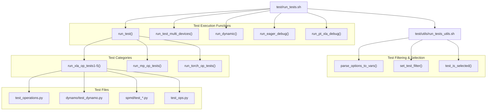
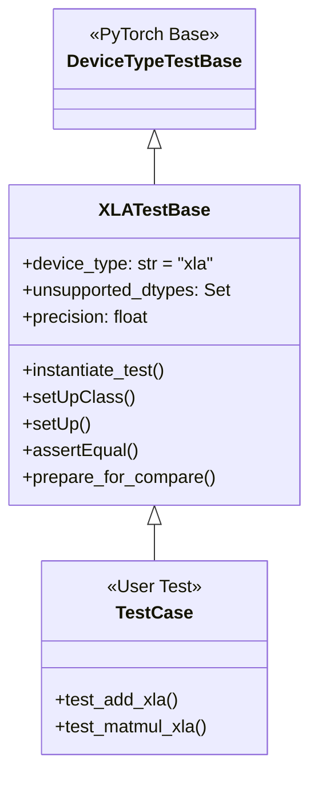
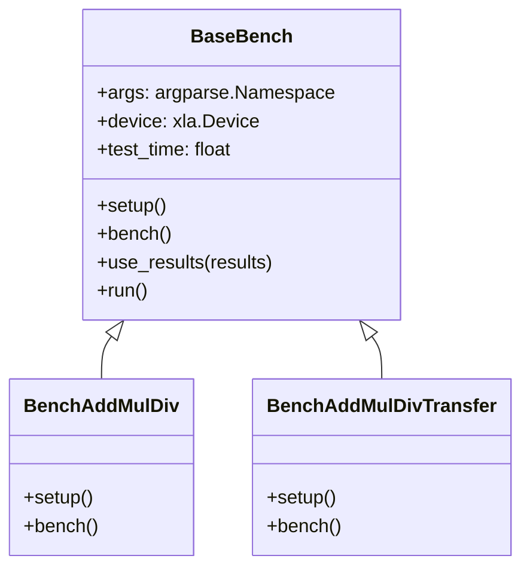
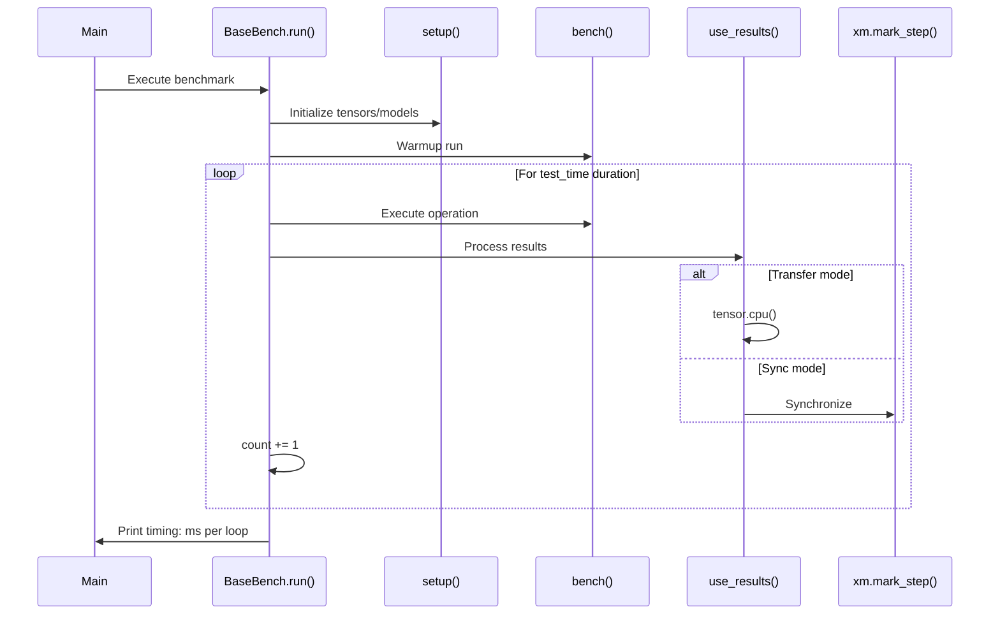
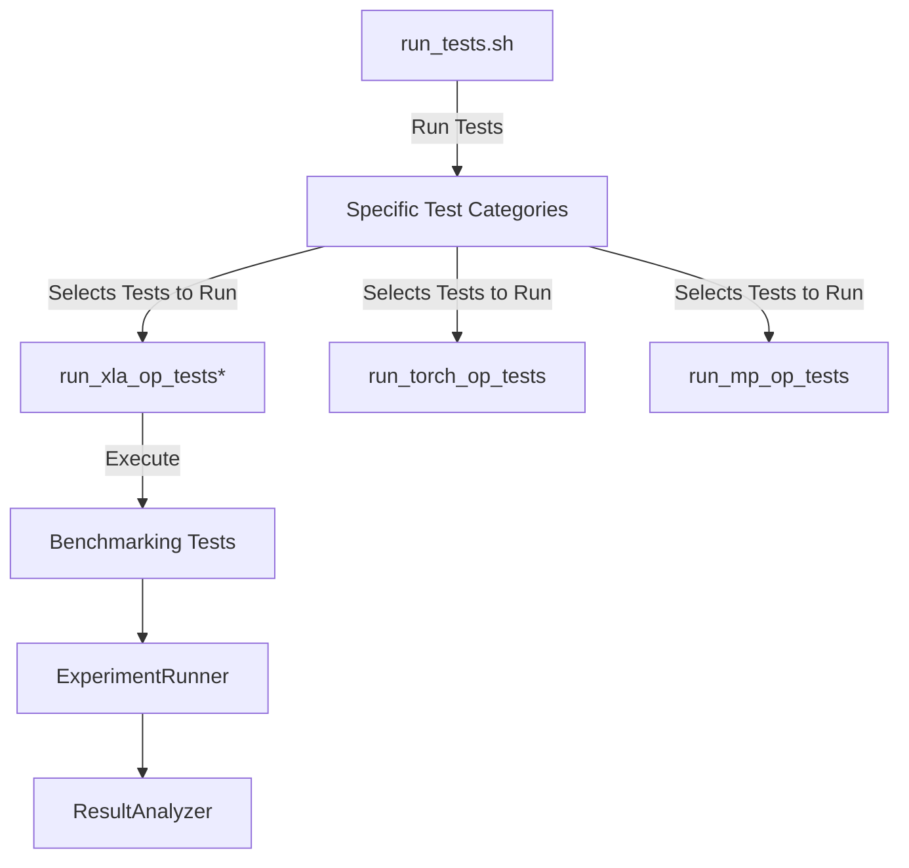

<!-- source: DeepWiki mcp.deepwiki.com · repo pytorch/xla · page 5.4 Benchmarking and Performance Testing · fetched 2026-10-21 -->

# Benchmarking and Performance Testing

<details>
<summary>Relevant source files</summary>

The following files were used as context for generating this wiki page:

- [.circleci/build.sh](.circleci/build.sh)
- [.circleci/common.sh](.circleci/common.sh)
- [.circleci/test.sh](.circleci/test.sh)
- [.github/upstream/install_conda.sh](.github/upstream/install_conda.sh)
- [.github/upstream/install_valgrind.sh](.github/upstream/install_valgrind.sh)
- [test/bench.py](test/bench.py)
- [test/benchmarks/run_torchbench_tests.sh](test/benchmarks/run_torchbench_tests.sh)
- [test/neuron/run_tests.sh](test/neuron/run_tests.sh)
- [test/pytorch_test_base.py](test/pytorch_test_base.py)
- [test/run_tests.sh](test/run_tests.sh)
- [test/spmd/test_dtensor_convert_mesh.py](test/spmd/test_dtensor_convert_mesh.py)
- [test/spmd/test_dtensor_redistribute.py](test/spmd/test_dtensor_redistribute.py)
- [test/spmd/test_xla_dtensor_placements.py](test/spmd/test_xla_dtensor_placements.py)
- [test/spmd/test_xla_dtensor_spec_conversion.py](test/spmd/test_xla_dtensor_spec_conversion.py)
- [test/spmd/test_xla_sharded_tensor.py](test/spmd/test_xla_sharded_tensor.py)
- [test/test_mp_all_to_all.py](test/test_mp_all_to_all.py)
- [test/test_mp_collective_permute.py](test/test_mp_collective_permute.py)
- [test/test_operations_hlo.py](test/test_operations_hlo.py)
- [test/test_ops.py](test/test_ops.py)
- [test/test_user_computation_debug_cache.py](test/test_user_computation_debug_cache.py)
- [test/test_xla_graph_execution.py](test/test_xla_graph_execution.py)
- [test/torch_distributed/test_torch_distributed_fsdp_meta.py](test/torch_distributed/test_torch_distributed_fsdp_meta.py)
- [test/tpu/run_tests.sh](test/tpu/run_tests.sh)
- [test/utils/run_tests_utils.sh](test/utils/run_tests_utils.sh)
- [torch_xla/distributed/spmd/xla_sharded_tensor.py](torch_xla/distributed/spmd/xla_sharded_tensor.py)

</details>


This page covers the testing and benchmarking infrastructure in PyTorch/XLA for evaluating correctness and performance. The system provides test orchestration, performance measurement, and integration with various benchmark suites.

## Test Execution Architecture

PyTorch/XLA uses a shell-based test orchestration system centered around `run_tests.sh` scripts that execute Python test files with various configurations.

**Test Execution Flow**



Sources:
- [test/run_tests.sh:1-359]()
- [test/utils/run_tests_utils.sh:1-156]()

## Test Base Classes

### XLATestBase

The `XLATestBase` class in `pytorch_test_base.py` provides the foundation for PyTorch/XLA tests. It extends PyTorch's `DeviceTypeTestBase` to handle XLA-specific testing requirements.

**Key Features**



**Capabilities:**
- **Automatic test instantiation**: Converts PyTorch device-agnostic tests to XLA-specific tests
- **Dtype filtering**: Skips unsupported data types (complex numbers, half precision)
- **Precision handling**: Adjusts floating-point comparison tolerances
- **Test skipping**: Maintains lists of disabled tests for CPU and TPU backends
- **Device selection**: Automatically selects XLA device (CPU or TPU) at runtime

Sources:
- [test/pytorch_test_base.py:526-690]()

### Test Instantiation and Skipping

`XLATestBase.instantiate_test()` implements sophisticated test filtering:

```python
# Pseudo-code showing the instantiation flow
def instantiate_test(cls, name, test):
    test_name = name + '_xla'
    
    # Check if test is in disabled list
    if test_name in DISABLED_TORCH_TESTS[device_type]:
        setattr(cls, test_name, skipped_test)
        return
    
    # Handle dtype variants
    dtype_combinations = cls._get_dtypes(test)
    for dtype in dtype_combinations:
        if dtype in cls.unsupported_dtypes:
            # Skip unsupported dtypes
            continue
        
        # Set precision overrides for floating types
        test.precision_overrides[dtype] = compute_precision(dtype)
    
    # Instantiate the actual test
    super().instantiate_test(name, test)
```

Sources:
- [test/pytorch_test_base.py:543-611]()

### Disabled Test Lists

PyTorch/XLA maintains comprehensive lists of disabled tests that are known to fail or are not applicable to XLA:

| Test Category | Examples | Reason |
|---------------|----------|--------|
| Storage operations | `test_storage`, `test_deepcopy` | XLA tensors don't expose storage |
| Memory format | `test_memory_format_*` | XLA doesn't support memory format hints |
| Strided tensors | `test_strided_*` | XLA layout differs from eager |
| Sparse operations | `test_embedding_backward` | Sparse layout not supported on XLA |
| Half precision | Tests with `torch.half` | Limited half support on some accelerators |
| Complex numbers | Tests with complex dtypes | Complex support incomplete |

Sources:
- [test/pytorch_test_base.py:31-476]()

## Benchmark Framework

### BaseBench Class

The `BaseBench` class in `test/bench.py` provides a simple framework for writing microbenchmarks.



**Benchmark Workflow:**



Sources:
- [test/bench.py:28-75]()

### Writing a Benchmark

Benchmarks inherit from `BaseBench` and implement:

1. **setup()**: Initialize tensors, models, and state
2. **bench()**: The operation to measure
3. **use_results()**: How to materialize results (sync or transfer)

Example benchmark:

```python
class BenchAddMulDiv(BaseBench):
    def setup(self):
        self.a = torch.rand(8, 8)
        self.b = torch.rand(8, 8).abs() + 1.0
        self.xla_a = self.a.to(self.device)
        self.xla_b = self.b.to(self.device)
    
    def bench(self):
        xla_c = self.xla_a * self.xla_b - self.xla_a / self.xla_b
        self.use_results([xla_c])
```

Sources:
- [test/bench.py:77-88]()

## TorchBench Integration

PyTorch/XLA integrates with the TorchBench benchmark suite to test real-world models.

### Running TorchBench Tests

The `test/benchmarks/run_torchbench_tests.sh` script orchestrates TorchBench execution:

```bash
#!/bin/bash
# Install dependencies
install_package()  # Installs torchvision, torchaudio, torchtext
install_torchbench_models()  # Clones and installs TorchBench

# Run tests with different configurations
for functionalization in "true" "false"; do
    for model in "${TORCHBENCH_MODELS[@]}"; do
        PJRT_DEVICE=$pjrt_device python -u benchmarks/experiment_runner.py \
            --suite-name=torchbench \
            --experiment-config='{"accelerator":"'$pjrt_device'","xla":"PJRT",...}' \
            --model-config='{"model_name":"'$model'"}'
    done
done
```

Sources:
- [test/benchmarks/run_torchbench_tests.sh:1-114]()

### TorchBench Configuration

TorchBench tests support various experiment configurations:

| Configuration | Options |
|---------------|---------|
| `accelerator` | CPU, CUDA |
| `xla` | PJRT, null |
| `dynamo` | openxla, null |
| `test` | eval, train |
| `enable_functionalization` | true, false |

Sources:
- [test/benchmarks/run_torchbench_tests.sh:85-101]()

## Benchmark Metrics

The benchmarking system collects a variety of metrics:

### Timing Metrics

| Metric | Description |
|--------|-------------|
| `total_time` | Total execution time |
| `per_iter_time` | Average time per iteration |
| `trace_total_time` | Total tracing time (XLA) |
| `trace_per_iter_time` | Average tracing time per iteration (XLA) |
| `xla_CompileTime_time_s` | XLA compilation time in seconds |
| `xla_ExecuteTime_time_s` | XLA execution time in seconds |
| `dynamo_compile_time` | Dynamo compilation time |

### Performance Profiling

For detailed performance analysis, the system can collect:

- PyTorch profiler information (CPU and CUDA operations)
- XLA metrics (compilation cache hits/misses, execution time)
- Dynamo compilation counters

Sources:
- [benchmarks/experiment_runner.py:404-452]()
- [benchmarks/result_analyzer.py:78-105]()

## Result Analysis

After running benchmarks, use `result_analyzer.py` to process the results:

```
python benchmarks/result_analyzer.py --output-dirname=experiment_results
```

This will:
1. Read all JSONL files in the output directory
2. Extract and compute summary metrics
3. Generate a CSV report at `experiment_results/metric_report.csv`

The CSV report contains metrics like:
- Median execution time per iteration
- Compilation time
- Error messages (if any)
- Hardware and configuration details

Sources:
- [benchmarks/result_analyzer.py:26-42]()
- [benchmarks/README.md:130-142]()

## Verification

Beyond performance benchmarking, the system supports verifying the correctness of results:

```
python benchmarks/experiment_runner.py \
    --xla=PJRT \
    --dynamo=openxla \
    --test=eval \
    --filter=BERT_pytorch$ \
    --suite-name=torchbench \
    --accelerator=cuda \
    --verify
```

Verification works by:
1. Running the model in eager mode (without XLA/Dynamo) to establish a baseline
2. Running the model with the specified configuration
3. Comparing outputs using relative error or cosine similarity
4. Reporting success (PASS) or failure (FAIL) in the results

Verification codes include:
- `PASS`: Results match within tolerance
- `FAIL`: Results differ beyond tolerance
- `EAGER_FAILED`: Reference eager execution failed
- `NONDETERMINISTIC_EAGER_RUN`: Eager runs don't agree

Sources:
- [benchmarks/verifier.py:16-93]()
- [benchmarks/README.md:95-121]()

## Data Type Testing

The benchmarking system supports testing different data types and precision modes:

### BFloat16 Mode

Set `XLA_USE_BF16=1` or `XLA_DOWNCAST_BF16=1` to test BF16 precision:

```
XLA_USE_BF16=1 python benchmarks/experiment_runner.py ...
```

### FP8 Support

PyTorch/XLA supports benchmarking models with FP8 data types:
- `torch.float8_e5m2`
- `torch.float8_e4m3fn`

This enables testing quantized models and specialized hardware support for lower precision operations.

Sources:
- [torch_xla/csrc/dtype.cpp:10-57]()
- [test/test_fp8.py:11-55]()
- [test/test_data_type.py:42-50]()

## Running on Different Hardware

### TPU

For TPU benchmarking:

```
python benchmarks/experiment_runner.py \
    --accelerator=tpu \
    --xla=PJRT \
    --suite-name=torchbench \
    --filter="^resnet18$"
```

### CUDA (GPU)

For GPU benchmarking:

```
python benchmarks/experiment_runner.py \
    --accelerator=cuda \
    --xla=PJRT \  # For PyTorch/XLA with PJRT
    --dynamo=inductor \  # Or use inductor without XLA
    --suite-name=torchbench
```

### Reducing Benchmark Noise

For consistent results:
- Lock CPU frequency: `sudo cpupower frequency-set --governor performance`
- Lock GPU clocks: `nvidia-smi --lock-gpu-clocks=$FREQ,$FREQ`
- Disable autoboost: `CUDA_AUTO_BOOST=0`

Sources:
- [benchmarks/README.md:21-41]()
- [test/tpu/run_tests.sh:1-87]()

## Integration with CI Testing

The benchmarking system integrates with the PyTorch/XLA CI testing infrastructure:



Sources:
- [test/run_tests.sh:1-372]()
- [test/benchmarks/run_tests.sh:1-62]()
- [.github/scripts/run_tests.sh:1-29]()

## Best Practices

### 1. Ensure consistent environments

- Use the same hardware configuration for all comparison runs
- Control thermal conditions (lock CPU/GPU frequencies)
- Run with enough iterations to warm up caches (discard first few iterations)

### 2. Choose appropriate metrics

- For inference, focus on `per_iter_time`
- For training, examine both forward and backward pass times
- Look at compilation times separately from execution times

### 3. Enable verification when comparing implementations

```
python benchmarks/experiment_runner.py \
    --verify \
    --suite-name=torchbench \
    ...
```

### 4. Analyze results with statistical rigor

- Run multiple repetitions (e.g., `--repeat=5` or higher)
- Look at median and percentile values, not just means
- Consider standard deviations to assess run-to-run stability

Sources:
- [benchmarks/README.md:21-41]()
- [benchmarks/experiment_runner.py:389-420]()

---

