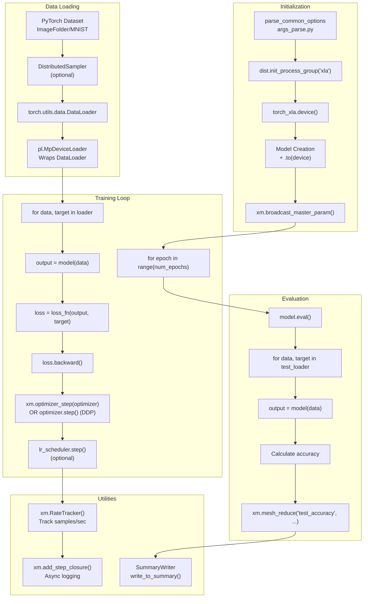
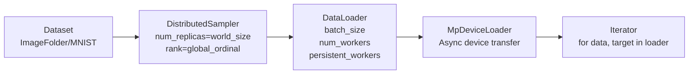
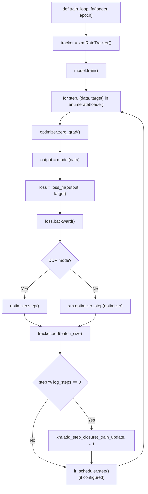
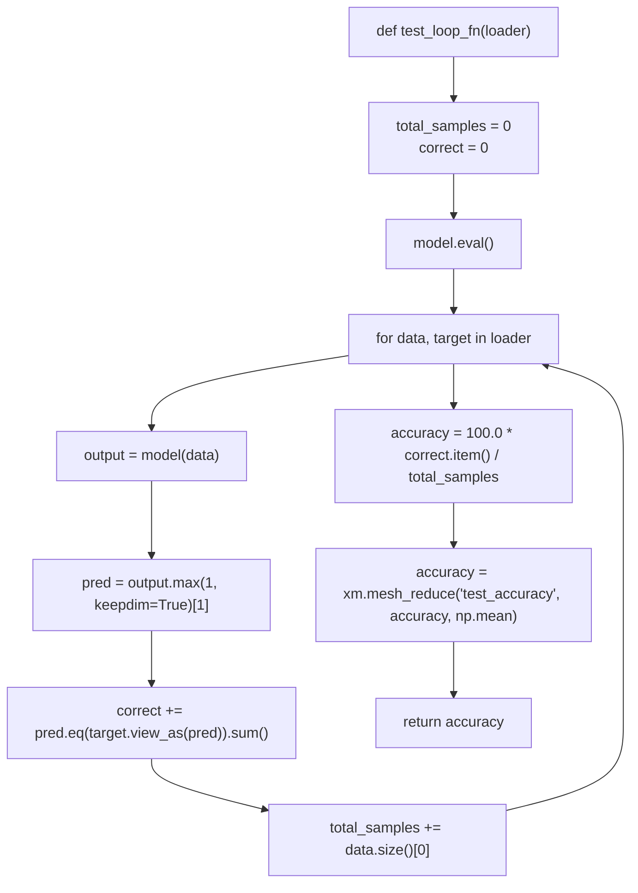
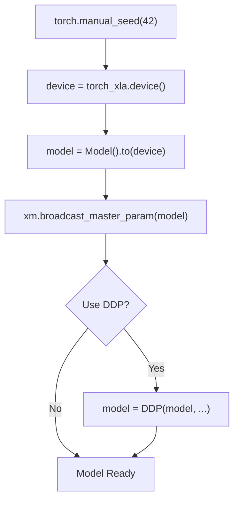
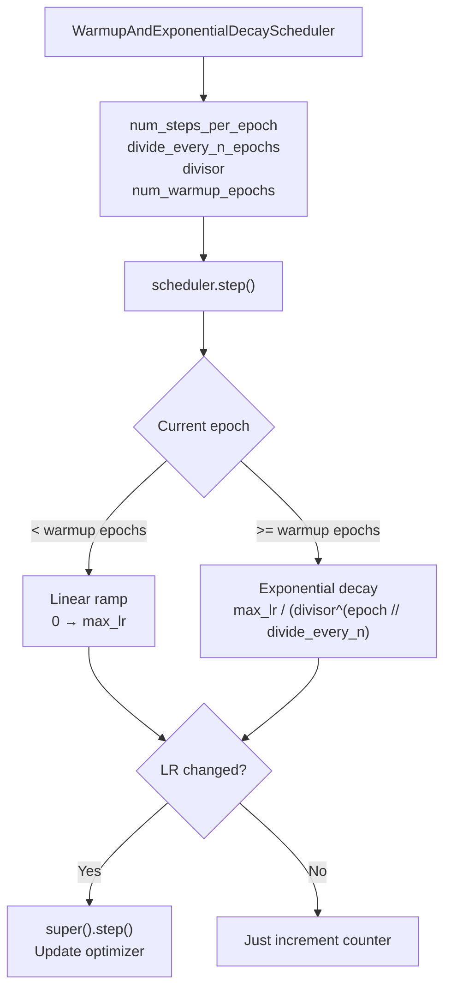

<!-- source: DeepWiki mcp.deepwiki.com · repo pytorch/xla · page 6 Training Examples and Patterns · fetched 2026-10-21 -->

# Training Examples and Patterns

<details>
<summary>Relevant source files</summary>

The following files were used as context for generating this wiki page:

- [test/args_parse.py](test/args_parse.py)
- [test/schedulers.py](test/schedulers.py)
- [test/test_train_mp_imagenet.py](test/test_train_mp_imagenet.py)
- [test/test_train_mp_mnist.py](test/test_train_mp_mnist.py)
- [test/test_utils.py](test/test_utils.py)
- [torch_xla/test/test_utils.py](torch_xla/test/test_utils.py)

</details>


This document provides an overview of common training patterns, workflows, and best practices when training models with PyTorch/XLA. It covers the fundamental structure of training scripts, key utilities, and architectural patterns used in the example training scripts.

For detailed analysis of specific training examples, see:
- [MNIST Training Example](#6.2) - Simple distributed training with a small CNN
- [ImageNet Training Example](#6.3) - Large-scale distributed training with various model architectures

For distributed training concepts and SPMD sharding, see [Distributed Training and SPMD](#3).

## Training Workflow Overview

PyTorch/XLA training follows a standard workflow with XLA-specific optimizations for device synchronization and data transfer.



**Sources:** [test/test_train_mp_mnist.py:77-203](), [test/test_train_mp_imagenet.py:179-361](), [test/args_parse.py:7-49]()

## Training Script Structure

All PyTorch/XLA training scripts follow a common structure with standardized components and entry points.

### Entry Point Pattern

Training scripts use `torch_xla.launch()` to spawn worker processes:


**Sources:** [test/test_train_mp_mnist.py:217-220](), [test/test_train_mp_imagenet.py:375-379](), [torch_xla/distributed/xla_multiprocessing.py:10-43]()

The worker function (`_mp_fn`) receives:
- `index`: The process ordinal (0 to num_cores-1)
- `flags`: Parsed command-line arguments

### Argument Parsing

The `args_parse.parse_common_options()` function provides standardized configuration:

| Argument | Type | Purpose |
|----------|------|---------|
| `--datadir` | str | Path to dataset directory |
| `--batch_size` | int | Batch size per device |
| `--num_epochs` | int | Number of training epochs |
| `--lr` | float | Learning rate |
| `--momentum` | float | SGD momentum |
| `--num_workers` | int | DataLoader worker threads |
| `--log_steps` | int | Steps between logging |
| `--fake_data` | bool | Use synthetic data |
| `--ddp` | bool | Use DistributedDataParallel |
| `--pjrt_distributed` | bool | Use PJRT distributed mode |

**Sources:** [test/args_parse.py:7-49](), [test/test_train_mp_mnist.py:13-21](), [test/test_train_mp_imagenet.py:60-69]()

### Model-Specific Configuration

Training scripts can override defaults with model-specific configurations:

**Sources:** [test/test_train_mp_imagenet.py:93-150]()

The `MODEL_SPECIFIC_DEFAULTS` dictionary allows per-model parameter tuning, and `OPTIMIZED_KWARGS` provides hardware-specific optimizations (e.g., `tpuv4` configurations).

## Training Modes

PyTorch/XLA supports multiple training modes for different use cases:

```mermaid
graph TB
    subgraph "Single Device"
        SINGLE_DEVICE["Single XLA Device<br/>No process group"]
        SINGLE_MODEL["model.to(device)"]
        SINGLE_OPT["xm.optimizer_step(optimizer)"]
    end
    
    subgraph "DDP Mode"
        DDP_INIT["dist.init_process_group('xla')"]
        DDP_WRAPPER["DDP(model, gradient_as_bucket_view=True)"]
        DDP_OPT["optimizer.step()<br/>(automatic gradient sync)"]
    end
    
    subgraph "PJRT Distributed"
        PJRT_INIT["dist.init_process_group('xla')<br/>+ --pjrt_distributed"]
        PJRT_MODEL["model.to(device)"]
        PJRT_OPT["xm.optimizer_step(optimizer)"]
        PJRT_REDUCE["xm.all_reduce() explicit"]
    end
    
    SINGLE_DEVICE --> SINGLE_MODEL
    SINGLE_MODEL --> SINGLE_OPT
    
    DDP_INIT --> DDP_WRAPPER
    DDP_WRAPPER --> DDP_OPT
    
    PJRT_INIT --> PJRT_MODEL
    PJRT_MODEL --> PJRT_OPT
    PJRT_OPT --> PJRT_REDUCE
```



**Sources:** [test/test_train_mp_mnist.py:78-79](), [test/test_train_mp_mnist.py:140-141](), [test/test_train_mp_imagenet.py:180-181](), [test/test_train_mp_imagenet.py:260-263]()

### Single Device Training

For single-device or debugging scenarios:

- Use `xm.optimizer_step(optimizer)` for gradient application
- No distributed setup required
- Useful for development and testing

### DDP (DistributedDataParallel) Mode

Enabled with `--ddp` flag:

1. Initialize process group: `dist.init_process_group('xla', init_method='xla://')`
2. Wrap model: `DDP(model, broadcast_buffers=False, gradient_as_bucket_view=True)`
3. Use standard PyTorch optimizer: `optimizer.step()`
4. DDP automatically handles gradient synchronization via all-reduce

**Key parameters:**
- `broadcast_buffers=False`: Skip broadcasting buffer updates (BatchNorm running stats)
- `gradient_as_bucket_view=True`: Memory optimization, avoids gradient detachment

**Sources:** [test/test_train_mp_mnist.py:140-141](), [test/test_train_mp_imagenet.py:260-263]()

### PJRT Distributed Mode

Enabled with `--pjrt_distributed` flag:

1. Initialize process group: `dist.init_process_group('xla', init_method='xla://')`
2. Model remains unwrapped
3. Use `xm.optimizer_step(optimizer)` for manual gradient synchronization
4. Provides more control over collective operations

**Sources:** [test/test_train_mp_mnist.py:78-79]()

## Data Loading Patterns

### Standard PyTorch DataLoader Setup



**Sources:** [test/test_train_mp_mnist.py:94-128](), [test/test_train_mp_imagenet.py:185-249]()

### DistributedSampler Configuration

For multi-device training, use `DistributedSampler` to partition data:

```python
train_sampler = torch.utils.data.distributed.DistributedSampler(
    train_dataset,
    num_replicas=xr.world_size(),
    rank=xr.global_ordinal(),
    shuffle=True
)
```

**Sources:** [test/test_train_mp_mnist.py:111-115](), [test/test_train_mp_imagenet.py:222-226]()

### MpDeviceLoader

The `MpDeviceLoader` wraps a PyTorch `DataLoader` to asynchronously transfer data to XLA devices:

| Parameter | Purpose |
|-----------|---------|
| `loader` | Base PyTorch DataLoader |
| `device` | Target XLA device |
| `loader_prefetch_size` | CPU queue size (default: 8) |
| `device_prefetch_size` | Device queue size (default: 4) |
| `host_to_device_transfer_threads` | Transfer parallelism (default: 1) |
| `input_sharding` | Optional ShardingSpec for SPMD |

**Sources:** [torch_xla/distributed/parallel_loader.py:253-288](), [test/test_train_mp_mnist.py:181-182](), [test/test_train_mp_imagenet.py:328-339]()

### Fake Data Generation

For testing and benchmarking, use `xu.SampleGenerator`:

**Sources:** [test/test_train_mp_mnist.py:84-93](), [test/test_train_mp_imagenet.py:186-194](), [torch_xla/utils/utils.py:41-69]()

This generates synthetic data without disk I/O, useful for measuring pure computation performance.

## Training Loop Implementation

### Standard Training Loop



**Sources:** [test/test_train_mp_mnist.py:148-165](), [test/test_train_mp_imagenet.py:288-309]()

### Key Components

#### RateTracker

`xm.RateTracker()` tracks throughput metrics:

- `add(count)`: Add processed samples
- `rate()`: Current samples/second (smoothed)
- `global_rate()`: Average samples/second since start

**Sources:** [torch_xla/core/xla_model.py:254-295]()

#### Optimizer Step

Two patterns based on training mode:

1. **DDP Mode**: `optimizer.step()` - gradient synchronization is automatic
2. **Manual Mode**: `xm.optimizer_step(optimizer)` - performs all-reduce and applies gradients

**Sources:** [test/test_train_mp_mnist.py:156-159](), [test/test_train_mp_imagenet.py:298-301](), [torch_xla/core/xla_model.py:1007-1110]()

#### Asynchronous Logging

`xm.add_step_closure()` schedules logging without blocking training:

**Sources:** [test/test_train_mp_mnist.py:162-165](), [test/test_train_mp_imagenet.py:306-307]()

This allows the training loop to continue while metrics are computed and logged asynchronously.

## Evaluation Loop Implementation

### Test Loop Pattern



**Sources:** [test/test_train_mp_mnist.py:167-179](), [test/test_train_mp_imagenet.py:311-326]()

### Multi-Device Metric Reduction

`xm.mesh_reduce()` aggregates metrics across all devices:

**Sources:** [test/test_train_mp_mnist.py:178](), [test/test_train_mp_imagenet.py:325](), [torch_xla/core/xla_model.py:1170-1222]()

Common reduction operations: `np.mean`, `np.sum`, `np.max`, `np.min`

## Model Initialization and Synchronization

### Model Setup



**Sources:** [test/test_train_mp_mnist.py:81-141](), [test/test_train_mp_imagenet.py:251-263]()

### Parameter Broadcasting

`xm.broadcast_master_param(model)` ensures all devices start with identical weights:

**Sources:** [test/test_train_mp_mnist.py:138](), [test/test_train_mp_imagenet.py:258](), [torch_xla/core/xla_model.py:1263-1277]()

This is critical when using PJRT, as initialization is nondeterministic across multiple threads.

## Learning Rate Scheduling

### WarmupAndExponentialDecayScheduler

Custom scheduler supporting warmup and exponential decay:



**Sources:** [test/schedulers.py:6-93]()

### Scheduler Configuration

Use `wrap_optimizer_with_scheduler()` to attach a scheduler:

**Sources:** [test/schedulers.py:95-141](), [test/test_train_mp_imagenet.py:275-282]()

## Logging and Monitoring

### Tensorboard Integration

Training scripts support Tensorboard logging:

| Function | Purpose |
|----------|---------|
| `get_summary_writer(logdir)` | Create SummaryWriter |
| `write_to_summary(writer, step, dict_to_write, write_xla_metrics)` | Log scalars and XLA metrics |
| `close_summary_writer(writer)` | Flush and close writer |

**Sources:** [torch_xla/test/test_utils.py:48-90](), [torch_xla/test/test_utils.py:93-109]()

### Training Updates

`print_training_update()` provides consistent logging format:

**Sources:** [torch_xla/test/test_utils.py:115-149]()

Output format:
```
| Training Device=xla:0 Epoch=1 Step=100 Loss=0.12345 Rate=1234.56 GlobalRate=1200.00 Time=12:34:56
```

### Master Ordinal Pattern

Use `xm.is_master_ordinal()` to log only from one device:

**Sources:** [test/test_train_mp_mnist.py:143-144](), [test/test_train_mp_imagenet.py:266-267](), [torch_xla/core/xla_model.py:97-110]()

This prevents duplicate logging from all devices in distributed training.

## Performance Best Practices

### DataLoader Configuration

Optimized settings for different TPU versions:

| Parameter | TPU v4 | Default | Purpose |
|-----------|--------|---------|---------|
| `batch_size` | 128 | 128 | Per-device batch size |
| `num_workers` | 16 | 8 | CPU threads for data loading |
| `persistent_workers` | True | False | Keep workers alive between epochs |
| `prefetch_factor` | 32 | 16 | Batches to prefetch per worker |
| `loader_prefetch_size` | 128 | 8 | CPU queue size |
| `device_prefetch_size` | 1 | 4 | Device queue size |
| `host_to_device_transfer_threads` | 4 | 1 | Transfer parallelism |

**Sources:** [test/test_train_mp_imagenet.py:93-130]()

### Graph Execution Optimization

Key patterns for efficient XLA execution:

1. **Minimize host-device synchronization**: Use `xm.add_step_closure()` for async operations
2. **Consistent batch sizes**: Use `drop_last=True` to avoid recompilation
3. **Fixed input shapes**: Avoid dynamic shapes when possible
4. **Batched operations**: Aggregate multiple operations before sync

**Sources:** [test/test_train_mp_mnist.py:120](), [test/test_train_mp_imagenet.py:236]()

### Memory Optimization

For DDP training, enable `gradient_as_bucket_view=True`:

**Sources:** [test/test_train_mp_mnist.py:141](), [test/test_train_mp_imagenet.py:263]()

This optimization avoids creating separate gradient tensors, reducing memory usage.

## Profiling Support

Enable profiling with the `--profile` flag:

**Sources:** [test/test_train_mp_imagenet.py:37-39](), [test/test_train_mp_imagenet.py:285-286]()

Profiler provides:
- Step timing breakdown
- HLO graph visualization
- Device utilization metrics

For profiling details, see the XLA profiler documentation.

## Common Utilities Summary

| Utility | Purpose | Location |
|---------|---------|----------|
| `torch_xla.device()` | Get default XLA device | Core API |
| `torch_xla.launch()` | Spawn worker processes | [torch_xla/distributed/xla_multiprocessing.py:10-43]() |
| `xr.world_size()` | Get total number of devices | Runtime API |
| `xr.global_ordinal()` | Get global device rank | Runtime API |
| `xm.optimizer_step()` | Synchronized optimizer step | [torch_xla/core/xla_model.py:1007-1110]() |
| `xm.broadcast_master_param()` | Sync initial parameters | [torch_xla/core/xla_model.py:1263-1277]() |
| `xm.mesh_reduce()` | Reduce metrics across devices | [torch_xla/core/xla_model.py:1170-1222]() |
| `xm.RateTracker()` | Track throughput | [torch_xla/core/xla_model.py:254-295]() |
| `xm.add_step_closure()` | Async execution | [torch_xla/core/xla_model.py:1293-1348]() |
| `xm.is_master_ordinal()` | Check if master rank | [torch_xla/core/xla_model.py:97-110]() |
| `pl.MpDeviceLoader` | Async data loading | [torch_xla/distributed/parallel_loader.py:253-288]() |
| `xu.SampleGenerator` | Synthetic data | [torch_xla/utils/utils.py:41-69]() |

**Sources:** Various files as cited in table

## Next Steps

For detailed examples and implementation patterns:
- [Training Script Architecture](#6.1) - Deep dive into script structure and components
- [MNIST Training Example](#6.2) - Simple CNN training walkthrough
- [ImageNet Training Example](#6.3) - Production-scale training patterns
- [Distributed Training and SPMD](#3) - Advanced distributed training techniques

---

