<!-- source: DeepWiki mcp.deepwiki.com · repo pytorch/xla · page 6.1 Training Script Architecture · fetched 2026-10-21 -->

# Training Script Architecture

Relevant source files

The following files were used as context for generating this wiki page:

- [test/args_parse.py](test/args_parse.py)
- [test/schedulers.py](test/schedulers.py)
- [test/test_train_mp_imagenet.py](test/test_train_mp_imagenet.py)
- [test/test_train_mp_mnist.py](test/test_train_mp_mnist.py)
- [test/test_utils.py](test/test_utils.py)
- [torch_xla/test/test_utils.py](torch_xla/test/test_utils.py)

## Purpose and Scope

This document describes the common architectural patterns used in PyTorch/XLA training scripts, including configuration management, data loading, distributed training setup, learning rate scheduling, and TensorBoard integration. The examples in this document are based on the reference training scripts for MNIST and ImageNet located in the `test/` directory.

For information about the underlying distributed training mechanisms (SPMD sharding, collective operations), see [Distributed Training and SPMD](#3). For details on multi-process execution and process spawning, see [Multi-Process Execution](#3.2). For information on data loading internals, see [Distributed Data Loading](#3.5).

---

## Overview of Training Script Components

PyTorch/XLA training scripts follow a consistent architectural pattern that separates configuration, data loading, model setup, training loops, and distributed execution. The following diagram shows the high-level flow and major components:

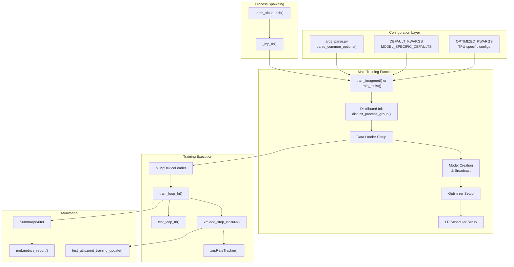

**Sources:** [test/test_train_mp_imagenet.py:1-380](), [test/test_train_mp_mnist.py:1-221]()

---

## Configuration Management

### Argument Parsing

Training scripts use a common argument parser that defines standard training hyperparameters and flags. The `parse_common_options()` function provides a reusable interface for configuration:

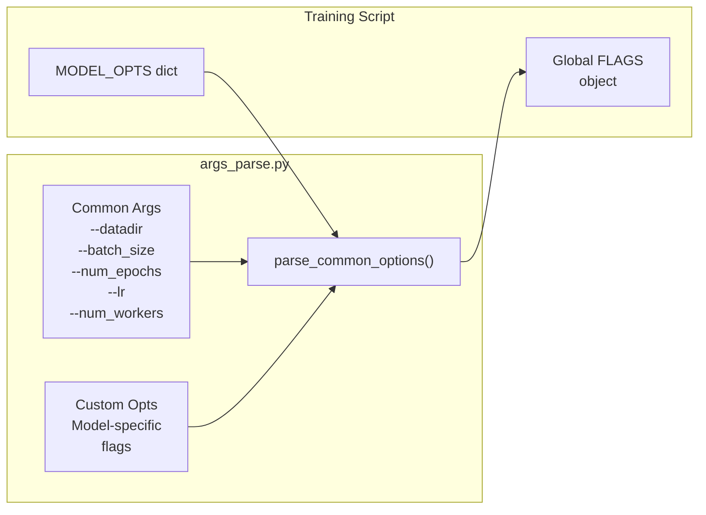

Common arguments include:

| Argument | Type | Purpose |
|----------|------|---------|
| `--datadir` | str | Path to dataset directory |
| `--batch_size` | int | Training batch size per device |
| `--num_epochs` | int | Total training epochs |
| `--lr` | float | Learning rate |
| `--num_workers` | int | DataLoader worker processes |
| `--log_steps` | int | Frequency of logging |
| `--fake_data` | flag | Use synthetic data for testing |
| `--metrics_debug` | flag | Print XLA metrics after each epoch |
| `--drop_last` | flag | Drop incomplete batches |

**Sources:** [test/args_parse.py:7-49](), [test/test_train_mp_imagenet.py:60-69]()

### Multi-Tier Configuration System

Training scripts use a three-tier configuration system to allow flexible customization while maintaining good defaults:

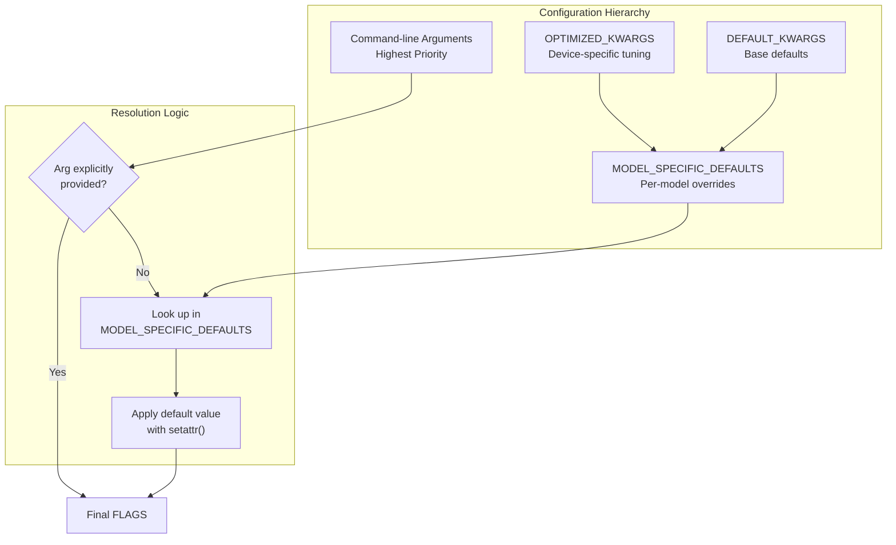

The ImageNet training script demonstrates this pattern:

| Configuration Tier | Example | Purpose |
|-------------------|---------|---------|
| `DEFAULT_KWARGS` | `batch_size=128, lr=0.1` | Base configuration for all models |
| `OPTIMIZED_KWARGS['tpuv4']` | `batch_size=128, loader_prefetch_size=128` | TPU v4-specific tuning |
| `MODEL_SPECIFIC_DEFAULTS['resnet50']` | `lr=0.5, lr_scheduler_type='WarmupAndExponentialDecayScheduler'` | ResNet-50 specific settings |

**Sources:** [test/test_train_mp_imagenet.py:93-150](), [test/test_train_mp_mnist.py:13-21]()

---

## Data Loading Architecture

### Distributed Sampler Integration

Training scripts use PyTorch's `DistributedSampler` to partition datasets across replicas in multi-device training:

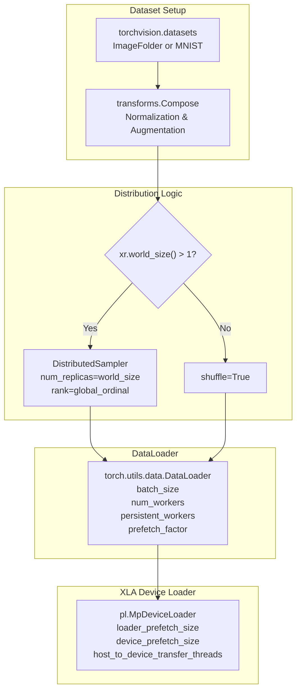

Key parameters for efficient data loading:

| Parameter | Location | Purpose |
|-----------|----------|---------|
| `num_workers` | DataLoader | Number of CPU processes for data loading |
| `persistent_workers` | DataLoader | Keep workers alive between epochs |
| `prefetch_factor` | DataLoader | Number of batches to prefetch per worker |
| `loader_prefetch_size` | MpDeviceLoader | Host-side prefetch queue size |
| `device_prefetch_size` | MpDeviceLoader | Device-side prefetch queue size |
| `host_to_device_transfer_threads` | MpDeviceLoader | Parallel transfer threads |

**Sources:** [test/test_train_mp_imagenet.py:220-249](), [test/test_train_mp_mnist.py:109-128](), [test/test_train_mp_imagenet.py:328-339]()

### Fake Data Generation

For testing and benchmarking, scripts support synthetic data generation using `xu.SampleGenerator`:

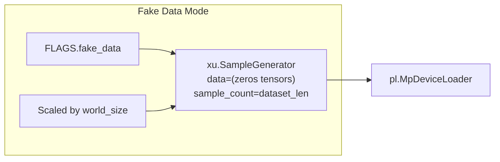

This allows rapid iteration during development without requiring actual datasets.

**Sources:** [test/test_train_mp_imagenet.py:185-194](), [test/test_train_mp_mnist.py:83-93]()

---

## Model Setup and Distributed Initialization

### Process Group Initialization

Training scripts support multiple distributed execution modes:

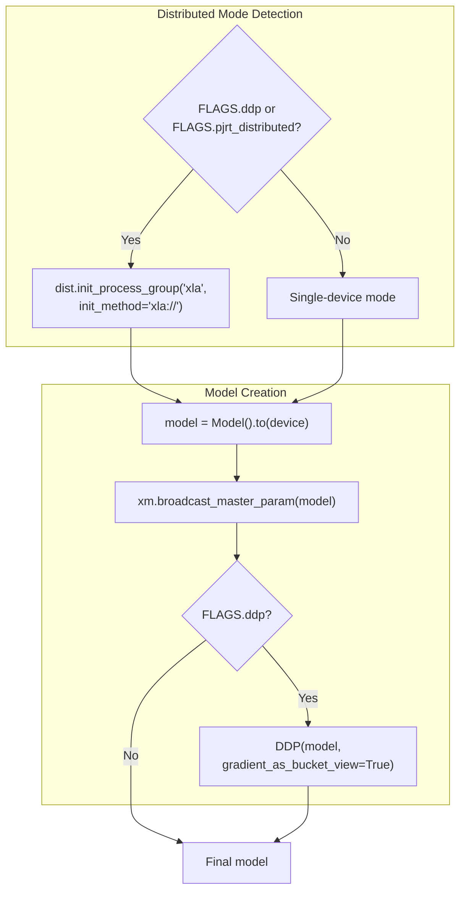

Key distributed initialization patterns:

1. **Process Group Initialization**: `dist.init_process_group('xla', init_method='xla://')` sets up the XLA backend for distributed operations
2. **Parameter Broadcast**: `xm.broadcast_master_param(model)` synchronizes initial model parameters across replicas (necessary due to non-deterministic initialization in multi-threaded PjRt)
3. **DDP Wrapper**: Optional `DistributedDataParallel` wrapper with `gradient_as_bucket_view=True` for memory efficiency

**Sources:** [test/test_train_mp_imagenet.py:180-263](), [test/test_train_mp_mnist.py:78-141]()

---

## Training Loop Architecture

### Core Training Loop Pattern

PyTorch/XLA training loops use a closure-based pattern for asynchronous metric collection:

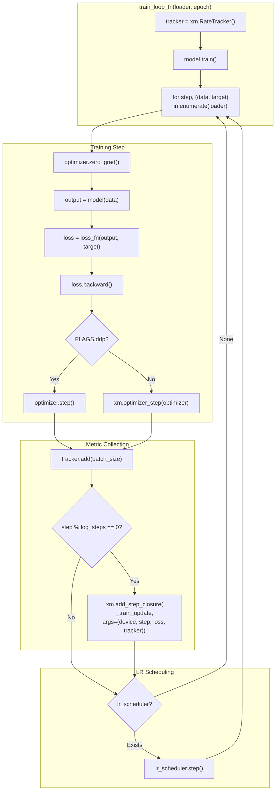

Key components:

- **`xm.RateTracker()`**: Tracks training throughput (examples/second)
- **`xm.optimizer_step(optimizer)`**: XLA-specific optimizer step that handles gradient synchronization
- **`xm.add_step_closure()`**: Schedules a callback to execute after the current computation graph completes, enabling asynchronous metric collection without blocking training

**Sources:** [test/test_train_mp_imagenet.py:288-309](), [test/test_train_mp_mnist.py:148-165]()

### Test/Evaluation Loop Pattern

The test loop computes accuracy and uses mesh reduction for distributed aggregation:

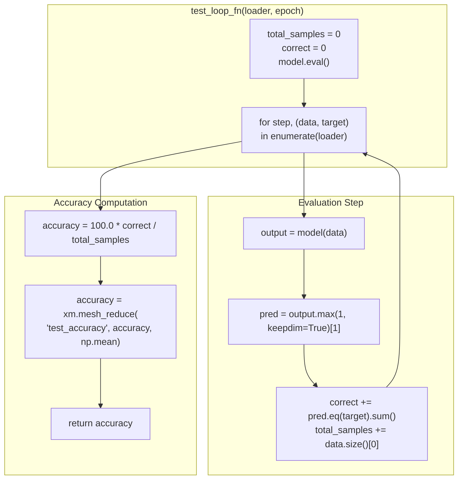

The `xm.mesh_reduce()` function aggregates accuracy across all replicas using the specified reduction operation (e.g., `np.mean`).

**Sources:** [test/test_train_mp_imagenet.py:311-326](), [test/test_train_mp_mnist.py:167-179]()

---

## Learning Rate Scheduling

### Scheduler Integration Pattern

Training scripts use the `wrap_optimizer_with_scheduler()` helper to configure learning rate schedules:

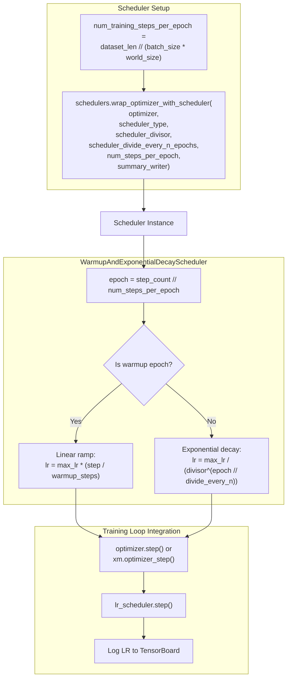

The `WarmupAndExponentialDecayScheduler` implements a common training pattern:
1. **Warmup phase**: Linearly increase learning rate from 0 to max_lr over `num_warmup_epochs`
2. **Decay phase**: Exponentially decay learning rate by dividing by `divisor` every `divide_every_n_epochs`

**Sources:** [test/test_train_mp_imagenet.py:273-282](), [test/schedulers.py:6-93](), [test/schedulers.py:95-141]()

---

## TensorBoard Integration

### Monitoring and Logging

Training scripts integrate TensorBoard for experiment tracking:

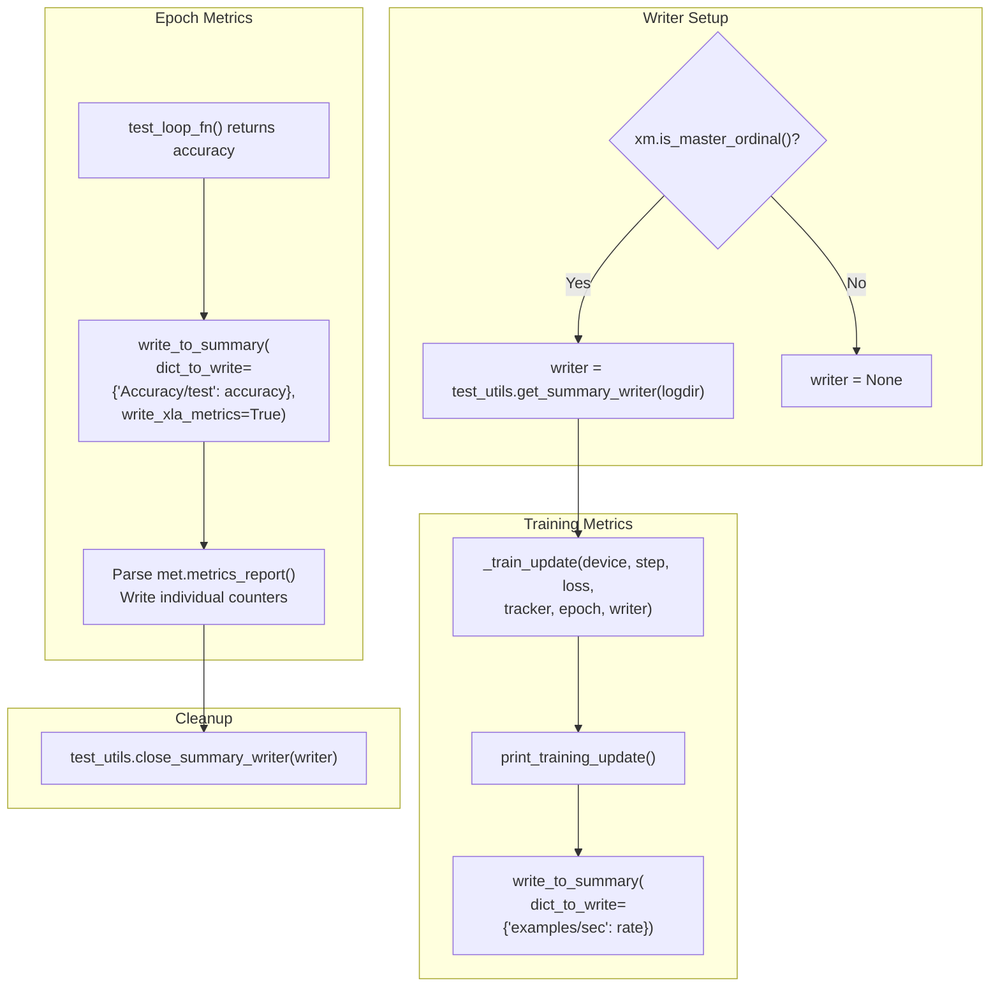

Key logging utilities:

| Function | Purpose | File |
|----------|---------|------|
| `get_summary_writer(logdir)` | Initialize TensorBoard writer | [torch_xla/test/test_utils.py:93-109]() |
| `print_training_update()` | Print and log training metrics | [torch_xla/test/test_utils.py:115-149]() |
| `write_to_summary()` | Write scalars and optionally XLA metrics | [torch_xla/test/test_utils.py:48-79]() |
| `close_summary_writer()` | Flush and close writer | [torch_xla/test/test_utils.py:81-91]() |

**Sources:** [test/test_train_mp_imagenet.py:266-267](), [test/test_train_mp_imagenet.py:351-358](), [test/test_train_mp_mnist.py:143-144]()

---

## Multi-Process Execution Pattern

### Process Spawning with torch_xla.launch

Training scripts follow a standard pattern for multi-process execution:

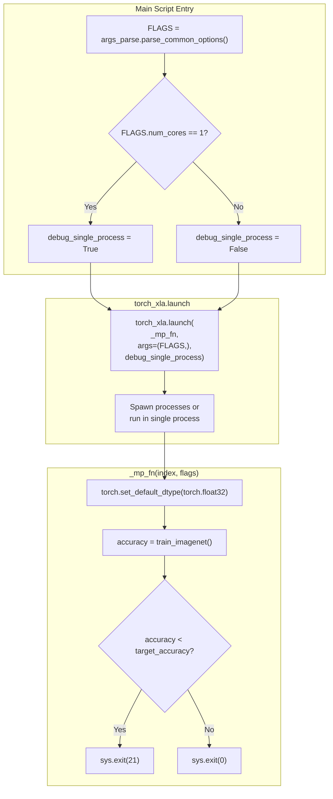

The `_mp_fn` function serves as the entry point for each spawned process:
- Receives `index` (process rank) and `flags` (parsed arguments)
- Sets up the training environment
- Calls the main training function
- Validates results and exits with appropriate status code

**Sources:** [test/test_train_mp_imagenet.py:364-379](), [test/test_train_mp_mnist.py:206-220]()

---

## Complete Training Flow

The following diagram shows the end-to-end execution flow of a typical training script:

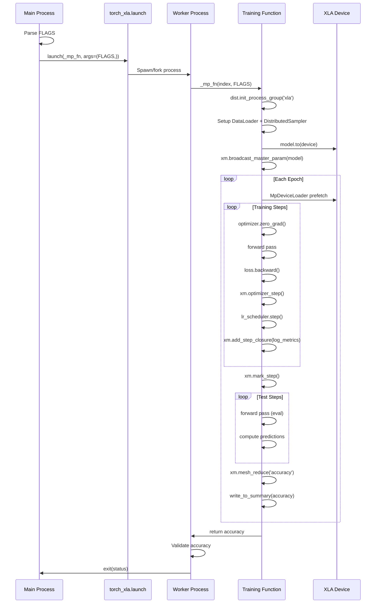

**Sources:** [test/test_train_mp_imagenet.py:179-361](), [test/test_train_mp_mnist.py:77-203]()

---

## Best Practices and Common Patterns

### Configuration Best Practices

1. **Use hierarchical defaults**: Define `DEFAULT_KWARGS`, device-specific `OPTIMIZED_KWARGS`, and `MODEL_SPECIFIC_DEFAULTS` to allow flexible overriding
2. **Apply defaults conditionally**: Only set default values for arguments not explicitly provided by the user
3. **Document optimization parameters**: Include comments explaining TPU-specific or model-specific settings

### Data Loading Best Practices

1. **Use DistributedSampler for multi-device**: Ensures each replica processes different data
2. **Tune prefetch parameters**: Balance `loader_prefetch_size`, `device_prefetch_size`, and `num_workers` for optimal throughput
3. **Enable persistent workers**: Set `persistent_workers=True` to avoid worker process creation overhead
4. **Use fake data for testing**: Enable rapid iteration with `--fake_data` flag

### Training Loop Best Practices

1. **Use step closures for metrics**: Call `xm.add_step_closure()` for asynchronous metric collection without blocking training
2. **Track throughput**: Use `xm.RateTracker()` to monitor examples/second
3. **Synchronize parameters after initialization**: Call `xm.broadcast_master_param(model)` to handle non-deterministic initialization
4. **Choose optimizer step carefully**: Use `xm.optimizer_step()` for manual gradient synchronization or DDP's `optimizer.step()` with the XLA backend

### Distributed Training Best Practices

1. **Initialize process group early**: Call `dist.init_process_group('xla')` before model creation
2. **Use mesh_reduce for metrics**: Aggregate evaluation metrics across replicas with `xm.mesh_reduce()`
3. **Log only from master**: Use `xm.is_master_ordinal()` to avoid duplicate logging
4. **Scale learning rate**: Consider scaling learning rate by `xr.world_size()` for data parallel training

**Sources:** [test/test_train_mp_imagenet.py:93-150](), [test/test_train_mp_imagenet.py:328-339](), [test/test_train_mp_imagenet.py:288-309]()

---

