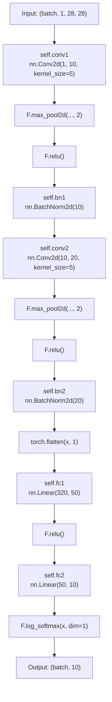
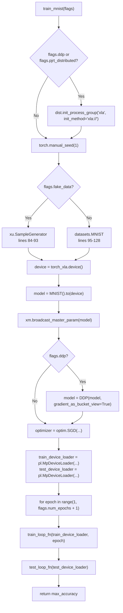
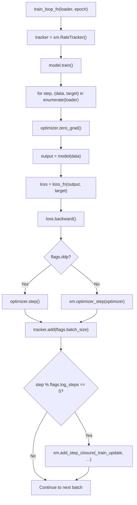
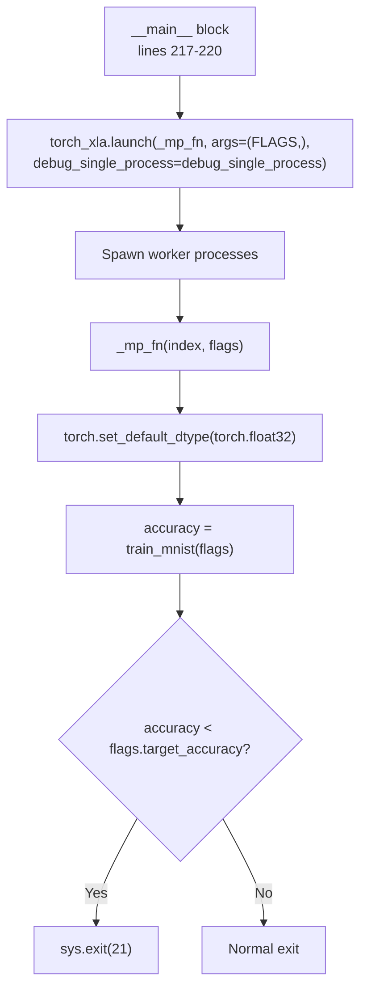
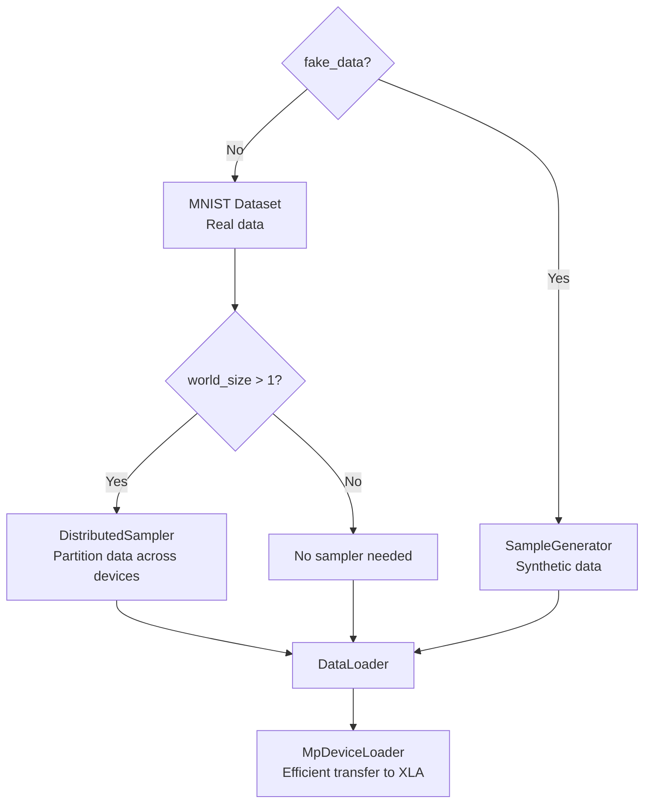

<!-- source: DeepWiki mcp.deepwiki.com · repo pytorch/xla · page 6.2 MNIST Training Example · fetched 2026-10-21 -->

# MNIST Training Example

<details>
<summary>Relevant source files</summary>

The following files were used as context for generating this wiki page:

- [test/args_parse.py](test/args_parse.py)
- [test/schedulers.py](test/schedulers.py)
- [test/test_train_mp_imagenet.py](test/test_train_mp_imagenet.py)
- [test/test_train_mp_mnist.py](test/test_train_mp_mnist.py)
- [test/test_utils.py](test/test_utils.py)
- [torch_xla/test/test_utils.py](torch_xla/test/test_utils.py)

</details>


This page documents the MNIST training example located at [test/test_train_mp_mnist.py](). This example demonstrates basic distributed training with PyTorch/XLA using the MNIST dataset. For a more complex example with additional features, see page 6.3 (ImageNet Training Example).

## File Structure and Entry Point

The example consists of the following components:

| Component | Location | Purpose |
|-----------|----------|---------|
| Main training script | [test/test_train_mp_mnist.py]() | Contains model definition and training logic |
| Argument parser | [test/args_parse.py]() | Parses command line arguments |
| Test utilities | [torch_xla/test/test_utils.py]() | Provides logging and TensorBoard utilities |

The entry point is the `__main__` block at [test/test_train_mp_mnist.py:217-220](), which calls `torch_xla.launch()` to spawn worker processes.

Sources: [test/test_train_mp_mnist.py:1-221](), [test/args_parse.py:1-50]()

## Model Architecture

The `MNIST` class at [test/test_train_mp_mnist.py:44-63]() defines a convolutional neural network.

**MNIST Model Architecture**


The model has the following layer definitions:
- `self.conv1`: `nn.Conv2d(1, 10, kernel_size=5)` at line 48
- `self.bn1`: `nn.BatchNorm2d(10)` at line 49
- `self.conv2`: `nn.Conv2d(10, 20, kernel_size=5)` at line 50
- `self.bn2`: `nn.BatchNorm2d(20)` at line 51
- `self.fc1`: `nn.Linear(320, 50)` at line 52
- `self.fc2`: `nn.Linear(50, 10)` at line 53

The forward pass at [test/test_train_mp_mnist.py:55-63]() applies max pooling, ReLU activations, batch normalization, flattening, and log softmax.

Sources: [test/test_train_mp_mnist.py:44-63]()

## Command Line Arguments

The example uses `parse_common_options()` from [test/args_parse.py:7-49]() to define command line arguments. MNIST-specific arguments are defined in the `MODEL_OPTS` dictionary at [test/test_train_mp_mnist.py:4-11]():

| Argument | Type | Default | Description |
|----------|------|---------|-------------|
| `--ddp` | flag | False | Use `torch.nn.parallel.DistributedDataParallel` |
| `--pjrt_distributed` | flag | False | Use PJRT distributed mode |
| `--datadir` | str | `/tmp/mnist-data` | Directory for MNIST data |
| `--batch_size` | int | 128 | Training batch size |
| `--lr` | float | 0.01 | Learning rate |
| `--momentum` | float | 0.5 | SGD momentum |
| `--num_epochs` | int | 18 | Number of training epochs |
| `--target_accuracy` | float | 98.0 | Target accuracy for test validation |

Sources: [test/test_train_mp_mnist.py:4-21](), [test/args_parse.py:7-49]()

## Main Training Function

The `train_mnist()` function at [test/test_train_mp_mnist.py:77-203]() implements the training logic.

**train_mnist() Execution Flow**


Sources: [test/test_train_mp_mnist.py:77-203]()

## Data Loading

The data loading logic at [test/test_train_mp_mnist.py:83-128]() supports two modes:

**Fake Data Mode** (`flags.fake_data=True`):
- Uses `xu.SampleGenerator` to create synthetic data
- Generates tensors of shape `(batch_size, 1, 28, 28)` for inputs and `(batch_size,)` for labels
- Sample counts are divided by `xr.world_size()` for distributed training

**Real Data Mode** (`flags.fake_data=False`):
- Uses `torchvision.datasets.MNIST` to download/load real MNIST data
- Downloads to `{flags.datadir}/{xr.global_ordinal()}` to avoid conflicts in multi-process training
- Applies normalization with mean=0.1307, std=0.3081
- Creates `torch.utils.data.distributed.DistributedSampler` when `xr.world_size() > 1`
- Wraps dataset with `torch.utils.data.DataLoader`

Both modes create `pl.MpDeviceLoader` instances at [test/test_train_mp_mnist.py:181-182]() to transfer data to XLA devices.

Sources: [test/test_train_mp_mnist.py:83-128](), [test/test_train_mp_mnist.py:181-182]()

## Training Loop Implementation

The `train_loop_fn()` function at [test/test_train_mp_mnist.py:148-165]() implements the training iteration:

**train_loop_fn Code Flow**


Key differences between DDP and native XLA modes:
- **DDP mode** (line 157): Uses standard `optimizer.step()`
- **Native XLA mode** (line 159): Uses `xm.optimizer_step(optimizer)` which includes gradient synchronization

The `xm.add_step_closure()` call at line 162 defers the execution of `_train_update()` to avoid blocking the training loop.

Sources: [test/test_train_mp_mnist.py:148-165]()

## Test Loop Implementation

The `test_loop_fn()` function at [test/test_train_mp_mnist.py:167-179]() implements evaluation:

```mermaid
graph LR
    Start["test_loop_fn(loader)"] --> Init["total_samples = 0<br/>correct = 0<br/>model.eval()"]
    Init --> Loop["for data, target in loader"]
    Loop --> Forward["output = model(data)"]
    Forward --> Pred["pred = output.max(1, keepdim=True)[1]"]
    Pred --> Count["correct += pred.eq(target.view_as(pred)).sum()<br/>total_samples += data.size()[0]"]
    Count --> CalcAcc["accuracy = 100.0 * correct.item() / total_samples"]
    CalcAcc --> Reduce["accuracy = xm.mesh_reduce('test_accuracy', accuracy, np.mean)"]
    Reduce --> Return["return accuracy"]
```



The `xm.mesh_reduce()` call at line 178 averages the accuracy across all devices using the reduction name `'test_accuracy'`.

Sources: [test/test_train_mp_mnist.py:167-179]()

## Distributed Training Configuration

The example supports distributed training through two mechanisms:

**Process Group Initialization** (lines 78-79):
```
if flags.ddp or flags.pjrt_distributed:
    dist.init_process_group('xla', init_method='xla://')
```

**Model Parallelization** (lines 140-141):
```
if flags.ddp:
    model = DDP(model, gradient_as_bucket_view=True)
```

The `gradient_as_bucket_view=True` parameter optimizes memory usage by creating gradient views instead of copies.

**Parameter Synchronization** (line 138):
```
xm.broadcast_master_param(model)
```
This broadcasts parameters from the master device to all other devices to ensure consistent initialization.

**Learning Rate Scaling** (line 131):
```
lr = flags.lr * xr.world_size()
```
The learning rate is scaled by the number of devices to maintain effective batch size.

Sources: [test/test_train_mp_mnist.py:78-79](), [test/test_train_mp_mnist.py:130-141]()

## Process Spawning

The `_mp_fn()` function at [test/test_train_mp_mnist.py:206-214]() is the worker process entry point:



The `debug_single_process` variable at line 218 is set to `True` when `FLAGS.num_cores == 1`, which runs the code in a single process for debugging purposes.

Sources: [test/test_train_mp_mnist.py:206-220]()

## Logging and Metrics

The example integrates with TensorBoard through utility functions:

**_train_update()** at [test/test_train_mp_mnist.py:66-74]():
- Calls `test_utils.print_training_update()` from [torch_xla/test/test_utils.py:115-148]()
- Logs device, step, loss, rate (examples/sec), and global rate
- Writes to TensorBoard `SummaryWriter` if provided

**TensorBoard Integration** at [test/test_train_mp_mnist.py:193-197]():
- Uses `test_utils.write_to_summary()` to write accuracy and XLA metrics
- The `write_xla_metrics=True` parameter causes `met.metrics_report()` to be parsed and written as scalars

**Metrics Reporting** (lines 198-199):
```
if flags.metrics_debug:
    xm.master_print(met.metrics_report())
```
Prints XLA performance metrics when `--metrics_debug` flag is set.

Sources: [test/test_train_mp_mnist.py:66-74](), [test/test_train_mp_mnist.py:193-199](), [torch_xla/test/test_utils.py:48-78]()

## Implementation Details

### Data Management

The implementation supports both real MNIST data loading and synthetic data generation:



Sources: [test/test_train_mp_mnist.py:83-128](), [torch_xla/distributed/parallel_loader.py]()

### Training and Evaluation Functions

The training and evaluation functions handle the core workflows:

1. `train_loop_fn`: Manages forward pass, loss calculation, backpropagation, and optimization
2. `test_loop_fn`: Performs evaluation and calculates accuracy
3. `_train_update`: Reports training progress metrics

All functions work with device-specific data loaders that efficiently transfer data to XLA devices.

Sources: [test/test_train_mp_mnist.py:148-179]()

## Cross-Replica Operations

Distributed MNIST training relies on cross-replica operations for coordination:

1. **Parameter Synchronization**: `xm.broadcast_master_param(model)` ensures consistent initialization
2. **Gradient Reduction**: Built into `xm.optimizer_step()` or handled by DDP
3. **Metric Aggregation**: `xm.mesh_reduce()` combines metrics like accuracy across devices
4. **Barrier Synchronization**: `xm.rendezvous()` ensures all processes reach certain points together

These operations are built on XLA's collective communication primitives such as all-reduce, all-gather, and reduce-scatter.

Sources: [torch_xla/core/xla_model.py:417-474](), [torch_xla/csrc/cross_replica_reduces.cpp:135-182]()

## Performance Considerations

When running MNIST training on XLA devices, consider these optimization techniques:

1. **Batch Size Tuning**: Adjust batch size based on available device memory and workload
2. **Learning Rate Scaling**: Scale learning rate proportionally to the number of devices
3. **Prefetch Optimization**: Configure `loader_prefetch_size` and `device_prefetch_size` for data loading
4. **Mark Step Placement**: Strategic placement of `xm.mark_step()` to balance graph compilation and execution

The example scales learning rate by the world size to maintain consistent convergence behavior when training across multiple devices.

Sources: [test/test_train_mp_mnist.py:130-131](), [test/test_train_mp_mnist.py:180-183]()

## Conclusion

The MNIST training example provided with PyTorch/XLA demonstrates how to efficiently train neural networks on XLA devices. It showcases core PyTorch/XLA patterns, including device initialization, data loading, model training, and distributed training techniques that apply to more complex models and datasets.

---

